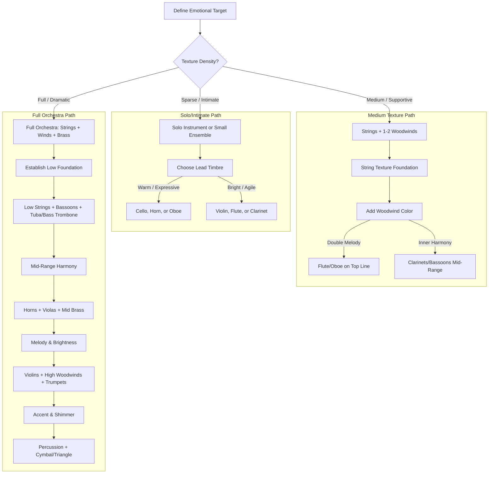

# Lesson 2: Orchestration Techniques for Film Scoring

## 1. First-Principles Intuition (15%)

Film orchestration is sound design for story: every instrumental choice either clarifies or muddies what the audience feels at that frame. Unlike concert writing, you don't get four minutes to develop a theme — you often get eight bars to shift the emotional temperature of a scene, and the cue has to hit a specific timecode doing it.

**Core acoustic reality:** every instrument's timbre is its harmonic fingerprint. A violin's bite comes from strong 3rd–7th partials; a horn's roundness comes from a dominant fundamental with softer upper partials; a trumpet sits aggressively in 2–4 kHz because of strong odd harmonics in that band. When you stack instruments, you're stacking overlapping spectra. Two instruments with similar harmonic fingerprints in the same register fuse into mud. Two instruments with complementary fingerprints (bright + dark, strong fundamental + strong overtone) stack into clarity. This is why a solo cello cuts through a string pad but a second cello doubling it in unison just makes it "thicker" without adding intelligibility — the spectra are near-identical.

**Transposition in one paragraph:** B♭ trumpet and clarinet sound a major 2nd below written pitch; F horn sounds a perfect 5th below; E♭ alto sax sounds a major 6th below. Write in each instrument's strongest written register (trumpet in D–A, horn in G–C) rather than fighting the extremes — register, not just pitch class, is what makes an instrument speak confidently or choke.

**Dynamic headroom:** strings run ~60 dB from *ppp* to *fff* and can sustain a true *pp* for minutes. Brass have explosive ceiling dynamics but a narrow, unstable *pp* — a horn player asked to hold *ppp* for 16 bars will crack. Budget your dynamic architecture around what each section can physically sustain, not just what looks good on the page.

Everything below operationalizes this: frequency-range mapping, divisi voicing, balance ratios, transposition workflow, and ready-to-score cue templates.

---

## 2. Practical Orchestration Mechanics (85%)

### Frequency Range Architecture

| Section | Low Register | Mid Register | High Register |
|---------|--------------|--------------|----------------|
| **Strings** | Cello/Bass: 40–250 Hz (foundation) | Viola/Cello: 250 Hz–1 kHz (inner harmony) | Violin: 1–4 kHz (melody, brilliance) |
| **Woodwinds** | Bassoon/Bass Clar: 60–400 Hz (dark counter-bass) | Clarinet/Oboe: 250 Hz–2 kHz (lyrical, doubling) | Flute/Piccolo: 500 Hz–4 kHz (air, sparkle) |
| **Brass** | Tuba/Bass Trbn: 50–400 Hz (pedal, power) | Horn/Trombone: 150–800 Hz (nobility, warmth) | Trumpet: 250 Hz–2 kHz (fanfare, edge) |
| **Percussion** | Timp/Bass Drum: 40–200 Hz (rhythmic floor) | Snare/Toms: 100–500 Hz (attack, color) | Cymbal/Triangle: 2–12 kHz (shimmer) |

**Working rule:** dark/tense cue → cluster activity 60–400 Hz. Bright/heroic cue → push energy into 500 Hz–2 kHz. If cellos already carry the bass line, adding bassoon *and* trombone *and* tuba on the same note stacks three instruments into the same 60–250 Hz pocket — fine if you want a wall of sound, wasteful if you actually wanted clarity. Decide on purpose, not habit.

**Ear test for pile-up:** solo each instrument group for 4 bars in your DAW/mockup. If muting any one of three low instruments changes nothing you can hear, you have redundant mass, not reinforcement — reassign one of them to a different register or cut it.

### String Section Divisi Voicing

**Standard 40-piece layout:** Violin I ×12, Violin II ×10, Viola ×8, Cello ×6, Bass ×4. (A "Hollywood scoring string" session typically runs 8-7-6-5-4 or smaller — the voicing principles below scale down identically; a 5-5-4-3-2 group divisi's the same way.)

**Four-part harmony example — C major triad (C–E–G):**

```text
Violin I   (div. a2): high C + E   — 6 players per note
Violin II  (div. a2): G + high C   — 5 players per note
Viola      (non div.): middle C
Cello      (non div.): low G
Bass       (non div.): low C
```

Mark *div. a2* / *div. a3* in the part at the bar where the split starts, and *non div.* (or *unis.*) where it resolves back — players self-organize by stand partner, you don't assign desks.

**Voicing rules:**

1. **Wide low, tight high.** Space the bottom two notes an octave or more apart; cram the top notes within an octave. Mirrors the natural harmonic series (wide intervals low, narrow intervals high) so the chord sounds correct instead of boxy.
2. **Octave-reinforce the melody, don't unison-stack it.** If Violin I carries the tune, double it an octave down in Cello rather than piling Violin II onto the same pitch — you get range and weight instead of just more of the same frequency.
3. **Don't let Violin II + Viola + Cello collide in 250–500 Hz.** That's the "mud band" for strings; if all three sit there simultaneously, voice one of them an octave away.

**Texture drill (do this with a real DAW mockup, not just on paper):**

| Texture | Setup | Target sound |
|---|---|---|
| Soft pad (*pp*) | All sections *div. a2/a3*, slow bow changes, no vibrato | Glassy, ethereal bed |
| Power unison (*fff*) | All sections *non div.*, same melody, aggressive down-bow | Massive, aggressive wall |
| Transparent counterpoint | Vln I melody / Vln II countermelody / Viola sustained / Cello pizz bass | Clear, chamber-like detail |

### Brass and Woodwind Balance

**The problem in numbers:** a single trumpet at *ff* produces roughly as much perceived loudness as 8–10 strings at *mf*, because brass couples sound energy into the air far more efficiently per player. Balance in orchestration is ratio management, not equal dynamic markings.

**Doubling ladder:**

| Brass alone | + Woodwinds (color) | + Strings (blend) |
|---|---|---|
| 2 Horns *mf* unison | +2 Clarinets *mf* at unison/octave | +Vln I & II *mf* doubling melody |
| 3 Trumpets *ff* fanfare | +2 Oboes *ff* (adds edge) | +Full strings *f* (smooths the brass) |
| 4 Trombones *f* chorale | +2 Bassoons *f* (darkens, deepens) | +Low strings *mf* (foundation) |

**Balancing drill (mockup required, trust your ears over the page):**
1. Write 4 bars, 4 horns, *ff*, unison melody.
2. Layer 2 clarinets *mf* doubling the top line.
3. Layer full strings *f* doubling the whole horn chord.
4. Play back. If brass still dominates, pull brass down one dynamic step (*ff → f*) rather than pushing strings past their comfortable ceiling — strings distort tonally when forced loud, brass doesn't.

**Woodwind choir, dark to bright:**
```text
2 Bassoons  — low harmony / bass doubling
2 Clarinets — mid harmony / lyrical doubling
2 Oboes     — top melody / expressive lead
2 Flutes    — high shimmer / color accents
```
Stagger by register or role. Four pairs in rigid unison reads as one flat color instead of four distinct voices — intentional only if you want a deliberately faceless woodwind block (useful for horror "breathing" textures, rare elsewhere).

### Transposing Instruments: Practical Workflow

**Compose in concert pitch, transpose at the end.** Every mainstream notation app (Dorico, Sibelius, Finale, and even Logic/Cubase score editors) has a Concert Pitch toggle — write and audition with it ON, flip it OFF only before printing parts.

**Quick reference (from concert pitch):**

| Instrument | To get written pitch | Example: concert C→ |
|---|---|---|
| B♭ Trumpet / B♭ Clarinet | transpose UP a major 2nd | write D |
| F Horn | transpose UP a perfect 5th | write G |
| E♭ Alto Sax | transpose UP a major 6th | write A |
| B♭ Bass Clarinet | transpose UP a major 9th | write D (next octave) |

**Concert C major triad (C–E–G) written for each:**
```text
Horn in F:        G – B – D
Trumpet in B♭:    D – F♯ – A
Alto Sax in E♭:   A – C♯ – E
```

**Best-sounding written registers — memorize these, not just the transposition interval:**

| Instrument | Written sweet spot | Sounds | Character |
|---|---|---|---|
| Trumpet in B♭ | F♯4–C6 | E4–B♭5 | brilliant, confident |
| Horn in F | G3–C5 | C3–F4 | noble, full |
| Clarinet in B♭ | F♯3–C6 | E3–B♭5 | chalumeau warmth low, clarion brilliance high |

Writing a trumpet part that *transposes correctly* but sits above written C6 for sixteen bars is technically right and practically unplayable at tempo — register comfort overrides raw correctness every time.

**Scoring drill:** write a 16-bar unison melody at concert pitch for trumpet, horn, and clarinet. Transpose all three parts. Confirm every note sits inside the sweet-spot table above — if it doesn't, move the written melody an octave, don't ask the player to grind through it.

### Orchestration Architecture: Layering Flowchart



### Real-World Film Scoring Scenarios

**Scenario 1 — Tense underscore, low string cluster (90 sec, no melody, slow dread build):**

```text
Cello (div. a4):     sustained C–D♭–D–E♭ cluster, no vibrato, pp → mp
Bass (div. a2):      low C pedal + slow gliss C → B♭, ppp → p
Bassoon (a2):        doubles cello top two notes (D–E♭), mp
Contrabassoon:        low C pedal, ppp
Timpani:              soft roll on C, ppp, barely perceptible
```
Entrances: strings 0:00, bassoons 0:30, timpani 1:00. Dynamic swell *ppp → mp* across the full 90 sec. Texture only — melody would release tension prematurely.

**Scenario 2 — Heroic fanfare, brass-led (8 bars, 120 BPM, 4/4):**

```text
4 Horns:     unison melody, ff, marcato attacks
3 Trumpets:  melody doubled an octave up, ff, short articulation
3 Trombones: harmony a 3rd/5th below melody, f
Tuba:        bass line, f
Strings:     full section doubling entire brass chord, ff, long bows
Timpani:     downbeats, ff, reinforcing tonic/dominant
```

Bar 1, beat 1 voicing on a C major triad:
```text
Trumpet:   high C   (fff)
Horn:      middle C (ff)
Trombone:  E + G    (f)
Tuba:      low C    (f)
Vln I:     high C   (ff)
Vln II:    G        (ff)
Viola:     E        (ff)
Cello:     middle C (ff)
Bass:      low C    (ff)
Timpani:   C        (ff)
```
Note the dynamic markings differ by instrument for the *same perceived loudness* — this is the ratio principle from the balance section applied directly.

**Scenario 3 — Intimate love theme, solo + strings (32 bars, 60 BPM, 3/4 waltz):**

```text
Solo Cello:         melody, espressivo, mp → mf, rich vibrato
Vln I (div. a2):    sustained root + 5th harmony, pp, no vibrato
Vln II:             gentle arpeggiated accompaniment, p
Viola:              inner harmony in 3rds/6ths, pp
Harp:               arpeggiated chords on beats 1 & 2, p
```
Keep the solo cello 10–20 dB above the string bed in the mockup/mix. The strings are a harmonic pillow, not competition — if the bed creeps up in dynamic during a crescendo, bring the soloist up proportionally first.

### Modular Orchestration Blocks

**Block A — String Pad Foundation**
```text
Vln I+II (div. a2 each): 4-note chord, pp–mp, sustained
Viola (div. a2):          2-note harmony, pp
Cello+Bass (unison):      bass note, pp
```
**Block B — Woodwind Color Layer**
```text
2 Flutes:    top melody or shimmer, p–mf
2 Clarinets: mid doubling or countermelody, p
2 Bassoons:  low harmony or bass doubling, p
```
**Block C — Brass Power Accent**
```text
4 Horns:     sustained chord, mf–ff
3 Trumpets:  short fanfare/punctuation, f–ff
3 Trombones: low harmony, f
Tuba:        bass reinforcement, f
```
**Block D — Percussion Rhythm & Color**
```text
Timpani:            downbeats or rolls, p–ff
Snare/Bass Drum:    rhythmic hits, mf–f
Cymbal/Triangle:    accents or shimmer, p–mf
```

**32-bar assembly pattern:**
- Bars 1–8: Block A only — soft build.
- Bars 9–16: A + B — add color.
- Bars 17–24: A + B + C — full power.
- Bars 25–32: A + C + D — climax with rhythmic drive.

This four-block system is the fastest way to sketch a temp cue against picture before refining individual lines — block in first, then carve detail once the overall shape matches the edit.

### Practice Drills

**Drill 1 — Frequency separation**
1. Write 4 bars using only instruments in 60–250 Hz (low strings, bassoon, low brass).
2. Write the same phrase using only 1–4 kHz instruments (violin, flute, trumpet).
3. Combine. Confirm in playback that no register collapses into the other — if it does, move one line an octave.

**Drill 2 — Divisi voicing workout**
1. Take Cmaj7 (C–E–G–B).
2. Voice it three ways: wide (bass notes an octave+ apart, treble clustered), tight (all notes within one octave), and mixed (wide low / tight high).
3. Render all three in your mockup and compare warmth vs. clarity vs. power — write down which you'd use for a love theme vs. an action cue.

**Drill 3 — Brass/string balance test**
1. Write an 8-bar brass chorale: 4 horns + 3 trombones, *f*.
2. Add full strings doubling at *mf*, then *f*, then *ff*.
3. Identify which string dynamic actually balances against the *f* brass. (Expect it to land around *f* to *ff* — strings need to work harder than their markings suggest next to brass.)

**Drill 4 — Transposition speed test**
1. Write a 16-bar melody in concert pitch.
2. Transpose for B♭ trumpet, F horn, E♭ alto sax, A clarinet.
3. Time yourself. Target: under 5 minutes for all four, with zero notes outside each instrument's sweet-spot register.

### Notation Software Workflow (Dorico / Sibelius / Finale)

1. **Concert Pitch ON** — View → Concert Pitch. Compose and audition everything at sounding pitch.
2. **Input all parts in concert pitch** — write exactly what you want to hear.
3. **Concert Pitch OFF** before engraving — the software auto-transposes every part to its correct written notation. Spot-check horn and clarinet parts manually; key signature auto-transposition occasionally needs a manual accidental fix at modulations.
4. **File → Export → Parts** — generates individually transposed, correctly cued parts for the session or the players.

**Common trap:** composing with Concert Pitch OFF by accident means you're auditioning transposed pitches as if they were concert pitch — chords will sound wrong by the transposition interval and you'll "fix" a problem that doesn't exist. If a chord sounds mysteriously off, check this toggle first.

### Orchestral Blending Reference

| Technique | Setup | Result |
|---|---|---|
| Unison doubling | Vln I + Flute + Oboe, same pitch, *ff* | Brilliant, cutting, unified |
| Octave doubling | Vln I (high) + Cello (octave down) | Full-spectrum warmth + brilliance |
| Harmonic doubling | Vln I melody / Vln II 3rd below / Viola 5th below / Cello octave below | Lush chord built around the tune |
| Timbral fusion | Horn + Clarinet, same pitch & dynamic | New blended color — darker than clarinet, brighter than horn alone |
| Timbral fusion | Cello + Bassoon, unison, low register | Dark, resonant, mysterious |

**Key principle:** instruments matched in register and dynamic fuse into a single new timbre; instruments separated by register or dynamic stay perceptually distinct. Use fusion when you want one unified color (horror drones, warm pads); use separation when you want a melody to read clearly over an accompaniment.

### Orchestration Checklist for Every Cue

- [ ] Frequency map clear — no unintended pile-up in 200–500 Hz.
- [ ] All transpositions verified and every part sits in its comfortable written range.
- [ ] Dynamic balance tested in mockup — brass doesn't swallow strings/winds unless intended.
- [ ] Divisi explicitly marked (*div. a2/a3* / *non div.*) at the bar it changes.
- [ ] Articulations marked consistently (legato, staccato, marcato, tenuto).
- [ ] Tempo and time signature locked to the picture edit if syncing to video.
- [ ] Dynamics shaped across the cue — not static, breathing with scene pacing.
- [ ] Soloist (if any) sits 10–20 dB above the accompaniment bed in the mix.

Master the frequency map, drill divisi voicing and transposition until they're reflexive, and build cues from the modular blocks before polishing detail — that order (shape first, detail second) is what lets you hit a locked picture deadline without losing musical intent.
