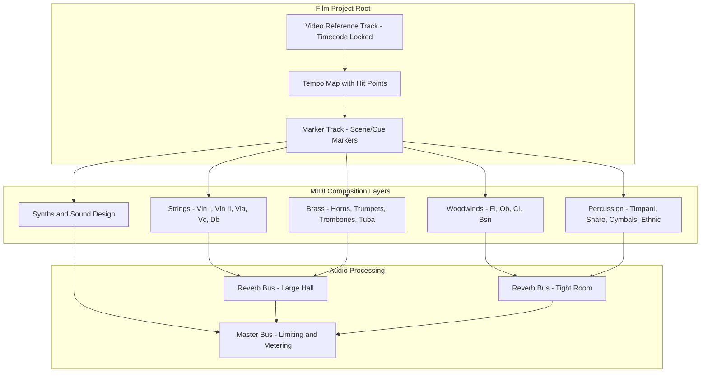

# Lesson 3: Software Tools and Workflows for Film Scoring

## 1. First-Principles Intuition & Invariants

Film scoring is the only musical discipline where tempo is not your decision alone — the picture dictates it. Every cue lives inside a fixed timeline: a director has already cut a scene to a specific length, specific cuts, specific emotional beats, and your music must breathe inside that container without being audibly "stretched" to fit. Unlike concert writing, where you compose the clock, in scoring you compose *against* a clock that someone else built.

**The four invariants that govern every session you build:**

1. **Timecode Lock.** Film runs at 23.976, 24, 25, or 29.97 frames per second. At 24 fps, one frame = 41.67 ms. That's roughly the gap between a snare hit landing "on" a punch versus landing just after it — small enough that a director won't describe it technically, but they will say the cue "feels late." Your DAW's video track must stay locked to absolute timecode even when you insert tempo changes upstream of it.

2. **Non-Destructive Layering.** You will be asked to redo the brass three times, remove the choir entirely, and then bring it back an hour later. Your session has to support that without anyone (including you) losing earlier work. This is a session-architecture problem, not a talent problem — composers get fired over blown deadlines caused by messy sessions, not bad melodies.

3. **Virtual Orchestration Realism.** Sample libraries are recordings of real players performing real techniques (legato bowing, spiccato, breath attacks). A mockup convinces a director only when you trigger the *correct* technique for the phrase, not just the correct pitch. Keyswitches, dynamic layers, and CC automation are how you tell the sample library which technique to use.

4. **Stem Delivery.** The thing you deliver is not a stereo file. It's a folder: strings, brass, woodwinds, percussion, synths, choir, each as its own stereo (or multichannel) file, time-aligned to the frame, plus edits like "no melody" (for trailers) or "60-second cutdown" (for broadcast).

**The minimum DSP literacy you need, in one paragraph:** Audio becomes numbers through sampling (48 kHz = 48,000 amplitude snapshots per second — the film/TV standard, versus 44.1 kHz for music-only releases) and bit depth (24-bit = ~16.7 million discrete amplitude steps, giving you ~144 dB of theoretical dynamic range to work in before quantization noise matters). MIDI is not audio — it's a control protocol carrying note number (pitch, 0–127), velocity (how hard the key was struck, 0–127), and continuous controllers (CC1 modulation, CC11 expression, CC64 sustain) that steer a sampler or synth into producing sound. Everything below this builds on those four numbers: sample rate, bit depth, note data, and CC data.

## 2. DAW Selection and Project Setup

### 2.1 Choosing Your DAW (and Why It Matters Less Than You Think)

All five tools below can deliver a professional score. The differences matter for *workflow speed*, not sound quality — the sample libraries and your writing decide the sound.

| DAW | Pick it if... | Weak point |
|---|---|---|
| **Logic Pro** (macOS only) | You compose and mix solo, want built-in orchestral patches to sketch fast | No AAX, less common on scoring stages for final mix |
| **Cubase Pro** | You want per-note articulation control via Expression Maps, write dense orchestral mockups | Steeper learning curve, Windows/Mac only |
| **Pro Tools** | You're delivering to a dub stage or mixing engineer, or recording a live orchestra | Clunky MIDI editing compared to Cubase/Logic |
| **Digital Performer** | You manage 40+ TV cues and need independent timeline "Chunks" per cue | Smaller user base, fewer third-party templates online |
| **Reaper** | Budget-conscious, want to script your own tools (ReaScript Lua/Python), run Linux | Smaller template ecosystem, UI needs setup work |

A common professional split: compose and build the mockup in Cubase or Logic, then open the final session in Pro Tools for the mix pass and stem printing, because that's the format your re-recording mixer expects.

### 2.2 Session Architecture



**Step-by-step build (Logic Pro; steps 2, 3, 4, 6 translate directly to Cubase/DP with menu-name differences noted):**

1. **New project.** File → New → Empty Project. Sample rate **48 kHz**, bit depth **24-bit**. Never mix sample rates mid-project — if picture was delivered at 48 kHz and you work at 44.1 kHz, you will get drift when the final audio is conformed back to video.

2. **Import picture.** File → Movie → Open Movie. Immediately right-click the video track → **Lock Movie to Absolute Timecode**. Without this, adjusting tempo later can drag the video out of sync with the edit. (Cubase: Project → Add Track → Video, then lock via the Project Synchronization Setup.)

3. **Set frame rate.** File → Project Settings → Synchronization → Frame Rate. Match exactly what the picture editor delivered — check the QuickTime/ProRes file properties in Premiere or Resolve before you guess. **23.976 fps and 24 fps are not interchangeable**; a 90-second cue drifts by over 2 frames across that mismatch, enough to throw off a hit point by the time you reach the back half of a cue.

4. **Build the tempo map.**
   - Open the Tempo List (Shift+Cmd+T in Logic; Project → Tempo Track in Cubase).
   - Scrub the scene and log picture events to the frame: a door slam at 00:01:15:08 means 1 minute, 15 seconds, 8 frames.
   - Insert a tempo event so a downbeat (not necessarily beat 1 of a bar — any strong beat) lands on that frame. Logic's Tempo Operations → "Adjust tempo so that locator position falls on nearest beat" automates the math.
   - **Rule of thumb**: pick one tempo per emotional section, not one tempo per hit. Chasing every hit with a tempo change produces a stiff, unmusical pulse. Reserve tempo changes for structural shifts (section change, not accent emphasis) and nail small accents with orchestration hits instead.

5. **Marker track.** One marker per cue section (Intro, Build, Peak, Release). Color code consistently across your whole career, not just this project — Green = warmth/safety, Red = danger/aggression, Blue = mystery/suspense. Directors start reading your color code within a few sessions and it speeds up spotting notes meetings.

6. **Load virtual instruments.**
   - One MIDI track per articulation, not per instrument, when using multi-output section libraries (Spitfire Studio Strings: 5 outputs — Vln I, Vln II, Vla, Vc, Db — each gets its own channel so you can automate CC11 independently).
   - Insert a reverb send on every track routed to two aux buses: **Hall** (2.5–3.0 s decay — Valhalla Room or Vienna MIR) and **Tight Room** (0.8–1.0 s decay) for rhythmic/percussive material that needs to stay punchy.

7. **Track stacks/folders.** Strings into one Summing Stack, Brass into another, each stack's output feeds the master bus through the reverb sends. This keeps your mixer window to 6–8 visible faders instead of 40 individual tracks when you're trying to balance sections fast.

8. **Naming convention.** Prefix with section + articulation: `01_VLN1_Legato`, `02_VLN2_Spicc`, `03_VLA_Trem`. Numeric prefixes keep track order stable when you add instruments later — Logic and Cubase both sort alphanumerically by default.

### 2.3 MIDI Controller Setup for Expressive Input

**Hardware:**
- **88-key weighted controller** (Native Instruments Komplete Kontrol S88, Arturia KeyLab 88): full range for orchestral writing, aftertouch available for vibrato depth on libraries that support it.
- **Expression pedal** (Roland EV-5, Yamaha FC-7): mapped to **CC11**. This is the single most important controller you own — expression pedal technique *is* the dynamic realism of your mockup.
- **Mod wheel**: default **CC1**, usually vibrato intensity or dynamic-layer crossfade depending on the library.

**Standard CC map for orchestral libraries:**
- **CC1 (Mod Wheel)** — vibrato depth or dynamic layer crossfade.
- **CC11 (Expression)** — real-time volume shaping. This is where phrasing lives; a flat CC11 line is the #1 reason mockups sound robotic.
- **CC64 (Sustain Pedal)** — triggers legato transitions on libraries like Spitfire (holding the pedal while playing overlapping notes produces a bowed/slurred transition instead of a re-attack).
- **Keyswitches** (commonly mapped C-2 to C-1, below the playable range) — trigger articulation change: legato, staccato, pizzicato, tremolo. Write these on a dedicated keyswitch lane above the note data so you can see them at a glance while editing.

**Recording workflow — record in separate passes, not all at once:**
1. **Pass 1 — pitch and rhythm.** Play the phrase with a metronome, no expression concerns, just get the notes and timing right.
2. **Pass 2 — expression (CC11)** while listening back to pass 1, riding the expression pedal like a real player controls bow pressure.
3. **Pass 3 — modulation/vibrato (CC1)**, layered on top.

Recording all three simultaneously while sight-reading a complex line produces jittery, inconsistent CC data — your hand is fighting between note accuracy and pedal control. Separating passes is slower per-bar but faster overall because you don't re-record from scratch when the expression pass is sloppy.

4. **Overdub keyswitches last**, after notes and CC are final — insert the keyswitch note 1 tick before the phrase that needs the new articulation.
5. **Humanize timing**: select all notes, apply ±5–10 ms random offset (Logic: MIDI Transform → Randomize → Position; Cubase: MIDI → Functions → Humanize). Quantized-to-the-grid orchestral parts sound like a sequencer, not an ensemble, because real players never land in perfect unison.

## 3. Orchestral Sample Library Deep Dive

### 3.1 Library Architectures

**Kontakt-based (Native Instruments engine):** Spitfire Symphonic Orchestra, 8Dio Adagio Strings, Cinesamples CineBrass. Deep scripting, consistent UI across vendors, but RAM-hungry — a full orchestral template commonly needs 12–32 GB loaded, more if you keep every articulation live instead of purging unused ones.

**Proprietary engines:** EastWest PLAY, VSL Synchron Player, Orchestral Tools SINE. Better disk-streaming (less upfront RAM), built-in mic-position mixing, but each has its own update cycle and quirks to learn separately.

### 3.2 Articulation Strategy by Section

**Strings (example patch set: Spitfire Studio Strings):**
- **Long** — sustained note with a natural swell curve; ride CC11 for dynamics, don't just set a static velocity.
- **Legato** — smooth bowed transitions between notes; requires either overlapping MIDI notes or CC64 held through the phrase, depending on the library's legato trigger method.
- **Spiccato** — short bounced bow strokes, for rhythmic ostinatos and nervous-energy textures.
- **Pizzicato** — plucked, fast decay. Use sparingly, as an accent color, not a sustained texture.
- **Tremolo** — rapid back-and-forth bow strokes, the default color for building tension under dialogue.
- **Col legno** — wood of the bow striking the string, a dry percussive effect for horror/thriller color.

**Real-time articulation switching (Cubase Expression Maps example):**

```
Expression Map: Spitfire Studio Strings
Slot 1: Long       (Keyswitch C-2)
Slot 2: Legato     (Keyswitch C#-2)
Slot 3: Spiccato   (Keyswitch D-2)
Slot 4: Pizzicato  (Keyswitch D#-2)
Slot 5: Tremolo    (Keyswitch E-2)
```

In the Key Editor's articulation lane (directly above the note grid), click to assign which slot plays under each note group. Cubase writes the correct keyswitch MIDI note automatically — you never have to manually place C-2 in the piano roll, which eliminates the most common source of wrong-articulation playback bugs.

**Brass realism:**
- **French horns**: slow attack, warm — use CC11 swells for heroic/triumphant lines, never a hard velocity hit for a sustained horn melody, it sounds synthetic.
- **Trumpets**: bright, fast attack — staccato for fanfare rhythms, legato for lyrical lines.
- **Trombones**: deep, powerful — chorale writing or bass reinforcement under the horns.
- **Tuba**: foundation of the brass stack, frequently doubled with bass trombone or string basses an octave apart for weight.

**Woodwind breath control:**
- **Flutes**: airy, soft attack — use CC2 (Breath Controller) if the library maps it, otherwise CC11 shaped with a slow attack curve.
- **Oboes**: piercing, sustained — the classic solo voice for pathos (*Gabriel's Oboe*, *The Mission*).
- **Clarinets**: warm, versatile — chalumeau (low) register for dark, intimate color.
- **Bassoons**: comedic in staccato, ominous in low sustained tones — wide expressive range for a single instrument.

### 3.3 Microphone Position Mixing

Modern libraries record multiple simultaneous mic arrays of the same performance:
- **Close** (0–3 ft): dry, detailed — articulation clarity, good for action/rhythmic cues.
- **Decca Tree** (10–15 ft overhead): balanced stereo image, the "main" mic position for most mixes.
- **Outriggers** (20+ ft): adds stereo width.
- **Ambient** (30+ ft): captures the room/hall reverb naturally, for emotional/sustained material.

**Starting blend for hybrid realism** (percentages represent relative send level, not a sum-to-100 budget — they overlap intentionally):
- Close: 40% (−8 dB)
- Tree: 50% (−6 dB)
- Outriggers: 20% (−14 dB)
- Ambient: 30% (−10 dB)

Push close mics up for action cues (clarity under sound effects), push ambient mics up for emotional swells (sense of space and distance).

## 4. Notation Software Integration

### 4.1 Why It Still Matters in a MIDI-Mockup World

If you're recording a live section or full orchestra, the players need a conductor score and individual parts, not a DAW screenshot. Dorico, Sibelius, and Finale produce publisher-grade engraving.

**Workflow: DAW → Notation Software**

1. **Export MIDI.** Select all composed regions, File → Export → MIDI File, using the "merge tracks" option to produce one multichannel file.
2. **Import into Dorico/Sibelius.** Dorico: File → Import → MIDI, then map MIDI channels to instrument staves. Sibelius: File → Open → MIDI File, use "Transcription" mode for intelligent quantization of the imported rhythm.
3. **Clean up the notation:**
   - Quantize pitches and rhythms — your humanization (±8 ms timing offsets) that made the mockup sound alive will make printed notation unreadable. Strip it before engraving.
   - Add slurs, staccato dots, accents, and dynamic markings (pp through ff) by ear/eye from your mockup's CC11 curve.
   - Insert tempo markings in traditional language: Allegro (120–140 BPM), Andante (76–100 BPM), Adagio (66–76 BPM).
   - Match bar numbers to the picture editor's reference cut so the conductor and the dub stage are talking about the same measure 47.
4. **Extract parts.** Dorico: File → Print → Layouts → select "Violin I Part" → export PDF. Repeat per instrument.

**Engraving conventions that keep a session running on time:**
- Stems up for upper-staff voices, down for lower, when two voices share a staff.
- Beam by beat — in 4/4, beam eighth notes in groups of two, not across the barline.
- Insert multi-measure rests and leave room for page turns — a player fumbling a page turn mid-take costs you a studio minute you're paying for by the hour.

### 4.2 Notation-First Workflow (Alternate Path)

For composers who think in notation rather than piano-roll:

1. Write directly in Dorico using a MIDI keyboard or computer-keyboard note entry.
2. Load Spitfire/EastWest libraries via the Play tab for real-time audition while writing.
3. Export MIDI to Logic/Cubase afterward to add the detailed CC11/CC1 automation that's impractical to draw inside notation software.

**Trade-off**: you get a clean, readable score from day one, but final mockup realism still requires a DAW pass — notation software's automation tools are too coarse for convincing expression curves.

## 5. Real-World Workflow: Scoring a 2-Minute Dramatic Cue

**Scene**: Protagonist discovers betrayal. Quiet disbelief → building anger → sorrowful acceptance.

### 5.1 Spotting and Tempo Mapping (5 min)

Watch the scene repeatedly and log the beats to the frame:
- 00:00:00 — door opens, neutral entrance.
- 00:00:15 — sees evidence on table, realization starts.
- 00:00:45 — picks up photograph, heartbreak.
- 01:15:00 — smashes glass, anger peak.
- 01:45:00 — sinks into chair, resignation.

Place markers: `M1_Door`, `M2_Evidence`, `M3_Photo`, `M4_Smash`, `M5_Chair`.

Build the tempo map in broad strokes, not per-hit:
- 00:00:00 — 80 BPM (tentative).
- 00:00:45 — ritardando to 65 BPM (time stretches during heartbreak).
- 01:15:00 — accelerando to 120 BPM (anger).
- 01:45:00 — ritardando to 50 BPM (exhaustion).

### 5.2 Harmony and Orchestration Sketch (10 min)

**Chord progression (C minor):**
- Cm – Am7♭5 – Fm – G7 (bars 1–8, disbelief)
- A♭maj7 – B♭ – Cm – D°7 (bars 9–16, realization)
- Fm – G7 – Cm (bars 17–20, anger)
- A♭maj7 – E♭/G – Cm (bars 21–24, resignation)

**Orchestration by section:**
- 00:00–00:45: solo cello (low register, sul tasto for a hollow tone), soft string pad, CC11 held around 40.
- 00:45–01:15: add tremolo violins crescendoing (CC11 50→90), low horns sustaining root notes underneath.
- 01:15–01:45: full brass marcato stabs, timpani rolls, cymbal crash synced to the glass smash.
- 01:45–02:00: solo oboe melody over a thinning string pad, decrescendo to ppp, fade to silence.

### 5.3 MIDI Programming (30 min)

**Cello solo (00:00–00:45):** Spitfire Studio Strings Cello, Legato patch. Melody: C3 – E♭3 – F3 – G3, quarter notes at 80 BPM. CC11: start at 30, swell to 60 on the G3, settle back to 40.

**String tremolo build (00:45–01:15):** Violins I + II on Tremolo articulation, sustained Cm chord (C4, E♭4, G4, C5). CC11: linear ramp 50→100 over 30 seconds — draw this as a slightly curved ramp, not a straight line, or the crescendo will sound mechanical.

**Brass/percussion hit (01:15:00):** 4 horns, 3 trumpets, 3 trombones on Marcato, stabbed on the downbeat of measure 17. Horns: C3, E♭3, G3. Trumpets: C4, E♭4, G4. Trombones: C2, G2, C3. CC11 at 120, velocity 127. Timpani: two hits (C1, G1) with a short roll leading into the stab.

**Oboe solo (01:45–02:00):** Spitfire Woodwinds Oboe, Legato patch. Descending line G4 – F4 – E♭4 – D4 – C4. CC11: start at 60, fade to 20 by the final note.

### 5.4 Mixing and Reverb (15 min)

**Bus routing:**
- Strings → Hall Reverb (Valhalla Room, 2.5 s decay, 30 ms pre-delay).
- Brass → Tight Room (1.2 s decay, 15 ms pre-delay) — keeps the stabs punchy instead of washing them out.
- Percussion → same Hall bus as strings, for spatial cohesion with the section it's reinforcing.
- Solo oboe → Hall bus, but send level dropped to 40% for intimacy rather than a cavernous solo.

**EQ starting points (adjust by ear against the picture, these are not fixed rules):**
- Cellos: high-pass at 80 Hz (removes rumble below the instrument's fundamental), gentle boost at 250 Hz for warmth.
- Violins: high-pass at 120 Hz, boost at 3 kHz for presence, slight roll-off above 10 kHz if the library's close mics are harsh.
- Brass: high-pass at 100 Hz, notch around 400 Hz if the stack sounds muddy, boost at 2 kHz for bite/cut-through under dialogue.
- Timpani: boost at 80 Hz (fundamental), cut at 250 Hz (boxiness).

**Limiting:** FabFilter Pro-L 2 or Waves L2 on the master bus, ceiling at −1.0 dBFS, target integrated loudness around **−16 LUFS** (the common film/TV delivery target before the dub stage does its own pass — confirm the spec with your mixer, broadcast specs like −23 LUFS for EBU R128 differ by region and delivery format).

### 5.5 Stem Export (10 min)

**Required stems:** Strings, Brass, Woodwinds, Percussion, Full Mix.

**Export settings (Logic Pro):** File → Bounce → Project or Section. WAV, 48 kHz, 24-bit, interleaved stereo. Enable "Include Audio Tail" so reverb decay isn't truncated at the cue's last note. Filename convention: `ProjectName_StemName_Date.wav` (e.g. `Betrayal_Strings_2025-01-15.wav`).

**Procedure:** Mute all tracks except strings, bounce → repeat for each group, unmuting/muting between passes. Always bounce the Full Mix last as a sanity check against the individually exported stems (see Drill 4 below for how to verify they actually sum correctly).

## 6. Advanced Techniques and Failure Modes

### 6.1 CPU and RAM Management

**Symptom**: playback stutters, dropouts, "System Overload" errors.

**Diagnosis**: Activity Monitor (macOS) or Task Manager (Windows) during playback. Sustained CPU above 80% means the session is too heavy for real-time processing. RAM paging to disk (swap) means you need either more RAM or fewer loaded samples.

**Fixes, in order of how often you'll use them:**
1. **Freeze tracks.** Renders MIDI + plugins to audio, disables real-time processing for that track. Logic: Track → Freeze Track. Cubase: right-click → Render in Place → "Keep Source MIDI" so you can unfreeze and edit later.
2. **Raise buffer size.** Audio Settings → Buffer Size, 128 → 512 samples. Latency goes up (512 samples @ 48 kHz ≈ 10.67 ms), but CPU load typically drops 30–50%. Use high buffers for mixing/playback, low buffers only when recording live MIDI input.
3. **Purge unused samples.** Kontakt → Memory tab → Purge, which drops unloaded velocity layers and articulations from RAM — often frees several GB in a dense orchestral template.
4. **Bounce finalized parts to audio** and delete the virtual instrument track once you're sure you won't need to re-edit the MIDI.

### 6.2 Latency Compensation and Plugin Delay

**Symptom**: MIDI triggers feel late, or tracks seem out of sync during playback.

**Cause**: plugins with inherent processing delay (look-ahead limiters, linear-phase EQs). The DAW compensates automatically during playback, but live recording monitored through those plugins feels sluggish.

**Fixes:**
- Bypass the master bus limiter and swap linear-phase EQs for minimum-phase versions during recording passes.
- Enable Low-Latency Mode (Logic: record button) or "Constrain Delay Compensation" (Cubase: Studio → Audio Performance) — this temporarily disables high-latency plugins for input monitoring only.
- If a track consistently records late by a measurable amount, nudge the recorded region earlier by that measured offset rather than re-recording.

### 6.3 MIDI Note Bleeding and Stuck Notes

**Symptom**: notes sustain indefinitely, or the wrong articulation triggers mid-phrase.

**Cause**: missing note-off messages, or a keyswitch from an earlier phrase never got reset.

**Fixes:**
- Insert MIDI CC121 (Reset All Controllers) at the start of every cue — a "panic" message that clears stuck states in the sampler.
- Select all notes → Quantize → "End to Grid" to guarantee every note-on has a matching note-off.
- Insert a default keyswitch (commonly "Long," often C-2) after a complex articulation passage so the next phrase doesn't inherit the wrong technique by accident.

### 6.4 Reverb and Spatial Coherence

**Symptom**: instruments sound pasted together rather than performing in the same room.

**Cause**: inconsistent reverb settings or dry/wet balance across instruments that are supposed to share an acoustic space.

**Fixes:**
- Route all orchestral instruments to a **single** hall reverb bus rather than giving each section its own reverb instance — real orchestras share one room.
- Vary **send level**, not the reverb's internal settings, to place instruments front-to-back: close/solo instruments at 20–30% send, back-row or ensemble instruments at 50–60%.
- Match pre-delay to perceived distance: 10–20 ms for close instruments, 30–50 ms for distant ones, mimicking the time sound takes to travel from the stage to the hall mics.

### 6.5 Director Revisions and Version Control

**Symptom**: a revision request arrives after delivery, and the original session has already been overwritten.

**Fixes:**
1. **Incremental saves, never overwrites**: `Project_v01`, `Project_v02`, and so on — disk space is cheaper than rebuilding a mix from memory.
2. **Track Alternatives (Logic) / Lanes (Cubase)**: record multiple takes of the same part on separate lanes so you can A/B by soloing, without duplicating the whole session.
3. **Archive every stem export with its version number.** If the director says "keep the strings from v3, swap in the brass from v5," you recombine from archived stems instead of recomposing.
4. **Git for MIDI** (optional, useful on long-running series work): export MIDI files per session, `git add *.mid`, `git commit -m "tremolo build added at m.17"`. Gives you diffable history and rollback on compositional decisions across a season's worth of cues.

## 7. Practice Drills and Competency Targets

### Drill 1: Tempo Mapping to Picture (15 min)
**Goal**: lock musical downbeats to visual hit points within ±1 frame.
1. Import a 1-minute action scene.
2. Identify 5 hit points (explosions, punches, door slams) and mark them.
3. Adjust tempo so measures align with the markers.
4. **Success metric**: play a click track over the video — the clicks should feel motivated by the picture, not arbitrary.

### Drill 2: Articulation Keyswitch Workflow (20 min)
**Goal**: switch articulations mid-phrase without an audible seam.
1. Load Spitfire Studio Strings Violins I.
2. Compose an 8-bar melody using 4 articulations: long, legato, spiccato, pizzicato.
3. Insert keyswitches 1 tick before each articulation change.
4. Record CC11 automation for dynamics.
5. **Success metric**: playback sounds like one violinist changing bow technique, not four separate robotic patches stitched together.

### Drill 3: Reverb Bus Mixing (30 min)
**Goal**: build spatial depth through send levels alone, not plugin settings.
1. Four tracks: solo cello, violins, brass, percussion.
2. One reverb bus (Valhalla Room, 2.5 s decay).
3. Send levels: cello 25%, violins 50%, brass 40%, percussion 60%.
4. **Success metric**: close your eyes and you can place each instrument front-to-back, not just left-to-right.

### Drill 4: Stem Export and Reassembly (20 min)
**Goal**: verify stems sum to the full mix with zero phase cancellation.
1. Compose a 30-second cue with strings, brass, and percussion.
2. Export 4 stems: Strings, Brass, Percussion, Full Mix.
3. Import all stems into a new session, nudged to the same start point.
4. Play them together against the Full Mix using a phase meter (Waves PAZ Analyzer, iZotope Insight).
5. **Success metric**: summed stems match the full mix waveform exactly — if they don't, check that no stem bounce included a different reverb tail length or a muted send.

### Drill 5: MIDI Humanization (15 min)
**Goal**: break robotic quantization without losing rhythmic integrity.
1. Program a 16-bar string ostinato, perfectly quantized to 1/16 notes.
2. Apply ±8 ms timing offset, ±10 velocity variation, and a hand-drawn (non-linear) CC11 curve.
3. A/B the quantized version against the humanized version.
4. **Success metric**: the humanized version sounds like an ensemble of players, but the groove is still tight enough to feel intentional, not sloppy.

## 8. Competency Milestones

**Beginner (0–6 months)**
- Set up a DAW session with video import, tempo map, and marker track.
- Load and play a single orchestral library patch correctly (right articulation, basic CC11 shaping).
- Export a stereo mix at 48 kHz, 24-bit.

**Intermediate (6–18 months)**
- Build a full orchestral template with 30+ tracks across strings, brass, woodwinds, percussion.
- Program realistic string legato with convincing CC11 automation.
- Mix using reverb buses and deliver a clean 5-stem export.

**Advanced (18–36 months)**
- Score a 5-minute scene with tempo changes synced to hit points within ±1 frame.
- Produce a conductor score and parts in Dorico/Sibelius from your MIDI mockup.
- Manage a 50+ cue TV episode project with version control and same-day director revisions.

**Professional (36+ months)**
- Compose and deliver a full feature score (60+ minutes of music).
- Record a live orchestra using your mockup as the guide track for the session.
- Handle hybrid scores combining orchestral samples, live recording, and synths, all spatially coherent in the final mix.
