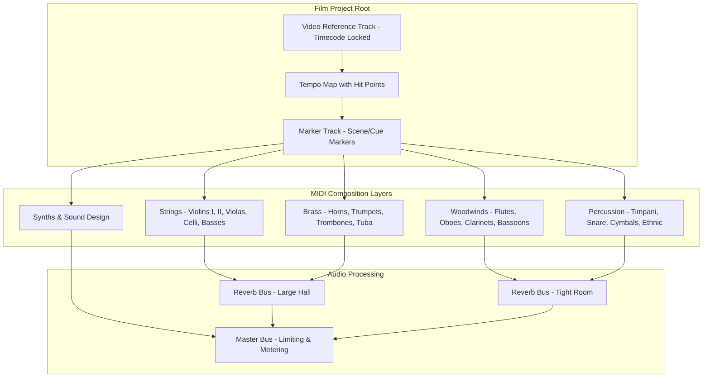

# Lesson 3: Software Tools and Workflows for Film Scoring

## 1. First-Principles Intuition & Invariants

Film scoring demands synchronization of three parallel streams: picture timecode, musical pulse, and emotional narrative. Unlike concert music, where tempo can float, film cues must lock to frame-accurate events while maintaining musical coherence. The tools you use—Digital Audio Workstations (DAWs), MIDI controllers, notation software, and sample libraries—are extensions of your compositional intent, converting creative decisions into synchronized audio that breathes with the image.

**Core Invariants:**

1. **Timecode Lock**: Film runs at fixed frame rates (23.976 fps, 24 fps, 25 fps, or 29.97 fps). Your DAW must maintain sample-accurate sync across tempo changes, time signature shifts, and MIDI/audio regions. A single frame at 24 fps = 41.67 ms—enough to be perceived as "off" by directors and mixers.

2. **Layered Non-Destructive Editing**: Film scoring is iterative. Directors request changes to cue start/end times, orchestration, and emotional tone. Your session architecture must support rapid experimentation without destroying previous work.

3. **Virtual Orchestration Realism**: Sample libraries are recordings of real instruments. Realistic playback requires understanding articulation keyswitches, legato transitions, dynamic layers (pp to ff), and humanization techniques (timing, velocity variation, vibrato modulation).

4. **Stem Delivery Requirements**: The final deliverable isn't just a stereo mix. Mixers need stems (submixes) organized by instrument family—strings, brass, woodwinds, percussion, synths, choir—plus alternate versions (no percussion, no melody, 60-second edit, etc.).

The physics beneath digital audio: Audio is converted to numbers via sampling (typically 48 kHz for film = 48,000 snapshots per second) and bit depth (24-bit = 16.7 million dynamic steps from silence to peak). MIDI is a control protocol: note number (pitch), velocity (0–127), and continuous controllers (CC) for modulation wheel, expression, breath, etc. MIDI doesn't produce sound—it triggers samples or synthesizers.

## 2. DAW Selection and Project Setup

### 2.1 Industry-Standard DAWs for Film Scoring

**Logic Pro (macOS)**
- **Strengths**: Deep integration with macOS, bundled orchestral library (Studio Strings, Studio Brass), flexible track alternatives for version comparison, streamlined MIDI editing.
- **Typical Use**: Mid-budget films, TV episodics, composer-editors who deliver final mixes themselves.

**Cubase Pro (macOS/Windows)**
- **Strengths**: Expression Maps (single-staff control of articulation keyswitches), chord track for harmonic analysis, VariAudio pitch editing, VST3 plugin standard.
- **Typical Use**: European composers, complex orchestral mockups requiring detailed articulation control.

**Pro Tools (macOS/Windows)**
- **Strengths**: Industry mixing standard, AAX plugin format, robust stem printing, tight integration with studio hardware (Avid consoles, HDX DSP cards).
- **Typical Use**: Large-budget scoring stages, composers who split composition (Cubase/Logic) and mixing (Pro Tools).

**Digital Performer (macOS)**
- **Strengths**: Chunks (independent timeline segments), sequence editor for managing multiple cue versions, consolidated window interface.
- **Typical Use**: Composers managing 40+ cues for TV series, editors needing rapid cue variation assembly.

**Reaper (macOS/Windows/Linux)**
- **Strengths**: Scriptable via ReaScript (Lua/Python), low CPU footprint, aggressive routing capabilities, no track count limits.
- **Typical Use**: Budget-conscious composers, Linux workflows, deep customization needs.

### 2.2 Essential Session Architecture



**Step-by-Step Project Setup (Logic Pro Example):**

1. **Create New Project**: File → New → Empty Project. Set sample rate to **48 kHz** (film standard), bit depth to **24-bit**.

2. **Import Video Reference**: File → Movie → Open Movie. Logic will create a global video track. Right-click video track → "Lock Movie to Absolute Timecode" to prevent drift if you adjust tempo.

3. **Set Project Frame Rate**: File → Project Settings → Synchronization → Frame Rate. Match the video's frame rate (usually 23.976 fps or 24 fps). Verify by checking the video's properties in your editor (Premiere, Final Cut, Resolve).

4. **Build Tempo Map**:
   - Open Tempo List (Shift+Cmd+T).
   - Watch the scene and identify musical "hit points" (door slam, explosion, character turn).
   - Insert tempo changes to align downbeats or accents with visual events.
   - **Example**: If a door slam occurs at 00:01:15:08 (1 minute, 15 seconds, 8 frames), place a marker there, then adjust tempo so beat 1 of measure 17 aligns precisely.

5. **Create Marker Track**:
   - Add cycle markers for each cue: Intro, Tension Build, Chase, Resolution.
   - Use color coding: Green = safe/happy, Red = danger, Blue = mystery.

6. **Instantiate Virtual Instruments**:
   - Load orchestral libraries (Spitfire, EastWest, Orchestral Tools) on separate MIDI tracks.
   - Use multi-output mode for section libraries (e.g., Spitfire Studio Strings with 5 outputs: Violins I, Violins II, Violas, Cellos, Basses).
   - Insert reverb sends on each track, routing to two aux buses: Hall (3.0s decay, Vienna MIR or Valhalla Room) and Tight Room (0.9s decay).

7. **Configure Track Stacks/Folders**:
   - Group Strings → Summing stack.
   - Group Brass → Summing stack.
   - Each summing stack goes to the master bus via the reverb sends.

8. **Naming Convention**:
   - `01_VLN1_Legato`, `02_VLN2_Spiccato`, `03_VLA_Tremolo`.
   - Prefix with numbers for automatic sorting.

### 2.3 MIDI Controller Setup for Expressive Input

**Hardware Recommendations:**
- **88-key weighted controller**: Native Instruments Komplete Kontrol S88, Arturia KeyLab 88. Full piano range, aftertouch for vibrato control.
- **Expression pedal**: Roland EV-5, Yamaha FC-7. Map to CC11 (Expression) for real-time dynamics.
- **Mod wheel**: Default CC1 (Modulation), typically controls vibrato intensity.

**MIDI Mapping for Orchestral Libraries:**
- **CC1 (Mod Wheel)**: Vibrato depth or layer crossfade.
- **CC11 (Expression)**: Volume automation (most important for realistic dynamics).
- **CC64 (Sustain Pedal)**: Legato transitions (Spitfire libraries), or standard sustain.
- **Keyswitches**: Map C-2 to C-1 to articulation changes (legato, staccato, pizzicato, tremolo, etc.). Write these on a dedicated track above the note data for visibility.

**Recording Workflow:**
1. **Record in passes**: First pass = pitch and rhythm. Second pass = expression (CC11). Third pass = vibrato/modulation (CC1). Recording all simultaneously produces inconsistent results.
2. **Overdub keyswitches**: After recording notes, go back and insert keyswitch triggers before phrase starts.
3. **Humanize timing**: Select all notes, apply small random timing offset (±5–10 ms) to break mechanical grid quantization. Most DAWs have a "Humanize" function (Logic: MIDI Transform → Randomize → Position).

## 3. Orchestral Sample Library Deep Dive

### 3.1 Library Architectures

**Kontakt-Based Libraries (Native Instruments Engine)**
- **Examples**: Spitfire Symphonic Orchestra, 8Dio Adagio Strings, Cinesamples CineBrass.
- **Pros**: Deep scripting control, NKS integration, consistent UI across libraries.
- **Cons**: High RAM usage (12–32 GB typical for full template), Kontakt license required for some libraries.

**Proprietary Engines**
- **EastWest PLAY, VSL Synchron Player, Orchestral Tools SINE**.
- **Pros**: Optimized streaming (less RAM), integrated mic position mixing.
- **Cons**: Additional software to learn, separate update cycles.

### 3.2 Articulation Strategies

**Strings Example (Spitfire Studio Strings):**
- **Long**: Sustain with natural swell, use CC11 for dynamics.
- **Legato**: Smooth note transitions with recorded portamento. Requires overlapping MIDI notes or CC64 = on.
- **Spiccato**: Short, bounced bow strokes. Use for rhythmic ostinatos.
- **Pizzicato**: Plucked strings. Fast decay, use sparingly for accents.
- **Tremolo**: Rapid back-and-forth bowing, creates tension.
- **Col Legno**: Hitting strings with wood of bow, percussive effect.

**Real-Time Articulation Switching (Cubase Expression Maps):**

```
Expression Map: Spitfire Studio Strings
Slot 1: Long (Keyswitch C-2)
Slot 2: Legato (Keyswitch C#-2)
Slot 3: Spiccato (Keyswitch D-2)
Slot 4: Pizzicato (Keyswitch D#-2)
Slot 5: Tremolo (Keyswitch E-2)
```

In the Key Editor, draw articulation changes in the articulation lane above the notes. Cubase automatically inserts the correct keyswitch MIDI notes.

**Brass Legato Realism**:
- French horns: Slow attack, warm legato transitions. Use CC11 swells for heroic lines.
- Trumpets: Bright, fast attack. Staccato for fanfares, legato for lyrical lines.
- Trombones: Deep, powerful. Use for bass reinforcement or chorale writing.
- Tuba: Foundation of brass section. Double bass trombone or string basses.

**Woodwind Breath Control**:
- Flutes: Airy, soft attacks. Use CC2 (Breath) for dynamic shaping if library supports it.
- Oboes: Piercing, sustained. Great for solos (think "Gabriel's Oboe" from *The Mission*).
- Clarinets: Warm, versatile. Use chalumeau (low) register for dark colors.
- Bassoons: Comedic or ominous. Wide dynamic range.

### 3.3 Microphone Position Mixing

Modern libraries record with multiple mic arrays:
- **Close**: Dry, detailed, 0–3 feet from instruments. Use for clarity, articulation definition.
- **Decca Tree**: Stereo overhead, 10–15 feet above orchestra. Balanced, natural width.
- **Outriggers**: Wide stereo, 20+ feet. Adds spaciousness.
- **Ambient**: Far mics, 30+ feet. Captures hall reverb naturally.

**Mixing Recipe for Hybrid Realism**:
- Close: 40% (−8 dB)
- Tree: 50% (−6 dB)
- Outriggers: 20% (−14 dB)
- Ambient: 30% (−10 dB)

Sum exceeds 100% because they overlap. Adjust to taste—close mics for action cues, ambient mics for emotional swells.

## 4. Notation Software Integration

### 4.1 Why Notation Software Matters

Even if your final product is a MIDI mockup, professional film composers deliver **conductor scores** and **parts** for live recording sessions. Notation software (Dorico, Sibelius, Finale) produces publisher-grade sheet music.

**Workflow: DAW → Notation Software**

1. **Export MIDI from DAW**: Select all composed MIDI regions, File → Export → MIDI File. Use "Merge tracks" option to create a single multi-channel MIDI file.

2. **Import into Dorico/Sibelius**:
   - Dorico: File → Import → MIDI. Map MIDI channels to instrument staves.
   - Sibelius: File → Open → MIDI File. Use "Transcription" mode to quantize intelligently.

3. **Clean Up Notation**:
   - **Quantize pitches and rhythms**: Remove microtiming humanization (great for playback, terrible for reading).
   - **Add articulations**: Slurs, staccato dots, accents, dynamics (pp, mp, mf, f, ff).
   - **Insert tempo markings**: Allegro (120–140 BPM), Andante (76–100 BPM), Adagio (66–76 BPM).
   - **Bar numbering**: Match film's bar count for rehearsal efficiency.

4. **Extract Parts**: Dorico: File → Print → Layouts → Select "Violin I Part", export PDF. Repeat for all instruments.

**Engraving Best Practices**:
- Stems: Up for upper staff voices, down for lower.
- Beaming: Group by beat (4/4 = beam in two groups of two eighth notes).
- Page turns: Ensure multi-measure rests for page turns in live performance.

### 4.2 Direct Notation in Dorico (Alternate Workflow)

For composers who think in notation first:

1. **Write in Dorico**: Use MIDI keyboard or computer keyboard input.
2. **Assign VST instruments**: Play tab → Load Spitfire/EastWest libraries for real-time playback.
3. **Fine-tune in DAW**: Export MIDI from Dorico, import to Logic/Cubase, add detailed CC11/CC1 automation that's impractical to notate.

**Advantage**: Perfectly readable score from the start, no cleanup.  
**Disadvantage**: Expression automation is harder in notation software; final realism requires DAW pass.

## 5. Real-World Workflow: Scoring a 2-Minute Dramatic Cue

**Scene Setup**: Protagonist discovers betrayal. Starts quiet (disbelief), builds to anger, ends with sorrowful acceptance.

### 5.1 Spotting and Tempo Mapping (5 minutes)

1. **Watch scene 10 times**: Note emotional beats.
   - 00:00:00 — Door opens, protagonist enters (neutral).
   - 00:00:15 — Sees evidence on table (realization starts).
   - 00:00:45 — Picks up photograph (heartbreak).
   - 01:15:00 — Smashes glass (anger peak).
   - 01:45:00 — Sinks into chair (resignation).

2. **Set markers in DAW**: `M1_Door`, `M2_Evidence`, `M3_Photo`, `M4_Smash`, `M5_Chair`.

3. **Build tempo map**:
   - 00:00:00 — 80 BPM (slow, tentative).
   - 00:00:45 — Ritardando to 65 BPM (time slows during heartbreak).
   - 01:15:00 — Accelerando to 120 BPM (anger explosion).
   - 01:45:00 — Ritardando to 50 BPM (exhaustion).

### 5.2 Harmonic and Orchestration Sketch (10 minutes)

**Chord Progression** (in C minor):
- Cm — Am7♭5 — Fm — G7 (measures 1–8, disbelief).
- A♭maj7 — B♭ — Cm — D°7 (measures 9–16, realization).
- Fm — G7 — Cm (measures 17–20, anger).
- A♭maj7 — E♭/G — Cm (measures 21–24, resignation).

**Orchestration Layers**:
- **00:00–00:45**: Solo cello (low register, sul tasto for darkness), soft pad (strings, long articulation, CC11 at 40).
- **00:45–01:15**: Add violins (tremolo, crescendo CC11 from 50 to 90), low brass (horns sustain on root notes).
- **01:15–01:45**: Full brass stabs (marcato), timpani rolls, cymbal crash on glass smash.
- **01:45–02:00**: Solo oboe melody over string pad, decrescendo to ppp, fade to silence.

### 5.3 MIDI Programming (30 minutes)

1. **Cello solo** (00:00–00:45):
   - Load Spitfire Studio Strings Cello, Legato patch.
   - Record melody in C minor: C3 — E♭3 — F3 — G3 (quarter notes, 80 BPM).
   - Automate CC11: Start at 30, gentle swell to 60 on G3, back to 40.

2. **String tremolo build** (00:45–01:15):
   - Violins I + II: Load Tremolo articulation.
   - Sustained Cm chord (C4, E♭4, G4, C5), CC11 automation: Linear ramp from 50 to 100 over 30 seconds.

3. **Brass and percussion hit** (01:15:00):
   - 4 French horns, 3 trumpets, 3 trombones: Marcato patch, stab on downbeat of measure 17.
   - Notes: Horns on C3, E♭3, G3; trumpets on C4, E♭4, G4; trombones on C2, G2, C3.
   - CC11 at 120 (full force), velocity = 127.
   - Timpani: Two hits (C1, G1), rolls leading into hit.

4. **Oboe solo** (01:45–02:00):
   - Load Spitfire Woodwinds Oboe, Legato patch.
   - Simple descending line: G4 — F4 — E♭4 — D4 — C4.
   - CC11: Start at 60, fade to 20 by end.

### 5.4 Mixing and Reverb (15 minutes)

**Bus Structure**:
- All strings → Hall Reverb (Valhalla Room, 2.5s decay, pre-delay 30ms).
- All brass → Tight Room (1.2s decay, pre-delay 15ms).
- Percussion → Hall Reverb (same as strings).
- Solo oboe → Hall Reverb, but send level at 40% (more intimate).

**EQ Adjustments**:
- Cellos: High-pass at 80 Hz (remove rumble), gentle boost at 250 Hz (warmth).
- Violins: High-pass at 120 Hz, boost at 3 kHz (presence), gentle roll-off above 10 kHz.
- Brass: High-pass at 100 Hz, notch at 400 Hz if muddy, boost at 2 kHz (bite).
- Timpani: Boost at 80 Hz (fundamental), cut at 250 Hz (boxiness).

**Limiting**:
- Insert Waves L2 or FabFilter Pro-L 2 on master bus.
- Set ceiling to −1.0 dBFS (prevents clipping), target integrated LUFS of −16 (film mix standard).

### 5.5 Stem Export (10 minutes)

**Required Stems**:
1. **Strings** (cello, violins, violas).
2. **Brass** (horns, trumpets, trombones).
3. **Woodwinds** (oboe solo).
4. **Percussion** (timpani).
5. **Full Mix** (all stems combined).

**Export Settings (Logic Pro)**:
- File → Bounce → Project or Section.
- Format: WAV, 48 kHz, 24-bit.
- File Type: Interleaved (stereo).
- Select "Include Audio Tail" (captures reverb decay).
- Filename: `ProjectName_StemName_Date.wav` (e.g., `Betrayal_Strings_2025-01-15.wav`).

**Solo Each Stem Group**:
- Mute all except strings, bounce → `Betrayal_Strings.wav`.
- Unmute, mute all except brass, bounce → `Betrayal_Brass.wav`.
- Repeat for woodwinds, percussion, full mix.

## 6. Advanced Techniques and Failure Modes

### 6.1 CPU and RAM Management

**Symptom**: Playback stutters, audio dropouts, "System Overload" errors.

**Diagnosis**:
- Open Activity Monitor (macOS) or Task Manager (Windows).
- Check CPU usage during playback. If sustained above 80%, your session is too heavy.
- Check RAM usage. If paging to disk (swap), you need more RAM or must freeze tracks.

**Solutions**:

1. **Freeze Tracks**: Renders MIDI + plugins to audio, disables real-time processing.
   - Logic: Track → Freeze Track.
   - Cubase: Right-click track → Render in Place → Settings → "Keep Source MIDI".
   - Unfreeze to edit, re-freeze before continuing.

2. **Increase Buffer Size**: Audio Settings → Buffer Size. Increase from 128 to 512 samples. Latency increases (512 samples @ 48 kHz = 10.67 ms), but CPU load drops 30–50%. Use high buffers for mixing, low buffers for recording.

3. **Purge Unused Samples**: Kontakt → Memory tab → Purge. Removes unused velocity layers and articulations from RAM.

4. **Bounce MIDI to Audio**: Once a part is finalized, bounce to audio and delete the virtual instrument track.

### 6.2 Latency Compensation and Plugin Delay

**Symptom**: MIDI notes trigger late, or tracks sound out of sync.

**Cause**: Plugins introduce processing delay (look-ahead limiters, linear-phase EQs). DAWs compensate automatically, but manual recording can feel sluggish.

**Solutions**:
- **Disable latency-inducing plugins during recording**: Bypass master bus limiter, replace linear-phase EQs with minimum-phase versions.
- **Use Low-Latency Mode**: Logic: Record button → Low Latency Mode (disables high-latency plugins during input monitoring). Cubase: Studio → Audio Performance → "Constrain Delay Compensation".
- **Manual offset**: If a track consistently records late, nudge the region earlier by the measured latency (check DAW's latency report).

### 6.3 MIDI Note Bleeding and Stuck Notes

**Symptom**: Notes sustain forever, or wrong articulations trigger.

**Cause**: Missing MIDI note-off messages, or keyswitches not resetting.

**Solutions**:
- **Insert MIDI CC121 (Reset All Controllers)** at the start of each cue. This sends a "panic" message to instruments.
- **Manually trim MIDI notes**: Ensure every note-on has a matching note-off. Select all notes, Quantize → End to Grid.
- **Reset keyswitches between phrases**: Insert a "default" keyswitch (usually C-2 for "long" articulation) after complex passages.

### 6.4 Reverb and Spatial Coherence

**Symptom**: Instruments sound pasted together, not in the same room.

**Cause**: Different reverb settings per instrument, or dry/wet balance inconsistencies.

**Solutions**:
- **Single Hall Reverb Bus**: All orchestral instruments → same convolution reverb (e.g., Vienna Konzerthaus, EastWest Spaces).
- **Adjust send levels, not reverb settings**: Closer instruments (solo cello) = 20–30% send. Distant instruments (back-row violins) = 50–60% send.
- **Pre-delay matching**: Short pre-delay (10–20 ms) for close instruments, longer (30–50 ms) for distant. Mimics sound traveling from stage to hall mics.

### 6.5 Director Revisions and Version Control

**Symptom**: Director requests changes after you've delivered final mix. Original project is overwritten.

**Solutions**:

1. **Save Incremental Versions**: `Project_v01.logic`, `Project_v02.logic`, etc. Never overwrite previous versions.

2. **Use Track Alternatives (Logic) or Lanes (Cubase)**:
   - Record multiple takes of the same part on different lanes.
   - A/B compare by soloing lanes.
   - Director can audition versions without opening separate projects.

3. **Archive Stems**: Keep all stem exports with version numbers. If director says "I liked the strings from version 3 but brass from version 5," you can recompose the mix from archived stems.

4. **Git for MIDI Projects (Advanced)**:
   - Export MIDI files from DAW sessions.
   - Track MIDI files in Git: `git add *.mid`, `git commit -m "Added tremolo build in measure 17"`.
   - Allows diffing and rollback of compositional decisions.

## 7. Practice Drills and Competency Targets

### Drill 1: Tempo Mapping to Picture (15 minutes)
**Goal**: Lock musical downbeats to visual hit points within ±1 frame accuracy.

1. Import a 1-minute action scene (use stock footage or a film you're scoring).
2. Identify 5 hit points (explosions, punches, door slams).
3. Place markers at each hit point.
4. Adjust tempo so measures align perfectly with markers.
5. **Success metric**: Play a click track over video—click hits should feel motivated by the picture, not arbitrary.

### Drill 2: Articulation Keyswitch Workflow (20 minutes)
**Goal**: Seamlessly switch articulations mid-phrase for realistic playback.

1. Load Spitfire Studio Strings Violins I.
2. Compose an 8-bar melody using 4 articulations: long, legato, spiccato, pizzicato.
3. Insert keyswitches 1 tick before each articulation change.
4. Record CC11 automation for dynamics (crescendo, decrescendo).
5. **Success metric**: Playback sounds like a live violinist changing bow techniques, not a robot.

### Drill 3: Reverb Bus Mixing (30 minutes)
**Goal**: Create spatial depth using send levels, not reverb plugins.

1. Create 4 tracks: solo cello, violins, brass, percussion.
2. Create 1 reverb bus (Valhalla Room, 2.5s decay).
3. Set send levels:
   - Cello: 25% (intimate).
   - Violins: 50% (mid-depth).
   - Brass: 40% (punchy but roomy).
   - Percussion: 60% (distant).
4. **Success metric**: Close your eyes and visualize instrument placement—front to back, not just left to right.

### Drill 4: Stem Export and Reassembly (20 minutes)
**Goal**: Verify stems sum to the full mix without phase issues.

1. Compose a 30-second cue with strings, brass, and percussion.
2. Export 4 stems: Strings, Brass, Percussion, Full Mix.
3. Import all stems into a new session.
4. Play all stems together. Use a phase meter plugin (Waves PAZ Analyzer, iZotope Insight).
5. **Success metric**: Stems sum = full mix (identical waveform, zero phase cancellation).

### Drill 5: MIDI Humanization (15 minutes)
**Goal**: Break robotic quantization while maintaining rhythmic integrity.

1. Program a 16-bar string ostinato, perfectly quantized to 1/16 notes.
2. Apply humanization:
   - Timing: ±8 ms random offset.
   - Velocity: ±10 random variation.
   - CC11: Draw subtle curves (not straight lines).
3. A/B compare quantized vs. humanized.
4. **Success metric**: Humanized version sounds like an ensemble, not a machine, but groove is still tight.

## 8. Competency Milestones

**Beginner (0–6 months)**
- Set up a DAW session with video import, tempo map, and marker track.
- Load and play a single orchestral library patch.
- Export a stereo mix at 48 kHz, 24-bit.

**Intermediate (6–18 months)**
- Build a full orchestral template with 30+ tracks (strings, brass, woodwinds, percussion).
- Program realistic string legato with CC11 automation.
- Mix with reverb buses and deliver 5-stem exports.

**Advanced (18–36 months)**
- Score a 5-minute scene with tempo changes synced to hit points within ±1 frame.
- Create conductor score and parts in Dorico/Sibelius from your MIDI mockup.
- Manage a 50+ cue TV episode project with version control and rapid director revisions.

**Professional (36+ months)**
- Compose and deliver a feature film score (60+ minutes of music).
- Record live orchestra, integrating your mockup as a guide track.
- Handle hybrid scores: orchestral samples + live recording + synths, all spatially coherent.
