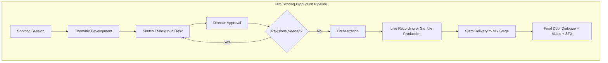

# Lesson 4: Practical Scoring Exercises — Spotting, Sync, and Delivery

## 1. First-Principles Intuition: Music as Narrative Architecture

A film score has three jobs: **amplify emotion** (push what's already on screen), **reveal subtext** (say what the dialogue won't), and **glue structure** (make forty disconnected shots feel like one scene). Concert music stands on its own. Film music kneels to the picture — if a cue fights the edit or steps on a line of dialogue, the cue is wrong, no matter how good it sounds in isolation.

Four invariants govern everything in this lesson:

1. **Timing primacy** — a hit that lands 2 frames off a cut reads as sloppy even to an untrained ear. Audiences don't consciously count frames, but they feel the mismatch as "something's off."
2. **Dynamic headroom** — dialogue typically sits around -12 to -6 dB (short-term LUFS reference, not peak). Score needs to average -18 to -12 dB under dialogue, with peaks rarely crossing -6 dB, or the dub mixer will simply turn you down in the final mix.
3. **Frequency lane discipline** — speech intelligibility lives in 300 Hz–3 kHz. Anything you stack densely in that band (unison horns, thick piano chords, massed violas) is competing directly with the actor's voice for the listener's attention.
4. **Thematic economy** — a 90-minute feature rarely needs more than 2–4 real themes. More than that and the audience can't hold onto any of them.

Why intervals and tempo move people is grounded in simple, testable physiology, not mysticism: ascending major-tonality lines correlate with reported feelings of hope/relief, descending minor/diminished lines with tension/sadness, minor 2nds and tritones measurably raise heart rate in listening studies, and tempo entrainment pulls the listener's physiological arousal toward the music's BPM (60–80 BPM reads as resting/calm, 120–140 BPM reads as activated/urgent). You don't need the citations memorized — you need to feel this at the keyboard, which is what the exercises below are for.

---

## 2. Spotting & Cue Sheet Construction

### The Spotting Session Protocol

Before you write a note, you sit with the director (or alone, for this lesson) and watch the **locked picture** — the final edit, no more cuts coming — start to finish, marking every point where music should enter or exit. This is not creative brainstorming, it's documentation. You're building the blueprint the rest of the job depends on.

For every cue, log:

- **Timecode In/Out** — SMPTE, matched to the project frame rate (e.g., `01:23:15:08` to `01:24:42:12` at 24 fps)
- **Cue number/name** — industry convention is `[Reel][M][Cue number]`, so the 3rd music cue in reel 1 is `1M3`. Give it a working title too: `1M3 – Discovery of the Letter`
- **Dramatic function** — one sentence, what must this music *do* dramatically (not "sad music," but "underscores grief while planting a seed of dread for the reveal in reel 2")
- **Sync points** — exact frames where picture and music must lock: a door slam, a cut, a glance, a gunshot
- **Temp track notes** — if the director has temp music, write down *what they're reacting to* (tempo? orchestration color? harmonic language?), because that's what you need to replicate in your own voice, not the actual notes they temped with

### Hands-On Exercise 2.1 — Build a Real Cue Sheet (20 minutes)

Using any 2-minute dialogue scene (a short film, a scene from a feature with the score muted, or the course's "The Inheritance" reference clip):

1. Watch the scene **silent**, three to five times.
2. Mark 3–4 points where silence becomes dramatically uncomfortable, or where a scene transition needs connective tissue.
3. Identify 2 hard sync points — a physical action (door closing, object dropped) or an internal beat (a character's face changing on a realization).
4. Write one dramatic-function sentence for the primary cue.
5. Chart the emotional arc of the scene in one line: rising tension, falling tension, or transformation (e.g., dread → relief).

### Cue Sheet Template

| Cue # | TC In | TC Out | Duration | Dramatic Function | Sync Points | Temp Reference |
|---|---|---|---|---|---|---|
| 1M1 | 00:00:15:00 | 00:01:42:18 | 1:27.75 | Establish melancholy, plant mystery | 00:00:47:12 (letter reveal), 00:01:30:00 (window closes) | Arvo Pärt – *Spiegel im Spiegel* |
| 1M2 | 00:02:10:00 | 00:02:48:05 | 0:38.21 | Antagonize calm with intruding dread | 00:02:22:14 (footsteps on stairs) | — |

Keep this in a spreadsheet, not just markdown — you'll be sorting by timecode constantly once a project has 20+ cues.

---

## 3. Thematic Development from Dramatic Beats

### Interval Content as Emotional Vocabulary

Intervals aren't just math between two pitches — they carry cultural and psychoacoustic weight that composers exploit deliberately:

| Interval | Emotional Read | Reference Use |
|---|---|---|
| Minor 2nd | Dissonance, threat, claustrophobia | *Jaws* ostinato, *The Shining* |
| Major 2nd | Open, neutral, pastoral | Folk melody, Copland-style Americana |
| Minor 3rd | Melancholy, introspective | Blues tonality, grief themes |
| Major 3rd | Warm, resolved, consonant | Love themes, resolution points |
| Perfect 4th | Strength, stability | Fanfares, hymn openings |
| Tritone | Instability, dread, the "devil's interval" | Horror stingers, villain motifs |
| Perfect 5th | Power, grandeur | Heroic themes (*Star Wars* main title) |
| Minor 6th | Longing, aching yearning | Bernard Herrmann's string writing |
| Major 6th | Sweetness, romance | Ballad themes |
| Minor 7th | Tension seeking resolution | Dominant-function harmony |
| Major 7th | Dreamy, ambiguous, modern | Contemporary/indie scoring |

### Exercise 3.1 — Interval Palette Audition (15 minutes)

At a MIDI keyboard or in notation software:

1. Play each interval above slowly, ascending and descending, and say out loud what it makes you feel. Don't skip this — building an instinctive catalog in your ear is the actual skill.
2. Watch your reference scene again with sound off.
3. Pick 2–3 intervals that match the scene's emotional core.
4. Build a 4-note motif restricted to only those intervals. Example: minor 3rd up, minor 2nd down, perfect 4th up.
5. Play that exact motif at 60 BPM, then 90 BPM, then 120 BPM. Write one sentence on how tempo alone changed the character of an unchanged melody. This is the single fastest way to internalize that tempo is not neutral — it's a primary emotional parameter, equal in weight to pitch choice.

### Leitmotif Construction Rules

A workable leitmotif satisfies four constraints simultaneously:

1. **Distinctive** — recognizable on 1–2 hearings. 3–7 notes is the sweet spot; longer themes blur in audience memory across a 2-hour runtime.
2. **Transformable** — must survive being recast in major or minor, inverted, augmented (stretched in rhythm), or fragmented to 2–3 notes.
3. **Orchestrationally flexible** — has to work played by one oboe alone in a quiet scene and by the full orchestra in the climax, without rewriting the notes.
4. **Contoured, not scalar** — stepwise-only melodies are forgettable. The strongest film themes mix steps with one defining leap.

**The Williams principle**: pair stepwise motion with one unmistakable interval leap. *Star Wars* — three repeated notes then a rising perfect 4th. *Jaws* — a half-step ostinato (E–F) that never resolves, which is exactly why it feels like a predator that won't stop.

### Exercise 3.2 — Build and Transform a Character Theme (45 minutes)

For a protagonist in your reference scene:

1. Write a 5-note motif in C minor, built from your Exercise 3.1 interval palette.
2. Generate four variants:
   - **Inversion** — flip every interval's direction (up becomes down, same size).
   - **Retrograde** — play the pitch sequence backward.
   - **Augmentation** — double every note's rhythmic value (instant "slow motion" or "memory" effect — this is Williams' go-to trick for flashbacks).
   - **Fragmentation** — isolate just the first 3 notes; this is what you'll use for quick motivic reminders later in the score without restating the whole theme.
3. Harmonize the original with a simple **i – iv – V7 – i** progression in C minor.
4. Orchestrate the same material three ways and bounce audio for each:
   - Solo cello (intimacy, melancholy)
   - String quartet (close, personal scale)
   - Full string section (catharsis, scale-up for the climax)

Notice that the notes never change — only the vessel does. That's the entire point of a leitmotif: one idea, infinitely reclothed to match the story's escalation.

---

## 4. Orchestration for Picture: Frequency Domain Tactics

### Why This Matters More Than Harmony Class Ever Told You

A beautifully orchestrated cue that buries dialogue gets muted or stripped out in the dub. The dub stage's priority order is almost always **Dialogue > Music > Effects**, flipping only in pure action beats with no lines. Your job is to orchestrate so the mixer never has to choose between you and the actor.

### Frequency Lane Map

| Band | What lives there | Scoring rule |
|---|---|---|
| 80–300 Hz | Engine rumble, impacts, room tone, sub-bass sound design | Keep score sparse here. Sustained pedal tones, not moving basslines, during dialogue-heavy passages. |
| 300 Hz–3 kHz | Speech intelligibility (vowels, consonant clarity) | This is the danger zone. Avoid thick unison horns, doubled violas, dense piano voicings while someone is talking. |
| 3–8 kHz | Instrumental presence, solo clarity, consonant "edge" | Safe zone for solo lines even under dialogue — flute, oboe, upper strings read clearly here without masking speech formants. |
| 8 kHz+ | Air, shimmer, sparkle | Use sparingly — cymbals, triangle, string harmonics. Overused, it causes listener fatigue across a 2-hour runtime. |

**Practical move**: when a scene has dialogue, high-pass filter your pad and sustain tracks at 400–500 Hz in the DAW. This single EQ move does more to "fix" a cue fighting dialogue than almost any re-orchestration.

### Orchestral Palette Reference

| Instrument | Emotional archetype | Approx. fundamental range | Dialogue compatibility |
|---|---|---|---|
| Solo violin | Intimacy, vulnerability | 200 Hz–3 kHz + harmonics to 10 kHz | Moderate — avoid double stops sitting in the vocal band |
| Cello | Warmth, melancholy | 65 Hz–1 kHz | Good — mostly sits below dialogue |
| Flute | Innocence, ethereal | 260 Hz–4 kHz | Excellent — upper register cuts cleanly |
| Oboe | Pastoral, longing | 230 Hz–1.5 kHz | Good — distinct timbre avoids masking |
| Clarinet | Woody, versatile | 165 Hz–2 kHz | Good — naturally sits in a safer pocket |
| French horn | Nobility, grandeur | 87–700 Hz | Poor — dense midrange, clashes hard with dialogue |
| Trumpet | Heroic, fanfare | 165 Hz–1.5 kHz | Moderate — use sparingly under lines |
| String section | Emotional bed | 40 Hz–8 kHz | Excellent when voiced thoughtfully |
| Piano | Percussive clarity | 27.5 Hz–4.2 kHz | Moderate — avoid dense chording under dialogue |
| Timpani | Dramatic punctuation | 40–200 Hz | Excellent — sits below the voice entirely |

### Exercise 4.1 — Orchestrate for Dialogue Compatibility (30 minutes)

Re-score your Exercise 3.2 theme for a dialogue-heavy scene:

1. Strip to solo violin (melody) + harp (arpeggiated chords only, no block voicings).
2. High-pass the harp pad at 400 Hz.
3. Set your mix bus peak around -18 dB (leaving generous headroom under dialogue).
4. Play dialogue from any podcast or show over the top at a realistic -12 dB.
5. **A/B test**: can you understand every word without straining? If not, pull the midrange content down another 3 dB or thin the orchestration further before touching overall volume — volume is the last lever, not the first.

---

## 5. DAW Workflow: Scoring to Picture in Real Time

### Setup (Logic Pro, Pro Tools, Cubase — steps are functionally identical)

1. **Import video**: `File > Movie > Open Movie`. Use ProRes 422 or H.264 for smooth scrubbing — large uncompressed files will stutter your transport.
2. **Match frame rate** to the picture exactly: 23.976 fps for most cinema deliverables, 24 fps for true 24p, 29.97 fps for broadcast/TV. Getting this wrong means every timecode you wrote in your cue sheet drifts from the picture.
3. **Show timecode** in the transport, set to the SMPTE format matching the picture (drop-frame vs. non-drop-frame matters at 29.97 — check your delivery spec).
4. **Build your tempo map**: either lock to a fixed BPM, or if the scene has no consistent pulse, use tempo automation so your grid itself bends with the picture.
5. **Drop markers** at every sync point straight from your cue sheet. Do this before you write a single note.

### Hitting a Sync Point Precisely

For a door slam at `00:01:23:15`:

- **Sample-library mockup**: place the hit's MIDI note 2 frames *early* (`00:01:23:13`). Sampled instruments need a few milliseconds for the attack transient to fully speak — nudging early compensates so the *perceived* attack lands exactly on frame.
- **Live orchestra**: write the hit exactly on the frame. Human musicians naturally anticipate a conductor's downbeat by roughly 30–50 ms, which does the same compensation for you acoustically.

### Exercise 5.1 — Score a 30-Second Cue with 2 Sync Points (60–90 minutes)

Using any 30-second clip with two clear hit points:

1. Import video, set project to the clip's native frame rate, show timecode.
2. Mark your two sync points.
3. Compose a rising-tension ostinato that accelerates from 100 BPM to 140 BPM across the cue — use tempo automation, not a tempo track jump, for a smooth ramp.
4. Hit sync point 1 with cymbal crash + bass drum.
5. Hit sync point 2 with a full-ensemble sforzando stab on the downbeat.
6. Score it with any free orchestral library (Spitfire LABS, BBCSO Discover, ProjectSAM Free Orchestra all work for this).
7. Bounce a stereo stem and a video file with music printed to picture.

**Deliverable spec**: 48 kHz/24-bit stereo WAV, peak around -6 dB, no limiter on the master — leave headroom for the mix stage to shape.

### Compensating for Sample Library Pre-Delay

Orchestral sample libraries bake in attack delay to emulate real instrument response — a trumpet doesn't speak instantly, neither should its sample. Typical ranges:

- **Short articulations** (staccato, spiccato): 20–50 ms
- **Long articulations** (sustains, legato): 80–150 ms
- **Brass section hits**: 100–200 ms (simulating breath attack across a full section)

**Fix**: nudge the MIDI region 3–6 frames earlier than the visual sync point, or use your DAW's track delay compensation to shift the whole virtual instrument track forward globally, rather than hand-nudging every note.

### Exercise 5.2 — Measure Your Library's Real Latency (20 minutes)

1. Load a brass staccato patch.
2. Build a 120 BPM click track.
3. Play one MIDI note exactly on beat 1.
4. Record the audio output and zoom to sample level in the waveform editor.
5. Measure the gap between the click and the actual attack transient.
6. Convert that millisecond offset to frames at your project's frame rate.
7. Apply that as a track delay (preferred — it's global and non-destructive) or nudge every MIDI region by that exact frame count.

Repeat for strings and woodwinds and keep a written latency chart per patch — this single page saves you from chasing "why does this feel late" bugs for the rest of your career.

---

## 6. Tempo Mapping vs. Free Timing

### Strict Tempo — When the Grid Serves the Scene

Use a locked tempo for:

- **Action sequences** — rhythmic drive needs a stable pulse to build momentum.
- **Montages** — cutting on the beat reinforces editorial rhythm and makes cuts feel intentional.
- **Diegetic/period music** — anything characters are visibly dancing or playing to must match picture tempo exactly.

**Grid-based protocol:**

1. Tap-tempo the scene's natural pulse while watching it (most DAWs have a tap-tempo transport button).
2. Lock that tempo, build a 4-bar loop for your core idea.
3. Develop the material, marking structural transitions every 8–16 bars.
4. Align those structural transitions with actual picture edits — a new section of your cue should usually begin on or near a cut.

### Free Timing — When the Grid Would Fight the Scene

Use free/rubato timing for:

- **Emotional dialogue scenes** — music must breathe with the actor's unpredictable pacing, not force the actor into a metronome.
- **Atmospheric underscore** — ambient, non-pulsed cues where rhythmic drive would feel mechanical.
- **Classical/period drama** — emulating a live conducted orchestra's natural tempo flex.

**Free-timing workflow:**

1. Set a nominal 60 BPM (useful because 1 beat = 1 second, which makes eyeballing timecode easy) but disable the metronome click for performance.
2. Draw a tempo curve in the automation lane that follows the scene's emotional rise and fall.
3. Record-enable and perform the melody live against picture, letting your hands "conduct" the phrasing in real time.
4. Clean up the MIDI afterward, nudging only the notes that must lock to specific sync points — leave the expressive timing elsewhere alone.

### Exercise 6.1 — Score the Same Scene Two Ways (90 minutes)

Using a 2-minute dialogue-driven scene:

1. **Version A**: strict 90 BPM, 3/4 meter, barlines aligned to major picture edits.
2. **Version B**: free tempo, melody conducted live in real time against the actor's pacing.

Export both. A/B them back to back. Which feels more organic to the performance? Which gives stronger narrative propulsion? There's no universally correct answer — the point is training your ear to recognize which tool a given scene actually calls for.

---

## 7. Harmonic Language for Subtext

### Functional Harmony as a Narrative Tool

| Chord function | Narrative meaning |
|---|---|
| Tonic (I) | Home, resolution, truth revealed |
| Subdominant (IV) | Reflection, looking backward, softening |
| Dominant (V/V7) | Tension, anticipation, a question posed |
| Deceptive cadence (V→vi) | Expectation subverted, plot twist |
| Neapolitan (bII) | Darkness, tragedy, operatic pathos |
| Modal interchange (borrowed chords) | Emotional color shift without a literal key change |

**Subtext protocol in practice**: if a character says "I'm fine" while visually falling apart, stay silent under the line itself — let the actor's delivery carry it — then, the instant the line ends, drop in a borrowed minor iv chord under an otherwise major key. That modal mixture is the musical equivalent of the audience thinking "she's lying," without a single note playing *during* the lie itself.

### Exercise 7.1 — Harmonic Subtext Composition (30 minutes)

Scenario: *Character A says "We'll get through this together" while the camera holds on Character B's doubtful face.*

1. Write a 4-bar phrase in C major.
2. Under Character A's line: diatonic **I – V – vi – IV** (reads as sincere, hopeful).
3. On the cut to Character B's reaction: introduce **bVI** (Ab major) — the chromatic darkening signals doubt without a single word of dialogue.
4. End the phrase on an unresolved **V7** — leaves the audience hanging exactly where the story needs them to.
5. Orchestrate for string quartet, export audio.

### Modal Color Palette

| Mode | Emotional quality | Defining interval | Typical film usage |
|---|---|---|---|
| Ionian (major) | Bright, resolved | Major 3rd, major 7th | Triumphant endings |
| Dorian | Melancholy yet hopeful | Minor 3rd + major 6th | Period drama, folk settings |
| Phrygian | Dark, exotic | Minor 2nd above root | Danger, "otherness" |
| Lydian | Floating, ethereal | Augmented 4th | Fantasy, wonder (*E.T.*) |
| Mixolydian | Earthy, grounded | Minor 7th | Folk/Celtic, epic fantasy (*Game of Thrones*) |
| Aeolian (natural minor) | Sad, introspective | Minor 6th | Grief, loss |
| Locrian | Unstable, unresolved | Diminished 5th | Horror, psychological dread |

### Exercise 7.2 — Modal Scene Matching (45 minutes)

Assign the most fitting mode and write an 8-bar solo-instrument phrase for each:

1. A knight rides through misty highlands at dawn.
2. A child discovers a glowing portal in the forest.
3. A detective realizes the killer is someone they trust.
4. Two lovers reunite after years apart.

Export audio for all four. Compare your choices against the table — if your instinct disagreed with the "typical usage," that's not wrong, it's a deliberate subversion worth noting *why* you made it.

---

## 8. Revision & Feedback Integration

Directors speak in emotional shorthand, not music theory. Learning to translate is a core professional skill:

| Director says | What they usually mean |
|---|---|
| "Make it bigger" | Denser orchestration, octave doublings, higher dynamic level |
| "Too on the nose" | Pull level back 3–6 dB, reduce melodic activity, shift to a harmonic pad |
| "It's fighting the scene" | Wrong emotional key entirely — re-read the scene's intent, don't just remix |
| "I don't feel it yet" | Your entry point is too late — bring the music in 2–4 seconds earlier |
| "Feels like temp" | You've copied the reference track too closely — find your own harmonic/orchestration voice |

**Translation protocol**: ask clarifying questions ("when you say bigger, do you mean louder, more instruments, or more dramatic?"), then offer concrete A/B options rather than guessing blind ("version A adds brass, version B doubles strings at the octave — which direction?"). Log every note with a timecode and an action item — "notes" without timecodes are useless by your third revision pass.

### Exercise 8.1 — Mock Feedback Session (60 minutes)

Simulated director note: *"The opening feels too sad too soon — I want curiosity, not grief yet. But when she closes the window at 1:30, that's when the weight should hit."*

1. Original cut: melancholy theme starting at 0:15.
2. Revision: swap to neutral/mysterious scoring (Lydian mode, solo woodwind) until 1:30.
3. At 1:30: full strings enter with the emotional theme, now in Aeolian.
4. Export both versions, write a 3-sentence rationale for the change.

---

## 9. Stem Delivery & Mix Stage Collaboration

### Standard Stem Configuration

| Stem | Contents |
|---|---|
| M1 | High strings (violins, violas above C4) |
| M2 | Low strings (cellos, basses) |
| M3 | Woodwinds (flutes, oboes, clarinets, bassoons) |
| M4 | Brass (horns, trumpets, trombones, tuba) |
| M5 | Percussion (timpani, cymbals, auxiliary) |
| M6 | Piano/harp/keys |
| M7 | Synth/electronics (if applicable) |
| M8 | Full mix — reference only, not used for the final dub |

### Export Specifications

- **Format**: WAV, 48 kHz/24-bit (match the picture's audio spec exactly — ask the post house if unsure)
- **Start time**: `00:58:00:00` is the industry-standard 2-hour pre-roll convention for feature deliverables — confirm the project's actual start timecode with the editor
- **Tail**: 2 seconds of silence after the final note so reverb decay isn't truncated
- **Naming**: `ProjectName_CueNumber_StemName.wav` — e.g., `Inheritance_1M1_HighStrings.wav`
- **No master-bus processing** — no limiter, no EQ — unless the director has explicitly signed off on a specific sound
- **Levels**: peak around -6 dB max, -12 dB average, so dialogue always sits clearly on top in the final dub

### Exercise 9.1 — Prepare a Professional Stem Delivery (45 minutes)

1. Create a minimum of 5 stems from your scored material (adjust groupings to your actual orchestration).
2. Export each as an individual 48 kHz/24-bit WAV.
3. Build a metadata spreadsheet: stem name, cue timecode in/out, peak level in dB, instrumentation list.
4. Zip stems + metadata into one delivery package.

This is literally the package a post-production sound team expects to receive — practicing it now means your first real delivery isn't the first time you've done it.

---

## 10. Practical Assignment: Score a 3-Minute Short Film

**Final deliverable**, using any 3-minute short film (or a muted scene from a feature):

1. **Spotting session** — full cue sheet, 3–5 cues, timecode in/out, dramatic function, sync points.
2. **Thematic development** — two contrasting leitmotifs (protagonist, antagonist/obstacle).
3. **Full score** — complete orchestrated cues, synced to picture in your DAW, with an appropriate tempo strategy per cue (locked or free).
4. **Revision pass** — write yourself one realistic director's note per cue and implement it.
5. **Stem delivery** — 6–8 stems, professional naming and metadata.

**Technical requirements:**

- Minimum 3 cues, 90–120 seconds of total music
- At least 4 hard sync points locked to picture
- Orchestration includes strings, woodwinds, and one solo instrument
- At least one scene demonstrates harmonic subtext (music contradicting or commenting on the dialogue/action)
- Peak -6 dB, average -12 to -18 dB
- Deliverables: stems + full mix + cue sheet + a 500-word composer's note explaining your dramatic choices

**Grading weight:**

- Sync accuracy — 30%
- Thematic coherence — 25%
- Dialogue compatibility — 20%
- Emotional effectiveness — 15%
- Technical polish (clean, labeled, professional stems) — 10%

---

## Additional Resources

**Score study (watch with picture, score in hand if possible):**

- *Jaws* (John Williams) — leitmotif construction, sustained tension
- *There Will Be Blood* (Jonny Greenwood) — modernist dissonance, string writing
- *The Social Network* (Reznor & Ross) — electronic underscore as emotional architecture
- *Schindler's List* (John Williams) — solo instrument as emotional focal point
- *Inception* (Hans Zimmer) — tempo manipulation, brass writing
- *Up* (Michael Giacchino) — thematic economy, one theme carrying an entire wordless sequence

**Free orchestral libraries for mockups**: Spitfire LABS, ProjectSAM Free Orchestra, VSCO2 Community Edition.

**Professional libraries**: Spitfire Symphonic Orchestra, EastWest Hollywood Orchestra, Cinematic Studio Series.

**Notation software**: MuseScore (free, full-featured), Dorico (best engraving), Sibelius (industry standard), Finale (legacy).

**Sync/workflow tools**: QuickTime for ProRes playback, HandBrake for H.264 conversion, online SMPTE frame calculators for offset math.

---

The craft comes from repetition, not theory. Score the clips, implement the feedback, deliver the stems — then do it again on the next scene. Every exercise in this lesson is the literal daily workflow of a working film composer, not a simplified classroom version of it.
