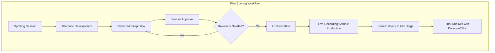

# Lesson 4: Practical Scoring Exercises

## 1. First-Principles Intuition: Music as Narrative Architecture

Film scoring is the art of translating visual storytelling into emotional sound. At its core, a film score serves three functions: **emotional amplification** (intensifying what's on screen), **narrative subtext** (revealing hidden intentions or foreshadowing), and **structural cohesion** (binding disparate scenes into a unified whole). Unlike concert music, which exists autonomously, film music must surrender to the picture—it exists to serve the story, not the other way around.

The fundamental invariants of effective film scoring:

1. **Timing Primacy**: Music must lock to picture at critical sync points (hits, edits, emotional beats). A cue that's 2 frames early or late can destroy dramatic impact.
2. **Dynamic Range Management**: Film dialogue typically sits at -12dB to -6dB. Score must leave headroom, with peaks rarely exceeding -6dB and sustained levels around -18dB to -12dB to avoid masking speech.
3. **Frequency Domain Awareness**: Human voice intelligibility lives in 300Hz–3kHz. Aggressive scoring in this range obscures dialogue. Dense low-frequency scoring below 80Hz competes with sound effects and can muddy the mix.
4. **Thematic Economy**: A 90-minute feature supports 2–4 primary themes maximum. Over-themeing fragments audience memory.

The physics of emotional response: Ascending melodic lines and major tonalities trigger dopamine release (perceived as hope, triumph). Descending lines and minor/diminished harmonies activate the amygdala (anxiety, sadness). Dissonance (intervals of minor 2nds, tritones) creates measurable physiological tension—increased heart rate and cortisol. Tempo entrainment: sustained rhythms at 60–80 BPM match resting heart rate (calm), while 120–140 BPM drives sympathetic nervous system arousal (excitement, danger).

## 2. Spotting & Cue Sheet Construction

### The Spotting Session Protocol

Before writing a single note, conduct a **spotting session**: watch the locked picture cut with the director and note every music start/stop point. Document:

- **Timecode In/Out**: SMPTE start and end points (e.g., 01:23:15:08 to 01:24:42:12 at 24fps)
- **Cue Name/Number**: Descriptive label (e.g., "1M3 – Discovery of the Letter")
- **Dramatic Function**: What the music must accomplish (e.g., "underscores grief while hinting at coming revelation")
- **Sync Points**: Critical picture moments requiring musical punctuation (door slam at 01:23:47:00, character's realization at 01:24:18:15)
- **Temp Track Reference**: If director has temporary music, note what they respond to—tempo, orchestration, harmonic language

**Hands-On Exercise 2.1: Create a Cue Sheet**

Download the provided 2-minute short film clip "The Inheritance" (available in course materials). Watch it 3–5 times without sound. On a blank cue sheet template:

1. Mark 3–4 potential music entry points where silence becomes uncomfortable or narrative needs support
2. Identify 2 critical sync points requiring musical punctuation (a slammed book, a character's sudden realization)
3. Write a 2–3 sentence dramatic function for the primary cue
4. Note the overall emotional arc: does tension rise, fall, or transform?

Target time: 20 minutes.

### Cue Sheet Template (Markdown Table Format)

| Cue # | Timecode In | Timecode Out | Duration | Dramatic Function | Sync Points | Temp Reference |
|-------|-------------|--------------|----------|-------------------|-------------|----------------|
| 1M1   | 00:00:15:00 | 00:01:42:18  | 1:27.75  | Establishes melancholy, hints at mystery | 00:00:47:12 (letter reveal), 00:01:30:00 (window close) | Arvo Pärt - Spiegel im Spiegel |

## 3. Thematic Development from Dramatic Beats

### Interval Content as Emotional Vocabulary

Every interval carries emotional connotation rooted in harmonic overtone series and cultural conditioning:

- **Minor 2nd** (semitone): dissonance, unease, threat (Jaws, The Shining)
- **Major 2nd**: neutral, pastoral, open (folk melodies)
- **Minor 3rd**: melancholy, introspection (blues tonality)
- **Major 3rd**: warmth, consonance, resolution
- **Perfect 4th**: strength, stability (fanfares, hymns)
- **Tritone (Augmented 4th)**: instability, supernatural dread (Devil's interval)
- **Perfect 5th**: power, grandeur (heroic themes, Star Wars)
- **Minor 6th**: longing, yearning (Bernard Herrmann)
- **Major 6th**: sweetness, romantic (ballads)
- **Minor 7th**: tension seeking resolution (dominant chords)
- **Major 7th**: dreamy, ambiguous, modern

**Hands-On Exercise 3.1: Interval Palette Analysis**

Using MIDI keyboard or notation software:

1. Play the interval series above slowly, listening to the emotional quality of each
2. Watch "The Inheritance" clip again
3. Select 2–3 intervals that match the scene's emotional core
4. Construct a 4-note melodic motif using only those intervals (e.g., Minor 3rd up, Minor 2nd down, Perfect 4th up)
5. Play the motif at 3 different tempos: 60 BPM (contemplative), 90 BPM (neutral), 120 BPM (agitated)

Note how tempo transforms emotional meaning. Record your observations.

### Leitmotif Construction Rules

A leitmotif must be:

1. **Distinctive**: Recognizable after 1–2 hearings (3–7 notes optimal)
2. **Transformable**: Works in major/minor, can be inverted, augmented, fragmented
3. **Orchestrationally Flexible**: Effective on solo instrument or full orchestra
4. **Memorably Contoured**: Avoid scalar stepwise motion; use leaps and directional changes

**John Williams Principle**: The strongest themes combine stepwise motion with a defining leap (Star Wars: do-do-do-sol ascending 4th; Jaws: E-F semitone ostinato).

**Exercise 3.2: Construct a Character Theme**

For "The Inheritance" protagonist:

1. Write a 5-note motif in C minor using the interval palette from Exercise 3.1
2. Vary it: 
   - **Inversion**: flip intervals upside-down
   - **Retrograde**: play backwards
   - **Augmentation**: double note values (slow motion effect)
   - **Fragmentation**: extract the first 3 notes only
3. Harmonize the motif with a simple i–iv–V7–i progression
4. Orchestrate for solo cello (melancholy), then string quartet (intimacy), then full strings (catharsis)

Use notation software (MuseScore, Dorico, Sibelius) or DAW MIDI editor. Export audio of all 3 orchestrations.

## 4. Orchestration for Picture: Frequency Domain Tactics

### The Dialogue Consideration Principle

Film mix engineers prioritize: **Dialogue > Music > Sound Effects** (except in action sequences where SFX can dominate). To avoid music cuts and fighting in the final mix:

**Frequency Zone Etiquette:**

- **80–300 Hz**: Reserve for sound design (rumbles, impacts, vehicle engines). Use sparse bass scoring here—sustain bass notes instead of running basslines.
- **300 Hz–3 kHz**: Dialogue intelligibility zone. Avoid dense midrange orchestration (french horns, violas in unison, thick piano chording). If scoring dialogue scenes, use:
  - High strings (violins above the staff)
  - Woodwind solos (flute, oboe in upper register)
  - Harp/celesta/glockenspiel (percussive clarity above 2kHz)
  - Pads with high-pass filter at 400–500 Hz
- **3–8 kHz**: Presence and clarity. Solo instruments shine here. Avoid massed brass unless scene has no dialogue.
- **8 kHz+**: Air and shimmer. Cymbals, triangle, string harmonics. Use sparingly—excessive high frequency content fatigues listeners.

**Exercise 4.1: Orchestrate for Dialogue Compatibility**

Re-orchestrate your character theme from Exercise 3.2 for a dialogue-heavy scene:

1. Strip orchestration to solo violin (melody) + harp (arpeggiated chords)
2. High-pass filter at 400 Hz in DAW
3. Set peak level at -18dB LUFS
4. Overlay dialogue from a TV show or podcast (any content at -12dB)
5. A/B test: Can you hear every word clearly? If not, reduce midrange or lower volume 3dB more.

### Orchestral Palette Reference

| Instrument Family | Emotional Archetype | Frequency Range | Dialogue Compatibility |
|-------------------|---------------------|-----------------|------------------------|
| Solo Violin | Intimacy, vulnerability | 200 Hz–3 kHz (fundamental), harmonics to 10 kHz | Moderate—avoid double stops in midrange |
| Cello | Warmth, melancholy | 65 Hz–1 kHz | Good—usually below dialogue range |
| Flute | Innocence, ethereal | 260 Hz–4 kHz | Excellent—upper register cuts through |
| Oboe | Pastoral, longing | 230 Hz–1.5 kHz | Good—distinctive timbre avoids masking |
| Clarinet | Versatile, woody | 165 Hz–2 kHz | Good—naturally occupies "safe" zone |
| French Horn | Nobility, grandeur | 87 Hz–700 Hz | Poor—dense midrange clashes with dialogue |
| Trumpet | Heroic, fanfare | 165 Hz–1.5 kHz | Moderate—use sparingly over dialogue |
| Strings (Section) | Emotional foundation | 40 Hz–8 kHz | Excellent when voiced with awareness |
| Piano | Percussive clarity | 27.5 Hz–4.2 kHz | Moderate—avoid dense chording in midrange |
| Timpani | Dramatic punctuation | 40–200 Hz | Excellent—sub-dialogue impact |

## 5. DAW Workflow: Scoring to Picture in Real Time

### Software Setup (Logic Pro X / Pro Tools / Cubase)

1. **Import Video**: File > Movie > Open Movie (ensure codec is ProRes 422 or H.264 for smooth playback)
2. **Set Frame Rate**: Match project frame rate to film (23.976fps for cinema, 24fps for true 24p, 29.97fps for broadcast)
3. **Enable Timecode Display**: View > Transport > Show Timecode. Set to SMPTE format matching picture.
4. **Create Tempo Map**: If scene has no consistent tempo, use free tempo with tempo automation
5. **Place Markers**: Create markers at every sync point from cue sheet

**Critical Sync Point Workflow:**

For a door slam at 00:01:23:15:

1. Place marker at exact frame
2. Compose to that point naturally
3. Add a final "hit" 2 frames early (00:01:23:13)—gives orchestral sample libraries time to speak before attack transient
4. For live orchestra, write the hit exactly on frame—musicians will naturally precede by ~50ms (human anticipation)

**Exercise 5.1: Score a 30-Second Cue with 2 Sync Points**

Using provided clip "The Chase" (30 seconds, 2 sync points at 00:00:07:12 and 00:00:24:00):

1. Import video to DAW
2. Set project to 24fps, display timecode
3. Place markers at sync points
4. Compose a rising tension cue (suggested: ostinato pattern accelerating from 100 BPM to 140 BPM)
5. Hit first sync point with cymbal crash + bass drum
6. Hit second sync point with orchestral stab (all instruments sforzando on downbeat)
7. Use MIDI with free orchestral library (BBCSO Discover, Spitfire LABS, ProjectSAM Free Orchestra)
8. Export audio stem and bounced video with music

**Deliverable Format**: Stereo mix at 48kHz/24-bit, peak at -6dB, no limiting.

### Sample Library Latency Compensation

Professional orchestral libraries have **pre-delay** (50–200ms) to allow natural instrument attack. When scoring to picture:

- **Short Articulations** (staccato, spiccato): 20–50ms pre-delay
- **Long Articulations** (sustains, legato): 80–150ms pre-delay
- **Brass Section Hits**: 100–200ms pre-delay (breath attack simulation)

**Compensation Technique**: Nudge MIDI notes 3–6 frames *earlier* than sync point, or use DAW track delay compensation to shift entire virtual instrument track forward in time.

**Exercise 5.2: Measure and Compensate for Sample Latency**

1. Load a brass staccato patch in your DAW
2. Create a click track at 120 BPM
3. Play a MIDI note exactly on beat 1
4. Record the audio output
5. Zoom in to sample level—measure the time from click to brass attack transient
6. Calculate offset in milliseconds, convert to frames at your project frame rate
7. Apply track delay or nudge MIDI region forward by calculated offset

Repeat for strings and woodwinds. Keep a latency reference chart for your library.

## 6. Tempo Mapping vs. Free Timing

### When to Use Strict Tempo

- **Action sequences**: Rhythmic drive and forward momentum require locked tempo
- **Montages**: Cutting to beat enhances editorial rhythm
- **Dance/period sequences**: On-screen music must sync to picture tempo

**Grid-Based Scoring Protocol:**

1. Determine average tempo via tap tempo while watching scene (use DAW tap function)
2. Set fixed tempo, create 4-bar loop
3. Compose primary theme/ostinato within loop
4. Extend and develop, marking structural transitions every 8–16 bars
5. Align structural transitions with picture edits

### When to Use Free Timing (Rubato/Conducting to Picture)

- **Emotional dialogue scenes**: Music must breathe with actor's pacing
- **Atmospheric scoring**: Environmental underscore without rhythmic drive
- **Classical/period dramas**: Emulate live conducted orchestra

**Free Timing Workflow:**

1. Disable metronome, set tempo to 60 BPM (1 beat per second for easy timecode reference)
2. Use automation lanes to create tempo curve following scene's emotional arc
3. Conduct MIDI input while watching picture in real-time (record enable, hit play, perform)
4. Clean up MIDI performance, adjust note placement to sync points manually

**Exercise 6.1: Score Same Scene Two Ways**

Using "The Inheritance" clip (2 minutes):

1. **Version A**: Strict tempo at 90 BPM, compose in 3/4 time, align barlines to major picture edits
2. **Version B**: Free tempo, conduct melody in real-time following actor's emotional pacing

Export both versions. A/B comparison: Which feels more organic? Which provides stronger narrative propulsion?

## 7. Harmonic Language for Subtext

### Functional Harmony as Narrative Tool

- **Tonic (I)**: Home, resolution, truth revealed
- **Subdominant (IV)**: Reflection, looking backward, softening
- **Dominant (V/V7)**: Tension, anticipation, question posed
- **Deceptive Cadence (V–vi)**: Expectation subverted, plot twist
- **Neapolitan (bII)**: Darkness, tragedy, operatic pathos
- **Borrowed Chords (modal interchange)**: Emotional color shift without key change

**Subtext Scoring Protocol:**

If character says "I'm fine" but visually appears distressed:

- Dialogue: No music (let actor's delivery carry)
- Immediately after line: Introduce minor iv chord under major key (modal mixture)—signals to audience that character is lying

**Exercise 7.1: Harmonic Subtext Composition**

Score this 20-second scenario:

*Character A: "We'll get through this together." (Camera holds on Character B's doubtful face.)*

1. Compose 4-bar phrase in C major
2. On Character A's line: diatonic I–V–vi–IV progression (hopeful)
3. On Character B's reaction shot: Introduce bVI (Ab major chord)—harmonic darkening implies doubt
4. End on unresolved V7—leaves audience in suspense

Orchestrate for string quartet. Export audio.

### Modal Color Palette

| Mode | Emotional Quality | Characteristic Interval | Film Usage |
|------|-------------------|-------------------------|------------|
| Ionian (Major) | Bright, resolved | Major 3rd, Major 7th | Happy endings, triumph |
| Dorian | Melancholy yet hopeful | Minor 3rd, Major 6th | Period drama, folk settings |
| Phrygian | Dark, Spanish/Middle Eastern | Minor 2nd above root | Exoticism, danger |
| Lydian | Ethereal, floating | Augmented 4th | Fantasy, dreamscapes (E.T.) |
| Mixolydian | Folk, rock, Celtic | Minor 7th | Earthy, grounded (Game of Thrones) |
| Aeolian (Natural Minor) | Sad, introspective | Minor 6th | Tragedy, loss |
| Locrian | Unstable, dissonant | Diminished 5th | Horror, psychological terror |

**Exercise 7.2: Modal Scene Matching**

Given 4 scene descriptions, assign a mode and compose an 8-bar phrase:

1. *A knight rides through misty highlands at dawn.*
2. *A child discovers a glowing portal in the forest.*
3. *A detective realizes the killer is someone they trust.*
4. *Two lovers reunite after years apart.*

Compose each in the most appropriate mode. Use solo instrument of your choice. Export audio examples.

## 8. Revision & Feedback Integration

### The Director's Cut: Navigating Creative Notes

Directors provide feedback in non-musical terms:

- "Make it bigger" → Increase orchestration density, add octave doublings, raise dynamic level
- "Too on the nose" → Pull back volume 3–6dB, remove melodic activity, shift to harmonic pad
- "It's fighting the scene" → Music is in wrong emotional key; re-examine scene intent
- "I don't feel it yet" → Entry point is too late; bring music in 2–4 seconds earlier
- "Feels like temp" → You've imitated reference track too closely; find your own voice

**Translation Protocol:**

1. Ask clarifying questions: "When you say 'bigger,' do you mean louder, or more instruments, or more dramatic?"
2. Offer A/B options: "Here's version A with brass added, version B with strings doubled at the octave."
3. Document all feedback with timecodes and action items in revision tracker

**Exercise 8.1: Mock Feedback Session**

Re-score "The Inheritance" clip based on these simulated director notes:

*"The opening feels too sad too soon—I want the audience to feel curiosity, not grief yet. But when she closes the window at 1:30, that's when the weight should hit them."*

**Revision Task:**

1. Original: Melancholy theme from 0:15
2. Revision: Neutral/mysterious scoring (Lydian mode, solo woodwind) until 1:30 timecode
3. At 1:30: Full string section enters with emotional theme in Aeolian mode

A/B export both versions. Write a 3-sentence rationale for your changes.

## 9. Stem Delivery & Mix Stage Collaboration

### Stem Organization for Dubbing Mixers

Deliver music in **stems** (grouped submixes) for mix stage flexibility:

**Standard Stem Configuration:**

1. **M1 – High Strings** (violins, violas above C4)
2. **M2 – Low Strings** (cellos, basses)
3. **M3 – Woodwinds** (flutes, oboes, clarinets, bassoons)
4. **M4 – Brass** (horns, trumpets, trombones, tuba)
5. **M5 – Percussion** (timpani, cymbals, auxiliary)
6. **M6 – Piano/Harp/Keys**
7. **M7 – Synth/Electronics** (if applicable)
8. **M8 – Full Mix** (reference, usually not used in final)

**Export Specifications:**

- Format: WAV, 48kHz/24-bit (match film's audio specs)
- Start time: 00:58:00:00 (standard 2-frame pre-roll before first cue)
- Tail: 2 seconds of silence after final note for natural reverb decay
- Naming: `ProjectName_CueNumber_StemName.wav` (e.g., `Inheritance_1M1_HighStrings.wav`)
- No master bus processing (no limiting, no EQ) unless specified by director
- Peak level: -6dB max, -12dB average (dialogue must sit on top)

**Exercise 9.1: Prepare a Professional Stem Delivery**

Take your final "The Inheritance" score:

1. Create 5 stems minimum (adjust to your orchestration)
2. Export each stem as individual WAV at 48kHz/24-bit
3. Create a metadata spreadsheet:
   - Stem name
   - Cue timecode in/out
   - Peak level in dB
   - Instrumentation list
4. Create a ZIP archive with all stems + metadata

This is the package you'd deliver to a film's post-production sound team.

## 10. Practical Assignment: Score a 3-Minute Short Film

**Final Exam Deliverable:**

You will receive a 3-minute short film clip titled "The Last Train." Your task:

1. **Spotting Session**: Create a complete cue sheet with 3–5 cues, timecode in/out, dramatic function, sync points
2. **Thematic Development**: Compose 2 contrasting leitmotifs (protagonist theme, antagonist/obstacle theme)
3. **Full Score**: Compose complete score with proper orchestration, DAW sync to picture, tempo mapping
4. **Revision**: Implement provided "director's notes" (will be sent 48 hours after initial submission)
5. **Stem Delivery**: Deliver 6–8 stems in professional format with metadata

**Technical Requirements:**

- Minimum 3 cues, total music duration 90–120 seconds
- At least 4 sync points locked to picture
- Orchestration must include strings, woodwinds, and one solo instrument
- Demonstrate harmonic subtext in at least one scene (music contradicts or comments on dialogue/action)
- Peak level -6dB, average -12dB to -18dB
- Deliver stems + full mix + cue sheet + 500-word composer's notes explaining dramatic choices

**Grading Rubric:**

- Sync accuracy (30%): Music locks to picture at marked sync points
- Thematic coherence (25%): Motifs are memorable, developed, and orchestrationally varied
- Dialogue compatibility (20%): Music does not mask dialogue, frequency domain awareness
- Emotional effectiveness (15%): Score enhances narrative without over-playing
- Technical polish (10%): Stems are clean, properly labeled, professional format

**Deadline**: 2 weeks from assignment date. Late submissions lose 10% per day.

---

## Additional Resources

**Recommended Score Study (with Picture):**

- *Jaws* (John Williams) – Leitmotif construction, tension building
- *There Will Be Blood* (Jonny Greenwood) – Modernist dissonance, string writing
- *The Social Network* (Trent Reznor & Atticus Ross) – Electronic underscore
- *Schindler's List* (John Williams) – Solo instrument emotional focus
- *Inception* (Hans Zimmer) – Tempo manipulation, brass writing
- *Up* (Michael Giacchino) – Thematic economy (entire 4-minute sequence with one theme)

**DAW Templates & Libraries:**

- **Free Orchestral Samples**: Spitfire LABS, ProjectSAM Free Orchestra, VSCO2 Community Edition
- **Professional Libraries**: Spitfire Symphonic Orchestra, EastWest Hollywood Orchestra, Cinematic Studio Series
- **Scoring Templates**: Search "film scoring template" for your DAW—pre-routed orchestral layouts save hours

**Notation Software:**

- **Free**: MuseScore (full-featured, cross-platform)
- **Professional**: Dorico (best engraving), Sibelius (industry standard), Finale (legacy but powerful)

**Sync & Workflow Tools:**

- **Video Codecs**: Install Quicktime for ProRes support, HandBrake for H.264 conversion
- **Timecode Calculators**: Online SMPTE frame calculators for offset math
- **Reference Mixes**: Download Academy Color Encoding System (ACES) calibrated mixes for accurate monitoring

---

Your ability to score effectively comes from the union of compositional craft and narrative empathy. The exercises in this lesson are not theoretical—they are the exact workflow professional film composers execute daily. Score the clips, implement feedback, deliver stems. Repeat until the process becomes instinctive. The craft lies in the repetition.
