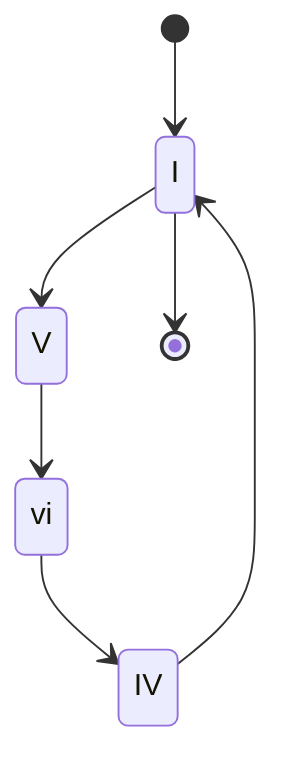
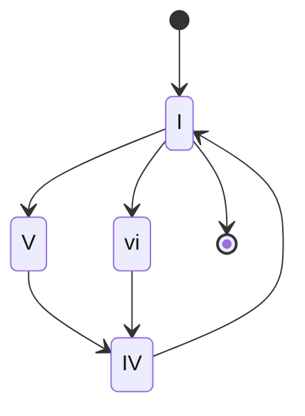

# Advanced Foundation: Jazz Harmony

## 1. Theoretical Invariants & Formal Frameworks

### Formal Proofs and Kernel Invariants

Jazz harmony, like any sophisticated musical system, is built upon a foundation of theoretical invariants and formal frameworks. These invariants are akin to the axioms in mathematics, providing a robust structure upon which harmonic complexity can be constructed. One such invariant is the principle of **tonal center**, which asserts that a piece of music revolves around a central pitch or key. This principle is formalized through the concept of **tonal gravity**, where pitches are assigned a gravitational pull towards the tonic, governed by the harmonic series and the overtone spectrum.

The **harmonic series** is a fundamental invariant in music theory, representing the natural overtones produced by a vibrating string. The series is defined as:

\[ f_n = f_0 \cdot n \]

where \( f_0 \) is the fundamental frequency and \( f_n \) is the \( n \)-th harmonic. In equal temperament, the frequency ratio between consecutive semitones is given by:

\[ f_n = f_0 \cdot 2^{n/12} \]

This ratio is a kernel invariant in Western music, providing a consistent tuning system that facilitates harmonic consonance and dissonance. In jazz, the exploration of altered chords and extensions can be seen as a manipulation of these kernel invariants, creating new harmonic landscapes while maintaining a sense of tonal coherence.

### Formal Frameworks in Jazz Harmony

A formal framework for jazz harmony can be constructed using set theory and group theory. **Set theory** provides a mathematical language for describing chord structures and their transformations. A **chord** can be represented as a set of pitch classes, and transformations such as transposition, inversion, and retrograde can be defined as operations on these sets. For example, the Cmaj7 chord can be represented as the set \(\{0, 4, 7\}\), where 0 represents C, 4 represents E, and 7 represents G.

**Group theory** offers a deeper understanding of the symmetries and transformations within jazz harmony. The **chromatic group** is a cyclic group of order 12, representing the 12 pitch classes in equal temperament. Operations within this group correspond to transpositions and inversions, providing a formal framework for analyzing chord progressions and voice leading.

## 2. Low-Level Invariant Taxonomy

### Deep Registers and Memory Models

In the context of jazz harmony, the concept of **deep registers** can be analogized to the low-level memory models in computer science. Just as memory models define the structure and behavior of data storage, deep registers in jazz harmony refer to the lower pitch ranges of instruments, which provide a rich, resonant foundation for harmonic structures. The bass, for instance, occupies the deep register, and its role in defining the harmonic landscape is crucial.

The **memory model** in jazz harmony can be seen as the set of harmonic structures and patterns that are stored and recalled by musicians. These structures include common chord progressions, scale patterns, and voicings. The **cache** in this model refers to the immediate recall of these structures, allowing musicians to navigate complex harmonic changes with fluidity. The **race condition** in jazz harmony occurs when two or more harmonic structures conflict, leading to dissonance or harmonic ambiguity. Musicians must navigate these race conditions with skill, using techniques such as voice leading and chord substitution to maintain harmonic coherence.

### Hardware Constraints and Axiomatic Definitions

The **hardware constraints** in jazz harmony refer to the physical limitations of instruments and the human voice. For example, the range of a saxophone is limited, and the technique required to play certain chords or scales is constrained by the instrument's design. These constraints define the axiomatic definitions within jazz harmony, providing a framework for harmonic exploration.

The **axiomatic definitions** in jazz harmony include the rules of voice leading, which ensure that harmonic transitions are smooth and consonant. Voice leading rules include the prohibition of parallel fifths and octaves, the resolution of dissonant intervals, and the use of consonant intervals to connect chords. These rules are axiomatic in the sense that they are accepted as fundamental principles within the harmonic system.

## 3. Micro-Architecture & Concurrency Dynamics

### Mermaid and ASCII State Machines

The micro-architecture of jazz harmony can be visualized using state machines, which represent the transitions between harmonic states. A **state machine** in jazz harmony is a model of a system that can be in one of a finite number of states, with transitions between states triggered by harmonic events. For example, a state machine can represent the transitions between chords in a jazz progression, with each state corresponding to a specific chord and each transition corresponding to a harmonic change.

The following Mermaid diagram represents a simple state machine for a jazz progression:



In this diagram, the states represent the chords I, V, vi, and IV, and the transitions represent the harmonic changes between these chords. The state machine can be extended to include more complex harmonic structures and transitions, providing a detailed model of the micro-architecture of jazz harmony.

### Cache and Race Condition Diagrams

The cache in jazz harmony can be visualized using a circular buffer, which represents the immediate recall of harmonic structures. The following ASCII diagram represents a circular buffer for a jazz progression:

```
+-------------------+
|   I   |   V   |   vi  |   IV  |
+-------------------+
```

In this diagram, the circular buffer represents the immediate recall of the chords I, V, vi, and IV. The buffer can be extended to include more complex harmonic structures and transitions, providing a detailed model of the cache in jazz harmony.

The race condition in jazz harmony can be visualized using a state machine with conflicting transitions. The following Mermaid diagram represents a state machine with a race condition:



In this diagram, the state machine has conflicting transitions between the chords I and IV, leading to a race condition. Musicians must navigate these race conditions with skill, using techniques such as voice leading and chord substitution to maintain harmonic coherence.

## 4. Subtle Failure Modes & Boundary Conditions

### Subtle Failure Modes

Subtle failure modes in jazz harmony occur when harmonic structures and transitions are not executed correctly, leading to dissonance or harmonic ambiguity. One subtle failure mode is the **voice leading error**, which occurs when dissonant intervals are not resolved correctly. For example, a voice leading error can occur when a chord transition involves a parallel fifth or octave, leading to a dissonant harmonic structure.

Another subtle failure mode is the **chord substitution error**, which occurs when a chord substitution is not executed correctly, leading to harmonic ambiguity. For example, a chord substitution error can occur when a dominant seventh chord is substituted with a diminished seventh chord, but the substitution is not executed correctly, leading to a dissonant harmonic structure.

### Boundary Conditions

Boundary conditions in jazz harmony occur when harmonic structures and transitions reach the limits of the harmonic system. One boundary condition is the **tonal center boundary**, which occurs when a piece of music moves away from its tonal center, leading to harmonic ambiguity. For example, a tonal center boundary can occur when a piece of music moves from the key of C major to the key of G major, leading to harmonic ambiguity.

Another boundary condition is the **harmonic series boundary**, which occurs when a harmonic structure reaches the limits of the harmonic series. For example, a harmonic series boundary can occur when a chord includes a high harmonic, leading to a dissonant harmonic structure.

## 5. Master Socratic Inquiries

### Research-Grade Discussion Questions

1. **Formal Proofs and Kernel Invariants:**
   - How can the harmonic series be used to formalize the concept of tonal gravity in jazz harmony?
   - How can set theory and group theory be used to construct a formal framework for jazz harmony?

2. **Low-Level Invariant Taxonomy:**
   - How do the deep registers and memory models in jazz harmony relate to the physical limitations of instruments and the human voice?
   - How do the axiomatic definitions in jazz harmony, such as the rules of voice leading, define the harmonic system?

3. **Micro-Architecture & Concurrency Dynamics:**
   - How can state machines be used to model the micro-architecture of jazz harmony?
   - How can circular buffers be used to model the cache in jazz harmony?

4. **Subtle Failure Modes & Boundary Conditions:**
   - How can voice leading errors be avoided in jazz harmony?
   - How can chord substitution errors be avoided in jazz harmony?

5. **Advanced Topics:**
   - How can the principles of digital signal processing be applied to the analysis and synthesis of jazz harmony?
   - How can machine learning techniques be used to generate jazz harmonic structures and progressions?

These research-grade discussion questions provide a framework for exploring the advanced foundations of jazz harmony, encouraging a deep and rigorous understanding of the theoretical invariants and formal frameworks that define this rich and complex musical system.
