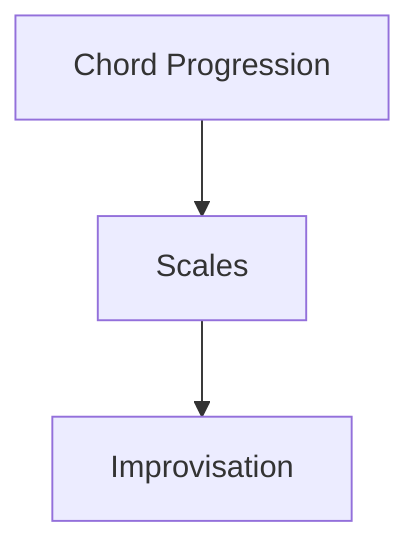

# Beginner Foundation: Jazz Harmony

## 1. Everyday Intuition & First Principles

Imagine you are at a bustling jazz club, the lights are dim, and the air is filled with the rich, soulful sounds of a jazz band. The rhythm section—drums, bass, and piano—lays down a steady, swinging beat. Over this foundation, the saxophonist and trumpet player improvise, weaving intricate melodies that dance around the chords. Jazz harmony is the musical language that allows these musicians to communicate and create together. It is a system of chords and scales that provides a framework for improvisation and composition, much like a map provides a framework for exploring a new city. Just as a map highlights key landmarks and routes, jazz harmony highlights key chords and scales that guide the musical journey.

## 2. Foundational Vocabulary & Glossary

### Chord
A chord is a group of three or more notes played simultaneously. In jazz, chords are the building blocks of harmony. For example, a C7 chord consists of the notes C, E, G, and Bb.

### Chord Progression
A chord progression is a sequence of chords played one after another. In jazz, common chord progressions include the ii-V-I progression (Dm7-G7-Cmaj7) and the I-vi-ii-V progression (Cmaj7-Am7-Dm7-G7).

### Scale
A scale is a series of notes played in ascending or descending order. In jazz, scales are used for improvisation and melody creation. The most common scales in jazz are the major scale, the natural minor scale, the harmonic minor scale, and the melodic minor scale.

### Blues Scale
The blues scale is a six-note scale that includes a flattened third and seventh degree. It is a fundamental scale in jazz and blues music. For example, the C blues scale consists of the notes C, Eb, F, G, Bb, and B.

### Dominant Seventh Chord
A dominant seventh chord is a chord that includes a root, third, fifth, and flattened seventh degree. It is a cornerstone of jazz harmony. For example, a G7 chord consists of the notes G, B, D, and Fb.

### Improvisation
Improvisation is the act of creating music on the spot, without pre-written notes. In jazz, improvisation is a key element that allows musicians to express their individuality and creativity. Improvisation is often based on chord progressions and scales.

## 3. Visual System Flow

### ASCII Diagram
```
+-------------------+       +-------------------+       +-------------------+
|   Chord Progress  |  ---> |       Scales      |  ---> |   Improvisation   |
|   (ii-V-I, I-vi-  |       | (Major, Minor,    |       |   (Based on      |
|    ii-V)          |       |  Blues)           |       |   Chords & Scales)|
+-------------------+       +-------------------+       +-------------------+
```

### Mermaid Flowchart


## 4. Common Beginner Misconceptions & Mental Traps

### Misconception: Jazz Harmony is Too Complex
Jazz harmony can seem complex at first, but it is built on a foundation of simple principles. By mastering the basic chords and scales, you can begin to understand and create jazz harmony.

### Misconception: You Need to Know All the Chords and Scales
While it is helpful to know many chords and scales, you do not need to memorize them all to start improvising. Focus on mastering a few key chords and scales, and gradually expand your knowledge.

### Misconception: Improvisation is Random
Improvisation in jazz is not random; it is based on a deep understanding of chords and scales. By studying jazz harmony, you can learn to improvise in a structured and meaningful way.

## 5. Socratic Discussion Starters

### Basic Questions to Explore with Your AI Tutor

1. **What is the difference between a major chord and a dominant seventh chord?**
2. **How does a ii-V-I progression work, and why is it so common in jazz?**
3. **Can you explain the role of the blues scale in jazz improvisation?**
4. **What are some common chord progressions in jazz, and how do they differ from classical progressions?**
5. **How do you choose which scale to use over a particular chord?**
6. **What are some exercises to improve your improvisation skills?**
7. **How does the rhythm section (drums, bass, piano) support the improvisation in jazz?**
8. **What are some key differences between jazz harmony and other musical styles, such as classical or pop?**

By exploring these questions, you can deepen your understanding of jazz harmony and develop a strong foundation for improvisation and composition.
