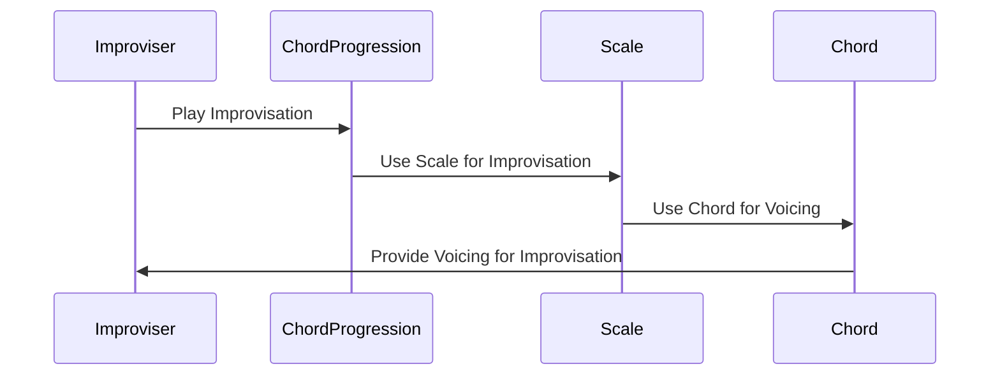

# Intermediate Foundation: Jazz Harmony

## 1. Architectural Mental Model

In the realm of jazz harmony, the architectural mental model is akin to a sophisticated cityscape, where each building represents a harmonic structure, and the streets are the pathways through which these structures interact. This cityscape is not static but dynamic, with constant movement and transformation, reflecting the improvisational nature of jazz. The foundational elements of this architecture include scales, chords, and progressions, which are the building blocks of harmonic structures. However, the true essence of jazz harmony lies in the way these elements are combined and transformed, creating a rich tapestry of sound.

### Scales and Modes
Scales and modes serve as the primary material from which jazz harmonies are constructed. The most common scales in jazz are the Major, Dorian, Mixolydian, Aeolian, Phrygian, and Locrian modes, each derived from the Major scale. These modes provide a framework for improvisation and composition, offering a palette of tonal colors. For instance, the Dorian mode (1, 2, ♭3, 4, 5, 6, ♭7) is often used over minor chords, while the Mixolydian mode (1, 2, 3, 4, 5, 6, ♭7) is frequently employed over dominant chords. Understanding the unique characteristics of each mode is crucial for creating compelling jazz harmonies.

### Chords and Voicings
Chords are the fundamental units of harmonic structure in jazz. The most common chords in jazz are the Major 7th, Minor 7th, Dominant 7th, and Diminished 7th chords. These chords form the backbone of jazz progressions and provide a framework for improvisation. Chord voicings are the specific arrangements of notes within a chord, and they play a critical role in the sound and texture of jazz music. Voicings can be open, closed, or spread, and they can be inverted to create different harmonic tensions and resolutions. The choice of voicing can significantly impact the overall sound and feel of a piece.

### Progressions and Forms
Progressions and forms are the architectural blueprints of jazz compositions. Common jazz forms include the 12-bar blues, the 32-bar AABA form, and the Rhythm Changes. These forms provide a structure for improvisation and composition, allowing musicians to explore harmonic and rhythmic variations within a defined framework. Understanding the harmonic structure of these forms is essential for creating effective jazz compositions and improvisations.

## 2. Systems Taxonomy & Component Protocols

In jazz harmony, the systems taxonomy and component protocols are akin to the rules and conventions that govern the construction of buildings in a city. These rules ensure that the various components of a harmonic structure work together seamlessly, creating a cohesive and compelling sound.

### Standard Interfaces
Standard interfaces in jazz harmony include the use of common chord progressions and scales. These interfaces provide a common language for musicians to communicate and collaborate, ensuring that the various components of a harmonic structure are compatible and coherent. For example, the use of the 12-bar blues progression provides a standard interface for improvisation, allowing musicians to explore harmonic and rhythmic variations within a defined framework.

### Protocols
Protocols in jazz harmony include the rules and conventions that govern the construction of harmonic structures. These protocols ensure that the various components of a harmonic structure work together seamlessly, creating a cohesive and compelling sound. For example, the use of the Dorian mode over a minor chord is a protocol that ensures harmonic coherence and tension.

### Data Models
Data models in jazz harmony include the use of Roman numeral analysis and functional harmony. These data models provide a framework for understanding the harmonic structure of a piece, allowing musicians to analyze and interpret the harmonic content of a piece. For example, the use of Roman numeral analysis allows musicians to identify the function of each chord in a progression, providing a deeper understanding of the harmonic structure.

## 3. Multi-Component Interaction Flow

The multi-component interaction flow in jazz harmony is akin to the flow of traffic in a city. The various components of a harmonic structure must work together seamlessly, creating a cohesive and compelling sound. The following ASCII and Mermaid sequence diagrams illustrate the interaction flow of jazz harmony.

### ASCII Sequence Diagram

```
[Improviser] ->> [Chord Progression]: Play Improvisation
[Chord Progression] ->> [Scale]: Use Scale for Improvisation
[Scale] ->> [Chord]: Use Chord for Voicing
[Chord] ->> [Improviser]: Provide Voicing for Improvisation
```

### Mermaid Sequence Diagram



## 4. Architectural Trade-offs & Production Pitfalls

In jazz harmony, architectural trade-offs and production pitfalls are akin to the challenges faced in urban planning. The various components of a harmonic structure must be balanced and harmonized to create a cohesive and compelling sound. The following are some common architectural trade-offs and production pitfalls in jazz harmony.

### Trade-offs
- **Harmonic Complexity vs. Clarity**: The use of complex harmonic structures can create a rich and engaging sound, but it can also be overwhelming and difficult to follow. Balancing harmonic complexity with clarity is essential for creating effective jazz compositions and improvisations.
- **Tonal vs. Atonal**: The use of tonal harmony can create a sense of stability and resolution, but it can also be limiting. The use of atonal harmony can create a sense of tension and dissonance, but it can also be challenging to navigate. Balancing tonal and atonal elements is essential for creating effective jazz compositions and improvisations.

### Pitfalls
- **Over-Reliance on Common Chord Progressions**: Over-reliance on common chord progressions can create a sense of predictability and monotony. Exploring new and unconventional chord progressions can create a sense of freshness and excitement.
- **Neglecting Voicings**: Neglecting voicings can create a sense of dissonance and tension. Paying attention to voicings can create a sense of clarity and resolution.
- **Ignoring Form**: Ignoring form can create a sense of chaos and disorder. Understanding and respecting form can create a sense of structure and coherence.

## 5. Socratic Discussion Starters

The following Socratic discussion starters bridge the architecture of jazz harmony to low-level implementation, encouraging deep reflection and exploration.

- **How do the various components of a harmonic structure (scales, chords, progressions) work together to create a cohesive and compelling sound?**
- **What are the trade-offs between harmonic complexity and clarity in jazz harmony?**
- **How can the use of unconventional chord progressions and voicings create a sense of freshness and excitement in jazz compositions and improvisations?**
- **How can the use of form and structure create a sense of coherence and resolution in jazz compositions and improvisations?**
- **How can the use of scales and modes create a sense of tonal color and texture in jazz compositions and improvisations?**

By exploring these questions, musicians can deepen their understanding of jazz harmony and create more effective compositions and improvisations.
