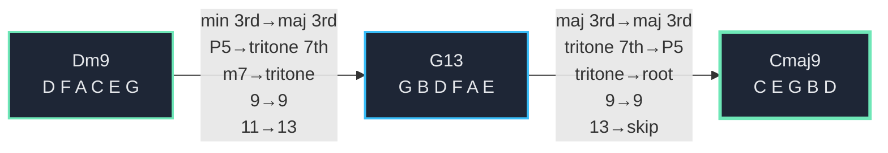

# Operational Verification Labs: Jazz Harmony

## Objective & Lab Setup

### Objective

This laboratory provides rigorous, hands-on implementation of jazz harmonic principles through systematic parameter variation, empirical analysis, and fault injection. You will construct harmonic progressions from first principles, dissect their intervallic architecture, and analyze how voice-leading constraints, chord-scale relationships, and functional substitution patterns govern harmonic motion in the jazz idiom. By the end of these exercises, you will understand the structural mechanics that distinguish jazz harmony from common-practice tonality: extended tertian chords, tritone substitution, modal interchange, and the tension-resolution cycles that drive improvisation.

### Lab Setup

Prepare the following environment:

**Notation and Analysis**
- **MuseScore 4.x** (open-source, cross-platform) for score entry, playback, and MIDI export
- **music21** Python library (>=9.1) for computational music analysis, chord recognition, and Roman numeral analysis

**Digital Audio Workstation**
- **Reaper** (lightweight, MIDI-capable) or **Ableton Live** for MIDI playback, track routing, and real-time parameter adjustment
- VST/AU instrument: **Keyscape**, **Addictive Keys**, or **Pianoteq** for realistic piano voicings

**Python Environment**
- Python 3.10 or later
- Libraries: `music21`, `numpy`, `matplotlib`, `scipy`, `pandas`
- Install via: `pip install music21 numpy matplotlib scipy pandas`

**Additional Tools**
- **iReal Pro** (optional) for chord chart playback and transposition
- **Sonic Visualiser** with Chordino plugin for audio-to-chord analysis

Verify installation:

```bash
python3 --version
python3 -c "import music21; print(music21.__version__)"
```

Configure music21 to use MuseScore for MIDI playback:

```python
from music21 import environment
us = environment.UserSettings()
us['musescoreDirectPNGPath'] = '/usr/bin/mscore'  # or /Applications/MuseScore\ 4.app/Contents/MacOS/mscore
us['musicxmlPath'] = '/usr/bin/mscore'
```

---

## Exercise 1: Foundational Practical Implementation

### Exercise Overview

You will construct a ii-V-I progression—the fundamental harmonic cell of jazz—and extend it with upper-structure tensions (9ths, 11ths, 13ths). This exercise establishes the intervallic stack that defines jazz chord voicings and demonstrates how voice-leading efficiency (minimizing melodic motion between adjacent chords) creates smooth harmonic flow.

**Theoretical Foundation: Why ii-V-I Works**

The ii-V-I progression in C major (Dm7 → G7 → Cmaj7) functions as a circle-of-fifths descent: the root motion by descending perfect fifth creates strong harmonic momentum. The V chord (G7) contains the tritone B-F, which resolves by contrary motion to C and E in the I chord. The ii chord prepares the V by establishing subdominant function and placing the 7th of the V chord (F) as a common tone.

In jazz, chords are extended with diatonic tensions:
- **Dm7**: root, minor 3rd, perfect 5th, minor 7th (D, F, A, C) → add 9th (E), 11th (G)
- **G7**: root, major 3rd, perfect 5th, minor 7th (G, B, D, F) → add 9th (A), 13th (E)
- **Cmaj7**: root, major 3rd, perfect 5th, major 7th (C, E, G, B) → add 9th (D), 13th (A)

### Step-by-Step Procedure

**1. Score Entry in MuseScore**

Open MuseScore and create a new score:
- Instrument: Jazz Combo (Piano, Bass, Drums)
- Time signature: 4/4
- Key signature: C major
- Tempo: 120 BPM (medium swing)

In the piano grand staff, enter the following chord voicings in the treble clef:

| Measure | Chord   | Voicing (bottom to top)       |
|---------|---------|-------------------------------|
| 1       | Dm9     | F, A, C, E, G                 |
| 2       | G13     | F, A, B, E                    |
| 3       | Cmaj9   | E, G, B, D                    |
| 4       | Cmaj9   | E, G, B, D                    |

These voicings are constructed in fourths (quartal harmony) in the left hand and thirds in the right, typical of modern jazz piano comping.

In the bass clef, add a walking bass line that outlines chord tones:

| Measure | Bass notes (quarter notes)    |
|---------|-------------------------------|
| 1       | D, F, A, C                    |
| 2       | G, B, D, F                    |
| 3       | C, E, G, B                    |
| 4       | C, Bb, A, Ab                  |

The final measure introduces chromatic approach tones (Bb, A, Ab) to set up a return to Dm7.

In the drum staff, notate a basic swing pattern:
- Hi-hat: eighth notes with swing feel (notate as straight eighths, enable swing playback)
- Ride cymbal: quarter notes on beats 1 and 3
- Snare: ghost notes on beats 2 and 4
- Bass drum: sparse kicks on beats 1 and 3

Add chord symbols above the staff using MuseScore's chord symbol palette: `Dm9`, `G13`, `Cmaj9`, `Cmaj9`.

Enable swing playback: Format → Style → Score → Set "Swing" to "Eighth note swing (2:1 ratio)".

Export the score as MIDI: File → Export → MIDI (select all tracks).

**2. DAW Import and Harmonic Verification**

Import the MIDI file into your DAW:
- Create separate tracks for piano, bass, and drums
- Load a piano VST on the piano track
- Load a bass VST or sampler on the bass track
- Route drums to a drum sampler or individual drum samples

Enable MIDI note display and verify chord voicings visually in the piano roll. Check that the tensions (9ths, 11ths, 13ths) are present and correctly spelled.

Play back the arrangement. Listen for:
- **Voice-leading smoothness**: Each chord tone should move by step or remain static when possible.
- **Tension resolution**: The tritone in G13 (B-F) should resolve to C and E in Cmaj9.
- **Swing feel**: The hi-hat and ride should lock with the bass to establish the groove.

**3. Computational Analysis with music21**

Analyze the harmonic structure programmatically:

```python
from music21 import stream, chord, roman, key
import matplotlib.pyplot as plt

# Define the progression
progression_stream = stream.Stream()
progression_stream.append(key.Key('C'))
progression_stream.append(chord.Chord(['D3', 'F3', 'A3', 'C4', 'E4', 'G4']))  # Dm9
progression_stream.append(chord.Chord(['G3', 'B3', 'D4', 'F4', 'A4', 'E5']))  # G13
progression_stream.append(chord.Chord(['C3', 'E3', 'G3', 'B3', 'D4']))        # Cmaj9
progression_stream.append(chord.Chord(['C3', 'E3', 'G3', 'B3', 'D4']))        # Cmaj9

# Analyze each chord
tonic = key.Key('C')
for i, ch in enumerate(progression_stream.getElementsByClass(chord.Chord)):
    print(f"Chord {i+1}: {ch.pitchedCommonName}")
    print(f"  Root: {ch.root().name}")
    print(f"  Bass: {ch.bass().name}")
    print(f"  Chord tones: {[p.nameWithOctave for p in ch.pitches]}")
    print(f"  Intervals from root: {[interval.Interval(ch.root(), p).name for p in ch.pitches]}")
    
    # Roman numeral analysis
    rn = roman.romanNumeralFromChord(ch, tonic)
    print(f"  Roman numeral: {rn.figure}")
    print()

# Extract root motion intervals
roots = [ch.root() for ch in progression_stream.getElementsByClass(chord.Chord)]
root_intervals = []
for i in range(len(roots) - 1):
    from music21 import interval
    root_interval = interval.Interval(roots[i], roots[i+1])
    root_intervals.append(root_interval.name)
    print(f"Root motion {i+1}→{i+2}: {root_interval.name}")
```

This script extracts the harmonic structure and calculates root motion. Expected output:

```
Chord 1: D minor ninth chord
  Root: D
  Bass: D
  Chord tones: ['D3', 'F3', 'A3', 'C4', 'E4', 'G4']
  Intervals from root: ['P1', 'm3', 'P5', 'm7', 'M9', 'P11']
  Roman numeral: ii9

Root motion 1→2: P5 (descending perfect fifth)
Root motion 2→3: P5 (descending perfect fifth)
Root motion 3→4: P1 (unison)
```

The analysis confirms circle-of-fifths motion (descending P5) from ii to V to I, the most efficient root progression in tonal harmony.

**4. Voice-Leading Diagram**

Visualize the voice-leading with a Mermaid diagram:



This diagram shows how individual voices move between chords. The tritone in G13 (B-F) resolves inward by semitone to C and E in Cmaj9, creating strong resolution.

---

## Exercise 2: Parameter Variation & Empirical Analysis

### Exercise Overview

You will systematically vary chord quality, extension, and substitution to analyze their effect on harmonic function and perceived tension. This exercise introduces **tritone substitution** (replacing V7 with bII7) and **modal interchange** (borrowing chords from parallel minor), two cornerstone techniques of jazz reharmonization.

**Theoretical Foundation: Tritone Substitution**

The tritone substitution replaces a dominant seventh chord with another dominant seventh chord whose root is a tritone away. In C major, G7 (root G, tritone B-F) can be replaced by Db7 (root Db, tritone F-Cb/B). The tritone interval is identical in both chords, but Db7 has a chromatic bass line descent: D → Db → C. This creates smooth voice-leading while maintaining dominant function.

**Modal Interchange**

Borrowing chords from the parallel minor (C minor) introduces darker harmonic colors. Common borrowed chords: bVI (Abmaj7), bVII (Bb7), iv (Fm7), bIIImaj7 (Ebmaj7). These chords introduce flat-side alterations while remaining functional within the key.

### Step-by-Step Procedure

**1. Generate Parametric Chord Progressions**

Create a Python function that generates ii-V-I progressions with randomized substitutions:

```python
import random
from music21 import chord, pitch, stream, key, roman
import numpy as np

class JazzProgressionGenerator:
    """Generate jazz progressions with substitution rules."""
    
    def __init__(self, tonic='C', mode='major'):
        self.key = key.Key(tonic, mode)
        self.tonic = pitch.Pitch(tonic)
        
    def build_chord(self, root_name, quality, extensions=None):
        """Construct a chord with specified quality and extensions."""
        root = pitch.Pitch(root_name)
        
        # Define interval patterns for chord qualities
        quality_intervals = {
            'maj7': [0, 4, 7, 11],      # root, M3, P5, M7
            'min7': [0, 3, 7, 10],      # root, m3, P5, m7
            'dom7': [0, 4, 7, 10],      # root, M3, P5, m7
            'halfdim7': [0, 3, 6, 10],  # root, m3, d5, m7
            'dim7': [0, 3, 6, 9],       # root, m3, d5, d7
        }
        
        extension_intervals = {
            '9': 14,   # M9 above root
            'b9': 13,  # m9 above root
            '#9': 15,  # A9 above root
            '11': 17,  # P11 above root
            '#11': 18, # A11 above root
            '13': 21,  # M13 above root
            'b13': 20, # m13 above root
        }
        
        # Build base chord
        intervals = quality_intervals.get(quality, [0, 4, 7, 10])
        pitches = [root.transpose(i) for i in intervals]
        
        # Add extensions
        if extensions:
            for ext in extensions:
                if ext in extension_intervals:
                    pitches.append(root.transpose(extension_intervals[ext]))
        
        return chord.Chord(pitches)
    
    def generate_two_five_one(self, substitution_mode='none'):
        """Generate ii-V-I with optional substitutions.
        
        Args:
            substitution_mode: 'none', 'tritone', 'modal_interchange', 'diminished'
        """
        progression = stream.Stream()
        progression.append(self.key)
        
        if substitution_mode == 'none':
            # Standard ii-V-I
            ii = self.build_chord('D', 'min7', ['9', '11'])
            V = self.build_chord('G', 'dom7', ['9', '13'])
            I = self.build_chord('C', 'maj7', ['9'])
            
        elif substitution_mode == 'tritone':
            # ii-bII-I (tritone sub on V)
            ii = self.build_chord('D', 'min7', ['9', '11'])
            V = self.build_chord('D-', 'dom7', ['9', '13'])  # Db7 instead of G7
            I = self.build_chord('C', 'maj7', ['9'])
            
        elif substitution_mode == 'modal_interchange':
            # iv-V-i (borrowed from parallel minor)
            ii = self.build_chord('F', 'min7', ['9', '11'])  # iv from C minor
            V = self.build_chord('G', 'dom7', ['b9', 'b13'])  # altered dominant
            I = self.build_chord('C', 'min7', ['9'])  # minor tonic
            
        elif substitution_mode == 'diminished':
            # ii-#iidim7-I (diminished passing chord)
            ii = self.build_chord('D', 'min7', ['9', '11'])
            V = self.build_chord('D#', 'dim7')  # D#dim7 = F#dim7 = Adim7 = Cdim7
            I = self.build_chord('C', 'maj7', ['9'])
            
        else:
            raise ValueError(f"Unknown substitution mode: {substitution_mode}")
        
        progression.append(ii)
        progression.append(V)
        progression.append(I)
        
        return progression
    
    def analyze_harmonic_tension(self, chord_obj):
        """Calculate tension coefficient based on dissonance and extension density.
        
        Returns a float from 0.0 (consonant) to 1.0 (maximally dissonant).
        """
        # Count semitone intervals (major 7th, minor 9th, tritone)
        dissonance_intervals = ['m2', 'M7', 'TT', 'm9', 'A4', 'd5']
        dissonance_count = 0
        
        pitches = chord_obj.pitches
        for i in range(len(pitches)):
            for j in range(i+1, len(pitches)):
                from music21 import interval
                intv = interval.Interval(pitches[i], pitches[j])
                if intv.simpleName in dissonance_intervals:
                    dissonance_count += 1
        
        # Normalize by number of possible intervals
        max_intervals = (len(pitches) * (len(pitches) - 1)) / 2
        tension = dissonance_count / max_intervals if max_intervals > 0 else 0.0
        
        return tension

# Generate and analyze progressions
generator = JazzProgressionGenerator('C', 'major')
modes = ['none', 'tritone', 'modal_interchange', 'diminished']

results = []
for mode in modes:
    prog = generator.generate_two_five_one(substitution_mode=mode)
    chords = prog.getElementsByClass(chord.Chord)
    
    print(f"\n=== Substitution mode: {mode} ===")
    tensions = []
    for i, ch in enumerate(chords):
        tension = generator.analyze_harmonic_tension(ch)
        tensions.append(tension)
        print(f"Chord {i+1}: {ch.pitchedCommonName}")
        print(f"  Pitches: {[p.nameWithOctave for p in ch.pitches]}")
        print(f"  Tension coefficient: {tension:.3f}")
    
    results.append({
        'mode': mode,
        'tensions': tensions,
        'mean_tension': np.mean(tensions),
        'progression': prog
    })

# Sort by mean tension
results.sort(key=lambda x: x['mean_tension'])
print("\n=== Tension ranking (low to high) ===")
for r in results:
    print(f"{r['mode']}: {r['mean_tension']:.3f}")
```

Expected output will rank substitution modes by harmonic tension. The modal interchange progression typically has highest tension due to borrowed flat-side chords and altered dominants (b9, b13).

**2. Visualize Tension Curves**

Plot tension across the progression for each substitution mode:

```python
import matplotlib.pyplot as plt

fig, ax = plt.subplots(figsize=(12, 6))

for r in results:
    ax.plot(range(1, len(r['tensions']) + 1), r['tensions'], 
            marker='o', label=r['mode'], linewidth=2, markersize=8)

ax.set_xlabel('Chord Position', fontsize=12, fontweight='bold')
ax.set_ylabel('Tension Coefficient', fontsize=12, fontweight='bold')
ax.set_title('Harmonic Tension Analysis: ii-V-I Substitutions', fontsize=14, fontweight='bold')
ax.set_xticks(range(1, 4))
ax.set_xticklabels(['ii', 'V', 'I'])
ax.legend(loc='best', fontsize=10)
ax.grid(True, alpha=0.3)
ax.set_ylim(0, 1)

plt.tight_layout()
plt.savefig('tension_analysis.png', dpi=300)
plt.show()
```

The graph will show:
- **Standard progression**: Low tension at ii, peak at V, resolution at I (classic tension-release curve)
- **Tritone substitution**: Similar curve but with chromatic voice-leading smoothness
- **Modal interchange**: Elevated tension throughout, with altered dominant creating maximum dissonance at V
- **Diminished**: Sharp tension spike at the diminished chord due to stacked minor thirds

**3. Statistical Analysis of Voice-Leading Efficiency**

Measure the total melodic motion (sum of interval distances) between adjacent chords:

```python
from music21 import interval

def calculate_voice_leading_cost(progression):
    """Compute total semitone motion between adjacent chords.
    
    Lower cost = smoother voice-leading.
    """
    chords = progression.getElementsByClass(chord.Chord)
    total_cost = 0
    
    for i in range(len(chords) - 1):
        chord1 = chords[i]
        chord2 = chords[i + 1]
        
        # Align chord sizes by padding shorter chord
        pitches1 = sorted(chord1.pitches, key=lambda p: p.ps)
        pitches2 = sorted(chord2.pitches, key=lambda p: p.ps)
        
        # Calculate minimum-cost voice assignment (simplified nearest-neighbor)
        chord_cost = 0
        for j in range(min(len(pitches1), len(pitches2))):
            intv = interval.Interval(pitches1[j], pitches2[j])
            chord_cost += abs(intv.semitones)
        
        total_cost += chord_cost
        print(f"  Chord {i+1}→{i+2}: {chord_cost} semitones")
    
    return total_cost

print("\n=== Voice-Leading Efficiency ===")
for r in results:
    cost = calculate_voice_leading_cost(r['progression'])
    print(f"{r['mode']}: {cost} semitones total\n")
```

The tritone substitution should show the lowest voice-leading cost due to chromatic bass motion (D → Db → C), while diminished substitution has
