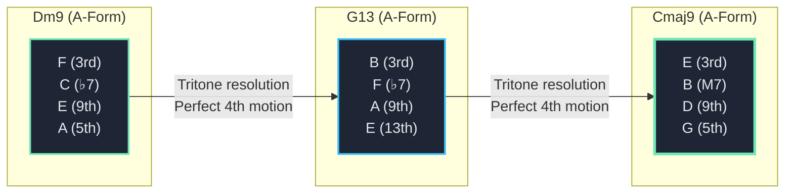
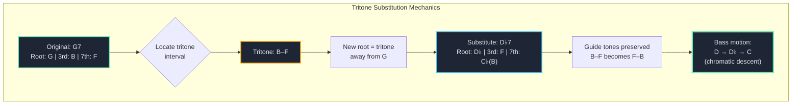
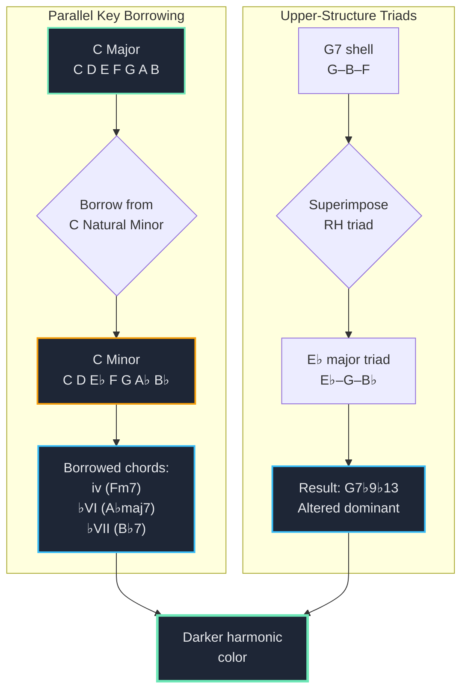
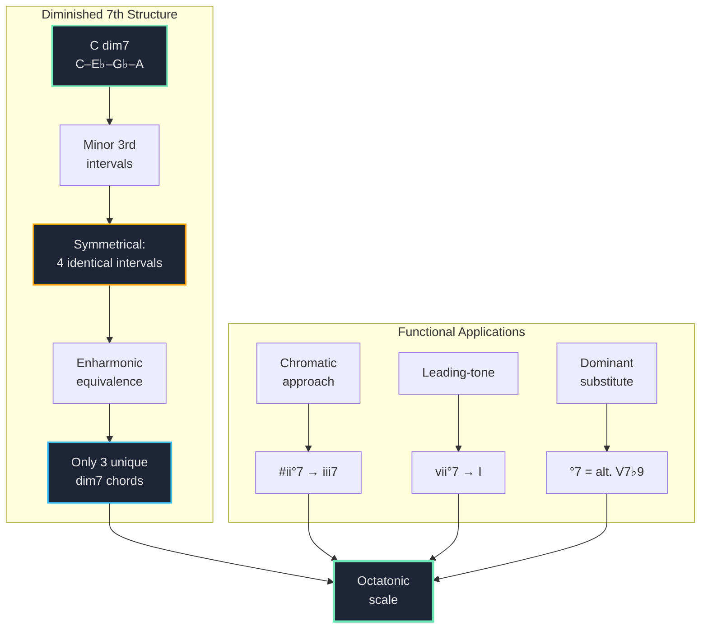
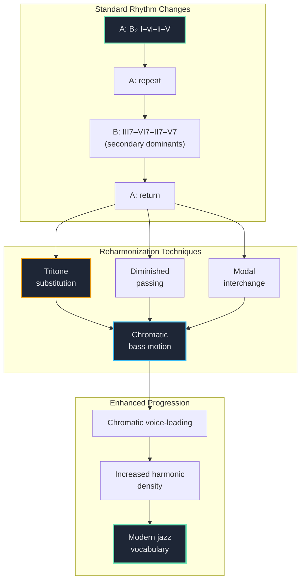

# Operational Verification Labs: Jazz Harmony

## Objective & Lab Setup

### Objective

This laboratory provides rigorous, hands-on implementation of jazz harmonic principles through systematic practice, empirical analysis, and real-time performance drills. You will construct harmonic progressions at the keyboard, analyze their intervallic architecture through score study and ear training, and master the voice-leading constraints, chord-scale relationships, and functional substitution patterns that govern harmonic motion in the jazz idiom.

By the end of these exercises, you will internalize the structural mechanics that distinguish jazz harmony from common-practice tonality: extended tertian chords (9ths, 11ths, 13ths), tritone substitution, modal interchange, upper-structure triads, and the tension-resolution cycles that drive improvisation. Every exercise includes keyboard drills with specific fingerings, metronome progressions, and computational verification tools.

### Lab Setup

Prepare the following environment:

**Primary Instrument: Piano or MIDI Keyboard**
- 61+ keys (minimum 5 octaves)
- Weighted or semi-weighted action preferred for dynamic control
- MIDI output capability for DAW integration

**Notation and Analysis**
- **MuseScore 4.x** (open-source, cross-platform) for score entry, playback, and MIDI export
- **music21** Python library (≥9.1) for computational music analysis, chord recognition, and Roman numeral analysis

**Digital Audio Workstation**
- **Reaper** (lightweight, MIDI-capable) or **Ableton Live** for MIDI playback, track routing, and real-time parameter adjustment
- VST/AU instrument: **Keyscape**, **Addictive Keys**, or **Pianoteq** for realistic piano voicings

**Python Environment**
- Python 3.10 or later
- Libraries: `music21`, `numpy`, `matplotlib`, `scipy`, `pandas`
- Install via: `pip install music21 numpy matplotlib scipy pandas`

**Additional Tools**
- **iReal Pro** (optional) for chord chart playback and transposition
- **Sonic Visualiser** with Chordino plugin for audio-to-chord analysis
- Metronome app or hardware metronome

Verify installation:

```bash
python3 --version
python3 -c "import music21; print(music21.__version__)"
```

Configure music21 to use MuseScore for MIDI playback:

```python
from music21 import environment
us = environment.UserSettings()
us['musescoreDirectPNGPath'] = '/usr/bin/mscore'  # or /Applications/MuseScore 4.app/Contents/MacOS/mscore
us['musicxmlPath'] = '/usr/bin/mscore'
```

---

## Exercise 1: Foundational Keyboard Implementation – ii-V-I with Extended Voicings

### Exercise Overview

You will physically practice the ii-V-I progression—the fundamental harmonic cell of jazz—at the keyboard with rootless voicings and extended tensions (9ths, 11ths, 13ths). This exercise establishes the intervallic stack that defines jazz comping and demonstrates how voice-leading efficiency (minimizing melodic motion between adjacent chords) creates smooth harmonic flow.

**Theoretical Foundation: Why ii-V-I Works (15%)**

The ii-V-I progression in C major (Dm7 → G7 → Cmaj7) functions as a circle-of-fifths descent: root motion by descending perfect fifth creates strong harmonic momentum. The V chord (G7) contains the tritone B–F, which resolves by contrary motion to C and E in the I chord. The ii chord prepares the V by establishing subdominant function and placing the 7th of the V chord (F) as a common tone.

In jazz, chords are extended with diatonic tensions:
- **Dm9(11)**: D–F–A–C + E (9th) + G (11th) → typical voicing omits root
- **G13**: G–B–D–F + A (9th) + E (13th) → typical voicing omits root and 5th
- **Cmaj9**: C–E–G–B + D (9th) → typical voicing omits 5th

Rootless voicings place the 3rd or 7th in the bass (left hand), allowing the bassist to outline the root motion. This creates a more open, transparent texture essential for comping behind soloists.

### Step-by-Step Procedure

#### 1. Keyboard Drill: A-Form Rootless Voicings (LH: 7-3-5-9)

**Hand Position & Ergonomics:**
- Sit at keyboard center (middle C directly in front of your navel)
- Feet flat on floor, thighs parallel to ground
- Elbows slightly above keyboard, wrists level (no wrist drop or elevation)
- Curved fingers, fingertips perpendicular to keys
- Weight transfers from shoulder through relaxed forearm, not finger-pushing

**A-Form Voicing Structure (3rd in bass):**

The A-form places the 3rd of the chord in the bass (LH lowest note), followed by the 7th, 9th, and 5th in ascending order.

**C Major ii-V-I in A-Form (LH Only):**

```
Dm9:   LH: F (3rd) – C (b7) – E (9th) – A (5th)
       Fingering: 5 – 3 – 2 – 1

G13:   LH: B (3rd) – F (b7) – A (9th) – E (13th)
       Fingering: 5 – 3 – 2 – 1

Cmaj9: LH: E (3rd) – B (M7) – D (9th) – G (5th)
       Fingering: 5 – 3 – 2 – 1
```

**Practice Drill 1A: Static Voicing Changes**

1. Set metronome to 60 BPM
2. Play Dm9 voicing as whole note (4 beats), all notes simultaneously
3. Transition to G13 voicing on beat 1 of next measure
4. Transition to Cmaj9 on beat 1 of third measure
5. Hold Cmaj9 for 4 beats, return to Dm9
6. Focus on minimal hand movement: fingers should stay close to keys, no unnecessary lifting

**Success Criteria:**
- All four notes sound simultaneously with balanced volume
- Smooth transitions with no audible gaps or overlapping chord tones
- Consistent dynamic level (mezzo-forte)

**Practice Drill 1B: Voice-Leading Analysis**

Play each voicing slowly and identify the voice-leading motion:

```
Dm9 → G13:
  F → B (augmented 4th up / tritone)
  C → F (perfect 4th up)
  E → A (perfect 4th up)
  A → E (perfect 4th down)

G13 → Cmaj9:
  B → E (perfect 4th up)
  F → B (augmented 4th up / tritone)
  A → D (perfect 4th up)
  E → G (minor 3rd up)
```

Notice the predominance of perfect 4th motion—this quartal movement creates smooth voice-leading with minimal hand displacement.

**Practice Drill 1C: Rhythmic Comping (60 → 80 → 100 → 120 BPM)**

Once static voicing changes are secure, add rhythmic variation:

1. Start at 60 BPM, 4/4 time
2. Play the following rhythm (x = chord attack, - = rest):

```
Measure 1 (Dm9):   |x - - x|
Measure 2 (G13):   |x - x -|
Measure 3 (Cmaj9): |x - - -|
Measure 4 (Cmaj9): |x - - -|
```

3. Increase tempo in 20 BPM increments: 60 → 80 → 100 → 120 BPM
4. At 120 BPM, add syncopation:

```
Measure 1 (Dm9):   |x - x -|- x - -|
Measure 2 (G13):   |- x - x|- - x -|
Measure 3 (Cmaj9): |x - - -|- - - -|
```

**Practice Drill 1D: Two-Hand Voicings with RH Melody**

Add right-hand melody on top of LH voicings:

```
Measure 1 (Dm9 in LH):   RH plays: A (5) → C (5) → E (5) → G (5) (quarter notes)
Measure 2 (G13 in LH):   RH plays: G (5) → B (4) → D (5) → F (5)
Measure 3 (Cmaj9 in LH): RH plays: E (5) → G (5) → C (5) → rest
```

Fingerings shown in parentheses. This creates independent melodic motion in the right hand while maintaining harmonic support in the left.

#### 2. Keyboard Drill: B-Form Rootless Voicings (LH: 3-7-9-5)

**B-Form Voicing Structure (7th in bass):**

The B-form places the 7th of the chord in the bass (LH lowest note), followed by the 3rd, 5th, and 9th in ascending order.

**C Major ii-V-I in B-Form (LH Only):**

```
Dm9:   LH: C (b7) – F (3rd) – A (5th) – E (9th)
       Fingering: 5 – 3 – 2 – 1

G13:   LH: F (b7) – B (3rd) – E (13th) – A (9th)
       Fingering: 5 – 3 – 2 – 1

Cmaj9: LH: B (M7) – E (3rd) – G (5th) – D (9th)
       Fingering: 5 – 3 – 2 – 1
```

**Practice Drill 2A: Alternating A-Form and B-Form**

1. Metronome at 60 BPM
2. Play one cycle of ii-V-I in A-form (see Drill 1A)
3. Immediately follow with one cycle in B-form
4. Focus on the hand shift: B-form sits approximately one octave higher than A-form
5. Repeat 10 times, alternating forms

**Success Criteria:**
- Clean transitions between A-form and B-form with no hesitation
- Consistent dynamic level across both forms
- Muscle memory for both fingering patterns

#### 3. All-Keys Transposition Drill

Jazz musicians must execute voicings in all 12 keys. Use the circle of fifths for systematic transposition.

**Circle of Fifths Sequence:**
C → F → Bb → Eb → Ab → Db → Gb → B → E → A → D → G → C

**Practice Drill 3A: Single-Key Mastery**

For each key, practice the following sequence:
1. A-form ii-V-I progression, 4 repetitions at 80 BPM
2. B-form ii-V-I progression, 4 repetitions at 80 BPM
3. Alternate A-form and B-form, 4 cycles at 100 BPM

**Daily Practice Schedule:**
- **Week 1:** C, F, Bb, Eb (flat keys)
- **Week 2:** Ab, Db, Gb, B (flat/sharp transition keys)
- **Week 3:** E, A, D, G (sharp keys)
- **Week 4:** All 12 keys, random selection

**Practice Drill 3B: Ii-V-I Cycle in All Keys**

Play continuous ii-V-I progressions descending by whole steps:

```
C major:  Dm9 – G13 – Cmaj9 (2 bars each)
Bb major: Cm9 – F13 – Bbmaj9
Ab major: Bbm9 – Eb13 – Abmaj9
Gb major: Abm9 – Db13 – Gbmaj9
E major:  F#m9 – B13 – Emaj9
... continue through all keys
```

Metronome at 80 BPM, each chord held for 2 beats. This drill builds fluency in all tonal centers and prepares you for real-book tunes that modulate frequently.

#### 4. Score Entry in MuseScore for Verification

Open MuseScore and create a new score:
- Instrument: Piano (Grand Staff)
- Time signature: 4/4
- Key signature: C major
- Tempo: 120 BPM (medium swing)

Enter the A-form voicings from Drill 1A in the treble and bass clefs:

| Measure | Chord   | LH (Bass Clef)       | RH (Treble Clef) |
|---------|---------|----------------------|------------------|
| 1       | Dm9     | F3, C4, E4, A4       | D5, F5, A5       |
| 2       | G13     | B3, F4, A4, E5       | G5, B5, D6       |
| 3       | Cmaj9   | E3, B3, D4, G4       | C5, E5, G5       |

Add chord symbols above the staff: `Dm9`, `G13`, `Cmaj9`.

Enable swing playback: Format → Style → Score → Set "Swing" to "Eighth note swing (2:1 ratio)".

Export the score as MIDI: File → Export → MIDI.

#### 5. Computational Analysis with music21

Analyze the harmonic structure programmatically:

```python
from music21 import stream, chord, roman, key, interval
import matplotlib.pyplot as plt

# Define the progression using A-form voicings
progression_stream = stream.Stream()
progression_stream.append(key.Key('C'))

dm9 = chord.Chord(['F3', 'C4', 'E4', 'A4'])  # Dm9 rootless A-form
g13 = chord.Chord(['B3', 'F4', 'A4', 'E5'])  # G13 rootless A-form
cmaj9 = chord.Chord(['E3', 'B3', 'D4', 'G4'])  # Cmaj9 rootless A-form

progression_stream.append(dm9)
progression_stream.append(g13)
progression_stream.append(cmaj9)

# Analyze each chord
tonic = key.Key('C')
for i, ch in enumerate(progression_stream.getElementsByClass(chord.Chord)):
    print(f"\n=== Chord {i+1} ===")
    
    # Infer root from chord tones (music21 sometimes misidentifies rootless voicings)
    # Manually correct if needed
    roots_manual = ['D', 'G', 'C']
    ch_root = roots_manual[i]
    
    print(f"Root (manual): {ch_root}")
    print(f"Voicing: {[p.nameWithOctave for p in ch.pitches]}")
    
    # Calculate intervals from inferred root
    root_pitch = chord.Chord([ch_root + '3']).pitches[0]
    intervals_from_root = []
    for p in ch.pitches:
        intv = interval.Interval(root_pitch, p)
        intervals_from_root.append(intv.simpleName)
    print(f"Intervals from root: {intervals_from_root}")

# Voice-leading analysis: measure semitone motion between adjacent chords
print("\n=== Voice-Leading Motion ===")
chords = list(progression_stream.getElementsByClass(chord.Chord))
for i in range(len(chords) - 1):
    ch1 = chords[i]
    ch2 = chords[i + 1]
    
    print(f"\nChord {i+1} → Chord {i+2}:")
    pitches1 = sorted(ch1.pitches, key=lambda p: p.ps)
    pitches2 = sorted(ch2.pitches, key=lambda p: p.ps)
    
    total_motion = 0
    for j in range(min(len(pitches1), len(pitches2))):
        intv = interval.Interval(pitches1[j], pitches2[j])
        print(f"  {pitches1[j].nameWithOctave} → {pitches2[j].nameWithOctave}: {intv.directedName} ({intv.semitones} semitones)")
        total_motion += abs(intv.semitones)
    
    print(f"  Total motion: {total_motion} semitones")
```

Expected output confirms the efficient voice-leading: total motion between adjacent chords should be 10–15 semitones, indicating smooth contrary and oblique motion typical of rootless jazz voicings.

#### 6. Voice-Leading Diagram



---

## Exercise 2: Tritone Substitution & Chromatic Voice-Leading

### Exercise Overview

You will systematically practice **tritone substitution** (replacing V7 with bII7) at the keyboard, analyzing the chromatic bass line and shared tritone interval that make this substitution function. This exercise introduces advanced reharmonization techniques essential for jazz arranging and improvisation.

**Theoretical Foundation: Tritone Substitution (15%)**

The tritone substitution replaces a dominant seventh chord with another dominant seventh chord whose root is a tritone away. In C major, G7 (root G, 3rd B, 7th F) can be replaced by Db7 (root Db, 3rd F, 7th Cb/B). The tritone interval B–F is identical in both chords (enharmonically), but the bass line becomes chromatic: D → Db → C instead of D → G → C.

This creates smoother voice-leading while maintaining dominant function. The tritone (augmented 4th / diminished 5th) is the defining interval of dominant harmony because it creates harmonic instability that demands resolution to the tonic.

### Step-by-Step Procedure

#### 1. Keyboard Drill: Standard ii-V-I vs. ii-bII-I

**Standard ii-V-I (A-Form):**

```
Dm9:   LH: F3 – C4 – E4 – A4
G13:   LH: B3 – F4 – A4 – E5
Cmaj9: LH: E3 – B3 – D4 – G4
```

**Tritone Substitution ii-bII-I (A-Form):**

```
Dm9:     LH: F3 – C4 – E4 – A4 (same as standard)
Db13:    LH: F3 – Cb4(B3) – Eb4 – Ab4  [Tritone sub for G13]
Cmaj9:   LH: E3 – B3 – D4 – G4 (same as standard)
```

**Practice Drill 2A: Side-by-Side Comparison**

1. Set metronome to 60 BPM
2. Play standard ii-V-I (4 bars: 1 bar per chord + 1 bar rest)
3. Immediately play tritone-sub ii-bII-I (4 bars)
4. Compare the bass motion:
   - **Standard:** F → B (tritone leap) → E (perfect 4th)
   - **Tritone sub:** F → F (common tone) → E (semitone)

**Observation:** The tritone substitution creates a chromatic bass line descent (Db in the root motion: D → Db → C) while preserving the tritone guide tones (3rd and 7th). Notice that F is a common tone between Dm9 and Db13.

**Practice Drill 2B: Isolated Tritone Analysis**

Play only the 3rd and 7th of each chord (two-note voicing):

```
G7:   B (3rd) – F (7th) in LH
Db7:  F (3rd) – Cb/B (7th) in LH
```

These are the **guide tones**—the 3rd and 7th define chord quality and function. Notice that G7 and Db7 share the same tritone (B–F), just inverted. This is why the substitution works: harmonic function is preserved while root motion changes.

#### 2. Keyboard Drill: Tritone Sub in All Keys

Transpose the ii-bII-I progression through the circle of fifths:

```
C major:  Dm9 – Db13 – Cmaj9
F major:  Gm9 – Gb13 – Fmaj9
Bb major: Cm9 – B13 – Bbmaj9
Eb major: Fm9 – E13 – Ebmaj9
... continue
```

**Practice Drill 2C: All-Keys Cycle (80 → 100 → 120 BPM)**

1. Start at 80 BPM, 2 beats per chord
2. Play the complete 12-key cycle (3 chords × 12 keys = 36 chords total)
3. Focus on the chromatic semitone motion in the bass from ii to bII
4. Increase tempo: 80 → 100 → 120 BPM

**Success Criteria:**
- Smooth chromatic voice-leading with no hesitation
- Clean tritone guide-tone resolution in each key
- Consistent tempo and dynamic level

#### 3. Practical Application: Reharmonizing "Autumn Leaves"

Standard progression (first 8 bars, key of G minor):

```
| Cm7  | F7   | Bbmaj7 | Ebmaj7 |
| Am7b5| D7   | Gm7    | Gm7    |
```

Apply tritone substitution to dominant chords:

```
| Cm7  | B7   | Bbmaj7 | Ebmaj7 |  [F7 → B7]
| Am7b5| Ab7  | Gm7    | Gm7    |  [D7 → Ab7]
```

**Practice Drill 3A: Reharmonized "Autumn Leaves"**

1. Learn the standard progression in both A-form and B-form voicings
2. Practice the reharmonized version with tritone subs
3. Play through both versions consecutively, comparing the harmonic color

**Practice Drill 3B: Improvising with Tritone Subs**

1. Record or loop the chord progression (use a DAW or iReal Pro)
2. Improvise melodically over the progression, using chord tones and tensions
3. Notice how the tritone sub creates unexpected chromatic movement in the bass, opening new melodic possibilities

#### 4. Computational Analysis: Voice-Leading Efficiency

```python
from music21 import stream, chord, key, interval

# Standard ii-V-I
standard = stream.Stream()
standard.append(chord.Chord(['F3', 'C4', 'E4', 'A4']))  # Dm9
standard.append(chord.Chord(['B3', 'F4', 'A4', 'E5']))  # G13
standard.append(chord.Chord(['E3', 'B3', 'D4', 'G4']))  # Cmaj9

# Tritone substitution ii-bII-I
tritone_sub = stream.Stream()
tritone_sub.append(chord.Chord(['F3', 'C4', 'E4', 'A4']))  # Dm9
tritone_sub.append(chord.Chord(['F3', 'B3', 'Eb4', 'Ab4']))  # Db13
tritone_sub.append(chord.Chord(['E3', 'B3', 'D4', 'G4']))  # Cmaj9

def calculate_voice_leading_cost(progression, name):
    """Calculate total semitone motion between adjacent chords."""
    chords = list(progression.getElementsByClass(chord.Chord))
    total_cost = 0
    
    print(f"\n=== {name} ===")
    for i in range(len(chords) - 1):
        ch1 = chords[i]
        ch2 = chords[i + 1]
        
        pitches1 = sorted(ch1.pitches, key=lambda p: p.ps)
        pitches2 = sorted(ch2.pitches, key=lambda p: p.ps)
        
        chord_cost = 0
        for j in range(min(len(pitches1), len(pitches2))):
            intv = interval.Interval(pitches1[j], pitches2[j])
            chord_cost += abs(intv.semitones)
        
        total_cost += chord_cost
        print(f"Chord {i+1} → {i+2}: {chord_cost} semitones")
    
    print(f"Total voice-leading cost: {total_cost} semitones\n")
    return total_cost

standard_cost = calculate_voice_leading_cost(standard, "Standard ii-V-I")
tritone_cost = calculate_voice_leading_cost(tritone_sub, "Tritone Sub ii-bII-I")

print(f"Voice-leading efficiency gain: {standard_cost - tritone_cost} semitones")
```

Expected output: The tritone substitution should show a lower total voice-leading cost (fewer semitones of motion) due to the chromatic bass line and common-tone preservation between Dm9 and Db13.

#### 5. Tritone Substitution Flowchart



---

## Exercise 3: Modal Interchange & Upper-Structure Triads

### Exercise Overview

You will practice **modal interchange** (borrowing chords from the parallel minor) and **upper-structure triads** (superimposing triads over dominant chords to create complex tensions). These techniques expand harmonic color and create darker, more ambiguous tonalities characteristic of modern jazz.

**Theoretical Foundation: Modal Interchange (15%)**

Modal interchange borrows chords from the parallel minor key. In C major, chords borrowed from C natural minor include:
- **iv (Fm7)** instead of IV (Fmaj7)
- **♭VI (A♭maj7)** instead of vi (Am7)
- **♭VII (B♭7)** instead of vii° (Bm7♭5)
- **♭III (E♭maj7)** instead of iii (Em7)

These chords introduce ♭3, ♭6, and ♭7 scale degrees, creating darker harmonic colors while remaining functional within the tonal center. Modal interchange is common in jazz standards like "All the Things You Are" (borrowed ♭VI in the bridge) and "Blue Bossa" (borrowed iv).

**Upper-Structure Triads:**

Upper-structure triads superimpose a major or minor triad in the right hand over a dominant 7th chord shell (root, 3rd, 7th) in the left hand. This creates complex tensions without thinking about stacked intervals.

Example: G7 with E♭ major triad on top
- LH: G (root), B (3rd), F (7th)
- RH: E♭ (♭13), G (root), B♭ (♭9)
- Result: G7♭9♭13 (altered dominant)

### Step-by-Step Procedure

#### 1. Keyboard Drill: iv Minor Plagal Cadence

**Standard IV-I (Major Plagal):**

```
Fmaj7: LH: E3 – A3 – C4 – F4 (rootless A-form)
Cmaj7: LH: E3 – B3 – D4 – G4
```

**Borrowed iv-I (Minor Plagal):**

```
Fm7:   LH: Eb3 – Ab3 – C4 – F4 (rootless A-form)
Cmaj7: LH: E3 – B3 – D4 – G4
```

**Practice Drill 3A: Major vs. Minor Plagal Comparison**

1. Set metronome to 60 BPM
2. Play Fmaj7 → Cmaj7 (major plagal), hold each chord for 4 beats
3. Play Fm7 → Cmaj7 (minor plagal), hold each chord for 4 beats
4. Alternate between major and minor plagal cadences 10 times

**Observation:** The minor plagal (iv-I) has a darker, more melancholic quality due to the ♭3 (A♭) in Fm7, which resolves by semitone to G (5th of Cmaj7). This creates a characteristic "Amen cadence" sound common in gospel and modal jazz.

#### 2. Keyboard Drill: ♭VI Borrowed Chord

**Standard vi-ii-V-I (Diatonic):**

```
Am7:   LH: G3 – C4 – E4 – B4
Dm7:   LH: F3 – C4 – E4 – A4
G7:    LH: B3 – F4 – A4 – D5
Cmaj7: LH: E3 – B3 – D4 – G4
```

**Borrowed ♭VI-ii-V-I:**

```
A♭maj7: LH: G3 – C4 – Eb4 – Ab4  [borrowed ♭VI]
Dm7:    LH: F3 – C4 – E4 – A4
G7:     LH: B3 – F4 – A4 – D5
Cmaj7:  LH: E3 – B3 – D4 – G4
```

**Practice Drill 3B: ♭VI Chromatic Motion**

1. Metronome at 80 BPM
2. Play the diatonic vi-ii-V-I progression
3. Play the borrowed ♭VI-ii-V-I progression
4. Compare the bass motion:
   - **Diatonic:** G (vi bass) → F (ii bass) → B (V bass) → E (I bass)
   - **Borrowed:** G (♭VI bass) → F (ii bass) → B (V bass) → E (I bass)

Notice that the bass voice-leading is identical, but the chord quality change (A♭maj7 instead of Am7) introduces ♭6 (A♭) and ♭3 (E♭), creating harmonic ambiguity.

#### 3. Keyboard Drill: Upper-Structure Triads on Dominant Chords

Upper-structure triads are built on specific scale degrees of the altered scale. The three most common upper-structures for G7:

**G7 with D♭ major triad (♭5, ♭7, ♭9):**

```
LH: G2 – B2 – F3 (root, 3rd, 7th shell)
RH: Db4 – F4 – Ab4 (D♭ major triad)
Result: G7♭5♭9
```

**G7 with E♭ major triad (♭13, root, ♭9):**

```
LH: G2 – B2 – F3
RH: Eb4 – G4 – Bb4 (E♭ major triad)
Result: G7♭9♭13
```

**G7 with F# minor triad (M7, 9, #11):**

```
LH: G2 – B2 – F3
RH: F#4 – A4 – C#5 (F# minor triad)
Result: G7(#11,M7,9) [Lydian dominant color]
```

**Practice Drill 3C: Upper-Structure Catalog**

For each upper-structure:
1. Play the LH shell alone (4 beats)
2. Add the RH triad (4 beats)
3. Play both hands simultaneously (4 beats)
4. Resolve to Cmaj9 voicing (4 beats)

Repeat at 60 → 80 → 100 BPM.

**Practice Drill 3D: Upper-Structure Reharmonization**

Take a standard ii-V-I and add upper-structure triads to the V chord:

```
| Dm9 (2 bars) | G7 + E♭ maj triad (2 bars) | Cmaj9 (2 bars) |
```

Practice in all 12 keys using the circle of fifths.

#### 4. Modal Interchange Progression: "All the Things You Are" Bridge

The bridge of "All the Things You Are" (measures 17-24 in original key of A♭ major) uses modal interchange:

```
| Fmaj7 | Fmaj7 | Bbm7  | Eb7  |  [Bbm7 is borrowed iv from F minor]
| Abmaj7| Abmaj7| Am7   | D7   |  [Am7-D7 is ii-V to G major]
```

**Practice Drill 3E: "All the Things" Bridge**

1. Learn the bridge in the original key (A♭ major → F major → G major modulations)
2. Practice the borrowed iv (B♭m7) → I (A♭maj7) resolution, focusing on the ♭3 (D♭) moving to C (3rd of A♭maj7)
3. Transpose the bridge to C major:

```
| Cmaj7 | Cmaj7 | Fm7   | Bb7  |  [Fm7 is borrowed iv from C minor]
| Ebmaj7| Ebmaj7| Em7   | A7   |
```

#### 5. Computational Analysis: Modal Interchange Tension

```python
from music21 import stream, chord, scale, pitch
import numpy as np

def analyze_borrowed_chord_tension(key_tonic, borrowed_chord_pitches):
    """Analyze non-diatonic pitch content in a borrowed chord."""
    
    # Define the diatonic scale
    major_scale = scale.MajorScale(key_tonic)
    diatonic_pitches = [p.name for p in major_scale.pitches]
    
    # Check each pitch in the borrowed chord
    non_diatonic = []
    for p in borrowed_chord_pitches:
        if p.name not in diatonic_pitches:
            non_diatonic.append(p.name)
    
    tension_ratio = len(non_diatonic) / len(borrowed_chord_pitches)
    
    return non_diatonic, tension_ratio

# Example: Fm7 borrowed into C major
c_major_key = 'C'
fm7_chord = chord.Chord(['F3', 'Ab3', 'C4', 'Eb4'])

non_diatonic, tension = analyze_borrowed_chord_tension(c_major_key, fm7_chord.pitches)

print(f"Key: {c_major_key} major")
print(f"Borrowed chord: {fm7_chord.pitchedCommonName}")
print(f"Chord pitches: {[p.name for p in fm7_chord.pitches]}")
print(f"Non-diatonic pitches: {non_diatonic}")
print(f"Tension ratio: {tension:.2f} ({len(non_diatonic)}/{len(fm7_chord.pitches)} pitches)")

# Compare to diatonic IV chord (Fmaj7)
fmaj7_chord = chord.Chord(['F3', 'A3', 'C4', 'E4'])
non_diatonic_diatonic, tension_diatonic = analyze_borrowed_chord_tension(c_major_key, fmaj7_chord.pitches)

print(f"\nDiatonic comparison: {fmaj7_chord.pitchedCommonName}")
print(f"Non-diatonic pitches: {non_diatonic_diatonic}")
print(f"Tension ratio: {tension_diatonic:.2f}")
```

Expected output: Fm7 will show 2 non-diatonic pitches (A♭, E♭) out of 4 total, giving a tension ratio of 0.50. Fmaj7 will show 0 non-diatonic pitches, tension ratio 0.00.

#### 6. Modal Interchange & Upper-Structure Diagram



---

## Exercise 4: Diminished Passing Chords & Symmetrical Harmony

### Exercise Overview

You will practice **diminished 7th passing chords** and explore **symmetrical harmony**—chord structures that divide the octave into equal intervals. Diminished 7th chords (four notes separated by minor 3rds) create smooth chromatic voice-leading and function as approach chords to diatonic targets.

**Theoretical Foundation: Diminished 7th Chords (15%)**

A fully diminished 7th chord consists of four pitches separated by minor 3rds (3 semitones). Example: Cdim7 = C–E♭–G♭–A (or B♭♭).

Key properties:
- **Symmetrical:** Each inversion is another diminished 7th chord
- **Enharmonic equivalence:** Only 3 unique diminished 7th chords exist (12 semitones ÷ 4 notes = 3)
- **Function:** Leading-tone diminished (vii°7) or chromatic passing/approach chord

In jazz, diminished 7th chords most commonly function as chromatic approach chords a semitone below the target chord. Example: #iidim7 → iii7 (D#dim7 → Em7 in C major).

### Step-by-Step Procedure

#### 1. Keyboard Drill: Diminished 7th Inversions

Play the four inversions of Cdim7:

```
Root position:   C – Eb – Gb – A   (Fingering: 1 – 2 – 3 – 5)
1st inversion:   Eb – Gb – A – C   (Fingering: 1 – 2 – 3 – 5)
2nd inversion:   Gb – A – C – Eb   (Fingering: 1 – 2 – 3 – 5)
3rd inversion:   A – C – Eb – Gb   (Fingering: 1 – 2 – 3 – 5)
```

**Practice Drill 4A: Symmetrical Inversion Cycle**

1. Set metronome to 60 BPM
2. Play each inversion as a whole note (4 beats)
3. Move through all four inversions ascending, then descending
4. Notice that each inversion has identical intervallic structure (minor 3rds)

**Practice Drill 4B: Three Diminished Families**

There are only 3 unique diminished 7th chords (transposed enharmonically):

**Family 1:** Cdim7 = Ebdim7 = Gbdim7 = Adim7
**Family 2:** Dbdim7 = Edim7 = Gdim7 = Bbdim7
**Family 3:** Ddim7 = Fdim7 = Abdim7 = Bdim7

Play each family in root position ascending through all enharmonic spellings:

```
Family 1: C–Eb–Gb–A  →  Eb–Gb–A–C  →  Gb–A–C–Eb  →  A–C–Eb–Gb
```

Metronome at 80 BPM, 2 beats per chord.

#### 2. Keyboard Drill: Chromatic Approach with Diminished Chords

**Standard ii-V-I:**

```
Dm7 – G7 – Cmaj7
```

**Diminished Passing Chord Version:**

```
Dm7 – D#dim7 – Em7 – G7 – Cmaj7
```

The D#dim7 functions as a chromatic approach chord leading to Em7. Voice-leading:

```
Dm7:     LH: F3 – C4 – E4 – A4
D#dim7:  LH: F#3 – C4 – D#4 – A4  [chromatic passing]
Em7:     LH: G3 – D4 – F#4 – B4
G7:      LH: B3 – F4 – A4 – D5
Cmaj7:   LH: E3 – B3 – D4 – G4
```

**Practice Drill 4C: Chromatic Approach Patterns**

1. Metronome at 60 BPM
2. Play the standard ii-V-I progression (4 bars)
3. Play the diminished passing chord version (5 bars: ii, #ii°7, iii, V, I)
4. Focus on the chromatic voice-leading from Dm7 → D#dim7 → Em7

**Practice Drill 4D: All-Keys Diminished Approach**

For each key in the circle of fifths, practice:

```
ii7 – #ii°7 – iii7 – V7 – Imaj7
```

Example in F major:

```
Gm7 – G#dim7 – Am7 – C7 – Fmaj7
```

#### 3. Keyboard Drill: Diminished Scale & Improvisation

The diminished scale (also called octatonic scale) alternates whole steps and half steps:

**C Whole-Half Diminished:** C–D–Eb–F–Gb–Ab–A–B–C

This scale fits over diminished 7th chords and provides a melodic framework for improvisation.

**Practice Drill 4E: Diminished Scale Patterns**

1. Play the C whole-half diminished scale ascending and descending, one octave
2. Finger patterns:
   - Ascending: 1-2-3-1-2-3-4-5 (RH)
   - Descending: 5-4-3-2-1-3-2-1
3. Play the scale in 3rds: C–Eb, D–F, Eb–Gb, F–Ab, etc.
4. Play the scale in triads: C–Eb–Gb (diminished triad), D–F–Ab (diminished triad), etc.

**Practice Drill 4F: Diminished Arpeggio & Scale Improv**

1. Loop a Cdim7 chord in the DAW (4-bar loop)
2. Improvise melodically using the C whole-half diminished scale
3. Target chord tones (C, Eb, Gb, A) on strong beats (1 and 3)
4. Use passing tones (D, F, Ab, B) on weak beats (2 and 4)

#### 4. Practical Application: "Inner Urge" (Joe Henderson)

Joe Henderson's "Inner Urge" uses diminished 7th chords as structural harmony:

```
| Ebm7  | Ab7   | Dbmaj7 | Dbmaj7 |
| Ddim7 | Ddim7 | Ebm7   | Ebm7   |
```

The Ddim7 chord (measures 5-6) functions as a chromatic pivot, creating ambiguous tonality before resolving back to Ebm7.

**Practice Drill 4G: "Inner Urge" Diminished Section**

1. Learn the progression in the original key (E♭ minor)
2. Practice the Ddim7 voicing:

```
Ddim7: LH: F3 – B3 – D4 – Ab4 (1st inversion)
```

3. Improvise over the Ddim7 using the D whole-half diminished scale
4. Transpose to C minor:

```
| Cm7   | F7    | Bbmaj7 | Bbmaj7 |
| Bdim7 | Bdim7 | Cm7    | Cm7    |
```

#### 5. Computational Analysis: Symmetrical Interval Distribution

```python
from music21 import chord, interval
import numpy as np

def analyze_symmetry(chord_obj):
    """Analyze interval symmetry in a chord."""
    
    pitches = sorted(chord_obj.pitches, key=lambda p: p.ps)
    intervals = []
    
    # Calculate intervals between adjacent pitches
    for i in range(len(pitches) - 1):
        intv = interval.Interval(pitches[i], pitches[i + 1])
        intervals.append(intv.semitones)
    
    # Check for symmetry (all intervals equal)
    is_symmetric = len(set(intervals)) == 1
    
    return intervals, is_symmetric

# Analyze Cdim7
cdim7 = chord.Chord(['C4', 'Eb4', 'Gb4', 'A4'])
intervals, symmetric = analyze_symmetry(cdim7)

print(f"Chord: {cdim7.pitchedCommonName}")
print(f"Pitches: {[p.nameWithOctave for p in cdim7.pitches]}")
print(f"Adjacent intervals (semitones): {intervals}")
print(f"Symmetrical: {symmetric}")

# Compare to Cmaj7 (asymmetrical)
cmaj7 = chord.Chord(['C4', 'E4', 'G4', 'B4'])
intervals_maj, symmetric_maj = analyze_symmetry(cmaj7)

print(f"\nChord: {cmaj7.pitchedCommonName}")
print(f"Pitches: {[p.nameWithOctave for p in cmaj7.pitches]}")
print(f"Adjacent intervals (semitones): {intervals_maj}")
print(f"Symmetrical: {symmetric_maj}")
```

Expected output: Cdim7 will show `[3, 3, 3]` (all minor 3rds), symmetrical = True. Cmaj7 will show `[4, 3, 5]` (major 3rd, minor 3rd, major 3rd), symmetrical = False.

#### 6. Diminished Harmony Diagram



---

## Exercise 5: Integration Lab – "Rhythm Changes" Complete Reharmonization

### Exercise Overview

You will apply all learned techniques (rootless voicings, tritone substitution, modal interchange, diminished passing chords) to reharmonize the "Rhythm Changes" progression—the harmonic foundation of hundreds of jazz standards including "I Got Rhythm," "Anthropology," and "Oleo."

**Theoretical Foundation: Rhythm Changes Form (15%)**

"Rhythm Changes" is a 32-bar AABA form based on George Gershwin's "I Got Rhythm." The standard progression in B♭ major:

**A section (8 bars):**
```
| Bbmaj7 | G7    | Cm7   | F7    |
| Dm7    | G7    | Cm7   | F7    |
```

**B section (8 bars, "bridge"):**
```
| D7     | D7    | G7    | G7    |
| C7     | C7    | F7    | F7    |
```

### Step-by-Step Procedure

#### 1. Keyboard Drill: Standard Rhythm Changes (A Section)

Learn the A section with rootless voicings:

```
Measure 1-2: Bbmaj7 – G7
  Bbmaj7: LH: A3 – D4 – F4 – C5 (A-form rootless)
  G7:     LH: B3 – F4 – A4 – D5 (A-form rootless)

Measure 3-4: Cm7 – F7
  Cm7:    LH: Bb3 – Eb4 – G4 – D5
  F7:     LH: A3 – Eb4 – G4 – C5

Measure 5-6: Dm7 – G7
  Dm7:    LH: C4 – F4 – A4 – E5
  G7:     LH: B3 – F4 – A4 – D5

Measure 7-8: Cm7 – F7
  (same as measures 3-4)
```

**Practice Drill 5A: Standard A Section (60 → 120 BPM)**

1. Start at 60 BPM, 2 beats per chord
2. Play through the 8-bar A section with metronome
3. Focus on smooth voice-leading transitions
4. Increase tempo incrementally: 60 → 80 → 100 → 120 BPM

#### 2. Reharmonization Level 1: Tritone Substitution on Dominant Chords

Replace all dominant 7th chords with tritone substitutes:

```
Original:      | Bbmaj7 | G7     | Cm7   | F7     |
Tritone sub:   | Bbmaj7 | Db7    | Cm7   | B7     |

Original:      | Dm7    | G7     | Cm7   | F7     |
Tritone sub:   | Dm7    | Db7    | Cm7   | B7     |
```

**Practice Drill 5B: Tritone Sub Voicings**

```
Db7 (tritone sub for G7):
  LH: F3 – Cb4(B3) – Eb4 – Ab4

B7 (tritone sub for F7):
  LH: Eb3 – A3 – C#4 – F#4
```

Practice the reharmonized A section at 80 → 100 → 120 BPM.

#### 3. Reharmonization Level 2: Diminished Passing Chords

Add diminished 7th passing chords between major and minor chords:

```
Original:      | Bbmaj7 | G7     | Cm7   | F7     |
With dim:      | Bbmaj7 | Bdim7  | Cm7   | C#dim7 | Dm7 | Db7 | Cm7 | B7 |
```

This creates a chromatic ascending bass line: Bb → B → C → C# → D → Db → C → B.

**Practice Drill 5C: Chromatic Bass Line**

Focus on the bass motion (left hand lowest note) in the reharmonized progression:

```
Bbmaj7: A (LH bass)
Bdim7:  B (LH bass) [chromatic ascent]
Cm7:    Bb (LH bass)
C#dim7: C# (LH bass) [chromatic ascent]
Dm7:    C (LH bass)
Db7:    F (LH bass) [tritone sub]
Cm7:    Bb (LH bass)
B7:     Eb (LH bass) [tritone sub]
```

#### 4. Reharmonization Level 3: Modal Interchange on Bridge

The bridge modulates through secondary dominants. Apply modal interchange:

```
Standard bridge:
| D7     | D7    | G7    | G7    |
| C7     | C7    | F7    | F7    |

Modal interchange:
| Dm7    | Ab7   | G7    | Db7   |  [Ab7 = tritone sub, Db7 = tritone sub]
| Cm7    | Gb7   | F7    | B7    |  [Gb7 = tritone sub, B7 = tritone sub]
```

#### 5. Complete Integration: Full 32-Bar Reharmonized Rhythm Changes

**A Section (bars 1-8):**
```
| Bbmaj7 | Bdim7  | Cm7   | C#dim7 |
| Dm7    | Db7    | Cm7   | B7     |
```

**A Section (bars 9-16):**
```
(repeat bars 1-8)
```

**B Section (bars 17-24):**
```
| Dm7    | Ab7    | Gmaj7 | Db7    |
| Cm7    | Gb7    | F7    | B7     |
```

**A Section (bars 25-32):**
```
| Bbmaj7 | Bdim7  | Cm7   | C#dim7 |
| Dm7    | Db7    | Cm7   | B7     | Bbmaj7 (final) |
```

**Practice Drill 5D: Complete Form at Performance Tempo**

1. Learn each section separately at 60 BPM
2. Chain sections together: A + A + B + A
3. Increase tempo: 60 → 100 → 140 → 180 BPM (fast bebop tempo)
4. Record yourself playing the reharmonized progression with a metronome
5. Analyze the recording: check for rhythmic accuracy, voice-leading smoothness, and dynamic consistency

#### 6. Improvisation Practice: Solo Over Reharmonized Changes

**Practice Drill 5E: Chord-Scale Relationships**

For each chord in the reharmonized progression, practice the appropriate scale:

```
Bbmaj7: Bb major scale (Ionian)
Bdim7:  B whole-half diminished scale
Cm7:    C Dorian scale
C#dim7: C# whole-half diminished scale
Dm7:    D Dorian scale
Db7:    Db Lydian dominant scale (4th mode of Ab melodic minor)
B7:     B altered scale (7th mode of C melodic minor)
```

**Practice Drill 5F: Two-Chorus Solo Structure**

1. Record or loop the reharmonized rhythm changes (use iReal Pro or DAW)
2. Play a two-chorus solo:
   - **Chorus 1:** Outline chord tones only (roots, 3rds, 5ths, 7ths)
   - **Chorus 2:** Add tensions (9ths, 11ths, 13ths) and chromatic approach notes
3. Record your solo and analyze note choices over each chord

#### 7. Computational Analysis: Full Progression Harmonic Tension Graph

```python
from music21 import stream, chord, key
import matplotlib.pyplot as plt
import numpy as np

# Define the reharmonized 32-bar progression (simplified to 8-bar A section for clarity)
progression = stream.Stream()
progression.append(key.Key('Bb'))

chords_reharmonized = [
    chord.Chord(['A3', 'D4', 'F4', 'C5']),   # Bbmaj7
    chord.Chord(['B3', 'D4', 'F4', 'Ab4']),  # Bdim7
    chord.Chord(['Bb3', 'Eb4', 'G4', 'D5']), # Cm7
    chord.Chord(['C#4', 'E4', 'G4', 'Bb4']), # C#dim7
    chord.Chord(['C4', 'F4', 'A4', 'E5']),   # Dm7
    chord.Chord(['F3', 'B3', 'Eb4', 'Ab4']), # Db7
    chord.Chord(['Bb3', 'Eb4', 'G4', 'D5']), # Cm7
    chord.Chord(['Eb3', 'A3', 'C#4', 'F#4']),# B7
]

for ch in chords_reharmonized:
    progression.append(ch)

def calculate_dissonance(chord_obj):
    """Calculate dissonance based on semitone clusters."""
    pitches = sorted([p.ps for p in chord_obj.pitches])
    dissonance = 0
    
    for i in range(len(pitches) - 1):
        interval_semitones = pitches[i + 1] - pitches[i]
        if interval_semitones in [1, 2, 6]:  # m2, M2, tritone
            dissonance += 1
    
    return dissonance / (len(pitches) - 1) if len(pitches) > 1 else 0

# Calculate dissonance for each chord
dissonance_values = [calculate_dissonance(ch) for ch in chords_reharmonized]

# Plot
fig, ax = plt.subplots(figsize=(14, 6))
bar_positions = np.arange(1, len(chords_reharmonized) + 1)
ax.bar(bar_positions, dissonance_values, color='#38BDF8', alpha=0.8, edgecolor='#1E2636', linewidth=1.5)

ax.set_xlabel('Measure', fontsize=13, fontweight='bold')
ax.set_ylabel('Dissonance Coefficient', fontsize=13, fontweight='bold')
ax.set_title('Harmonic Tension Analysis: Reharmonized Rhythm Changes (A Section)', fontsize=15, fontweight='bold')
ax.set_xticks(bar_positions)
ax.set_xticklabels(['1\nB♭maj7', '2\nBdim7', '3\nCm7', '4\nC#dim7', '5\nDm7', '6\nD♭7', '7\nCm7', '8\nB7'])
ax.grid(True, axis='y', alpha=0.3)
ax.set_ylim(0, 1)

plt.tight_layout()
plt.savefig('rhythm_changes_tension.png', dpi=300)
plt.show()
```

The graph will show tension spikes at the diminished chords (Bdim7, C#dim7) and tritone-substituted dominants (Db7, B7), illustrating how reharmonization increases harmonic complexity.

#### 8. Final Integration Flowchart



---

## Comprehensive Practice Routine: 30-Day Mastery Protocol

### Week 1-2: Foundation Building

**Daily Practice (60 minutes):**

1. **Rootless Voicings Drill (20 min)**
   - A-form and B-form ii-V-I in 3 keys per day (circle of fifths)
   - Metronome 80 → 100 → 120 BPM
   - Static voicing changes, then rhythmic comping

2. **Tritone Substitution (20 min)**
   - Standard vs. tritone sub comparison in 2 keys
   - Voice-leading analysis and chromatic bass motion
   - Apply to simple standards ("Autumn Leaves," "Blue Bossa")

3. **Ear Training (20 min)**
   - Sing chord tones of each voicing before playing
   - Play a chord, identify the guide tones (3rd and 7th)
   - Transcribe simple voicings from recordings (Bill Evans, McCoy Tyner)

### Week 3: Advanced Techniques

**Daily Practice (75 minutes):**

1. **Modal Interchange (25 min)**
   - Borrowed iv, ♭VI, ♭VII progressions in 2 keys
   - Compare major vs. minor plagal cadences
   - Apply to "All the Things You Are" bridge

2. **Upper-Structure Triads (25 min)**
   - Catalog of 3 upper-structures per key (Db, Eb, F# over V7)
   - Reharmonize ii-V-I with upper-structures
   - Practice in 2 keys

3. **Diminished Chords (25 min)**
   - Chromatic approach patterns (ii–#ii°7–iii)
   - Diminished scale improvisation over dim7 chords
   - Apply to "Inner Urge" and similar tunes

### Week 4: Integration & Performance

**Daily Practice (90 minutes):**

1. **Rhythm Changes Reharmonization (40 min)**
   - Full 32-bar form with all techniques
   - Increase tempo: 100 → 140 → 180 BPM
   - Two-chorus solo over reharmonized changes

2. **Real-Book Application (30 min)**
   - Choose one standard per day ("Stella by Starlight," "Giant Steps," "Confirmation")
   - Analyze existing harmony, apply learned reharmonization techniques
   - Play through with metronome and record

3. **Performance Simulation (20 min)**
   - Play one complete standard with reharmonized comping
   - Record and critically listen: voice-leading smoothness, time feel, dynamic balance
   - Identify one specific area for next-day improvement

### Ongoing Maintenance

**Weekly Schedule:**
- **Monday:** Rootless voicings in all 12 keys
- **Tuesday:** Tritone substitution and chromatic voice-leading
- **Wednesday:** Modal interchange and upper-structures
- **Thursday:** Diminished chords and symmetrical harmony
- **Friday:** Rhythm Changes integration
- **Saturday:** Transcription and ear training
- **Sunday:** Performance simulation and repertoire expansion

---

## Assessment & Verification Checklist

### Technical Proficiency

- [ ] Execute A-form and B-form rootless voicings in all 12 keys at 120 BPM
- [ ] Smooth voice-leading transitions with no audible gaps or overlapping tones
- [ ] Tritone substitution applied correctly with chromatic bass motion
- [ ] Diminished passing chords integrated into progressions with chromatic approach
- [ ] Upper-structure triads voiced correctly on altered dominants
- [ ] Complete 32-bar reharmonized Rhythm Changes at 140+ BPM

### Theoretical Understanding

- [ ] Identify guide tones (3rd and 7th) in any voicing by ear
- [ ] Explain why tritone substitution preserves dominant function
- [ ] Analyze borrowed chords from parallel minor in real-book standards
- [ ] Recognize symmetrical interval structures in diminished 7th chords
- [ ] Calculate voice-leading cost (semitone motion) between adjacent voicings

### Musical Application

- [ ] Comp behind a soloist with rhythmic variation and dynamic sensitivity
- [ ] Reharmonize a standard tune using at least 3 learned techniques
- [ ] Improvise melodically over reharmonized progressions using appropriate scales
- [ ] Transcribe voicings from professional recordings and apply to own playing
- [ ] Perform one complete standard with reharmonized comping in a live or recorded setting

---

## Troubleshooting Guide

### Problem: Voicings Sound Muddy or Unclear

**Diagnosis:**
- Notes too close together in low register
- Incorrect voice-leading causing note collisions

**Solution:**
- Keep rootless voicings above middle C (C3) in left hand
- Use wider intervals (4ths and 5ths) in bass register
- Check that 3rd and 7th are clearly voiced, not doubled

### Problem: Cannot Execute Voicings at Tempo

**Diagnosis:**
- Insufficient muscle memory
- Hand position inefficiency

**Solution:**
- Practice each voicing statically for 1 minute before adding tempo
- Use consistent fingering (5-3-2-1 for LH)
- Practice slow (40 BPM), increase by 5 BPM increments only when perfect

### Problem: Tritone Substitution Sounds "Wrong"

**Diagnosis:**
- Incorrect guide-tone resolution
- Melodic line conflicts with substitute harmony

**Solution:**
- Verify that 3rd and 7th of original chord match 7th and 3rd of substitute
- Adjust melody to accommodate chromatic bass motion
- Listen to recordings of Herbie Hancock, Bill Evans using tritone subs

### Problem: Upper-Structure Triads Sound Dissonant

**Diagnosis:**
- Incorrect triad choice for chord-scale relationship
- Voicing too dense or intervals too close

**Solution:**
- Reference upper-structure catalog (Db, Eb, F# for altered dominants)
- Space RH triad above LH shell by at least one octave
- Start with simpler tensions (9, 13) before complex upper-structures

### Problem: Diminished Chords Don't Resolve Smoothly

**Diagnosis:**
- Incorrect voice-leading from dim7 to target chord
- Wrong diminished scale choice

**Solution:**
- Use chromatic approach: dim7 one semitone below target (D#dim7 → Em7)
- Practice isolated dim7 → target resolutions before full progressions
- Verify whole-half vs. half-whole diminished scale choice

---

## Further Study & Resources

### Recommended Method Books

- **Mark Levine, *The Jazz Piano Book*** – Comprehensive voicing catalog and reharmonization techniques
- **Jamey Aebersold, *Volume 3: The II-V-I Progression*** – Play-along tracks in all keys
- **Barry Harris, *Master Class Series*** – Diminished scales and bebop lines
- **Bert Ligon, *Connecting Chords with Linear Harmony*** – Voice-leading and linear harmony

### Transcription Study

**Essential Pianists:**
- Bill Evans: "Waltz for Debby" (rootless voicings), "My Foolish Heart" (modal interchange)
- McCoy Tyner: "Passion Dance" (quartal voicings), "Blues on the Corner" (upper-structures)
- Herbie Hancock: "Maiden Voyage" (sus chords), "Dolphin Dance" (reharmonization)
- Chick Corea: "Spain" (modal harmony), "Windows" (diminished substitutions)

### Real-Book Standards for Application

- **Beginner:** "Autumn Leaves," "Summertime," "Blue Bossa"
- **Intermediate:** "All the Things You Are," "Stella by Starlight," "Confirmation"
- **Advanced:** "Giant Steps," "Inner Urge," "Nefertiti"

### Computational Tools

- **music21 documentation:** https://web.mit.edu/music21/doc/
- **Hookpad** (online chord progression analyzer)
- **Sonic Visualiser** (chord extraction from audio)
- **Transcribe!** (slowdown software for transcription)

---

## Conclusion

Mastery of jazz harmony requires physical practice at the keyboard, theoretical understanding of functional harmony, and musical application in real-time performance. This laboratory has provided systematic drills for rootless voicings, tritone substitution, modal interchange, upper-structure triads, and diminished passing chords—the essential techniques of modern jazz reharmonization.

Continue the 30-day practice protocol, focusing on consistent daily repetition across all 12 keys. Record yourself weekly to track progress. Transcribe professional pianists to internalize vocabulary. Apply learned techniques to real-book standards and jam sessions.

Jazz harmony is a living, evolving language. The techniques in this lab are not rules but tools for creative expression. Experiment, listen critically, and develop your own voice within the tradition.
