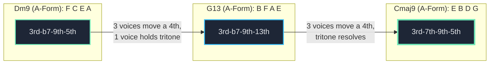
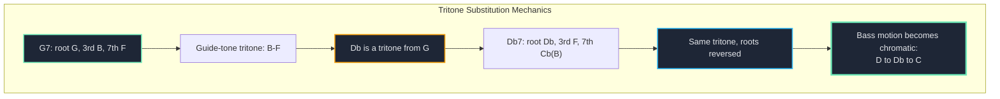
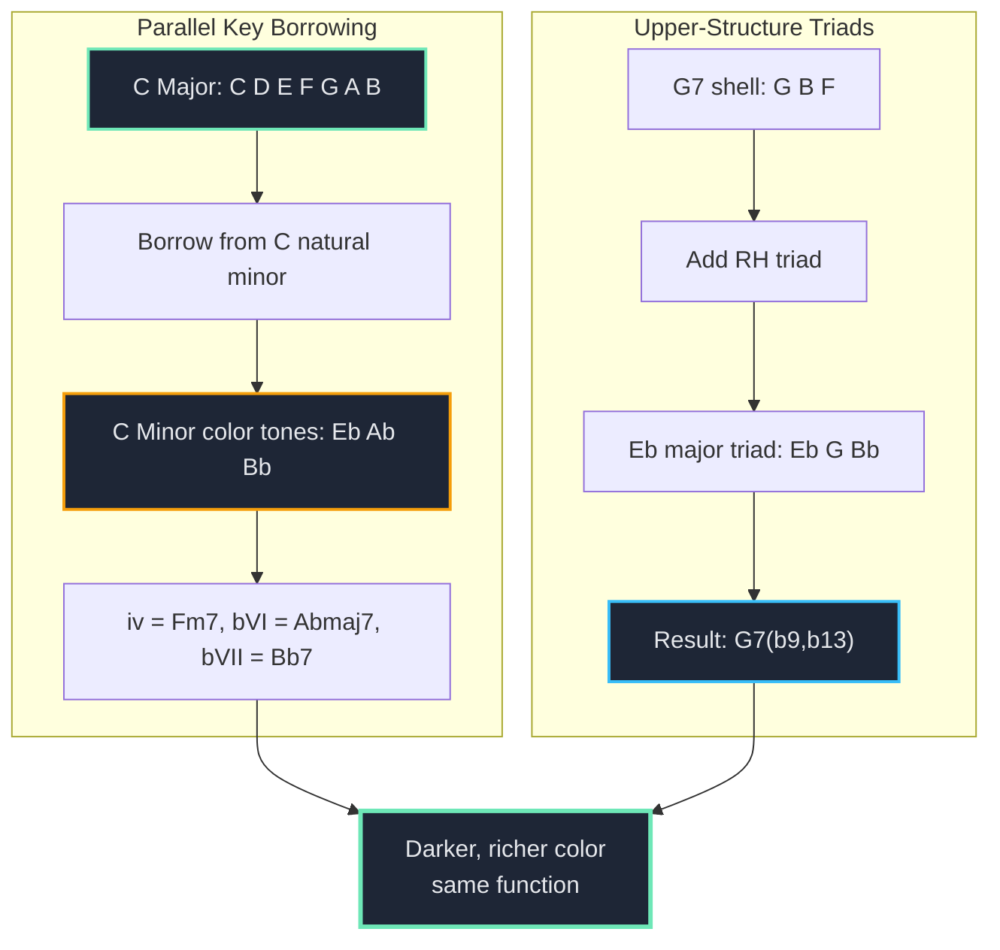
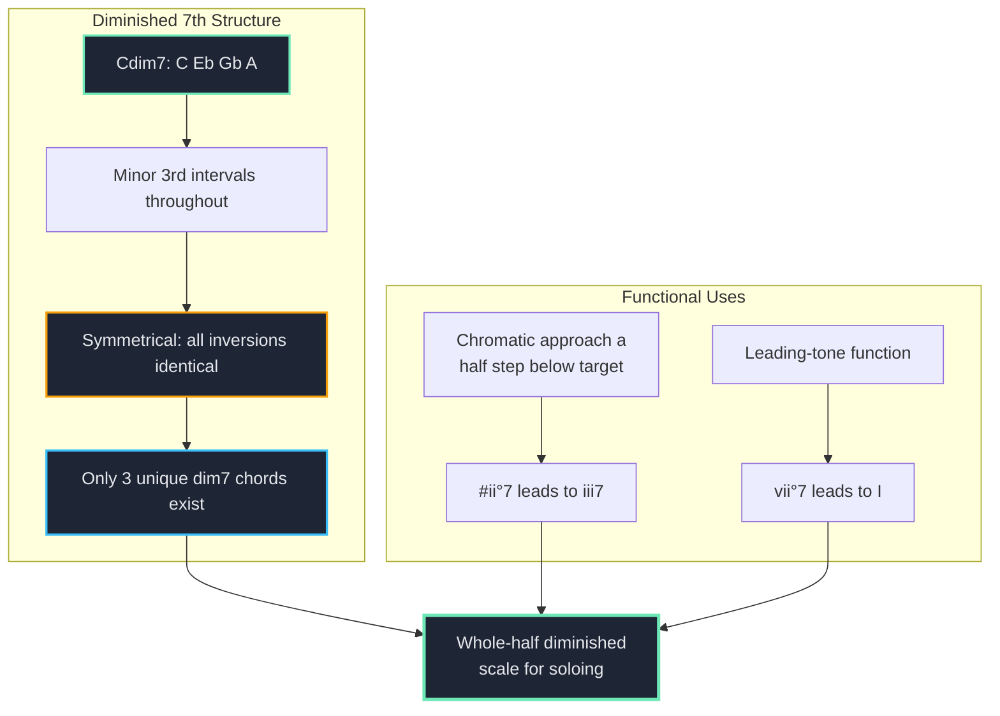
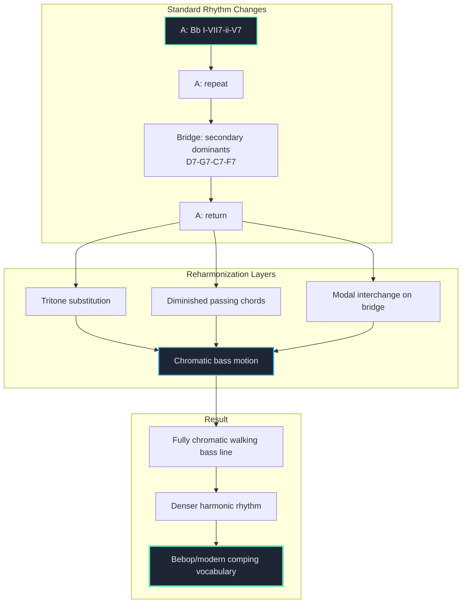

# Jazz Harmony at the Keyboard: Voicings, Substitution, and Reharmonization

## How to Use This Material

This is a hands-on course for pianists who already read chord symbols and can play a major scale in both hands. You will spend most of your time with fingers on keys, not reading theory. Every voicing is written with exact notes, exact left-hand fingering, and a metronome target. The theory paragraphs exist only to explain *why* a voicing or substitution works so you can transpose the logic yourself instead of memorizing shapes by rote.

Keep a real piano or weighted MIDI keyboard in front of you while reading. Nothing here is learned by eye.

---

## Lab Setup

**Instrument:** 61+ key weighted or semi-weighted keyboard, or acoustic piano. You need the full left-hand range from roughly E2 to C4 for voicings in this lesson.

**Notation/playback:** MuseScore 4 (free) for writing out voicings and hearing swing playback. Set Format → Style → Score → Swing to "Eighth note swing" so comping rhythms sound idiomatic rather than stiff.

**Practice loop:** iReal Pro or a simple DAW (Reaper, GarageBand) to loop a progression so you can comp and solo over a static backing instead of always playing both hands of the changes.

**Metronome:** Any metronome app with accent-on-beat-1 capability. You will use it in nearly every drill.

Optional, if you want to verify your own voicings computationally rather than just by ear — this is a sanity-check tool, not a substitute for playing:

```bash
pip install music21
python3 -c "from music21 import chord; print(chord.Chord(['F3','C4','E4','A4']).pitchedCommonName)"
```

That should print something resembling `D-minor-ninth`. If it doesn't, you've mis-voiced the chord — trust your ear and the fingerings below over the script, but the check catches typos.

---

## Exercise 1: Rootless Voicings — The ii–V–I Engine

### Why rootless voicings exist

In a working rhythm section the bassist already states the root. If the pianist also plays the root, you get two instruments competing for the same low frequency, and the voicing sounds thick and dated. Bill Evans popularized the solution: the piano's left hand plays only the 3rd, 7th, and upper color tones (9th, 13th), leaving the root to the bass. This is not a simplification — it's a deliberate removal of redundant information that opens space in the texture.

The two voicings you need are built around guide tones: the 3rd and 7th of each chord. These two notes alone define whether a chord is major, minor, or dominant, and whether it needs to resolve. Everything else is color.

In C major, Dm7 → G7 → Cmaj7, watch what the 7th of each chord does:
- Dm7's 7th is C. It becomes the 3rd of... no — it stays as a common tone into G7's voicing (C is the b7 of G7 too, in root position thinking)... more usefully: G7 contains the tritone **B–F** (3rd and 7th). That tritone is harmonically unstable and wants to contract inward. It resolves to **C and E** — the root and 3rd of Cmaj7. That one interval, contracting by half step on each side, is the entire reason the V–I cadence feels conclusive. Everything you build below is decoration around that one moving tritone.

### A-Form voicings (3rd in the bass)

A-form stacks: **3rd – 7th – 9th – 5th**, read bottom to top, left hand only.

```text
Dm9     LH: F3  C4  E4  A4      (3rd, b7, 9th, 5th)
G13     LH: B3  F4  A4  E5      (3rd, b7, 9th, 13th)
Cmaj9   LH: E3  B3  D4  G4      (3rd, 7th, 9th, 5th)
```

**Left-hand fingering (all three chords): 5–3–2–1**, thumb on top. Keep the hand in one compact shape — you are not reaching, you are repositioning a fixed claw.

**Hand posture check before you play a note:**
- Sit so middle C is in front of your sternum, not your left shoulder.
- Wrist level with the forearm — no breaking downward into the keys.
- Fingers curved as if holding a small ball; strike with the pad of the fingertip, not the flat finger.
- Drop the chord using arm weight falling through a relaxed wrist, not four fingers stabbing independently. You should feel the attack originate near the elbow.

### Drill 1A — Static voicing changes (60 BPM)

1. Play Dm9 as a half-note chord — all four notes hit exactly together, no smearing.
2. On beat 1 of the next bar, move to G13.
3. On beat 1 of the bar after, move to Cmaj9. Hold two bars.
4. Loop back to Dm9.

**What "clean" sounds like:** when you lift off Dm9 and land on G13, there should be zero gap (sounds like a held pedal tone bleeding through) and zero overlap (sounds like a smear/cluster). Record yourself on your phone — your ear catches sloppy transitions far better in playback than in the moment.

### Drill 1B — Why this voice-leads well

Write out the motion between adjacent chords, note by note, bottom to top:

```text
Dm9 → G13:     F→B (tritone)   C→F (4th up)   E→A (4th up)   A→E (4th down)
G13 → Cmaj9:   B→E (4th up)    F→B (tritone)  A→D (4th up)   E→G (m3 up)
```

Three of four voices move by a perfect 4th in each transition. A 4th on the keyboard is a small physical reach — roughly the width of your hand's natural span between two fingers. This is why rootless A/B-form voicings feel almost static under the hand even though the chord symbols are changing completely: the *physical* motion is small even when the *harmonic* motion (a full descending-fifth root movement) is large. That mismatch between small hand motion and large harmonic motion is the main technical payoff of learning rootless voicings at all.

### Drill 1C — Add comping rhythm (60 → 120 BPM)

Static whole-note chords are a practice scaffold, not real comping. Add this syncopated pattern once Drill 1A is solid (x = attack, dash = held/rest within the beat):

```text
Dm9 (1 bar):   x . x .  (beats 1 and 3)
G13 (1 bar):   . x . x  (beats 2 and 4, anticipating resolution)
Cmaj9 (2 bars): x . . .  | . . . .
```

Run the full 4-bar phrase at 60, then 80, then 100, then 120 BPM. Do not advance tempo until the previous tempo is clean for four consecutive loops without listening to the metronome — if you lose the click, you're not ready to move up.

### Drill 1D — Two-hand independence: RH melody over LH comping

```text
Bar 1 (LH: Dm9 held):   RH quarter notes: A4(5) C5(5) E5(5) G5(5)
Bar 2 (LH: G13 held):   RH quarter notes: G4(5) B4(4) D5(5) F5(5)
Bar 3 (LH: Cmaj9 held): RH quarter notes: E4(5) G4(5) C5(5) rest
```
(RH fingering in parentheses — these are mostly 5th-finger-led arpeggiations; use 4-3-2-1 for the descending notes within each beat group as needed for your hand size.)

The point of this drill is hand independence: the left hand's rhythm (from Drill 1C) and the right hand's melody must NOT lock into the same rhythmic pattern. Practice LH alone, RH alone, then combine at half speed before bringing it to tempo.

### B-Form voicings (7th in the bass)

B-form stacks: **7th – 3rd – 5th – 9th**. This is the A-form voicing inverted up — same four pitch classes, different note on the bottom.

```text
Dm9     LH: C4  F4  A4  E5
G13     LH: F4  B4  E5  A5
Cmaj9   LH: B3  E4  G4  D5
```

Fingering: **5–3–2–1** again. Notice B-form sits roughly an octave higher than A-form for the same chord — this is intentional. In real comping, you alternate A-form and B-form specifically so your hand doesn't have to jump the full octave every time you move from a ii chord to a V chord; instead you alternate "low voicing → high voicing → low voicing" and the hand travels in small, comfortable steps.

### Drill 2A — Alternate A-form and B-form (60 BPM)

1. Play the full Dm9–G13–Cmaj9 cycle in A-form.
2. Immediately repeat the cycle in B-form, one register higher.
3. Alternate ten times without stopping. Watch for hesitation exactly at the switch point — that hesitation is where your muscle memory is weakest and where you should slow down and isolate just that transition for thirty seconds before resuming the full loop.

### Drill 3 — All twelve keys

Use the circle of fifths for transposition order, not alphabetical or random order — fifths-related keys share the most voicing shapes, so this order builds transfer fastest:

```text
C → F → Bb → Eb → Ab → Db → Gb → B → E → A → D → G → C
```

**Four-week schedule:**
- Week 1: C, F, Bb, Eb — A-form and B-form, 4 reps each at 80 BPM
- Week 2: Ab, Db, Gb, B — same drill
- Week 3: E, A, D, G — same drill
- Week 4: All twelve, randomized order, 100 BPM, no repeats of a key until all twelve are played once

**A fast way to transpose without re-deriving the voicing:** the A-form shape for a minor ii chord is always *interval pattern* (root+3, root+10, root+2 up an octave, root+7) relative to the chord's root — but the faster practical method is to recognize that A-form Dm9 and B-form G13 share almost the same four notes (compare: Dm9 A-form is F-C-E-A; G13 B-form is F-B-E-A — only one note differs). Once you see that ii and V chords one fifth apart share 3 of 4 voice tones, you stop thinking "what are the notes of Ab13" and start thinking "what's the one note that moves."

### Voice-leading diagram



---

## Exercise 2: Tritone Substitution

### The mechanism, concretely

Any dominant 7th chord's identity comes from its tritone: the interval between its 3rd and 7th. G7's tritone is B–F. Now find the *other* dominant 7th chord in the universe that also contains the interval B–F as its guide tones — that's Db7 (3rd = F, 7th = Cb, which is enharmonically B). Two completely different chords, same tritone, same pull toward resolution. Db is a tritone away from G (six semitones in either direction — that's where the name comes from), so this substitution is always "the dominant chord built on the b5 of the original."

The payoff is the bass line. A standard ii–V–I moves D (ii) → G (V) → C (I) — a 4th down, then a 5th up. Substitute the V and you get D (ii) → Db (subV) → C (I) — a chromatic step down, then another chromatic step down. Chromatic bass motion sounds smoother and more "inevitable" than leaping 4ths and 5ths, which is why tritone subs became a reharmonization staple rather than just a curiosity.

### Drill 2A — Side by side (60 BPM)

```text
Standard:     Dm9 (LH: F3 C4 E4 A4) → G13 (LH: B3 F4 A4 E5) → Cmaj9 (LH: E3 B3 D4 G4)
Tritone sub:  Dm9 (same)           → Db13(LH: F3 B3 Eb4 Ab4) → Cmaj9 (same)
```

Play four bars standard, immediately four bars substituted. Listen specifically to the bass note under beat 1 of bar 2: standard jumps a tritone (F to B going up, or think of it as the LH lowest note going F→B), tritone-sub version has **F stay on F** — it's a literal common tone between Dm9 and Db13. That shared note is why the substitution feels seamless rather than jarring: one whole voice doesn't move at all.

### Drill 2B — Isolate the guide tones

Strip each chord to just 3rd and 7th, two notes:

```text
G7:  B3 F4   (3rd, 7th)
Db7: F3 B3   (3rd, 7th — same two pitch classes, inverted)
```

Play G7's guide tones, then Db7's guide tones, back and forth, ten times, listening for the fact that they are the *same dyad*. This two-note drill is the fastest way to internalize why the substitution is legitimate rather than arbitrary — you're hearing the shared tritone directly with no other notes to distract you.

### Drill 2C — All twelve keys (80 → 120 BPM)

```text
C major:  Dm9 – Db13 – Cmaj9
F major:  Gm9 – Gb13 – Fmaj9
Bb major: Cm9 – B13  – Bbmaj9
Eb major: Fm9 – E13  – Ebmaj9
```
Continue around the circle of fifths. Two beats per chord, 80 BPM to start, pushing to 120. The sub chord root is always a half step above the I chord's root resolving down to it (e.g., Db→C, Gb→F, B→Bb) — use that relationship as a mental shortcut instead of calculating "tritone from G" every time.

### Applying it: "Autumn Leaves," first 8 bars (G minor)

```text
Original:        | Cm7   | F7    | Bbmaj7 | Ebmaj7 |
                 | Am7b5 | D7    | Gm7    | Gm7    |

Tritone-subbed:  | Cm7   | B7    | Bbmaj7 | Ebmaj7 |   (F7 → B7)
                 | Am7b5 | Ab7   | Gm7    | Gm7    |   (D7 → Ab7)
```

Learn the original with A/B-form voicings first — you need the unaltered version in your ear before the substitution will sound like a *choice* rather than an error. Then swap in the subbed chords and play both versions back to back, noting that the melody of the tune (if you're comping under a singer or horn) may now clash with the new chord unless you check it against the new guide tones.

### Flowchart



---

## Exercise 3: Modal Interchange & Upper-Structure Triads

### Modal interchange, in practice

"Borrowing from the parallel minor" means: you're in C major, but you reach into C minor's key signature (Eb, Ab, Bb) and pull out a chord. The four most useful borrowed chords, and what they replace:

```text
iv   (Fm7)     replaces IV (Fmaj7)    — introduces Ab
bVI  (Abmaj7)  replaces vi (Am7)      — introduces Ab, Eb
bVII (Bb7)     replaces vii° (Bm7b5)  — introduces Bb, Eb
bIII (Ebmaj7)  replaces iii (Em7)     — introduces Eb
```

Why it works without sounding "wrong": you're keeping the chord in a *functional* role (iv still behaves like a subdominant, bVI still behaves like a predominant/submediant) while changing its color. The ear accepts the new color because the function — where the chord sits in the phrase, what it resolves to — hasn't changed.

### Drill 3A — Major vs. minor plagal cadence (60 BPM)

```text
Major plagal:  Fmaj7 (LH: E3 A3 C4 F4) → Cmaj7 (LH: E3 B3 D4 G4)
Minor plagal:  Fm7   (LH: Eb3 Ab3 C4 F4) → Cmaj7 (same)
```

Play each cadence, 4 beats per chord, ten times alternating. Listen for the Ab in Fm7 resolving down a half step to G, the 5th of Cmaj7 — that half-step pull is the "Amen cadence" sound used constantly in gospel, soul, and modal jazz (think the end of "My Favorite Things" or the IV-chord moment in countless ballads).

### Drill 3B — bVI borrowed chord (80 BPM)

```text
Diatonic:  Am7(G3 C4 E4 B4) – Dm7(F3 C4 E4 A4) – G7(B3 F4 A4 D5) – Cmaj7(E3 B3 D4 G4)
Borrowed:  Abmaj7(G3 C4 Eb4 Ab4) – Dm7 – G7 – Cmaj7
```

The bass note under the first chord doesn't change (G stays G in both versions, since Abmaj7's voicing here keeps G as a chord tone) — only the quality shifts from minor to major-with-flat-color. This is a good drill for proving to your ear that borrowing a chord is a *color* change, not necessarily a *bass line* change.

### Upper-structure triads: practical construction

An upper-structure triad is a major or minor triad played in the right hand, sitting on top of a left-hand dominant 7th "shell" (just root, 3rd, 7th — no 5th, no 9th written separately, because the RH triad supplies the extra color tones).

**The three you'll use constantly, over G7:**

```text
LH shell (all three): G2  B2  F3   (root, 3rd, b7)

RH Db major triad (Db F Ab):  → chord tones added: b5, b7(dup), b9  → sounds as G7(b5,b9)
RH Eb major triad (Eb G Bb):  → chord tones added: b13, root(dup), b9 → sounds as G7(b9,b13)
RH F# minor triad (F# A C#):  → chord tones added: maj7(!), 9, #11  → sounds as G7(9,#11) — Lydian dominant color
```

Note the F# minor triad case: it adds an F# which is the major 7th of G, an unusual color on a dominant chord, giving a bright, modern "Lydian dominant" sound rather than a dark altered sound. This is the triad to reach for over a non-resolving or vamping dominant (modal jazz contexts); use the Db or Eb triads when the dominant is resolving strongly to a minor or tonic chord.

### Drill 3C — Upper-structure catalog (60 → 100 BPM)

For each of the three triads above:
1. Play the LH shell alone, 4 beats.
2. Add the RH triad, hold 4 beats — listen to the specific color before moving on.
3. Play both hands together as a single gesture, 4 beats.
4. Resolve to Cmaj9 (LH: E3 B3 D4 G4), 4 beats.

Keep the RH triad voiced at least an octave above the LH shell. If you stack them close together you get mud, not color — the whole point of an upper-structure is that the ear parses it as two separate layers (bass-register dominant function, treble-register bright triad), not as one dense cluster.

### Drill 3D — Insert into a ii-V-I

```text
| Dm9 (2 bars) | G7-shell + Eb-major-triad (2 bars) | Cmaj9 (2 bars) |
```
Run this in all twelve keys. This is the actual comping vocabulary you'll use behind a soloist on a standard — static ii-V-I with a colored V chord.

### "All the Things You Are" bridge — modal interchange in the wild

Original key Ab major, bridge (measures 17–24):
```text
| Fmaj7  | Fmaj7  | Bbm7 | Eb7 |   (Bbm7 is borrowed iv, in the key of F)
| Abmaj7 | Abmaj7 | Am7  | D7  |   (Am7-D7 is a ii-V into G major)
```
Transposed to C major for practice:
```text
| Cmaj7  | Cmaj7  | Fm7  | Bb7 |
| Ebmaj7 | Ebmaj7 | Em7  | A7  |
```
Learn this transposition — the pattern of "borrow iv, then pivot via a secondary ii-V" recurs constantly in standards and is worth having under your hands independent of the specific tune.

### Diagram



---

## Exercise 4: Diminished Passing Chords

### The one fact that explains everything about dim7 chords

A diminished 7th chord stacks four notes a minor 3rd apart: C–Eb–Gb–A. Four minor 3rds add up to exactly an octave (3+3+3+3=12 semitones), which means the chord is perfectly symmetrical — every inversion sounds like a root-position diminished chord, just spelled differently. Practical consequence: **there are only three diminished 7th chords in all of music**, not twelve. Cdim7 = Ebdim7 = Gbdim7 = Adim7, all the same four pitches. Learning three shapes gets you all twelve diminished chords for free.

### Drill 4A — The four inversions of Cdim7 (60 BPM)

```text
Root:      C  Eb  Gb  A     fingering 1-2-3-5
1st inv:   Eb Gb  A   C     fingering 1-2-3-5
2nd inv:   Gb A   C   Eb    fingering 1-2-3-5
3rd inv:   A  C   Eb  Gb    fingering 1-2-3-5
```
Play each as a whole note, ascend through all four, then descend. Every inversion has the identical sound and interval structure — confirm this by ear, not just intellectually: it should genuinely be hard to tell which inversion you just played without looking.

### Drill 4B — The three diminished families (80 BPM)

```text
Family 1: C / Eb / Gb / A     — all spell the same four notes
Family 2: Db / E / G / Bb
Family 3: D / F / Ab / B
```
Pick Family 1 and play it ascending through its four enharmonic "roots": C-Eb-Gb-A → Eb-Gb-A-C → Gb-A-C-Eb → A-C-Eb-Gb. Two beats per chord. This drill is really just the inversion drill from 4A relabeled — the insight to absorb is that "transposing a dim7 chord up a minor 3rd" does nothing to its sound.

### Chromatic approach chords — the real-world use

The most common jazz use of a dim7 chord is as a half-step approach to a diatonic target, inserted between two chords that are a step apart. Standard ii-V-I:
```text
Dm7 – G7 – Cmaj7
```
Insert a diminished chord a half step above Dm7's root to approach the next diatonic chord up (iii, i.e. Em7), and you get a longer, smoother line:
```text
Dm7 – D#dim7 – Em7 – G7 – Cmaj7
```
Wait — notice this inserts an *extra* chord (iii) that wasn't in the original progression at all. That's intentional: diminished approach chords are often used to connect two chords a *whole step* apart by inserting a passing diatonic chord plus its diminished approach, turning two chords into four and creating a stepwise bass line: D (ii) – D# (passing dim) – E (iii) – ... – G (V) – C (I).

### Drill 4C — Chromatic approach pattern (60 BPM)

```text
Dm7:     LH F3 C4 E4 A4
D#dim7:  LH F#3 C4 D#4 A4
Em7:     LH G3 D4 F#4 B4
G7:      LH B3 F4 A4 D5
Cmaj7:   LH E3 B3 D4 G4
```
Play the plain ii-V-I first (4 bars), then the 5-chord expanded version. Focus entirely on the half-step motion from Dm7's bass (F, as the 3rd) into D#dim7 (F#) — one finger moving one key.

### Drill 4D — All twelve keys

Template: ii7 – #ii°7 – iii7 – V7 – Imaj7. Example in F major: Gm7 – G#dim7 – Am7 – C7 – Fmaj7. Run the circle of fifths, 80 BPM, 2 beats per chord.

### The diminished (octatonic) scale for soloing

```text
C whole-half diminished: C D Eb F Gb Ab A B C
```
Alternating whole step, half step. This scale is what you improvise with over any of these dim7 chords.

### Drill 4E/4F — Scale and arpeggio practice

1. Play the scale ascending/descending, one octave: RH fingering ascending 1-2-3-1-2-3-4-5, descending 5-4-3-2-1-3-2-1.
2. Play it in diminished triads: C-Eb-Gb, D-F-Ab, Eb-Gb-A, etc. — notice every triad you build from this scale is itself diminished, another symmetry consequence.
3. Loop a Cdim7 vamp in your DAW/iReal Pro for 4 bars. Improvise using the scale, landing specifically on chord tones (C, Eb, Gb, A) on beats 1 and 3, and passing tones (D, F, Ab, B) on beats 2 and 4. This beat-placement discipline is what makes diminished-scale lines sound intentional instead of just "all the notes that fit."

### Applying it: Joe Henderson's "Inner Urge"

```text
| Ebm7  | Ab7   | Dbmaj7 | Dbmaj7 |
| Ddim7 | Ddim7 | Ebm7   | Ebm7   |
```
The Ddim7 in bars 5-6 is not resolving anywhere immediately — it functions as a floating, ambiguous color before the return to Ebm7. Voice it as:
```text
Ddim7: LH F3 B3 D4 Ab4   (1st inversion — F in the bass gives a smoother link from Dbmaj7's bass)
```
Improvise over it with the D whole-half diminished scale. Transpose the whole passage to C minor for a second key:
```text
| Cm7   | F7    | Bbmaj7 | Bbmaj7 |
| Bdim7 | Bdim7 | Cm7    | Cm7    |
```

### Diagram



---

## Exercise 5: Integration Lab — Reharmonizing Rhythm Changes

"Rhythm Changes" is the chord progression under "I Got Rhythm," "Anthropology," "Oleo," and dozens of other bebop standards. It's the second-most-used harmonic form in jazz after the 12-bar blues, which makes it the ideal testbed for combining everything above.

### The standard form (Bb major, AABA, 32 bars)

```text
A section (8 bars):
| Bbmaj7 | G7    | Cm7   | F7    |
| Dm7    | G7    | Cm7   | F7    |

B section / bridge (8 bars):
| D7     | D7    | G7    | G7    |
| C7     | C7    | F7    | F7    |
```

### Step 1 — Learn the plain A section with rootless voicings (60 → 120 BPM)

```text
Bbmaj7: LH A3 D4 F4 C5     G7:  LH B3 F4 A4 D5
Cm7:    LH Bb3 Eb4 G4 D5   F7:  LH A3 Eb4 G4 C5
Dm7:    LH C4 F4 A4 E5     G7:  LH B3 F4 A4 D5
```
Two beats per chord. This is your unreharmonized baseline — don't skip it. You need it in your fingers before any substitution will register as a deliberate choice.

### Step 2 — Tritone-sub the dominants

```text
Original:    | Bbmaj7 | G7  | Cm7 | F7 |
Substituted: | Bbmaj7 | Db7 | Cm7 | B7 |
```
```text
Db7 voicing: LH F3 B3 Eb4 Ab4
B7 voicing:  LH Eb3 A3 C#4 F#4
```
Play original, then substituted, at 80 → 100 → 120 BPM.

### Step 3 — Add diminished passing chords for a fully chromatic bass line

Chain the ii, the diminished approach, and the tritone sub together so the left-hand *lowest note* walks chromatically through the bar:

```text
Bbmaj7 (bass A) → Bdim7 (bass B) → Cm7 (bass Bb) → C#dim7 (bass C#) →
Dm7 (bass C) → Db7 (bass F, tritone sub) → Cm7 (bass Bb) → B7 (bass Eb, tritone sub)
```
Voicings:
```text
Bbmaj7: A3 D4 F4 C5         Bdim7:  B3 D4 F4 Ab4
Cm7:    Bb3 Eb4 G4 D5       C#dim7: C#4 E4 G4 Bb4
Dm7:    C4 F4 A4 E5         Db7:    F3 B3 Eb4 Ab4
Cm7:    Bb3 Eb4 G4 D5       B7:     Eb3 A3 C#4 F#4
```
Practice this bass line alone first, left hand only, slowly — your ear should hear a clear stepwise descent/ascent, not a series of unrelated leaps. If any pair of adjacent bass notes jumps more than a step, re-check your voicing before adding the right hand.

### Step 4 — Modal interchange on the bridge

```text
Standard bridge:  | D7  | D7  | G7  | G7  |
                  | C7  | C7  | F7  | F7  |

Reharmonized:      | Dm7 | Ab7 | G7  | Db7 |
                   | Cm7 | Gb7 | F7  | B7  |
```
Here each original secondary dominant (D7, G7, C7, F7) is preceded by its related minor chord and the following dominant is tritone-subbed, giving the bridge a darker, more modern color while preserving the underlying cadential motion every two bars.

### Full 32-bar reharmonized chart

```text
A (1-8):    | Bbmaj7 | Bdim7  | Cm7   | C#dim7 |
            | Dm7    | Db7    | Cm7   | B7     |
A (9-16):   (repeat bars 1-8)
B (17-24):  | Dm7    | Ab7    | G7    | Db7    |
            | Cm7    | Gb7    | F7    | B7     |
A (25-32):  | Bbmaj7 | Bdim7  | Cm7   | C#dim7 |
            | Dm7    | Db7    | Cm7   | B7     | Bbmaj7 (final tag) |
```

### Drill 5D — Full form at tempo

1. Learn each 8-bar section separately at 60 BPM until clean.
2. Chain A–A–B–A without stopping at section boundaries — the section seams are where hesitation hides.
3. Push tempo: 60 → 100 → 140 → 180 BPM (standard bebop "Oleo" tempo).
4. Record every session. Listen back specifically for: are the diminished chords landing exactly on the beat, or dragging? Is the bass line audible as a connected line, or do the voicings bury it?

### Drill 5E — Chord-scale map for soloing over the reharmonization

```text
Bbmaj7:  Bb major (Ionian)
Bdim7:   B whole-half diminished
Cm7:     C Dorian
C#dim7:  C# whole-half diminished
Dm7:     D Dorian
Db7:     Db Lydian dominant (4th mode of Ab melodic minor)
B7:      B altered scale (7th mode of C melodic minor)
```
These last two — Lydian dominant and altered — are standard scale choices for tritone-sub dominants; use Lydian dominant when the chord still has a bright/unresolved color, altered when it's pulling hard toward resolution.

### Drill 5F — Two-chorus solo discipline

Chorus 1: chord tones only (root, 3rd, 5th, 7th of whatever's sounding) — no tensions, no chromaticism. This forces your ear to track the reharmonized changes accurately before you add color. Chorus 2: add 9ths/13ths and chromatic approach notes into the chord tones from chorus 1. Record both choruses and check chorus 1 against the actual chord symbols — wrong notes here mean you don't actually know the changes yet, no amount of "outside" playing in chorus 2 will fix that.

### Final integration diagram



---

## 30-Day Practice Protocol

### Weeks 1–2: Foundation (60 min/day)

- **Rootless voicings (20 min):** A-form and B-form ii-V-I, 3 keys/day via circle of fifths, 80 → 120 BPM. Static changes first, then Drill 1C comping rhythm.
- **Tritone substitution (20 min):** standard vs. substituted comparison in 2 keys/day, then apply to "Autumn Leaves" or "Blue Bossa."
- **Ear training (20 min):** before playing a voicing, sing its guide tones (3rd and 7th) from the chord symbol alone. Then play it and check pitch. Transcribe one 4-bar Bill Evans or McCoy Tyner voicing passage per week.

### Week 3: Advanced techniques (75 min/day)

- **Modal interchange (25 min):** borrowed iv, bVI, bVII in 2 keys/day; apply to the "All the Things You Are" bridge.
- **Upper-structure triads (25 min):** the three-triad catalog (Db, Eb, F# major triads over a dominant shell), reharmonize a ii-V-I, 2 keys/day.
- **Diminished chords (25 min):** chromatic approach patterns (ii–#ii°7–iii), whole-half diminished scale improv; apply to "Inner Urge."

### Week 4: Integration (90 min/day)

- **Rhythm Changes reharmonization (40 min):** full 32-bar form, 100 → 140 → 180 BPM, two-chorus solo discipline from Drill 5F.
- **Real-book application (30 min):** one standard per day ("Stella by Starlight," "Giant Steps," "Confirmation") — find where the tune's own harmony already uses these devices before inventing your own substitutions.
- **Performance simulation (20 min):** one full standard, recorded, reharmonized comping. Listen back and name exactly one specific fix for tomorrow — not a vague "play better," a specific bar or transition.

### Weekly maintenance after day 30

```text
Mon: rootless voicings, all 12 keys
Tue: tritone substitution and chromatic bass lines
Wed: modal interchange and upper-structures
Thu: diminished chords and the octatonic scale
Fri: Rhythm Changes integration
Sat: transcription and ear training
Sun: performance simulation / repertoire expansion
```

---

## Assessment Checklist

**Technical**
- [ ] A-form and B-form rootless ii-V-I in all 12 keys at 120 BPM, no audible gaps or overlaps
- [ ] Tritone substitution with correct chromatic bass motion, any key, on request
- [ ] Diminished passing chords inserted into a ii-V-I with clean half-step voice-leading
- [ ] Upper-structure triads voiced with at least an octave separation from the LH shell
- [ ] Full 32-bar reharmonized Rhythm Changes at 140+ BPM without stopping

**Theoretical**
- [ ] Can name the guide tones (3rd, 7th) of any chord symbol by ear, instantly
- [ ] Can explain why a tritone substitution preserves dominant function (shared tritone)
- [ ] Can spot a borrowed chord in a real lead sheet and name which parallel-minor scale degree it comes from
- [ ] Can explain why there are only 3 unique diminished 7th chords

**Musical**
- [ ] Can comp behind a soloist with rhythmic variation, not just whole-note chords
- [ ] Can reharmonize an unfamiliar standard using at least 3 techniques from this lesson
- [ ] Can improvise over reharmonized changes using the matched chord-scale from Drill 5E
- [ ] Has a recorded, self-critiqued performance of one full standard with reharmonized comping

---

## Troubleshooting

**Voicings sound muddy.** You're voicing too low. Keep LH rootless voicings at or above C3 — below that, close intervals (minor 2nds, major 2nds between adjacent tensions) read as mud rather than color because the ear can't resolve close harmonics in the bass register. Also check you haven't doubled the 3rd or 7th by accident, which thickens the chord without adding information.

**Can't execute at tempo.** You're adding speed before the shape is automatic. Go back to 40 BPM, hold each voicing statically for a full four counts, and don't move the metronome up until four consecutive clean loops happen without you watching your hands.

**Tritone substitution sounds wrong, not colorful.** Almost always a guide-tone mismatch — check that the substitute chord's 3rd and 7th are literally the same two pitches (reordered) as the original's 7th and 3rd. If they're not, you've built the wrong substitute chord, not a legitimately "edgy" one.

**Upper-structure triads sound like noise.** Either the triad doesn't belong to that dominant's altered/Lydian-dominant scale, or it's voiced too close to the LH shell. Fix the octave spacing first — that alone resolves most muddiness complaints before you even reconsider the triad choice.

**Diminished chords don't resolve smoothly.** Check that your approach chord sits exactly a half step below its target's root (D#dim7 approaching Em7, not some other diminished chord). Also confirm you're choosing whole-half diminished scale for chords functioning as dominant-adjacent approach tones — half-whole diminished is for a different context (altered dominant soloing) and will clash here.

---

## Further Study

**Method books:** Mark Levine's *The Jazz Piano Book* (the standard reference for everything in this lesson, in far more depth); Jamey Aebersold *Volume 3: The II-V-I Progression* for play-along practice in all keys; Barry Harris masterclasses for bebop diminished-scale vocabulary; Bert Ligon's *Connecting Chords with Linear Harmony* for voice-leading beyond block voicings.

**Transcribe these specifically:** Bill Evans, "Waltz for Debby" (rootless voicings in motion) and "My Foolish Heart" (modal interchange); McCoy Tyner, "Passion Dance" (quartal voicings) and "Blues on the Corner" (upper-structures); Herbie Hancock, "Dolphin Dance" (dense reharmonization); Chick Corea, "Windows" (diminished-based substitution).

**Repertoire progression:** start with "Autumn Leaves," "Summertime," "Blue Bossa"; move to "All the Things You Are," "Stella by Starlight," "Confirmation"; graduate to "Giant Steps," "Inner Urge," "Nefertiti."

---

## Closing Note

Every technique here — rootless voicings, tritone subs, borrowed chords, diminished passing chords — exists to solve one problem: making harmonic motion sound smoother and richer than the raw chord symbols suggest. Learn them as tools tied to that one goal, not as a checklist. The test of mastery isn't whether you can name a bVI chord on demand; it's whether, mid-tune, your hands find the smoothest path between two chords without you having to think about it.
