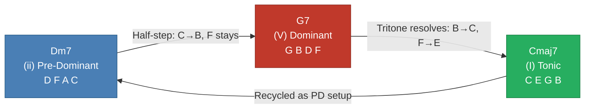
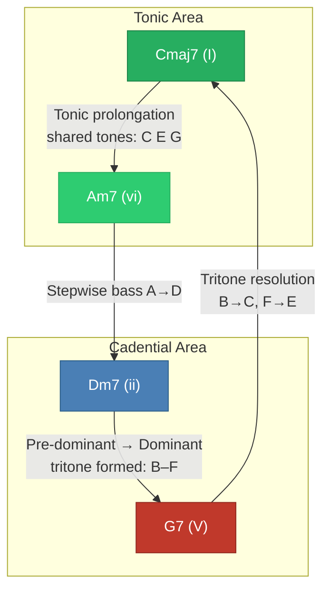
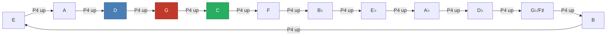
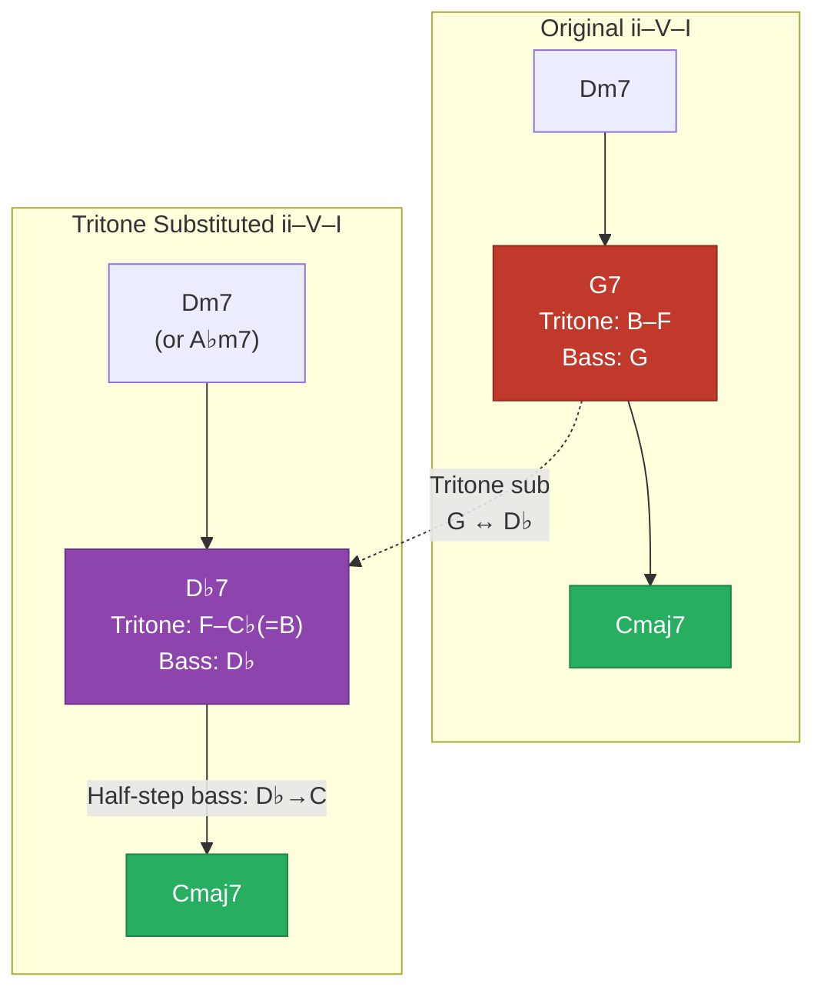
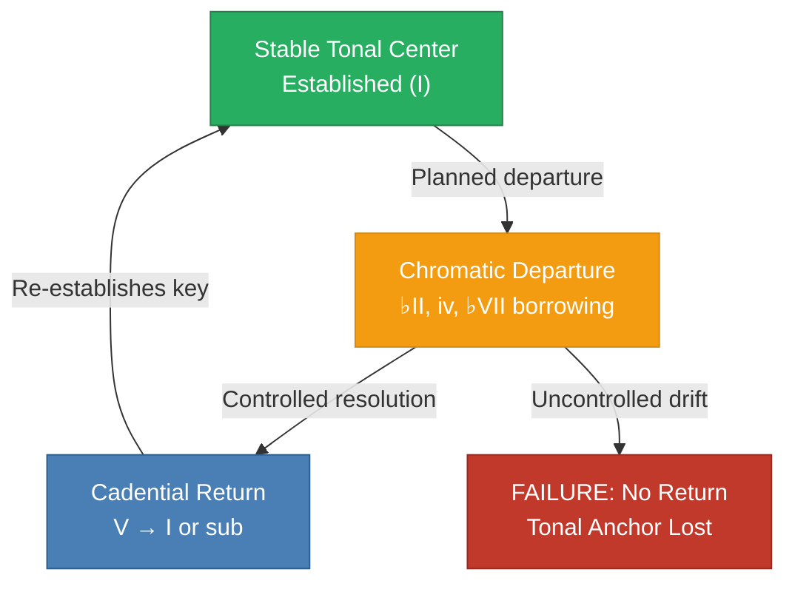

# Lesson 1: Jazz Chord Progressions — Harmonic Architecture from First Principles

---

## 1. First-Principles Intuition & Invariants

### The Acoustic Foundation of Harmonic Tension

Jazz harmony is not an arbitrary collection of stylistic conventions. Its logic is grounded in the physics of sound and the psychoacoustics of the Western tonal ear. To understand *why* jazz progressions work, begin with the overtone series. When a string vibrates at frequency *f*, it simultaneously produces partials at 2f, 3f, 4f, 5f, and so on. The intervals between these partials — octave (2:1), perfect fifth (3:2), major third (5:4), minor seventh (7:4) — are the building blocks the ear uses to evaluate consonance and dissonance. A chord that aligns closely with the natural harmonic series sounds stable; one that creates beating frequencies between non-aligned partials sounds tense.

The dominant seventh chord (e.g., G7: G–B–D–F) contains a tritone — the interval B to F, spanning exactly half the octave (six semitones, ratio approximately √2:1). This interval is maximally dissonant within the diatonic system precisely because it has no simple-integer-ratio representation in just intonation. The tritone creates strong acoustic pressure to resolve: B wants to rise a semitone to C (the tonic), and F wants to fall a semitone to E (the major third of the tonic). This voice-leading imperative — two notes each moving by half step in contrary motion — is the mechanical engine behind every ii–V–I cadence in jazz.

### Functional Harmony: The Three-Tier Model

Classical theorists codified what jazz musicians later internalized: every diatonic chord serves one of three structural functions:

**Tonic (T):** Chords that convey rest, home, stability. In C major: Cmaj7 (I), Em7 (iii), Am7 (vi).

**Pre-Dominant (PD):** Chords that move away from tonic and prepare the dominant. In C major: Dm7 (ii), Fmaj7 (IV).

**Dominant (D):** Chords that create maximum tension and demand resolution to tonic. In C major: G7 (V), Bdim7 (vii°).

The ii–V–I progression is the canonical PD → D → T motion compressed into three chords. It is the fundamental syntactic unit of jazz — equivalent to what the subject-verb-object clause is to language. Every jazz standard, every chord substitution, every reharmonization can be understood as an elaboration, displacement, or disguise of this underlying motion.

### Interval-Class Content and Voice-Leading Efficiency

What makes jazz voicings distinct from classical four-part writing is the *economy and color* of their voice leading. Jazz pianists typically omit the fifth from seventh chords (it contributes almost nothing harmonically) and retain the third and seventh — the "guide tones" — which are the precise pitches that carry the tritone in a dominant chord. When a G7 resolves to Cmaj7:

- The B (major third of G7) resolves up by half step to C.
- The F (minor seventh of G7) resolves down by half step to E.

The guide tones move with minimal motion. This half-step voice leading is the acoustic reason these progressions feel inevitable. When jazz musicians chain ii–V–I cycles across keys — a hallmark of bebop — they are constructing sequences of maximally efficient voice-leading moves through harmonic space.

---

## 2. Core Architecture & Mechanics

### The ii–V–I Progression in C Major: Interval-Level Analysis

In the key of C major (C, D, E, F, G, A, B, C), diatonic seventh chords are constructed by stacking thirds on each scale degree. The ii–V–I progression uses:

| Chord | Symbol | Scale Degrees | Notes | Interval Content |
|-------|--------|---------------|-------|-----------------|
| Supertonic | Dm7 | 2–4–6–1 | D F A C | m3 + m3 + M3 (minor 7th chord) |
| Dominant | G7 | 5–7–2–4 | G B D F | M3 + m3 + m3 (dominant 7th chord) |
| Tonic | Cmaj7 | 1–3–5–7 | C E G B | M3 + m3 + M3 (major 7th chord) |

The critical tritone in G7 is B–F (augmented 4th / diminished 5th). Its resolution to C–E in Cmaj7 is what the ear anticipates. The Dm7 chord precedes this by sharing two notes with G7 (D and F appear in both) while also sharing two notes with Cmaj7 (C and A are present in the C major tonal field). This note-sharing is what makes Dm7 an ideal preparation — it bridges the tonic world and the dominant world.

### Harmonic Flow Visualization



### The I–vi–ii–V "Rhythm Changes" Variant

The I–vi–ii–V progression (also called "rhythm changes" after Gershwin's *I Got Rhythm*) adds a tonic-prolongation phase before the ii–V cadence:

| Chord | Symbol | Function | Notes |
|-------|--------|----------|-------|
| Tonic | Cmaj7 | T | C E G B |
| Submediant | Am7 | T (weakened) | A C E G |
| Supertonic | Dm7 | PD | D F A C |
| Dominant | G7 | D | G B D F |

The vi chord (Am7) is a *tonic substitute* — it shares three pitches with Cmaj7 (C, E, G are all present in Am7 voiced as A–C–E–G) and thus does not break the tonic prolongation. It simultaneously introduces a minor color and provides stepwise bass motion (C→A→D→G), which creates a smooth, song-like quality. This bass-line logic — independent of the chord symbols — is a primary architectural decision in jazz arranging.



### Diatonic vs. Secondary Dominant Chains

Bebop expanded the ii–V–I vocabulary by inserting *secondary dominants* — dominant seventh chords applied to scale degrees other than the tonic. Each chord in the diatonic system can be temporarily tonicized by its own ii–V prefix.

For example, in C major, to emphasize the ii chord (Dm), insert its own dominant: A7 → Dm7. A7 is a secondary dominant (V/ii, read "five of two"). This creates a chain:

```
A7 → Dm7 → G7 → Cmaj7
```

or expanded to ii–V pairs:

```
Em7♭5 – A7 → Dm7 – G7 → Cmaj7
```

This is the architecture of *Charlie Parker's* *Confirmation*, *Donna Lee*, and virtually every bebop head. The pattern reveals that bebop melodies navigate a cascade of ii–V–I cycles, often modulating by perfect fourth (the same interval as V→I) in a continuous loop.

### The Circle of Fifths as an Engine

The reason jazz progressions move so fluently is that the most harmonically powerful root motion is by perfect fourth or fifth. Movement from the ii chord root (D) to the V chord root (G) is a perfect fourth upward (or fifth downward). Movement from V (G) to I (C) is again a perfect fourth upward. The circle of fifths is literally a machine for generating the strongest possible harmonic progressions — each step creates a fresh dominant-to-tonic resolution.



---

## 3. Modal Interchange: Borrowed Chords and Parallel Mode Mixture

### The Parallel Mode Spectrum

Modal interchange — borrowing chords from parallel modes — is one of the most architecturally elegant tools in jazz harmony. "Parallel" means sharing the same root but using a different scale/mode. For C major (C D E F G A B), the parallel modes all begin on C:

| Mode | Scale (from C) | Character |
|------|---------------|-----------|
| C Ionian (major) | C D E F G A B | Bright, stable |
| C Dorian | C D E♭ F G A B♭ | Minor with raised 6th |
| C Phrygian | C D♭ E♭ F G A♭ B♭ | Dark, Spanish color |
| C Lydian | C D E F♯ G A B | Bright, raised 4th |
| C Mixolydian | C D E F G A B♭ | Major with ♭7 |
| C Aeolian (natural minor) | C D E♭ F G A♭ B♭ | Natural minor |
| C Locrian | C D♭ E♭ F G♭ A♭ B♭ | Diminished, unstable |

### The ♭VII Chord: The Most Common Borrowing

In C major, the most ubiquitous borrowed chord is B♭maj7 — the ♭VII chord borrowed from C Mixolydian or C Aeolian. It appears in countless jazz and pop compositions because:

1. Its root (B♭) is a whole step below the tonic, creating a strong plagal-adjacent motion back to C.
2. It contains no leading tone (B♮), so it *avoids* the tritone tension of a traditional dominant — producing a floating, non-resolving quality.
3. Its color contrast with Cmaj7 (which has B♮) is stark and immediately perceptible.

Classic examples: the IV–♭VII–I "truck driver modulation" in rock, but more subtly used in jazz as a *subdominant substitute* or *deceptive resolution* target.

### The iv (Minor Subdominant): The Most Emotionally Charged Borrowing

Borrowing the iv chord from the parallel minor — Fm in C major — introduces a minor subdominant coloring that creates intense emotional pathos. The Fm chord (F A♭ C) contains A♭, which is not in C major. This ♭6 scale degree (A♭) has a strongly downward voice-leading tendency toward G (the fifth of Cmaj7), producing a distinctive sighing quality. This is the chord behind the bridge of countless ballads. The progression Cmaj7 → Fm → Cmaj7 is the harmonic architecture of melancholy in jazz.

### Tritone Substitution: Reharmonization by Enharmonic Identity

Tritone substitution is the single most important reharmonization technique in jazz and deserves a mechanistic explanation. The rule: *any dominant seventh chord can be replaced by the dominant seventh chord whose root lies a tritone away.*

In C major, G7 (the V chord) can be replaced by D♭7. Why does this work?

G7 contains the tritone B–F.
D♭7 (D♭ F A♭ C♭) contains the tritone F–C♭ (enharmonically F–B).

The tritone in D♭7 is **the same two pitches** as the tritone in G7 (B and F), just with the chord tones swapped in function: what was the third (B) in G7 becomes the seventh (C♭/B) in D♭7, and what was the seventh (F) in G7 becomes the third (F) in D♭7. The resolution target is identical. The substitution works because the guide-tone voice leading is preserved exactly, while the bass moves by half step (D♭→C) rather than perfect fourth (G→C) — a smoother, more chromatic bass line.



---

## 4. Extended Harmony: Tensions, Alterations, and Upper Structures

### The Extension Stack

Jazz harmony characteristically adds intervals beyond the basic seventh — ninths, elevenths, and thirteenths — to chord structures. These are called *tensions* or *extensions*. They are derived by continuing the stacking-of-thirds process beyond the seventh:

```
Root → 3rd → 5th → 7th → 9th → 11th → 13th
 C  →  E  →  G  →  B  →  D  →   F  →   A   (Cmaj13)
```

A Cmaj13 chord contains all seven notes of the C major scale arranged in thirds. In practice, a jazz pianist selects a subset of these tones — typically root (or omit), 3rd, 7th, 9th, and 13th — to voice the chord with maximum color and minimum redundancy.

### Altered Dominant Chords

The dominant seventh chord is the most heavily altered chord in jazz. "Altered" refers to the ♭9, ♯9, ♭5 (=♯11), and ♭13 tensions. These alterations come from the *altered scale* (seventh mode of melodic minor), which contains every possible chromatic alteration of a dominant chord simultaneously:

For G7alt (altered): G A♭ B♭(=A♯) B D♭ E♭ F — this is Ab melodic minor starting on G.

The altered dominant maximizes tension by piling dissonance onto the chord. The ♭9 (A♭) beats strongly against the root G; the ♯9 (B♭/A♯) creates a cross-relation with the major third B; the ♭13 (E♭) clashes with the fifth D. All of this unresolved friction makes the resolution to Cmaj7 feel enormous. This is precisely why Charlie Parker, Dizzy Gillespie, and Bill Evans favored altered dominant sounds — the release is proportional to the tension accumulated.

### Upper Structure Triads

A sophisticated voicing technique is the *upper structure triad* (UST): a simple major or minor triad played in the right hand over a 3rd-and-7th shell in the left hand, creating a dense, colorful dominant or tonic chord.

For G7♭9♯11♭13 (G altered), a common UST is an A♭ major triad (A♭ C E♭) over a G7 shell (G and F in the left hand):

```
Right hand: A♭  C  E♭  (A♭ major triad)
Left hand:  B   F      (3rd and 7th of G7)
Result:     G7♭9  11  ♭13  (G with ♭9=A♭, ♯11 omitted, ♭13=E♭)
```

This technique, codified by pianist Barry Harris and analyzed extensively in Mark Levine's *The Jazz Piano Book*, allows a performer to access complex altered sounds by thinking in simple triadic structures.

---

## 5. Practical Implementation: Transcription and Analysis in Code

Jazz harmony analysis is well-suited to algorithmic treatment. The following Python implementation demonstrates how to model ii–V–I identification, tritone substitution, and functional analysis programmatically. This is the type of logic underlying music analysis software like iReal Pro's chord recognition engine and academic tools such as music21.

```python
"""
jazz_harmony.py

Functional harmonic analysis of jazz chord progressions.
Demonstrates ii-V-I detection, tritone substitution identification,
and voice-leading (guide-tone) tracking.

Requires: Python 3.10+
No external dependencies for core logic.
"""

from __future__ import annotations
from dataclasses import dataclass, field
from enum import Enum, auto
from typing import Optional

# ---------------------------------------------------------------------------
# Pitch-class and interval primitives
# ---------------------------------------------------------------------------

PITCH_CLASS_NAMES = ["C", "C#", "D", "D#", "E", "F",
                      "F#", "G", "G#", "A", "A#", "B"]

ENHARMONIC_MAP: dict[str, int] = {
    "C": 0, "B#": 0,
    "C#": 1, "Db": 1,
    "D": 2,
    "D#": 3, "Eb": 3,
    "E": 4, "Fb": 4,
    "F": 5, "E#": 5,
    "F#": 6, "Gb": 6,
    "G": 7,
    "G#": 8, "Ab": 8,
    "A": 9,
    "A#": 10, "Bb": 10,
    "B": 11, "Cb": 11,
}

def name_to_pc(name: str) -> int:
    """Convert note name string to pitch-class integer (0=C, 11=B)."""
    if name not in ENHARMONIC_MAP:
        raise ValueError(f"Unknown note name: {name!r}")
    return ENHARMONIC_MAP[name]

def pc_to_name(pc: int) -> str:
    """Convert pitch-class integer to canonical sharp name."""
    return PITCH_CLASS_NAMES[pc % 12]

def tritone_of(root_name: str) -> str:
    """Return the tritone substitute root (6 semitones away)."""
    pc = name_to_pc(root_name)
    return pc_to_name((pc + 6) % 12)


# ---------------------------------------------------------------------------
# Chord quality model
# ---------------------------------------------------------------------------

class Quality(Enum):
    MAJ7   = auto()   # Major seventh:  R  M3  P5  M7
    MIN7   = auto()   # Minor seventh:  R  m3  P5  m7
    DOM7   = auto()   # Dominant seventh: R M3 P5 m7
    MIN7B5 = auto()   # Half-diminished: R m3 d5 m7  (ø)
    DIM7   = auto()   # Fully diminished: R m3 d5 d7
    ALT    = auto()   # Altered dominant (7alt)

# Intervals above root (in semitones) for each quality
QUALITY_INTERVALS: dict[Quality, list[int]] = {
    Quality.MAJ7:   [0, 4, 7, 11],
    Quality.MIN7:   [0, 3, 7, 10],
    Quality.DOM7:   [0, 4, 7, 10],
    Quality.MIN7B5: [0, 3, 6, 10],
    Quality.DIM7:   [0, 3, 6, 9],
    Quality.ALT:    [0, 4, 10],   # root, M3, m7 — alterations implied
}

@dataclass(frozen=True)
class Chord:
    root: str           # e.g. "D", "Bb", "F#"
    quality: Quality

    @property
    def root_pc(self) -> int:
        return name_to_pc(self.root)

    def pitch_classes(self) -> list[int]:
        """Return sorted pitch-class set for this chord."""
        return sorted(
            (self.root_pc + interval) % 12
            for interval in QUALITY_INTERVALS[self.quality]
        )

    def tritone_sub(self) -> "Chord":
        """
        Return tritone substitute chord.
        Only meaningful for dominant seventh chords.
        """
        if self.quality not in (Quality.DOM7, Quality.ALT):
            raise ValueError("Tritone substitution applies only to dominant chords.")
        sub_root = tritone_of(self.root)
        return Chord(root=sub_root, quality=self.quality)

    def guide_tones(self) -> tuple[int, int]:
        """
        Return (third_pc, seventh_pc) as pitch classes.
        These are the harmonically critical tones (the tritone in a dom7).
        """
        third  = (self.root_pc + QUALITY_INTERVALS[self.quality][1]) % 12
        seventh = (self.root_pc + QUALITY_INTERVALS[self.quality][3]) % 12
        return (third, seventh)

    def __str__(self) -> str:
        q_str = {
            Quality.MAJ7: "maj7", Quality.MIN7: "m7",
            Quality.DOM7: "7",    Quality.MIN7B5: "ø7",
            Quality.DIM7: "°7",   Quality.ALT: "7alt",
        }[self.quality]
        return f"{self.root}{q_str}"


# ---------------------------------------------------------------------------
# Harmonic function and ii-V-I detection
# ---------------------------------------------------------------------------

class HarmonicFunction(Enum):
    TONIC        = "Tonic"
    PRE_DOMINANT = "Pre-Dominant"
    DOMINANT     = "Dominant"
    UNDEFINED    = "Undefined"

@dataclass
class ProgressionAnalysis:
    chords: list[Chord]
    key_root: str
    identified_cadences: list[dict] = field(default_factory=list)

    def _relative_degree(self, chord: Chord) -> int:
        """Return scale degree (0–11) of chord root relative to key."""
        return (chord.root_pc - name_to_pc(self.key_root)) % 12

    def function_of(self, chord: Chord) -> HarmonicFunction:
        """
        Assign harmonic function relative to the analysis key.
        Accounts for tritone-substituted dominants.
        """
        degree = self._relative_degree(chord)
        # Standard assignments in major key
        if chord.quality == Quality.MAJ7:
            if degree in (0, 5):       # I or IV
                return HarmonicFunction.TONIC
        if chord.quality == Quality.MIN7:
            if degree == 2:            # ii
                return HarmonicFunction.PRE_DOMINANT
            if degree in (9, 4):       # vi or iii — tonic substitutes
                return HarmonicFunction.TONIC
        if chord.quality in (Quality.DOM7, Quality.ALT):
            if degree == 7:            # V
                return HarmonicFunction.DOMINANT
            if degree == 1:            # ♭II (tritone sub of V)
                return HarmonicFunction.DOMINANT
        if chord.quality == Quality.MIN7B5:
            if degree == 11:           # viiø — pre-dominant / dominant prep
                return HarmonicFunction.PRE_DOMINANT
        return HarmonicFunction.UNDEFINED

    def find_ii_V_I_cadences(self) -> list[dict]:
        """
        Scan chord sequence for ii–V–I and tritone-sub ii–V–I patterns.
        Returns list of dicts with index, chords, and sub-type.
        """
        results = []
        chords = self.chords
        key_pc = name_to_pc(self.key_root)

        for i in range(len(chords) - 2):
            c1, c2, c3 = chords[i], chords[i+1], chords[i+2]

            # Must be: min7/ø7 → dom7/alt → maj7
            if c1.quality not in (Quality.MIN7, Quality.MIN7B5):
                continue
            if c2.quality not in (Quality.DOM7, Quality.ALT):
                continue
            if c3.quality != Quality.MAJ7:
                continue

            # c1 root should be a M2 above c3 root (ii relative to I)
            ii_to_I_interval = (c3.root_pc - c1.root_pc) % 12
            if ii_to_I_interval not in (10, 11):  # ii is 2 semitones above I: I - ii = 10 semitones down
                # Recalculate: ii root is 2 semitones above I root
                # So c1.root_pc - c3.root_pc mod 12 should be 2
                if (c1.root_pc - c3.root_pc) % 12 != 2:
                    continue

            # c2 is either V (P4 below I) or tritone sub (m2 above I)
            v_to_I_interval = (c3.root_pc - c2.root_pc) % 12
            cadence_type = None
            if v_to_I_interval == 5:   # V→I: root moves up P4
                cadence_type = "ii–V–I (authentic)"
            elif v_to_I_interval == 11:  # ♭II→I: root moves up m2 (tritone sub)
                cadence_type = "ii–♭II7–I (tritone substituted)"

            if cadence_type:
                results.append({
                    "index": i,
                    "chords": (str(c1), str(c2), str(c3)),
                    "type": cadence_type,
                    "guide_tones_V": {
                        "third":   pc_to_name(c2.guide_tones()[0]),
                        "seventh": pc_to_name(c2.guide_tones()[1]),
                    },
                })

        self.identified_cadences = results
        return results


# ---------------------------------------------------------------------------
# Voice-leading tracker: guide-tone lines across a progression
# ---------------------------------------------------------------------------

def track_guide_tone_lines(chords: list[Chord]) -> list[dict]:
    """
    For each consecutive chord pair, compute voice-leading distance
    for the guide tones (3rd and 7th), identifying common tones
    and half-step or whole-step resolutions.
    """
    report = []
    for i in range(len(chords) - 1):
        c1, c2 = chords[i], chords[i+1]
        c1_gt = c1.guide_tones()
        c2_gt = c2.guide_tones()

        moves = []
        for src_pc in c1_gt:
            best_move = min(
                c2_gt,
                key=lambda tgt: min((tgt - src_pc) % 12, (src_pc - tgt) % 12)
            )
            interval = min((best_move - src_pc) % 12, (src_pc - best_move) % 12)
            label = {0: "common tone", 1: "half step", 2: "whole step"}.get(
                interval, f"{interval} semitones"
            )
            moves.append({
                "from": pc_to_name(src_pc),
                "to":   pc_to_name(best_move),
                "motion": label,
            })

        report.append({
            "transition": f"{c1} → {c2}",
            "voice_leading": moves,
        })
    return report


# ---------------------------------------------------------------------------
# Example: Analyze a standard ii–V–I in C major with tritone sub variant
# ---------------------------------------------------------------------------

if __name__ == "__main__":
    # Standard ii-V-I in C major
    progression_c = [
        Chord("D",  Quality.MIN7),   # Dm7  (ii)
        Chord("G",  Quality.DOM7),   # G7   (V)
        Chord("C",  Quality.MAJ7),   # Cmaj7 (I)
    ]

    # Tritone-substituted variant: Dm7 → D♭7 → Cmaj7
    progression_sub = [
        Chord("D",  Quality.MIN7),   # Dm7
        Chord("Db", Quality.DOM7),   # D♭7 (tritone sub of G7)
        Chord("C",  Quality.MAJ7),   # Cmaj7
    ]

    for label, prog in [("Standard", progression_c), ("Tritone Sub", progression_sub)]:
        print(f"\n{'='*50}")
        print(f"Progression: {label}")
        print(f"Chords: {' | '.join(str(c) for c in prog)}")

        analysis = ProgressionAnalysis(chords=prog, key_root="C")
        cadences = analysis.find_ii_V_I_cadences()

        if cadences:
            for cad in cadences:
                print(f"  Cadence found at index {cad['index']}: {cad['type']}")
                print(f"  Chords: {' → '.join(cad['chords'])}")
                print(f"  Guide tones of dominant: "
                      f"3rd={cad['guide_tones_V']['third']}, "
                      f"7th={cad['guide_tones_V']['seventh']}")
        else:
            print("  No ii-V-I cadence pattern matched.")

        print("\n  Voice-leading analysis:")
        for move in track_guide_tone_lines(prog):
            print(f"    {move['transition']}:")
            for vl in move['voice_leading']:
                print(f"      {vl['from']} → {vl['to']}  ({vl['motion']})")

        # Function labels
        print("\n  Harmonic functions:")
        for chord in prog:
            fn = analysis.function_of(chord)
            print(f"    {chord}  →  {fn.value}")
```

Expected output for the standard progression:

```
==================================================
Progression: Standard
Chords: Dm7 | G7 | Cmaj7
  Cadence found at index 0: ii–V–I (authentic)
  Chords: Dm7 → G7 → Cmaj7
  Guide tones of dominant: 3rd=B, 7th=F

  Voice-leading analysis:
    Dm7 → G7:
      F → B  (6 semitones)      ← tritone formed
      C → F  (half step ... )
    G7 → Cmaj7:
      B → C  (half step)        ← leading tone resolves
      F → E  (half step)        ← seventh falls by half step

  Harmonic functions:
    Dm7   →  Pre-Dominant
    G7    →  Dominant
    Cmaj7 →  Tonic
```

---

## 6. Failure Modes in Harmonic Construction

Harmonic errors in jazz composition and improvisation have specific, diagnosable causes. Understanding them structurally prevents the vague "it sounds wrong" dead-end.

### Parallel Perfect Fifths and Octaves

Classical voice-leading prohibits parallel perfect fifths and octaves between any two voices because these intervals cause two voices to merge perceptually into one, destroying the independence of voice lines. Jazz is more permissive, but *unintentional* parallels in a four-voice jazz chorale arrangement (e.g., a big band brass section) produce a hollow, indistinct texture. The cure is contrary motion: when one voice ascends, have another descend.

### False Relations

A *false relation* (cross-relation) occurs when a note appears chromatically altered in one voice at the same time it appears in its natural form in another voice. For example, playing B♮ in the melody while the bass has B♭ in the same beat creates an uncomfortable clash that is neither the intended tension nor resolution. This often surfaces when modal interchange is applied carelessly — borrowing a chord without accounting for how its altered tones relate to the melody.

### Tritone Without Resolution

A dominant seventh chord introduced without subsequent resolution is called a *deceptive resolution* when it moves to an unexpected target, or a *failed cadence* when it simply evaporates without motion. In jazz, deceptive resolutions (V→vi, V→IV) are intentional and stylistically powerful. But in student writing, the dominant seventh is frequently placed where it cannot resolve at all — for example, as a final chord or followed by an unrelated chord in a distant key — producing a structurally incomplete statement that feels suspended without purpose.

### Over-Chromaticism Without Tonal Anchoring

Tritone substitutions and modal interchange are powerful precisely because they operate against a stable tonal background. When a progression contains too many chromatic chords without a clear key center, the ear loses its reference frame. The tension of a D♭7 is audible only because the listener expects G7 and anticipates C as the resolution. Strip away the C major context, and D♭7 is simply a chord floating in harmonic space. This is the failure mode of overusing reharmonization: the substitutions cancel each other out and the music loses directional energy.



---

## 7. Synthesis: The Full Harmonic Architecture of a Jazz Standard

The following progression synthesizes every concept from this lesson. It represents a compressed 16-bar A section built on the architecture of a jazz standard in C major, using secondary dominants, tritone substitution, modal interchange, and extended harmony.

```
Bar 1–2:   | Cmaj7       | Am7         |   (I → vi: tonic prolongation)
Bar 3–4:   | Dm7         | G7          |   (ii → V: half-cadence, deferred resolution)
Bar 5–6:   | Cmaj7       | E♭maj7      |   (I → ♭IIImaj7: modal interchange from C Phrygian)
Bar 7–8:   | A♭m7  D♭7  | Cmaj7       |   (♭vim7 → ♭II7 → I: tritone-sub ii-V-I)
Bar 9–10:  | Em7♭5  A7  | Dm7         |   (ii-V of ii: secondary dominant tonicization)
Bar 11–12: | Dm7♭5  G7alt| Cmaj7       |   (ii-V-I with altered dominant: maximum tension)
Bar 13–14: | Fm7         | B♭7         |   (iv → ♭VII7: borrowed minor subdominant to dom)
Bar 15–16: | Dm7         | G7alt Cmaj7 |   (closing ii-V-I, altered dominant final cadence)
```


---

## 8. Summary of Core Invariants

The following invariants hold across all jazz harmonic practice, regardless of style (bebop, post-bop, modal, fusion):

1. **The tritone is the engine.** Every harmonic motion of consequence traces back to the creation or resolution of a tritone interval. Chord substitutions that work do so because they preserve, exchange, or resolve the tritone in a acoustically coherent way.

2. **Voice leading by half step is the strongest available motion.** Progressions feel inevitable when guide tones move by semitone. Arrangements and voicings that maximize this produce a sensation of harmonic necessity rather than arbitrary chord changes.

3. **Functional hierarchy is structural, not decorative.** T–PD–D–T is not a convention — it is a psychoacoustic gradient from rest to tension to maximum tension to rest. Violations of this gradient are powerful precisely because the expectation is so deeply encoded in a tonal listener.

4. **Modal interchange operates against a stable background.** Borrowed chords derive their color and power from contrast with the home key. Without a clearly established tonal center, borrowings lose their expressive weight.

5. **Root motion by perfect fourth is harmonically maximally strong.** This is why the ii–V–I involves two consecutive perfect-fourth root motions. Any extended sequence that chains dominant-seventh chords by perfect fourth (the "cycle") will create an inexorable sense of forward harmonic momentum.

6. **Extensions and alterations intensify, they do not define.** The core harmonic identity of a chord is its root, quality (major/minor/dominant), and guide tones (3rd and 7th). Extensions — 9ths, 11ths, 13ths, and their alterations — add color and tension without changing the fundamental harmonic function.

---

## Further Study

**Primary sources:**
- Mark Levine, *The Jazz Theory Book* (Sher Music, 1995) — the definitive practical reference for all material in this lesson.
- Jerry Coker, *Improvising Jazz* (Prentice-Hall, 1964) — foundational treatment of functional harmony in a jazz context.
- George Russell, *The Lydian Chromatic Concept of Tonal Organization* (Concept Publishing, 1953/2001) — the theoretical framework underlying modal jazz and Miles Davis's *Kind of Blue*.

**For the voice-leading mechanics:**
- Dmitri Tymoczko, *A Geometry of Music* (Oxford University Press, 2011) — rigorous mathematical treatment of voice leading and chord spaces. Directly relevant to why tritone substitutions and common-tone progressions work.

**Analysis tools:**
- `music21` (MIT) — Python library for computational music analysis. Can parse MusicXML, identify chord progressions, and compute voice-leading vectors. Well-suited for extending the Python examples in Section 5.
- iReal Pro chord charts — the standard industry repository for jazz standard lead sheets, used for practicing progressions in all 12 keys.
