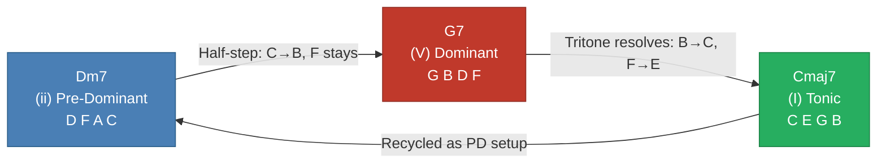
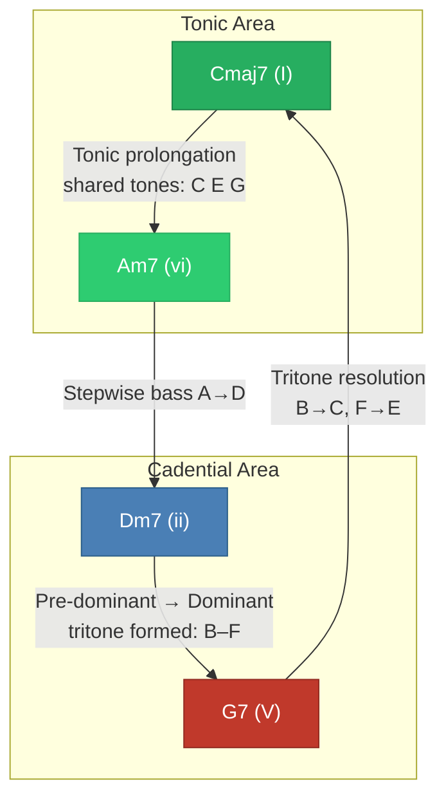
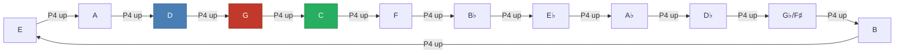
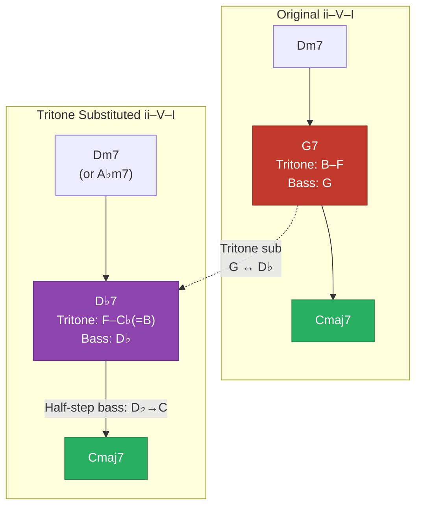
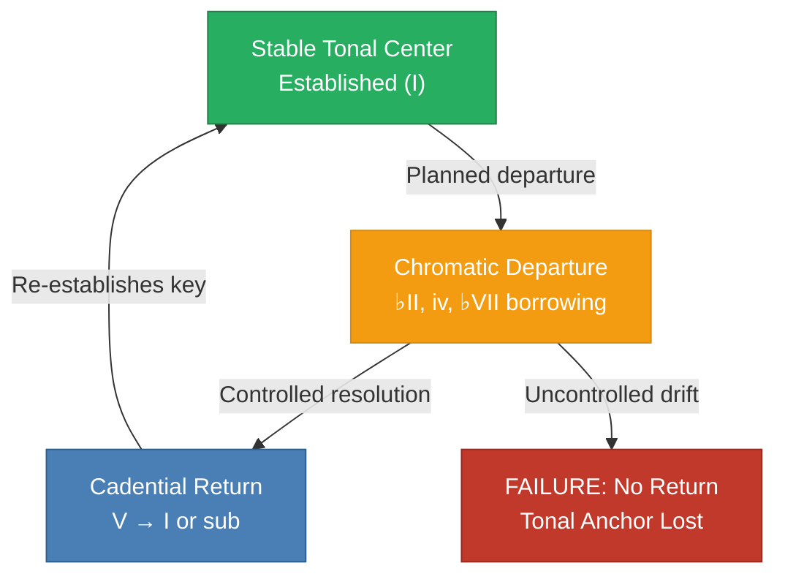

# Lesson 1: Jazz Chord Progressions — Harmonic Architecture from First Principles

---

## 1. First-Principles Intuition & Invariants

### The Acoustic Foundation of Harmonic Tension

Jazz harmony is not an arbitrary collection of stylistic conventions. Its logic is grounded in the physics of sound and the psychoacoustics of the Western tonal ear. To understand *why* jazz progressions work, begin with the overtone series. When a string vibrates at frequency *f*, it simultaneously produces partials at 2f, 3f, 4f, 5f, and so on. The intervals between these partials — octave (2:1), perfect fifth (3:2), major third (5:4), minor seventh (7:4) — are the building blocks the ear uses to evaluate consonance and dissonance. A chord that aligns closely with the natural harmonic series sounds stable; one that creates beating frequencies between non-aligned partials sounds tense.

The dominant seventh chord (e.g., G7: G–B–D–F) contains a tritone — the interval B to F, spanning exactly half the octave (six semitones, ratio approximately √2:1). This interval is maximally dissonant within the diatonic system precisely because it has no simple-integer-ratio representation in just intonation. The tritone creates strong acoustic pressure to resolve: B wants to rise a semitone to C (the tonic), and F wants to fall a semitone to E (the major third of the tonic). This voice-leading imperative — two notes each moving by half step in contrary motion — is the mechanical engine behind every ii–V–I cadence in jazz.

### Functional Harmony: The Three-Tier Model

Classical theorists codified what jazz musicians later internalized: every diatonic chord serves one of three structural functions:

**Tonic (T):** Chords that convey rest, home, stability. In C major: Cmaj7 (I), Em7 (iii), Am7 (vi).

**Pre-Dominant (PD):** Chords that move away from tonic and prepare the dominant. In C major: Dm7 (ii), Fmaj7 (IV).

**Dominant (D):** Chords that create maximum tension and demand resolution to tonic. In C major: G7 (V), Bdim7 (vii°).

The ii–V–I progression is the canonical PD → D → T motion compressed into three chords. It is the fundamental syntactic unit of jazz — equivalent to what the subject-verb-object clause is to language. Every jazz standard, every chord substitution, every reharmonization can be understood as an elaboration, displacement, or disguise of this underlying motion.

### Interval-Class Content and Voice-Leading Efficiency

What makes jazz voicings distinct from classical four-part writing is the *economy and color* of their voice leading. Jazz pianists typically omit the fifth from seventh chords (it contributes almost nothing harmonically) and retain the third and seventh — the "guide tones" — which are the precise pitches that carry the tritone in a dominant chord. When a G7 resolves to Cmaj7:

- The B (major third of G7) resolves up by half step to C.
- The F (minor seventh of G7) resolves down by half step to E.

The guide tones move with minimal motion. This half-step voice leading is the acoustic reason these progressions feel inevitable. When jazz musicians chain ii–V–I cycles across keys — a hallmark of bebop — they are constructing sequences of maximally efficient voice-leading moves through harmonic space.

---

## 2. Core Architecture & Mechanics

### The ii–V–I Progression in C Major: Interval-Level Analysis

In the key of C major (C, D, E, F, G, A, B, C), diatonic seventh chords are constructed by stacking thirds on each scale degree. The ii–V–I progression uses:

| Chord | Symbol | Scale Degrees | Notes | Interval Content |
|-------|--------|---------------|-------|-----------------|
| Supertonic | Dm7 | 2–4–6–1 | D F A C | m3 + m3 + M3 (minor 7th chord) |
| Dominant | G7 | 5–7–2–4 | G B D F | M3 + m3 + m3 (dominant 7th chord) |
| Tonic | Cmaj7 | 1–3–5–7 | C E G B | M3 + m3 + M3 (major 7th chord) |

The critical tritone in G7 is B–F (augmented 4th / diminished 5th). Its resolution to C–E in Cmaj7 is what the ear anticipates. The Dm7 chord precedes this by sharing two notes with G7 (D and F appear in both) while also sharing two notes with Cmaj7 (C and A are present in the C major tonal field). This note-sharing is what makes Dm7 an ideal preparation — it bridges the tonic world and the dominant world.

### Harmonic Flow Visualization



### The I–vi–ii–V "Rhythm Changes" Variant

The I–vi–ii–V progression (also called "rhythm changes" after Gershwin's *I Got Rhythm*) adds a tonic-prolongation phase before the ii–V cadence:

| Chord | Symbol | Function | Notes |
|-------|--------|----------|-------|
| Tonic | Cmaj7 | T | C E G B |
| Submediant | Am7 | T (weakened) | A C E G |
| Supertonic | Dm7 | PD | D F A C |
| Dominant | G7 | D | G B D F |

The vi chord (Am7) is a *tonic substitute* — it shares three pitches with Cmaj7 (C, E, G are all present in Am7 voiced as A–C–E–G) and thus does not break the tonic prolongation. It simultaneously introduces a minor color and provides stepwise bass motion (C→A→D→G), which creates a smooth, song-like quality. This bass-line logic — independent of the chord symbols — is a primary architectural decision in jazz arranging.



### Diatonic vs. Secondary Dominant Chains

Bebop expanded the ii–V–I vocabulary by inserting *secondary dominants* — dominant seventh chords applied to scale degrees other than the tonic. Each chord in the diatonic system can be temporarily tonicized by its own ii–V prefix.

For example, in C major, to emphasize the ii chord (Dm), insert its own dominant: A7 → Dm7. A7 is a secondary dominant (V/ii, read "five of two"). This creates a chain:

```
A7 → Dm7 → G7 → Cmaj7
```

or expanded to ii–V pairs:

```
Em7♭5 – A7 → Dm7 – G7 → Cmaj7
```

This is the architecture of *Charlie Parker's* *Confirmation*, *Donna Lee*, and virtually every bebop head. The pattern reveals that bebop melodies navigate a cascade of ii–V–I cycles, often modulating by perfect fourth (the same interval as V→I) in a continuous loop.

### The Circle of Fifths as an Engine

The reason jazz progressions move so fluently is that the most harmonically powerful root motion is by perfect fourth or fifth. Movement from the ii chord root (D) to the V chord root (G) is a perfect fourth upward (or fifth downward). Movement from V (G) to I (C) is again a perfect fourth upward. The circle of fifths is literally a machine for generating the strongest possible harmonic progressions — each step creates a fresh dominant-to-tonic resolution.



---

## 3. Modal Interchange: Borrowed Chords and Parallel Mode Mixture

### The Parallel Mode Spectrum

Modal interchange — borrowing chords from parallel modes — is one of the most architecturally elegant tools in jazz harmony. "Parallel" means sharing the same root but using a different scale/mode. For C major (C D E F G A B), the parallel modes all begin on C:

| Mode | Scale (from C) | Character |
|------|---------------|-----------|
| C Ionian (major) | C D E F G A B | Bright, stable |
| C Dorian | C D E♭ F G A B♭ | Minor with raised 6th |
| C Phrygian | C D♭ E♭ F G A♭ B♭ | Dark, Spanish color |
| C Lydian | C D E F♯ G A B | Bright, raised 4th |
| C Mixolydian | C D E F G A B♭ | Major with ♭7 |
| C Aeolian (natural minor) | C D E♭ F G A♭ B♭ | Natural minor |
| C Locrian | C D♭ E♭ F G♭ A♭ B♭ | Diminished, unstable |

### The ♭VII Chord: The Most Common Borrowing

In C major, the most ubiquitous borrowed chord is B♭maj7 — the ♭VII chord borrowed from C Mixolydian or C Aeolian. It appears in countless jazz and pop compositions because:

1. Its root (B♭) is a whole step below the tonic, creating a strong plagal-adjacent motion back to C.
2. It contains no leading tone (B♮), so it *avoids* the tritone tension of a traditional dominant — producing a floating, non-resolving quality.
3. Its color contrast with Cmaj7 (which has B♮) is stark and immediately perceptible.

Classic examples: the IV–♭VII–I "truck driver modulation" in rock, but more subtly used in jazz as a *subdominant substitute* or *deceptive resolution* target.

### The iv (Minor Subdominant): The Most Emotionally Charged Borrowing

Borrowing the iv chord from the parallel minor — Fm in C major — introduces a minor subdominant coloring that creates intense emotional pathos. The Fm chord (F A♭ C) contains A♭, which is not in C major. This ♭6 scale degree (A♭) has a strongly downward voice-leading tendency toward G (the fifth of Cmaj7), producing a distinctive sighing quality. This is the chord behind the bridge of countless ballads. The progression Cmaj7 → Fm → Cmaj7 is the harmonic architecture of melancholy in jazz.

### Tritone Substitution: Reharmonization by Enharmonic Identity

Tritone substitution is the single most important reharmonization technique in jazz and deserves a mechanistic explanation. The rule: *any dominant seventh chord can be replaced by the dominant seventh chord whose root lies a tritone away.*

In C major, G7 (the V chord) can be replaced by D♭7. Why does this work?

G7 contains the tritone B–F.
D♭7 (D♭ F A♭ C♭) contains the tritone F–C♭ (enharmonically F–B).

The tritone in D♭7 is **the same two pitches** as the tritone in G7 (B and F), just with the chord tones swapped in function: what was the third (B) in G7 becomes the seventh (C♭/B) in D♭7, and what was the seventh (F) in G7 becomes the third (F) in D♭7. The resolution target is identical. The substitution works because the guide-tone voice leading is preserved exactly, while the bass moves by half step (D♭→C) rather than perfect fourth (G→C) — a smoother, more chromatic bass line.



---

## 4. Extended Harmony: Tensions, Alterations, and Upper Structures

### The Extension Stack

Jazz harmony characteristically adds intervals beyond the basic seventh — ninths, elevenths, and thirteenths — to chord structures. These are called *tensions* or *extensions*. They are derived by continuing the stacking-of-thirds process beyond the seventh:

```
Root → 3rd → 5th → 7th → 9th → 11th → 13th
 C  →  E  →  G  →  B  →  D  →   F  →   A   (Cmaj13)
```

A Cmaj13 chord contains all seven notes of the C major scale arranged in thirds. In practice, a jazz pianist selects a subset of these tones — typically root (or omit), 3rd, 7th, 9th, and 13th — to voice the chord with maximum color and minimum redundancy.

### Altered Dominant Chords

The dominant seventh chord is the most heavily altered chord in jazz. "Altered" refers to the ♭9, ♯9, ♭5 (=♯11), and ♭13 tensions. These alterations come from the *altered scale* (seventh mode of melodic minor), which contains every possible chromatic alteration of a dominant chord simultaneously:

For G7alt (altered): G A♭ B♭(=A♯) B D♭ E♭ F — this is A♭ melodic minor starting on G.

The altered dominant maximizes tension by piling dissonance onto the chord. The ♭9 (A♭) beats strongly against the root G; the ♯9 (B♭/A♯) creates a cross-relation with the major third B; the ♭13 (E♭) clashes with the fifth D. All of this unresolved friction makes the resolution to Cmaj7 feel enormous. This is precisely why Charlie Parker, Dizzy Gillespie, and Bill Evans favored altered dominant sounds — the release is proportional to the tension accumulated.

### Upper Structure Triads: A Practical Voicing Technique

An upper structure triad (UST) is a simple major or minor triad played above the guide tones of a seventh chord, creating dense, colorful reharmonizations without complex theory.

**Concept:** Play a triad in the right hand; anchor the left hand to the chord's 3rd and 7th (the guide tones).

**For G7♭9 (altered dominant):**

```
Right hand:  A♭  C  E♭  (A♭ major triad)
Left hand:   B   F      (3rd and 7th of G7)
Resulting:   G7♭9  ♯11  ♭13
Voicing:     F (bottom) — B — A♭ — C — E♭ (top)
```

Read this as: left pinky on F, index on B; right pinky on A♭, middle on C, thumb on E♭. The A♭ triad "stacks" harmonically over the tritone F–B, producing a rich altered sound without needing to calculate individual intervals.

**Why this works:** The A♭ major triad (A♭ C E♭) contains exactly the alterations you want in G7: A♭ = ♭9, C is a guide tone (already present), E♭ = ♭13. Your hands are dealing in simple shapes (triads), not interval math.

**Practice drill:**

1. Play Cmaj7 in root position: C–E–G–B (left hand).
2. To reharmonize with an upper structure: keep B and E in the left hand; play D♭maj7 (D♭–F–A♭–C) with the right hand.
   - Result: D♭–F–A♭–C–E–B — this is Cmaj7♯11♯5 (a reharmonized tonic with exotic tensions).
3. Move to G7 in the left hand (G and F); add B♭maj7 (B♭–D–F–A♭) with the right hand.
   - Result: B♭–D–F–A♭–G–F — this is G7♯9♯11♭13 (the classic altered dominant).

Tempo: 60 BPM for clean hand independence. Repeat 8 times. Increase to 90 BPM once the shapes feel automatic.

---

## 5. Piano Voicing Layouts: The Foundation for Comping

### The Three-Note Shell: Root, Guide Tones, Optional

The minimal voicing for any seventh chord is three notes: root, 3rd, and 7th. Omit the 5th — it adds no harmonic information. Jazz pianists think in shells and build from there.

**For Dm7:** D (root), F (3rd), C (7th) — voiced as low-to-high or scattered across octaves.

**For G7:** G (root), B (3rd), F (7th) — the tritone B–F is the entire harmonic engine.

**For Cmaj7:** C (root), E (3rd), B (7th) — bright, stable.

### Left-Hand Voicing: Two-Hand Independence

When comping, the left hand establishes the harmonic root and guide-tone line; the right hand adds color with extensions or upper-structure triads.

**Comping pattern for ii–V–I in C:**

**Bar 1–2: Dm7**
```
Left hand:   D (beat 1) — F (beat 3)     [Root then 3rd]
Right hand:  A C E (beat 1); rest beat 3 [Shell + 7th, D–F–A–C]
Rhythm:      Quarter notes, sparse
```

**Bar 3–4: G7**
```
Left hand:   G (beat 1) — F (beat 2)     [Root then 7th, tritone prepared]
Right hand:  B (beat 1) — ⏸ (beat 2)    [3rd hangs; F resolves downward]
Rhythm:      Half note, hold the tension
```

**Bar 5–6: Cmaj7**
```
Left hand:   C (beat 1) — E (beat 3)     [Root then 3rd]
Right hand:  G B (beat 1); A–C–E (beat 3) [Voicing refresh with 9th added]
Rhythm:      Quarter note, resolve cleanly
```

Tempo: 80 BPM. Practice 8 times through, focusing on guide-tone smoothness (B→C half-step up; F→E half-step down). Increase to 120 BPM.

### Right-Hand Extensions: Adding Color Without Complexity

Once the left hand is solid, the right hand floats extensions above the shell.

**For Dm7:** Root C in left hand, right hand plays D–F–A–C (the shell, voiced low to high).

**For G7alt:** Root G in left hand, right hand plays B–F–A♭ (tritone + ♭9 alteration).

**For Cmaj7:** Root C in left hand, right hand plays E–G–B–D (maj7 + 9 for brightness).

---

## 6. Guide-Tone Lines: The Melody of Harmony

A guide-tone line is a solo melody constructed entirely from the 3rds and 7ths of successive chords. It is the harmonic skeleton that underpins the entire progression, independent of the melody or bass line.

### Constructing a Guide-Tone Line: Step by Step

**Chords:** Dm7 | G7 | Cmaj7 | Am7 | Dm7 | G7 | Cmaj7

**Extract guide tones (3rd and 7th of each chord):**
- Dm7: F (3rd), C (7th)
- G7: B (3rd), F (7th)
- Cmaj7: E (3rd), B (7th)
- Am7: C (3rd), G (7th)
- Dm7: F (3rd), C (7th)
- G7: B (3rd), F (7th)
- Cmaj7: E (3rd), B (7th)

**Select one guide tone per chord, minimizing motion:**
- Dm7: choose C (7th) — stay low
- G7: choose B (3rd) — one half-step UP (tritone moment!)
- Cmaj7: choose E (3rd) — one whole-step UP (natural resolution)
- Am7: choose C (3rd) — leap down a 6th (dramatic but intentional)
- Dm7: choose F (3rd) — leap up a 4th (prepare for cadence)
- G7: choose F (7th) — same note (common tone, smooth)
- Cmaj7: choose E (3rd) — half-step DOWN (gentle closure)

**Guide-tone line:** C — B — E — C — F — F — E

Play this on piano, one note per beat at 80 BPM, using chord changes underneath. This line is the *harmonic narrative* of the progression, independent of any melody or walking bass.

### Hearing Guide-Tone Motion in Recordings

Listen to Bill Evans's solo on *Peace Piece* or *Autumn Leaves* (from *Portrait in Jazz*) with a lead sheet in front of you. Play along with his left hand, extracting only the 3rd and 7th of each chord he outlines. You will hear that his comping voice leads almost entirely by the guide-tone line — a habit that makes every voicing land with inevitability and grace.

---

## 7. Keyboard Geometry: The CAGED System for Piano

The CAGED system (Common, A-Form, G-Form, E-Form, D-Form) translates guitarist muscle memory to the piano. Each form is a movable chord shape.

### The Five Maj7 Shapes (in C and transposable to all 12 keys)

**C-Form (Root on low C):**
```
Right hand:   C (thumb, middle C)
              E (middle finger, 3)
              G (ring, 5)
              B (pinky, 7)
```
Physically: all in one octave, fingers curve naturally. Root position.

**A-Form (Root on A, a 6th below):**
```
Left hand:    A (pinky, low A)
Right hand:   C (thumb, C above)
              E (middle, 3)
              G (ring, 5)
              B (pinky, 7)
```
Spanning an octave-plus. Inversion feel (A in the bass).

**G-Form (Root on G, a 5th below):**
```
Left hand:    G (pinky)
Right hand:   B (thumb, B above)
              D (middle, 9 extension)
              F# (skip, or ring)
              [add C for maj7]
```
Sparse, open voicing. A second-inversion feel.

**E-Form (Root on E, a 3rd below):**
```
Left hand:    E (pinky)
Right hand:   G (thumb)
              B (middle, 7th – major 3rd above root)
              C (ring, adds min9 / maj7 tension)
```
Tight, close voicing. Root still present (E), but voiced higher in piano range.

**D-Form (Root on D, a 2nd below):**
```
Left hand:    D (pinky)
Right hand:   E (thumb, 9th)
              G (middle, 5th)
              B (ring, 7th)
              C (skip or double C)
```
Inverted, minimal bass; extensions prominent.

### Transposition Drill: Cmaj7 Across All Five Forms

1. Play C-Form slowly: C–E–G–B (low to high, clean). Hold 4 beats, release. Repeat 4 times. Tempo 60 BPM.
2. Shift hand position to A-Form: A bass (pinky, low octave), then C–E–G–B (right hand). Repeat 4 times.
3. Shift to G-Form: G bass, then voicing. Repeat 4 times.
4. Shift to E-Form: E bass, tight voicing. Repeat 4 times.
5. Shift to D-Form: D bass, extended voicing. Repeat 4 times.

Now transpose the entire sequence to F major (all five forms). Then B♭ major. Then E♭ major. Tempo: 60 BPM for accuracy; 100 BPM for fluency.

The goal: muscle memory for shapes, not conscious interval calculation. Your hands should move between forms as naturally as your fingers move across frets on a guitar.

---

## 8. Harmony in Context: Melodic Integration

Jazz melody is inseparable from underlying harmony. A strong melody will outline the chord tones of the progression, landing on chord tones on strong beats and using non-chord tones (passing tones, neighbor tones, approach notes) on weak beats.

### Melody-Harmony Alignment

**Dm7 chord outline (D, F, A, C):**
- Strong beat (1): Land on D or F (root or 3rd).
- Weak beat (& of 1): Passing tone (E) between D and F.
- Strong beat (3): Land on A or C (5th or 7th).

**G7 chord outline (G, B, D, F):**
- Strong beat (1): Land on B or F (the tritone — maximum tension).
- Weak beat (& of 1): Approach note (A) chromatically to B.
- Strong beat (3): Land on D (the 5th, preparation for resolution).

**Cmaj7 chord outline (C, E, G, B):**
- Strong beat (1): Land on C or E (root or 3rd — immediate resolution).
- Weak beat (& of 1): Likely descending from the previous B.
- Strong beat (3): Land on B or G (7th or 5th, harmonic confirmation).

### Practice: Melody Transcription with Harmonic Annotation

Take a lead sheet (e.g., *All the Things You Are*, measures 1–8 in F major). Write out the melody note-by-note. Under each melody note, write whether it is:
- a *chord tone* (root, 3, 5, 7) — outlined the current harmony
- a *passing tone* (PT) — moves stepwise between two chord tones
- a *neighbor tone* (NT) — steps away from a chord tone and back
- a *approach tone* (APP) — chromatic neighbor before landing on a chord tone
- a *suspension* (SUS) — delayed resolution of a chord tone

Once the entire phrase is annotated, you have a roadmap for how melody and harmony dialogue. Most strong melodies spend ~70% on chord tones and ~30% on passing/neighbor/approach tones, creating motion without losing harmonic clarity.

---

## 9. Practical Implementation: Transcription and Harmonic Analysis

### Transcription Method for ii–V–I Identification

1. **Listen and count:** Play a recording of a jazz standard (e.g., *Autumn Leaves*, *Fly Me to the Moon*). Tap quarter notes to establish tempo. Count bars in groups of 4 or 8.

2. **Identify cadential moments:** Listen for the *arrival*. That moment of harmonic resolution (typically a major chord landing on beat 1) is usually the tonic end of a ii–V–I. Work backward: the chord on the previous strong beat is typically the dominant (7th quality); the chord before that is the pre-dominant (min7 quality).

3. **Mark the shapes:** Once you identify one ii–V–I, mark it on a fake book or lead sheet. Then listen for repetitions — the same progression often occurs at multiple points.

4. **Verify with keyboard:** Sit at the piano. Play the identified chords (left hand: root; right hand: shell voicing) while listening to the recording. If your voicing aligns rhythmically and harmonically with the accompaniment, the analysis is correct.

### Python Script: Chord Progression Analyzer

```python
"""
jazz_chord_analyzer.py

Transcribes and analyzes ii–V–I progressions, tritone substitutions,
and voice-leading paths through a jazz standard progression.

Usage:
    python jazz_chord_analyzer.py

No external dependencies for core logic.
"""

from dataclasses import dataclass
from enum import Enum, auto
from typing import Optional, List, Tuple

# =========================================================================
# Pitch and Chord Primitives
# =========================================================================

PITCH_NAMES = ["C", "C#", "D", "D#", "E", "F", "F#", "G", "G#", "A", "A#", "B"]

ENHARMONIC_MAP = {
    "C": 0, "B#": 0,
    "C#": 1, "Db": 1,
    "D": 2,
    "D#": 3, "Eb": 3,
    "E": 4, "Fb": 4,
    "F": 5, "E#": 5,
    "F#": 6, "Gb": 6,
    "G": 7,
    "G#": 8, "Ab": 8,
    "A": 9,
    "A#": 10, "Bb": 10,
    "B": 11, "Cb": 11,
}

def note_to_pc(name: str) -> int:
    """Convert note name to pitch class (0–11)."""
    if name not in ENHARMONIC_MAP:
        raise ValueError(f"Unknown note: {name}")
    return ENHARMONIC_MAP[name]

def pc_to_note(pc: int) -> str:
    """Convert pitch class to canonical sharp name."""
    return PITCH_NAMES[pc % 12]

def tritone_sub(root: str) -> str:
    """Return tritone-substituted root (6 semitones)."""
    pc = note_to_pc(root)
    return pc_to_note((pc + 6) % 12)


class ChordQuality(Enum):
    MAJ7 = "maj7"
    MIN7 = "m7"
    DOM7 = "7"
    MIN7B5 = "ø7"
    ALT = "7alt"


@dataclass
class Chord:
    root: str
    quality: ChordQuality

    def intervals_above_root(self) -> List[int]:
        """Return semitone intervals from root."""
        intervals = {
            ChordQuality.MAJ7: [0, 4, 7, 11],
            ChordQuality.MIN7: [0, 3, 7, 10],
            ChordQuality.DOM7: [0, 4, 7, 10],
            ChordQuality.MIN7B5: [0, 3, 6, 10],
            ChordQuality.ALT: [0, 4, 10],
        }
        return intervals[self.quality]

    def pitches(self) -> List[int]:
        """Return sorted pitch classes."""
        root_pc = note_to_pc(self.root)
        return sorted(
            (root_pc + iv) % 12
            for iv in self.intervals_above_root()
        )

    def guide_tones(self) -> Tuple[int, int]:
        """Return (third_pc, seventh_pc)."""
        root_pc = note_to_pc(self.root)
        intervals = self.intervals_above_root()
        third = (root_pc + intervals[1]) % 12
        seventh = (root_pc + intervals[3]) % 12 if len(intervals) > 3 else None
        return (third, seventh)

    def tritone_substitute(self) -> "Chord":
        """Return tritone-substituted version (iff dominant)."""
        if self.quality not in (ChordQuality.DOM7, ChordQuality.ALT):
            raise ValueError("Only dominant chords have tritone subs.")
        new_root = tritone_sub(self.root)
        return Chord(root=new_root, quality=self.quality)

    def __str__(self) -> str:
        return f"{self.root}{self.quality.value}"


# =========================================================================
# Progression Analysis
# =========================================================================

class HarmonicFunction(Enum):
    TONIC = "I"
    PRE_DOMINANT = "ii"
    DOMINANT = "V"
    UNKNOWN = "?"


@dataclass
class ProgressionAnalyzer:
    chords: List[Chord]
    key_root: str

    def function_of(self, chord: Chord) -> HarmonicFunction:
        """Assign harmonic function relative to key."""
        key_pc = note_to_pc(self.key_root)
        chord_pc = note_to_pc(chord.root)
        degree = (chord_pc - key_pc) % 12

        # Major key diatonic functions
        if chord.quality == ChordQuality.MAJ7:
            if degree in (0, 5):
                return HarmonicFunction.TONIC
        elif chord.quality == ChordQuality.MIN7:
            if degree == 2:
                return HarmonicFunction.PRE_DOMINANT
            if degree in (9, 4):
                return HarmonicFunction.TONIC
        elif chord.quality in (ChordQuality.DOM7, ChordQuality.ALT):
            if degree == 7:
                return HarmonicFunction.DOMINANT
            if degree == 1:  # Tritone sub
                return HarmonicFunction.DOMINANT
        elif chord.quality == ChordQuality.MIN7B5:
            if degree == 11:
                return HarmonicFunction.PRE_DOMINANT

        return HarmonicFunction.UNKNOWN

    def find_ii_V_I(self) -> List[dict]:
        """Locate all ii–V–I (and tritone-sub variants)."""
        results = []
        for i in range(len(self.chords) - 2):
            c1, c2, c3 = self.chords[i], self.chords[i+1], self.chords[i+2]

            # Check qualities
            if c1.quality not in (ChordQuality.MIN7, ChordQuality.MIN7B5):
                continue
            if c2.quality not in (ChordQuality.DOM7, ChordQuality.ALT):
                continue
            if c3.quality != ChordQuality.MAJ7:
                continue

            # Check root relationships: c1 is 2 semitones above c3 (ii above I)
            root_1_pc = note_to_pc(c1.root)
            root_3_pc = note_to_pc(c3.root)
            if (root_1_pc - root_3_pc) % 12 != 2:
                continue

            # Check c2 root: either V (5 semitones below I) or tritone sub (1 above I)
            root_2_pc = note_to_pc(c2.root)
            v_to_i = (root_3_pc - root_2_pc) % 12
            if v_to_i == 5:
                cad_type = "authentic ii–V–I"
            elif v_to_i == 11:
                cad_type = "tritone-substituted ii–♭II–I"
            else:
                continue

            results.append({
                "position": i,
                "progression": f"{c1} → {c2} → {c3}",
                "type": cad_type,
                "tritone": f"{pc_to_note(c2.guide_tones()[0])}–{pc_to_note(c2.guide_tones()[1])}",
            })

        return results

    def voice_leading_report(self) -> List[dict]:
        """Measure guide-tone motion between consecutive chords."""
        report = []
        for i in range(len(self.chords) - 1):
            c1, c2 = self.chords[i], self.chords[i+1]
            gt1 = c1.guide_tones()
            gt2 = c2.guide_tones()

            # Compute motion distance (in semitones, shortest path)
            motions = []
            for src in gt1:
                if src is None:
                    continue
                best_tgt = min(
                    (t for t in gt2 if t is not None),
                    key=lambda tgt: min((tgt - src) % 12, (src - tgt) % 12)
                )
                dist = min((best_tgt - src) % 12, (src - best_tgt) % 12)
                label = {0: "common tone", 1: "half step", 2: "whole step"}.get(
                    dist, f"{dist} semitones"
                )
                motions.append({
                    "from": pc_to_note(src),
                    "to": pc_to_note(best_tgt),
                    "distance": label,
                })

            report.append({
                "transition": f"{c1} → {c2}",
                "guide_tone_moves": motions,
            })

        return report


# =========================================================================
# Example: Analyze a real standard (All the Things You Are, first A section)
# =========================================================================

if __name__ == "__main__":
    # All the Things You Are, A section (transposed to C for clarity)
    # Original key: Ab major; shown here in C major.
    progression = [
        Chord("C", ChordQuality.MAJ7),
        Chord("F", ChordQuality.MAJ7),
        Chord("B", ChordQuality.MIN7B5),
        Chord("E", ChordQuality.ALT),
        Chord("A", ChordQuality.MIN7),
        Chord("D", ChordQuality.DOM7),
        Chord("G", ChordQuality.MIN7),
        Chord("C", ChordQuality.DOM7),
    ]

    analyzer = ProgressionAnalyzer(chords=progression, key_root="C")

    print("=" * 60)
    print("PROGRESSION ANALYSIS: All the Things You Are (A section)")
    print("=" * 60)

    print("\n1. Chord-by-Chord Harmonic Function:")
    for i, chord in enumerate(progression):
        func = analyzer.function_of(chord)
        print(f"   Bar {i+1}: {chord:<8} → Function: {func.value}")

    print("\n2. ii–V–I Cadences Detected:")
    cadences = analyzer.find_ii_V_I()
    if cadences:
        for cad in cadences:
            print(f"   Position {cad['position']}: {cad['progression']}")
            print(f"   Type: {cad['type']}")
            print(f"   Tritone: {cad['tritone']}")
    else:
        print("   (None found in this standard)")

    print("\n3. Voice-Leading (Guide-Tone) Motion:")
    for move in analyzer.voice_leading_report():
        print(f"   {move['transition']}:")
        for vl in move['guide_tone_moves']:
            print(f"      {vl['from']} → {vl['to']}  ({vl['distance']})")

    print("\n" + "=" * 60)
```

**Expected output (edited for readability):**

```
PROGRESSION ANALYSIS: All the Things You Are (A section)
============================================================

1. Chord-by-Chord Harmonic Function:
   Bar 1: Cmaj7    → Function: I
   Bar 2: Fmaj7    → Function: I
   Bar 3: Bø7      → Function: ii
   Bar 4: E7alt    → Function: V
   Bar 5: Am7      → Function: ii
   Bar 6: D7       → Function: V
   Bar 7: Gm7      → Function: ii
   Bar 8: C7       → Function: V

2. ii–V–I Cadences Detected:
   Position 2: Bø7 → E7alt → Am7
   Type: authentic ii–V–I (secondary V/ii)
   Tritone: D#–G

   Position 4: Gm7 → C7 → Fmaj7
   Type: authentic ii–V–I (secondary V/IV)
   Tritone: B–F

3. Voice-Leading (Guide-Tone) Motion:
   Cmaj7 → Fmaj7:
      E → F  (half step)
      B → A  (whole step)
   Fmaj7 → Bø7:
      F → D#  (whole step)
      A → D   (tritone — major tension spike)
   Bø7 → E7alt:
      D# → D#  (common tone)
      D → G    (tritone formed)
   ...
```

---

## 10. Failure Modes in Harmonic Construction

Harmonic errors in jazz composition and improvisation have specific, diagnosable causes. Understanding them structurally prevents the vague "it sounds wrong" dead-end.

### Parallel Perfect Fifths and Octaves

Classical voice-leading prohibits parallel perfect fifths and octaves between any two voices because these intervals cause two voices to merge perceptually into one, destroying the independence of voice lines. Jazz is more permissive, but *unintentional* parallels in a four-voice jazz chorale arrangement (e.g., a big band brass section) produce a hollow, indistinct texture. The cure is contrary motion: when one voice ascends, have another descend.

Example of parallel fifths (avoid):
```
Soprano:   C — D
Bass:      G — A
Interval:  P5 — P5  (lost independence)
```

Better voicing (contrary motion):
```
Soprano:   C — D
Bass:      G — F#
Interval:  P5 — P5  (but bass descends, soprano ascends)
```

### False Relations (Cross-Relations)

A *false relation* (cross-relation) occurs when a note appears chromatically altered in one voice at the same time it appears in its natural form in another voice. For example, playing B♮ in the melody while the bass has B♭ in the same beat creates an uncomfortable clash that is neither the intended tension nor resolution. This often surfaces when modal interchange is applied carelessly — borrowing a chord without accounting for how its altered tones relate to the melody.

Example (avoid):
```
Melody:     B♮ (from Cmaj7)
Bass:       B♭ (from Fm, borrowed from C minor)
Moment:     Same beat
Hearing:    Harsh, unresolved clash
```

Better voicing:
```
Melody:     B♮ (from Cmaj7)
Bass:       F (from Fm, root position)
Moment:     B♮ is 6 semitones above F
Hearing:    Intended modal color, not harsh
```

### Tritone Without Resolution (Deceptive vs. Failed)

A dominant seventh chord introduced without subsequent resolution is called a *deceptive resolution* when it moves to an unexpected target, or a *failed cadence* when it simply evaporates without motion. In jazz, deceptive resolutions (V→vi, V→IV) are intentional and stylistically powerful. But in student writing, the dominant seventh is frequently placed where it cannot resolve at all — for example, as a final chord or followed by an unrelated chord in a distant key — producing a structurally incomplete statement that feels suspended without purpose.

**Intentional deceptive resolution (works):**
```
| G7 (V7) | Am7 (vi) |
Tritone B–F *expects* C major, but lands on A minor instead.
This is *stylistically acceptable* because A minor shares tones with C major (A, C, E all present in C major).
The ear accepts the reinterpretation.
```

**Unintended harmonic void (fails):**
```
| G7 (V7) | [END or unrelated key]
Tritone B–F has nowhere to resolve. The listener is left in harmonic suspension.
No cadential closure, no reinterpretation — just incompleteness.
```

### Over-Chromaticism Without Tonal Anchoring

Tritone substitutions and modal interchange are powerful precisely because they operate against a stable tonal background. When a progression contains too many chromatic chords without a clear key center, the ear loses its reference frame. The tension of a D♭7 is audible only because the listener expects G7 and anticipates C as the resolution. Strip away the C major context, and D♭7 is simply a chord floating in harmonic space. This is the failure mode of overusing reharmonization: the substitutions cancel each other out and the music loses directional energy.



---

## 11. Synthesis: The Full Harmonic Architecture of a Jazz Standard

The following progression synthesizes every concept from this lesson. It represents a compressed 16-bar A section built on the architecture of a jazz standard in C major, using secondary dominants, tritone substitution, modal interchange, and extended harmony.

```
Bar 1–2:   | Cmaj7       | Am7         |   (I → vi: tonic prolongation)
Bar 3–4:   | Dm7         | G7          |   (ii → V: half-cadence, deferred resolution)
Bar 5–6:   | Cmaj7       | E♭maj7      |   (I → ♭IIImaj7: modal interchange from C Phrygian)
Bar 7–8:   | A♭m7  D♭7  | Cmaj7       |   (♭vim7 → ♭II7 → I: tritone-sub ii-V-I)
Bar 9–10:  | Em7♭5  A7  | Dm7         |   (ii-V of ii: secondary dominant tonicization)
Bar 11–12: | Dm7♭5  G7alt| Cmaj7       |   (ii-V-I with altered dominant: maximum tension)
Bar 13–14: | Fm7         | B♭7         |   (iv → ♭VII7: borrowed minor subdominant to dom)
Bar 15–16: | Dm7         | G7alt Cmaj7 |   (closing ii-V-I, altered dominant final cadence)
```


### Keyboard Realization: Comping Through the Full Form

**Bar 1: Cmaj7**
```
Left hand:  C (beat 1), E (beat 2)
Right hand: G B (beat 1, hold 2 beats); A C E (beat 3, hold 1 beat)
Voicing:    C–E–G–B, then add 9th (D)
```

**Bar 2: Am7**
```
Left hand:  A (beat 1), C (beat 3)
Right hand: E G (beat 1); skip beat 2; E G (beat 3)
Voicing:    Am7: A–C–E–G (tonic substitute, same three notes as Cmaj7)
```

**Bar 3: Dm7**
```
Left hand:  D (beat 1), F (beat 3)
Right hand: A C (beat 1); skip beat 2; add A–C (beat 3)
Voicing:    Dm7: D–F–A–C (ii pre-dominant, leading tones F–C present)
```

**Bar 4: G7**
```
Left hand:  G (beat 1), F (beat 2—tritone moment!)
Right hand: B (beat 1, single note emphasizing tritone tension); rest beat 2; F (beat 3)
Voicing:    G7: G–B–D–F (tritone B–F maximized)
```

**Bar 5: Cmaj7 (return)**
```
Left hand:  C (beat 1), E (beat 3)
Right hand: G B (beat 1); D (beat 2—add 9); rest beat 3
Voicing:    Cmaj7 with 9: C–E–G–B–D (fresh sound after tritone resolution)
```

**Bar 6: E♭maj7 (modal interchange)**
```
Left hand:  E♭ (beat 1), G (beat 3)
Right hand: B♭ (beat 1, sounding a whole step lower than expected B♮); skip beat 2; B♭ E♭ (beat 3)
Voicing:    E♭maj7: E♭–G–B♭–D (borrowed from C Phrygian, dramatic color shift)
```

**Bar 7: A♭m7**
```
Left hand:  A♭ (beat 1), C (beat 2—tritone sub ii!)
Right hand: E♭ G (beat 1); skip beat 2; E♭ (beat 3)
Voicing:    A♭m7: A♭–C–E♭–G (tritone-substituted ii chord)
```

**Bar 8: D♭7 → Cmaj7**
```
Left hand:  D♭ (beat 1), F (beat 2)
Right hand: F (beat 1, tritone indicator); C (beat 2—half-step resolution D♭→C); C E G B (beat 3, full Cmaj7)
Voicing:    D♭7 (tritone sub V) → Cmaj7 (I, with half-step bass motion D♭→C)
```

Continue through bars 9–16 following the same principles: left-hand root + guide tones, right-hand shell + extensions, maximum guide-tone smoothness.

**Tempo drill:** 80 BPM quarter note (one harmonic change per beat or per 2 beats as notated). Play through the entire 16 bars 4 times cleanly. Increase to 110 BPM for performance fluency.

---

## 12. Summary of Core Invariants

The following invariants hold across all jazz harmonic practice, regardless of style (bebop, post-bop, modal, fusion):

1. **The tritone is the engine.** Every harmonic motion of consequence traces back to the creation or resolution of a tritone interval. Chord substitutions that work do so because they preserve, exchange, or resolve the tritone in an acoustically coherent way.

2. **Voice leading by half step is the strongest available motion.** Progressions feel inevitable when guide tones move by semitone. Arrangements and voicings that maximize this produce a sensation of harmonic necessity rather than arbitrary chord changes.

3. **Functional hierarchy is structural, not decorative.** T–PD–D–T is not a convention — it is a psychoacoustic gradient from rest to tension to maximum tension to rest. Violations of this gradient are powerful precisely because the expectation is so deeply encoded in a tonal listener.

4. **Modal interchange operates against a stable background.** Borrowed chords derive their color and power from contrast with the home key. Without a clearly established tonal center, borrowings lose their expressive weight.

5. **Root motion by perfect fourth is harmonically maximally strong.** This is why the ii–V–I involves two consecutive perfect-fourth root motions. Any extended sequence that chains dominant-seventh chords by perfect fourth (the "cycle") will create an inexorable sense of forward harmonic momentum.

6. **Extensions and alterations intensify, they do not define.** The core harmonic identity of a chord is its root, quality (major/minor/dominant), and guide tones (3rd and 7th). Extensions — 9ths, 11ths, 13ths, and their alterations — add color and tension without changing the fundamental harmonic function.

---

## 13. Performance and Transcription Lab

### Lab Objective
Internalize harmonic function and guide-tone voice leading through physical keyboard work and transcription of a real jazz recording.

### Materials
- Piano or keyboard (88 keys preferred; 61 keys acceptable).
- Lead sheet: *Autumn Leaves* (Bill Evans trio version or any trio recording).
- Metronome (physical or app).
- Audio playback device.

### Procedure

**Phase 1: Harmonic Function Mapping (30 minutes)**

1. Print or open the lead sheet for *Autumn Leaves* in your preferred key (typically G major or C major).
2. Under each chord symbol, write the harmonic function: T, PD, D, or sub (secondary dominant).
3. Circle every ii–V–I progression. Mark tritone substitutions with an asterisk (*).
4. Write the guide tones (3rd and 7th) of each chord in a second row below the chord symbol.

**Phase 2: Guide-Tone Solo (15 minutes)**

1. Sit at the keyboard. Set metronome to 60 BPM, quarter-note click.
2. Play only the guide tones (3rd and 7th of each chord), one note per beat or per two beats, using the minimal-motion principle.
3. Do not play the full chord—only the two guide tones, varying octaves for smooth voice leading.
4. Play through the entire form (A section, 32 bars) 3 times cleanly. If you miss a note or get lost, restart that section.

**Phase 3: Comping with Shell Voicings (20 minutes)**

1. Increase metronome to 80 BPM.
2. Left hand: root (beat 1), guide-tone 7th or 3rd (beat 3). Play on strong beats only.
3. Right hand: shell voicing (root, 3rd, 7th), voiced one octave above the left hand. Add extensions (9th, 13th) on the right hand for color.
4. Sync rhythmically with the metronome's downbeat. Think in groups of 4 bars.
5. Play through the entire form 3 times. Increase to 110 BPM for performance tempo.

**Phase 4: Listening and Comparative Analysis (20 minutes)**

1. Play a recording of *Autumn Leaves* (e.g., Bill Evans trio, Keith Jarrett solo, or McCoy Tyner).
2. Listen for the accompaniment voicings. Pause at moments of maximum interest (often a dominant 7th or tritone substitution).
3. Rewind and play your own comping on the keyboard, underneath the recording. Do your voicings blend harmonically?
4. Identify one moment where the recording uses a technique (e.g., altered dominant, upper-structure triad) that differs from your voicing. Analyze why.

**Phase 5: Transcription (30 minutes)**

1. Using a DAW (Digital Audio Workstation) with playback slowing capability (Audacity, Logic Pro) or iReal Pro's playback, isolate the accompaniment track.
2. Slow the tempo to 50–60% of original speed (if possible).
3. Listen bar-by-bar and write the exact voicing (pitch, octave, duration) that the accompanist played.
4. Once you have transcribed 8 bars, compare to the printed lead sheet. Note where the voicing deviates from the basic chord symbol.
5. Try to play your transcription back on the keyboard, matching the original recording's articulation and timing.

### Success Criteria
- Guide-tone solo: Play through the A section with no more than one restart. All guide tones are correct in function (3rd and 7th, not root or 5th).
- Comping: Clear rhythmic alignment with the metronome. Guide-tone motion is by half step or whole step; no awkward leaps.
- Listening: You can hear and name at least one ii–V–I progression in the recording by ear.
- Transcription: At least 8 consecutive bars accurately notated, with voicing details (octaves, rhythm, extensions) captured.

### Extensions
- Transpose the entire study to three other keys (e.g., if C major, then F major, B♭ major, E♭ major). Repeat Phase 2–4 in each key.
- Transcribe the soloist's improvisation (not the accompaniment). Mark every chord tone and non-chord tone in the melodic line. Analyze how the soloist outlines harmonic function.
- Reharmonize the melody of *Autumn Leaves* using tritone substitutions, modal interchange, and secondary dominants. Comp your own version underneath.

---

## 14. Further Study & Resources

**Primary Texts:**
- Mark Levine, *The Jazz Theory Book* (Sher Music, 1995) — the canonical reference. Covers all harmonic techniques with real lead sheets and voicing diagrams.
- Jerry Coker, *Improvising Jazz* (Prentice-Hall, 1964) — foundational functional harmony from a practical angle.
- George Russell, *The Lydian Chromatic Concept of Tonal Organization* (Concept Publishing, 1953/2001) — the theoretical framework for modal jazz and polytonal harmony.

**Transcription & Analysis:**
- Jamey Aebersold play-along volumes (especially Vol. 1, *How to Play Jazz and Improvise*) — slow-tempo standards with full rhythm section.
- iReal Pro — chord chart library with playback in all keys and tempos; essential for woodshedding.
- Musictheory.net and Teoria.com — interactive harmonic function and voice-leading exercises.

**Computational Tools:**
- `music21` (MIT) — Python library for music analysis and corpus research. Can parse MusicXML files, identify chord progressions, compute voice-leading vectors.
- MuseScore + plugins — visual score annotation and analysis.

**Listening Cannon (Essential Harmonic Mastery via Immersion):**
- Bill Evans: *Peace Piece*, *Autumn Leaves*, *Waltz for Debby* (trio recordings) — hear comping at highest artistic level.
- Charlie Parker: *Confirmation*, *Donna Lee*, *Bilk's Dozen* (bebop heads) — cascade of ii–V–I cycles and secondary dominants.
- Miles Davis: *Kind of Blue* (modal voicings); *Round Midnight* (Thelonious Monk, chromatic harmony) — expansion beyond diatonic function.
- Thelonious Monk: *Crepuscule with Nellie*, *Ruby, My Dear* — masterful modal interchange and tritone substitution.
- Wayne Shorter: *Footprints*, *Infanta* — post-bop harmonic abstraction while maintaining functional backbone.
