# Jazz Harmony at the Keyboard: ii–V–I Mechanics, Voicings, and Reharmonization

---

## 1. Why This Works: The Tritone as Engine (Read Once, Apply Forever)

Every ii–V–I in jazz runs on one mechanism: **the tritone wants to resolve, and it resolves by half step in two directions at once.**

Take G7 (G–B–D–F). The interval from B to F spans six semitones — exactly half an octave, with no simple small-number ratio backing it in just intonation. Your ear can't settle it into a stable fraction, so it reads as unstable and *pulls*. Resolve it to C major:

- B (the 3rd of G7) rises a half step to C (the root of Cmaj7)
- F (the 7th of G7) falls a half step to E (the 3rd of Cmaj7)

Two notes, moving in opposite directions, each by the smallest possible interval. That's the entire physics lesson. You don't need more theory than this to play convincing jazz harmony — you need to feel this half-step pull in your hands until it's automatic. Everything else in this lesson — secondary dominants, tritone subs, altered chords, modal interchange — is a variation on finding new ways to set up and delay this resolution.

**The practical consequence:** jazz pianists voice chords around the 3rd and 7th (the "guide tones") because those are the two notes carrying this motion. The root and 5th are structural furniture — fine to include, irrelevant to the tension-and-release story.

---

## 2. Hand Position and Posture Before Anything Else

Before voicings, lock in posture or you will build bad habits into muscle memory that are painful to undo later.

- **Bench height:** forearms parallel to the floor when hands rest on keys, elbows slightly in front of the torso, not pinned to your sides.
- **Wrist:** level with the key bed, neither drooping nor cocked upward. A drooped wrist chokes off power and causes strain over long comping sessions.
- **Fingers:** curved as if holding a small ball, striking with the pad/tip, not flat and collapsed.
- **Weight transfer:** think of dropping forearm weight into the key, not pushing with isolated finger muscles. This matters enormously for comping stamina — a two-hour gig with finger-only technique leads to fatigue and tension; forearm-weight technique doesn't.
- **Left hand for comping:** keep it close to the keys, minimal lift between voicings. Big arm motions between chords destroy rhythmic precision.

Spend 5 minutes before every practice session just playing single notes with full arm-weight drop, no tension in the shoulder. This is not optional warm-up fluff — carpal tunnel and tendinitis in jazz pianists overwhelmingly trace back to finger-only technique under tempo pressure.

---

## 3. The Three-Note Shell: Your First Real Vocabulary

Forget full five-note chords at first. Build every seventh chord from **root, 3rd, 7th** — omit the 5th entirely. The 5th adds almost no harmonic information and clutters your hand.

| Chord | Root | 3rd | 7th | Shell (low to high) |
|---|---|---|---|---|
| Dm7 | D | F | C | D–F–C |
| G7 | G | B | F | G–B–F |
| Cmaj7 | C | E | B | C–E–B |

Notice G7's shell contains the tritone B–F directly — play it and you'll hear the tension sitting right in your hand.

### Drill 1: Shells in Both Hands, Root Motion by 4ths
Metronome 60 BPM, quarter notes, one chord per 2 beats.

```text
Left hand (root only):   D  -  G  -  C  -
Right hand (3rd+7th):    F C - B F - E B -
```

Play Dm7 → G7 → Cmaj7 in C major, then transpose up a whole step (Em7 → A7 → Dmaj7), then up another whole step, cycling through all 12 keys by whole steps. This single drill builds (1) the shell shape in muscle memory and (2) the perfect-fourth root motion that underlies all jazz cadences.

Progression: 60 → 80 → 110 BPM over a week. Do not increase tempo until you can play all 12 keys without looking at your hands.

---

## 4. Left-Hand / Right-Hand Comping Split

Once shells are automatic, split the labor: **left hand carries root + one guide tone, right hand carries the color.**

### ii–V–I in C, full comping pattern

**Bar 1 — Dm7**
```text
Left hand:   D (beat 1)         F (beat 3)
Right hand:  A-C-E (beat 1, held)
```
Fingering, right hand: 2 (A) – 3 (C) – 5 (E), thumb free for later extensions.

**Bar 2 — G7**
```text
Left hand:   G (beat 1)         F (beat 3 — tritone anchor)
Right hand:  B (beat 1, let it ring)   rest   add D (beat 3, the 9th for color)
```
Right-hand fingering: 2 (B), then 2-4 (B-D) on beat 3.

**Bar 3 — Cmaj7**
```text
Left hand:   C (beat 1)         E (beat 3)
Right hand:  G-B (beat 1)       D (beat 3, 9th added for lift)
```

**Why this split works:** the left hand's single guide tone (F in G7, then resolving) tracks the half-step motion precisely, while the right hand is free to add 9ths and 13ths without disturbing the core voice-leading line. You're separating *structure* from *color* — a core jazz piano skill.

Tempo target: 80 BPM for clean execution, 8 times through without hesitation, then 120 BPM for performance speed.

---

## 5. Guide-Tone Lines: Playing the Harmony as a Melody

A guide-tone line strips the progression down to one note per chord — just the 3rd or 7th, chosen to minimize motion between chords. This is the single best ear-training exercise for internalizing why ii–V–I feels inevitable.

**Progression:** Dm7 | G7 | Cmaj7 | Am7 | Dm7 | G7 | Cmaj7

**Guide tones available at each chord:**
- Dm7: F (3rd) or C (7th)
- G7: B (3rd) or F (7th)
- Cmaj7: E (3rd) or B (7th)
- Am7: C (3rd) or G (7th)

**Choosing for minimum motion:**
```text
Dm7 → G7 → Cmaj7 → Am7 → Dm7 → G7 → Cmaj7
 C  →  B →  E    →  C  →  F  →  F →  E
     (½ down)  (4th up) (3rd down) (4th up) (same)  (½ down)
```

### Drill 2: Guide-Tone Solo, Right Hand Only
One note per beat, metronome 60 BPM. Play through the full progression above, 4 times, in C major. Then transpose to F, B♭, E♭.

Once this is automatic, add the left-hand root underneath (just the root, whole notes) so you hear the guide tone against its harmonic foundation. This is exactly what you're tracking when you listen to a great comper — their inner voice-leading line, not their chord symbols.

---

## 6. CAGED-Style Movable Voicing Shapes for Jazz Piano

Guitarists learn five movable shapes across the neck (CAGED). Pianists benefit from an analogous idea: **learn one voicing shape and know where the root sits relative to your hand, then slide it.**

### Shape A — "Rootless A-Form" (3-7-9-5, root implied in bass by someone else, e.g., a bassist)
Used constantly in combo playing where the bassist states the root.

**For Cmaj7 (voiced E-G-B-D, built from the 3rd up):**
```text
Right hand:  E (thumb, 1) – G (2) – B (4) – D (5)
```
No root at all — the 3rd is now your lowest note. This is THE standard jazz-combo right-hand voicing because it leaves maximum space in the low register for the bass and avoids muddying the bottom.

**For Dm7 (voiced F-A-C-E, 3-5-7-9):**
```text
Right hand:  F (1) – A (2) – C (4) – E (5)
```

**For G7 (voiced F-A-B-D... more commonly F-B-D-A as 7-3-5-9):**
```text
Right hand:  F (1) – B (2) – D (4) – A (5)
```

### Shape B — "Rootless B-Form" (7-9-3-5)
A second inversion-feeling shape, used to alternate with Shape A so your voicings don't jump register awkwardly.

**For Cmaj7:**
```text
Right hand:  B (1) – D (2) – E (3) – G (5)
```

**For Dm7:**
```text
Right hand:  C (1) – E (2) – F (3) – A (5)
```

**For G7:**
```text
Right hand:  F (1) – A (2) – B (3) – D (5)
```

### Drill 3: Alternating Shape A / Shape B Through ii–V–I
Play Dm7 (Shape A) → G7 (Shape B) → Cmaj7 (Shape A), left hand playing roots only (D, G, C) as quarter notes. Notice how alternating shapes keeps the right hand in a comfortable, non-repetitive register and creates smoother top-note motion. Metronome 70 BPM, 8 repetitions, then transpose through all 12 keys ascending by half step (the classic "cycle drill" every working jazz pianist has done thousands of times).

This A/B shape alternation is the real pianistic analog to CAGED — not fixed finger patterns tied to specific keys, but movable upper-structure shapes you slide to any root, choosing whichever shape keeps your hand in the best register for the next chord.

---

## 7. Secondary Dominants: Extending the ii–V Vocabulary

Every diatonic chord can get its own personal V7 — a **secondary dominant** that temporarily tonicizes it. In C major, to strongly approach Dm7 (the ii chord), borrow its dominant: A7.

```text
A7 → Dm7 → G7 → Cmaj7
```

A7 is "V of ii," written V/ii. It contains C# (not in C major) — the raised note is what makes it sound like a dominant pulling specifically toward D, not toward anywhere else. This single borrowed sharp is doing all the work.

### Drill 4: Secondary Dominant Chain (bebop vocabulary)
Expand to full ii–V pairs for a Charlie Parker-style cascading progression:

```text
Em7♭5 – A7  →  Dm7 – G7  →  Cmaj7
(ii-V of ii)    (ii-V of I)   (arrival)
```

Left hand: roots only, quarter notes — E, A, D, G, C. Right hand: Shape A or B rootless voicings, picking whichever shape leaves the smoothest top-note line into the next chord. Metronome 70 BPM. This exact shape — chained ii-V motion — is the backbone of *Confirmation*, *Donna Lee*, and nearly every bebop head; practicing this chain in all 12 keys is more valuable than memorizing any number of tunes by rote.

---

## 8. Tritone Substitution: The Practical Version

**The rule:** any dominant 7th chord can be replaced by the dominant 7th chord rooted a tritone away. G7 → D♭7.

**Why it's not cheating:** G7's tritone is B–F. D♭7 (D♭–F–A♭–C♭) contains F and C♭ — and C♭ is just B spelled differently. Same two pitches, same tension, same resolution target. What changes is the bass motion into the tonic: instead of G→C (a fourth, the "expected" strong motion), you get D♭→C (a half step, smoother and more chromatic-sounding).

**Hands-on application — turn any ii–V–I into its tritone-sub twin:**

```text
Standard:    Dm7  →  G7   →  Cmaj7
Substituted: Dm7  →  D♭7  →  Cmaj7   (keep the ii chord, sub only the V)
```

**Left hand:** D (unchanged) → D♭ (half step down from G, not down from D!) → C. Suddenly your bass line is walking down by half steps into the tonic — D, D♭, C — instead of leaping by fourths. This chromatic bass motion is the signature sound of tritone-sub reharmonization, and it's audible immediately even to a non-musician listener.

### Drill 5: A/B Comparison
Play the standard ii–V–I in C four times, then the tritone-sub version four times, back to back, same tempo (80 BPM), same voicing shapes. Listen specifically to the bass line shape. This comparison — not abstract explanation — is what makes tritone subs click for most players.

**Where it goes wrong:** using a tritone sub without resolving the guide tones correctly. If you sub D♭7 but voice it as if it were still "pointing toward G," you lose the half-step bass logic that justifies the substitution in the first place. Always re-voice with F as the 3rd and C♭(B) as the 7th — don't just transpose the G7 shape down a tritone and call it done; check that your guide tones still land cleanly into Cmaj7's C and E.

---

## 9. Altered Dominants and Upper-Structure Triads

### The altered sound in one sentence
An altered dominant (G7alt) piles every available dissonant tension — ♭9, ♯9, ♭5/♯11, ♭13 — onto the chord simultaneously, maximizing pressure before resolution. The bigger the tension, the bigger the release when it resolves.

### Upper-structure triads: the practical shortcut
Rather than calculating ♭9/♯11/♭13 individually, play a *simple major triad* in your right hand positioned to automatically contain those tensions, with guide tones in the left hand underneath.

**G7alt, built as A♭ major triad over the 3rd+7th of G7:**
```text
Left hand:   B (3rd) – F (7th)
Right hand:  A♭ – C – E♭   (A♭ major triad, fingers 1-2-3 or 1-3-5)
```
Check the math by ear, not formula: A♭ = ♭9 of G, C is already a guide tone (reinforced), E♭ = ♭13 of G. You're playing one easy triad shape, and the "altered dominant" sound happens automatically because of where that triad sits relative to the bass.

### Drill 6: Upper-Structure Triad Resolution
```text
Step 1:  Left hand holds B-F (guide tones of G7).
Step 2:  Right hand plays A♭ major triad (upper structure) — hold 2 beats.
Step 3:  Resolve: left hand moves B→C, F→E (into Cmaj7).
         Right hand moves A♭ major triad → C major triad (C-E-G), 
         simple half/whole step motion, fingers barely need to shift.
```
Metronome 60 BPM, 8 repetitions. The point of this drill is feeling how little your hand actually has to move to go from maximum tension to full resolution — that economy of motion is why professional players can play altered dominants at high tempo without scrambling.

**Second upper structure to learn immediately — D♭maj7 over Cmaj7's guide tones**, for a bright Lydian-colored tonic sound:
```text
Left hand:   B (7th) – E (3rd) of Cmaj7
Right hand:  D♭ – F – A♭ – C  (D♭maj7 shape)
Result:      Cmaj7#11#5 — exotic but stable-sounding tonic color
```

---

## 10. Modal Interchange: Borrowed Chords You'll Use Constantly

"Parallel mode" means same root, different scale. In C, these are all the C-rooted modes:

| Mode | Notes from C | Flavor |
|---|---|---|
| Ionian | C D E F G A B | home base |
| Dorian | C D E♭ F G A B♭ | minor, bright 6th |
| Phrygian | C D♭ E♭ F G A♭ B♭ | dark, Spanish |
| Lydian | C D E F♯ G A B | bright, floating |
| Mixolydian | C D E F G A B♭ | major, bluesy ♭7 |
| Aeolian | C D E♭ F G A♭ B♭ | natural minor |

### Two borrowed chords to put in your hands today

**♭VII (B♭maj7 in C)** — borrowed from Mixolydian/Aeolian. No leading tone, so it doesn't pull hard toward resolution — it floats. Use it as a color substitute right before returning to I.
```text
Left hand:  B♭ (root)
Right hand: D-F-A  (upper triad, giving B♭maj7's 3-5-7)
```

**iv (Fm7 in C)** — borrowed from Aeolian/Dorian. The ♭6 (A♭) wants to sink down to G, producing the "sighing" quality under ballad bridges.
```text
Left hand:  F (root)
Right hand: A♭-C-E♭  (Fm triad)
Resolve to: Cmaj7, feeling A♭ settle down to G
```

### Drill 7: Cmaj7 → Fm7 → Cmaj7 Pathos Progression
Half notes, metronome 60 BPM. Play the resolution four times, paying attention to the A♭→G motion in whichever voice carries it (usually your right-hand top note). This two-chord move, slowed down and played with dynamic shading (soft, with slight rubato), is the harmonic DNA behind countless ballad bridges — Monk's *Ruby, My Dear* leans on exactly this kind of borrowing.

---

## 11. A Full 16-Bar Comping Chart: Everything Integrated

This progression stacks every technique above into one playable form. Work through it section by section before attempting it at tempo.

```text
Bar 1-2:   | Cmaj7         | Am7           |   I → vi (tonic prolongation)
Bar 3-4:   | Dm7           | G7            |   ii → V (half cadence)
Bar 5-6:   | Cmaj7         | E♭maj7        |   I → ♭III (modal interchange, Phrygian borrow)
Bar 7-8:   | A♭m7   D♭7    | Cmaj7         |   tritone-sub ii-V-I
Bar 9-10:  | Em7♭5  A7     | Dm7           |   secondary dominant (V/ii)
Bar 11-12: | Dm7♭5  G7alt  | Cmaj7         |   altered ii-V-I, max tension
Bar 13-14: | Fm7           | B♭7           |   borrowed iv → ♭VII7
Bar 15-16: | Dm7           | G7alt  Cmaj7  |   final cadence, altered dominant
```

### Comping realization, bar by bar

**Bars 1-2 (Cmaj7 → Am7):** Left hand C then A (roots). Right hand: G-B-D (Cmaj7, 5-7-9) sliding to E-G-C (Am7, b3-5-b7 — notice three of these notes, C-E-G, are shared with Cmaj7, so the hand barely moves). This is the tonic-substitute relationship audible directly in your fingers.

**Bars 3-4 (Dm7 → G7):** Shape A/B alternation from Section 6. Left hand D then G (roots), with F held as the common guide tone bridging both chords.

**Bars 5-6 (Cmaj7 → E♭maj7):** Left hand C then E♭ (root motion of a minor third, deliberately non-functional — this is the "color jump" of modal interchange). Right hand: G-B-D sliding to G-B♭-D (just lower the 3rd a half step — E♭maj7's 3rd, G, stays; wait — check: E♭maj7 is E♭-G-B♭-D. The move from Cmaj7's B to E♭maj7's B♭ is the single half-step that carries the color shift). Listen for that one note dropping.

**Bars 7-8 (A♭m7 → D♭7 → Cmaj7):** This is your tritone-sub ii-V from Section 8. Left hand walks A♭ → D♭ → C, descending by fourth then half step — a highly recognizable bebop bass shape. Right hand: E♭-G (shell of A♭m7) → F-C♭ (shell of D♭7, carrying the same tritone as G7 would) → E-G-B (Cmaj7 shell).

**Bars 9-10 (Em7♭5 → A7 → Dm7):** Secondary dominant chain from Section 7. Left hand E → A → D (root motion by fourths again). Right hand: rootless shells throughout, voice-led for minimal motion.

**Bars 11-12 (Dm7♭5 → G7alt → Cmaj7):** Upper-structure triad drill from Section 9, now in context. Left hand D(♭5 voicing: just play F, the 3rd, if the full ♭5 chord feels cluttered) → G (holding B-F guide tones under the A♭ triad) → C.

**Bars 13-14 (Fm7 → B♭7):** Borrowed iv moving to borrowed ♭VII7 — a classic "backdoor" approach. Left hand F → B♭. Right hand: A♭-C-E♭ (Fm7 shell+5th) → D-F-A♭ (B♭7, 3-5-7).

**Bars 15-16 (Dm7 → G7alt → Cmaj7):** Final cadence, identical mechanics to bars 11-12, landing home.

### Practice sequence for the full form
1. **Hands separate, 50 BPM:** left hand alone, roots only, all 16 bars, until the bass line (including the chromatic tritone-sub motion in bars 7-8) is completely secure.
2. **Hands together, 60 BPM:** add right-hand shells, half the written rhythmic activity (just downbeats).
3. **Full voicings, 80 BPM:** full comping rhythm as notated above, 4 clean passes.
4. **Performance tempo, 110-120 BPM:** full form, aiming for zero hesitation at the bar 6→7 modal interchange jump and the bar 8 tritone-sub resolution — these are the two spots where most players stumble first.

```mermaid
graph LR
    subgraph sub_tonic1 ["Bars 1-4: Tonic + Cadence"]
        b1["Cmaj7"] --> b2["Am7"] --> b3["Dm7"] --> b4["G7"]
    end
    subgraph sub_color ["Bars 5-8: Color + Sub"]
        b5["Cmaj7"] --> b6["E♭maj7"] --> b7["A♭m7"] --> b8["D♭7"]
    end
    subgraph sub_secdom ["Bars 9-12: Secondary Dom + Altered"]
        b9["Em7♭5"] --> b10["A7"] --> b11["Dm7"] --> b12["G7alt"]
    end
    subgraph sub_final ["Bars 13-16: Borrow + Final Cadence"]
        b13["Fm7"] --> b14["B♭7"] --> b15["Dm7"] --> b16["G7alt→Cmaj7"]
    end
    b4 --> b5
    b8 --> b9
    b12 --> b13
    b16 --> b1

    style b1 fill:#27ae60,color:#fff,stroke:#1e8449
    style b4 fill:#c0392b,color:#fff,stroke:#922b21
    style b6 fill:#8e44ad,color:#fff,stroke:#6c3483
    style b8 fill:#8e44ad,color:#fff,stroke:#6c3483
    style b12 fill:#c0392b,color:#fff,stroke:#922b21
    style b16 fill:#c0392b,color:#fff,stroke:#922b21
```



---

## 12. Transcription Method: Finding ii–V–I by Ear in Real Recordings

Theory on paper means nothing until you can hear this motion in a recording and name it instantly. Use this procedure with any jazz standard.

1. **Tap the pulse.** Play the recording, tap quarter notes on your knee, establish where the bar lines fall before analyzing anything harmonic.
2. **Find the arrival.** Listen for the moment of maximum relaxation — usually a major chord landing squarely on a downbeat. That's your tonic (I). Mark it.
3. **Work backward one chord.** The chord immediately preceding the arrival is almost always dominant quality (you'll hear the tritone buzz, a slightly "pressing" sound). That's your V.
4. **Work backward one more.** The chord before that is usually minor 7th quality, often a fourth below the dominant's root. That's your ii.
5. **Confirm at the keyboard.** Play your guessed Dm7-G7-Cmaj7 (or whatever key) along with the recording, left hand roots only. If your roots land in rhythmic and harmonic agreement with the bass player, your analysis is correct. If it clashes, you've likely misheard a secondary dominant or tritone sub — try a chord a tritone away from your guessed V and listen again.

**Recommended first transcription targets, in order of difficulty:**
- *Autumn Leaves* (Bill Evans trio, *Portrait in Jazz*) — nearly pure diatonic ii-V-I chains, ideal for a first transcription.
- *Fly Me to the Moon* — same vocabulary, faster harmonic rhythm.
- *All the Things You Are* — secondary dominants in nearly every bar; the advanced version of this exercise.

---

## 13. Failure Modes and Fixes

### Parallel fifths killing voice independence
If your left hand and a melody line (or a horn player's line) both move by a perfect fifth in the same direction at the same time, the two lines perceptually fuse and lose independence — the texture goes hollow. Jazz tolerates this more than strict classical voice leading, but unintentional parallels in arranged horn sections are still audible as muddiness.

**Fix:** when one voice moves up, have another voice stay, move by a different interval, or move down. Check your outer voices (bass and melody) specifically — that's where parallels are most audible.

### Playing an altered dominant with the wrong guide tones
A common beginner mistake: adding ♭9/♯9/♭13 color tones to a dominant chord without keeping the 3rd and 7th clear underneath. The result is mush — all tension, no clear direction. **Fix:** always secure the guide tones (3rd and 7th) first, in a register where they're clearly audible, before layering any alteration on top. This is exactly why the upper-structure triad method in Section 9 works — it enforces guide tones in the left hand by design.

### Tritone sub without adjusted bass logic
Subbing G7 for D♭7 but still thinking "I'm basically playing G7" causes players to voice-lead as if the bass were still moving by fourth into C. **Fix:** consciously voice the bass motion as a half step (D♭→C), and recheck that your right-hand guide tones are F (3rd of D♭7) and C♭/B (7th of D♭7) — not accidentally still F and B voiced as if rooted on G.

### Over-reharmonizing until the key center disappears
Tritone subs and modal interchange only sound powerful in contrast to an established tonal center. Stack three or four substitutions in a row without ever landing on a clear, unaltered tonic chord, and the listener loses the reference point — the "surprise" chords stop being surprising because there's nothing stable left to surprise.

**Fix:** after any dense reharmonized passage, land on a clean, unadorned tonic triad or maj7 chord (no extensions, simple voicing) for at least one full bar. Let the ear reset before introducing more color.

---

## 14. Practice Lab: Full Session Plan

**Total time: 90 minutes. Run this as a complete session, not piecemeal.**

### Phase 1 — Shell Voicing Warm-Up (10 min)
Drill 1 (Section 3) through all 12 keys ascending by half step. Metronome 70 BPM.

### Phase 2 — Guide-Tone Solo (15 min)
Drill 2 (Section 5). Play the full ii-V-I-vi-ii-V-I guide-tone line in C, then F, then B♭. Metronome 60 BPM, one note per beat.

### Phase 3 — Comping with Shapes A/B (20 min)
Drill 3 (Section 6). Alternate Shape A and Shape B through a ii-V-I cycling by half step through all 12 keys. Metronome 70 → 90 BPM over the session.

### Phase 4 — Reharmonization Drills (20 min)
Drill 5 (tritone sub A/B comparison, Section 8) and Drill 6 (upper-structure triad resolution, Section 9), each 8 repetitions. Metronome 60 BPM.

### Phase 5 — Full Form Integration (20 min)
Section 11's 16-bar chart, hands-separate at 50 BPM, building to hands-together at 80 BPM within the session. Do not rush to performance tempo in a single session — this form rewards slow, accurate repetition over several days far more than one fast, sloppy pass.

### Phase 6 — Transcription Application (5 min to start, ongoing)
Pick one 8-bar phrase from *Autumn Leaves* and apply the method in Section 12. Spend the remaining session time confirming your ii-V-I identification at the keyboard against the recording.

### Success Criteria
- Guide-tone solo played through three keys with no more than one restart per key.
- Tritone-sub bass line (Section 8, bars 7-8 equivalent) played cleanly at 80 BPM with correct half-step resolution into the tonic.
- Upper-structure triad drill executed with visibly minimal hand movement between the tension chord and its resolution.
- At least one ii-V-I correctly identified by ear in a recording, confirmed by playing along.

### Weekly Progression
- **Week 1:** Shells + guide tones in all keys, 60-80 BPM.
- **Week 2:** Shape A/B comping, secondary dominant chains (Drill 4), 70-100 BPM.
- **Week 3:** Tritone subs and altered dominants integrated into ii-V-I practice, 70-90 BPM.
- **Week 4:** Full 16-bar form from Section 11, hands together, targeting 110 BPM performance tempo.

---

## 15. Core Invariants to Internalize

1. **The tritone is the engine.** Every substitution or alteration that "works" does so because it preserves, relocates, or resolves a tritone in a way the ear can track.
2. **Half-step guide-tone motion is the strongest available voice leading.** Build every voicing choice around making the 3rd and 7th move by the smallest possible interval into the next chord.
3. **Root motion by perfect fourth drives harmonic momentum.** ii→V→I is two consecutive fourths. Chains of secondary dominants are just more fourths stacked in sequence.
4. **Extensions and alterations color a chord; they don't redefine it.** Root, quality, and guide tones establish function. 9ths, 11ths, 13ths, and their alterations add flavor on top — always secure the guide tones first.
5. **Reharmonization needs a stable tonal anchor to mean anything.** Borrowed chords and tritone subs sound powerful only in contrast to a clearly established key. Overuse erases the contrast and the payoff disappears.
6. **Shapes, not formulas, should drive your hands.** Think in movable triad and shell shapes (Section 6, Section 9) under tempo — not interval arithmetic. The arithmetic matters for understanding; the shapes matter for playing.

---

## 16. Further Study

**Primary texts:**
- Mark Levine, *The Jazz Theory Book* (Sher Music, 1995) — the standard reference for every voicing and progression covered here, with real lead sheets.
- Jerry Coker, *Improvising Jazz* (Prentice-Hall, 1964) — functional harmony explained from a working improviser's perspective.

**Practice tools:**
- Jamey Aebersold play-along volumes, especially Vol. 1 — full rhythm section backing at slow, practice-friendly tempos.
- iReal Pro — instant key transposition and tempo control for every drill in this lesson.

**Listening, in priority order:**
- Bill Evans, *Portrait in Jazz* (especially *Autumn Leaves*) — rootless voicings and guide-tone comping at the highest level.
- Charlie Parker, *Confirmation* and *Donna Lee* — chained secondary dominants and ii-V cycles at bebop tempo.
- Thelonious Monk, *Ruby, My Dear* — modal interchange and tritone substitution used for emotional effect, not just cleverness.
- Miles Davis, *Kind of Blue* — hear what happens when functional harmony gives way to modal voicings, as a contrast case.
