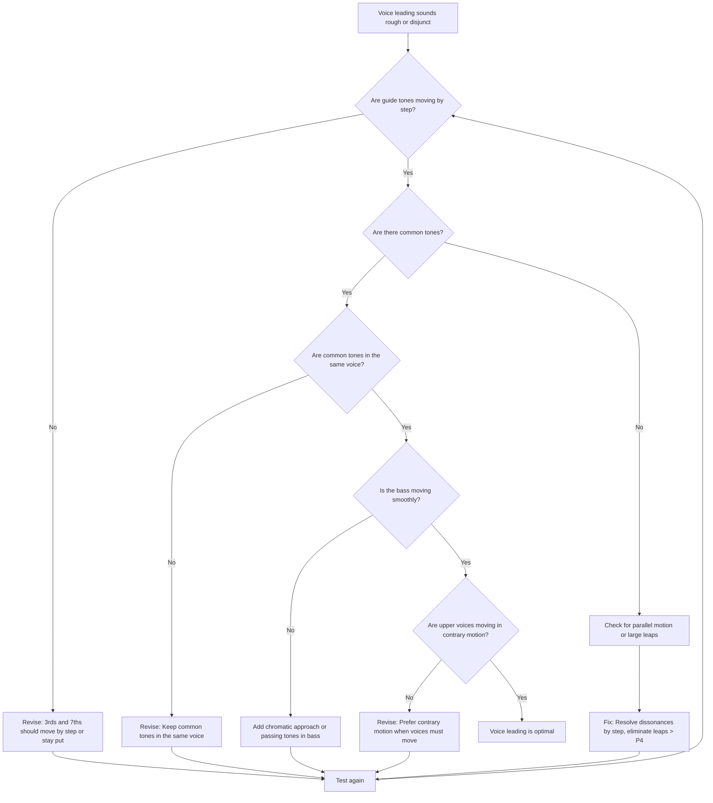

# Lesson 2: Voice Leading in Jazz

## 1. First-Principles Intuition & Invariants

Voice leading is the connective tissue of jazz harmony—the art of moving individual notes within chord progressions so smoothly that each chord tone becomes a melodic line. At its core: **every note in a chord is a voice, an independent melodic strand, and your job is to move those strands between chords with minimum motion while preserving harmonic clarity.**

### The Counterpoint Heritage

Jazz voice leading inherits directly from species counterpoint (Fux, common-practice harmony). Three core principles govern all motion:

**1. Minimal Motion Principle**  
Move each voice the shortest distance possible. Common tones stay put; moving voices step rather than leap. This isn't aesthetic preference—it's cognitive economy. The auditory system tracks smooth melodic continuity far better than disjunct leaps.

**2. Contrary Motion Preference**  
When two voices move, they should move in opposite directions. This preserves acoustic independence and avoids parallel perfect fifths/octaves that collapse multiple voices into a single perceived stream.

**3. Dissonance Resolution**  
Dissonant intervals (tritones, 7ths, 2nds) resolve by step, typically downward. The classic case: in a dominant seventh chord, the 7th resolves down by semitone, and the 3rd resolves up by semitone (or remains as a common tone).

### The Guide-Tone Principle (The Jazz Shortcut)

Here's what separates jazz from classical harmony: **the 3rd and 7th define chord quality. Everything else is optional.**

- **Root:** Supplied by the bassist (you don't need it in your voicing)
- **5th:** Often omitted—it contributes zero information about chord quality
- **3rd and 7th:** These are your **guide tones**—they define major, minor, dominant, or half-diminished quality

Effective jazz voice leading reduces to **two-voice counterpoint**: moving the 3rd and 7th between successive chords with minimal motion.

### The ii–V–I Guide-Tone Line (The Core Pattern)

In C major: **Dm7 → G7 → Cmaj7**

**Guide tones:**

```
Dm7:  F (3rd)  C (7th)
       ↓       ↓
G7:   F (7th)  B (3rd)    [C→B = semitone down, F stays put]
       ↓       ↓
Cmaj7: E (3rd)  B (7th)    [F→E = semitone down, B stays put]
```

This creates a **semitone resolution chain with common tones**—total voice leading distance of only 2 semitones across three chords. This is parsimonious voice leading in action.

**Invariants Summary (Priority Order):**

1. **Guide tones (3rd & 7th) move by step or stay put**
2. **Tritones resolve inward by semitone** (7→3, 3→7 voice exchange)
3. **Common tones are retained in the same voice**
4. **Moving voices favor contrary motion**
5. **Roots and 5ths are omitted or placed in the bass**

---

## 2. Two-Hand Piano Voicings: Drop-2 & Rootless Structures

### Drop-2 Voicings (Four-Way Close Position → Drop the Second Voice)

**Construction:**
1. Build a close-position seventh chord (all voices within an octave)
2. Drop the second-highest voice down one octave
3. Result: A spread voicing playable by two hands, with the melody on top

**Dm7 (Root Position, Drop-2):**
```
RH: F (3rd)   A (5th)
LH: C (7th)   D (root)
```

**G7 (Root Position, Drop-2):**
```
RH: B (3rd)   D (5th)
LH: F (7th)   G (root)
```

**Cmaj7 (Root Position, Drop-2):**
```
RH: E (3rd)   G (5th)
LH: B (7th)   C (root)
```

**Guide-tone voice leading (top two notes only):**
```
Dm7:  F – A
       ↓   ↓
G7:   F – B   [A→B = whole step up]
       ↓   ↓
Cmaj7: E – B   [F→E = semitone down, B common tone]
```

### Rootless Voicings (A/B Forms—The Comping Standard)

Pianists omit the root because the bassist plays it. This leaves 3rd, 7th, and extensions (9th, 13th). Two alternating shapes cover all keys:

**A-Form (7th on bottom, 3rd in the middle):**
```
Dm7 (A-form):
LH: C (7th) – F (3rd) – A (5th) – E (9th)
Fingers: 5      3       2      1

G7 (A-form):
LH: F (7th) – B (3rd) – D (5th) – A (9th)
Fingers: 5      3       2      1
```

**B-Form (3rd on bottom, 7th in the middle):**
```
Cmaj7 (B-form):
LH: E (3rd) – B (7th) – D (9th) – G (5th)
Fingers: 5      3       2      1
```

**Voice leading across ii–V–I (A → A → B forms):**
```
Dm7 (A):  C – F – A – E
           ↓   ↓   ↓   ↓
G7 (A):   F – B – D – A    [C→F = P4 down, F→B = tritone, etc.]
           ↓   ↓   ↓   ↓
Cmaj7 (B): E – B – D – G    [Minimal motion: semitones and common tones]
```

**Practice Drill 1: ii–V–I Voicing Cycle (All 12 Keys)**

- Start at ♩ = 60 BPM, whole notes (4 beats per chord)
- Play Dm7 (A-form) → G7 (A-form) → Cmaj7 (B-form)
- Move to the next key: E♭m7 → A♭7 → D♭maj7
- Continue descending by major thirds: Dm7, E♭m7, Fm7, G♭m7... (cycle of major thirds)
- Focus: Keep your hand in the same registral zone; voices should move < P4 in most cases
- Target tempo: ♩ = 100 BPM with smooth voice leading

---

## 3. Bass Guitar: Chromatic Approach & Voice-Led Walking Lines

### The Walking Bass Contract

Your job as a bassist in a jazz context:

1. **Outline chord roots on downbeats (beats 1 & 3)**
2. **Approach the next root by semitone or whole-step** (chromatic or diatonic approach)
3. **Arpeggiate chord tones (R-3-5-7) on strong beats**
4. **Use passing tones and neighbor tones on weak beats**

### Chromatic Approach Rules

**From below (most common):**  
Play the note a semitone *below* the target root on beat 4.

**From above (more tension):**  
Play the note a semitone *above* the target root on beat 4.

**Double chromatic approach (bebop style):**  
Approach from two semitones away: Target – 2 semitones → Target – 1 semitone → Target.

### Walking Line Construction (ii–V–I in C)

**Chord progression (4 beats per chord, 4/4 time):**

```
| Dm7         | G7          | Cmaj7       | Cmaj7       |
  1  2  3  4    1  2  3  4    1  2  3  4    1  2  3  4
```

**Example walking line (E string root motion emphasized):**

```
Dm7:
Beat 1: D (root, 5th fret A-string)
Beat 2: F (3rd, 8th fret A-string)
Beat 3: A (5th, 12th fret A-string)
Beat 4: F# (chromatic approach to G from below, 4th fret D-string)

G7:
Beat 1: G (root, 5th fret D-string)
Beat 2: B (3rd, 2nd fret A-string)
Beat 3: D (5th, 5th fret A-string)
Beat 4: B (7th stays as common tone, approach C from below, 4th fret G-string)

Cmaj7:
Beat 1: C (root, 5th fret G-string or 3rd fret A-string)
Beat 2: E (3rd, 7th fret A-string)
Beat 3: G (5th, 10th fret A-string)
Beat 4: B (7th, 2nd fret A-string, or return to C)
```

**Tablature (Simandl 1-2-4 fingering for low positions):**

```
Dm7 (A-string, frets 5-8-12):
A|--5-------8-------12------9--|  (D – F – A – F#)
   1       4        4      2

G7 (D-string, then A-string):
D|--5-------|--------------------|  (G on beat 1)
A|----------2-------5-------4---|  (B – D – B approach)
   1       1       4       3

Cmaj7 (A-string):
A|--3-------7-------10------2---|  (C – E – G – B)
   1       4        4      1
```

**Practice Drill 2: Walking Bass With Chromatic Approaches**

- Tempo: ♩ = 80 BPM (swing eighth feel)
- Loop: Dm7 | G7 | Cmaj7 | Cmaj7 |
- Variation 1: Approach every root from a semitone below (F# → G, B → C)
- Variation 2: Approach every root from a semitone above (A♭ → G, D♭ → C)
- Variation 3: Mix approaches: below for dominant chords, above for tonic chords
- Target tempo: ♩ = 120 BPM

---

## 4. Guitar: CAGED Triad Inversions & Voice-Led Chord Melody

### CAGED Triad Inversions (Top Three Strings, Movable)

Jazz guitarists voice chords on the top four strings to free the low E and A strings for bass movement or to allow the bassist clarity. The top three strings (G-B-E) provide compact triad inversions.

**C Major Triad Inversions (Top Three Strings):**

**Root Position (R-3-5):**
```
E|---0---  (E = 5th)
B|---1---  (C = Root)
G|---0---  (G = 5th... wait, this is wrong)
```

Let me correct:

**Root Position (R-3-5) on G-B-E strings:**
```
E|---5---  (G = 5th of C)
B|---5---  (E = 3rd of C)
G|---5---  (C = Root of C)
```

Actually, let's use standard movable triads:

**C Major (Root on G-string, 5th fret):**

*Root Position:*
```
E|---5---  (G, 5th)
B|---5---  (E, 3rd)
G|---5---  (C, root)
```

*First Inversion (3rd in bass):*
```
E|---8---  (C, root)
B|---8---  (G, 5th)
G|---5---  (E, 3rd)
```

*Second Inversion (5th in bass):*
```
E|---8---  (C, root)
B|---5---  (E, 3rd)
G|---5---  (G, 5th, on bottom)
```

### Voice-Led Chord Melody: "Autumn Leaves" A-Section

Voice leading on guitar means **moving chord shapes so the melody note stays on top and inner voices move minimally.**

**Progression: Dm7 → G7 → Cmaj7 → Fmaj7**

**Melody notes (top string): F – F – E – E**

**Chord voicings (frets, strings 4-3-2-1 = D-G-B-E):**

```
Dm7 (melody F on high E-string, 1st fret):
E|---1---  (F, 3rd)
B|---3---  (D, root)
G|---2---  (A, 5th)
D|---0---  (D, root)

G7 (melody F on high E-string, 1st fret):
E|---1---  (F, 7th)
B|---0---  (B, 3rd)
G|---0---  (G, root)
D|---0---  (D, 5th)

Cmaj7 (melody E on high E-string, 0 fret):
E|---0---  (E, 3rd)
B|---1---  (C, root)
G|---0---  (G, 5th)
D|---2---  (D, 9th)

Fmaj7 (melody E on high E-string, 0 fret):
E|---0---  (E, 7th)
B|---1---  (C, 5th)
G|---2---  (A, 3rd)
D|---3---  (F, root)
```

**Voice leading motion (inner voices):**
- B-string: 3 → 0 → 1 → 1 (minimal motion)
- G-string: 2 → 0 → 0 → 2 (common tones and steps)
- D-string: 0 → 0 → 2 → 3 (mostly stepwise)

**Practice Drill 3: Chord Melody Voice Leading**

- Tempo: ♩ = 60 BPM (whole notes)
- Play the progression Dm7 → G7 → Cmaj7 → Fmaj7 with melody on top
- Focus: Keep your hand in one position (frets 0–3); minimize finger jumps
- Listen for smooth voice leading in the inner voices
- Variation: Transpose to other keys using movable shapes (barre chords with same intervallic structure)
- Target tempo: ♩ = 80 BPM

---

## 5. Tritone Substitution & Voice Exchange

### The Tritone Substitution Principle

Any dominant seventh chord can be replaced by another dominant seventh a tritone away because **they share the same guide tones (3rd and 7th).**

**G7 in C major:**
- Root: G
- 3rd: B
- 5th: D
- 7th: F
- **Guide tones: B (3rd) and F (7th)**

**D♭7 (tritone substitute):**
- Root: D♭
- 3rd: F
- 5th: A♭
- 7th: C♭ (enharmonic B)
- **Guide tones: F (3rd) and C♭/B (7th)**

Notice: **G7's {B, F} = D♭7's {C♭, F} = {B, F}**. The guide tones are identical (enharmonically). Only the roots differ by a tritone.

### Voice Exchange Pattern

In a tritone substitution, the guide tones **exchange voices**:

**Original G7 → Cmaj7:**
```
G7:    B (3rd) – F (7th)
        ↓         ↓
Cmaj7: B (7th) – E (3rd)
```

**Tritone sub D♭7 → Cmaj7:**
```
D♭7:   F (3rd) – B (7th)
        ↓         ↓
Cmaj7: E (3rd) – B (7th)
```

The voices **swap roles**: what was the 3rd becomes the 7th, and vice versa. This creates smooth chromatic motion: F→E (semitone down), B stays.

### Bass Motion With Tritone Subs

The bass line becomes **chromatic** instead of diatonic:

**Original ii–V–I:**
```
Dm7 (D) → G7 (G) → Cmaj7 (C)
[Bass: D – G – C, motion by 4ths]
```

**With tritone sub:**
```
Dm7 (D) → D♭7 (D♭) → Cmaj7 (C)
[Bass: D – D♭ – C, chromatic descent]
```

This creates a smooth, descending chromatic line—a signature bebop sound.

### Piano Voicing Example (Tritone Sub)

**Dm7 → D♭7 → Cmaj7 (rootless voicings):**

```
Dm7 (A-form):
LH: C (7th) – F (3rd) – A (5th) – E (9th)

D♭7 (A-form, tritone sub of G7):
LH: B (7th) – F (3rd) – A♭ (5th) – E♭ (9th)

Cmaj7 (B-form):
LH: E (3rd) – B (7th) – D (9th) – G (5th)
```

**Voice leading:**
- C → B (semitone down)
- F → F (common tone)
- A → A♭ → G (chromatic descent)
- E → E♭ → D (chromatic descent in upper voice)

**Practice Drill 4: Tritone Substitution in All Keys**

- Progression: ii–V–I with tritone sub on V
- Example in C: Dm7 → D♭7 → Cmaj7
- Tempo: ♩ = 60 BPM (whole notes)
- Cycle through all keys: C, D♭, D, E♭, E, F, G♭, G, A♭, A, B♭, B
- Focus: Listen for the chromatic bass motion and smooth guide-tone resolutions
- Target tempo: ♩ = 90 BPM

---

## 6. Extended Voice Leading: Upper Structure Triads

### Upper Structure Principle

Rootless voicings can be thought of as **a triad built on an upper extension**, with the guide tones (3rd and 7th) in the left hand and a major or minor triad in the right hand.

**G7♯11 (Lydian Dominant):**
```
LH: F (7th) – B (3rd)
RH: D – F♯ – A  [D major triad = 5th, 7th, 9th of G7]
```

Wait, let me recalculate:

**G7♯11:**
- Root: G
- 3rd: B
- 5th: D
- 7th: F
- 9th: A
- ♯11: C♯ (♯4)

**Upper structure: D major triad (D-F♯-A) on top:**
- D = 5th of G7
- F♯ = ♯11 of G7 (♯4)
- A = 9th of G7

**Full voicing:**
```
RH: D – F♯ – A   (D major triad)
LH: F – B        (Guide tones: 7th and 3rd)
```

This is a **D/G7** voicing—a D major triad over a G7 chord.

### Common Upper Structure Triads

**Dominant 7♯11 (G7♯11):**
- Upper structure: D major (built on 5th)
- Sound: Lydian dominant, modern jazz

**Dominant 7♭9♯9 (G7alt):**
- Upper structure: E♭ minor or E♭ major (built on ♭13 or ♯5)
- Sound: Altered scale, bebop/post-bop

**Minor 11 (Dm11):**
- Upper structure: C major triad (built on ♭7)
- Voicing: C-E-G (♭7-9-11) over D

### Piano Voicing Example

**ii–V–I with upper structures:**

```
Dm11:
LH: C (♭7) – F (3rd)
RH: C – E – G  [C major triad = ♭7, 9, 11]

G7♯11:
LH: F (7th) – B (3rd)
RH: D – F♯ – A  [D major triad = 5, ♯11, 9]

Cmaj9:
LH: B (7th) – E (3rd)
RH: D – G – B  [G major triad = 5, root, 3... wait]
```

Let me recalculate Cmaj9:

**Cmaj9:**
- Root: C
- 3rd: E
- 5th: G
- 7th: B
- 9th: D

**Upper structure: D minor triad (D-F-A) or G major triad:**

Actually, simpler:

```
Cmaj9:
LH: E (3rd) – B (7th)
RH: D – G – C  [or C – E – G = C major triad with 9 in bass]
```

**Practice Drill 5: Upper Structure Triads (Two Hands)**

- Progression: Dm11 → G7♯11 → Cmaj9
- LH: Guide tones (7th and 3rd) only
- RH: Upper structure triad (block chord)
- Tempo: ♩ = 60 BPM (whole notes)
- Focus: Hear the triad "floating" above the guide tones; inner voices in the RH move smoothly
- Transpose through all keys
- Target tempo: ♩ = 80 BPM

---

## 7. Four-Part Choir & SATB Voice Leading

### SATB Ranges & Voicing Rules

**Soprano (S):** C4–A5 (middle C to high A)  
**Alto (A):** G3–E5  
**Tenor (T):** C3–G4  
**Bass (B):** E2–C4

**Spacing rules:**
1. **No more than an octave between S-A, A-T** (keeps upper voices blended)
2. **Up to two octaves between T-B allowed** (bass has independent harmonic function)
3. **Avoid voice crossing** (soprano should stay above alto, etc.)
4. **Double the root in major chords, root or 5th in minor chords** (never double the leading tone)

### SATB ii–V–I in C Major

**Dm7 (D-F-A-C):**
```
S: F (3rd)
A: D (root)
T: A (5th)
B: D (root)
```

**G7 (G-B-D-F):**
```
S: F (7th)     [common tone from Dm7]
A: D (5th)     [common tone from Dm7]
T: B (3rd)     [A→B, whole step up]
B: G (root)    [D→G, P4 up]
```

**Cmaj7 (C-E-G-B):**
```
S: E (3rd)     [F→E, semitone down]
A: C (root)    [D→C, whole step down]
T: B (7th)     [common tone from G7]
B: C (root)    [G→C, P4 up]
```

**Voice leading summary:**
- Soprano: F → F → E (common tone, then semitone resolution)
- Alto: D → D → C (common tone, then step)
- Tenor: A → B → B (step, then common tone)
- Bass: D → G → C (roots, moving in 4ths)

**Practice Drill 6: SATB Voice Leading (Choir or Piano)**

- Sing or play each line independently, then combine
- Tempo: ♩ = 60 BPM (whole notes)
- Focus: No voice should leap more than a P4 except the bass
- Check for parallel 5ths and octaves (there should be none)
- Transpose to F major, then B♭ major
- Target tempo: ♩ = 80 BPM

---

## 8. Practical Application: Reharmonization With Voice-Led Guide Tones

### Reharmonization Strategy

**Goal:** Substitute chords in a progression while preserving smooth voice leading.

**Method:**
1. Identify the original guide-tone line (3rds and 7ths)
2. Find alternate chords that share those guide tones
3. Test for smooth bass motion (stepwise or chromatic is best)

### Example: "Autumn Leaves" B-Section

**Original progression (E minor):**
```
| Em7  | A7   | Dmaj7 | Gmaj7 |
```

**Original guide tones:**
```
Em7:  G (♭3) – D (♭7)
A7:   C♯ (3) – G (♭7)
Dmaj7: F♯ (3) – C♯ (7)
Gmaj7: B (3) – F♯ (7)
```

**Reharmonization (adding passing diminished and ii–V):**
```
| Em7  | A7   | F♯º7 | Bm7 E7 |
| Dmaj7 | Gmaj7 | C♯m7♭5 F♯7 | Bm7 |
```

**New guide tones:**
```
Em7:   G (♭3) – D (♭7)
A7:    C♯ (3) – G (♭7)
F♯º7:  C (♭5) – E♭ (♭♭7/6) [or A-C-E♭ enharmonic guide tones]
Bm7:   D (♭3) – A (♭7)
E7:    G♯ (3) – D (♭7)
```

**Voice leading:**
- G → C♯ → C → D (chromatic motion, then step)
- D → G → E♭ → A (smooth resolutions)

**Practice Drill 7: Reharmonization With Guide Tones**

- Take a simple progression (e.g., I–vi–ii–V)
- Write out the guide-tone line on staff paper
- Substitute chords that fit the same guide tones (e.g., replace V with tritone sub)
- Play on piano or guitar, checking for smooth voice leading
- Test multiple reharmonizations of the same progression

---

## 9. Diagnostic Flowchart: Troubleshooting Voice Leading



---

## 10. 30-Day Practice Plan: Mastering Voice Leading

### Week 1: Guide Tones & Rootless Voicings
- **Day 1–2:** Play ii–V–I guide tones (two-note voicings, 3rd & 7th only) in all 12 keys, ♩ = 60 BPM
- **Day 3–4:** Add rootless A-form and B-form voicings (LH only, four notes), ♩ = 70 BPM
- **Day 5–7:** Combine guide tones and rootless voicings; play through jazz standards ("Autumn Leaves," "Fly Me to the Moon"), ♩ = 80 BPM

### Week 2: Bass Voice Leading & Walking Lines
- **Day 8–10:** Practice chromatic approach tones on bass (approach from below, above, double chromatic), ♩ = 80 BPM
- **Day 11–12:** Construct walking bass lines for ii–V–I in 12 keys (arpeggios on strong beats, passing tones on weak beats), ♩ = 100 BPM
- **Day 13–14:** Play along with Jamey Aebersold or iReal Pro play-alongs, ♩ = 120 BPM

### Week 3: Guitar & SATB Voice Leading
- **Day 15–17:** Learn CAGED triad inversions on guitar top three strings; practice voice-led chord melody, ♩ = 60 BPM
- **Day 18–19:** SATB voice leading exercises (sing or play on piano); check for parallel 5ths/octaves, ♩ = 70 BPM
- **Day 20–21:** Transpose SATB progressions to four keys (C, F, B♭, E♭), ♩ = 80 BPM

### Week 4: Tritone Subs, Upper Structures & Reharmonization
- **Day 22–24:** Practice tritone substitutions (ii–♭II–I) in 12 keys, focusing on chromatic bass motion, ♩ = 70 BPM
- **Day 25–26:** Upper structure triads (Dm11, G7♯11, Cmaj9) with two-hand piano voicings, ♩ = 60 BPM
- **Day 27–28:** Reharmonize a simple standard ("All of Me," "Blue Bossa") using guide-tone substitutions
- **Day 29–30:** Play through complete reharmonized standards with smooth voice leading at ♩ = 90–100 BPM; record and analyze for rough spots

---

## 11. Common Mistakes & Corrections

| **Mistake** | **Why It Happens** | **Fix** |
|-------------|-------------------|---------|
| **Large leaps in inner voices** | Not thinking of each chord tone as an independent melodic line | Resolve 7ths by step; keep common tones stationary |
| **Parallel 5ths or octaves** | Moving voices in the same direction without checking intervals | Use contrary motion; check interval quality between each voice pair |
| **Omitting the 3rd or 7th** | Over-emphasizing color tones (9ths, 13ths) at the expense of guide tones | Always include 3rd and 7th; extensions are optional |
| **Root in the voicing when bassist is present** | Classical piano training (always play all four notes) | Drop the root; bassist covers it |
| **Bass leaps by tritone or M7** | Not planning bass motion; random root notes | Use stepwise or chromatic motion; approach roots by semitone |
| **Tritone sub sounds wrong** | Using the wrong guide tones (not swapping 3rd & 7th) | Verify: G7 {B, F} = D♭7 {F, C♭/B}; voices exchange roles |

---

## 12. Further Resources & Listening

### Essential Listening (Voice Leading Masters)
- **Bill Evans Trio:** "Sunday at the Village Vanguard" (rootless voicings, guide-tone lines)
- **Oscar Peterson:** "Night Train" (stride bass with voice-led upper structures)
- **Red Garland:** "Groovy" (block chords with clear voice leading)
- **Ray Brown:** "Montreux '77" (walking bass with chromatic approaches)
- **Wes Montgomery:** "Full House" (voice-led chord melody on guitar)

### Books & Methods
- **"The Jazz Piano Book" by Mark Levine** (Chapter 3: Voicings and Voice Leading)
- **"Jazzology" by Robert Rawlins & Nor Eddine Bahha** (Guide-tone lines and reharmonization)
- **"The Drop 2 Book" by Randy Vincent** (Guitar-specific drop-2 voicings and voice leading)
- **"Walking Basslines" by Ed Friedland** (Chromatic approach and arpeggio construction)
- **"Counterpoint" by Kent Kennan** (Classical voice-leading foundation)

### Practice Tools
- **iReal Pro:** Play-along app with customizable ii–V–I loops in all keys
- **Jamey Aebersold Vol. 3:** "The ii–V–I Progression" (play-along tracks with tempo control)
- **Transcribe!:** Slow down recordings to analyze voice leading in solos and comping

---

## Summary: The Voice-Leading Checklist

Before you finish any voicing or progression, verify:

- [ ] **Guide tones (3rd & 7th) move by step or stay put**
- [ ] **Tritones resolve inward by semitone**
- [ ] **Common tones remain in the same voice**
- [ ] **Moving voices favor contrary motion**
- [ ] **No parallel perfect 5ths or octaves (SATB)**
- [ ] **Bass moves smoothly (stepwise or chromatic preferred)**
- [ ] **Root omitted from upper voicing when bassist present**
- [ ] **Dissonances (7ths, tritones) resolve by step**
- [ ] **Total voice-leading distance is minimized**

**Master these principles, and your chord progressions will flow with the inevitability of a well-told story—each voice a character, each resolution a satisfying answer to a musical question.**
