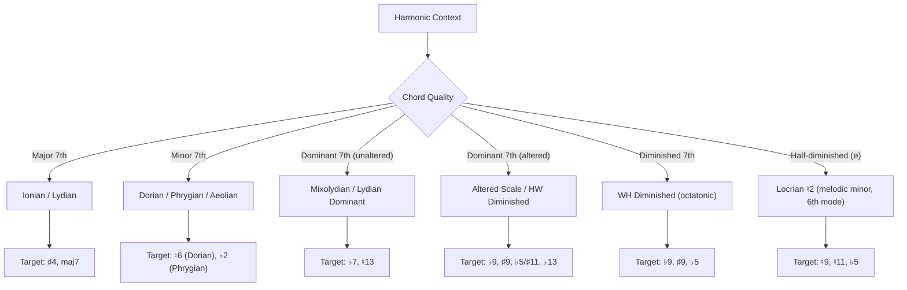
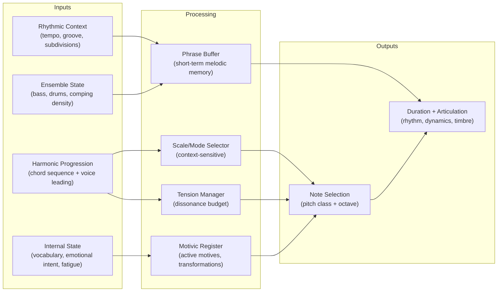
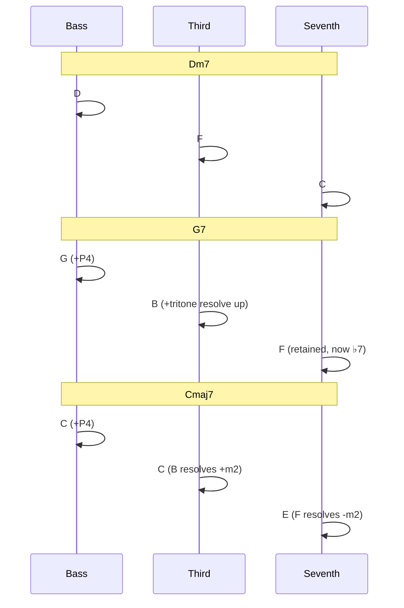
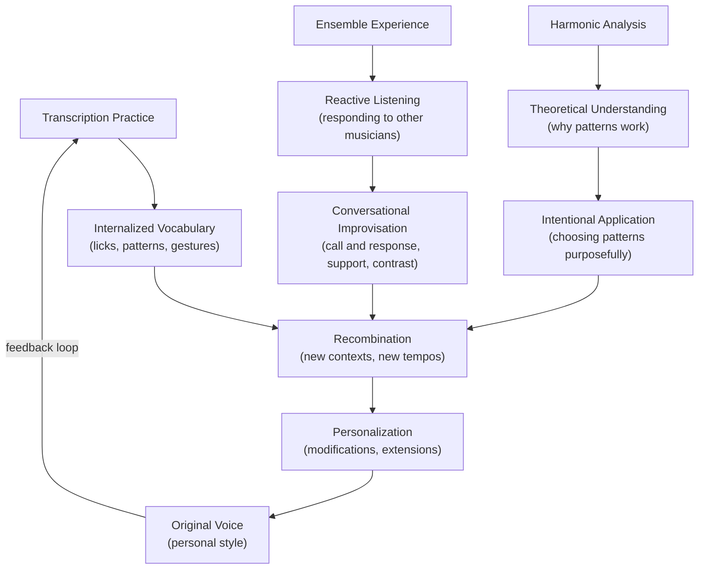
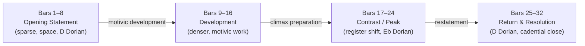
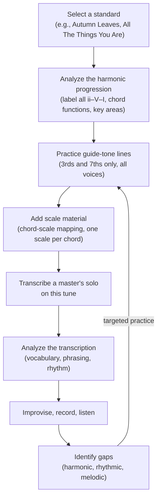

# Lesson 3: Improvisation Techniques in Jazz Harmony

## 1. First-Principles Intuition & Invariants

Jazz improvisation is not the spontaneous invention of melody from nothing. It is a real-time navigation of a constrained harmonic state space, governed by the physics of acoustics, the mathematics of interval relationships, and internalized compositional grammar accumulated through years of listening and practice. The improviser is simultaneously composer, performer, and reactive agent—making decisions at the speed of thought within a collective conversation that is itself evolving.

### 1.1 The Fundamental Invariant: Tonal Gravity

Every note in an improvisation exists in a gravitational field defined by the current harmonic context. This is not metaphor. When a dominant seventh chord (e.g., G7) sounds, the tritone formed between its third (B) and seventh (F) creates a specific acoustic tension. The interval ratio of a tritone—a frequency ratio of approximately √2 : 1, or 1.4142 : 1—sits maximally distant from unison on the circle of fifths and produces beating patterns in the air column that the auditory cortex registers as instability. Resolution to the tonic (C major) collapses the tritone: B resolves up by a half step to C, and F resolves down by a half step to E. This voice-leading resolution is physically driven by minimizing intervallic distance, and it constitutes the central engine of functional harmony.

The improviser's first invariant is therefore: **every note is a tension coefficient relative to the current chord function**. Notes can be classified structurally:

- **Chord tones** (root, third, fifth, seventh): coefficients near zero tension; they confirm the harmony.
- **Available tensions** (ninth, eleventh, thirteenth and their alterations): moderate tension; they color the harmony without contradicting it.
- **Avoid notes**: high tension; they create strong dissonance against the chord's defining intervals, typically the interval of a minor ninth above a chord tone.

This classification is dynamic—the same note (e.g., F♮) is a chord tone over a Fmaj7 chord, a ♭7 (available tension) over a G7 chord, and a ♭2 (avoid note) over an E major chord.

### 1.2 The Overtone Series as the Foundation of Chord Architecture

The extended chord vocabulary of jazz—seventh, ninth, eleventh, and thirteenth chords—is not an arbitrary expansion of triadic harmony. It is a selective approximation of the natural overtone series. When a string or air column vibrates at a fundamental frequency *f*, it simultaneously produces partials at integer multiples: 2f, 3f, 4f, 5f, 6f, 7f, 8f, etc.

```
Partial 1  (1f):  C  — Fundamental
Partial 2  (2f):  C  — Octave
Partial 3  (3f):  G  — Perfect fifth
Partial 4  (4f):  C  — Two octaves
Partial 5  (5f):  E  — Major third
Partial 6  (6f):  G  — Fifth again
Partial 7  (7f):  B♭ — Harmonic seventh (slightly flat of equal-tempered B♭)
Partial 8  (8f):  C  — Three octaves
Partial 9  (9f):  D  — Major second / ninth
Partial 11 (11f): F♯ — Augmented eleventh (Lydian quality)
Partial 13 (13f): A  — Major thirteenth
```

The dominant thirteenth chord (C7♯11) used pervasively in jazz—root, major third, perfect fifth, minor seventh, major ninth, augmented eleventh, major thirteenth—maps almost exactly onto partials 1–13 of the overtone series. Jazz harmony, in this sense, is a culturally refined exploitation of acoustic physics. The ♯11 (Lydian dominant) quality of this chord is not a theoretical invention; it is the eleventh partial heard in every naturally resonant tone.

This explains why the dominant seventh chord demands resolution: its minor seventh (the 7th partial) is acoustically present in the overtone series of the note a perfect fifth below, creating a hierarchical pull toward the tonic. The ii–V–I progression (e.g., Dm7 → G7 → Cmaj7) is powerful precisely because G7 contains the overtone structure of C, announcing the tonic before it arrives.

### 1.3 Modal Theory from First Principles

The seven modes of the major scale are not arbitrary scales to be memorized as separate entities. They are rotations of a single intervallic set—the diatonic collection—each rotation beginning on a different pitch class and therefore presenting a different interval between the first note and every subsequent note.

The diatonic collection in C: **C D E F G A B**

Intervals from each starting note (W = whole step, H = half step):

```
Ionian     (C): W W H W W W H  — major scale; stable, resolved
Dorian     (D): W H W W W H W  — minor with ♮6; sophisticated, forward-leaning
Phrygian   (E): H W W W H W W  — minor with ♭2; tense, Spanish/Flamenco quality
Lydian     (F): W W W H W W H  — major with ♯4; bright, ethereal, suspended
Mixolydian (G): W W H W W H W  — major with ♭7; dominant; bluesy, unresolved
Aeolian    (A): W H W W H W W  — natural minor; melancholic, introspective
Locrian    (B): H W W H W W W  — diminished fifth; maximally unstable
```

The critical structural insight is that each mode's character is dominated by its **characteristic intervals**—the intervals that differ from the parallel major or minor scale. Dorian's raised sixth (A♮ in D Dorian, versus A♭ in D natural minor) is the note that distinguishes it, and it is precisely the note that creates the mode's characteristic "lift." Phrygian's ♭2 creates an augmented second between scale degrees 1 and 2 when harmonized diatonically, which is why it carries such a strong tonal identity. The improviser who understands these characteristic intervals can target them melodically to invoke the modal color without playing the entire scale.

Beyond the diatonic modes, jazz improvisation draws heavily on:

- **Melodic minor modes**: particularly Lydian Dominant (melodic minor, 4th mode) and the Altered scale (melodic minor, 7th mode), used over dominant seventh chords.
- **Diminished scales** (octatonic): alternating whole-step/half-step or half-step/whole-step patterns, symmetric scales used over dominant 7♭9 and fully diminished chords.
- **Whole-tone scale**: six-note symmetric scale (all whole steps), used over dominant 7♯5 chords.
- **Bebop scales**: diatonic scales with added chromatic passing tones inserted to place chord tones on strong beats.



### 1.4 The Arpeggio as Harmonic Navigation

An arpeggio is not merely a chord played sequentially. It is the clearest possible statement of a chord's identity in the melodic register—a device that temporarily collapses the distinction between harmony and melody. When an improviser plays an arpeggio over a chord, they are tracing the frequency skeleton of that chord through time, and every note they play is unambiguously functional.

The sophistication of modern jazz improvisation lies in **arpeggio substitution**: playing the arpeggio of a chord that shares chord tones with the current harmony but introduces additional tensions. Classic examples:

- Over a **Cmaj7** chord, playing a **Em7** arpeggio (E G B D) adds the 3rd, 5th, 7th, and 9th of Cmaj7—a richer harmonic statement than the Cmaj7 arpeggio itself.
- Over a **G7** chord, playing a **B diminished 7** arpeggio (B D F A♭) outlines the 3rd, 5th, ♭7th, and ♭9th of G7—the defining tones of a G7♭9 chord.
- Over a **G7alt** chord, playing a **D♭maj7** arpeggio (D♭ F A♭ C) outlines the ♭5, ♭7, ♭9, and 3rd of G7—a tritone substitution arpeggio.

This last technique—the **tritone substitution**—deserves elaboration. Because the tritone is symmetric (it divides the octave exactly in half), two dominant seventh chords a tritone apart share the same tritone. G7 (tritone: B–F) and D♭7 (tritone: F–C♭/B) share identical guide tones (B/C♭ and F), only their assignment to third and seventh is reversed. This means D♭7 can substitute for G7 in resolving to Cmaj7, but the bass movement is now a half-step descent (D♭ → C) rather than a perfect fifth descent (G → C). Jazz improvisers use tritone substitution arpeggios constantly to introduce chromatic voice-leading into otherwise diatonic progressions.

### 1.5 Phrase Architecture and Motivic Development

Phrasing in jazz improvisation follows the same developmental logic as formal composition. A phrase is not a random chain of notes—it has an **initiating gesture**, a **developing middle**, and a **cadential close**. The bebop tradition codified this architecture partly through the work of Charlie Parker, whose lines consistently:

1. Begin on a chord tone or the leading tone into one.
2. Move through scalar or arpeggiating passages that outline the underlying harmony.
3. Land on a strong structural tone (typically the third or seventh of the current chord) on a downbeat or the and of beat 2 or 4.

**Motivic development** is the technique of transforming a small musical cell across the duration of a solo. Given a three-note motive, the improviser has access to a large transformation set:

- **Transposition**: the same motive moved to a different pitch level.
- **Inversion**: the motive's intervallic contour flipped (ascending becomes descending).
- **Retrograde**: the motive played backward.
- **Augmentation**: the motive's rhythmic values doubled.
- **Diminution**: the motive's rhythmic values halved.
- **Sequence**: the motive repeated at successive scalic or chromatic intervals.
- **Fragmentation**: only part of the motive used as a new starting point.

John Coltrane's approach to the "Giant Steps" changes exemplifies motivic economy: within a progression so harmonically dense that conventional scalar improvisation is nearly impossible, Coltrane reduced his improvisational vocabulary to a small set of three-note cells and arpeggios that he cycled through the rapidly shifting key centers (B major, G major, E♭ major—a symmetrical division of the octave into major thirds).

## 2. Core Architecture & Mechanics

### 2.1 The Improvisational System: A Formal Model

Improvisation can be modeled as a real-time constraint satisfaction and search process. At each moment, the improviser selects the next musical event (note, rest, rhythm, articulation) from a space whose boundaries are defined by multiple simultaneous constraints. This is not a loose analogy—computational musicologists have formalized jazz improvisation using finite automata, Markov chains, and more recently, neural sequence models, all of which confirm that the structure is learnable and constrained.



Each block in the Processing layer represents an internalized cognitive function that the trained improviser executes, in parallel, in real time. The Scale/Mode Selector maps chord quality and function onto an appropriate pool of available pitches. The Tension Manager tracks the accumulated dissonance of the current phrase and governs the balance between color tones and resolution. The Motivic Register stores active melodic ideas and their transformations, enabling developmental coherence across phrase boundaries.

### 2.2 Harmonic Progressions: Functional Architecture

The ii–V–I progression is the foundational building block of jazz harmony, appearing in virtually every standard in some form. Its power derives from the concatenation of three distinct harmonic functions:

- **Subdominant function** (ii7): pre-dominant; creates forward pull toward the dominant.
- **Dominant function** (V7): maximum tension; tritone demands resolution.
- **Tonic function** (Imaj7): resolution; acoustic rest point.

In C major: **Dm7 → G7 → Cmaj7**

The voice leading across this progression is exceptionally smooth. The seventh of Dm7 (C) becomes the seventh of G7 (C remains, now functioning as ♭7). The third of G7 (B) becomes the seventh of Cmaj7. The seventh of G7 (F) resolves to the third of Cmaj7 (E). The bass alone moves in perfect fourths/fifths: D → G → C.



This progression appears in multiple transpositions within a single tune. "Autumn Leaves," for instance, contains ii–V–I cadences in both G major and B♭ major within its first eight bars. John Coltrane's "Giant Steps" (1960) expanded this architecture by cycling through three tonal centers separated by major thirds (B, G, E♭), requiring ii–V–I resolutions at a rate of one per two beats in certain passages—a harmonic density that demanded a new improvisational approach.

### 2.3 Rhythm: Subdivision, Syncopation, and Superimposition

Jazz rhythm operates primarily in a **swing subdivision** framework. In swing, the quarter note is divided not into two equal eighth notes but into an approximated triplet feel: the first eighth is roughly two-thirds of the beat, the second roughly one-third. This is not a precise mathematical ratio—experienced jazz musicians adjust the degree of swing depending on tempo, style, and ensemble context (at very fast tempos, the swing feel approaches straight eighths; at very slow tempos, it leans closer to explicit triplets).

**Syncopation** displaces melodic emphasis from strong beats (1 and 3 in 4/4) to weak beats (2 and 4) or off-beats (the "and" of beats). In jazz, the backbeat emphasis on 2 and 4 from the ride cymbal and snare creates a rhythmic grid against which the improviser plays, and playing across this grid—landing phrases on the and of 4, sustaining through the downbeat—creates forward momentum and surprise.

**Metric superimposition** (or **hemiola**) involves implying a different meter within the actual time signature. A common technique is to play phrases built in groups of three within a 4/4 context, creating a "three against four" polyrhythm. This creates a sense of rhythmic displacement that gradually rotates back into alignment with the actual barline:

```
Actual meter (4/4):   |  1  +  2  +  3  +  4  +  |
3-note groupings:     [1  2  3][1  2  3][1  2  3]...
Realignment occurs every 12 eighth notes (3 measures)
```

Coltrane, McCoy Tyner, and later Keith Jarrett developed this into sophisticated polymetric improvisation where multiple rhythmic strata operate simultaneously at different levels.

**Rhythmic motivic development** mirrors pitch motivic development: the improviser extracts a rhythmic cell from the opening of a phrase and recycles it at different pitch levels, creating coherence through rhythm rather than melody alone. This is a core technique of Sonny Rollins, whose "thematic improvisation" explicitly derives melodic and rhythmic content from the head of the tune being played.

### 2.4 Bebop Vocabulary: The Bebop Scale

The bebop scale is one of the most precisely engineered tools in jazz improvisation. The **bebop dominant scale** adds a chromatic passing tone—a natural seventh—between the ♭7 and the root of the Mixolydian mode:

```
C Mixolydian (7 notes):   C  D  E  F  G  A  B♭  (C)
C Bebop Dominant (8 notes): C  D  E  F  G  A  B♭  B  (C)
```

The added B♮ creates an eight-note scale. When this scale is begun on a chord tone (C, E, G, or B♭) on a downbeat and played in continuous eighth notes descending, **every chord tone lands on a strong beat (downbeat or and-of-2 or and-of-4) and every non-chord tone lands on a weak beat**. This is not coincidental—the scale was constructed precisely to achieve this alignment.

Proof: Starting the scale on E (the third of C7) on beat 1 and descending:

```
Beat:   1    +    2    +    3    +    4    +
Note:   E    D    C    B♭   A    G    F    E
Type:   CT   PT   CT   CT   PT   CT   PT   CT
```

(CT = chord tone, PT = passing/non-chord tone)

Chord tones (E, C, B♭, G) fall on beats 1, 2, 3, and 4—strong beats—while passing tones (D, A, F) fall on the off-beats. This built-in metric alignment is what gives bebop lines their rhythmic clarity and harmonic transparency even at extreme tempos.

### 2.5 Guide Tones and Voice-Leading Paths

The third and seventh of any seventh chord are its **guide tones**—the two notes that most clearly define the chord's quality and function. Voice-leading between guide tones across a chord progression creates the most efficient harmonic path and is the backbone of professional improvisation.

Over a ii–V–I–VI turnaround in C (Dm7 → G7 → Cmaj7 → A7):

```
Chord:    Dm7   G7    Cmaj7  A7
3rd:       F     B     E      C♯
7th:       C     F     B      G
```

The guide tones create two independent melodic lines (inner voices) that move by half step or whole step through the progression. Practicing guide-tone lines before full improvisation is a fundamental pedagogical technique because it forces the improviser to hear the voice-leading structure of the progression independent of scale choice.

### 2.6 Ear Training as the Operational Foundation

All of the theoretical frameworks above are inert without the perceptual foundation to hear them in real time. The professional jazz improviser has undergone thousands of hours of **interval training** (hearing and identifying all 12 intervals by their sound), **chord quality recognition** (hearing maj7, min7, dom7, ø7, °7, and their alterations instantly), and **transcription** (learning solos by ear to internalize vocabulary directly from recordings).

Transcription is irreplaceable. When a musician transcribes Charlie Parker's solo on "Ko-Ko" (1945), they are not merely copying notes—they are internalizing the precise rhythmic placement, articulation, phrasing architecture, and harmonic logic of a master practitioner. This is equivalent, in software engineering terms, to reading production-grade source code written by a world-class engineer: the patterns absorbed become available for reuse and recombination in novel contexts.



### 2.7 A Computational Representation: Jazz Harmony in Python

The following code models the core harmonic concepts discussed above. It represents chord structures, computes guide tones, and determines appropriate scale choices for a given harmonic context—functions that mirror the implicit computations of an experienced improviser.

```python
"""
jazz_harmony.py

A computational model of jazz harmony concepts:
chord construction from intervals, guide-tone extraction,
scale selection, and voice-leading distance computation.

All interval arithmetic uses integer pitch-class notation:
  C=0, C#/Db=1, D=2, ..., B=11
"""

from __future__ import annotations
from dataclasses import dataclass, field
from typing import Optional
import itertools


# ---------------------------------------------------------------------------
# Interval constants (semitones from root)
# ---------------------------------------------------------------------------
INTERVALS = {
    "R": 0, "b2": 1, "2": 2, "b3": 3, "3": 4, "4": 5,
    "b5": 6, "5": 7, "b6": 8, "6": 9, "b7": 10, "7": 11,
    "8": 12, "b9": 13, "9": 14, "s9": 15, "11": 17,
    "s11": 18, "b13": 20, "13": 21,
}

NOTE_NAMES = ["C", "C#", "D", "Eb", "E", "F",
              "F#", "G", "Ab", "A", "Bb", "B"]

# Chord templates: maps chord quality to interval list (semitones from root)
CHORD_TEMPLATES: dict[str, list[int]] = {
    "maj7":    [0, 4, 7, 11],
    "maj9":    [0, 4, 7, 11, 14],
    "maj7#11": [0, 4, 7, 11, 14, 18],   # Lydian chord
    "7":       [0, 4, 7, 10],
    "9":       [0, 4, 7, 10, 14],
    "7#11":    [0, 4, 7, 10, 14, 18],   # Lydian dominant
    "7alt":    [0, 4, 6, 10, 13, 15],   # altered dominant: b5, b7, b9, #9
    "min7":    [0, 3, 7, 10],
    "min9":    [0, 3, 7, 10, 14],
    "min11":   [0, 3, 7, 10, 14, 17],
    "dim7":    [0, 3, 6, 9],
    "half_dim":[0, 3, 6, 10],           # min7b5 (ø)
}

# Scale templates: interval sets (semitones from root)
SCALE_TEMPLATES: dict[str, list[int]] = {
    "ionian":           [0, 2, 4, 5, 7, 9, 11],
    "dorian":           [0, 2, 3, 5, 7, 9, 10],
    "phrygian":         [0, 1, 3, 5, 7, 8, 10],
    "lydian":           [0, 2, 4, 6, 7, 9, 11],
    "mixolydian":       [0, 2, 4, 5, 7, 9, 10],
    "aeolian":          [0, 2, 3, 5, 7, 8, 10],
    "locrian":          [0, 1, 3, 5, 6, 8, 10],
    "melodic_minor":    [0, 2, 3, 5, 7, 9, 11],
    "lydian_dominant":  [0, 2, 4, 6, 7, 9, 10],  # melodic minor mode 4
    "altered":          [0, 1, 3, 4, 6, 8, 10],  # melodic minor mode 7
    "half_whole_dim":   [0, 1, 3, 4, 6, 7, 9, 10],  # dom7b9 chords
    "whole_tone":       [0, 2, 4, 6, 8, 10],
    "bebop_dominant":   [0, 2, 4, 5, 7, 9, 10, 11],  # mixolydian + maj7
}

# Map chord quality to recommended scale options (ordered by conventional preference)
CHORD_SCALE_MAP: dict[str, list[str]] = {
    "maj7":    ["ionian", "lydian"],
    "maj9":    ["ionian", "lydian"],
    "maj7#11": ["lydian"],
    "7":       ["mixolydian", "lydian_dominant", "bebop_dominant"],
    "9":       ["mixolydian", "lydian_dominant", "bebop_dominant"],
    "7#11":    ["lydian_dominant"],
    "7alt":    ["altered", "half_whole_dim"],
    "min7":    ["dorian", "aeolian", "phrygian"],
    "min9":    ["dorian", "melodic_minor"],
    "min11":   ["dorian"],
    "dim7":    ["half_whole_dim"],
    "half_dim":["locrian", "half_whole_dim"],
}


@dataclass
class Chord:
    root: int           # pitch class 0–11
    quality: str        # key into CHORD_TEMPLATES

    @property
    def tones(self) -> list[int]:
        """Return absolute pitch classes of all chord tones."""
        return [(self.root + interval) % 12
                for interval in CHORD_TEMPLATES[self.quality]]

    @property
    def third(self) -> int:
        template = CHORD_TEMPLATES[self.quality]
        # Third is the second interval (index 1) in all standard templates
        return (self.root + template[1]) % 12

    @property
    def seventh(self) -> int:
        template = CHORD_TEMPLATES[self.quality]
        # Seventh is at index 3 in all seventh-chord templates
        return (self.root + template[3]) % 12

    @property
    def guide_tones(self) -> tuple[int, int]:
        """The third and seventh: the two tones that define chord function."""
        return (self.third, self.seventh)

    def name(self) -> str:
        return f"{NOTE_NAMES[self.root]}{self.quality}"

    def recommended_scales(self) -> list[str]:
        return CHORD_SCALE_MAP.get(self.quality, [])

    def available_tensions(self) -> list[int]:
        """
        Return tension pitch classes not in the basic 7th chord shell.
        Tensions are defined as chord tones beyond the seventh.
        """
        base = set(CHORD_TEMPLATES[self.quality][:4])  # root, 3, 5, 7
        all_tones = set(CHORD_TEMPLATES[self.quality])
        tensions = all_tones - base
        return [(self.root + t) % 12 for t in tensions]


def voice_leading_distance(chord_a: Chord, chord_b: Chord) -> int:
    """
    Compute the total semitone displacement required to move each
    voice of chord_a to the nearest available tone in chord_b.
    Uses minimum-distance matching between tone sets.

    This models the smooth voice-leading principle: good progressions
    minimize total voice movement.
    """
    tones_a = chord_a.tones
    tones_b = chord_b.tones
    total_distance = 0

    for tone in tones_a:
        # Find the nearest tone in chord_b (considering octave equivalence)
        min_dist = min(
            min(abs(tone - t), 12 - abs(tone - t))
            for t in tones_b
        )
        total_distance += min_dist

    return total_distance


def build_ii_v_i(root: int) -> list[Chord]:
    """
    Build a ii–V–I progression in the given major key.
    root: pitch class of the tonic (e.g., 0 = C major)
    Returns [ii min7, V dom7, I maj7]
    """
    ii_root = (root + 2) % 12   # supertonic
    v_root  = (root + 7) % 12   # dominant
    return [
        Chord(ii_root, "min7"),
        Chord(v_root,  "7"),
        Chord(root,    "maj7"),
    ]


def tritone_substitution(dominant: Chord) -> Chord:
    """
    Return the tritone substitute of a dominant seventh chord.
    The substitute's root is a tritone (6 semitones) above the original.
    Both chords share the same tritone interval (3rd and 7th swap roles).
    """
    assert dominant.quality == "7", "Tritone substitution applies to dominant 7 chords."
    sub_root = (dominant.root + 6) % 12
    return Chord(sub_root, "7")


def analyze_progression(chords: list[Chord]) -> None:
    """Print a harmonic analysis of a chord sequence."""
    print(f"\n{'Chord':<14} {'Guide Tones (3, 7)':<22} {'Recommended Scales'}")
    print("-" * 70)
    for i, chord in enumerate(chords):
        gt = tuple(NOTE_NAMES[t] for t in chord.guide_tones)
        scales = ", ".join(chord.recommended_scales()[:2])  # top two
        print(f"{chord.name():<14} {str(gt):<22} {scales}")

        if i < len(chords) - 1:
            dist = voice_leading_distance(chord, chords[i + 1])
            print(f"  → VL distance to {chords[i+1].name()}: {dist} semitones")

    print()


# ---------------------------------------------------------------------------
# Example: ii–V–I in C major and G major (as in "Autumn Leaves" bars 1–8)
# ---------------------------------------------------------------------------
if __name__ == "__main__":
    print("=== ii–V–I in C major ===")
    c_major_ii_v_i = build_ii_v_i(root=0)
    analyze_progression(c_major_ii_v_i)

    print("=== ii–V–I in G major ===")
    g_major_ii_v_i = build_ii_v_i(root=7)
    analyze_progression(g_major_ii_v_i)

    print("=== Tritone substitution: G7 → D♭7 ===")
    g7  = Chord(root=7, quality="7")
    db7 = tritone_substitution(g7)
    print(f"Original:    {g7.name()}  — guide tones: "
          f"{tuple(NOTE_NAMES[t] for t in g7.guide_tones)}")
    print(f"Substitute:  {db7.name()} — guide tones: "
          f"{tuple(NOTE_NAMES[t] for t in db7.guide_tones)}")
    print(f"Shared tritone interval confirmed: "
          f"{abs(g7.third - db7.seventh)} semitones\n")

    print("=== Giant Steps: Coltrane changes (B → G → Eb tonal centers) ===")
    giant_steps = [
        Chord(11, "maj7"),   # Bmaj7
        Chord(7,  "7"),      # G7   (V of Emaj... but actually a Coltrane substitution)
        Chord(4,  "maj7"),   # Emaj7
        Chord(1,  "7"),      # C#7 / Db7
        Chord(8,  "maj7"),   # Abmaj7 / Ebmaj7
        Chord(5,  "7"),      # F7
        Chord(11, "maj7"),   # Bmaj7
    ]
    analyze_progression(giant_steps)
```

**Sample output:**

```
=== ii–V–I in C major ===
Chord          Guide Tones (3, 7)     Recommended Scales
----------------------------------------------------------------------
Dmin7          ('F', 'C')             dorian, aeolian
  → VL distance to G7: 4 semitones
G7             ('B', 'F')             mixolydian, lydian_dominant
  → VL distance to Cmaj7: 3 semitones
Cmaj7          ('E', 'B')             ionian, lydian

=== Tritone substitution: G7 → D♭7 ===
Original:    G7   — guide tones: ('B', 'F')
Substitute:  C#7  — guide tones: ('F', 'B')
Shared tritone interval confirmed: 6 semitones
```

The output confirms the tritone substitution's core property: the guide tones of G7 (B, F) are the guide tones of D♭7 (F, B) with their functional roles—third and seventh—swapped. This is not approximate; it is exact pitch-class identity.

## 3. Advanced Concepts: Reharmonization and Outside Playing

### 3.1 Reharmonization

Reharmonization is the practice of replacing the original chord in a progression with a different chord that shares a functional or coloristic relationship to it. The techniques range from conservative chord quality substitution to radical harmonic displacement.

The most common reharmonization techniques, ordered by increasing displacement from the original harmony:

1. **Quality substitution**: Replacing Cmaj7 with Cmaj9 or Cmaj7♯11—same function, more color.
2. **Relative substitution**: Replacing Cmaj7 with Am7 (the relative minor shares five of seven pitches).
3. **Secondary dominant insertion**: Inserting a V7 chord before any diatonic chord (e.g., inserting A7 before Dm7, making A7 the secondary dominant V/ii).
4. **Tritone substitution**: Replacing G7 with D♭7 (as described in Section 1.4).
5. **Backdoor dominant**: Replacing G7 (V7) with B♭7 (♭VII7)—a dominant seventh built on the minor seventh degree of the key. The ♭VII7 → I resolution exploits the fact that B♭7 and G7 share the note D (5th of G7, 3rd of B♭7) and both resolve smoothly to Cmaj7.
6. **Coltrane substitution**: Replacing a single ii–V–I with a chain of three ii–V–I cycles moving through keys a major third apart—the structural basis of "Giant Steps."

### 3.2 Outside Playing and Chromaticism

"Playing outside" refers to the deliberate introduction of pitches or harmonic areas that lie beyond the current chord-scale relationship, creating maximal tension before an intentional resolution back "inside." The technique is not random dissonance—it is controlled departure and return.

The most structurally coherent form of outside playing is **side-slipping**: transposing an entire phrase (melodic line + its implied harmony) up or down by a half step, then returning to the original key. Because the phrase retains its internal intervallic logic, it maintains melodic coherence while creating sharp harmonic friction. The listener hears the coherent phrase, tracks the half-step displacement, and experiences the return to the original key as resolution.

A more sophisticated approach is **superimposition**: implying a different harmonic center over the current chord without the rhythm section following. Over a Cmaj7 chord, an improviser might imply an F♯maj7 tonality (a tritone away) for two beats, then resolve back to C. The audience hears two simultaneous harmonic layers: the rhythm section's Cmaj7 and the soloist's F♯maj7, and the tension of their bitonality resolves when the soloist returns. This technique, used extensively by Woody Shaw, Freddie Hubbard, and later by Michael Brecker, requires that the resolution be as clear and intentional as the departure—outside playing that never returns is simply atonal, not outside.

### 3.3 The Architecture of a Complete Solo

A well-constructed jazz solo—one that works as a musical statement independent of its spontaneity—exhibits large-scale formal structure analogous to classical compositional forms. Using Miles Davis's solo on "So What" (Kind of Blue, 1959) as a reference:



Davis's solo is frequently analyzed as a model of economy: he uses a small number of phrases, leaves significant space (rests are as structural as notes), and builds intensity through register ascent and rhythmic compression rather than note density. The formal arc—statement, development, peak, resolution—mirrors the sonata principle and is perceptible to listeners with no theoretical training, which is evidence that these structural gestures are psychoacoustically real rather than theoretically imposed.

## 4. Practice Methodology: Building the Vocabulary

Theory without embodied practice remains inert. The following methodology is derived from the documented practice approaches of professional jazz musicians and established pedagogy:

**Harmonic skeleton first.** Before adding melodic material, practice singing and playing guide-tone lines through every common progression (ii–V–I, I–VI–ii–V, rhythm changes, blues). This anchors the ear in the voice-leading structure before the fingers add complexity.

**One concept, all 12 keys.** Every pattern, scale, arpeggio, or reharmonization technique should be practiced through all 12 transpositions without pause. This eliminates key-specific muscle memory and builds a genuinely transposable vocabulary. The Circle of Fifths provides the most musically natural transposition order: C → F → B♭ → E♭ → A♭ → D♭ → G♭ → B → E → A → D → G.

**Transcription with analysis.** Transcribe solos by ear, then analyze what was transcribed: identify the harmonic context, name the scale or arpeggio being used, identify the guide tones, and note the phrase architecture. This closes the loop between auditory internalization and theoretical understanding.

**Slow practice at the threshold of consciousness.** At the tempo where every decision must be made consciously, the student is building the neural pathways that will later operate automatically at performance tempo. Practicing at tempo beyond this threshold builds speed without depth; practicing below it builds depth that speed will follow.

**Record and listen analytically.** Self-recorded practice sessions reveal what theory alone cannot: the actual rhythmic placement of notes, the density of phrase material, and the balance between tension and resolution. The gap between what a musician believes they are playing and what is actually recorded is frequently instructive.



## 5. Summary of Structural Principles

The underlying logic of jazz improvisation reduces to a small number of deep principles that, once internalized, generate the entire vocabulary:

Harmonic motion is driven by **acoustic physics**—the overtone series creates tonal gravity, and the tritone creates the tension-release engine of functional harmony. Every chord substitution, reharmonization, and modal choice is ultimately reducible to these physical relationships.

**Scale choice is not a lookup table**—it is a function of chord quality, harmonic function (tonic/subdominant/dominant), voice-leading context, and the degree of tension the improviser wishes to introduce. The same G root can support Mixolydian (unaltered dominant), Lydian Dominant (colorized dominant), Altered (maximum tension dominant), or even Phrygian (if G is functioning as a tonic) depending entirely on harmonic context.

**Melodic coherence requires motivic economy**—the most effective solos use less material more thoroughly. Transformation of a single idea through transposition, inversion, augmentation, rhythmic displacement, and sequence generates far more structural integrity than the rapid deployment of unrelated patterns.

**Rhythm is not decoration**—it is a primary compositional dimension equivalent to pitch. The placement of a note in time, its duration, and its dynamic weight determine its harmonic meaning as much as its pitch class. A ♭9 on the downbeat is a structural statement; the same note on the last sixteenth of a bar is a passing tone.

**Outside playing is defined by its return**—dissonance is only structurally meaningful in relation to the consonance it departs from and resolves to. The mastery of outside playing is first and foremost mastery of inside playing; the former is only intelligible against the background of the latter.
