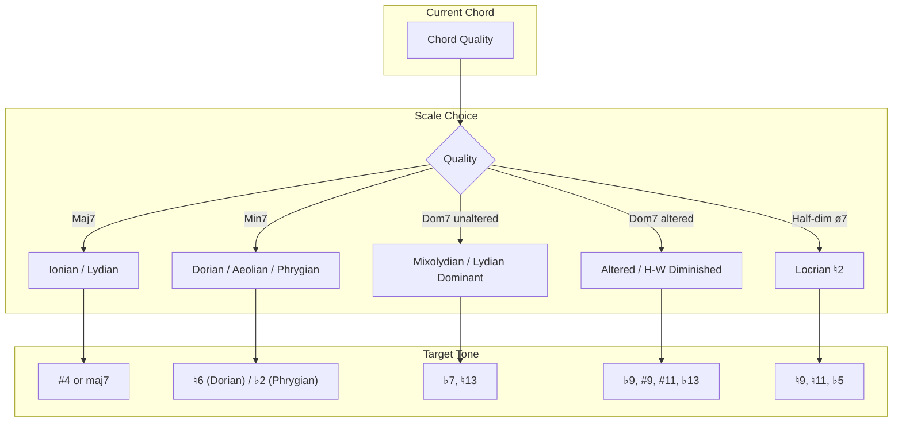
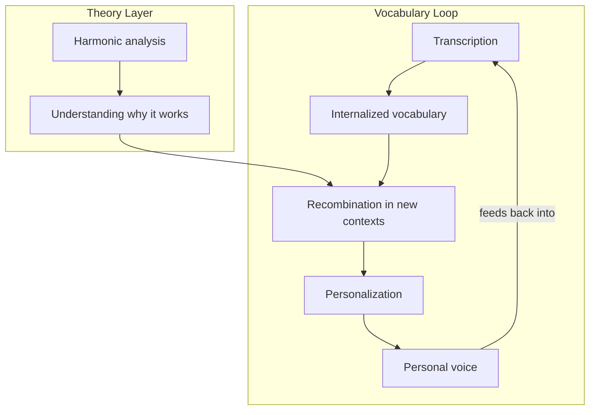
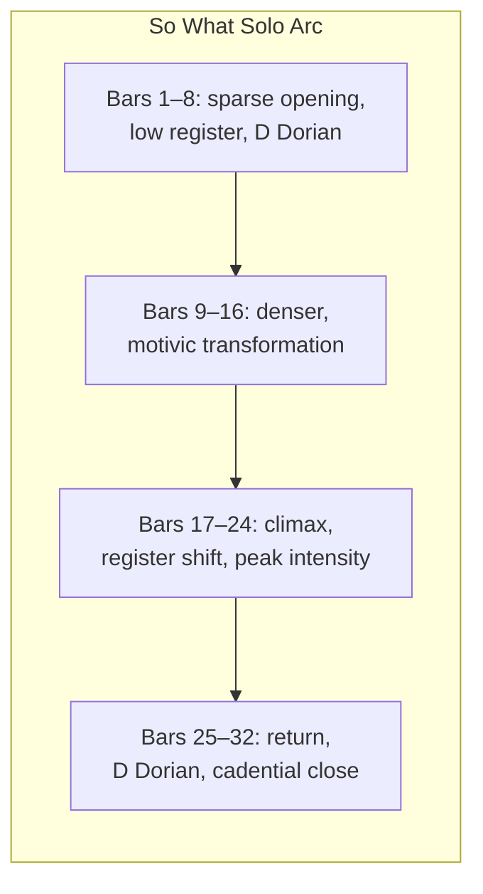
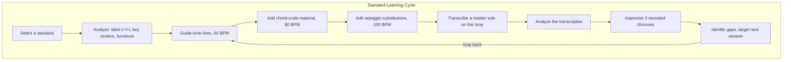

# Lesson 3: Improvisation Techniques in Jazz Harmony

## 1. Hearing the Tritone: The Engine of Resolution

Every dominant seventh chord contains a tritone between its 3rd and 7th. In G7 that's B and F. Your ear registers this interval as maximally unstable — it sits exactly halfway between the octave, so it has no natural pull toward either note on its own. What creates pull is the *context*: G7's B and F want to collapse inward and outward respectively to the nearest consonant chord, Cmaj7's E and C. B rises a half-step to C. F falls a half-step to E.

This half-step convergence is why ii–V–I feels inevitable rather than arbitrary. It's also why you can swap G7 for any other chord containing that same B–F tritone (like D♭7, whose 3rd and 7th are F and C♭/B) and the resolution still works — the ear is tracking the tritone's collapse, not the root motion. This single fact generates tritone substitution, backdoor dominants, and most "outside" vocabulary later in this lesson.

**Why the ♭7 wants to move:** acoustically, the minor 7th of a dominant chord (F in G7) sits close to the 7th partial of the overtone series built on G — a slightly flat, unstable-sounding interval in equal temperament. Your ear hears it as "leaning" toward resolution rather than sitting still. That's the entire physical basis for functional harmony. One paragraph of physics, the rest is your hands.

**Drill — hear it before you play it (5 min, piano or any instrument):**
1. Play G7 (G-B-D-F). Hold it. Sing B, then slide down by half-step to A-ish territory in your head until it lands — now actually play the resolution B→C against the chord change to Cmaj7.
2. Do the same with F→E.
3. Play G7 → Cmaj7 ten times, each time consciously tracking only those two notes. Everything you practice below is built on being able to hear this motion instantly, in any key.

## 2. Tension Classification: Know What Every Note Is Doing

Over any given chord, every note in the chromatic scale falls into one of three buckets:

| Category | Examples over Cmaj7 | Function |
|---|---|---|
| Chord tones | C, E, G, B | Confirm the harmony, near-zero tension |
| Available tensions | D (9), A (13), F# (#11) | Color without contradicting the chord |
| Avoid note | F (creates a minor 9th against E) | High tension, needs quick resolution if used |

This is context-dependent, not fixed per note-name. F is a chord tone on Fmaj7, a sweet available tension (the ♭7) on G7, and the classic avoid note on Cmaj7. You're not memorizing a list — you're learning to reclassify every pitch in real time as the chord changes under you.

**Drill (60 BPM, any instrument):**
1. Play root–3–5–7 ascending and descending over each chord in a tune you know.
2. Add the 9th. Listen to whether it sits comfortably (it almost always does on maj7/min7/dom7).
3. Add the 4th/11th. On a major chord this is usually the avoid note unless raised to #11.
4. Do this slowly enough that you're making a real-time judgment, not running a memorized scale.

## 3. Modes: Target the Note That Makes the Mode Audible

The seven diatonic modes share one interval pattern rotated to different starting points. What makes a mode *sound* like itself in improvisation isn't playing all seven notes — it's landing on the **characteristic interval**, the one note that differs from the nearest parallel major or minor.

```
Mode        Formula (W/H)      Characteristic tone   Color
Ionian      W W H W W W H      —                      Resolved major
Dorian      W H W W W H W      ♮6                     Minor, lifted
Phrygian    H W W W H W W      ♭2                      Dark, Spanish
Lydian      W W W H W W H      #4                      Bright, floating
Mixolydian  W W H W W H W      ♭7                      Dominant, bluesy
Aeolian     W H W W H W W      —                      Natural minor
Locrian     H W W H W W W      ♭5, ♭2                  Unstable
```

Miles Davis's "So What" solo is the textbook case: over D Dorian he keeps returning to A and B♮ — that ♮6 is what tells your ear "Dorian" rather than "natural minor," with almost no other note density required.



**Drill:** play each mode two octaves, 80 BPM, through the circle of fifths. Then play the arpeggio with only the characteristic tone emphasized — for D Dorian: 1-2-♭3-4-5-**6**-5-4-♭3-2-1, leaning into the 6 dynamically so it's audibly the point of the phrase.

## 4. Arpeggio Substitution: Playing the Chord Above the Chord

An arpeggio states the chord's identity as melody. The next level is substituting a *related* chord's arpeggio that shares tones with the original but adds color:

- Over **Cmaj7**, play **Em7** (E-G-B-D) → gives you 3-5-7-9 of Cmaj7, skipping the root entirely and sounding more "inside the harmony" than a root-based arpeggio.
- Over **G7**, play **Bdim7** (B-D-F-A♭) → gives you 3-5-♭7-♭9, spelling a G7♭9 color without needing to think "G7♭9" at all.
- Over **G7alt** (resolving to C), play **D♭maj7** (D♭-F-A♭-C) → gives you ♭5-♭7-♭9-3, the tritone substitution's arpeggio.

**Drill — ii–V–I in C, Dm7 → G7 → Cmaj7:**
- Over Dm7: play Fmaj7 arpeggio (F-A-C-E = ♭3-5-♭7-9)
- Over G7: play Bdim7 arpeggio (B-D-F-A♭ = 3-5-♭7-♭9)
- Over Cmaj7: play Em7 arpeggio (E-G-B-D = 3-5-7-9)

Ascend and descend through all three at 60 → 80 → 110 BPM without stopping. This single three-chord drill, transposed through all 12 keys, is the backbone of upper-structure melodic vocabulary.

## 5. Motivic Development: Say Less, Develop It More

A strong jazz phrase has a shape: it starts on a chord tone or leading tone, moves through scale/arpeggio material outlining the harmony, and lands on a structural tone (3rd or 7th) on a strong beat or strong off-beat.

Coltrane's "Giant Steps" solo is the clearest demonstration of motivic economy under pressure: the changes move so fast (new ii–V–I roughly every two beats in places) that scalar improvisation is impossible, so he reduces to short arpeggiated cells cycled through the key centers.

**Transformation toolkit for a 3-note cell (try C-E-D):**
- **Transposition:** same shape, new starting pitch
- **Inversion:** flip the contour (up becomes down)
- **Retrograde:** play it backward
- **Augmentation/diminution:** double or halve the rhythmic values
- **Sequence:** repeat at ascending/descending scale steps
- **Fragmentation:** take just two of the three notes as a new seed

**Drill, over a ii–V–I vamp at 60 BPM:**
1. Bars 1–4: transpose the cell to start on each chord's root.
2. Bars 5–8: invert it.
3. Bars 9–12: play it in retrograde.
4. Bars 13–16: sequence it up by scale step.

Record it. The goal isn't novelty — it's noticing which transformations still sound like "the same idea" to a listener.

## 6. The ii–V–I Engine: Internalizing the Voice Leading

```
Dm7 → G7 → Cmaj7

3rd:  F → B → E     (F→B tritone leap, B→E resolves down a 4th... 
7th:  C → F → B
```

The useful way to hear this: the 7th of Dm7 (C) is literally the same pitch as the 4th-degree color tone of G7 — it holds. The 3rd of G7 (B) resolves up a half-step to the 7th of Cmaj7 (B — wait, check your chord: it resolves to the root-adjacent tone). The core physical fact to internalize by ear: **3rd of V7 resolves up a half-step to 7th of Imaj7; 7th of V7 resolves down a half-step to 3rd of Imaj7.** That's the whole mechanism, in both directions, in every key.

```mermaid
sequenceDiagram
    participant Bass
    participant Guide3
    participant Guide7
    Note over Bass,Guide7: Dm7
    Bass->>Bass: D
    Guide3->>Guide3: F (b3)
    Guide7->>Guide7: C (b7)
    Note over Bass,Guide7: G7
    Bass->>Bass: G (up P4)
    Guide3->>Guide3: B (3rd — resolution setup)
    Guide7->>Guide7: F (b7 — retained from Dm7's 7th... same pitch class)
    Note over Bass,Guide7: Cmaj7
    Bass->>Bass: C (up P4)
    Guide3->>Guide3: E (B to E, resolves)
    Guide7->>Guide7: B (F down a half-step to E is the 3rd; B is the 7th, arrived separately)
```

**Full practice routine, all 12 keys, no stopping between keys:**
1. **Guide tones only** (3rds and 7ths), descending by whole step through the cycle (C → B♭ → A♭ → G♭ → E → D → C...), 60 BPM.
2. **Full arpeggios** root-3-5-7, 80 BPM.
3. **Chord-scale** (Dorian–Mixolydian–Ionian), 100 BPM.
4. **Bebop scales** (see §7), 120 BPM.

"Autumn Leaves" gives you two ii–V–I's to drill in context (G major and E minor) within the first 16 bars — use the real tune, not just the isolated drill, once the mechanics are automatic.

## 7. The Bebop Scale: Built for Metric Alignment

Mixolydian has 7 notes; dividing a bar of continuous eighth notes by 7 means chord tones drift off the strong beats as you ascend. Add one chromatic passing tone — the major 7th — between ♭7 and the root, and you get an 8-note scale that lines chord tones up with the beat every time, regardless of which chord tone you start on.

```
C Mixolydian:      C  D  E  F  G  A  B♭ (C)        — 7 notes
C Bebop Dominant:  C  D  E  F  G  A  B♭  B♮ (C)     — 8 notes
```

**Proof by example** — start on E (the 3rd) and descend in eighth notes:

```
Beat:   1    +    2    +    3    +    4    +
Note:   E    D    C    B♭   A    G    F    E
Type:   CT   PT   CT   CT   PT   CT   PT   CT
```

Chord tones land on 1, 2, 3, 4. Passing tones land on the off-beats. That's not a coincidence — the extra note exists specifically to make this alignment hold no matter which chord tone you begin from. This is what lets bebop lines stay harmonically legible at 300 BPM.

**Drill:**
1. Bebop dominant scale from C, 60 BPM, mark where chord tones fall.
2. Same scale starting from E, then from G, then from B♭ — confirm chord tones keep landing on strong beats.
3. Ramp 80 → 100 → 120 → 140 → 160 BPM.
4. Apply across ii–V–I: bebop Dorian (Dorian + major 3rd passing tone) over Dm7, bebop dominant over G7, bebop major (Ionian + #5 passing tone) over Cmaj7.

## 8. Guide Tones as the Voice-Leading Skeleton

The 3rd and 7th define a seventh chord's quality and function more than any other two notes. Practicing them as isolated melodic lines — before adding scales — trains your ear to hear harmonic motion independent of scalar decoration.

Turnaround in C: Dm7 → G7 → Cmaj7 → A7

```
3rd line:  F → B → E → C#
7th line:  C → F → B → G
```

**Drill:**
1. Play the 3rd-line only through the progression, 60 BPM.
2. Play the 7th-line only.
3. Alternate 3rd/7th/3rd/7th through the progression.
4. Add chromatic approach notes: hit each guide tone preceded by a half-step neighbor from above or below.

This becomes the skeleton every scale run and arpeggio substitution hangs on. If you can't sing the guide-tone line through a tune, you're not ready to improvise fluently over it yet — fix that first.

## 9. Rhythm: Swing Feel, Syncopation, Metric Superimposition

Swing subdivides the beat unevenly — roughly 2:1 rather than a straight triplet or straight eighths, and the exact ratio tightens toward straight eighths as tempo increases. You internalize this by listening and matching, not by counting a formula.

**Syncopation:** displacing accent onto beats 2 and 4, or onto the "and" of any beat, instead of 1 and 3. Landing a phrase on the "and" of 4 and sustaining across the downbeat is one of the most reliable ways to create forward momentum in a line.

**Metric superimposition (3-over-4):**

```
4/4 grid:        | 1 + 2 + 3 + 4 + | 1 + 2 + 3 + 4 + |
Grouped in 3s:   [1 2 3][1 2 3][1 2 3][1 2 3]
                 realigns with the downbeat every 3 bars of 4/4 (12 eighth notes)
```

Coltrane's "Impressions" solo rides extended 3-over-4 passages that create a floating, suspended feel against the underlying meter — the tension comes from implying a different pulse without abandoning the actual one.

**Drill:**
1. Metronome at 80 BPM, clicks on 2 and 4.
2. Tap quarter-note pulse with your foot, 1-2-3-4.
3. Clap on 1 & 3, then 2 & 4, then the "and" of each beat.
4. Play a C major scale in groups of 3 eighth notes against the quarter-note foot pulse for 8 bars; notice where the grouping realigns with downbeat 1.

## 10. Ear Training: The Non-Negotiable Foundation

No amount of theory substitutes for being able to hear a chord quality, interval, or line and immediately know what it is. Daily minimums:

1. **Interval singing** — sing all 12 intervals ascending and descending from a fixed root, check against your instrument. 5 minutes daily.
2. **Chord quality ID** — have a partner (or backing-track generator) play random maj7/min7/dom7/half-dim7/dim7 voicings; name the quality by ear. 10 minutes.
3. **Transcription** — 4–8 bars of a master solo per day, by ear, no sheet music. Sing it, then play it, then analyze: what chord, what scale/arpeggio, where are the guide tones, what's the phrase shape. 20 minutes.
4. **Playback analysis** — record your own improvising, listen back without the instrument in hand, compare what you intended to what actually happened. 10 minutes.



Transcription is the single highest-leverage activity in this entire lesson. Everything else accelerates what transcription builds.

## 11. Reharmonization: Changing the Chord Without Changing the Melody's Logic

Reharmonization ranges from subtle color changes to full harmonic replacement, while the melody above it stays functional.

**Hierarchy, conservative to radical:**
1. **Quality substitution:** Cmaj7 → Cmaj9 or Cmaj7#11 — same function, richer color.
2. **Relative substitution:** Cmaj7 → Am7 — shares three of four tones.
3. **Diatonic substitution:** I → iii or vi.
4. **Secondary dominants:** insert V7 of any diatonic chord before it (A7 before Dm7 = V7/ii).
5. **Tritone substitution:** G7 → D♭7.
6. **Backdoor dominant:** G7 → B♭7, resolving to Cmaj7 — plagal rather than authentic motion, heard throughout Bill Evans and Herbie Hancock's "Maiden Voyage."
7. **Coltrane substitution:** replace a single ii–V–I with three ii–V–I's a major third apart (the "Giant Steps" mechanism applied to an existing tune).

**Drill — take I–vi–ii–V in C (Cmaj7–Am7–Dm7–G7):**
1. Secondary dominant: Cmaj7–**E7**–Am7–**A7**–Dm7–G7
2. Tritone sub on the V: Cmaj7–Am7–Dm7–**D♭7**
3. Backdoor: Cmaj7–Am7–Dm7–**B♭7**

Play original and each variant at 80 BPM, then improvise the same melodic idea over all three — notice how identical phrasing reads completely differently against different harmony.

## 12. Outside Playing: Controlled Departure, Not Random Noise

Playing "outside" means deliberately introducing pitches or harmonic areas beyond the current chord-scale relationship — but it only works as a musical statement if it returns to resolve. Dissonance only means something relative to the consonance surrounding it.

**Four techniques:**

1. **Side-slipping:** play a coherent phrase, transpose the whole thing up or down a half-step, then return. Over Cmaj7: C major triad arpeggio → D♭ major triad arpeggio → back to C.
2. **Superimposition:** imply a different harmonic center without the rhythm section following. Over Cmaj7, outline F#maj7 (a tritone away) for two beats, then resolve to C — a favorite device of Woody Shaw and Michael Brecker.
3. **Chromatic enclosure:** approach a target note from a half-step above and below. Targeting E (3rd of Cmaj7): play F-D#-E or D#-F-E.
4. **Pentatonic displacement:** play a pentatonic scale rooted somewhere other than the current chord root. Over Cmaj7, F# minor pentatonic (F#-A-B-C#-E) creates real tension while staying internally consonant.

**Drill, over a Cmaj7 vamp at 100 BPM:**
1. C major scale, straight (inside).
2. Side-slip: D♭ major for 2 beats, return to C major.
3. Superimpose: C major triad, D♭ major triad, back to C.
4. Chromatic enclosure on E: F-D#-E-D#-F-E.
5. F# minor pentatonic for 4 beats, resolve to C major pentatonic.

Record and listen for the tension/resolution arc — that arc is the entire point, not the "wrong notes" themselves.

## 13. Solo Architecture: Building 32 Bars with a Shape

Miles Davis's "So What" solo (*Kind of Blue*, 1959) works as a model of large-scale shape over an otherwise static, single-chord form:



**Four formal principles:**
1. Start with space — establish phrasing before filling it with density.
2. Develop a motive across 8–16 bars rather than abandoning it for new material.
3. Build to one identifiable peak, typically around two-thirds through the solo.
4. Resolve by returning to a variation of the opening material in the final bars.

**Drill:**
1. Record 32 bars freely improvised over a single Dm7 vamp, 100 BPM.
2. Listen back without the instrument. Map the arc — is there a peak? Motivic development? Structural space?
3. Re-record with intentional shape: bars 1–8 sparse, 9–16 develop one motive, 17–24 build to peak, 25–32 return to the opening idea.
4. Compare the two recordings for narrative clarity.

## 14. Reference: Computational Chord/Scale Model

This script is a reference tool, not a substitute for ear-first practice — use it to check your arpeggio-substitution and voice-leading intuitions, or to quickly generate drill material in any key.

```python
"""
jazz_harmony.py — chord construction, guide-tone extraction,
scale mapping, and voice-leading distance.
Pitch classes: C=0, C#/Db=1, D=2, ... B=11
"""

from __future__ import annotations
from dataclasses import dataclass

NOTE_NAMES = ["C", "C#", "D", "Eb", "E", "F", "F#", "G", "Ab", "A", "Bb", "B"]

CHORD_TEMPLATES: dict[str, list[int]] = {
    "maj7":     [0, 4, 7, 11],
    "maj9":     [0, 4, 7, 11, 14],
    "maj7s11":  [0, 4, 7, 11, 18],
    "6":        [0, 4, 7, 9],
    "7":        [0, 4, 7, 10],
    "9":        [0, 4, 7, 10, 14],
    "13":       [0, 4, 7, 10, 14, 21],
    "7s11":     [0, 4, 7, 10, 18],
    "7alt":     [0, 4, 6, 10, 13, 15],
    "7b9":      [0, 4, 7, 10, 13],
    "min7":     [0, 3, 7, 10],
    "min9":     [0, 3, 7, 10, 14],
    "min6":     [0, 3, 7, 9],
    "minMaj7":  [0, 3, 7, 11],
    "dim7":     [0, 3, 6, 9],
    "half_dim": [0, 3, 6, 10],
}

CHORD_SCALE_MAP: dict[str, list[str]] = {
    "maj7":     ["ionian", "lydian"],
    "7":        ["mixolydian", "lydian_dominant", "bebop_dominant"],
    "7alt":     ["altered", "half_whole_dim", "whole_tone"],
    "min7":     ["dorian", "aeolian", "phrygian", "bebop_dorian"],
    "dim7":     ["whole_half_dim"],
    "half_dim": ["locrian_n2", "locrian", "half_whole_dim"],
}

@dataclass
class Chord:
    root: int
    quality: str

    @property
    def tones(self) -> list[int]:
        return [(self.root + iv) % 12 for iv in CHORD_TEMPLATES[self.quality]]

    @property
    def guide_tones(self) -> tuple[int, int]:
        t = CHORD_TEMPLATES[self.quality]
        third = (self.root + t[1]) % 12
        seventh = (self.root + t[3]) % 12 if len(t) >= 4 else (self.root + 10) % 12
        return (third, seventh)

    def name(self) -> str:
        return f"{NOTE_NAMES[self.root]}{self.quality.replace('s', '#').replace('b', 'b')}"

    def recommended_scales(self) -> list[str]:
        return CHORD_SCALE_MAP.get(self.quality, ["ionian"])


def voice_leading_distance(a: Chord, b: Chord) -> int:
    """Sum of nearest-neighbor semitone displacement, voice to voice."""
    total = 0
    for tone in a.tones:
        total += min(min(abs(tone - t), 12 - abs(tone - t)) for t in b.tones)
    return total


def build_ii_v_i(root: int) -> list[Chord]:
    """root = tonic pitch class, e.g. 0 = C major."""
    return [
        Chord((root + 2) % 12, "min7"),
        Chord((root + 7) % 12, "7"),
        Chord(root, "maj7"),
    ]


def tritone_substitution(dominant: Chord) -> Chord:
    assert "7" in dominant.quality
    return Chord((dominant.root + 6) % 12, dominant.quality)


def analyze_progression(chords: list[Chord]) -> None:
    print(f"\n{'Chord':<12}{'Guide Tones':<18}{'Scales'}")
    print("-" * 60)
    for i, c in enumerate(chords):
        gt = tuple(NOTE_NAMES[t] for t in c.guide_tones)
        print(f"{c.name():<12}{str(gt):<18}{', '.join(c.recommended_scales()[:2])}")
        if i < len(chords) - 1:
            dist = voice_leading_distance(c, chords[i + 1])
            print(f"  -> {dist} semitones of total voice movement to {chords[i+1].name()}")


if __name__ == "__main__":
    print("### ii-V-I in C major ###")
    analyze_progression(build_ii_v_i(0))

    print("\n### Tritone substitution: G7 -> Db7 ###")
    g7 = Chord(7, "7")
    db7 = tritone_substitution(g7)
    print(f"{g7.name()} guide tones: {tuple(NOTE_NAMES[t] for t in g7.guide_tones)}")
    print(f"{db7.name()} guide tones: {tuple(NOTE_NAMES[t] for t in db7.guide_tones)}")
```

**Sample output:**
```
### ii-V-I in C major ###

Chord       Guide Tones       Scales
------------------------------------------------------------
Dmin7       ('F', 'C')        dorian, aeolian
  -> 4 semitones of total voice movement to G7
G7          ('B', 'F')        mixolydian, lydian_dominant
  -> 3 semitones of total voice movement to Cmaj7
Cmaj7       ('E', 'B')        ionian, lydian

### Tritone substitution: G7 -> Db7 ###
G7 guide tones: ('B', 'F')
Db7 guide tones: ('F', 'B')
```

Confirms by computation what you should already be able to hear: G7 and D♭7 share the identical tritone, roles swapped. Modify `build_ii_v_i` to generate I-vi-ii-V or iii-vi-ii-V skeletons for your own transposition drills.

## 15. Daily Practice Template (60 Minutes)

**Segment 1 — Technical foundation (15 min)**
- Major scales through the cycle of fifths, 2 octaves, eighth notes, 80 → 120 BPM
- Chord arpeggios (maj7, min7, dom7, half-dim7, dim7), all 12 keys, 80 BPM
- Bebop scales, all keys, 100 BPM

**Segment 2 — Harmonic vocabulary (20 min)**
- Guide-tone lines, ii–V–I, all 12 keys, 60 BPM
- Arpeggio substitutions (Fmaj7 over Dm7, Bdim7 over G7, Em7 over Cmaj7), all keys, 80 BPM
- Tritone subs: V7→I vs ♭II7→I, compare voice leading
- Modal scales emphasizing characteristic intervals, 100 BPM

**Segment 3 — Transcription (15 min)**
- 4–8 bars of a master solo by ear, sung then played, then analyzed for chord, scale/arpeggio choice, guide tones, phrase shape
- Extract one lick, transpose to 3 keys, apply over a ii–V–I

**Segment 4 — Improvisation and recording (10 min)**
- Play 3 recorded choruses over a standard (Autumn Leaves, Confirmation, All The Things You Are), no stopping for mistakes
- Immediate playback: are you outlining the changes, developing motives, placing phrases on clear rhythmic points, building toward a peak?

## 16. Weekly Rotation

- **Week 1 — Guide tones only.** No scales. Hear the skeleton.
- **Week 2 — Modal playing.** One mode per day over long vamps (16–32 bars single chord), emphasizing the characteristic interval.
- **Week 3 — Bebop language.** Transcribe Parker or Bud Powell; focus on chord tones landing on strong beats.
- **Week 4 — Reharmonization.** Apply the full hierarchy from §11 to one simple progression.
- **Week 5 — Rhythm.** 3-over-4 groupings, syncopated landings on the "and" of 4.
- **Week 6 — Outside playing.** Side-slips, superimposition, chromatic enclosure, each resolved back inside.

## 17. Milestones

- **3 months:** Fluent ii–V–I in all 12 keys at 120 BPM using guide tones, scales, and arpeggio substitutions, without stopping between keys.
- **6 months:** 10 complete master solos transcribed and performed from memory; 20 vocabulary phrases extracted and personalized into other keys and tempos.
- **12 months:** Recorded improvisations over 10 standards showing clear guide-tone voice leading, motivic development across full 32-bar forms, intentional inside/outside contrast, and a recognizable large-scale arc.



## 18. Core Takeaways

1. **The tritone's collapse is the engine.** Every substitution in this lesson — tritone sub, backdoor dominant, Coltrane changes — is a variation on getting a tritone to resolve by half-step.
2. **Scale choice is contextual, not fixed.** The same root supports Mixolydian, Lydian Dominant, or Altered depending entirely on the function and tension you want.
3. **Guide tones first, scales second.** Practice the 3rd/7th skeleton before adding any scalar material — it's the fastest route to hearing real harmonic motion.
4. **Motivic economy beats note density.** Fewer ideas, transformed thoroughly, create more coherent solos than a constant stream of unrelated licks.
5. **Outside playing only works if it returns.** Dissonance is legible only against a background of consonance you've already established.
6. **Transcription is the highest-leverage practice activity in this entire lesson.** Theory tells you why something works; transcription puts it in your hands and ears permanently.

**Start now:** guide-tone lines through ii–V–I in C major, 60 BPM, 5 minutes. Then F major. Then B♭ major. Continue around the cycle of fifths daily. Everything above builds on this one habit.
