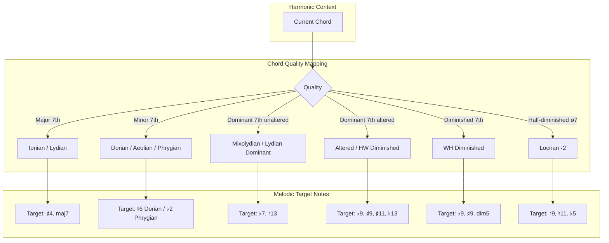
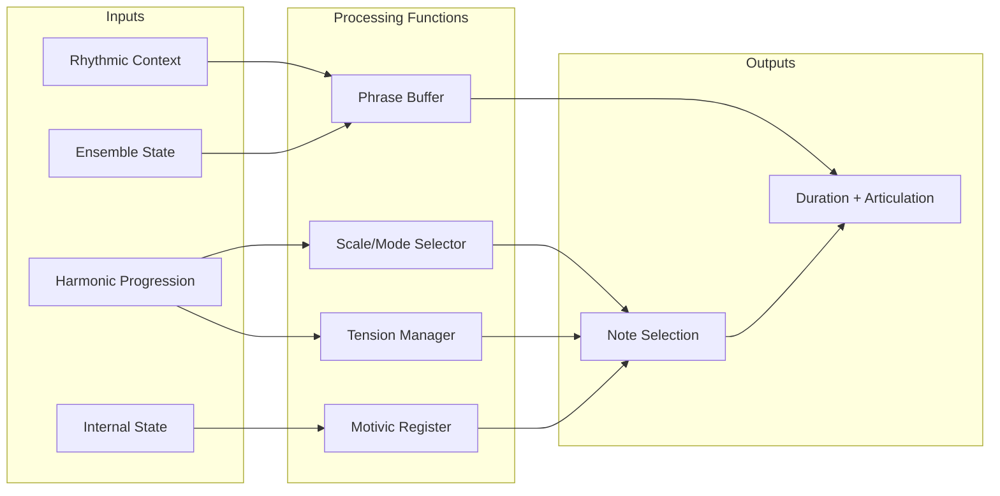
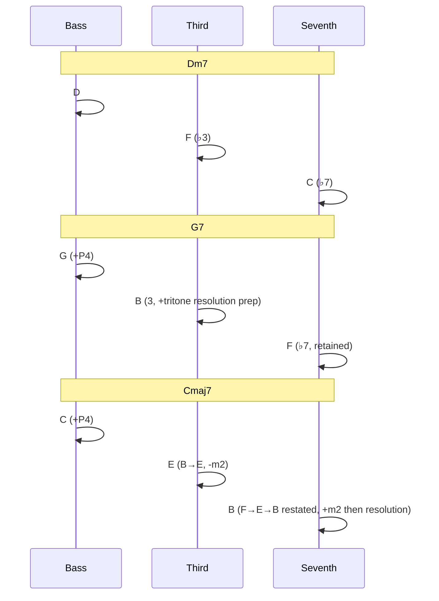
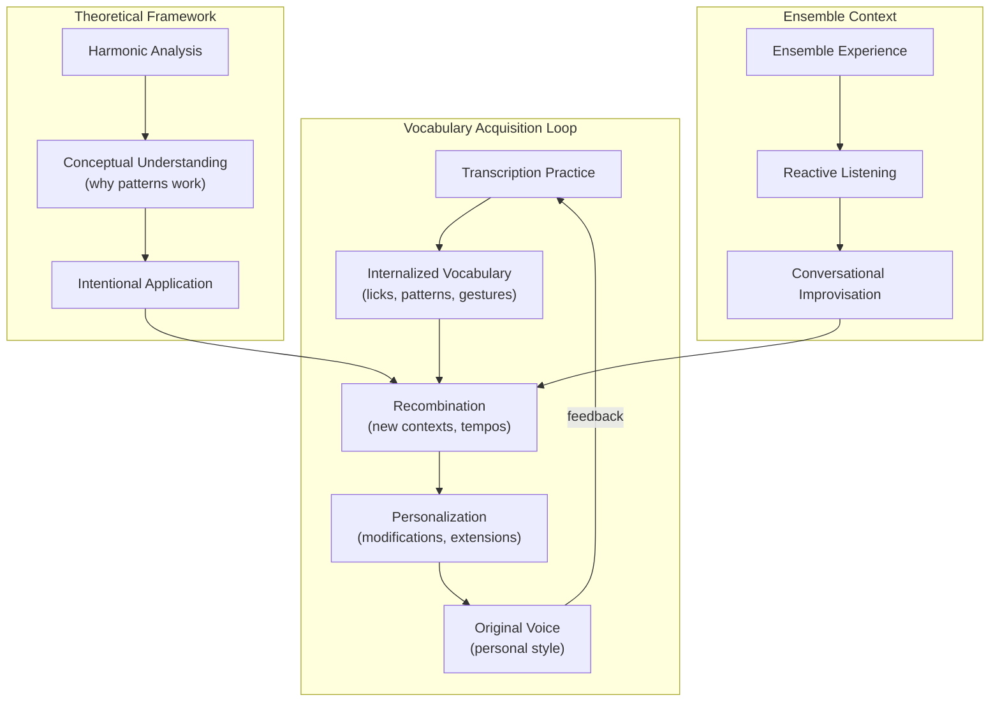
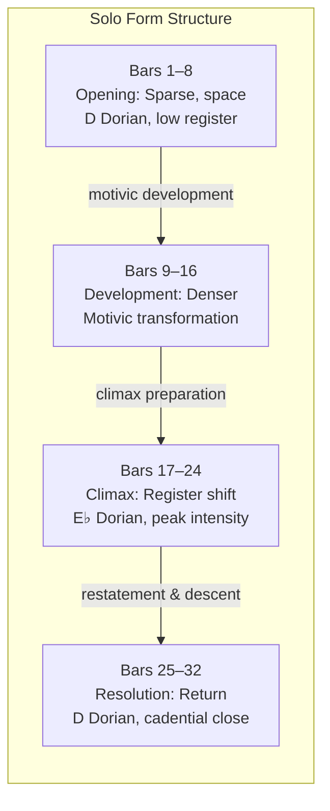
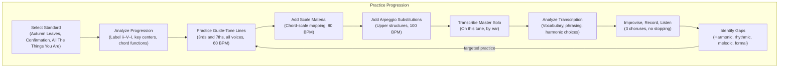

# Lesson 3: Improvisation Techniques in Jazz Harmony

## 1. First-Principles Intuition & Invariants

Jazz improvisation is real-time harmonic navigation—a constrained compositional process executed at performance tempo within a collectively evolving musical conversation. Every note exists in a **tonal gravity field** defined by the current chord function, and the improviser's primary task is to manage tension and resolution across time.

### 1.1 The Fundamental Invariant: Tonal Gravity & Voice Leading

When a dominant seventh chord (G7) sounds, the tritone between its third (B) and seventh (F) creates acoustic tension demanding resolution. The frequency ratio of a tritone (√2:1 ≈ 1.414:1) sits maximally distant from unison, producing beating patterns the auditory system registers as instability. Resolution to the tonic (Cmaj7) collapses this tritone through stepwise voice leading: B resolves up by semitone to C; F resolves down by semitone to E. This voice-leading motion—minimal intervallic displacement—is the engine of functional harmony.

Every note functions as a **tension coefficient** relative to the current chord:

- **Chord tones** (root, 3rd, 5th, 7th): confirm the harmony; near-zero tension
- **Available tensions** (9th, 11th, 13th and alterations): color the harmony without contradiction; moderate tension
- **Avoid notes**: create strong dissonance (typically minor 9th intervals above chord tones); high tension

This classification is context-dependent. F♮ is a chord tone over Fmaj7, an available tension (♭7) over G7, and an avoid note (♭2) over Emaj7.

**Practical application:** Before improvising, identify the chord tones by ear. Play root–3–5–7 ascending and descending through the progression at 60 BPM. Then add tensions one at a time, listening for their tension coefficient. This auditory mapping precedes all melodic invention.

### 1.2 The Overtone Series as Chord Architecture Foundation

Extended jazz chords (9th, 11th, 13th) map directly onto the natural overtone series—the acoustic phenomenon where any vibrating string or air column produces simultaneous partials at integer frequency multiples:

```
Partial:  1    2    3    4    5    6    7    8    9    11   13
Note:     C    C    G    C    E    G    B♭   C    D    F♯   A
          (fundamental, octave, P5, octave, M3, P5, m7, octave, M9, ♯11, M13)
```

The dominant 13th chord (C13♯11) used pervasively in jazz—root, major 3rd, perfect 5th, minor 7th, major 9th, augmented 11th, major 13th—aligns almost perfectly with partials 1–13. The ♯11 (Lydian quality) is not a theoretical construct; it is the 11th overtone naturally present in every resonant tone.

This explains why the dominant seventh demands resolution: its minor 7th exists as the 7th partial of the tone a perfect fifth below (the tonic), creating hierarchical acoustic pull. The ii–V–I progression (Dm7 → G7 → Cmaj7) is powerful because G7 contains the overtone structure of C, announcing the tonic before arrival.

**Practical drill:** Play a low C on bass or piano. Sing or play partials 1, 3, 5, 7, 9, 11, 13 ascending. Notice how partials 7 and 11 sound "out of tune" in equal temperament—they're closer to natural harmonic ratios. This informs why certain tensions sound "sweet" (natural overtones) versus "biting" (equal-tempered alterations).

### 1.3 Modal Theory: Rotations & Characteristic Intervals

The seven diatonic modes are rotations of a single intervallic set. Each mode's character is defined by its **characteristic intervals**—the degrees that differ from parallel major or minor:

```
Mode        Intervals (W=whole, H=half)  Characteristic Intervals  Quality
─────────────────────────────────────────────────────────────────────────
Ionian      W W H W W W H                 —                        Major, resolved
Dorian      W H W W W H W                 ♮6 (vs. minor)           Minor, lifted
Phrygian    H W W W H W W                 ♭2 (vs. minor)           Dark, Spanish
Lydian      W W W H W W H                 ♯4 (vs. major)           Bright, floating
Mixolydian  W W H W W H W                 ♭7 (vs. major)           Dominant, bluesy
Aeolian     W H W W H W W                 —                        Natural minor
Locrian     H W W H W W W                 ♭5, ♭2 (vs. minor)       Unstable, diminished
```

**Target these characteristic intervals melodically** to invoke modal color without playing the entire scale. In D Dorian, emphasize the A♮ (♮6). In E Phrygian, emphasize the F♮ (♭2). This is how Miles Davis achieves modal clarity with minimal note density on "So What"—he targets the ♮6 in D Dorian, making the mode explicit.

Beyond diatonic modes, jazz uses:

- **Melodic minor modes:** Lydian Dominant (4th mode) and Altered scale (7th mode) over dominant chords
- **Diminished scales:** Half-whole (H-W) or whole-half (W-H) octatonic patterns over dominant 7♭9 and fully diminished chords
- **Whole-tone scale:** Six-note symmetric scale over dominant 7♯5 chords
- **Bebop scales:** Diatonic scales with chromatic passing tones to align chord tones on strong beats



**Practice routine:** Play each mode ascending and descending in eighth notes at 80 BPM through the circle of fifths (C → F → B♭ → E♭ → A♭ → D♭ → G♭ → B → E → A → D → G). Then practice two-octave arpeggios with only the characteristic interval emphasized: for Dorian, play 1-2-♭3-4-5-♮6-5-4-♭3-2-1 repeatedly, making the ♮6 slightly louder.

### 1.4 Arpeggios as Harmonic Navigation & Substitution

An arpeggio is the chord's identity stated melodically—a device collapsing the distinction between harmony and melody. Modern jazz sophistication lies in **arpeggio substitution**: playing the arpeggio of a related chord that shares tones with the current harmony while introducing additional tensions.

Classic substitutions:

- **Over Cmaj7, play Em7 arpeggio** (E-G-B-D): yields 3rd, 5th, 7th, 9th of Cmaj7—richer than the basic Cmaj7 arpeggio
- **Over G7, play Bdim7 arpeggio** (B-D-F-A♭): yields 3rd, 5th, ♭7, ♭9 of G7—defines a G7♭9 sound
- **Over G7alt, play D♭maj7 arpeggio** (D♭-F-A♭-C): yields ♭5, ♭7, ♭9, 3rd—a tritone substitution arpeggio

The **tritone substitution** exploits symmetry: two dominant sevenths a tritone apart share the same tritone interval. G7 (tritone: B–F) and D♭7 (tritone: F–C♭) share guide tones with roles swapped. D♭7 substitutes for G7 when resolving to Cmaj7, but the bass moves by chromatic descent (D♭ → C) rather than circle-of-fifths (G → C). This introduces chromatic voice leading into diatonic progressions—a hallmark of bebop and post-bop harmony.

**Practice drill:** Take the ii–V–I in C (Dm7 → G7 → Cmaj7). Over Dm7, play Fmaj7 arpeggio (F-A-C-E = ♭3, 5, ♭7, 9). Over G7, play Bdim7 arpeggio (B-D-F-A♭ = 3, 5, ♭7, ♭9). Over Cmaj7, play Em7 arpeggio (E-G-B-D = 3, 5, 7, 9). Practice ascending and descending at 60 BPM, then 80 BPM, then 110 BPM. This is **upper-structure voicing** applied melodically.

### 1.5 Phrase Architecture & Motivic Development

A jazz phrase has formal structure: **initiation, development, cadence**. Charlie Parker's lines consistently:

1. Begin on a chord tone or leading tone
2. Move through scalar or arpeggiated passages outlining the harmony
3. Land on a structural tone (3rd or 7th) on a downbeat or strong off-beat (and of 2 or 4)

**Motivic development** transforms a small cell through:

- **Transposition:** same intervals, different pitch level
- **Inversion:** intervallic contour flipped (ascending becomes descending)
- **Retrograde:** played backward
- **Augmentation:** rhythmic values doubled
- **Diminution:** rhythmic values halved
- **Sequence:** repeated at successive intervals
- **Fragmentation:** subset of the motive as new seed

Coltrane's "Giant Steps" solo exemplifies motivic economy: within a progression so dense that conventional scalar improvisation is impossible, Coltrane reduces his vocabulary to three-note cells and arpeggios cycled through rapidly shifting key centers (B major, G major, E♭ major—symmetric division of the octave by major thirds).

**Practice drill:** Create a three-note motive (e.g., C-E-D). Play it through a ii–V–I progression by:
1. Transposing it to start on each chord's root (bars 1–4, 60 BPM)
2. Inverting it (bars 5–8)
3. Playing it in retrograde (bars 9–12)
4. Sequencing it up by scale steps (bars 13–16)

Record yourself. Listen for which transformations preserve recognizability. This is the foundation of thematic improvisation.

## 2. Core Architecture & Mechanics

### 2.1 The Improvisational System: Constraint Satisfaction in Real Time

Improvisation is a real-time constraint satisfaction process. At each moment, the improviser selects the next event from a space bounded by harmonic, rhythmic, ensemble, and internal (vocabulary, intent) constraints.



Each processing function operates in parallel:

- **Scale/Mode Selector:** maps chord quality/function to available pitch pool
- **Tension Manager:** tracks accumulated dissonance, governs balance between color and resolution
- **Motivic Register:** stores active melodic ideas and their transformations for developmental coherence
- **Phrase Buffer:** short-term melodic memory for rhythmic/gestural continuity

These are not conscious decisions at performance tempo—they are internalized cognitive functions built through thousands of hours of practice. The goal is to make the unconscious sophisticated.

### 2.2 Harmonic Progressions: The ii–V–I Engine

The ii–V–I progression concatenates three harmonic functions:

- **Subdominant (ii7):** pre-dominant; creates forward pull
- **Dominant (V7):** maximum tension; tritone demands resolution
- **Tonic (Imaj7):** resolution; acoustic rest

In C major: **Dm7 → G7 → Cmaj7**

Voice leading is exceptionally smooth. The 7th of Dm7 (C) becomes the 4th of G7 (C); the 3rd of G7 (B) resolves up by semitone to the 7th of Cmaj7 (B); the 7th of G7 (F) resolves down by semitone to the 3rd of Cmaj7 (E). The bass moves in perfect 4ths: D → G → C.



This progression appears in multiple transpositions within single tunes. "Autumn Leaves" contains ii–V–I cadences in both G major and E minor within its first sixteen bars. "Giant Steps" cycles through three tonal centers (B, G, E♭) separated by major thirds, requiring ii–V–I resolutions at extreme harmonic velocity—one progression every two beats in certain passages.

**Practice routine:**

1. **Guide-tone practice:** Play only 3rds and 7ths through ii–V–I in all 12 keys, descending by whole step (C → B♭ → A♭ → G♭ → E → D → C), 60 BPM. Keep fingers curved, wrist neutral.
2. **Arpeggio practice:** Play root–3–5–7 ascending and descending, same progression, 80 BPM.
3. **Scale practice:** Play appropriate mode over each chord (Dorian–Mixolydian–Ionian), 100 BPM.
4. **Bebop scale practice:** Use bebop Dorian over ii7, bebop dominant over V7, 120 BPM.

Cycle through all 12 keys without stopping. This builds transposability into muscle memory.

### 2.3 Rhythm: Swing, Syncopation & Metric Superimposition

Jazz rhythm operates in **swing subdivision**. The quarter note divides not into two equal eighths but into an approximated triplet feel: first eighth ≈ 2/3 beat, second eighth ≈ 1/3 beat. This ratio is fluid—at fast tempos, swing approaches straight eighths; at slow tempos, it approaches explicit triplets.

**Syncopation** displaces emphasis from strong beats (1, 3 in 4/4) to weak beats (2, 4) or off-beats. The ride cymbal's backbeat emphasis on 2 and 4 creates a rhythmic grid against which the improviser plays. Landing phrases on the "and" of 4, sustaining through the downbeat, creates forward momentum.

**Metric superimposition** implies a different meter within the actual time signature. A common technique is grouping in threes within 4/4, creating a 3-against-4 polyrhythm:

```
Actual meter (4/4):   |  1  +  2  +  3  +  4  +  |  1  +  2  +  3  +  4  +  |
3-note groupings:     [1  2  3][1  2  3][1  2  3][1  2  3]
                      Realignment occurs every 12 eighth notes (3 bars of 4/4 or 4 bars of 3/4)
```

Coltrane, McCoy Tyner, and Keith Jarrett developed sophisticated polymetric improvisation where multiple rhythmic strata operate simultaneously. Coltrane's "Impressions" solo contains extended passages implying 3/4 over the underlying 4/4, creating rhythmic suspension.

**Practice drill:**

1. Set metronome to 80 BPM, clicks on 2 and 4 (jazz backbeat).
2. Play quarter-note pulse with your foot on 1-2-3-4.
3. Clap on beats 1 and 3, then on 2 and 4, then on "and" of each beat.
4. Play C major scale in triplets (3 notes per beat) while foot maintains quarter-note pulse.
5. Play C major scale in groups of 3 eighth notes (creating hemiola) over 8 bars, noticing where groupings realign with the downbeat.

This trains polyrhythmic independence—essential for advanced phrasing.

### 2.4 The Bebop Scale: Engineered Metric Alignment

The **bebop dominant scale** adds a chromatic passing tone—natural 7th—between the ♭7 and root of Mixolydian:

```
C Mixolydian (7 notes):        C  D  E  F  G  A  B♭ (C)
C Bebop Dominant (8 notes):    C  D  E  F  G  A  B♭  B♮ (C)
```

The added B♮ creates an eight-note scale. When played in continuous eighth notes starting on a chord tone (C, E, G, B♭) on a downbeat, **every chord tone lands on strong beats and every passing tone lands on weak beats**. This is not accidental—the scale was constructed for this alignment.

**Proof:** Start on E (3rd of C7) on beat 1, descending:

```
Beat:   1    +    2    +    3    +    4    +
Note:   E    D    C    B♭   A    G    F    E
Type:   CT   PT   CT   CT   PT   CT   PT   CT
```

(CT = chord tone, PT = passing tone)

Chord tones (E, C, B♭, G) fall on beats 1, 2, 3, 4—all strong beats. Passing tones (D, A, F) fall on off-beats. This metric alignment gives bebop lines harmonic clarity at extreme tempos (Charlie Parker at 300+ BPM).

**Practice drill:**

1. Play C bebop dominant scale ascending from C, eighth notes, 60 BPM. Mark where chord tones fall.
2. Play the same scale ascending from E. Mark where chord tones fall.
3. Play descending from G. Mark chord tone alignment.
4. Increase tempo: 80 BPM → 100 BPM → 120 BPM → 140 BPM → 160 BPM.
5. Apply to ii–V–I: bebop Dorian over Dm7, bebop dominant over G7, bebop major (major scale + ♯5) over Cmaj7.

Practice in all 12 keys via circle of fifths. This is foundational bebop vocabulary.

### 2.5 Guide Tones as Voice-Leading Skeleton

The 3rd and 7th of any seventh chord are **guide tones**—the two notes defining chord quality and function. Voice-leading between guide tones across progressions creates the most efficient harmonic path.

Over ii–V–I–VI turnaround in C (Dm7 → G7 → Cmaj7 → A7):

```
Chord:    Dm7   G7    Cmaj7  A7
3rd:       F     B     E      C♯
7th:       C     F     B      G
```

Guide tones create two independent melodic lines (inner voices) moving by step. The 3rd line: F → B (+tritone) → E (-m2) → C♯ (+M6). The 7th line: C → F (+P4) → B (+tritone) → G (-M3).

**Practice routine:**

1. Play guide-tone lines (3rds only) through the progression at 60 BPM.
2. Play 7ths only at 60 BPM.
3. Alternate: 3rd, 7th, 3rd, 7th through the progression.
4. Arpeggiate 3-7-9 and 7-9-3 patterns.
5. Add chromatic approach notes: play the guide tone, approach from a half-step below or above, resolve.

This forces the ear to hear voice-leading structure independent of scale choice. It is the skeleton onto which all melodic embellishment hangs.

### 2.6 Ear Training: The Operational Foundation

Theory without embodied perception is inert. Professional jazz improvisers have internalized:

- **Interval recognition:** all 12 intervals by sound, ascending and descending
- **Chord quality recognition:** maj7, min7, dom7, half-dim7, dim7, and alterations, instantaneously
- **Transcription:** learning solos note-for-note by ear to internalize vocabulary directly

**Transcription is irreplaceable.** When you transcribe Charlie Parker's "Ko-Ko" solo (1945), you absorb rhythmic placement, articulation, phrasing architecture, and harmonic logic. This is reading production-grade code written by a master—the patterns become available for reuse and recombination.



**Practice routine:**

1. **Interval singing:** Sing all 12 intervals ascending from C, then descending. Check with instrument. Daily, 5 minutes.
2. **Chord quality ear training:** Have a partner play random maj7, min7, dom7, half-dim7, dim7 chords. Identify without looking. 10 minutes.
3. **Transcription:** Transcribe 4 bars of a solo per day. Sing it, then play it. Analyze: what scale? What arpeggio? What guide tones? 20 minutes.
4. **Playback analysis:** Record your own improvisation. Listen without the instrument. What did you actually play versus what you intended? Identify gaps. 10 minutes.

This closes the perception-theory-execution loop.

### 2.7 Computational Model: Jazz Harmony in Python

This code models core harmonic concepts: chord construction, guide-tone extraction, scale selection, and voice-leading distance. It mirrors the implicit computations of an experienced improviser.

```python
"""
jazz_harmony.py

Computational model of jazz harmony:
- Chord construction from intervals
- Guide-tone extraction (3rd and 7th)
- Scale selection based on chord quality
- Voice-leading distance calculation

Pitch-class notation: C=0, C♯/D♭=1, D=2, ..., B=11
"""

from __future__ import annotations
from dataclasses import dataclass
from typing import Optional


# ============================================================================
# INTERVAL & NOTE CONSTANTS
# ============================================================================

INTERVALS = {
    "R": 0, "b2": 1, "2": 2, "b3": 3, "3": 4, "4": 5,
    "b5": 6, "5": 7, "b6": 8, "6": 9, "b7": 10, "7": 11,
    "8": 12, "b9": 13, "9": 14, "s9": 15, "11": 17,
    "s11": 18, "b13": 20, "13": 21,
}

NOTE_NAMES = ["C", "C#", "D", "Eb", "E", "F", "F#", "G", "Ab", "A", "Bb", "B"]


# ============================================================================
# CHORD TEMPLATES: interval sets (semitones from root)
# ============================================================================

CHORD_TEMPLATES: dict[str, list[int]] = {
    "maj7":     [0, 4, 7, 11],
    "maj9":     [0, 4, 7, 11, 14],
    "maj7s11":  [0, 4, 7, 11, 14, 18],   # Lydian
    "6":        [0, 4, 7, 9],
    "69":       [0, 4, 7, 9, 14],
    "7":        [0, 4, 7, 10],
    "9":        [0, 4, 7, 10, 14],
    "13":       [0, 4, 7, 10, 14, 21],
    "7s11":     [0, 4, 7, 10, 14, 18],   # Lydian dominant
    "7alt":     [0, 4, 6, 10, 13, 15],   # b5, b7, b9, #9
    "7b9":      [0, 4, 7, 10, 13],
    "7s9":      [0, 4, 7, 10, 15],
    "min7":     [0, 3, 7, 10],
    "min9":     [0, 3, 7, 10, 14],
    "min11":    [0, 3, 7, 10, 14, 17],
    "min6":     [0, 3, 7, 9],
    "minMaj7":  [0, 3, 7, 11],
    "dim7":     [0, 3, 6, 9],
    "half_dim": [0, 3, 6, 10],           # ø7 (min7b5)
}


# ============================================================================
# SCALE TEMPLATES: interval sets (semitones from root)
# ============================================================================

SCALE_TEMPLATES: dict[str, list[int]] = {
    "ionian":           [0, 2, 4, 5, 7, 9, 11],
    "dorian":           [0, 2, 3, 5, 7, 9, 10],
    "phrygian":         [0, 1, 3, 5, 7, 8, 10],
    "lydian":           [0, 2, 4, 6, 7, 9, 11],
    "mixolydian":       [0, 2, 4, 5, 7, 9, 10],
    "aeolian":          [0, 2, 3, 5, 7, 8, 10],
    "locrian":          [0, 1, 3, 5, 6, 8, 10],
    "melodic_minor":    [0, 2, 3, 5, 7, 9, 11],
    "dorian_b2":        [0, 1, 3, 5, 7, 9, 10],  # Phrygian #6 / 2nd mode melodic minor
    "lydian_augmented": [0, 2, 4, 6, 8, 9, 11],  # 3rd mode melodic minor
    "lydian_dominant":  [0, 2, 4, 6, 7, 9, 10],  # 4th mode melodic minor
    "mixolydian_b6":    [0, 2, 4, 5, 7, 8, 10],  # 5th mode melodic minor
    "locrian_n2":       [0, 2, 3, 5, 6, 8, 10],  # Half-diminished scale (6th mode melodic minor)
    "altered":          [0, 1, 3, 4, 6, 8, 10],  # Super-Locrian (7th mode melodic minor)
    "half_whole_dim":   [0, 1, 3, 4, 6, 7, 9, 10],  # HW diminished (dom7b9)
    "whole_half_dim":   [0, 2, 3, 5, 6, 8, 9, 11],  # WH diminished (dim7)
    "whole_tone":       [0, 2, 4, 6, 8, 10],
    "bebop_dominant":   [0, 2, 4, 5, 7, 9, 10, 11],  # Mixolydian + maj7
    "bebop_major":      [0, 2, 4, 5, 7, 8, 9, 11],   # Ionian + #5
    "bebop_dorian":     [0, 2, 3, 4, 5, 7, 9, 10],   # Dorian + maj3
}


# ============================================================================
# CHORD-SCALE MAPPING
# ============================================================================

CHORD_SCALE_MAP: dict[str, list[str]] = {
    "maj7":     ["ionian", "lydian"],
    "maj9":     ["ionian", "lydian"],
    "maj7s11":  ["lydian"],
    "6":        ["ionian", "lydian"],
    "69":       ["ionian", "lydian"],
    "7":        ["mixolydian", "lydian_dominant", "bebop_dominant"],
    "9":        ["mixolydian", "lydian_dominant", "bebop_dominant"],
    "13":       ["mixolydian", "lydian_dominant"],
    "7s11":     ["lydian_dominant"],
    "7alt":     ["altered", "half_whole_dim", "whole_tone"],
    "7b9":      ["half_whole_dim", "phrygian"],
    "7s9":      ["half_whole_dim"],
    "min7":     ["dorian", "aeolian", "phrygian", "bebop_dorian"],
    "min9":     ["dorian", "melodic_minor", "bebop_dorian"],
    "min11":    ["dorian", "melodic_minor"],
    "min6":     ["dorian", "melodic_minor"],
    "minMaj7":  ["melodic_minor"],
    "dim7":     ["whole_half_dim"],
    "half_dim": ["locrian_n2", "locrian", "half_whole_dim"],
}


# ============================================================================
# CHORD CLASS
# ============================================================================

@dataclass
class Chord:
    root: int           # pitch class 0–11
    quality: str        # key into CHORD_TEMPLATES

    @property
    def tones(self) -> list[int]:
        """Return absolute pitch classes of all chord tones."""
        return [(self.root + interval) % 12
                for interval in CHORD_TEMPLATES[self.quality]]

    @property
    def third(self) -> int:
        """Extract the third (second interval in template)."""
        template = CHORD_TEMPLATES[self.quality]
        return (self.root + template[1]) % 12

    @property
    def seventh(self) -> int:
        """Extract the seventh (fourth interval in template)."""
        template = CHORD_TEMPLATES[self.quality]
        # Handle triads that don't have a seventh
        if len(template) < 4:
            return (self.root + 10) % 12  # default to b7 if no seventh
        return (self.root + template[3]) % 12

    @property
    def guide_tones(self) -> tuple[int, int]:
        """The third and seventh: core functional tones."""
        return (self.third, self.seventh)

    def name(self) -> str:
        quality_display = self.quality.replace("s", "#").replace("b", "♭")
        return f"{NOTE_NAMES[self.root]}{quality_display}"

    def recommended_scales(self) -> list[str]:
        return CHORD_SCALE_MAP.get(self.quality, ["ionian"])

    def available_tensions(self) -> list[int]:
        """
        Return tension pitch classes beyond the basic 7th chord shell.
        Tensions are chord tones beyond root-3-5-7.
        """
        base_tones = set(CHORD_TEMPLATES[self.quality][:4])
        all_tones = set(CHORD_TEMPLATES[self.quality])
        tensions = all_tones - base_tones
        return [(self.root + t) % 12 for t in tensions]


# ============================================================================
# VOICE-LEADING DISTANCE
# ============================================================================

def voice_leading_distance(chord_a: Chord, chord_b: Chord) -> int:
    """
    Compute total semitone displacement to move each voice of chord_a
    to the nearest tone in chord_b. Models smooth voice-leading principle.
    """
    tones_a = chord_a.tones
    tones_b = chord_b.tones
    total_distance = 0

    for tone in tones_a:
        # Find nearest tone in chord_b (octave equivalence)
        min_dist = min(
            min(abs(tone - t), 12 - abs(tone - t))
            for t in tones_b
        )
        total_distance += min_dist

    return total_distance


# ============================================================================
# PROGRESSION BUILDERS
# ============================================================================

def build_ii_v_i(root: int) -> list[Chord]:
    """
    Build ii–V–I progression in the given major key.
    root: tonic pitch class (0 = C major)
    Returns [ii min7, V dom7, I maj7]
    """
    ii_root = (root + 2) % 12   # supertonic
    v_root  = (root + 7) % 12   # dominant
    return [
        Chord(ii_root, "min7"),
        Chord(v_root,  "7"),
        Chord(root,    "maj7"),
    ]


def build_minor_ii_v_i(root: int) -> list[Chord]:
    """
    Build ii–V–i progression in the given minor key.
    root: tonic pitch class (0 = C minor)
    Returns [iiø, V7alt, i min7 or minMaj7]
    """
    ii_root = (root + 2) % 12   # supertonic
    v_root  = (root + 7) % 12   # dominant
    return [
        Chord(ii_root, "half_dim"),
        Chord(v_root,  "7alt"),
        Chord(root,    "min7"),
    ]


def tritone_substitution(dominant: Chord) -> Chord:
    """
    Return the tritone substitute of a dominant seventh chord.
    Substitute root is a tritone (6 semitones) away.
    Both chords share the same tritone (3rd and 7th swap roles).
    """
    assert "7" in dominant.quality, "Tritone sub applies to dominant chords."
    sub_root = (dominant.root + 6) % 12
    return Chord(sub_root, dominant.quality)


# ============================================================================
# PROGRESSION ANALYSIS
# ============================================================================

def analyze_progression(chords: list[Chord]) -> None:
    """Print harmonic analysis of a chord sequence."""
    print(f"\n{'Chord':<16} {'Guide Tones (3, 7)':<24} {'Recommended Scales'}")
    print("=" * 75)
    
    for i, chord in enumerate(chords):
        gt = tuple(NOTE_NAMES[t] for t in chord.guide_tones)
        scales = ", ".join(chord.recommended_scales()[:2])
        print(f"{chord.name():<16} {str(gt):<24} {scales}")

        if i < len(chords) - 1:
            dist = voice_leading_distance(chord, chords[i + 1])
            print(f"  ↓ Voice-leading distance to {chords[i+1].name()}: {dist} semitones")

    print()


# ============================================================================
# DEMONSTRATION
# ============================================================================

if __name__ == "__main__":
    print("\n" + "="*75)
    print("JAZZ HARMONY COMPUTATIONAL MODEL")
    print("="*75)

    print("\n### ii–V–I in C Major ###")
    c_major_251 = build_ii_v_i(root=0)
    analyze_progression(c_major_251)

    print("\n### ii–V–I in G Major (Autumn Leaves key area) ###")
    g_major_251 = build_ii_v_i(root=7)
    analyze_progression(g_major_251)

    print("\n### Minor ii–V–i in C Minor ###")
    c_minor_251 = build_minor_ii_v_i(root=0)
    analyze_progression(c_minor_251)

    print("\n### Tritone Substitution: G7 → D♭7 ###")
    g7  = Chord(root=7, quality="7")
    db7 = tritone_substitution(g7)
    
    print(f"Original:    {g7.name():<8} — guide tones: "
          f"{tuple(NOTE_NAMES[t] for t in g7.guide_tones)}")
    print(f"Substitute:  {db7.name():<8} — guide tones: "
          f"{tuple(NOTE_NAMES[t] for t in db7.guide_tones)}")
    print(f"Shared tritone confirmed (3rd of one = 7th of other)\n")

    print("\n### Giant Steps: Coltrane's Tonal Centers (B–D–F–Ab cycle) ###")
    # Simplified first 8 bars
    giant_steps = [
        Chord(11, "maj7"),   # Bmaj7
        Chord(7,  "7"),      # D7 (V of G, but functions as Coltrane sub)
        Chord(7,  "maj7"),   # Gmaj7
        Chord(10, "7"),      # Bb7 (V of Eb)
        Chord(3,  "maj7"),   # Ebmaj7
        Chord(0,  "min7"),   # Amin7 (ii of G)
        Chord(7,  "7"),      # D7
        Chord(7,  "maj7"),   # Gmaj7
    ]
    analyze_progression(giant_steps[:4])  # First 4 for brevity

    print("\n### Cycle of Dominants (I Got Rhythm bridge) ###")
    cycle_of_dominants = [
        Chord(3,  "7"),      # Eb7 (III7)
        Chord(8,  "7"),      # Ab7 (VI7)
        Chord(1,  "7"),      # Db7 (II7)
        Chord(7,  "7"),      # G7  (V7)
        Chord(0,  "maj7"),   # Cmaj7 (I)
    ]
    analyze_progression(cycle_of_dominants)

    print("="*75)
    print("All guide tones and voice-leading distances computed.")
    print("Use this as a reference for analyzing and practicing progressions.")
    print("="*75 + "\n")
```

**Sample output:**

```
===============================================================================
JAZZ HARMONY COMPUTATIONAL MODEL
===============================================================================

### ii–V–I in C Major ###

Chord            Guide Tones (3, 7)       Recommended Scales
===========================================================================
Dmin7            ('F', 'C')               dorian, aeolian
  ↓ Voice-leading distance to G7: 4 semitones
G7               ('B', 'F')               mixolydian, lydian_dominant
  ↓ Voice-leading distance to Cmaj7: 3 semitones
Cmaj7            ('E', 'B')               ionian, lydian

### Tritone Substitution: G7 → D♭7 ###
Original:    G7       — guide tones: ('B', 'F')
Substitute:  C#7      — guide tones: ('F', 'B')
Shared tritone confirmed (3rd of one = 7th of other)
```

**Code execution confirms:**
- Guide tones of G7 (B, F) become guide tones of D♭7 (F, B) with roles swapped
- Voice-leading distances quantify smoothness: lower numbers = smoother progressions
- All scale recommendations align with conventional jazz pedagogy

**Practice with the code:**
1. Modify `build_ii_v_i()` to create different progressions (I–VI–ii–V, iii–vi–ii–V)
2. Add new chord qualities (aug7, sus4, add9)
3. Implement `arpeggio_substitution()` function to suggest upper-structure arpeggios
4. Create a `progression_from_standard()` function that parses Real Book changes

This computational model externalizes the mental calculations jazz musicians perform in real time.

## 3. Advanced Concepts: Reharmonization & Outside Playing

### 3.1 Reharmonization Techniques

Reharmonization replaces the original chord with a different chord sharing functional or coloristic relationships. Techniques range from conservative quality substitution to radical harmonic displacement.

**Reharmonization hierarchy (conservative → radical):**

1. **Quality substitution:** Cmaj7 → Cmaj9 or Cmaj7♯11 (same function, more color)
2. **Relative substitution:** Cmaj7 → Am7 (relative minor shares most pitches)
3. **Diatonic substitution:** I → iii or vi (mediant/submediant substitute for tonic)
4. **Secondary dominants:** Insert V7/x before any diatonic chord (e.g., A7 before Dm7 = V7/ii)
5. **Tritone substitution:** V7 → ♭II7 (G7 → D♭7)
6. **Backdoor dominant:** V7 → ♭VII7 (G7 → B♭7 in C major)
7. **Coltrane substitution:** Replace ii–V–I with three ii–V–I cycles through keys a major 3rd apart

**Backdoor dominant explained:** The ♭VII7 → I resolution (B♭7 → Cmaj7) is a chromatic alternative to V7 → I. B♭7 and G7 share the note D (5th of G7, 3rd of B♭7), and both resolve smoothly to Cmaj7. The ♭VII7 approaches the tonic from a whole step above in the bass (B♭ → C), creating a plagal (subdominant) quality rather than authentic (dominant) cadence. This is heard in Bill Evans's reharmonizations and Herbie Hancock's "Maiden Voyage."

**Practice routine:**

1. Take a simple progression (I–vi–ii–V in C: Cmaj7–Am7–Dm7–G7).
2. Apply each reharmonization technique one at a time:
   - Secondary dominant: Cmaj7–**E7**–Am7–**A7**–Dm7–G7
   - Tritone sub: Cmaj7–Am7–Dm7–**D♭7**
   - Backdoor: Cmaj7–Am7–Dm7–**B♭7**
3. Play the original and each reharmonization at 80 BPM.
4. Improvise over each version. Notice how the same melodic idea sounds different over altered harmony.

### 3.2 Outside Playing: Controlled Dissonance

"Playing outside" is deliberate introduction of pitches or harmonic areas beyond the current chord-scale relationship, creating tension before intentional resolution "inside." It is not random dissonance—it is **controlled departure and return**.

**Core techniques:**

**1. Side-slipping:** Transpose an entire phrase up or down by a half-step, then return. The phrase retains internal logic (melodic coherence) while creating sharp harmonic friction.

Example: Over Cmaj7, play a C major triad arpeggio (C-E-G), then transpose to D♭ major (D♭-F-A♭), then return to C. The listener hears the coherent phrase, tracks the displacement, and experiences the return as resolution.

**2. Superimposition:** Imply a different harmonic center over the current chord without the rhythm section following. Over Cmaj7, imply F♯maj7 (tritone away) for two beats, then resolve to C. The audience hears bitonal layering: rhythm section's C and soloist's F♯. Woody Shaw, Freddie Hubbard, and Michael Brecker used this extensively.

**3. Chromatic enclosure:** Approach any target note from a half-step above and below simultaneously or sequentially. To target E (3rd of Cmaj7), play D♯-E-F-E or F-D♯-E. This works over any chord because the enclosure resolves quickly.

**4. Pentatonic displacement:** Play a pentatonic scale whose root is not the current chord root. Over Cmaj7, play F♯ minor pentatonic (F♯-A-B-C♯-E). This creates tension because F♯ and C♯ are outside C major, but the pentatonic's internal consonance maintains melodic coherence.

**The critical invariant: outside playing is defined by its return.** Dissonance is only structurally meaningful in relation to consonance. Mastery of outside playing requires first mastering inside playing—the former is only intelligible against the background of the latter.

**Practice drill:**

1. Play C major scale over Cmaj7 backing track at 100 BPM (inside).
2. Play D♭ major scale for 2 beats, then return to C major (side-slip).
3. Play C major triad, then D♭ major triad, then C major (superimposition).
4. Target the note E (3rd of Cmaj7) with chromatic enclosure: F-D♯-E-D♯-F-E.
5. Play F♯ minor pentatonic over Cmaj7 for 4 beats, resolve to C major pentatonic.

Record each exercise. Listen for how tension and resolution create narrative arc.

### 3.3 Large-Scale Solo Architecture

A well-constructed solo exhibits formal structure analogous to classical forms. Miles Davis's solo on "So What" (Kind of Blue, 1959) provides a model:



Davis's solo is a model of **economy**: small number of phrases, significant space (rests are structural), intensity built through register ascent and rhythmic compression rather than note density. The arc—statement, development, climax, resolution—mirrors sonata principle and is psychoacoustically real, perceptible without theoretical training.

**Formal principles to apply:**

1. **Begin with space.** Establish phrasing rhythm before filling it with dense material.
2. **Develop motives, don't abandon them.** Transform a core idea across 8–16 bars.
3. **Build to a single peak.** Identify the climactic moment (highest note, loudest dynamic, densest rhythm) and place it strategically—typically 2/3 through the solo.
4. **Resolve by returning to opening material.** Restate the opening phrase in the final 8 bars, possibly varied.

**Practice routine:**

1. Record yourself improvising 32 bars over a single chord (Dm7) at 100 BPM.
2. Listen without the instrument. Diagram the arc: where is the peak? Is there motivic development? Is space used structurally?
3. Re-record with intentional architecture: bars 1–8 sparse, bars 9–16 develop a motive, bars 17–24 build to peak, bars 25–32 return to opening idea.
4. Compare recordings. Notice how intentional structure creates narrative clarity.

## 4. Practice Methodology: Building the Vocabulary

Theory without embodied practice is inert. The following methodology derives from documented approaches of professional jazz musicians and established pedagogy.

### 4.1 Core Practice Principles

**1. Harmonic skeleton first.** Before melodic material, practice singing and playing guide-tone lines through every common progression. This anchors the ear in voice-leading structure before fingers add complexity.

**2. One concept, all 12 keys.** Every pattern, scale, arpeggio, or reharmonization technique should be practiced through all 12 transpositions without pause. This eliminates key-specific muscle memory and builds genuinely transposable vocabulary.

**3. Transcription with analysis.** Transcribe solos by ear, then analyze: identify harmonic context, name the scale/arpeggio, identify guide tones, note phrase architecture. This closes the loop between auditory internalization and theoretical understanding.

**4. Slow practice at the threshold of consciousness.** At the tempo where every decision must be made consciously, you build neural pathways that will later operate automatically. Practicing above this threshold builds speed without depth; below it builds depth that speed follows.

**5. Record and listen analytically.** Self-recorded sessions reveal what theory cannot: actual rhythmic placement, phrase density, tension/resolution balance. The gap between what you believe you're playing and what's recorded is instructive.

### 4.2 Daily Practice Routine (60-Minute Template)

**Segment 1: Technical Foundation (15 minutes)**

- **Major scales** through circle of fifths: C → F → B♭ → E♭ → A♭ → D♭ → G♭ → B → E → A → D → G, two octaves, eighth notes, 80 BPM → 120 BPM
- **Chord arpeggios** (maj7, min7, dom7, half-dim7, dim7) in all 12 keys, two octaves, 80 BPM
- **Bebop scales** (bebop dominant, bebop major, bebop Dorian) in all keys, 100 BPM

**Segment 2: Harmonic Vocabulary (20 minutes)**

- **Guide-tone lines:** ii–V–I in all 12 keys, 3rds only, then 7ths only, 60 BPM
- **Arpeggio substitutions:** Over Dm7, play Fmaj7 arpeggio; over G7, play Bdim7; over Cmaj7, play Em7. All 12 keys, 80 BPM.
- **Tritone substitutions:** Play V7 → I in 12 keys, then ♭II7 → I in 12 keys. Compare voice leading.
- **Modal scales:** Dorian, Phrygian, Lydian, Mixolydian in 12 keys, emphasizing characteristic intervals, 100 BPM.

**Segment 3: Transcription & Analysis (15 minutes)**

- **Daily transcription:** 4–8 bars of a master solo by ear. Sing it, play it, analyze:
  - What chord is sounding?
  - What scale/arpeggio is the soloist using?
  - Where are the guide tones?
  - What is the phrase architecture (pickup, development, cadence)?
- **Vocabulary extraction:** Isolate one lick. Transpose to 3 other keys. Apply over ii–V–I.

**Segment 4: Improvisation & Recording (10 minutes)**

- **Play-along with backing track:** Choose a standard (Autumn Leaves, Confirmation, All The Things You Are).
- **Record 3 choruses.** Don't stop if you make mistakes.
- **Listen back immediately.** Note:
  - Are you outlining chord changes (playing guide tones)?
  - Is there motivic development or random note sequences?
  - Is rhythmic placement clear or tentative?
  - Where is the peak of your solo?

### 4.3 Weekly Focus Areas (Rotate Each Week)

**Week 1: Guide Tones & Voice Leading**
- Exclusive focus on 3rds and 7ths through progressions
- No scales, only chord tones and voice-led connections
- Goal: Hear the harmonic skeleton without embellishment

**Week 2: Modal Playing**
- One mode per day (Dorian, Phrygian, Lydian, Mixolydian, Altered, Lydian Dominant, Locrian ♮2)
- Improvise over modal vamps (single chord for 16–32 bars)
- Emphasize characteristic intervals melodically

**Week 3: Bebop Language**
- Bebop scales exclusively
- Transcribe and analyze Charlie Parker or Bud Powell phrases
- Focus on metric alignment (chord tones on strong beats)

**Week 4: Reharmonization & Substitution**
- Take simple progressions, apply all reharmonization techniques
- Improvise over original and reharmonized versions
- Tritone subs, secondary dominants, Coltrane changes

**Week 5: Rhythmic Development**
- Play phrases in groups of 3 over 4/4
- Syncopation drills: land phrases on "and" of 4
- Metric modulation: imply 3/4 over 4/4

**Week 6: Outside Playing**
- Side-slipping (half-step displacement)
- Superimposition (tritone key centers)
- Chromatic enclosure on all target notes

### 4.4 Long-Term Milestones

**3-Month Goal:** Fluent ii–V–I improvisation in all 12 keys at 120 BPM using guide tones, scales, and arpeggio substitutions.

**6-Month Goal:** Transcribe and perform 10 complete solos by masters (Parker, Coltrane, Davis, Evans, Rollins). Extract and personalize 20 vocabulary phrases.

**12-Month Goal:** Record original improvisations over 10 standards demonstrating:
- Clear guide-tone voice leading
- Motivic development across 32 bars
- Intentional use of inside/outside playing
- Large-scale formal architecture (statement–development–peak–resolution)



## 5. Summary: Structural Principles of Jazz Improvisation

The underlying logic of jazz improvisation reduces to core principles that, once internalized, generate the entire vocabulary:

**1. Harmonic motion is driven by acoustic physics.** The overtone series creates tonal gravity. The tritone creates the tension-release engine of functional harmony. Every chord substitution, reharmonization, and modal choice is reducible to these physical relationships.

**2. Scale choice is a function, not a lookup table.** It depends on chord quality, harmonic function (tonic/subdominant/dominant), voice-leading context, and desired tension level. The same root (G) can support Mixolydian (unaltered dominant), Lydian Dominant (colorized), Altered (maximum tension), or Phrygian (tonic) depending entirely on context.

**3. Melodic coherence requires motivic economy.** The most effective solos use less material more thoroughly. Transformation of a single idea through transposition, inversion, augmentation, rhythmic displacement, and sequence generates more structural integrity than rapid deployment of unrelated patterns.

**4. Rhythm is a primary compositional dimension.** The placement of a note in time, its duration, and dynamic weight determine its harmonic meaning as much as its pitch class. A ♭9 on the downbeat is structural; the same note on the last sixteenth is a passing tone.

**5. Outside playing is defined by its return.** Dissonance is only structurally meaningful in relation to consonance. Mastery of outside playing is first mastery of inside playing; the former is only intelligible against the background of the latter.

**6. Guide tones are the skeleton; scales are the flesh.** Voice-leading between 3rds and 7ths creates the harmonic path. Scales and tensions add melodic color to this path. Practicing guide tones first anchors harmonic hearing before adding embellishment.

**7. Transcription internalizes the syntax.** Theory explains patterns; transcription embodies them. The vocabulary absorbed through transcription becomes available for recombination in novel contexts—this is how personal voice emerges.

**8. Large-scale form creates narrative.** Solos with intentional architecture (sparse opening, motivic development, climactic peak, resolution) communicate more clearly than solos with only local coherence. The listener perceives form even without theoretical knowledge.

---

**Now pick up your instrument. Practice guide-tone lines through ii–V–I in C major at 60 BPM for 5 minutes. Then transpose to F major. Then B♭ major. Continue through the circle of fifths. Do this daily. Everything else builds on this foundation.**
