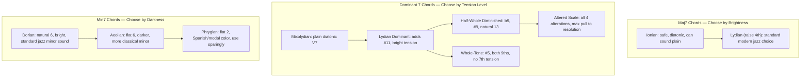
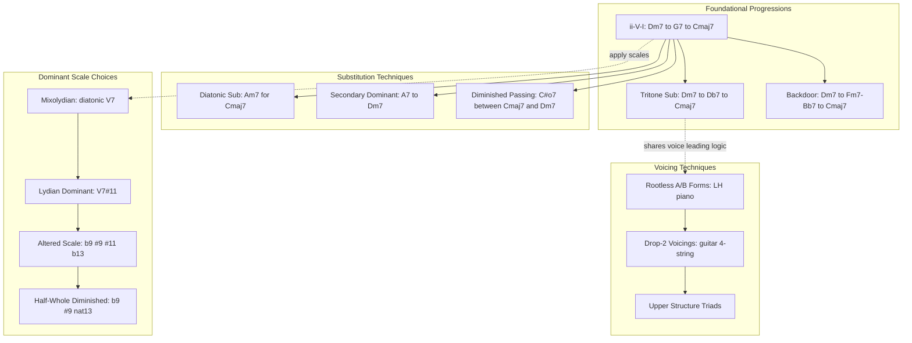
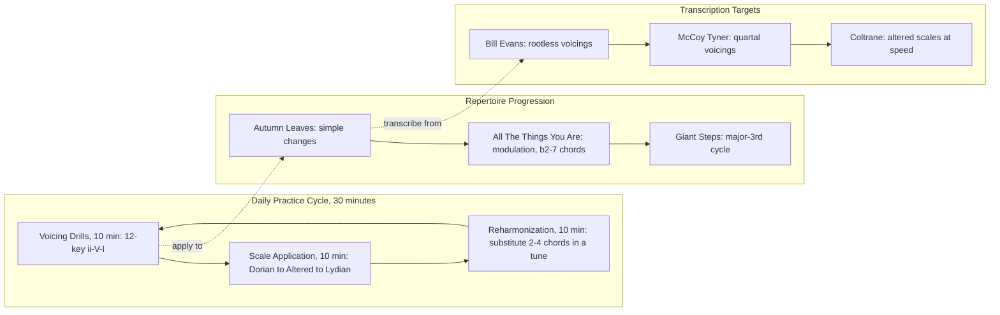

# Lesson 4: Advanced Jazz Harmony – Voicings, Voice Leading & Reharmonization

## 1. First-Principles Intuition (read once, then go play)

Everything in this lesson reduces to three physical/acoustic facts:

1. **The tritone wants to resolve.** The 3rd and ♭7th of any dominant chord sit a tritone apart (600 cents, exactly half the octave). This interval has no stable position in the harmonic series, so your ear hears it as "leaning" toward resolution. In G7→Cmaj7, B leans up to C and F leans down to E — contrary motion, half-step each. That one movement is the engine behind every ii–V–I, every tritone sub, every altered dominant in this lesson. Feel it in your hands before you theorize about it: play B and F together, then C and E together, on any instrument, and notice the release.

2. **Symmetrical chords are wormholes.** A diminished 7th chord splits the octave into four equal minor-3rd slices; an augmented triad splits it into three equal major-3rd slices. Because the intervals repeat exactly, any of these chords can be respelled to point at four (or three) different keys. That's the entire mechanism behind diminished passing chords and Coltrane's major-3rd cycle — no new theory needed, just "this shape is identical if I start on a different note."

3. **Voice leading is a hand-motion problem before it's a theory problem.** The reason rootless voicings and drop-2 shapes feel good under the fingers is that most notes don't move between chords — they're shared tones. Less physical motion, clearer sound, easier time. This is the practical reason jazz pianists and guitarists voice chords the way they do; the "smoothness" you hear is literally your hands doing less work.

**One paragraph of math, as promised, no more:** 12-tone equal temperament divides the octave into 12 semitones of ratio 2^(1/12) ≈ 1.05946 each. The tritone (6 semitones) sits at exactly 600 cents — the exact midpoint of the octave — which is why it's acoustically ambiguous and why G7 and D♭7 (a tritone apart) can substitute for each other: they share that identical midpoint interval. That's it. Now to the instrument.

## 2. The ii–V–I: Build Everything From Here

Every concept in this lesson is a variation on Dm7–G7–Cmaj7. Drill this until it's unconscious before touching substitutions.

### Piano: Rootless Voicings, Left Hand

Rootless voicings exist because in a trio or combo, the bassist already plays the root — doubling it in your left hand wastes a finger and muddies the bottom. You voice the *color* (3rd, 7th, extensions) and let the bass handle the foundation.

**A Form (7th on the bottom of the LH shape):**

```text
Dm7     F – A – C – E      (♭7 – 9 – 11 – 5)
G7      F – A – B – E      (♭7 – 9 – 3 – 13)
Cmaj7   E – G – B – D      (3 – 5 – 7 – 9)
```

**B Form (3rd on the bottom — use when the A form sits awkwardly, or to alternate register with your right hand):**

```text
Dm7     F – A – C – E
G7      B – E – F – A      (3 – 13 – ♭7 – 9)
Cmaj7   E – G – B – D
```

**Hand mechanics:**
- LH fingering for all three four-note shapes: 5–3–2–1 (pinky, middle, index, thumb). Keep the hand relaxed, knuckles slightly arched, no flat fingers.
- Watch the voice leading as you move chord to chord: **F and A are common tones held from Dm7 into G7** — don't lift them, just let the hand stay put while thumb slides C→B. Into Cmaj7, **E is held**, G moves up to... wait, actually track it concretely: G7 (F-A-B-E) → Cmaj7 (E-G-B-D): B is common, E drops to... no — compare note by note: F→E (step down), A→B (step up, wait check), B→B (common), E→D (step down). The practical rule stands regardless of exact mapping: **look for the note that doesn't need to move, and anchor your hand weight there.**

**Drill — do this before anything else in the lesson:**
1. ♩=60. Play Dm7 (A form), whole notes, 4 beats, listening to the exact pitches.
2. Move to G7 — move only the fingers that must move, keep the others pressed.
3. Move to Cmaj7 — same rule.
4. Loop 20 times without looking at your hands. You're building muscle memory, not reading memory.
5. Raise tempo: ♩=60 → 80 → 100 → 120.
6. Once automatic, add a right-hand melodic line: D Dorian over Dm7, G Mixolydian over G7, C Ionian over Cmaj7. One note per beat, then two, then swing eighths.
7. Transpose the whole cycle through all 12 keys, following the cycle of 4ths: C→F→B♭→E♭→A♭→D♭→G♭(F♯)→B→E→A→D→G→C.

### Guitar: Drop-2 Voicings, Strings 4–3–2–1

A "drop-2" voicing takes a close-position four-note chord and drops the second-from-top note down an octave. The result spreads the notes across four adjacent strings in a shape your fretting hand can actually grab, while still containing all four chord tones.

**Dm7 → G7 → Cmaj7, starting around the 5th fret (string set D-G-B-E, i.e. strings 4-3-2-1):**

```text
Dm7 (root-position voicing):
e |---5---|   A  (5th)
B |---6---|   D  (root)
G |---5---|   A  (5th)
D |---7---|   C  (♭7)

G7 (3rd-inversion voicing):
e |---5---|   A  (9th)
B |---5---|   F  (♭7)
G |---4---|   B  (3rd)
D |---5---|   G  (root)

Cmaj7 (2nd-inversion voicing):
e |---5---|   A  (13th, color tone, optional)
B |---5---|   E  (3rd)
G |---4---|   B  (7th)
D |---5---|   G  (5th)
```

**Fretting hand:** use fingers 1-2-3-4 spread across the four strings rather than barring — these shapes are usually one-finger-per-string. Keep the thumb low behind the neck for leverage; don't let it creep over the top, which cramps the stretch between strings D and B.

**Voice-leading check:** between Dm7 and G7 only the D-string and B-string notes change (C→B is a half step, A→G is a whole step); the top string holds A→A, common tone. Between G7 and Cmaj7, G-string and B-string hold, D-string and top string step. **This is why bebop comping on guitar looks like small finger wiggles, not big hand jumps** — that's the physical payoff of drop-2 voicing.

**Drill:**
1. ♩=60, quarter notes, hold each chord 4 beats, loop the three-chord cycle.
2. Identify which finger moves and which stays for each transition — say it out loud the first few reps ("ring finger moves, others hold").
3. Move the whole cycle up by half steps to cover all 12 keys. Keep the same drop-2 shape, same string set, same fingering pattern — only the fret position changes. This is the entire point of movable shapes: one hand shape, twelve keys, zero new fingerings to learn.
4. ♩=80 → 100 → 120.

## 3. Tritone Substitution: One Shared Interval, Two Chord Names

**Mechanism:** G7 contains the tritone B–F. D♭7 contains the tritone F–C♭ (enharmonically F–B). Same two pitches, different chord root. Because that shared tritone is what creates the harmonic pull toward C, either chord can deliver you to Cmaj7 — but D♭7 gets you there with the bass walking down chromatically instead of jumping a 4th.

```text
Original:      Dm7 → G7  → Cmaj7     (bass: D → G  → C, a 4th + a 4th)
Tritone sub:   Dm7 → D♭7 → Cmaj7     (bass: D → D♭ → C, chromatic half steps)
```

**Piano voicing comparison:**

```text
Dm7:   F – A – C  – E
G7:    F – A – B  – E
D♭7:   B(C♭) – E – F – A♭     (♭7–9–3–♯11, enharmonic respelling of the same tritone)
Cmaj7: E – G – B  – D
```

Notice F and A are still sitting there, held from Dm7 — that's not a coincidence, it's the same tritone pair wearing a new name. Only the bass note and one inner voice (C→C♭/B, or think of it as A♭ entering as a new color tone) actually change.

**Drill:**
1. Play the plain ii–V–I at ♩=60 in C. Then play it again substituting D♭7 for G7.
2. Sing the bass line out loud while you play: "D — D-flat — C." That chromatic bass is the entire sonic signature of a tritone sub; if you can sing it, you can hear it in any tune instantly.
3. Over the D♭7, improvise using D♭ Lydian Dominant (D♭–E♭–F–G–A♭–B♭–C♭) — this is just the Mixolydian scale with a raised 4th, and it matches the ♯11 color the substitution implies.
4. Run the whole thing through all 12 keys at ♩=60, then push to ♩=120 in swing rhythm, comping on beats 2 and 4 like you would with a drummer.

**Where to actually use this:** tritone subs work best on **secondary or less structurally critical V7 chords** (turnarounds, interior ii–V's) rather than the final cadence of a tune, where the listener's ear often wants the "home" sound of the real dominant. Try it in the last two bars of an 8-bar phrase before experimenting on the final cadence of the whole tune.

## 4. Diminished 7th Chords: The Four-Way Wormhole

A diminished 7th chord (1–♭3–♭5–♭♭7) is built from four stacked minor 3rds, which divide the octave into four equal parts. Because all four notes are equally spaced, **any diminished 7th chord is simultaneously four different diminished chords** depending on which note you treat as the root. B°7 (B–D–F–A♭) is also D°7, F°7, and A♭°7 — same four notes, four possible names.

**Practical use #1 — dominant substitute:** B°7 shares the tritone B–F with G7, so it functions as a V7 substitute resolving to Cmaj7:

```text
Dm7:   F – A – C – E
B°7:   B – D – F – A♭      (any inversion — try D-F-A♭-B for smoother top-voice motion)
Cmaj7: E – G – B – D
```

**Practical use #2 — chromatic passing chord between diatonic chords:**

```text
Cmaj7   →  C♯°7         →  Dm7
E-G-B-D →  E-G-B♭-C♯   →  F-A-C-E
```

Track each voice: E→E→F, G→G→A, B→B♭→C, D→C♯→E. Every single voice moves by a half step or stays put — this is why passing diminished chords sound so smooth even though the chord symbol looks exotic on paper.

**Guitar arpeggio drill (diminished shapes repeat every minor 3rd, i.e. every 3 frets — use this to navigate the whole neck with one fingering):**

```text
C♯°7 arpeggio, 6th string root at fret 9, 1-2-4 fingering per string:
e |---8---11---14---17---|
B |---8---11---14---17---|
G |---8---11---14---17---|
D |---8---11---14---17---|
A |---9---12---15---18---|
E |---9---12---15---18---|
```

Because of the symmetry, this exact finger pattern starting 3 frets higher or lower gives you the enharmonic equivalents of the same chord — you don't need four separate fingerings for four diminished "names."

**Drill:** ascend/descend the arpeggio at ♩=60, then ♩=120. Then insert diminished passing chords between the diatonic chords of a tune you already know (try "Autumn Leaves," inserting one between the Dm7 and Cmaj7-ish motion in the bridge).

## 5. Altered Dominants: Converging Chromatic Tension

**The idea in plain terms:** a dominant chord's job is to create tension that resolves. "Altering" the 5th and 9th (raising or lowering each) adds more tension-tones, all of which are a half step away from a note in the target chord. More half-step pulls = stronger resolution.

**The altered scale** is the 7th mode of melodic minor. For G7alt resolving to Cmaj7, use A♭ melodic minor, which gives you: G–A♭–B♭–B–D♭–E♭–F. Relabeled against G7: root, ♭9, ♯9, 3rd, ♯11, ♭13, ♭7.

Check the resolutions into C major: A♭→G (♭9 to root, half step), B♭→C (♯9 resolving up, or treat as going to the 3rd), D♭→C (♯11 down to the 3rd, half step), E♭→D (♭13 down to the 9th, half step). Every altered tension has a half-step landing spot in the tonic chord — that's the entire design logic of the scale.

**Piano voicing:**

```text
G7alt:  B – E♭ – F – A♭     (3 – ♭13 – ♭7 – ♭9)
        LH fingering: 5–3–2–1
```

This grabs the essential tritone (B–F) plus two altered colors in one four-note grip — maximum chromatic flavor, minimal notes.

**Right-hand altered scale fingering starting on G:**

```text
G  A♭  B♭  B  D♭  E♭  F  G
1   2   3  1   2   3  4  5     (thumb crosses under on B)
```

Drill: ascending/descending quarter notes at ♩=60, then eighth notes at ♩=100. Practice landing specifically on A♭ or B♭ on strong beats, then resolving by half step into the Cmaj7 that follows — that's the sound you're training your ear and fingers toward, not just scale fluency.

**Guitar altered scale shape (G7alt, low root around 3rd fret):**

```text
e |---4---5---7---8---|
B |---4---6---7---9---|
G |---4---5---7---8---|
D |---3---5---6---8---|
A |---3---5---6---8---|
E |---3---4---6---7---|
```

Loop over a G7alt–Cmaj7 two-chord vamp. Target: land ♭9 or ♯9 on a downbeat over the G7alt, then resolve it stepwise into a chord tone the instant Cmaj7 arrives. That half-step resolution across the barline is what makes altered lines sound inevitable rather than random.

## 6. Extended Chords: 9ths, 11ths, 13ths in Practice

Extensions correspond to the 9th, 11th, and 13th partials of the harmonic series, but you don't need the acoustics to use them — you need to know which ones clash and which don't. The rule that matters at the keyboard: **omit the natural 11th on a major chord (it beats against the 3rd a half step away) and often omit the plain 5th once you're voicing extensions (it adds no new color and eats a finger).**

**Cmaj7(♯11) — the "Lydian" sound (Bill Evans, Herbie Hancock territory):**

```text
E – G – B – F♯      (3 – 5 – 7 – ♯11)
LH fingering: 5–4–2–1
```

The raised 4th replaces the "avoid note" (natural F against C-E) with a consonant color tone a whole step above the 7th. This is why almost every modern jazz voicing of a major 7 chord quietly assumes Lydian rather than Ionian.

**G13 — dominant function, 5th omitted:**

```text
B – E – F – A       (3 – 13 – ♭7 – 9)
LH fingering: 5–3–2–1
```

**Guitar G13, drop-2, 3rd-fret position:**

```text
e |---5---|   E (13th)
B |---5---|   F (♭7)
G |---4---|   B (3rd)
D |---5---|   G (root)
```

**Drill:**
1. Hold Cmaj7(♯11) for 4 bars, feeling the open, floating quality.
2. Move to G13 as if it were a V7 of C (even though in this context it's acting more like a color extension — the point is training the hand shape).
3. Resolve to any target (Fmaj7, Dm7).
4. Right hand: C Lydian over the Cmaj7(♯11), G Mixolydian over the G13. Internalize that **Lydian is simply "major scale, raise the 4th"** and **you already know it** — it's not a new scale to memorize from scratch.

## 7. Chord-Scale Choices: A Decision Map, Not a List to Memorize

The question you're actually answering in real time is: "what color does this chord want, and what does the melody allow?" Use this as a lookup table while comping or soloing, not as abstract theory:



**The one rule that prevents 90% of "wrong note" problems: match your scale/alteration choice to what the melody is already doing.** If the tune's melody note over a G7 is A (natural 9), don't voice or solo with ♭9 or ♯9 underneath it — you'll create an unintended half-step clash against the melody. Use Mixolydian or Lydian Dominant instead. Altered scale is for when the melody itself moves chromatically or lands on a tension tone.

**Drill:**
1. Loop Dm7 (4 bars) → G7 (4 bars) → Cmaj7 (4 bars).
2. Solo D Dorian over the Dm7.
3. Solo G altered over the G7.
4. Resolve with C Lydian over the Cmaj7.
5. On each new chord, aim to land a clear chord tone (not just any scale tone) squarely on beat 1 — this is what makes scale-based lines sound like they're "following the changes" instead of just running patterns.
6. Tempo arc: ♩=80 → 100 → 120 → 140.

## 8. Reharmonization: Concrete Substitution Techniques

### Diatonic substitution (common-tone swap)

Am7 (A–C–E–G) shares three of four notes with Cmaj7 (C–E–G–B). When the melody is sitting on C, E, or G, you can substitute Am7 for Cmaj7 without clashing — it changes the color (relative minor darkness) while keeping the melody fully consonant.

```text
Original:       Cmaj7 | Dm7 | G7 | Cmaj7 |
Reharmonized:   Am7   | Dm7 | G7 | Cmaj7 |
```

### Secondary dominants (borrow a V7 for any diatonic chord)

Any diatonic chord can be preceded by its own dominant 7th a 5th above its root. To intensify the arrival at Dm7 (the ii chord), insert A7 (the V7 of Dm7) right before it:

```text
Original:       Cmaj7 | Dm7 | G7 | Cmaj7 |
Reharmonized:   Cmaj7 | A7  | Dm7 | G7 | Cmaj7 |
```

Piano voicing for the new A7→Dm7 motion:

```text
A7:    G – C♯ – E – G     (♭7 – 3 – 5 – ♭7, top note doubled for a full sound)
Dm7:   F – A  – C – E     (voice leading: C♯→C half step, G→F whole step)
```

### Backdoor ii–V (♭VII7 as substitute dominant)

The backdoor progression swaps the usual V7 for a dominant chord built on the lowered 7th degree, approaching the tonic from a different chromatic direction (a whole step above rather than a half step below):

```text
Original:   Dm7 | G7         | Cmaj7 |
Backdoor:   Dm7 | Fm7 → B♭7  | Cmaj7 |
```

```text
Fm7:    F – A♭ – C – E♭
B♭7:    A♭ – D – E♭ – F      (♭7 – 3 – ♯11 – 5)
Cmaj7:  E – G – B – D        (A♭ resolves down to G; D resolves up to E)
```

This gives tunes like "Just Friends" and "I Got Rhythm" bridges their distinctive descending, almost "sliding" resolution — different emotional color from a straight V7 cadence.

### Coltrane changes (major-3rd cycle)

Because major 3rds divide the octave into three equal parts (symmetry again), you can insert a dominant-tonic pair at each of the three points and create rapid, cyclical modulation instead of a single cadence:

```text
| Cmaj7  | E7     | Amaj7  | C7     |
| Fmaj7  | A♭7    | D♭maj7 | G7     | Cmaj7 ||
```

Each dominant resolves down a 4th to its own tonic (E7→Amaj7, C7→Fmaj7, A♭7→D♭maj7, G7→Cmaj7), and the three tonics (C, A♭, E — reading the main downbeats) are each a major 3rd apart.

**Guitar — drop-2 maj7/dom7 shapes moving by major 3rds (strings 4-3-2-1):**

```text
Cmaj7 (5th fret):
e |---5---|
B |---5---|
G |---4---|
D |---5---|

E7 (7th fret):
e |---7---|
B |---8---|
G |---7---|
D |---9---|

Amaj7 (9th fret):
e |---9---|
B |---9---|
G |---9---|
D |---11--|
```

**Drill:**
1. Block chords only, ♩=60, through the full 8-bar sequence. Say the chord names out loud as you play — the sequence doesn't "stick" in your ear until you've connected sound to name.
2. Once the shapes are automatic, add a simple arpeggio line (root-3rd-5th-7th ascending) over each chord at the same slow tempo.
3. Only then start pushing tempo: ♩=100 → 140 → 180, eventually toward the recording tempo of "Giant Steps" (♩≈260-290). Do not rush this — the entire difficulty of the tune is hand-shape fluency at speed, which only comes from the slow block-chord stage being bulletproof first.



## 9. Daily Practice Routine (30 Minutes, Repeatable)

**Section 1 — Voicing drills (10 min)**
1. Rootless ii–V–I, all 12 keys, A form, whole notes, ♩=60. Cycle of 4ths (C→F→B♭→E♭...). Priority: common-tone retention and minimal hand motion, not speed.
2. Guitar: drop-2 ii–V–I, 12 keys, starting with 6th-string roots then 5th-string roots, string set 5-4-3-2 then 4-3-2-1. ♩=60 quarter notes strict time. Week 2 onward: add tritone subs into the same drill.

**Section 2 — Scale application (10 min)**
1. Loop a G7 vamp. Bars 1–4: Mixolydian. Bars 5–8: Lydian Dominant. Bars 9–12: Altered. Bars 13–16: Half-Whole Diminished. Start ♩=80, build to ♩=140.
2. Loop Dm7(4)→G7(4)→Cmaj7(4). Play D Dorian → G Altered → C Lydian, landing a clear chord tone on beat 1 of each new chord. Tempo arc ♩=100→120→140.

**Section 3 — Reharmonization workshop (10 min)**
1. Take 8 bars of a standard you know. Reharmonize using exactly: two tritone subs, one secondary dominant, one diminished passing chord. Write the voicings out, play at ♩=60.
2. Real-time substitution: play the original changes at performance tempo; every 4th chorus, swap in one substitution. Increase density gradually across sessions, not within one sitting.

## 10. Troubleshooting Guide

**Altered dominants sound "wrong" against the melody.**
Cause: the melody is sitting on a natural extension (e.g. natural 9th) that your alteration contradicts.
Fix: if the melody has A over G7, do not voice ♭9 or ♯9 underneath it. Switch to Mixolydian or Lydian Dominant, which keep the natural 9th available.
```text
Melody note A over G7 → use G7 (Mixolydian) or G7(#11) (Lydian Dominant)
                       → avoid G7b9 / G7#9 (creates an unintended half-step clash)
```

**Low-register voicings sound muddy.**
Cause: close-position chords below roughly E2 pack overtones too tightly for the ear to separate them cleanly; the low fundamentals also physically beat against each other.
Fix: don't voice close-position chords below E2. In the left hand, use tenths (root plus the 10th above) instead of stacked octaves, and omit the 5th in low-register voicings — it adds nothing but low-end clutter. For Cmaj7, voice E2-G3-B3-D4 (spread) rather than C2-E2-G2-B2 (stacked and muddy).

**Reharmonization erases the tune.**
Cause: too many substitutions, too close together, or placed on structurally important melody notes (phrase endings, climaxes).
Fix: keep the original harmony under those structural notes. Cap substitution density at roughly 25% of the chords on a first pass. Ask: can someone who knows the tune still recognize it? If not, pull back. Safe places to substitute: weak beats, passing chords, interior bars of a 4-bar phrase — not bar 1 or bar 4 of a phrase.

**Voice leading sounds jumpy.**
Cause: a voice is leaping when it could have stepped, or a common tone got dropped and re-struck for no reason.
Fix: before playing a chord change, identify on paper (or mentally) which note(s) are shared between the two chords — hold those in the same register, same finger if possible. Move everything else by the smallest available interval. Example: Dm7 (F-A-C-E) → G7 (F-A-B-E): F and A are common tones (don't restrike them), C steps down to B, E is common.

**Quartal voicings sound vague or directionless.**
Cause: stacked 4ths contain no tritone, so there's no strong functional pull — fine for modal music, weak for cadential ii-V-I motion.
Fix: reserve quartal voicings for modal tunes or suspended sections. In functional ii-V-I contexts, make sure at least the 3rd and 7th are present somewhere in the voicing to establish chord quality. A useful hybrid: left hand plays 3rd+7th (functional anchor), right hand stacks 4ths above it (modern color).

## 11. Ensemble Context

**Piano trio (piano, bass, drums):**
Omit roots in the left hand — the bassist owns that note. Voice in the A2–D5 range to stay clear of the bass's register and avoid masking it. Don't comp on every beat; leave space for the bass line and drum fills. A reliable starting comping rhythm is backbeat accents on beats 2 and 4, or syncopated off-beat stabs.

**Big band / horn section writing:**
Write distinct voicings per section. Saxes typically voice close (all chord tones within an octave) for a blended, homogenous sound. Brass typically voices open (spread 1.5–2 octaves) for projection and power. Drop-2 and drop-2-and-4 voicings are the standard tools for spreading a chord across a section without losing the chord's identity.

**Solo piano:**
The left hand must supply both bass function and harmonic content simultaneously — there's no bassist to lean on. Use stride (root on beats 1 and 3, chord on 2 and 4) or a walking bass line under right-hand melody and occasional comping. Build the independence needed for this with Hanon-style coordination exercises and two-part contrapuntal material (Bach inventions transcribed for piano work well) — the goal is being able to run an independent bass line while voicing chords on top without one hand "leaking" into the other's rhythm.

## 12. Repertoire Application

Work through these in order of harmonic density:

1. **"Autumn Leaves"** — simple, diatonic-leaning changes with a clear melody. Ideal first testbed for basic ii-V-I, one secondary dominant, and one tritone sub per pass.
2. **"All The Things You Are"** — modulates through several keys and uses a ♭II7 (Neapolitan-function) chord. Standard intermediate benchmark tune.
3. **"Stella By Starlight"** — dense reharmonization history, half-diminished chords, multiple legitimate altered-dominant choices. Good for practicing chord-scale decision making.
4. **"Rhythm Changes" (I Got Rhythm form)** — 32-bar AABA, fast harmonic rhythm, the core vehicle for bebop vocabulary.
5. **"Giant Steps"** — major-3rd cycle (Coltrane changes) at speed. Save for after the drills above are solid.

**Protocol per tune:**
1. Learn the melody by ear first — sing it before you play it, then play it without the chart.
2. Comp through the original changes at ♩=60 using A/B rootless (or drop-2) voicings only.
3. Add one tritone sub per A section.
4. Add one secondary dominant per A section.
5. Try altered scales over the dominants.
6. Record yourself comping and soloing at performance tempo (♩=120–180).
7. Transcribe 2–4 bars from a classic recording of the tune (Bill Evans, Oscar Peterson, Bud Powell, or McCoy Tyner are all strong, stylistically distinct starting points) and integrate the exact voicing into your own playing.

**Reference recordings for harmonic study:**
- Bill Evans Trio, *Portrait in Jazz* (1960) — rootless voicings, Lydian major 7th sonorities, unusually sensitive voice leading.
- McCoy Tyner, *The Real McCoy* (1967) — quartal voicings, modal harmony.
- Herbie Hancock, *Maiden Voyage* (1965) — suspended chords, modal writing, upper-structure triads.
- John Coltrane, *Giant Steps* (1960) — major-3rd cycle changes, altered scales at extreme tempo.
- Oscar Peterson Trio, *Night Train* (1963) — ii-V-I execution at a virtuosic level, stride bass, blues-based reharmonization.

**Transcription method:** slow the recording to 50% speed (Transcribe! or a similar time-stretch tool), write out every note with fingerings, drill the voicing in all 12 keys at ♩=60, then work it into your improvisation over the same tune.



## Summary

Advanced jazz harmony is physical before it's theoretical. The tritone resolves because your fingers feel B and F pull toward C and E, not because you've memorized that it sits at 600 cents. Rootless voicings work because your left hand learns to hold F-A-C-E steady while your right hand moves. Altered scales sound inevitable once your ear has heard A♭ resolve to G and D♭ resolve to C a thousand times in practice.

**Priorities, in order:**
1. Rootless A/B voicings (piano) or drop-2 voicings (guitar) for ii-V-I in all 12 keys — nothing else matters until this is automatic.
2. Match alterations to the melody. Never force a ♭9 against a melody sitting on a natural 9th.
3. Voice leading economy: find the common tones, hold them, move everything else by the smallest step available.
4. Reharmonize gradually — about 25% of a tune at first — and protect the structural melody notes.
5. Transcribe real recordings. Theory tells you what's possible; recordings tell you what actually sounds good.

Play every voicing in this lesson in all 12 keys, at ♩=60, then ♩=100, then ♩=140. Record yourself. Listen back critically. Adjust. Repeat tomorrow.
