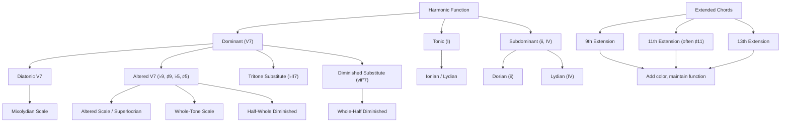
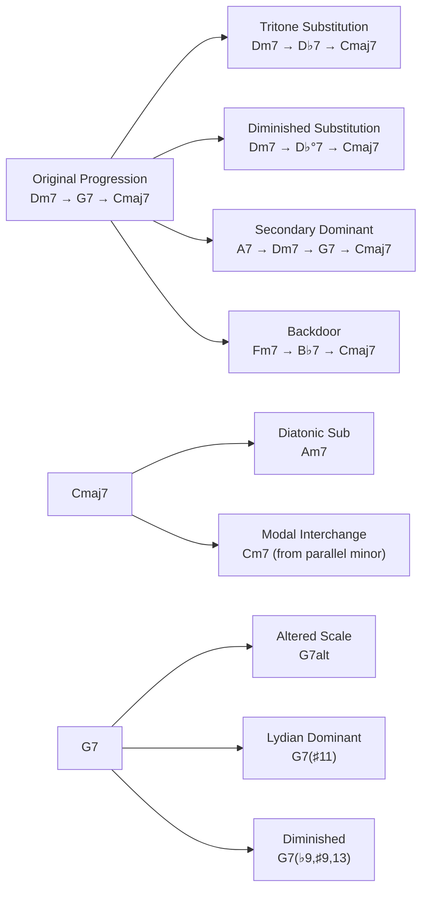

# Lesson 4: Advanced Harmonic Concepts in Jazz

## 1. First-Principles Intuition & Invariants

Jazz harmony extends the functional tonal system inherited from common-practice Western music by systematically exploiting chromaticism, voice-leading ambiguity, and upper-structure extensions. At its core, advanced jazz harmony is governed by three invariant principles: the tritone's functional demand for resolution, the symmetrical partitioning of the octave into equal divisions, and the voice-leading economy that privileges stepwise motion over leaps.

### The Twelve-Tone Equal Temperament Foundation

The twelve-tone equal temperament (12-TET) system divides the octave into twelve logarithmically equal intervals, each representing a frequency ratio of $2^{1/12} \approx 1.05946$. This standardization permits modulation to any key and enables the construction of chords from any root. The semitone, the atomic unit of 12-TET, measures 100 cents, and all intervals derive from integer multiples of this value.

The diatonic scale—constructed from a specific pattern of whole (200 cents) and half (100 cents) steps—yields seven scale degrees. In the major scale, the pattern W-W-H-W-W-W-H produces the interval sequence: root, major second, major third, perfect fourth, perfect fifth, major sixth, and major seventh. Chords built by stacking thirds from these degrees form the diatonic harmonies that underpin functional tonality.

### The Dominant Seventh and the Tritone

The dominant seventh chord (V7) is the engine of tonal motion. Built from the fifth scale degree of the major scale, it comprises four pitch classes: root, major third, perfect fifth, and minor seventh. In the key of C major, the G7 chord contains G, B, D, and F. The critical feature is the tritone interval between the third (B) and seventh (F)—a dissonance spanning three whole tones (600 cents), precisely half an octave.

The tritone's instability arises from its equal division of the octave. Unlike the perfect fifth (701.96 cents), which has a simple frequency ratio of 3:2 and strong harmonic stability, the tritone's ratio of approximately $\sqrt{2}:1$ lacks the reinforcement of low-order harmonics. This dissonance creates a functional demand: the third typically resolves upward by semitone to the tonic's root, while the seventh resolves downward by semitone to the tonic's third. In G7 resolving to C major, B ascends to C and F descends to E, creating efficient voice-leading with minimal motion.

### Altered Dominants: Chromatic Intensification

Jazz composers intensify dominant function by altering the fifth and ninth scale degrees of the V7 chord. These alterations introduce additional chromatic tensions that sharpen the chord's resolution tendency. The altered dominant scale (also called the superlocrian or diminished whole-tone scale) contains all four possible alterations: flat nine (♭9), sharp nine (♯9), sharp eleven (♯11, enharmonically equivalent to ♭5), and flat thirteen (♭13, enharmonically equivalent to ♯5).

Consider G7alt resolving to Cmaj7. The chord tones and alterations form the pitch-class set {G, B, D♭/C♯, E♭/D♯, F, A♭}. The altered tones create multiple chromatic resolutions: D♭ (♭5) resolves down to C, A♭ (♭13) resolves down to G, D♯ (♯9) resolves up to E, all converging onto the tonic triad through stepwise motion. This creates a saturated chromatic approach to resolution, maximizing voice-leading tension.

The dominant seventh flat-nine (V7♭9) adds a minor ninth above the root, creating a half-step clash with the root an octave higher. This interval (113 cents in 12-TET) is one of the most dissonant in the chromatic scale. The V7♯9 chord, popularized by players like Jimi Hendrix (the "Hendrix chord") and ubiquitous in bebop, places a minor third (enharmonically an augmented second) above the root, creating simultaneous major and minor third implications—a polytonal ambiguity that enriches the dominant's color.

### Diminished Seventh Chords: Symmetrical Division

The diminished seventh chord partitions the octave into four equal minor thirds (300 cents each). This symmetry produces a unique property: the chord contains only three distinct transpositions under modulo-12 arithmetic. Any diminished seventh chord can be respelled to serve as a leading-tone chord to four different tonics, each a minor third apart.

The fully diminished seventh chord built on the leading tone (vii°7) functions as a dominant substitute because it shares the tritone of the V7 chord. In C major, B°7 contains B, D, F, and A♭. The tritone between B and F is identical to that in G7, giving the chords equivalent functional pull toward C. This substitution is strengthened by voice-leading: B resolves to C, D moves to C or E, F descends to E, and A♭ descends to G, providing efficient chromatic motion to the tonic.

Jazz exploits this symmetry through the diminished passing chord, which connects diatonic chords by chromatic motion. Moving from Cmaj7 to Dm7, a musician might insert C♯°7, creating the progression Cmaj7 → C♯°7 → Dm7. The diminished chord acts as a chromatic bridge, with each voice moving by semitone.

### Extended Chords: Upper-Structure Harmonic Series

Extended chords incorporate the ninth, eleventh, and thirteenth scale degrees, bringing the harmonic series into explicit compositional use. The harmonic series—the natural overtones produced by any vibrating string or air column—orders partials by integer multiples of the fundamental frequency. The seventh partial (roughly a minor seventh above two octaves) justifies the dominant seventh; the ninth partial justifies the ninth; the eleventh and thirteenth follow naturally.

In practice, jazz voicings often omit certain chord tones to avoid muddiness and maintain clarity. The root is frequently omitted in comping because the bass player provides it. The perfect fifth is often omitted from extended chords because it adds no color. The eleventh is typically raised (♯11) in major chords to avoid a half-step clash with the third. A Cmaj13 voicing might contain only the third, seventh, ninth, and thirteenth (E, B, D, A), relying on the bass to supply C.

### Set-Theoretic and Group-Theoretic Foundations

Pitch-class set theory provides a formal framework for analyzing harmonic structures beyond functional tonality. A pitch-class set is an unordered collection of pitch classes (integers 0–11 modulo 12). Chords can be represented as sets and compared using operations like transposition (Tn) and inversion (TnI). The interval vector of a set catalogs all interval classes present, providing a harmonic fingerprint.

The symmetrical properties of diminished and augmented chords correspond to specific group structures. The diminished seventh chord exhibits Z₄ symmetry (the cyclic group of order 4) under transposition by minor thirds. The augmented triad exhibits Z₃ symmetry under transposition by major thirds. These symmetries enable rich substitution possibilities and remote modulations that characterize advanced jazz harmony.

## 2. Core Architecture & Mechanics

The architecture of jazz harmony rests on three hierarchical layers: the functional progression (the large-scale tonal motion), the chord-scale relationship (the melodic-harmonic interface), and the voicing (the specific vertical arrangement of pitches). Understanding these layers reveals how jazz musicians construct harmonic complexity in real time.

### Functional Progressions and Tonal Centers

Functional harmony in jazz derives from the classical tonic-subdominant-dominant paradigm but enriches it through substitution and reharmonization. The ii-V-I progression is the archetypal jazz cadence, appearing in thousands of standards. In C major, Dm7 → G7 → Cmaj7 provides a strong tonal trajectory: the ii chord (supertonic) prepares the V chord (dominant), which resolves to I (tonic).

Tritone substitution exploits the enharmonic symmetry of the tritone. Any dominant seventh chord can be replaced by a dominant seventh chord whose root lies a tritone away, because both chords share the same tritone interval. G7 (G-B-D-F) contains the tritone B-F. D♭7 (D♭-F-A♭-C♭/B) contains the tritone F-B (enharmonically F-C♭). Substituting D♭7 for G7 creates chromatic bass motion: Dm7 → D♭7 → Cmaj7, where the bass descends by semitones (D → D♭ → C).

Modal interchange (borrowed chords) imports harmonies from parallel modes. In C major, a composer might borrow the iv chord from C minor (Fm) or the ♭VII chord (B♭). These chords introduce modal color and flatten the leading tone, weakening functional drive in favor of coloristic variety. Miles Davis's "So What" exemplifies modal harmony, anchoring long stretches on a single Dorian mode rather than cycling through functional progressions.

### Chord-Scale Theory: Melodic Implications

Each chord type implies a corresponding scale that supplies consonant melodic material. The chord-scale approach, codified by theorists like George Russell, systematizes improvisation by associating scales with chord symbols. This framework transforms harmonic symbols into melodic roadmaps.

For major seventh chords (e.g., Cmaj7), the Ionian (major) scale or Lydian mode provides consonant extensions. The Lydian mode raises the fourth scale degree, avoiding the half-step clash between the fourth and third that can occur in Ionian. The raised fourth (♯11) is a characteristic jazz color tone, heard prominently in Cmaj7(♯11) voicings.

For dominant seventh chords, multiple scale choices exist, each producing different alterations. The Mixolydian mode (major scale with a lowered seventh) is the diatonic choice. The Lydian dominant (Mixolydian with ♯4) yields a ♯11 extension. The altered scale (seventh mode of melodic minor, also called the superlocrian) produces all four alterations (♭9, ♯9, ♯11, ♭13). The whole-tone scale, which divides the octave into six equal steps, generates augmented fifths and flat/sharp ninths. The half-whole diminished scale (alternating half and whole steps) produces both ♭9 and ♯9 alongside a natural thirteenth.

For minor seventh chords, the Dorian mode (natural minor with raised sixth) is standard. The Aeolian mode (natural minor) and the Phrygian mode (natural minor with lowered second) provide darker colors. The melodic minor scale itself, with its raised sixth and seventh, offers a brighter minor sonority.

### Voicing Architecture: Vertical Organization

Voicing refers to the specific arrangement of chord tones across registers. Effective voicing balances clarity, color, and voice-leading economy. Jazz pianists and guitarists employ several standard voicing techniques.

Drop-2 voicings take a close-position chord (all voices within an octave) and drop the second-highest voice down an octave. This creates a more open, orchestral sound suitable for guitar and piano comping. A Cmaj7 in close position (C-E-G-B) becomes E-G-C-E in drop-2 from the second inversion, spreading the voices for better resonance.

Rootless voicings omit the root, allowing the bass to supply it. A pianist playing G7 might voice only B-F-A-D (third, seventh, ninth, fifth), leaving G to the bassist. This avoids muddiness in the low register and focuses on the chord's color tones.

Upper-structure triads treat the upper extensions (9, ♯11, 13) as a separate triad superimposed over the lower chord. A G13(♯11) can be voiced as a D major triad (D-F♯-A, representing the fifth, seventh, ninth) over a G root, with C♯ (the ♯11) added. This triadic thinking simplifies the construction of complex extended chords.

Quartal voicings stack perfect fourths instead of thirds, creating an open, ambiguous sound associated with modal jazz. Bill Evans and McCoy Tyner pioneered these voicings, which avoid the tertian clarity of traditional harmony in favor of coloristic suspension.

### Reharmonization Techniques

Reharmonization replaces a progression's original chords with substitute harmonies that maintain or enhance the melodic line. Common techniques include:

**Diatonic substitution:** Chords sharing two or more common tones can substitute for each other. In C major, Am7 (A-C-E-G) can replace Cmaj7 (C-E-G-B) because they share C, E, and G. This shifts the harmonic color without violating the melody.

**Secondary dominants:** Any diatonic chord can be tonicized by preceding it with its own V7. In C major, the progression Cmaj7 → Dm7 becomes Cmaj7 → A7 → Dm7, where A7 is the V7/ii (the dominant of Dm7). This technique chains dominant resolutions, creating harmonic momentum.

**Backdoor progressions:** The backdoor ii-V moves from iv to ♭VII7 to I, approaching the tonic from the flat side rather than the sharp side. In C major, Fm7 → B♭7 → Cmaj7 provides a smooth, descending voice-leading alternative to the traditional ii-V-I. The ♭VII7 chord functions as a substitute dominant, with its seventh (A♭) resolving down to G and its third (D) moving to E.

**Coltrane changes:** Named for John Coltrane's "Giant Steps," this progression divides the octave into three major thirds (equidistant roots) and connects them through dominant motion. The cycle moves through three tonal centers (e.g., C, E, A♭) via their respective dominants (G7 → Cmaj7, B7 → Emaj7, E♭7 → A♭maj7), creating rapid, symmetrical modulation.

## 3. High-Performance Optimization & Failure Modes

Jazz harmony in practice requires balancing theoretical sophistication with musical coherence. The densest reharmonization or the most altered dominant may be theoretically sound but musically ineffective if it obscures the melody, disrupts the groove, or overwhelms the ensemble's texture. This section examines performance optimization strategies and common failure modes.

### Voice-Leading Economy

Efficient voice-leading minimizes the distance each voice travels between chords, reducing cognitive load for the performer and creating smoother, more coherent harmonic motion for the listener. The principle of parsimonious voice-leading—inherited from classical counterpoint—dictates that voices should move by step when possible and by leap only when necessary.

When moving from Dm7 (D-F-A-C) to G7 (G-B-D-F), efficient voice-leading holds the common tones D and F while moving A down to G (a whole step) and C down to B (a half step). This creates a sense of harmonic continuity. Contrast this with a voicing that leaps all four voices, which disrupts the sense of connection between chords.

Tritone substitution gains its effectiveness from voice-leading efficiency. In the progression Dm7 → D♭7 → Cmaj7, the bass descends chromatically (D → D♭ → C), and the upper voices move by small intervals. If Dm7 is voiced D-A-C-F and D♭7 is voiced D♭-A♭-C♭-F, the C and F move by semitone while the A descends to A♭, creating maximal chromaticism with minimal motion.

### Harmonic Rhythm and Placement

Harmonic rhythm refers to the rate at which chords change. Too frequent changes create harmonic clutter and prevent the listener from settling into any tonal area. Too infrequent changes risk stasis and boredom. Effective jazz arranging balances harmonic motion with rhythmic stability.

Bebop tunes often place chord changes on every two beats in fast tempos, creating a rapid harmonic surface suitable for virtuosic improvisation. Modal jazz slows harmonic rhythm to one chord per several measures, allowing improvisers to explore melodic development within a single scale. Ballads distribute chord changes irregularly, often placing harmonic motion at phrase boundaries rather than on a metronomic grid.

### Register and Density Management

Low-register voicings tend toward muddiness due to the close spacing of overtones in lower frequencies. The frequency ratio between adjacent semitones is constant (approximately 1.059), but the absolute frequency difference increases as pitch rises. A minor second between C2 (65.41 Hz) and C♯2 (69.30 Hz) spans only 3.89 Hz, while a minor second between C5 (523.25 Hz) and C♯5 (554.37 Hz) spans 31.12 Hz. This means low-register clusters produce more intermodulation and beating, leading to perceptual muddiness.

To avoid this, jazz pianists voice chords with wider intervals in the left hand (often tenths rather than octaves) and closer intervals in the right hand. The bass player and pianist typically separate by at least an octave to avoid frequency masking. Extended chords are voiced with selective omissions: the fifth is often dropped, and the eleventh (if natural) is omitted or raised to avoid clashing with the third.

### Failure Mode: Overuse of Alterations

A common failure mode among developing jazz musicians is the indiscriminate application of alterations without attention to melodic implication or ensemble context. Altering every dominant seventh chord with all available tensions (♭9, ♯9, ♯11, ♭13) produces a saturated chromaticism that can obscure the melody and exhaust the listener.

Effective use of alterations requires sensitivity to the melody. If the melody contains the natural ninth (e.g., A over G7 in C major), voicing a ♭9 creates a half-step clash that sounds like an error
