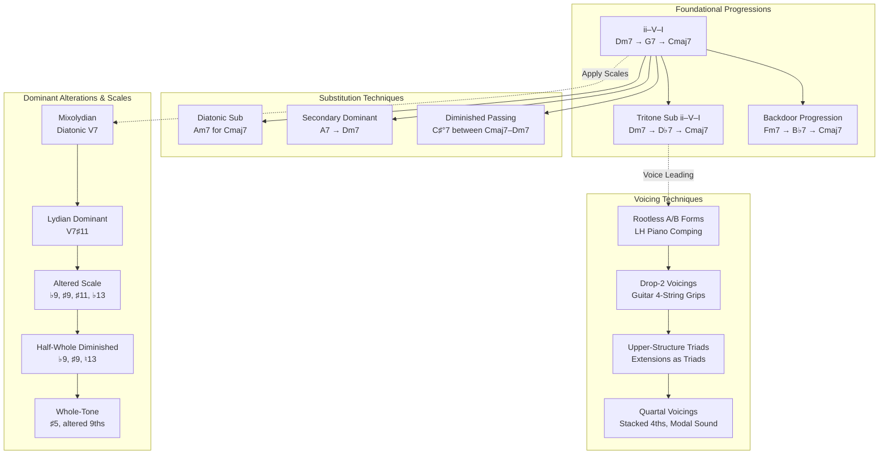
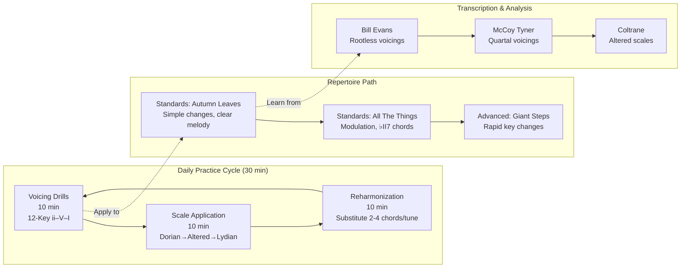

# Lesson 4: Advanced Harmonic Concepts in Jazz – Practical Voicing, Voice Leading & Reharmonization

## 1. First-Principles Intuition & Invariants (15%)

Jazz harmony extends functional tonality through three core principles that govern every voicing decision you make at the keyboard or fretboard:

1. **The Tritone's Functional Demand:** The interval of three whole tones (600 cents, ratio ≈√2:1) lacks reinforcement from the natural harmonic series and creates instability. In V7 chords, the tritone between the 3rd and ♭7th resolves by contrary stepwise motion to the tonic's root and 3rd, generating the strongest harmonic pull in tonal music.

2. **Symmetrical Octave Division:** Diminished 7th chords (four minor 3rds), augmented triads (three major 3rds), and whole-tone scales (six whole steps) partition the octave equally. These symmetries enable substitution, enharmonic respelling, and remote modulation—the harmonic "wormholes" that let you move between distant keys seamlessly.

3. **Voice-Leading Economy:** Efficient harmony moves each voice by the smallest possible interval—common tones stay put, others move by step. This reduces physical hand motion at the keyboard, clarifies harmonic progression for the listener, and is the foundation of all practical reharmonization.

**Equal Temperament & The Dominant Seventh:** The 12-tone equal temperament system (12-TET) divides the octave into twelve semitones of 100 cents each, with frequency ratio 2^(1/12) ≈ 1.05946. The V7 chord's defining tritone interval sits exactly halfway through the octave at 600 cents, creating maximum harmonic tension. In G7 resolving to Cmaj7, the B→C and F→E resolutions represent the strongest available voice-leading pull—this is why ii–V–I progressions dominate jazz.

**Altered Dominants & Chromaticism:** Jazz intensifies dominant function by raising or lowering the 5th and 9th: G7♭9, G7♯9, G7♭5, G7♯5. The altered scale (7th mode of melodic minor: G–A♭–B♭–B(C♭)–D♭–E♭–F) contains all four alterations simultaneously, creating saturated chromatic approach tones that converge on the tonic by semitone motion.

**Extended Harmony & The Overtone Series:** The 9th, 11th, and 13th correspond to partials 9, 11, and 13 of the natural harmonic series. Jazz voicings make these extensions explicit while omitting tones that add no color (5th) or create mud (root in low register, natural 11th clashing with the 3rd).

## 2. Core Keyboard & Fretboard Mechanics (85%)

### The ii–V–I Progression: Hand Shapes & Voice Leading

The ii–V–I is the fundamental jazz cadence. Master these voicings first—all advanced harmony builds from here.

**Piano: Rootless A & B Form Voicings (Left Hand Anchors)**

In C major: Dm7 → G7 → Cmaj7

**A Form (7th on bottom):**
```
Dm7:       F–A–C–E    (♭7–9–11–5, root omitted)
G7:        F–A–B–E    (♭7–9–3–13)
Cmaj7:     E–G–B–D    (3–5–7–9)
```

**B Form (3rd on bottom):**
```
Dm7:       F–A–C–E    → (same as A form)
G7:        B–E–F–A    (3–13–♭7–9)
Cmaj7:     E–G–B–D    → (same result)
```

**Fingering (RH for melody/solo, LH for voicing):**
- LH: 5–3–2–1 (pinky–middle–index–thumb) for four-note voicings
- Practice: Hold each voicing for four beats at ♩=60, feeling the weight transfer from pinky to thumb
- Common tones: F moves by semitone to E (Dm7 to Cmaj7); A stays put (Dm7 to G7)

**Physical Drill:**
1. Play Dm7 (A form) in whole notes at ♩=60 BPM
2. Move to G7: A stays, F stays, C→B, E→E (minimal motion!)
3. Move to Cmaj7: G stays, A→B, F→E (stepwise motion)
4. Repeat cycle 20× without looking at hands
5. Increase tempo: ♩=80 → 100 → 120 BPM
6. Add RH improvisation using D Dorian → G Mixolydian → C Ionian

**Guitar: Drop-2 Voicings (String Set 4–3–2–1)**

In C major, starting with Dm7 on the 5th fret:

```
Dm7 (root position):
E|---5---  (A, 5th)
B|---6---  (D, root)
G|---5---  (A, 5th)
D|---7---  (C, ♭7)

G7 (3rd inversion):
E|---5---  (A, 9th)
B|---5---  (F, ♭7)
G|---4---  (B, 3rd)
D|---5---  (G, root)

Cmaj7 (2nd inversion):
E|---5---  (A, 13th)
B|---5---  (E, 3rd)
G|---4---  (B, 7th)
D|---5---  (G, 5th)
```

**Voice-leading efficiency:** Only two fingers move between each chord; remaining fingers hold position or shift by one fret. This is the core of bebop comping—minimal hand motion, maximum harmonic clarity.

### Tritone Substitution: Chromatic Bass Motion

**The Principle:** Any V7 can be replaced by the V7 a tritone away because both share the same tritone interval (enharmonically). G7 (G–B–D–F) contains tritone B–F. D♭7 (D♭–F–A♭–C♭) contains tritone F–C♭(B). Substitute D♭7 for G7 and the bass descends chromatically: D→D♭→C.

**Piano Voicing (Tritone Sub in Practice):**

Original progression:
```
Dm7:   F–A–C–E
G7:    F–A–B–E
Cmaj7: E–G–B–D
```

With tritone sub:
```
Dm7:   F–A–C–E
D♭7:   C♭(B)–E–F–A♭   (♭7–9–3–♯11, enharmonic respelling)
Cmaj7: E–G–B–D
```

**Voice leading:** The F and A are common tones (enharmonically, F=F and A=A), C moves to C♭(B), E stays as E. The bass drops chromatically D→D♭→C. This creates a smooth, descending chromatic line—instantly recognizable as "jazzy."

**Practice Drill:**
1. Play original ii–V–I in all 12 keys, A form voicings, ♩=60
2. Substitute D♭7 for G7 in each key
3. Sing the bass line while playing: "D—D-flat—C"
4. Add RH bebop line using D♭ Lydian Dominant (D♭–E♭–F–G–A♭–B♭–C♭) over the sub
5. Increase tempo to ♩=120 and comp in swing rhythm

### Diminished 7th Chords: Symmetrical Substitution

The fully diminished 7th chord (1–♭3–♭5–♭♭7) divides the octave into four equal minor 3rds (300 cents each). Any diminished chord can be respelled to tonicize four different roots a minor 3rd apart.

**Example: B°7 as Dominant Substitute**

B°7 contains B–D–F–A♭. This shares the tritone B–F with G7, making it a functional substitute for V7 in C major.

**Piano Voicing:**
```
Dm7:   F–A–C–E
B°7:   B–D–F–A♭   (or any inversion)
Cmaj7: E–G–B–D
```

**Chromatic Passing Diminished:**

Insert diminished chords between diatonic chords to create chromatic voice leading:

```
Cmaj7 → C♯°7 → Dm7
E–G–B–D → E–G–B♭–C♯ → F–A–C–E
```

Each voice moves by semitone: E→E→F, G→G→A, B→B♭→C, D→C♯→E.

**Guitar Application (Diminished Arpeggio Drill):**

Play diminished 7th arpeggios across the neck using the 1-2-4 pattern:
```
String pattern (example C♯°7 starting on 6th string, 9th fret):
E|---8---11---14---17---  (♭♭7 enharmonic cycle)
B|---8---11---14---17---
G|---8---11---14---17---
D|---8---11---14---17---
A|---9---12---15---18---
E|---9---12---15---18---
```

Practice ascending and descending at ♩=60, then ♩=120. Insert these shapes between diatonic chords in any progression.

### Altered Dominants: The Altered Scale & Practical Fingerings

**The Altered Scale (7th Mode of Melodic Minor):**

For G7alt resolving to Cmaj7, use A♭ melodic minor (G–A♭–B♭–C♭(B)–D♭–E♭–F):
- Contains: ♭9 (A♭), ♯9 (B♭, enharmonic to A♯), ♯11 (C♯, enharmonic to D♭), ♭13 (E♭)
- All chromatic tensions converge on C major: A♭→G, B♭→C, D♭→C, E♭→D

**Piano Altered Voicing:**

```
G7alt: B–E♭–F–A♭  (3–♭13–♭7–♭9)
       LH: 5–3–2–1 fingering
```

This voicing contains the essential tritone (B–F) plus two altered tensions (E♭ and A♭) for maximum chromatic saturation.

**RH Altered Scale Fingering (Starting on G):**
```
G–A♭–B♭–B–D♭–E♭–F–G
1–2–3–1–2–3–4–5 (thumb under on B)
```

Practice ascending/descending at ♩=60 in quarter notes, then eighth notes at ♩=100.

**Guitar Altered Scale Shape (G7alt, 3rd fret root):**

```
E|---4---5---7---8---
B|---4---6---7---9---
G|---4---5---7---8---
D|---3---5---6---8---
A|---3---5---6---8---
E|---3---4---6---7---
```

Play the scale ascending and descending, then improvise over a G7alt–Cmaj7 vamp. Focus on landing altered tensions (♭9, ♯9) on downbeats, resolving stepwise to chord tones of Cmaj7.

### Extended Chords: Practical 9th, 11th, 13th Voicings

**Maj7(♯11) Voicing (Lydian Sound):**

Cmaj7(♯11) = C–E–G–B–F♯

Piano voicing (rootless):
```
E–G–B–F♯  (3–5–7–♯11)
LH: 5–4–2–1
```

The raised 4th (F♯ over C) creates the bright, floating "Lydian" color heard in Bill Evans, McCoy Tyner, and Herbie Hancock voicings.

**13th Chords (Dominant Function):**

G13 = G–B–D–F–A–E (root–3–5–♭7–9–13)

Piano voicing (rootless, omit 5th):
```
B–E–F–A  (3–13–♭7–9)
LH: 5–3–2–1
```

**Guitar G13 (Drop-2 voicing, 3rd fret):**

```
E|---5---  (E, 13th)
B|---5---  (F, ♭7)
G|---4---  (B, 3rd)
D|---5---  (G, root)
```

**Practice Drill:**
1. Play Cmaj7(♯11) for 4 bars
2. Move to G13 (ii–V motion, treating Cmaj7 as "ii relative to G")
3. Resolve to any target chord (Fmaj7, Dm7, etc.)
4. Add RH improvisation using C Lydian over Cmaj7(♯11), G Mixolydian over G13

### Chord-Scale Relationships: Practical Improvisation Maps

**Major 7th Chords:**
- **Ionian (major scale):** Diatonic choice, safe but potentially bland
- **Lydian (major with ♯4):** Preferred jazz sound—avoids the 4th's clash with the major 3rd
  - Example: Cmaj7 → C Lydian (C–D–E–F♯–G–A–B)

**Dominant 7th Chords:**
- **Mixolydian:** Diatonic (major with ♭7)
- **Lydian Dominant:** Mixolydian with ♯4, produces ♯11 extension (G7♯11 → G Lydian Dominant: G–A–B–C♯–D–E–F)
- **Altered Scale:** All four alterations (♭9, ♯9, ♯11, ♭13), maximum chromatic tension
- **Half-Whole Diminished:** Alternating half/whole steps, produces ♭9, ♯9, natural 13 (G–A♭–B♭–B–C♯–D–E–F)
- **Whole-Tone:** Six equal steps, produces augmented 5th and both 9th alterations (G–A–B–C♯–D♯–F)

**Minor 7th Chords:**
- **Dorian (natural minor with ♮6):** Standard jazz minor sound, bright and stable (Dm7 → D Dorian: D–E–F–G–A–B–C)
- **Aeolian (natural minor):** Darker, more classical sound
- **Phrygian (natural minor with ♭2):** Spanish/modal flavor, use sparingly

**Practice Method:**
1. Record or loop a ii–V–I progression in one key (Dm7–G7–Cmaj7)
2. Improvise over Dm7 using D Dorian exclusively for 4 bars
3. Switch to G altered scale over G7 for 2 bars
4. Resolve with C Lydian over Cmaj7 for 4 bars
5. Repeat cycle, gradually increasing phrase complexity
6. Tempo progression: ♩=80 → 100 → 120 → 140 BPM

### Reharmonization: Practical Substitution Techniques

**Diatonic Substitution (Common-Tone Exchange):**

In C major, Am7 (A–C–E–G) shares three notes with Cmaj7 (C–E–G–B). Substitute Am7 for Cmaj7 when the melody emphasizes C, E, or G.

```
Original: Cmaj7 | Dm7 | G7 | Cmaj7 |
Reharmonized: Am7 | Dm7 | G7 | Cmaj7 |
```

**Secondary Dominants (Tonicization):**

Precede any diatonic chord with its own V7. To tonicize Dm7 (ii), insert A7 (V7/ii).

```
Original: Cmaj7 | Dm7 | G7 | Cmaj7 |
Reharmonized: Cmaj7 | A7 | Dm7 | G7 | Cmaj7 |
```

Piano voicing for A7 resolving to Dm7:
```
A7:    G–C♯–E–G   (♭7–3–5–♭7, doubled)
Dm7:   F–A–C–E    (smooth voice leading: C♯→C, G→F)
```

**Backdoor ii–V (♭vii7 Substitute Dominant):**

The backdoor progression iv–♭VII7–I provides a smooth, descending alternative to V7–I.

```
Original: Dm7 | G7 | Cmaj7 |
Backdoor: Dm7 | Fm7 → B♭7 | Cmaj7 |
```

Piano voicing:
```
Fm7:   F–A♭–C–E♭
B♭7:   A♭–D–E♭–F  (♭7–3–♯11–5, passing motion)
Cmaj7: E–G–B–D    (smooth resolution: A♭→G, D→E)
```

The ♭VII7 chord (B♭7) functions as a substitute dominant: its ♭7 (A♭) resolves down to G (5th of Cmaj7), and its 3rd (D) moves to E (3rd of Cmaj7).

**Coltrane Changes (Giant Steps Substitution):**

Divide the octave into three major 3rds (C–E–A♭) and connect them via dominant motion. This creates rapid, symmetrical modulation.

```
| Cmaj7  | E7     | Amaj7  | C7     | 
| Fmaj7  | A♭7    | D♭maj7 | G7     | Cmaj7 ||
```

Each dominant (E7, C7, A♭7, G7) resolves to a tonic a 5th below (Amaj7, Fmaj7, D♭maj7, Cmaj7). Practice this progression slowly (♩=60) in block chords before attempting improvisation at tempo (♩=240–280).

**Guitar Coltrane Changes (Simplified Voicing):**

Use drop-2 maj7 and dom7 voicings on strings 4–3–2–1, moving by major 3rds:

```
Cmaj7 (5th fret):
E|---5---
B|---5---
G|---4---
D|---5---

E7 (7th fret):
E|---7---
B|---8---
G|---7---
D|---9---

Amaj7 (9th fret):
E|---9---
B|---9---
G|---9---
D|---11---
```

Practice the cycle ascending and descending, focusing on minimal hand motion and accurate voicing spelling.



## 3. Advanced Practice Drills & Performance Strategies

### Daily Technical Routine (30-Minute Cycle)

**Section 1: Voicing Drills (10 min)**
1. **Rootless ii–V–I in 12 Keys (Piano):**
   - A form voicings, whole notes, ♩=60
   - Play through cycle of 4ths: C→F→B♭→E♭→A♭→D♭→G♭→B→E→A→D→G→C
   - Focus: Common-tone retention, minimal hand motion
   - Progress to B form voicings in second week

2. **Drop-2 ii–V–I in 12 Keys (Guitar):**
   - Start on 6th string roots, then 5th string roots
   - String set 5–4–3–2, then 4–3–2–1
   - ♩=60, quarter notes, strict time
   - Week 2: Add tritone subs

**Section 2: Scale Application (10 min)**
1. **Dominant Scale Rotation:**
   - Record/loop G7 vamp (4 bars)
   - Bar 1-4: Mixolydian
   - Bar 5-8: Lydian Dominant
   - Bar 9-12: Altered Scale
   - Bar 13-16: Half-Whole Diminished
   - Start ♩=80, progress to ♩=140

2. **Connecting Scales Through Changes:**
   - Record Dm7 (4 bars) → G7 (4 bars) → Cmaj7 (4 bars)
   - D Dorian → G Altered → C Lydian
   - Focus on landing chord tones on beat 1 of each new chord
   - Tempo: ♩=100 → 120 → 140

**Section 3: Reharmonization Workshop (10 min)**
1. **Tune Memo Reharmonization:**
   - Choose a standard (e.g., "Autumn Leaves," "Rhythm Changes")
   - Reharmonize 8 bars using:
     - Two tritone subs
     - One secondary dominant
     - One diminished passing chord
   - Write out voicings, play at ♩=60
   - Goal: Create smooth, logical voice leading

2. **Real-Time Substitution:**
   - Play original changes to a standard at performance tempo
   - Every 4th chorus, substitute one chord (tritone sub or secondary dominant)
   - Gradually increase substitution density

### Failure Modes & Troubleshooting

**Problem: Altered Dominants Sound "Wrong" or Clash with Melody**

**Diagnosis:** The melody contains natural extensions (e.g., natural 9th or 13th) that conflict with alterations.

**Solution:**
- If the melody has A (the natural 9th) over G7, do NOT voice ♭9 or ♯9
- Use Lydian Dominant (G7♯11) or Mixolydian instead of Altered Scale
- Rule: Match your alterations to the melody's note choices

**Piano Troubleshooting:**
```
Melody note: A over G7
✓ Correct: G7 with natural 9 (Mixolydian or Lydian Dominant)
✗ Wrong:   G7♭9 or G7♯9 (creates half-step clash with melody)
```

**Problem: Low-Register Voicings Sound Muddy**

**Diagnosis:** Overtones in the low register are spaced closely in absolute frequency, causing intermodulation distortion and perceptual blur.

**Solution:**
- Never voice chords below E2 (82.41 Hz) in close position
- Use tenths (root + 10th) instead of octaves in LH bass register
- Omit the 5th in LH voicings below middle C
- Example: For Cmaj7, voice E2–G3–B3–D4 (wide spacing) rather than C2–E2–G2–B2 (muddy)

**Problem: Reharmonization Obscures the Original Tune**

**Diagnosis:** Too many substitutions, too rapidly, or on structurally important melody notes.

**Solution:**
- Preserve original harmony on key melody notes (climaxes, phrase starts/ends)
- Limit substitutions to 25% of the progression initially
- Test: Can a listener still recognize the tune? If not, reduce substitution density
- Common safe zones: Passing beats, weak beats, interior measures of 4-bar phrases

**Problem: Voice Leading Sounds Jumpy or Disconnected**

**Diagnosis:** Voices leap unnecessarily rather than moving by step or holding common tones.

**Solution:**
- Identify common tones between consecutive chords—hold them in the same register
- Move remaining voices by the smallest interval (step preferred over leap)
- Example: Dm7 (F–A–C–E) → G7 (F–A–B–E)
  - F and A are common tones → hold in place
  - C→B (step down)
  - E→E (common tone)

**Problem: Quartal Voicings Sound Too Vague**

**Diagnosis:** Lack of tritone means reduced functional drive; listener loses tonal bearings.

**Solution:**
- Reserve quartal voicings for modal sections or suspensions
- When playing functional harmony (ii–V–I), include at least the 3rd and 7th to define chord quality
- Hybrid voicing: Quartal in RH, functional in LH (e.g., LH plays 3rd+7th, RH plays stacked 4ths above)

### Performance Context & Ensemble Awareness

**In a Piano Trio (Piano, Bass, Drums):**
- Omit roots in LH; bass covers them
- Voice in mid-register (A2–D5 range) to avoid masking bass or clashing in low register
- Leave space for bass and drum fills—don't comp on every beat
- Typical comping rhythm: Beat 2 and 4 (backbeat accents), or syncopated off-beats

**In a Big Band or Orchestral Setting:**
- Write specific voicings for each section (saxes, brass)
- Use drop-2 and drop-2-and-4 voicings for smooth, orchestral spread
- Saxes: Close voicings (all within an octave) for blend
- Brass: Open voicings (spread over 1.5–2 octaves) for power

**In Solo Piano Performance:**
- LH must supply both bass and harmonic foundation
- Use stride bass (root on 1 and 3, chord on 2 and 4) or walking bass lines
- RH carries melody and occasional comping chords
- Practice independence: Hanon exercises, Bach Two-Part Inventions for hand separation

### Real-World Repertoire Application

**Standards for Practicing These Concepts:**

1. **"Autumn Leaves" (Em or Gm):** Perfect for basic ii–V–I, secondary dominants, and tritone subs. Simple melody allows focus on reharmonization.

2. **"All The Things You Are" (A♭ major):** Modulates through multiple keys, uses ♭II7 chords (Neapolitan), and backdoor progressions. Essential for intermediate players.

3. **"Giant Steps" (Coltrane):** Rapid modulation by major 3rds, requires fluency with maj7 and dom7 voicings in all inversions. Advanced technical and harmonic challenge.

4. **"Stella By Starlight" (B♭ major):** Dense reharmonization opportunities, half-diminished chords, altered dominants. Great for exploring chord-scale choices.

5. **"Rhythm Changes" (I Got Rhythm, B♭ major):** Standard 32-bar AABA form with fast harmonic rhythm. Essential for bebop vocabulary development.

**Practice Protocol for Standards:**
1. Learn melody by ear first (sing it, then play without looking at sheet music)
2. Comp through original changes at ♩=60, A and B voicings only
3. Add one tritone sub per A section
4. Add one secondary dominant per A section
5. Experiment with altered scales over dominants
6. Record yourself comping and soloing at tempo (♩=120–180)
7. Transcribe one classic recording of the tune (Bill Evans, Oscar Peterson, Bud Powell, McCoy Tyner—your choice)

### Further Study: Listening & Transcription

**Essential Recordings for Harmonic Study:**

- **Bill Evans Trio – "Portrait in Jazz" (1960):** Rootless voicings, Lydian major 7 chords, sensitive voice leading
- **McCoy Tyner – "The Real McCoy" (1967):** Quartal voicings, modal harmony, pentatonic superimposition
- **Herbie Hancock – "Maiden Voyage" (1965):** Suspended 4th chords, modal composition, upper-structure triads
- **John Coltrane – "Giant Steps" (1960):** Coltrane changes, rapid modulation, altered scales at extreme tempo
- **Oscar Peterson Trio – "Night Train" (1963):** Virtuosic ii–V–I execution, stride bass, blues reharmonization

**Transcription Practice:**
1. Choose a 2-bar voicing or lick from a master recording
2. Slow the recording to 50% speed (use software: Transcribe!, Amazing Slow Downer)
3. Write out every note, with fingerings
4. Practice the voicing in all 12 keys at ♩=60
5. Integrate into your improvisation over the same tune



## Summary: From Theory to Performance

Advanced jazz harmony is not an abstract academic exercise—it is a set of physical keyboard and fretboard shapes, voice-leading habits, and listening choices that you internalize through thousands of repetitions. The tritone resolves because you *feel* the B–F tension in your fingers and hear it demand C and E. Rootless voicings work because your left hand learns to hold F–A–C–E while your right improvises. Altered scales sound "right" when your ear expects the chromatic approach tones A♭→G and D♭→C.

**Core Takeaways:**
1. Master ii–V–I in 12 keys with rootless A/B forms (piano) or drop-2 voicings (guitar) before exploring substitutions.
2. Match alterations to the melody—never force ♭9 when the melody has ♮9.
3. Voice leading economy: Common tones stay, other voices move by step.
4. Reharmonize 25% of a tune initially; preserve original harmony on structural melody notes.
5. Practice with recordings: Transcribe voicings and licks from masters, integrate into your playing.

Now get to the keyboard or fretboard. Play every example in this lesson in all 12 keys at ♩=60, then ♩=100, then ♩=140. Record yourself. Listen back. Adjust. Repeat. This is how theory becomes music.
