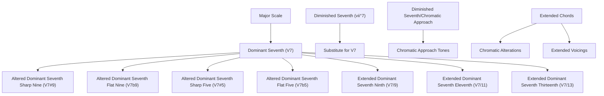

# Lesson 4: Advanced Harmonic Concepts

## 1. First-Principles Intuition & Invariants

In the realm of jazz harmony, the exploration of advanced harmonic structures is a journey into the very essence of musical expression and innovation. Jazz thrives on the tension and release of harmonic progressions, and the introduction of altered dominants, diminished chords, and extended chords enriches this dynamic interplay. To understand these concepts, one must delve into the foundational principles of tonal harmony and the mathematical invariants that govern the construction of chords and their interactions.

At the heart of harmonic theory lies the diatonic scale, constructed using whole and half steps. The twelve-tone equal temperament system, which divides the octave into twelve equal parts, provides a standardized framework for these intervals, with each semitone corresponding to a frequency ratio of $2^{1/12}$. This system allows for the construction of chords based on specific scale degrees, and the relationships between these chords form the backbone of harmonic progressions.

In jazz, the dominant seventh chord (V7) plays a crucial role, often serving as a pivot point leading to the tonic (I) chord. The dominant seventh chord is constructed from the root, third, fifth, and seventh scale degrees of the diatonic scale, with its inherent tension arising from the tritone interval between the third and seventh scale degrees. This tension resolves when the dominant seventh chord resolves to the tonic chord, creating a sense of harmonic closure.

However, jazz composers and improvisers often seek to expand upon this basic harmonic framework by introducing alterations to the dominant seventh chord. These alterations can include the sharpening or flattening of specific scale degrees, resulting in chords such as the dominant seventh sharp nine (V7#9) or the dominant seventh flat nine (V7b9). These altered dominants introduce new harmonic tensions and resolutions, adding complexity and depth to the musical landscape.

Diminished chords, constructed using a series of minor third intervals, are inherently unstable and unresolved. In jazz, they are often used as passing chords to connect more stable chords. The diminished chord's unique quality arises from its symmetrical structure, allowing it to function in multiple harmonic contexts. For example, a diminished seventh chord built on the fifth scale degree (vii°7) can serve as a substitute for the dominant seventh chord, creating a sense of harmonic ambiguity and tension.

Extended chords, which incorporate notes beyond the seventh scale degree, are another key element of advanced jazz harmony. These chords can include ninth, eleventh, and thirteenth scale degrees, and can be further altered to create even more complex harmonic structures. Extended chords allow for greater harmonic richness and color, and can be used to create a sense of harmonic movement and progression.

The mathematical invariants governing these harmonic structures are rooted in set theory and group theory. Chords can be represented as sets of pitch classes, and the relationships between these sets can be analyzed using group theory to understand the symmetrical and asymmetrical properties of harmonic progressions. This mathematical framework provides a deeper understanding of the underlying principles governing harmonic structures in jazz, and allows for the exploration of new and innovative harmonic ideas.

## 2. Core Architecture & Mechanics

To dissect the internal architecture and mechanics of advanced harmonic structures in jazz, we can use a Mermaid diagram to illustrate the relationships between different chord types and their alterations. The diagram below shows the relationships between the dominant seventh chord, its alterations, and extended chords:

In this diagram, the major scale serves as the foundation for the construction of the dominant seventh chord (V7). The dominant seventh chord can be altered in various ways, including the sharpening or flattening of specific scale degrees, resulting in chords such as the altered dominant seventh sharp nine (V7#9) or the altered dominant seventh flat nine (V7b9). These altered dominants introduce new harmonic tensions and resolutions, adding complexity and depth to the musical landscape.

The dominant seventh chord can also be extended to include notes beyond the seventh scale degree, resulting in chords such as the extended dominant seventh ninth (V7/9), the extended dominant seventh eleventh (V7/11), and the extended dominant seventh thirteenth (V7/13). These extended chords allow for greater harmonic richness and color, and can be used to create a sense of harmonic movement and progression.

Diminished chords, constructed using a series of minor third intervals, are inherently unstable and unresolved. In jazz, they are often used as passing chords to connect more stable chords. The diminished chord's unique quality arises from its symmetrical structure, allowing it to function in multiple harmonic contexts. For example, a diminished seventh chord built on the fifth scale degree (vii°7) can serve as a substitute for the dominant seventh chord, creating a sense of harmonic ambiguity and tension.

## 3. High-Performance Optimization & Failure Modes

In the realm of jazz harmony, the exploration of advanced harmonic structures requires a deep understanding of the underlying principles and mathematical invariants governing these structures. However, the practical application of these concepts in jazz compositions and improvisations also requires a focus on high-performance optimization and the identification of potential failure modes.

One key aspect of high-performance optimization in jazz harmony is the efficient use of harmonic resources. This involves the careful selection of chord progressions and voicings that are both musically interesting and technically feasible. For example, the use of extended chords and altered dominants can add complexity and richness to a composition, but they must be employed in a way that maintains clarity and coherence. Composers and improvisers must consider the harmonic context and the overall musical narrative when incorporating these advanced structures.

Another critical aspect is the identification and mitigation of potential failure modes. In jazz, harmonic structures can sometimes lead to unintended dissonance or lack of resolution if not handled carefully. For instance, overuse of altered dominants without proper resolution can create a sense of unresolved tension that may not be musically satisfying. Similarly, extended chords can introduce harmonic clutter if not voiced effectively. Therefore, it is essential to balance complexity with clarity, ensuring that each harmonic choice serves the musical purpose and enhances the overall composition or improvisation.
