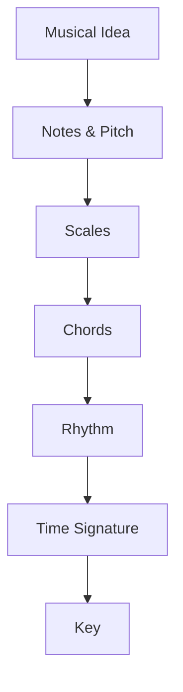

# Beginner Foundation: Music Theory

## 1. Everyday Intuition & First Principles

Music theory is the study of the elements of music and how they work together. Think of it as the language of music. Just as we use words to convey ideas and emotions in spoken language, musicians use notes, chords, and rhythms to express themselves. Music theory provides the rules and structures that allow musicians to create meaningful and expressive music. It's like the grammar of music, helping us understand how different musical elements interact to create harmony and melody.

Imagine you're building a house. You need to know the basics of architecture, such as how to lay a foundation, construct walls, and install a roof. Similarly, music theory provides the foundational knowledge needed to construct musical pieces. It helps us understand the building blocks of music—notes, scales, chords, and rhythms—and how to combine them to create something beautiful and meaningful.

## 2. Foundational Vocabulary & Glossary

### Note
A note is the basic unit of music, representing a specific pitch and duration. For example, when you press a key on a piano, you produce a note. Notes can be high or low, long or short.

### Pitch
Pitch refers to how high or low a note is. It is determined by the frequency of the sound wave. Higher pitches have higher frequencies, and lower pitches have lower frequencies.

### Scale
A scale is a sequence of notes arranged in ascending or descending order. The most common scale is the major scale, which consists of seven notes. For example, the C major scale consists of the notes C, D, E, F, G, A, and B.

### Chord
A chord is a group of three or more notes played simultaneously. Chords are the building blocks of harmony and are used to create musical progressions. For example, the C major chord consists of the notes C, E, and G.

### Rhythm
Rhythm refers to the pattern of beats and silences in music. It is what gives music its sense of movement and drive. Rhythm is determined by the duration of notes and the spaces between them.

### Measure
A measure is a segment of time in music, defined by a specific number of beats. Measures are used to organize music into smaller, more manageable sections. For example, a measure in 4/4 time consists of four quarter-note beats.

### Time Signature
A time signature indicates the number of beats per measure and the type of note that represents one beat. For example, a time signature of 4/4 means there are four quarter-note beats per measure.

### Key
A key is the tonal center of a piece of music, the note around which the music revolves. It determines the scale and chords used in the music. For example, a piece in the key of C major uses the notes of the C major scale.

## 3. Visual System Flow

### ASCII Diagram

```
+-------------------+
|   Musical Idea    |
+-------------------+
          |
          v
+-------------------+
|   Notes & Pitch   |
+-------------------+
          |
          v
+-------------------+
|      Scales       |
+-------------------+
          |
          v
+-------------------+
|      Chords       |
+-------------------+
          |
          v
+-------------------+
|      Rhythm       |
+-------------------+
          |
          v
+-------------------+
|    Time Signature |
+-------------------+
          |
          v
+-------------------+
|       Key         |
+-------------------+
```

### Mermaid Flowchart



## 4. Common Beginner Misconceptions & Mental Traps

### Misconception: Music Theory is Boring
Music theory is not just a set of rules; it's a fascinating exploration of the building blocks of music. Understanding music theory can enhance your appreciation of music and help you create your own compositions.

### Misconception: You Need to Know Theory to Make Music
While knowledge of music theory can be very helpful, it is not necessary to make music. Many musicians, including famous ones, have created great music without formal training in music theory. However, learning music theory can provide valuable insights and tools for your musical journey.

### Misconception: Music Theory is Only for Classical Music
Music theory applies to all genres of music, from classical to pop to jazz. The principles of music theory are universal and can be applied to any style of music.

### Misconception: You Need to Memorize Everything
While memorization can be helpful, it's not the only way to learn music theory. Understanding the concepts and principles behind music theory can help you apply them in a flexible and creative way.

## 5. Socratic Discussion Starters

### Basic Questions to Explore with Your AI Tutor

1. **What is the difference between pitch and rhythm?**
2. **Can you explain the concept of a scale and give an example?**
3. **How do chords work in music, and why are they important?**
4. **What is a time signature, and how does it affect the rhythm of a piece?**
5. **How does the key of a piece of music influence its sound and mood?**
6. **Can you explain the relationship between notes and chords?**
7. **Why is rhythm important in music, and how can it be varied?**
8. **How does music theory apply to different genres of music?**

By exploring these questions, you can deepen your understanding of music theory and develop a strong foundation for your musical journey.
