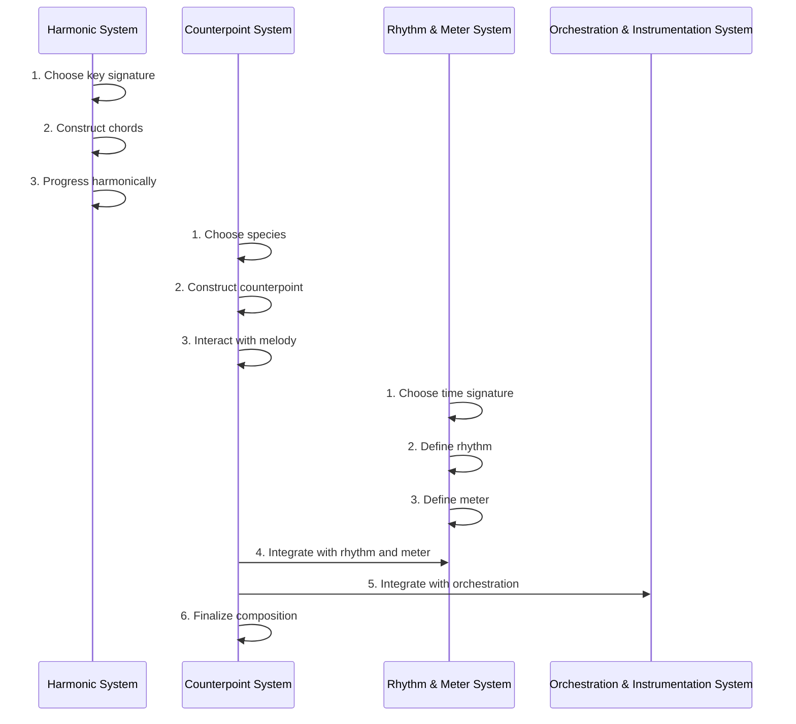

# Intermediate Foundation: Music Theory

## 1. Architectural Mental Model

In the realm of music theory, the architectural mental model serves as a framework for understanding how various components of music interact to create a cohesive and meaningful composition. This model assumes a foundational knowledge of basic music theory concepts such as scales, chords, and rhythm, and builds upon these to explore more complex structures and systems.

At the core of this architectural model is the concept of **harmonic progression**, which can be likened to the backbone of a building. Just as a building's structure supports its various elements, harmonic progressions provide the foundation upon which melodies, rhythms, and textures are constructed. The choice of harmonic progression dictates the emotional and structural flow of a piece, guiding the listener through a journey of tension and resolution.

Another critical component of this model is **counterpoint**, which involves the interplay between multiple melodic lines. Counterpoint can be seen as the intricate wiring within a building, connecting different elements and creating a rich tapestry of sound. Through the use of counterpoint, composers can create complex textures and interactions between voices, enhancing the overall depth and complexity of a composition.

Rhythm and meter form the rhythmic framework of the architectural model, akin to the foundation and load-bearing walls of a building. They provide the temporal structure that holds the composition together, creating a sense of pulse and movement. The interplay between rhythm and harmony is crucial, as it determines the pacing and emotional intensity of a piece.

Finally, **orchestration** and **instrumentation** serve as the decorative elements and finishing touches of the architectural model. Just as interior design and landscaping can transform a building into a work of art, orchestration and instrumentation can transform a composition into a rich and engaging auditory experience. The choice of instruments and their arrangement can greatly influence the mood, color, and texture of a piece.

## 2. Systems Taxonomy & Component Protocols

In music theory, the systems taxonomy and component protocols provide a standardized framework for understanding and interacting with various musical components. This section delves into the standard interfaces, protocols, and data models that govern the interaction between different elements of a composition.

### Harmonic Systems

Harmonic systems are the foundational protocols that govern the construction of harmonic progressions. The most common harmonic systems are based on **tonal harmony**, which is rooted in the concept of a tonic or home note. Tonal harmony is typically organized around a **key signature**, which defines the set of pitches used in a composition. The key signature determines the scale and the chords that can be constructed within that scale.

A key component of harmonic systems is the **chord**, which is a collection of pitches played simultaneously. Chords can be classified into various types based on their intervals and functions within a harmonic progression. The most common chord types are **triads** (three-note chords) and **sevenths** (four-note chords). Chords can be further classified based on their function within a harmonic progression, such as **tonic**, **dominant**, and **subdominant** chords.

### Counterpoint Systems

Counterpoint systems govern the interplay between multiple melodic lines. The most common counterpoint systems are based on **Fuxian species counterpoint**, which is a set of rules and guidelines for constructing counterpoint. The five species of counterpoint are:

1. **Species 1**: Note against note, with a strict one-to-one relationship between the two voices.
2. **Species 2**: Two notes against one, with a simple rhythmic relationship between the voices.
3. **Species 3**: Four notes against one, with a more complex rhythmic relationship between the voices.
4. **Species 4**: Notes of unequal length against one, with a mix of long and short notes in the counterpoint.
5. **Species 5**: Free counterpoint, with no strict rhythmic relationship between the voices.

### Rhythm and Meter Systems

Rhythm and meter systems govern the temporal structure of a composition. The most common rhythm and meter systems are based on **time signatures**, which define the number of beats per measure and the duration of each beat. Time signatures can be classified into various types based on their meter, such as **simple meter** (e.g., 4/4, 3/4) and **compound meter** (e.g., 6/8, 9/8).

### Orchestration and Instrumentation Systems

Orchestration and instrumentation systems govern the choice and arrangement of instruments within a composition. The most common orchestration and instrumentation systems are based on **instrument families**, which are groups of instruments that share similar characteristics and functions. The most common instrument families are:

1. **Strings**: Violins, violas, cellos, double basses, and harps.
2. **Woodwinds**: Flutes, oboes, clarinets, bassoons, and saxophones.
3. **Brass**: Trumpets, horns, trombones, and tubas.
4. **Percussion**: Drums, cymbals, xylophones, and other percussion instruments.

## 3. Multi-Component Interaction Flow

The multi-component interaction flow describes the detailed sequence of interactions between different elements of a composition. This section provides a detailed ASCII and Mermaid sequence diagram to illustrate the interaction flow.

### ASCII Sequence Diagram

```
+-------------------+        +-------------------+        +-------------------+
|   Harmonic System |        | Counterpoint System|        | Rhythm & Meter Sys|
+-------------------+        +-------------------+        +-------------------+
          |                            |                            |
          | 1. Choose key signature    | 1. Choose species          | 1. Choose time signature
          |                            |                            |
          | 2. Construct chords        | 2. Construct counterpoint  | 2. Define rhythm
          |                            |                            |
          | 3. Progress harmonically   | 3. Interact with melody    | 3. Define meter
          |                            |                            |
          +----------------------------+----------------------------+----------------------------+
                                                   |
                                                   | 4. Integrate with rhythm and meter
                                                   |
                                                   +----------------------------+
                                                   |
                                                   | 5. Integrate with orchestration
                                                   |
                                                   +----------------------------+
                                                   |
                                                   | 6. Finalize composition
                                                   |
                                                   +----------------------------+
```

### Mermaid Sequence Diagram



## 4. Architectural Trade-offs & Production Pitfalls

In music theory, architectural trade-offs and production pitfalls are critical considerations that can greatly influence the success of a composition. This section explores some of the most common trade-offs and pitfalls to be aware of.

### Trade-offs

1. **Harmonic Complexity vs. Simplicity**: Complex harmonic progressions can create a sense of tension and interest, but they can also be difficult to follow and may not be suitable for all genres or audiences. Simpler harmonic progressions can be more accessible and easier to understand, but they may lack the depth and complexity of more complex progressions.

2. **Counterpoint Density vs. Clarity**: Dense counterpoint can create a rich and intricate texture, but it can also be difficult to follow and may not be suitable for all genres or audiences. Clearer counterpoint can be more accessible and easier to understand, but it may lack the complexity and richness of denser counterpoint.

3. **Rhythmic Complexity vs. Simplicity**: Complex rhythms can create a sense of tension and interest, but they can also be difficult to follow and may not be suitable for all genres or audiences. Simpler rhythms can be more accessible and easier to understand, but they may lack the depth and complexity of more complex rhythms.

4. **Orchestration Density vs. Clarity**: Dense orchestration can create a rich and intricate texture, but it can also be difficult to follow and may not be suitable for all genres or audiences. Clearer orchestration can be more accessible and easier to understand, but it may lack the complexity and richness of denser orchestration.

### Production Pitfalls

1. **Overuse of Complex Harmonic Progressions**: Overusing complex harmonic progressions can create a sense of tension and interest, but it can also be overwhelming and difficult to follow. It is important to balance complex progressions with simpler ones to create a sense of contrast and resolution.

2. **Overuse of Dense Counterpoint**: Overusing dense counterpoint can create a rich and intricate texture, but it can also be overwhelming and difficult to follow. It is important to balance dense counterpoint with clearer counterpoint to create a sense of contrast and clarity.

3. **Overuse of Complex Rhythms**: Overusing complex rhythms can create a sense of tension and interest, but it can also be overwhelming and difficult to follow. It is important to balance complex rhythms with simpler ones to create a sense of contrast and resolution.

4. **Overuse of Dense Orchestration**: Overusing dense orchestration can create a rich and intricate texture, but it can also be overwhelming and difficult to follow. It is important to balance dense orchestration with clearer orchestration to create a sense of contrast and clarity.

## 5. Socratic Discussion Starters

Socratic discussion starters are questions that bridge the gap between architecture and low-level implementation. These questions encourage critical thinking and exploration of the underlying principles of music theory.

1. **How does the choice of harmonic progression influence the emotional and structural flow of a composition?**
2. **How can counterpoint be used to create complex textures and interactions between voices?**
3. **How does the interplay between rhythm and harmony determine the pacing and emotional intensity of a piece?**
4. **How can orchestration and instrumentation be used to transform a composition into a rich and engaging auditory experience?**
5. **What are the trade-offs between harmonic complexity and simplicity, and how can they be balanced to create a successful composition?**
6. **What are the trade-offs between counterpoint density and clarity, and how can they be balanced to create a successful composition?**
7. **What are the trade-offs between rhythmic complexity and simplicity, and how can they be balanced to create a successful composition?**
8. **What are the trade-offs between orchestration density and clarity, and how can they be balanced to create a successful composition?**
9. **How can overuse of complex harmonic progressions be avoided to create a successful composition?**
10. **How can overuse of dense counterpoint be avoided to create a successful composition?**
11. **How can overuse of complex rhythms be avoided to create a successful composition?**
12. **How can overuse of dense orchestration be avoided to create a successful composition?**

By exploring these questions, engineers and practitioners can deepen their understanding of music theory and develop a more nuanced and sophisticated approach to composition.
