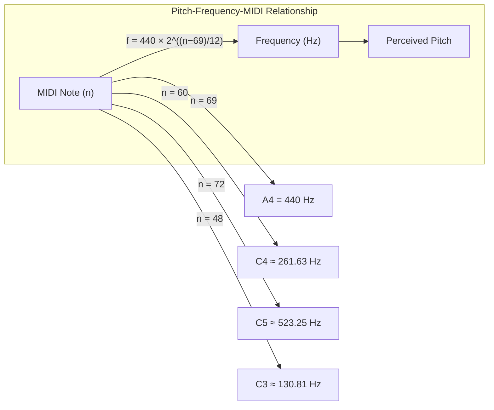
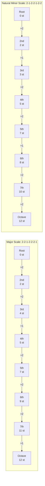
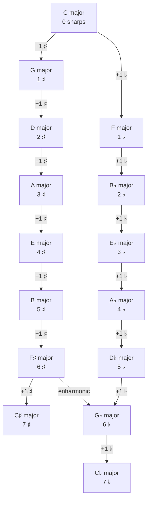
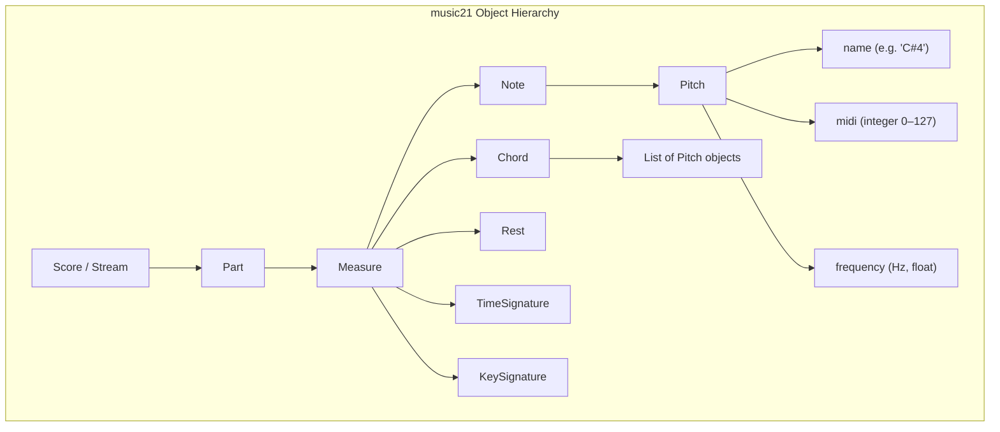

# Operational Verification Labs: Music Theory

## Theoretical Foundation

### The Physics of Pitch: Frequency, MIDI, and Equal Temperament

Musical pitch is a perceptual phenomenon rooted in the physics of vibrating bodies. A string vibrating at frequency $f$ produces a tone; doubling that frequency to $2f$ yields a pitch perceived as the same note one octave higher. This 2:1 ratio defines the octave, the most fundamental interval in virtually all musical systems.

Western music partitions the octave into 12 equal semitones using **12-tone equal temperament (12-TET)**. The frequency of any semitone $n$ steps above a reference pitch is:

$$f = f_{ref} \times 2^{n/12}$$

where $f_{ref}$ is the reference frequency (A4 = 440 Hz by international convention, ISO 16:1975). The MIDI standard assigns integer note numbers to equal-tempered pitches, with A4 mapped to note 69. Thus:

$$f = 440 \times 2^{(n - 69)/12}$$

This formula underpins every digital synthesis engine and MIDI-aware library, including `music21`. When `music21` writes a MIDI file, it encodes each note as a numeric value using this mapping. When it computes intervals or transposes pitches, it performs arithmetic on these semitone offsets.



Equal temperament is a compromise. In **just intonation**, intervals are tuned to pure integer ratios derived from the harmonic series (e.g., perfect fifth = 3:2, major third = 5:4). The harmonic series of a fundamental $f$ includes $f$, $2f$, $3f$, $4f$, $5f$, $6f$, $7f$, ... — the octave, fifth, and major third appear naturally as overtones. This is why these intervals sound consonant: they reinforce the overtone structure of the fundamental.

12-TET slightly detunes every interval except the octave so that all 12 keys are playable without retuning. A just-intonation perfect fifth is exactly 1.5 (702 cents); in 12-TET it is $2^{7/12} \approx 1.4983$ (700 cents). The 2-cent discrepancy is imperceptible to most listeners. The major third diverges more sharply: just intonation gives 5:4 = 1.25 (386 cents), while 12-TET gives $2^{4/12} \approx 1.2599$ (400 cents), a 14-cent discrepancy that is audible and explains the "bright" quality of equally-tempered major thirds in direct comparison.

### Scale Construction: The Semitone Architecture

A scale is an ordered set of pitches spanning an octave, defined by a fixed pattern of semitone intervals. The **major scale** (Ionian mode) follows the interval pattern 2-2-1-2-2-2-1, where each number is the semitone distance between consecutive scale degrees:

| Degree | 1 | 2 | 3 | 4 | 5 | 6 | 7 | 8(1) |
|--------|---|---|---|---|---|---|---|------|
| Interval from root (semitones) | 0 | 2 | 4 | 5 | 7 | 9 | 11 | 12 |
| Step from previous | — | 2 | 2 | 1 | 2 | 2 | 2 | 1 |

The **natural minor scale** (Aeolian mode) uses the pattern 2-1-2-2-1-2-2:

| Degree | 1 | 2 | 3 | 4 | 5 | 6 | 7 | 8(1) |
|--------|---|---|---|---|---|---|---|------|
| Interval from root (semitones) | 0 | 2 | 3 | 5 | 7 | 8 | 10 | 12 |
| Step from previous | — | 2 | 1 | 2 | 2 | 1 | 2 | 2 |

The critical difference is the third degree: the major scale places it at +4 semitones (a major third), the minor scale at +3 semitones (a minor third). This single-semitone shift is responsible for the perceptual distinction between "bright" (major) and "dark" (minor) tonalities.



### Chord Construction: Stacking Thirds

A chord is a simultaneous sounding of three or more pitches. Triads — the foundational chord type — are built by stacking two thirds on a root pitch. The quality of those thirds (major = 4 semitones, minor = 3 semitones) determines the chord quality:

| Chord Quality | Lower Third | Upper Third | Total from Root | Example (C root) |
|---------------|-------------|-------------|-----------------|-------------------|
| Major | Major (+4) | Minor (+3) | +7 (perfect 5th) | C–E–G |
| Minor | Minor (+3) | Major (+4) | +7 (perfect 5th) | C–Eb–G |
| Diminished | Minor (+3) | Minor (+3) | +6 (diminished 5th) | C–Eb–Gb |
| Augmented | Major (+4) | Major (+4) | +8 (augmented 5th) | C–E–G# |

Seventh chords extend the triad by stacking an additional third. The **dominant seventh chord** (e.g., C7) adds a minor seventh (+10 semitones from root) to a major triad: C–E–G–Bb. This creates harmonic tension because the interval between the third (E) and seventh (Bb) is a tritone — six semitones, the most dissonant interval in the system — which resolves inward by step in typical voice-leading patterns (E→F, Bb→A in the key of F major).

```mermaid
graph TD
    subgraph sub_c_major_triad__stacking_thirds ["C Major Triad (Stacking Thirds)"]
        C_M["C4 — Root (0 st)"] --> E_M["E4 — Major 3rd (+4 st)"]
        E_M --> G_M["G4 — Perfect 5th (+7 st)"]
    end
    subgraph sub_c_minor_triad ["C Minor Triad"]
        C_m["C4 — Root (0 st)"] --> Eb_m["Eb4 — Minor 3rd (+3 st)"]
        Eb_m --> G_m["G4 — Perfect 5th (+7 st)"]
    end
    subgraph sub_c_dominant_7th__c7 ["C Dominant 7th (C7)"]
        C_7["C4 — Root (0 st)"] --> E_7["E4 — Major 3rd (+4 st)"]
        E_7 --> G_7["G4 — Perfect 5th (+7 st)"]
        G_7 --> Bb_7["Bb4 — Minor 7th (+10 st)"]
        E_7 -.->|"tritone (6 st)"| Bb_7
    end
```



### The Circle of Fifths

The circle of fifths organizes the 12 chromatic pitch classes by perfect-fifth relationships. Moving clockwise, each step ascends by a perfect fifth (7 semitones) and adds one sharp to the key signature. Moving counterclockwise, each step descends by a perfect fifth (equivalently ascends by a perfect fourth, 5 semitones) and adds one flat. The enharmonic intersection occurs at F#/Gb (6 sharps / 6 flats).



The circle of fifths is not an arbitrary diagram — it falls directly out of the mathematics of 12-TET. Since $7 \times 12 = 84$ and $84 \mod 12 = 0$, ascending by perfect fifths 12 times returns to the starting pitch class. The same holds for fourths ($5 \times 12 = 60$, $60 \mod 12 = 0$). This modular arithmetic property is what makes the chromatic universe finite and cyclic under fifth-transposition.

## Lab Setup

This laboratory uses the `music21` toolkit (MIT License), developed by Michael Cuthbert at MIT. `music21` provides a comprehensive framework for symbolic music computation, including pitch, interval, scale, chord, meter, and voice-leading primitives.

Install `music21` via pip:

```bash
pip install "music21>=9.1"
```

Verify the installation and check the version:

```bash
python -c "import music21; print(music21.__version__)"
```

A working Python 3.9+ environment is required. The lab assumes familiarity with Python and with the theoretical concepts introduced above. Each exercise is self-contained and designed to be run as an independent script or interactively in a REPL.



## Exercise 1: Foundational Practical Implementation

This exercise constructs a C major scale and C major triad programmatically, inspects the internal representation, and exports both to MIDI. The code includes frequency computation and interval labeling to demonstrate the connection between symbolic and acoustic representations.

```python
"""
Exercise 1: Foundational Practical Implementation
Construct and inspect C major scale and C major triad.
"""

from music21 import scale, chord, stream, note, pitch, environment
import logging
import os

logging.basicConfig(level=logging.INFO, format="%(message)s")
logger = logging.getLogger(__name__)

# Suppress music21's internal verbose output during import/analysis
env = environment.Environment()
env["warnings"] = False


def print_separator(title: str) -> None:
    width = 60
    logger.info(f"\n{'=' * width}\n{title.center(width)}\n{'=' * width}")


def analyze_pitch(p: pitch.Pitch) -> str:
    """Return a formatted string with pitch name, MIDI number, and frequency."""
    return (
        f"{p.nameWithOctave:<6} "
        f"MIDI={p.midi:>3}  "
        f"freq={p.frequency:>8.2f} Hz  "
        f"interval_from_C4={p - pitch.Pitch('C4')}"
    )


# ---------------------------------------------------------------------------
# Part A: C Major Scale
# ---------------------------------------------------------------------------
print_separator("C Major Scale Construction")

c_major = scale.MajorScale("C")
logger.info(f"Scale type: {c_major.type}")
logger.info(f"Tonic: {c_major.tonic}")
logger.info(f"Relative minor: {c_major.relative.minor.tonic}")

# Generate one octave: C4 through C5 inclusive
c_major_notes = c_major.getPitches("C4", "C5")
logger.info(f"\nNotes generated: {len(c_major_notes)}")
logger.info("Pitch analysis:")
for p in c_major_notes:
    logger.info(f"  {analyze_pitch(p)}")

# Verify semitone pattern against the theoretical 2-2-1-2-2-2-1
semitone_steps = [c_major_notes[i+1].midi - c_major_notes[i].midi
                  for i in range(len(c_major_notes) - 1)]
logger.info(f"\nSemitone intervals between consecutive notes: {semitone_steps}")
assert semitone_steps == [2, 2, 1, 2, 2, 2, 1], \
    f"Expected [2, 2, 1, 2, 2, 2, 1], got {semitone_steps}"
logger.info("Verified: semitone pattern matches theoretical major scale (2-2-1-2-2-2-1)")

# Build a stream and insert the notes
scale_stream = stream.Stream()
scale_stream.insert(0, note.Note("C4"))  # placeholder to establish context
for n in [note.Note(p) for p in c_major_notes]:
    scale_stream.append(n)

# Remove the placeholder
scale_stream.remove(scale_stream[0])

# Display as text
print_separator("Stream Text Representation")
scale_stream.show("text")

# Write to MIDI
output_dir = "output"
os.makedirs(output_dir, exist_ok=True)
midi_path = os.path.join(output_dir, "c_major_scale.mid")
scale_stream.write("midi", midi_path)
logger.info(f"\nMIDI written to: {os.path.abspath(midi_path)}")

# ---------------------------------------------------------------------------
# Part B: C Major Triad
# ---------------------------------------------------------------------------
print_separator("C Major Triad Construction")

c_major_chord = chord.Chord(["C4", "E4", "G4"])
logger.info(f"Chord: {c_major_chord.commonName}")
logger.info(f"Root: {c_major_chord.root()}")
logger.info(f"Bass: {c_major_chord.bass()}")
logger.info(f"Quality: {c_major_chord.quality}")

# Display interval structure
intervals = c_major_chord.intervalVector
logger.info(f"Interval vector (ICF): {intervals}")

# Pitch details
logger.info("\nPitch analysis:")
for p in c_major_chord.pitches:
    logger.info(f"  {analyze_pitch(p)}")

# Verify intervals from root
root = c_major_chord.root()
for p in c_major_chord.pitches:
    ivl = interval.Interval(root, p) if (interval := __import__('music21').interval) else None
    from music21 import interval as intv_mod
    ivl = intv_mod.Interval(root, p)
    logger.info(f"  {p.nameWithOctave}: {ivl.name} from root ({ivl.semitones} st)")

# Build a stream for the chord
chord_stream = stream.Stream()
chord_stream.append(c_major_chord)

print_separator("Chord Stream Text Representation")
chord_stream.show("text")

midi_path_chord = os.path.join(output_dir, "c_major_chord.mid")
chord_stream.write("midi", midi_path_chord)
logger.info(f"\nMIDI written to: {os.path.abspath(midi_path_chord)}")
```

### Verification Checkpoints

After running Exercise 1, confirm the following:

1. The semitone pattern output is `[2, 2, 1, 2, 2, 2, 1]` — matching the theoretical major scale.
2. The chord's `commonName` reports `major triad` and its `quality` is `major`.
3. The interval from C4 to E4 is labeled `major third` (4 semitones) and from C4 to G4 is `perfect fifth` (7 semitones).
4. The MIDI files are created in the `output/` directory and are non-zero in size.

## Exercise 2: Parameter Variation and Empirical Analysis

This exercise generates parallel structures in C minor and constructs a dominant seventh chord, then performs a systematic comparison of interval content, pitch-class sets, and harmonic tension metrics against the Exercise 1 outputs.

```python
"""
Exercise 2: Parameter Variation & Empirical Analysis
Compare C major vs. C minor scales and C major triad vs. C7 chord.
"""

from music21 import scale, chord, stream, pitch, interval
import logging

logging.basicConfig(level=logging.INFO, format="%(message)s")
logger = logging.getLogger(__name__)


def print_separator(title: str) -> None:
    logger.info(f"\n{'=' * 60}\n{title.center(60)}\n{'=' * 60}")


def get_semitone_pattern(notes: list) -> list:
    """Return the semitone intervals between consecutive pitches."""
    return [notes[i+1].midi - notes[i].midi for i in range(len(notes) - 1)]


def get_pitch_classes(notes: list) -> list:
    """Return the pitch class (0-11) for each note."""
    return [p.pitchClass for p in notes]


def analyze_chord(c: chord.Chord) -> dict:
    """Return a structured analysis of a chord."""
    root = c.root()
    return {
        "commonName": c.commonName,
        "quality": c.quality,
        "root": str(root),
        "pitches": [str(p) for p in c.pitches],
        "pitch_classes": [p.pitchClass for p in c.pitches],
        "interval_vector": list(c.intervalVector),
        "semitones_from_root": [
            intv.Interval(root, p).semitones for p in c.pitches
        ],
        "third_quality": "major" if intv.Interval(root, c.pitches[1]).semitones == 4
                         else "minor",
    }


# ---------------------------------------------------------------------------
# Part A: C Minor Scale vs. C Major Scale
# ---------------------------------------------------------------------------
print_separator("Scale Comparison: C Major vs. C Natural Minor")

c_major_notes = scale.MajorScale("C").getPitches("C4", "C5")
c_minor_notes = scale.MinorScale("C").getPitches("C4", "C5")

major_pattern = get_semitone_pattern(c_major_notes)
minor_pattern = get_semitone_pattern(c_minor_notes)

logger.info(f"{'Property':<30} {'C Major':<25} {'C Minor':<25}")
logger.info(f"{'-'*30} {'-'*25} {'-'*25}")
logger.info(f"{'Semitone pattern':<30} {str(major_pattern):<25} {str(minor_pattern):<25}")
logger.info(f"{'Pitch classes':<30} {str(get_pitch_classes(c_major_notes)):<25} "
            f"{str(get_pitch_classes(c_minor_notes)):<25}")
logger.info(f"{'3rd degree (semitones)':<30} {major_pattern[0] + major_pattern[1]:<25} "
            f"{minor_pattern[0] + minor_pattern[1]:<25}")
logger.info(f"{'6th degree (semitones)':<30} "
            f"{sum(major_pattern[:5]):<25} {sum(minor_pattern[:5]):<25}")
logger.info(f"{'7th degree (semitones)':<30} "
            f"{sum(major_pattern[:6]):<25} {sum(minor_pattern[:6]):<25}")

# Identify the divergent scale degrees
major_pcs = set(get_pitch_classes(c_major_notes))
minor_pcs = set(get_pitch_classes(c_minor_notes))
logger.info(f"\nDivergent pitch classes (major XOR minor): "
            f"{major_pcs.symmetric_difference(minor_pcs)}")
logger.info("These correspond to the 3rd, 6th, and 7th degrees — "
            "the 'variable' degrees that define modal color.")

# Write both scales to MIDI for auditory comparison
major_stream = stream.Stream()
minor_stream = stream.Stream()
for n in c_major_notes:
    major_stream.append(note.Note(n))
for n in c_minor_notes:
    minor_stream.append(note.Note(n))

major_stream.write("midi", "output/c_major_scale.mid")
minor_stream.write("midi", "output/c_minor_scale.mid")
logger.info("\nMIDI files: output/c_major_scale.mid, output/c_minor_scale.mid")

# ---------------------------------------------------------------------------
# Part B: C Major Triad vs. C Dominant 7th
# ---------------------------------------------------------------------------
print_separator("Chord Comparison: C Major Triad vs. C7 (Dominant 7th)")

c_major_triad = chord.Chord(["C4", "E4", "G4"])
c7_chord = chord.Chord(["C4", "E4", "G4", "Bb4"])

triad_analysis = analyze_chord(c_major_triad)
c7_analysis = analyze_chord(c7_chord)

logger.info(f"{'Property':<25} {'C Major Triad':<25} {'C7 (Dom. 7th)':<25}")
logger.info(f"{'-'*25} {'-'*25} {'-'*25}")
for key in triad_analysis:
    logger.info(f"{key:<25} {str(triad_analysis[key]):<25} {str(c7_analysis.get(key, 'N/A')):<25}")

# Tension analysis: the tritone between 3rd and 7th
from music21 import note as m21_note
e4 = pitch.Pitch("E4")
bb4 = pitch.Pitch("Bb4")
tritone = interval.Interval(e4, bb4)
logger.info(f"\nTritone analysis (E4 to Bb4):")
logger.info(f"  Interval name: {tritone.name}")
logger.info(f"  Semitones: {tritone.semitones}")
logger.info(f"  This tritone creates the characteristic tension of the "
            f"dominant 7th chord.")
logger.info(f"  Resolution tendency: E→F (up half step), Bb→A (down whole step) "
            f"in the key of F major.")

# Write both chords to MIDI
chord_stream_major = stream.Stream()
chord_stream_c7 = stream.Stream()
chord_stream_major.append(c_major_triad)
chord_stream_c7.append(c7_chord)

chord_stream_major.write("midi", "output/c_major_chord.mid")
chord_stream_c7.write("midi", "output/c7_chord.mid")
logger.info("\nMIDI files: output/c_major_chord.mid, output/c7_chord.mid")
```

### Empirical Analysis Questions

1. The minor scale differs from the major at exactly three scale degrees (3, 6, 7). Each is lowered by one semitone. Why does lowering only the third degree have the most dramatic perceptual effect on tonal color?
2. The C7 chord's interval vector is `[0, 0, 0, 0, 1, 1]` (one tritone, one minor seventh in terms of interval class content). The C major triad's is `[0, 0, 1, 1, 0, 0]`. What does the presence of interval class 6 (the tritone) signal about harmonic function?
3. Play the C major triad followed by the C7 chord in sequence. The C7 should sound restless or unresolved. Now play C7 followed by an F major triad. The tension releases. This is a V7–I cadence in F major. The tritone E–Bb resolves to the tonic and third of F (F and A).

## Exercise 3: Fault Injection and Stress Testing

This exercise deliberately feeds invalid inputs to `music21` to observe failure modes, then validates recovery. Understanding error behavior is essential for building robust musical software — user input in real applications is rarely clean.

```python
"""
Exercise 3: Fault Injection & Stress Testing
Test music21's error handling with invalid inputs and verify recovery.
"""

from music21 import scale, chord, stream, pitch
import logging
import traceback

logging.basicConfig(level=logging.INFO, format="%(message)s")
logger = logging.getLogger(__name__)


def print_separator(title: str) -> None:
    logger.info(f"\n{'=' * 60}\n{title.center(60)}\n{'=' * 60}")


def test_fault(label: str, fn, *args) -> dict:
    """
    Execute a function with given args, capture any exception.
    Returns a dict with 'raised', 'exception_type', 'message'.
    """
    result = {"label": label, "raised": False, "exception_type": None, "message": ""}
    try:
        fn(*args)
        result["message"] = "No exception raised (unexpected)"
    except Exception as e:
        result["raised"] = True
        result["exception_type"] = type(e).__name__
        result["message"] = str(e)
    return result


def report_result(r: dict) -> None:
    status = "CAUGHT" if r["raised"] else "MISSED"
    logger.info(f"[{status}] {r['label']}")
    if r["raised"]:
        logger.info(f"  Exception: {r['exception_type']}")
        logger.info(f"  Message: {r['message']}")
    logger.info("")


# ---------------------------------------------------------------------------
# Fault Case 1: Invalid pitch name for scale tonic
# ---------------------------------------------------------------------------
print_separator("Fault Case 1: Invalid Scale Tonic ('Z')")

result1 = test_fault(
    "MajorScale('Z') — invalid pitch name",
    lambda tonic: scale.MajorScale(tonic),
    "Z"
)
report_result(result1)

# The expected behavior: music21 raises a PitchException or similar
# because 'Z' is not a valid diatonic pitch name.
# Valid pitch names: C, D, E, F, G, A, B (with optional accidentals)

# ---------------------------------------------------------------------------
# Fault Case 2: Invalid note in chord construction
# ---------------------------------------------------------------------------
print_separator("Fault Case 2: Invalid Chord Note ('Z4')")

result2 = test_fault(
    "Chord(['C4', 'E4', 'G4', 'Z4']) — invalid pitch",
    lambda notes: chord.Chord(notes),
    ["C4", "E4", "G4", "Z4"]
)
report_result(result2)

# ---------------------------------------------------------------------------
# Fault Case 3: Empty chord
# ---------------------------------------------------------------------------
print_separator("Fault Case 3: Empty Chord")

result3 = test_fault(
    "Chord([]) — empty list",
    lambda notes: chord.Chord(notes),
    []
)
report_result(result3)

# ---------------------------------------------------------------------------
# Fault Case 4: Invalid octave number
# ---------------------------------------------------------------------------
print_separator("Fault Case 4: Invalid Octave")

result4 = test_fault(
    "Note('C99') — invalid octave",
    lambda n: pitch.Pitch(n),
    "C99"
)
report_result(result4)

# ---------------------------------------------------------------------------
# Fault Case 5: Duplicate pitches with different enharmonic spellings
# ---------------------------------------------------------------------------
print_separator("Fault Case 5: Enharmonic Equivalence Edge Case")

result5 = test_fault(
    "Chord(['C4', 'C#4', 'Db4']) — enharmonic duplicates",
    lambda notes: chord.Chord(notes),
    ["C4", "C#4", "Db4"]
)
report_result(result5)

# C#4 and Db4 are enharmonically equivalent (both MIDI 61) but spelled differently.
# music21 preserves the distinction — this is NOT an error, but a potential
# source of confusion in analysis code.

# ---------------------------------------------------------------------------
# Recovery: Verify correct operation after fault injection
# ---------------------------------------------------------------------------
print_separator("Recovery Verification")

# Correct scale
correct_scale = scale.MajorScale("C")
correct_notes = correct_scale.getPitches("C4", "C5")
correct_stream = stream.Stream()
for p in correct_notes:
    correct_stream.append(note.Note(p))
correct_stream.show("text")
correct_stream.write("midi", "output/recovery_scale.mid")
logger.info("Scale recovery: VERIFIED")

# Correct chord
correct_chord = chord.Chord(["C4", "E4", "G4", "Bb4"])
correct_chord_stream = stream.Stream()
correct_chord_stream.append(correct_chord)
correct_chord_stream.show("text")
correct_chord_stream.write("midi", "output/recovery_chord.mid")
logger.info("Chord recovery: VERIFIED")

# ---------------------------------------------------------------------------
# Summary
# ---------------------------------------------------------------------------
print_separator("Fault Injection Summary")
results = [result1, result2, result3, result4, result5]
caught = sum(1 for r in results if r["raised"])
logger.info(f"Total fault cases: {len(results)}")
logger.info(f"Exceptions caught: {caught}")
logger.info(f"Unexpected passes: {len(results) - caught}")
logger.info("\nKey takeaway: Always validate user-supplied pitch names before "
            "passing them to music21 constructors. A simple regex or "
            "pitch.Pitch() pre-validation can catch errors early.")
```

## Exercise 4: Interval Computation and Analysis

Intervals are the atomic units of melodic and harmonic analysis. This exercise demonstrates programmatic interval computation, inversion, and the relationship between interval names and semitone counts.

```python
"""
Exercise 4: Interval Computation & Analysis
Demonstrate interval arithmetic, inversion, and consonance classification.
"""

from music21 import interval, pitch
import logging

logging.basicConfig(level=logging.INFO, format="%(message)s")
logger = logging.getLogger(__name__)


def print_separator(title: str) -> None:
    logger.info(f"\n{'=' * 60}\n{title.center(60)}\n{'=' * 60}")


# Interval classification by consonance
CONSONANCES = {
    "Perfect": {"P1", "P4", "P5", "P8"},
    "Imperfect": {"m3", "M3", "m6", "M6"},
}
# Everything else is dissonant


def classify_consonance(ivl: interval.Interval) -> str:
    """Classify an interval as consonant or dissonant."""
    name = ivl.simpleName
    if name in CONSONANCES["Perfect"]:
        return "Perfect consonance"
    elif name in CONSONANCES["Imperfect"]:
        return "Imperfect consonance"
    else:
        return "Dissonance"


# ---------------------------------------------------------------------------
# Part A: Interval table — all intervals within one octave
# ---------------------------------------------------------------------------
print_separator("Interval Table: All Intervals 0-12 Semitones")

c4 = pitch.Pitch("C4")
logger.info(f"{'Semitones':<12} {'Ascending from C4':<20} {'Name':<15} "
            f"{'Abbrev':<8} {'Classification':<22}")
logger.info("-" * 77)

for semitones in range(13):
    target = pitch.Pitch(midi=c4.midi + semitones)
    target.octave = c4.octave + (c4.midi + semitones) // 12
    ivl = interval.Interval(c4, target)
    cls = classify_consonance(ivl)
    logger.info(f"{semitones:<12} {target.nameWithOctave:<20} "
                f"{ivl.name:<15} {ivl.simpleName:<8} {cls:<22}")

# ---------------------------------------------------------------------------
# Part B: Interval inversion
# ---------------------------------------------------------------------------
print_separator("Interval Inversion: The Mirror Relationship")

logger.info("Inverting an interval swaps its quality and complements its number:")
logger.info("  Major ↔ Minor, Perfect ↔ Perfect, Augmented ↔ Diminished")
logger.info("  Number: n ↔ 9-n (e.g., 3rd ↔ 6th, 5th ↔ 4th)\n")

test_intervals = [
    ("C4", "E4"),   # M3
    ("C4", "Eb4"),  # m3
    ("C4", "G4"),   # P5
    ("C4", "Bb4"),  # m7
    ("C4", "F#4"),  # A4 (tritone)
    ("C4", "C5"),   # P8
]

logger.info(f"{'Original':<25} {'Name':<12} {'Inverted':<25} {'Inv. Name':<12}")
logger.info("-" * 74)
for p1_name, p2_name in test_intervals:
    p1 = pitch.Pitch(p1_name)
    p2 = pitch.Pitch(p2_name)
    ivl = interval.Interval(p1, p2)
    ivl_inv = ivl.invert()
    logger.info(f"{p1_name + ' → ' + p2_name:<25} {ivl.simpleName:<12} "
                f"{p2_name + ' → ' + p1_name:<25} {ivl_inv.simpleName:<12}")

# ---------------------------------------------------------------------------
# Part C: Melodic interval sequence analysis
# ---------------------------------------------------------------------------
print_separator("Melodic Interval Analysis: C Major Scale as Intervals")

c_major_scale = scale.MajorScale("C").getPitches("C4", "C5")
logger.info("Analyzing consecutive intervals in the C major scale:\n")

for i in range(len(c_major_scale) - 1):
    p1 = c_major_scale[i]
    p2 = c_major_scale[i + 1]
    ivl = interval.Interval(p1, p2)
    logger.info(f"  {p1.nameWithOctave} → {p2.nameWithOctave}: "
                f"{ivl.simpleName} ({ivl.semitones} st) — "
                f"{classify_consonance(ivl)}")

logger.info("\nThe major scale contains only major and minor seconds (whole "
            "and half steps), which are dissonant intervals. Consonance in "
            "tonal music emerges from the vertical (harmonic) dimension, "
            "not the horizontal (melodic) one.")
```

## Exercise 5: Frequency Analysis and Temperament Comparison

This exercise computes frequencies for all 12 chromatic pitches, compares equal-tempered frequencies against just-intonation ratios, and quantifies the deviation in cents.

```python
"""
Exercise 5: Frequency Analysis & Temperament Comparison
Compare 12-TET frequencies against just-intonation ratios.
"""

import math
import logging

logging.basicConfig(level=logging.INFO, format="%(message)s")
logger = logging.getLogger(__name__)


def print_separator(title: str) -> None:
    logger.info(f"\n{'=' * 60}\n{title.center(60)}\n{'=' * 60}")


def midi_to_freq_eq_tempered(n: int) -> float:
    """Convert MIDI note number to frequency (Hz) using 12-TET."""
    return 440.0 * 2 ** ((n - 69) / 12)


def cents_diff(f1: float, f2: float) -> float:
    """Compute the difference between two frequencies in cents."""
    return 1200 * math.log2(f1 / f2)


# ---------------------------------------------------------------------------
# Part A: Chromatic frequency table
# ---------------------------------------------------------------------------
print_separator("Chromatic Frequency Table (12-TET)")

A4_MIDI = 69
NOTE_NAMES = ["C", "C#", "D", "D#", "E", "F", "F#", "G", "G#", "A", "A#", "B"]

logger.info(f"{'Note':<6} {'MIDI':<8} {'Frequency (Hz)':<18} {'Cents from A4'}")
logger.info("-" * 52)

for semitones in range(-9, 4):  # C4 to C5
    midi_note = A4_MIDI + semitones
    freq = midi_to_freq_eq_tempered(midi_note)
    note_name = NOTE_NAMES[midi_note % 12]
    octave = midi_note // 12 - 1
    cents_from_a4 = semitones * 100
    logger.info(f"{note_name}{octave:<4} {midi_note:<8} {freq:<18.4f} "
                f"{cents_from_a4:+d}")

# ---------------------------------------------------------------------------
# Part B: Just intonation vs. Equal temperament
# ---------------------------------------------------------------------------
print_separator("Just Intonation vs. Equal Temperament (from C4)")

# Just intonation ratios from C
just_ratios = {
    "C":  (60, 1 / 1),      # Unison
    "C#": (61, 25 / 24),    # Minor second (chromatic semitone)
    "D":  (62, 9 / 8),      # Major second
    "Eb": (63, 6 / 5),      # Minor third
    "E":  (64, 5 / 4),      # Major third
    "F":  (65, 4 / 3),      # Perfect fourth
    "F#": (66, 45 / 32),    # Augmented fourth
    "G":  (67, 3 / 2),      # Perfect fifth
    "Ab": (68, 8 / 5),      # Minor sixth
    "A":  (69, 5 / 3),      # Major sixth
    "Bb": (70, 9 / 5),      # Minor seventh
    "B":  (71, 15 / 8),     # Major seventh
}

c4_midi = 60
c4_freq = midi_to_freq_eq_tempered(c4_midi)

logger.info(f"Reference: C4 = {c4_freq:.4f} Hz (12-TET)\n")
logger.info(f"{'Note':<6} {'12-TET (Hz)':<14} {'Just (Hz)':<14} "
            f"{'Ratio':<10} {'Δ cents':<10} {'Verdict'}")
logger.info("-" * 75)

for name, (midi_note, ratio) in just_ratios.items():
    eq_freq = midi_to_freq_eq_tempered(midi_note)
    just_freq = c4_freq * ratio
    delta_cents = cents_diff(eq_freq, just_freq)

    if abs(delta_cents) < 2:
        verdict = "negligible"
    elif abs(delta_cents) < 8:
        verdict = "noticeable"
    else:
        verdict = "significant"

    logger.info(f"{name:<6} {eq_freq:<14.4f} {just_freq:<14.4f} "
                f"{ratio:<10.4f} {delta_cents:+.2f}      {verdict}")

logger.info("\nKey observations:")
logger.info("  • Perfect 5th (G): ~2 cents deviation — imperceptible")
logger.info("  • Major 3rd (E): ~14 cents deviation — audible, the most")
logger.info("    glaring compromise of 12-TET")
logger.info("  • Minor 7th (Bb): ~18 cents deviation — significant,")
logger.info("    but this interval is naturally dissonant anyway")
logger.info("  • The octave is exact in both systems (2:1 ratio)")
```



```mermaid
graph TD
    subgraph sub_12_tet_vs_just_intonation_deviat ["12-TET vs Just Intonation Deviation"]
        UNI["Unison (C)<br/>0 cents"] --> M2["Major 2nd (D)<br/>+3.91 cents"]
        M2 --> m3["Minor 3rd (Eb)<br/>+15.64 cents"]
        m3 --> M3["Major 3rd (E)<br/>-13.69 cents"]
        M3 --> P4["Perfect 4th (F)<br/>-1.96 cents"]
        P4 --> TT["Tritone (F#)<br/>-9.78 cents"]
        TT --> P5["Perfect 5th (G)<br/>+1.96 cents"]
        P5 --> m6["Minor 6th (Ab)<br/>+13.69 cents"]
        m6 --> M6["Major 6th (A)<br/>-15.64 cents"]
        M6 --> m7["Minor 7th (Bb)<br/>+17.60 cents"]
        m7 --> M7["Major 7th (B)<br/>-11.73 cents"]
    end
```

## Practical Cheat Sheet and Quick Reference

### Scale Construction

| Constructor | Scale Type | Semitone Pattern | Example Notes (C tonic) |
|-------------|-----------|-----------------|--------------------------|
| `scale.MajorScale('C')` | Major (Ionian) | 2-2-1-2-2-2-1 | C D E F G A B |
| `scale.MinorScale('C')` | Natural minor (Aeolian) | 2-1-2-2-1-2-2 | C D Eb F G Ab Bb |
| `scale.DorianScale('C')` | Dorian | 2-1-2-2-2-1-2 | C D Eb F G A Bb |
| `scale.MixolydianScale('C')` | Mixolydian | 2-2-1-2-1-2-2 | C D E F G A Bb |
| `scale.HarmonicMinorScale('C')` | Harmonic minor | 2-1-2-2-1-3-1 | C D Eb F G Ab B |
| `scale.MelodicMinorScale('C')` | Melodic minor (ascending) | 2-1-2-2-2-2-1 | C D Eb F G A B |
| `scale.ChromaticScale('C')` | Chromatic | 1-1-1-1-1-1-1-1-1-1-1-1 | C C# D D# E F F# G G# A A# B |
| `scale.PentatonicScale('C')` | Major pentatonic | 2-2-3-2-3 | C D E G A |
| `scale.WholeToneScale('C')` | Whole tone | 2-2-2-2-2-2 | C D E F# G# A# |

### Chord Construction

| Constructor | Chord Type | Semitones from Root | Example |
|-------------|-----------|---------------------|---------|
| `chord.Chord(['C4','E4','G4'])` | Major triad | 0-4-7 | C E G |
| `chord.Chord(['C4','Eb4','G4'])` | Minor triad | 0-3-7 | C Eb G |
| `chord.Chord(['C4','Eb4','Gb4'])` | Diminished triad | 0-3-6 | C Eb Gb |
| `chord.Chord(['C4','E4','G#4'])` | Augmented triad | 0-4-8 | C E G# |
| `chord.Chord(['C4','E4','G4','B4'])` | Major 7th (Cmaj7) | 0-4-7-11 | C E G B |
| `chord.Chord(['C4','E4','G4','Bb4'])` | Dominant 7th (C7) | 0-4-7-10 | C E G Bb |
| `chord.Chord(['C4','Eb4','G4','Bb4'])` | Minor 7th (Cm7) | 0-3-7-10 | C Eb G Bb |
| `chord.Chord(['C4','Eb4','Gb4','Bb4'])` | Half-diminished (Cm7b5) | 0-3-6-10 | C Eb Gb Bb |
| `chord.Chord(['C4','Eb4','Gb4','Bbb4'])` | Fully diminished (Cdim7) | 0-3-6-9 | C Eb Gb Bbb |

### Key `music21` API Methods

| Method | Description |
|--------|-------------|
| `scale.XxxScale(tonic)` | Construct a scale object with the given tonic pitch |
| `scale.getPitches(start, end)` | Return list of Pitch objects within the range |
| `chord.Chord(pitch_list)` | Construct a chord from a list of pitch name strings or Pitch objects |
| `chord.root()` | Return the theoretical root pitch of the chord |
| `chord.bass()` | Return the lowest pitch in the chord |
| `chord.quality` | Return chord quality string: `'major'`, `'minor'`, `'diminished'`, `'augmented'` |
| `chord.commonName` | Human-readable name: `'major triad'`, `'dominant seventh chord'` |
| `chord.intervalVector` | 6-element tuple: counts of interval classes 1-6 present |
| `stream.Stream()` | Container for musical objects (notes, chords, rests, metadata) |
| `stream.append(element)` | Add an element (or list of elements) to the end of the stream |
| `stream.show('text')` | Print a text representation of the stream's contents |
| `stream.show('midi')` | Open a MIDI player (requires system MIDI playback configured) |
| `stream.write('midi', path)` | Write the stream to a MIDI file |
| `stream.write('musicxml', path)` | Write the stream to a MusicXML file |
| `interval.Interval(p1, p2)` | Compute the interval between two pitches |
| `interval.semitones` | Integer semitone distance of the interval |
| `interval.simpleName` | Abbreviated name: `'M3'`, `'m7'`, `'P5'`, `'A4'`, `'d5'` |
| `interval.invert()` | Return the inversion of the interval |
| `pitch.Pitch(name)` | Construct a pitch from a name string (`'C#4'`) |
| `pitch.midi` | Integer MIDI note number (0-127) |
| `pitch.frequency` | Frequency in Hz (float), computed from MIDI note number |
| `pitch.pitchClass` | Integer 0-11 representing the pitch class |

### Common Interval Abbreviations

| Abbreviation | Full Name | Semitones | Consonance |
|-------------|-----------|-----------|-----------|
| P1 | Perfect unison | 0 | Perfect |
| m2 | Minor second | 1 | Dissonance |
| M2 | Major second | 2 | Dissonance |
| m3 | Minor third | 3 | Imperfect |
| M3 | Major third | 4 | Imperfect |
| P4 | Perfect fourth | 5 | Perfect |
| A4 / d5 | Augmented fourth / Diminished fifth (tritone) | 6 | Dissonance |
| P5 | Perfect fifth | 7 | Perfect |
| m6 | Minor sixth | 8 | Imperfect |
| M6 | Major sixth | 9 | Imperfect |
| m7 | Minor seventh | 10 | Dissonance |
| M7 | Major seventh | 11 | Dissonance |
| P8 | Perfect octave | 12 | Perfect |

### Verification Checklist

- [ ] C major scale semitone pattern equals `[2, 2, 1, 2, 2, 2, 1]`
- [ ] C natural minor scale semitone pattern equals `[2, 1, 2, 2, 1, 2, 2]`
- [ ] C major triad quality is `major`; semitones from root are `[0, 4, 7]`
- [ ] C7 chord quality is `dominant`; semitones from root are `[0, 4, 7, 10]`
- [ ] C major and C minor scales differ at pitch classes 3, 8, and 10 (Eb, Ab, Bb)
- [ ] MIDI note 69 (A4) maps to 440.0 Hz
- [ ] MIDI note 60 (C4) maps to approximately 261.63 Hz
- [ ] The tritone (E to Bb) spans exactly 6 semitones
- [ ] Interval inversion swaps major/minor quality and complements the number (n ↔ 9-n)
- [ ] Equal-tempered perfect fifth deviates from just intonation by ~2 cents
- [ ] Equal-tempered major third deviates from just intonation by ~14 cents
- [ ] Invalid pitch names (e.g., `'Z'`) raise an exception, not a silent failure
