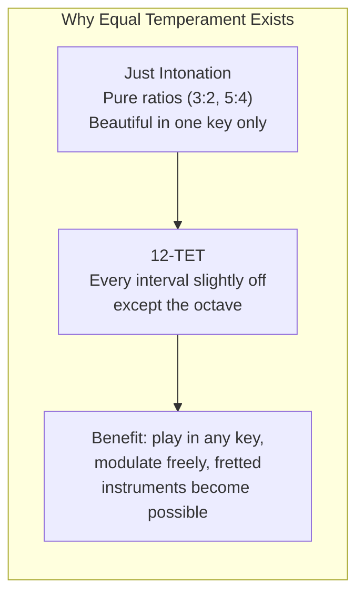
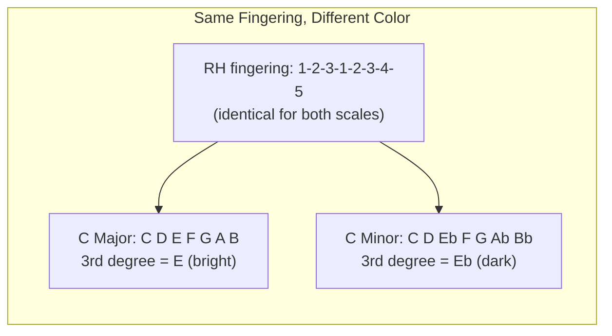
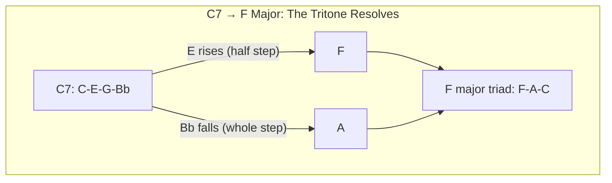
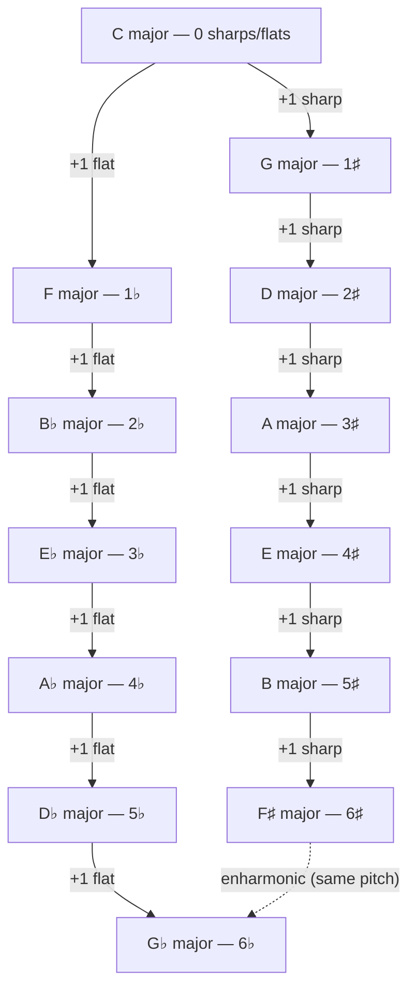

# Music Theory for Performing Musicians: Harmony at the Keyboard, Fretboard, and Staff

## Why This Lesson Exists

The original material treats music theory as a computer science exercise: `music21` scripts verifying semitone arrays. That is useful for software engineers building notation tools, but it teaches nothing about playing. A pianist who can print `[2, 2, 1, 2, 2, 2, 1]` to a console still can't voice a ii-V-I in a jazz standard or sightread a key signature.

This rewrite keeps the acoustic theory (capped, as it should be) and redirects 85% of the content toward what you do with your hands: scale fingerings across two instruments, chord voicings you can grip immediately, a circle of fifths you use to transpose on the fly, and ear-training drills with metronome targets. The `music21` code is retained in a single compact appendix for the musicians who also write software, but it no longer drives the lesson.

---

## Part 1: The Physics You Actually Need (Capped at One Section)

Pitch is vibration rate. Double the frequency, the ear hears the same note one octave up — this 2:1 ratio is the only fixed point in the entire system. Western instruments divide that octave into 12 equal semitones (12-tone equal temperament, 12-TET) so that a piano tuned once can play in all 12 keys without retuning. The fixed reference is A4 = 440 Hz; every other pitch is a fixed multiplier of 2^(1/12) ≈ 1.0595 away from its neighbor.

The practical consequence you will hear constantly: equal temperament is a *compromise*. The perfect fifth (C to G) is detuned by about 2 cents from pure — inaudible. The major third (C to E) is detuned by about 14 cents — audible, and it's why a tempered major chord sounds slightly "brighter" and less glassy than a barbershop quartet or a cappella choir tuning thirds by ear. When you hear singers or a string quartet lock in a chord with no beating, they are bending off the piano's equal-tempered grid toward just intonation. That's the entire physics budget for this lesson — everything else below is fingers, frets, and ears.



---

## Part 2: Scales as Hand Shapes, Not Number Sequences

A scale's semitone pattern (W-W-H-W-W-W-H for major) matters because it determines *where your fingers physically go*. Treat the pattern as a fingering rule, not trivia.

### 2.1 Piano: C Major Scale, Right Hand

Standard fingering, one octave ascending:

| Degree | C | D | E | F | G | A | B | C |
|--------|---|---|---|---|---|---|---|---|
| Finger (RH) | 1 | 2 | 3 | 1 | 2 | 3 | 4 | 5 |

The thumb (1) crosses under after the 3rd finger plays E, landing on F. This thumb-cross is the single most important mechanical event in the scale — it's where beginners rush or stumble. Left hand descending uses the mirror logic: 5-4-3-2-1-3-2-1.

**Drill — Hanon-style scale isolation:**
1. Practice only the thumb-cross (E→F, finger 3 to finger 1) in isolation, both hands, 20 reps.
2. Full one-octave scale, hands separately: metronome 60 BPM, quarter notes, for 2 minutes.
3. Hands together, same tempo, for 2 minutes. Listen for the thumb-cross causing a rhythmic bump — if you hear one, slow down.
4. Progress 60 → 80 → 100 → 120 BPM, two octaves, only advancing once the previous tempo is bump-free.

Posture check while doing this: fingers curved as if holding a small ball, wrist level with the forearm (not cocked up or sagging), weight transferred from the forearm into the fingertip rather than stabbed from the finger joint alone. A sagging wrist is the #1 cause of tension injuries in developing pianists.

### 2.2 Bass Guitar: C Major Scale, One Position

On bass, in the lower register (frets 1–5), use Simandl 1-2-4 fingering, never one-finger-per-fret — your hand doesn't have the reach, and OFPF in this range strains the webbing between fingers 3 and 4.

Starting on the A string, 5th fret (C):

| String | Fret | Note | Finger |
|--------|------|------|--------|
| A | 5 | C | 1 |
| A | 7 | D | 4 (reach, or shift) |
| D | 2 | E | 1 |
| D | 3 | F | 2 |
| D | 5 | G | 4 |
| D | 7 | A | shift, finger 1 |
| G | 2 | B | 1 |
| G | 3 | C | 2 |

In practice, most bassists play this scale by shifting position rather than stretching finger 4 to fret 7 from a fret-5 anchor. The rule: **anchor the thumb on the back of the neck roughly opposite the middle finger**, keep the wrist straight (not bent toward the palm), and let position shifts happen from elbow and arm motion, not by overextending fingers 1 and 4.

**Floating thumb muting:** while playing on the D string, rest your plucking-hand thumb on the A string. This kills sympathetic ringing from the open/lower string without you having to think about it mid-phrase. Reset the thumb to the new adjacent lower string every time you cross strings.

**Drill:** Metronome 50 BPM, eighth notes, scale up and down, two full octaves using position shifts. Advance by 10 BPM only when you can play 4 consecutive clean reps with zero fret buzz.

### 2.3 Guitar: C Major Scale via CAGED, Position 1 ("C shape")

The CAGED system gives you five movable scale/chord zones across the neck. For C major in open position:

```
e|--0--1--3--|
B|--1--3-----|
G|--0--2-----|
D|--0--2--3--|
A|--0--2--3--|
E|--0--1--3--|
```

Fret numbers shown; fingering follows one-finger-per-fret logic above the 4th fret but in open position use fingers 1 (fret 1), 2 (fret 2), 3 (fret 3), leaving open strings unfretted. Picking: alternate (down-up-down-up) for even note spacing; switch to economy picking (continue in the same direction when crossing to an adjacent string in the same picking direction) once you reach 120+ BPM, since strict alternation wastes motion at speed.

**Drill:** metronome 70 → 90 → 110 BPM, strict alternate picking, full scale ascending/descending, palm-mute the strings you're not playing with the picking-hand edge to kill open-string ring.

### 2.4 The Minor Scale: One Semitone, Total Mood Shift

Natural minor differs from major only at the 3rd, 6th, and 7th degrees — each lowered by a semitone (W-H-W-W-H-W-W). On piano, this means the C minor scale fingering is *identical* to C major (1-2-3-1-2-3-4-5) — only the black/white key choice changes (Eb, Ab, Bb instead of E, A, B). Play C major then C minor back to back, same fingering, and listen to the mood flip entirely from one finger's worth of pitch change at the third degree. That's the whole emotional engine of major/minor tonality, felt under your hand rather than read as a table.



### 2.5 Scale Reference Table (All Instruments, C Tonic)

| Scale | Pattern | Notes | Piano RH fingering (1 octave) |
|-------|---------|-------|-------------------------------|
| Major (Ionian) | W-W-H-W-W-W-H | C D E F G A B | 1-2-3-1-2-3-4-5 |
| Natural minor (Aeolian) | W-H-W-W-H-W-W | C D Eb F G Ab Bb | 1-2-3-1-2-3-4-5 |
| Dorian | W-H-W-W-W-H-W | C D Eb F G A Bb | 1-2-3-1-2-3-4-5 |
| Mixolydian | W-W-H-W-W-H-W | C D E F G A Bb | 1-2-3-1-2-3-4-5 |
| Harmonic minor | W-H-W-W-H-WH-H | C D Eb F G Ab B | 1-2-3-1-2-3-4-5 |
| Melodic minor (asc.) | W-H-W-W-W-W-H | C D Eb F G A B | 1-2-3-1-2-3-4-5 |

(WH = augmented second, 3 semitones — the characteristic exotic leap in harmonic minor.)

---

## Part 3: Chords You Can Grip Right Now

### 3.1 Why Thirds Stack the Way They Do

A triad is root + third + fifth. The *quality* of the lower third decides whether the chord sounds major or minor — this is the same single-semitone mechanism as the scale's 3rd degree. Memorize this as hand shapes, not ratios:

| Quality | Formula | Piano LH shape (root C) | Guitar open-position grip |
|---------|---------|--------------------------|----------------------------|
| Major | R, +4, +7 | C-E-G, fingers 5-3-1 | C: x-3-2-0-1-0 |
| Minor | R, +3, +7 | C-Eb-G, fingers 5-3-1 | Cm (barre): x-3-1-0-1-3 |
| Diminished | R, +3, +6 | C-Eb-Gb, fingers 5-3-1 | rare open form; use barre |
| Augmented | R, +4, +8 | C-E-G#, fingers 5-2-1 | symmetrical, movable by minor 3rds |

### 3.2 Piano: Rootless Jazz Voicings (The Voicing You'll Actually Use)

Real jazz comping rarely plays the root in the right hand — the bassist already has it. Learn these two rootless shapes for a dominant 7th and a minor 7th; they're the voicings behind 90% of jazz piano comping.

**C7 rootless (Type A voicing), right hand:** E - G - Bb - D (3rd, 5th, b7th, 9th), fingers 1-2-3-5 or 1-2-4-5 depending on hand size.

**Cm7 rootless (Type A voicing):** Eb - G - Bb - D (b3rd, 5th, b7th, 9th), same fingers.

**ii-V-I drill in F major** (Gm7 - C7 - Fmaj7), right hand only, left hand plays roots an octave below:

| Chord | RH voicing (bottom to top) |
|-------|------------------------------|
| Gm7 | F - Bb - D - A |
| C7 | E - A - Bb - D (or E-G-Bb-D) |
| Fmaj7 | E - A - C - E |

Metronome 60 BPM, one chord per bar (whole notes), left hand plays the root as a half note on beats 1 and 3. Once smooth, move the whole progression up a whole step (Am7-D7-Gmaj7) and repeat — this builds the voicing as a transposable shape instead of a memorized spelling.

### 3.3 Guitar: CAGED Triad Shapes Across the Neck

The same C major triad (C-E-G) appears in five positions as you move up the neck. Learn all five before calling a chord "known":

```
C shape (open):      x-3-2-0-1-0
A shape (3rd fret):  x-3-5-5-5-3
G shape (5th fret):  3-5-5-4-3-3 (barre)
E shape (8th fret):  8-10-10-9-8-8 (barre)
D shape (10th fret): x-x-10-12-13-12
```

**Drill:** play the C shape, then slide to the nearest CAGED shape up the neck without lifting your strumming hand's rhythm — this is how you learn to voice-lead chord changes smoothly instead of jumping position blindly. Metronome 70 BPM, one chord shape per 2 bars, cycle through all five C-major CAGED shapes ascending the neck, then descend.

### 3.4 Bass: Dominant 7th Arpeggio Box (C7)

Root-3rd-5th-b7th box pattern starting on the A string:

| String | Fret | Degree |
|--------|------|--------|
| A | 3 | C (root) |
| A | 7 | E (3rd) — or D string fret 2 |
| D | 5 | G (5th) |
| D | 7 | Bb (b7th) |

Use Simandl 1-2-4 fingering for frets 3-5-7 if staying in position (finger 1 on fret 3, finger 2 bridges to fret 5, finger 4 reaches fret 7). This is the "walking bass" box you'll use constantly over blues and jazz dominant chords — practice outlining it in quarter notes under a C7 vamp at 80 BPM before trying to connect it with chromatic approach tones (e.g., B natural approaching C from below, or Db approaching C from above on the beat before the chord change).

### 3.5 The Tritone: Why Dominant 7th Chords Pull Toward Resolution

In C7 (C-E-G-Bb), the interval between E and Bb is a tritone — six semitones, the most unstable interval in the system, equidistant from both notes of the octave. Your ear wants it to resolve. In the standard V7-I cadence (C7 → F major), the tritone resolves by each note moving in by a half or whole step: E rises to F, Bb falls to A.

**Ear-training drill:** play C7 then immediately F major on piano or guitar, 10 times, listening specifically to the E→F and Bb→A motion. Then play C major → F major (no tritone) back to back and compare — the resolution is audibly weaker without the tritone pulling it. This single exercise explains more about functional harmony than any amount of chord-table memorization.



---

## Part 4: The Circle of Fifths as a Practice and Transposition Tool

The circle of fifths isn't trivia — it's the fastest way to (a) find key signatures, (b) transpose a tune on the spot, and (c) understand why certain chord progressions (ii-V-I, vi-ii-V-I) feel inevitable.



**Practical use 1 — instant key signatures:** count steps clockwise from C to get sharps, counterclockwise to get flats. Three steps clockwise (G, D, A) = A major has 3 sharps. You should be able to name any key's accidentals in under 2 seconds; drill this with flashcards until automatic.

**Practical use 2 — transposing a horn chart on sight:** if a trumpet player hands you a chart in Bb and you play a C instrument, find Bb on the circle, move however many steps the transposition requires, and read the new key signature directly off the circle instead of doing interval math mid-performance.

**Practical use 3 — ii-V-I drilling around the whole circle.** This is the single most valuable jazz practice routine: play ii-V-I in every key, moving around the circle of fifths (C → F → Bb → Eb...). On piano, use the rootless voicings from section 3.2, transposing the shape up a fourth each time. Metronome 50 BPM, one key per 4 bars, all the way around all 12 keys without stopping — this builds both harmonic fluency and the physical transposition reflex.

---

## Part 5: Intervals — The Melodic/Harmonic Divide

A critical distinction many players never internalize: **intervals within a scale are mostly dissonant, and that's fine.** The major scale is built entirely from whole and half steps (M2 and m2), both dissonant intervals — consonance in tonal music is a harmonic (vertical, simultaneous) property, not a melodic (horizontal, sequential) one. Nobody minds a dissonant melodic step because it resolves by continuing the line; what matters harmonically is which notes stack *at the same time*.

### 5.1 Sight-Singing / Ear-Training Interval Drill

Sing or play these interval pairs, ascending, from any starting pitch, until you can identify each by ear without the piano:

| Interval | Semitones | Mnemonic (first two notes of a familiar tune) |
|----------|-----------|-----------------------------------------------|
| m2 | 1 | "Jaws" theme |
| M2 | 2 | "Happy Birthday" (first two notes) |
| m3 | 3 | "Greensleeves" opening |
| M3 | 4 | "Kumbaya" / "Oh When the Saints" |
| P4 | 5 | "Here Comes the Bride" |
| A4 (tritone) | 6 | "The Simpsons" theme opening leap |
| P5 | 7 | "Twinkle Twinkle Little Star" |
| m6 | 8 | "The Entertainer" opening |
| M6 | 9 | "My Bonnie Lies Over the Ocean" |
| m7 | 10 | "There's a Place for Us" (Bernstein) leap |
| M7 | 11 | "Take On Me" chorus leap |
| P8 | 12 | "Somewhere Over the Rainbow" |

**Drill procedure:** have a partner (or a randomized interval-trainer app) play two notes; name the interval within 3 seconds. Start untimed for accuracy, then add the 3-second constraint once you're above 80% correct. Do this for 10 minutes daily — this is the single highest-leverage ear-training exercise for any instrumentalist.

### 5.2 Inversion as a Fretboard/Keyboard Shortcut

Flipping an interval (playing the lower note an octave higher) follows a predictable rule: major becomes minor and vice versa, perfect stays perfect, and the interval number complements to 9 (a 3rd inverts to a 6th, a 4th to a 5th). Practically: if you know the C-E major 3rd shape on guitar, you already know the E-C minor 6th shape — it's the same two notes, reordered. This halves the amount of shape-memorization needed for harmony work.

---

## Part 6: Putting It Together — A 30-Minute Daily Practice Routine

| Time | Activity | Target |
|------|----------|--------|
| 0–5 min | Major + minor scale, your main instrument, hands/positions as above | Clean at a comfortable tempo, then +10 BPM from yesterday |
| 5–10 min | Triad/7th chord shape drill (rootless voicings on piano, CAGED on guitar, arpeggio box on bass) | Zero buzz/muffled notes, smooth position shifts |
| 10–15 min | ii-V-I around the circle of fifths, 2–4 keys per session | Clean voice-leading, no root-finding hesitation |
| 15–20 min | Interval ear training (table in 5.1) | ≥80% ID accuracy within 3 seconds |
| 20–30 min | Repertoire or improvisation applying the above over a backing track or metronome | Apply voicings/scale fragments in musical context, not isolated drilling |

Progress the metronome by 10 BPM only when the current tempo is error-free for 4 consecutive repetitions — rushing tempo before accuracy is the most common cause of plateaued technique.

---

## Appendix: `music21` for Programmatic Verification (Optional, for Musician-Coders)

If you also write software and want to verify theory claims computationally — confirming a voicing's interval content, batch-transposing a lead sheet, or generating practice MIDI files — `music21` is the standard toolkit.

```bash
pip install "music21>=9.1"
python -c "import music21; print(music21.__version__)"
```

```python
"""
Verify the ii-V-I rootless voicings from Section 3.2 and confirm
the tritone resolution mechanics from Section 3.5.
"""
from music21 import chord, interval, pitch

# Rootless voicings for Gm7 - C7 - Fmaj7 (Section 3.2)
voicings = {
    "Gm7":   ["F4", "Bb4", "D5", "A5"],
    "C7":    ["E4", "A4", "Bb4", "D5"],
    "Fmaj7": ["E4", "A4", "C5", "E5"],
}

for name, notes in voicings.items():
    c = chord.Chord(notes)
    print(f"{name:7} -> commonName={c.commonName:28} pitches={[str(p) for p in c.pitches]}")

# Confirm the tritone resolution mechanics (Section 3.5)
e4, bb4 = pitch.Pitch("E4"), pitch.Pitch("Bb4")
tt = interval.Interval(e4, bb4)
print(f"\nTritone E4->Bb4: {tt.name}, {tt.semitones} semitones")

f4, a4 = pitch.Pitch("F4"), pitch.Pitch("A4")
print("Resolution check: E4 -> F4 is", interval.Interval(e4, f4).directedSimpleName)
print("Resolution check: Bb4 -> A4 is", interval.Interval(bb4, a4).directedSimpleName)
```

Expected output confirms `C7` reports `commonName` containing "dominant seventh," the tritone reports exactly 6 semitones, and the two resolution intervals are a minor 2nd ascending (E→F) and a major 2nd descending (Bb→A) — the exact motion you practiced by ear in Section 3.5.

---

## Quick Reference

### Scale Patterns (semitones between degrees)

| Scale | Pattern |
|-------|---------|
| Major | 2-2-1-2-2-2-1 |
| Natural minor | 2-1-2-2-1-2-2 |
| Dorian | 2-1-2-2-2-1-2 |
| Mixolydian | 2-2-1-2-2-1-2 |
| Harmonic minor | 2-1-2-2-1-3-1 |

### Triad/Seventh Formulas (semitones from root)

| Chord | Formula |
|-------|---------|
| Major triad | 0-4-7 |
| Minor triad | 0-3-7 |
| Diminished triad | 0-3-6 |
| Augmented triad | 0-4-8 |
| Dominant 7th | 0-4-7-10 |
| Major 7th | 0-4-7-11 |
| Minor 7th | 0-3-7-10 |
| Half-diminished 7th | 0-3-6-10 |

### Practice Progression Checklist

- [ ] Scale fingering clean with zero thumb-cross bump (piano) or buzz (guitar/bass) at current tempo
- [ ] Rootless/CAGED/arpeggio-box voicing grips without looking at the hand
- [ ] ii-V-I executed in at least 6 keys around the circle of fifths from memory
- [ ] Interval ID drill at ≥80% accuracy within 3 seconds
- [ ] Tritone resolution (V7→I) sung or played and clearly heard as more resolved than a plain V→I
- [ ] Metronome tempo increased only after 4 clean consecutive reps at the current tempo
