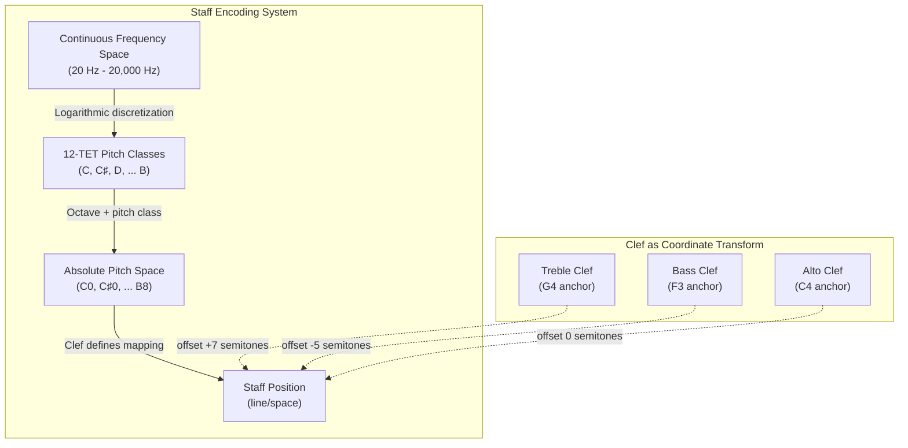
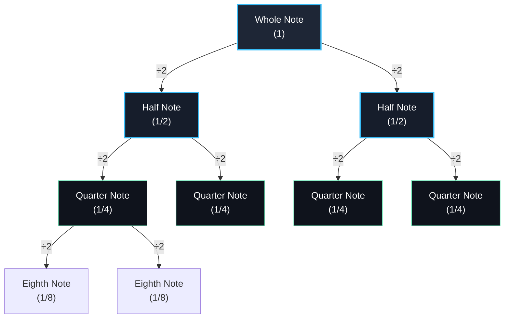
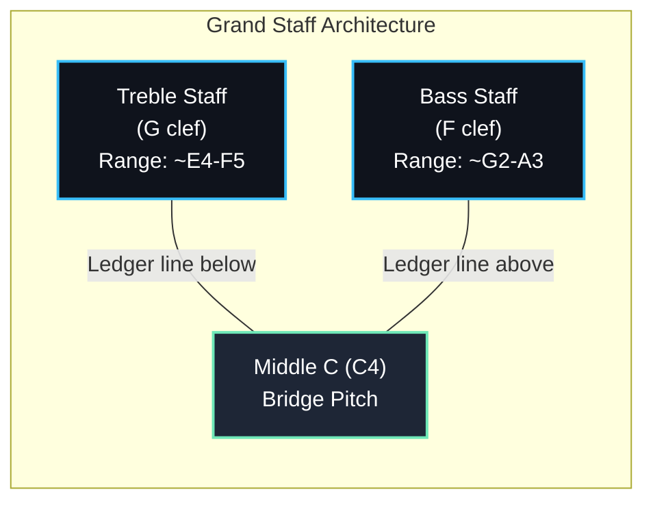
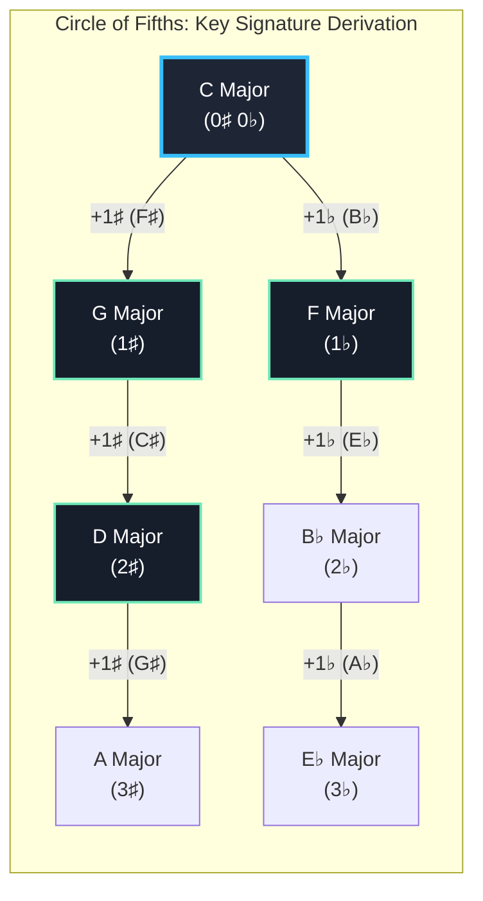
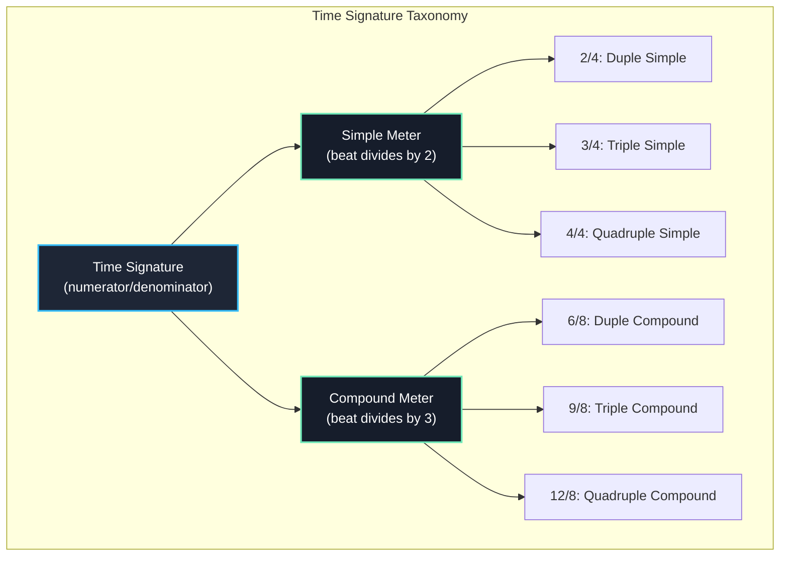

# Lesson 1: Music Notation — A First-Principles Architecture of Musical Language

## 1. First-Principles Intuition & Invariants

Music notation is a precision-engineered information encoding system that maps the continuous, multidimensional phenomenon of sound onto a discrete, two-dimensional visual representation. Unlike natural language, which evolved organically, Western music notation was deliberately designed over centuries to solve a specific problem: transmit musical performance instructions across time and space with minimal loss of fidelity.

### The Core Problem: Dimensionality Reduction

Musical sound exists in at least four fundamental dimensions:

1. **Frequency (pitch)**: Continuous from ~20 Hz to ~20,000 Hz, but Western music discretizes this into a logarithmic scale of pitches separated by frequency ratios
2. **Time (rhythm and duration)**: Continuous temporal flow, discretized into beats, measures, and hierarchical subdivisions
3. **Amplitude (dynamics)**: Continuous intensity from silence to maximum loudness, coarsely quantized into discrete dynamic levels
4. **Timbre (tone quality)**: Multidimensional spectral characteristics, indicated through instrument specification and articulation markings

Music notation compresses these dimensions onto a two-dimensional staff using position (vertical axis for pitch, horizontal axis for time) augmented with symbols (for dynamics, articulation, and timbre cues). This is fundamentally a lossy compression scheme—nuances of intonation, microtiming, dynamic shading, and timbral variation that exist in live performance cannot be fully captured. The notation system evolved to preserve the invariants deemed most essential for musical identity while allowing performer interpretation to fill in the rest.

### The Staff: A Quantized Pitch Grid

The five-line staff is not arbitrary but represents an optimization for the perceptual range of Western diatonic music. The staff maps discrete pitches to vertical positions with a resolution of one diatonic scale step (whole tone or semitone) per line or space. This design choice reflects two constraints:

1. **Perceptual resolution**: Human pitch discrimination in musical contexts clusters around the semitone (~6% frequency difference), making finer gradations unnecessary for most Western music
2. **Visual parsability**: Five lines provide sufficient range (spanning a ninth in pitch space) while remaining visually distinct and readable at typical page distances

The staff implements a **relative positioning system** rather than absolute frequency notation. The same vertical position on the staff can represent different pitches depending on the clef—a form of offset encoding that extends the system's range without adding visual complexity.

### Clefs: Offset Encoding for Range Extension

A clef functions as a **coordinate system origin** that defines the mapping between staff position and pitch. The treble clef (G clef) designates the second line from the bottom as G4 (392 Hz in A440 tuning), while the bass clef (F clef) designates the fourth line from the bottom as F3 (174.6 Hz). This is analogous to setting different viewport origins in computer graphics—the same geometric pattern (five lines and four spaces) can represent different pitch ranges.

The specific pitches chosen for clef anchors are not arbitrary:

- **Treble clef (G4)**: Centers the staff on the primary melodic range for soprano voices, violins, flutes, and right-hand piano parts (approximately E4 to F5 on-staff range)
- **Bass clef (F3)**: Centers the staff on the bass vocal range and left-hand piano parts (approximately G2 to A3 on-staff range)
- **Alto clef (C4)**: Centers the staff on middle C for instruments like viola, placing their primary playing range symmetrically around the middle line

The 15-semitone gap between treble and bass clef anchors is deliberate: it positions the two clefs such that middle C (C4) sits just below the treble staff (one ledger line) and just above the bass staff (one ledger line), creating a continuous pitch space when the two staves are combined in the grand staff.

### Duration: Binary Subdivision and Temporal Hierarchy

Note duration encoding implements a strict binary tree structure rooted in powers of two:

$$\text{duration}_n = \frac{\text{whole note}}{2^n}$$

where $n \in \{0, 1, 2, 3, 4, 5, 6, ...\}$ generates the sequence: whole, half, quarter, eighth, sixteenth, thirty-second, sixty-fourth notes.

This binary subdivision scheme is not merely conventional but reflects deep cognitive and mathematical properties:

1. **Perceptual naturalness**: Human rhythm perception operates on hierarchical metrical grids where each level subdivides into 2 or 3 sub-pulses. The binary system captures the duple aspect
2. **Combinatorial efficiency**: Powers of two allow any duration to be expressed as a sum of binary note values without remainder (any rational duration $\frac{p}{2^n}$ is expressible)
3. **Visual composability**: The notational shapes (filled/unfilled noteheads, stems, flags, beams) map cleanly to the binary hierarchy

The whole note is defined as the reference unit, but its absolute duration is determined by the **tempo** (beats per minute) and **time signature**. In 4/4 time at 60 BPM where the quarter note receives the beat, a whole note lasts exactly 4 seconds. This separation of relative duration (notated) from absolute duration (tempo-dependent) is another dimensionality reduction: the notation captures rhythmic relationships while leaving performance speed as a separate parameter.

### Invariants and Conservation Laws

Music notation preserves several critical invariants:

1. **Measure invariant**: Within a given time signature, the sum of note durations in each measure must equal the measure's total duration (e.g., 4 quarter notes in 4/4 time). This is enforced syntactically through barlines
2. **Pitch spelling invariant**: Each staff position represents exactly one letter name (A–G), though it can be modified by accidentals. This ensures that harmonic and scalar relationships are visually apparent
3. **Voice leading continuity**: In multi-voice notation, each voice maintains a continuous thread, with stem direction (up/down) and voicing separation preserving the independence of simultaneous melodic lines

These invariants are not just conventions—they constitute the grammar of musical notation, and violations signal either errors or intentional extensions of the system (contemporary music often deliberately breaks these rules for expressive purposes).

## 2. Core Architecture & Mechanics

### The Staff System: Line-Space Encoding

The five-line staff implements a bijective mapping between vertical position and diatonic pitch. Each staff position (line or space) advances by one scale degree in the prevailing diatonic collection. The staff provides nine discrete positions (five lines + four spaces), spanning a diatonic ninth (e.g., E4 to F5 in treble clef).

**Treble clef (G clef) pitch mapping** with G4 on the second line:
- Lines (bottom to top): E4, G4, B4, D5, F5
- Spaces (bottom to top): F4, A4, C5, E5

**Bass clef (F clef) pitch mapping** with F3 on the fourth line:
- Lines (bottom to top): G2, B2, D3, F3, A3
- Spaces (bottom to top): A2, C3, E3, G3

**Alto clef (C clef)** with middle C (C4) on the middle line:
- Lines (bottom to top): F3, A3, C4, E4, G4
- Spaces (bottom to top): G3, B3, D4, F4

The staff system extends beyond its five lines using **ledger lines**—short horizontal line segments that temporarily extend the staff above or below. Ledger lines follow the same alternating line-space pattern, maintaining the diatonic step relationship. However, excessive ledger lines reduce readability, which is why clef changes or octave transposition symbols (8va, 8vb) are introduced when music consistently sits far above or below the staff.

### Accidentals: Chromatic Offset Modifiers

The staff positions encode only the seven-note diatonic collection (C, D, E, F, G, A, B). To access the remaining five chromatic pitches in the twelve-tone equal temperament (12-TET) system, **accidentals** are used:

- **Sharp (♯)**: Raises the pitch by one semitone (+100 cents)
- **Flat (♭)**: Lowers the pitch by one semitone (-100 cents)
- **Natural (♮)**: Cancels a previous accidental, returning to the diatonic pitch
- **Double sharp (𝄪)**: Raises by two semitones
- **Double flat (𝄫)**: Lowers by two semitones

Accidentals apply to all subsequent notes at the same staff position within the same measure, then reset at the barline. This is a form of **state-based encoding** where the accidental establishes a local modification that persists within its scope.

The choice between enharmonic spellings (e.g., C♯ vs. D♭) is governed by harmonic context and voice leading logic. In a D major scale, the second scale degree is spelled E♮, not F♭♭, because each letter name should appear exactly once in the scale. This **pitch spelling constraint** preserves the visual representation of scale structure and functional harmony.

### Key Signatures: Global Offset State

A **key signature** is a set of accidentals placed at the beginning of each staff that establishes a persistent modification to specific pitches for the entire piece (or until a new key signature is introduced). This is an optimization: instead of writing the same accidental repeatedly, the key signature encodes the prevailing diatonic collection.

Key signatures follow strict ordering rules based on the **circle of fifths**:

**Sharp keys** add sharps in the order: F♯, C♯, G♯, D♯, A♯, E♯, B♯
- G major: F♯
- D major: F♯, C♯
- A major: F♯, C♯, G♯
- (continuing up to C♯ major with seven sharps)

**Flat keys** add flats in the order: B♭, E♭, A♭, D♭, G♭, C♭, F♭
- F major: B♭
- B♭ major: B♭, E♭
- E♭ major: B♭, E♭, A♭
- (continuing up to C♭ major with seven flats)

This ordering is not arbitrary but follows the sequence of fifths, which reflects the harmonic structure of diatonic scales. The key signature effectively **transposes the coordinate system** defined by the staff positions.

### Time Signatures: Metrical Framework

A **time signature** consists of two numbers stacked vertically:
- **Numerator**: Number of beats per measure
- **Denominator**: Note value that receives one beat (expressed as a fraction of a whole note: 4 = quarter note, 8 = eighth note, 2 = half note)

Common time signatures:
- **4/4 (common time)**: Four quarter-note beats per measure; the most prevalent meter in Western music
- **3/4**: Three quarter-note beats per measure; waltz meter
- **6/8**: Six eighth-note beats per measure, typically grouped as two dotted-quarter beats (compound duple meter)
- **2/2 (cut time)**: Two half-note beats per measure; faster-feeling than 4/4 despite similar notation

The denominator defines the **beat unit**, while the numerator defines the **metrical grouping**. Time signatures enforce the measure invariant: the sum of note durations in each measure must equal $\frac{\text{numerator}}{\text{denominator}}$ whole notes.

**Simple vs. compound meter**: Simple meters have beat units divisible by 2 (2/4, 3/4, 4/4), while compound meters have beat units divisible by 3 (6/8, 9/8, 12/8). In 6/8, the six eighth notes are grouped into two beats of three eighths each, creating a lilting feel distinct from 3/4's three quarter-note beats.

### Dynamics: Coarse Amplitude Quantization

Dynamics specify relative loudness using Italian abbreviations:

- **pp (pianissimo)**: Very soft
- **p (piano)**: Soft
- **mp (mezzo-piano)**: Moderately soft
- **mf (mezzo-forte)**: Moderately loud
- **f (forte)**: Loud
- **ff (fortissimo)**: Very loud

Extended dynamics include **ppp** (pianississimo), **fff** (fortississimo), and even further extremes in some 20th-century scores. Gradual changes are indicated by hairpin symbols: **crescendo** (<) for getting louder, **diminuendo/decrescendo** (>) for getting softer.

Dynamics are **ordinal rather than cardinal**—they specify relative loudness ordering but not absolute decibel levels. The mapping from dynamic marking to actual amplitude depends on the instrument, acoustic environment, and performer interpretation. This is another instance of lossy compression: the notation captures the salient structure (soft vs. loud, gradual vs. sudden changes) while leaving continuous parameters to real-time performance decisions.

### Articulation: Attack and Release Shaping

Articulation markings modify the attack, sustain, and release characteristics of individual notes:

- **Staccato (·)**: Shorten the note to roughly half its written duration, with silence filling the remainder
- **Tenuto (−)**: Hold the note for its full duration with slight emphasis
- **Accent (>)**: Emphasize the note's attack with increased initial amplitude
- **Marcato (^)**: Strong, separated accent; even more emphatic than accent
- **Legato (slur/curved line)**: Play notes smoothly connected with no separation
- **Fermata (𝄐)**: Hold the note longer than its written value (duration at performer's discretion)

These markings encode the **temporal envelope** of each note—parameters analogous to the attack-decay-sustain-release (ADSR) envelope in electronic synthesis. The notation provides discrete categories where the underlying phenomenon is continuous, relying on shared performance practice to fill in the specifics.

### Tempo: Absolute Time Scaling

Tempo markings specify the absolute speed of the beat using either Italian terms or metronome markings:

**Traditional Italian terms** (approximate BPM ranges):
- **Largo**: 40–60 BPM; very slow, broad
- **Adagio**: 66–76 BPM; slow, at ease
- **Andante**: 76–108 BPM; walking pace
- **Moderato**: 108–120 BPM; moderate
- **Allegro**: 120–168 BPM; fast, cheerful
- **Presto**: 168–200 BPM; very fast
- **Prestissimo**: 200+ BPM; as fast as possible

**Metronome markings** provide precise tempo: ♩ = 120 means 120 quarter notes per minute (one every 0.5 seconds). This removes ambiguity but sacrifices the expressive connotations of Italian terms.

Tempo multiplies all durations by a constant factor, converting the relative time values encoded in note durations into absolute wall-clock time:

$$t_{\text{absolute}} = \frac{60}{\text{BPM}} \times \frac{\text{beats in note}}{\text{1}}$$

For a quarter note at 120 BPM: $t = \frac{60}{120} \times 1 = 0.5$ seconds
