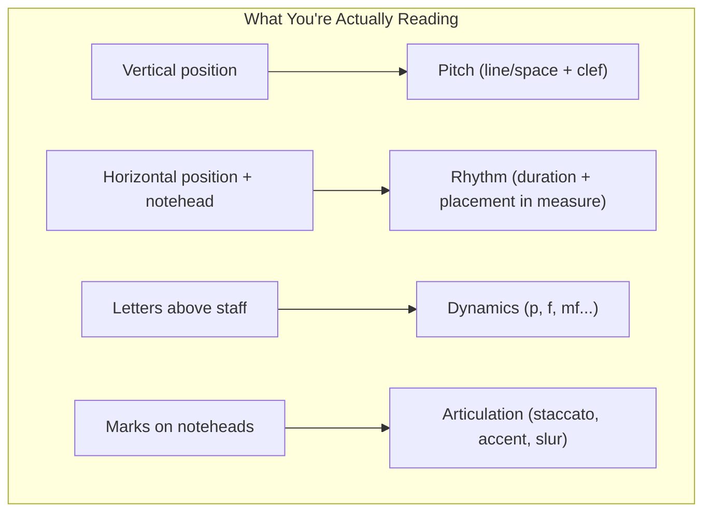
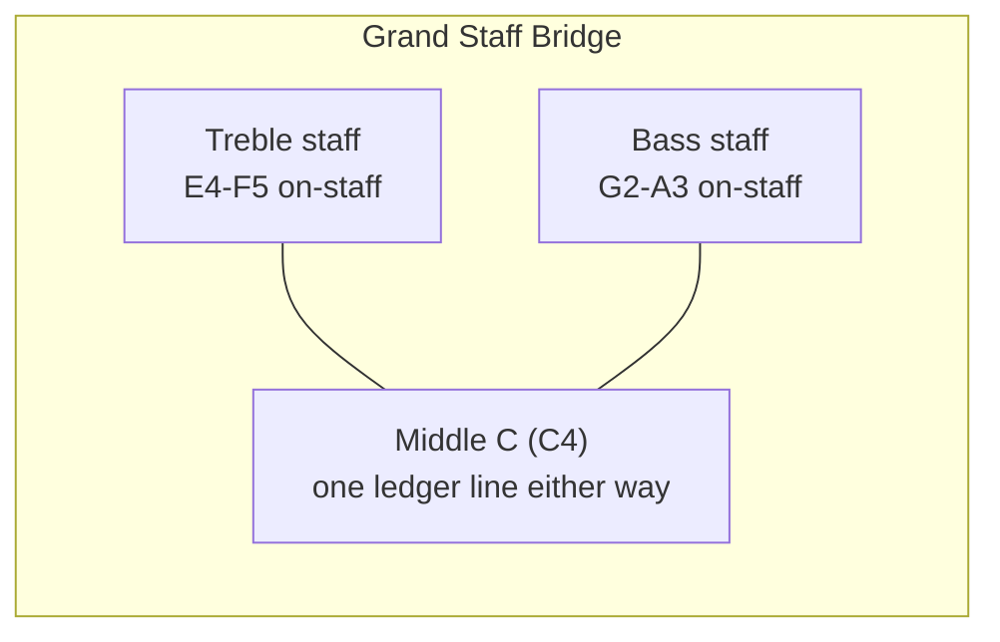
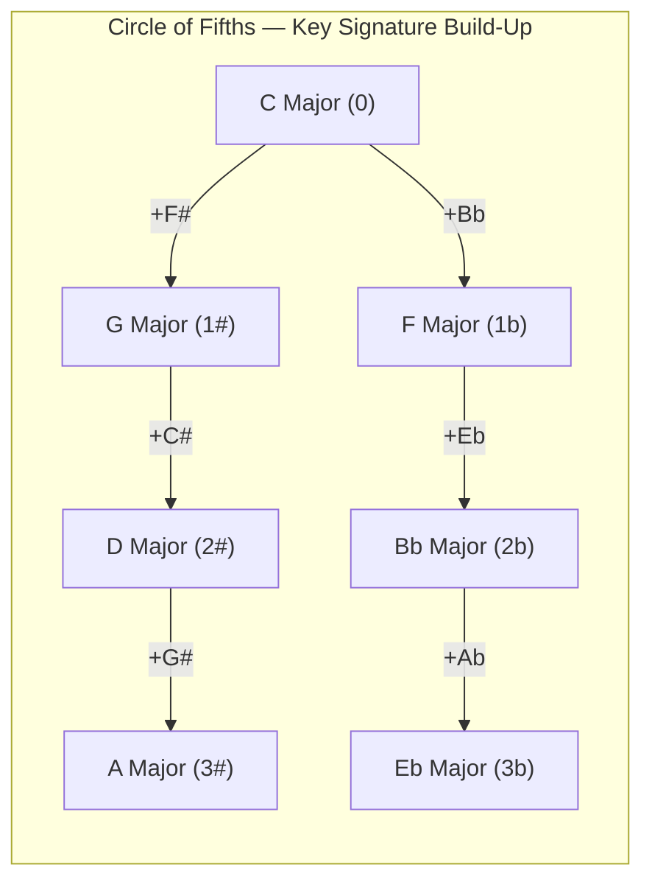
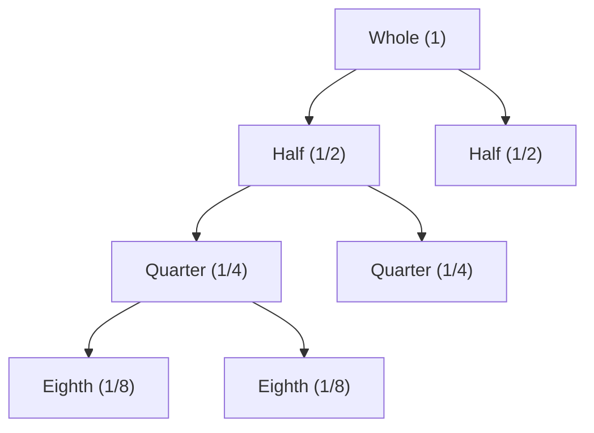

# Lesson 1: Music Notation — Reading the Staff Fluently at the Instrument

## 1. What Notation Actually Encodes (Read This Once, Then Go Practice)

Notation maps four things onto paper: **pitch** (vertical position), **rhythm** (horizontal position + notehead shape), **dynamics** (letters/symbols), and **articulation** (marks above/below the note). It is a lossy, practical shorthand — it tells a competent musician *enough* to reconstruct the music, and leaves the rest (microtiming, exact loudness, tone color) to tradition and taste. You don't need the information theory to read music. You need to drill the four encodings until your eye sees "G major triad" instead of three separate dots.

The one piece of physics worth carrying in your head: pitch is logarithmic. Going up an octave doubles the frequency, but on the staff it's always the same visual jump of seven lines/spaces. That's why staff position, not frequency, is the right mental model — stop thinking in Hz and start thinking in steps.

## 2. The Staff and Clefs — Build Instant Recognition, Not Counting

The five-line staff gives you nine slots (5 lines + 4 spaces), each one diatonic step from its neighbor. A clef just tells you which pitch sits on which line. Stop counting up from a known line every time — that's the #1 speed killer for beginning readers. Memorize anchor points and read by shape.

### Treble clef (G clef) — anchor: G4 on the 2nd line from bottom

| Position | Bottom → Top |
|---|---|
| Lines | E4 – G4 – B4 – D5 – F5 |
| Spaces | F4 – A4 – C5 – E5 |

Mnemonics: Lines = "**E**very **G**ood **B**oy **D**oes **F**ine." Spaces spell **FACE**.

### Bass clef (F clef) — anchor: F3 on the 4th line from bottom

| Position | Bottom → Top |
|---|---|
| Lines | G2 – B2 – D3 – F3 – A3 |
| Spaces | A2 – C3 – E3 – G3 |

Mnemonics: Lines = "**G**ood **B**oys **D**o **F**ine **A**lways." Spaces = "**A**ll **C**ows **E**at **G**rass."

### Alto clef (C clef) — anchor: middle C (C4) on the middle line (viola players: this is your home clef)

| Position | Bottom → Top |
|---|---|
| Lines | F3 – A3 – C4 – E4 – G4 |
| Spaces | G3 – B3 – D4 – F4 |

**Practical rule:** treat bass clef as its own language, not "treble clef minus something." Students who translate bass clef through treble clef permanently cap their reading speed around 60 BPM. Learn it cold.

### Ledger lines

Ledger lines extend the staff using the same line-space alternation. Past two ledger lines, don't count from scratch — use octave displacement: mentally drop the pitch an octave onto a staff position you know instantly, identify it, then shift back up. Example: two ledger lines above the treble staff = C6, exactly one octave above C5 (the third space of the staff).

## 3. Accidentals and Key Signatures — The State Machine You Must Automate

**Accidentals** (♯ raise a semitone, ♭ lower a semitone, ♮ cancel) apply to every note at that exact staff position for the rest of the *measure*, then reset at the barline. Miss this and you'll play a wrong note on beat 3 that was correct on beat 1.

**Key signatures** front-load the accidentals for the whole piece. Sharps accumulate F♯-C♯-G♯-D♯-A♯-E♯-B♯; flats accumulate B♭-E♭-A♭-D♭-G♭-C♭-F♭. Don't count them — use the identification shortcuts:

- **Sharp keys:** the last sharp in the signature is the leading tone (7th degree). Go up a semitone → that's the major key. Signature ends on C♯? Key is D major.
- **Flat keys:** the *second-to-last* flat is the tonic. Flats are B♭-E♭-A♭? Tonic is E♭ major. (One flat only = F major; memorize this single exception.)

## 4. Rhythm — Binary Subdivision You Can Tap

Durations halve: whole → half → quarter → eighth → sixteenth → thirty-second. That's it — each note is worth exactly half the one before it, which is why beaming and flags visually nest. Tempo (BPM) then converts these *relative* values into real seconds: a quarter note at 120 BPM lasts 0.5 seconds (60 ÷ BPM).

**Time signature** = beats per measure (top) / note value that gets one beat (bottom). 4/4 and 3/4 are simple meter (beat divides into 2); 6/8, 9/8, 12/8 are compound meter (beat divides into 3 — six eighths group as TWO beats of three, not six).

## 5. Dynamics and Articulation — The Envelope of Each Note

Dynamics are *ordinal*, not decibel values: pp < p < mp < mf < f < ff. Hairpins (`<` crescendo, `>` decrescendo) show gradual change. Articulation shapes attack/release: staccato (·) cuts the note to roughly half its written length, tenuto (−) holds full value with slight weight, accent (>) punches the attack, legato (slur) connects notes with zero gap, fermata holds at the performer's discretion. Think of these as a hand-drawn ADSR envelope layered on top of the pitch/rhythm grid.

**Tempo terms**, approximate BPM: Largo 40–60, Adagio 66–76, Andante 76–108, Moderato 108–120, Allegro 120–168, Presto 168–200. A metronome marking (♩ = 120) removes the ambiguity entirely — use it when precision matters more than character.

## 6. Hands-On Reading Drills

### Drill 1 — Treble Clef Staff Position Sprint
Metronome 60 BPM. On each click, point to a random line/space and say the pitch name out loud before the next click. Cycle all nine positions randomly. Progress 60 → 80 → 100 BPM once you hit zero errors for two full passes.
**Trap:** B4 (middle line) vs D5 (one line up) — B4 sits dead center of the staff, D5 is clearly above it.

### Drill 2 — Bass Clef Staff Position Sprint
Same procedure, bass clef only, no mental translation through treble. Anchor on F3 (4th line) and A2 (1st space) as your two reference points, read everything relative to those. 60 → 80 → 100 BPM.

### Drill 3 — Ledger Line Navigation
Start with one ledger line each direction (treble: D4 below, A5 above; bass: F2 below, B3 above). Name each aloud, then add a second ledger line, then a third. At three-plus, use the octave-displacement trick from Section 2.

### Drill 4 — Rhythm Subdivision Grid (physical tapping)
Metronome 60 BPM = quarter note.
1. Right hand quarters, left hand eighths (1:2) — two taps per click, evenly spaced.
2. Right hand quarters, left hand sixteenths (1:4) — four taps per click.
3. Right hand dotted quarters, left hand eighths (3:2 polyrhythm) — the classic trap rhythm.
4. Right hand half notes, left hand eighth-note triplets (1:6).

Master each level at 60 BPM with zero drift before moving to 80, then 100 BPM. At 120 BPM your left hand is firing 8 sixteenths per second — that's baseline speed for fast classical/jazz reading.

### Drill 5 — Key Signature Flash Recognition
Flashcards (physical or app) showing a key signature on a blank staff. Name the major key AND its relative minor instantly using the shortcuts in Section 3. Timed challenge: one card per metronome click at 60 BPM, then 80 BPM.

### Drill 6 — Interval Recognition by Staff Distance
Reference from C4 (treble): m2/M2 = adjacent staff position, m3/M3 = two positions, P4 = three positions, P5 = four positions, octave = seven positions. Write 20 random note-pairs, identify the interval by counting positions first, adjust for accidentals second, then sing it to lock the sound to the shape. Target: 30 intervals/minute.
**Trap:** M3 (two positions: line-space-line) vs P4 (three positions: line-space-line-space) — count the positions, don't eyeball the gap.

### Drill 7 — Rhythmic Dictation
Use a metronome app with a programmable click pattern, or have a practice partner clap patterns. Listen, clap it back to confirm, then notate it with correct beaming.
- Week 1: quarters and halves only
- Week 2: add eighths
- Week 3: add dotted rhythms
- Week 4: add sixteenths
- Week 5: syncopation

### Drill 8 — Grand Staff Clef Switching (piano)
Hanon No. 1 or any simple two-hand exercise. Hands separately at 40 BPM first, then together at 50 BPM. Read in chunks, not note-by-note: a C major triad in either clef is "space-line-space" — recognize the whole snowman shape, not three isolated dots. Progress 40 → 60 → 80 → 100 BPM; 100 BPM hands-together is the entry speed for Bach's Two-Part Inventions.

## 7. Applied Repertoire Walkthroughs

### Bach — Minuet in G Major (BWV Anh. 114)
**Setup:** Key signature 1♯ (F♯ everywhere unless cancelled). Time signature 3/4. Right hand treble (melody), left hand bass (Alberti-style accompaniment).

**Measure 1, right hand:** D5 (beat 1) – G4 (beat 2) – A4 (beat 3), all quarter notes.
**Measure 1, left hand:** G2 held through the bar (dotted half, or half+quarter depending on edition).

**Practice sequence:**
1. Clap the right-hand rhythm at 60 BPM, speaking pitch names.
2. Right hand alone at 40 BPM — every F must be F♯.
3. Left hand alone at 40 BPM.
4. Hands together at 40 BPM → 60 BPM (performance tempo) → 80 BPM for fluency margin.

**Watch for:** forgetting the key signature on F (playing F♮), and rushing beat 3 of the waltz — keep all three beats equal weight until you intentionally shape the phrase.

### Beethoven — "Ode to Joy" Theme (simplified, C major)
Entirely stepwise quarter notes, 4/4. If you ever see a leap larger than a 3rd in this melody, you misread a note — check immediately.

**Drill:** Sing the melody on note names first. Then play measures 1–4 piano and measures 5–8 forte at 60 BPM — the dynamic contrast is the actual lesson here, not the pitches.

### Scott Joplin — "The Entertainer" (opening strain, right hand)
2/4 time, C major. Beat 1 contains a sixteenth rest followed by three sixteenths — the melody enters *after* the beat, which is what makes it ragtime syncopation rather than a straight march.

**Practice sequence:**
1. Clap the rhythm on one pitch at 40 BPM, counting "1-e-and-a, 2-and" aloud.
2. Add pitches at 40 BPM, keeping the three sixteenths perfectly even.
3. Build to 60 BPM, then 100 BPM.

**Trap:** playing those opening sixteenths on the beat instead of after it erases the syncopation entirely — it will sound like a different, boring piece.

## 8. Sight-Reading Protocol

**Rule one: never stop.** A wrong note that keeps tempo is recoverable; a stop breaks the one thing sight-reading is testing — your ability to keep moving forward under uncertainty.

**20-minute daily routine:**
- Weeks 1–2: rhythm only. Clap one new piece per day from a graded sight-reading book (Paul Harris, "Improve Your Sight-Reading," Grade 1), metronome 60 BPM, counting aloud. Never repeat a piece — repetition turns sight-reading into memorization.
- Weeks 3–4: single-line melody, 50 BPM, 30-second preview allowed (key signature, time signature, contour), then play through once.
- Weeks 5–6: grand staff, both hands, 60-second preview, 40 BPM, prioritize rhythm over pitch accuracy.
- Week 7+: raise tempo 40 → 50 → 60 BPM, add syncopation and triplets, start tracking dynamics/articulation.

**Error priority when something goes wrong mid-read:** fix rhythm first (it destroys ensemble/flow), then pitch (sounds wrong but harmony survives), then articulation/dynamics last (polish, not survival). Target 90% rhythmic accuracy and 70% pitch accuracy on a true first read — professionals don't sight-read perfectly either.

**30-second preview checklist before any new piece:** key signature and tonic, time signature and beat unit, tempo marking, whether hands-separate practice is possible, and the highest/lowest pitches plus cadence points.

## 9. Notation Software — Getting Music Onto the Page

### Choosing a platform
- **MuseScore** (free): best starting point, full classical/jazz/pop feature set, exports PDF/MIDI/MusicXML/audio.
- **Sibelius** (commercial): industry standard for film scoring and publishing-grade engraving.
- **Dorico** (commercial): newest pro tool, best engraving automation and multi-part extraction.
- **Finale** (commercial, legacy, no longer developed): still common in older workflows.

### Building a lead sheet in MuseScore (concrete steps)
1. File → New Score → "Lead Sheet" template → set key (C major) and time signature (4/4) → 16 measures.
2. Click measure 1 beat 1, press **N** (note input mode), press **5** (quarter note), type letter names or click the staff to enter C4-D4-E4-F4.
3. Press **4** for eighth notes, enter G4-A4; press **6** for a half note, enter B4.
4. Click the note under a chord change, press **Ctrl+K** (**Cmd+K** on Mac), type `Cmaj7` — it renders as a proper chord symbol. Press **Space** to advance and repeat at each chord change.
5. Press **Space** to audition playback. Export via File → Export → PDF (print), MIDI (DAW/slow-down tools), or MusicXML (cross-platform compatibility with Sibelius/Dorico/Finale).

### Universal keyboard shortcuts
`N` note input · `Esc` exit input · `3/4/5/6` sixteenth/eighth/quarter/half duration · `↑/↓` chromatic step · `Ctrl+↑/↓` octave step · `R` repeat last note/passage · `Space` play/pause · `Delete` remove selection.

### Multi-voice piano notation (e.g., Bach, Chopin)
1. Open a piano (grand staff) score, click the first treble-clef note.
2. Press **1** for Voice 1 (stems up) — enter the melody.
3. Press **2** for Voice 2 (stems down) — enter the accompanying held notes.
4. Press **Esc** to exit. The staff now shows two independent rhythmic layers, which is exactly how polyphonic piano writing is read and performed.

## 10. Troubleshooting Common Reading Errors

**Pitch reading is too slow to hold tempo.** You're reading note-by-note instead of recognizing shapes. Fix: drill intervals as shapes (Drill 6), memorize triad/seventh-chord outlines as single units, and practice re-labeling a C-major piece in scale-degree numbers (1-2-3...) instead of letter names to force pattern thinking.

**Rhythm is correct in pitch but uneven in time.** Your internal pulse is weak. Fix: metronome on for every practice session for two months minimum, tap your foot on every beat even when it feels awkward, count subdivisions aloud ("1-e-and-a"). Record yourself; if tempo drifts more than 5 BPM across a passage, your pulse needs recalibration.

**You forget the key signature partway through.** Fix: write the signature at the start of every line while learning (redundant but effective), say the key aloud before each line ("G major, one sharp, F♯"), and warm up on the scale of the piece's key before reading it so the accidentals are in your hands before your eyes need them.

**You read bass clef as if it were treble, or vice versa.** Fix: cover one staff with paper and drill the other clef in isolation for a full week; use dedicated flashcards for the weak clef 10 minutes/day; try playing a bass-clef melody with your right hand to decouple "clef" from "hand" in your brain.

**Ledger lines cause hesitation.** Fix: memorize landmark pitches just outside the staff (treble: C4 below, A5 above) and use octave displacement for anything further out — shift the note down an octave to a position you know cold, identify it, then shift back up mentally.

## 11. Mastery Checklist

**Weeks 1–2:**
- [ ] Name any treble-clef line/space pitch in under 1 second
- [ ] Name any bass-clef line/space pitch in under 1 second
- [ ] Instantly identify key signatures up to 3 sharps/flats
- [ ] Clap quarter/half/eighth rhythms cleanly at 60 BPM

**Weeks 3–4:**
- [ ] Sight-read simple single-clef melodies at 50 BPM, new material daily
- [ ] Identify any interval unison–octave by staff distance
- [ ] Play dotted rhythms and basic syncopation accurately
- [ ] Read two ledger lines above/below the staff without hesitation

**Weeks 5–8:**
- [ ] Sight-read Grade 2 piano repertoire hands-together at 40 BPM
- [ ] Transcribe a clapped four-beat rhythm into correct notation
- [ ] Build a lead sheet with chord symbols in MuseScore from scratch
- [ ] Instantly identify all 15 key signatures (0–7 sharps/flats)

**Month 3+:**
- [ ] Sight-read Grade 3–4 repertoire at 75% of marked tempo
- [ ] Read alto and/or tenor clef fluently
- [ ] Notate independent multi-voice piano textures
- [ ] Pull basic harmonic analysis directly off the page (continues in Lesson 2: Harmony Fundamentals)

The only way notation becomes transparent is repetition under a metronome. Treat every drill above as a strength-training exercise for your eyes and hands, not a reading comprehension test — speed comes from reps, not from understanding the system better.
