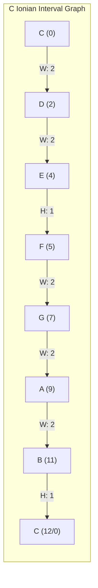
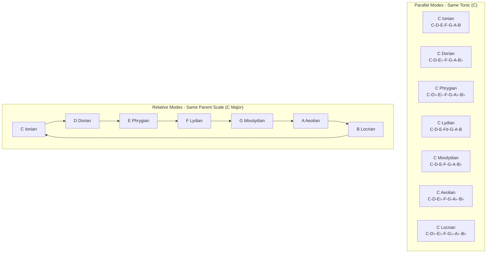

# Lesson 2: Scales and Modes

## 1. First-Principles Intuition & Invariants

Western music theory rests on a mathematical foundation where scales and modes emerge from the intersection of acoustic physics, perceptual psychology, and cultural convention. A scale is an ordered subset of pitches drawn from a tuning system, while a mode represents a specific rotation or reordering of that subset, each yielding distinct intervallic relationships that shape harmonic and melodic behavior.

### The Physics of Tuning Systems

The Western chromatic scale divides the octave into twelve equal steps through **equal temperament** (12-TET), a logarithmic tuning system where each semitone represents a frequency ratio of exactly \(2^{1/12} \approx 1.05946\). Given a reference frequency \(f_0\) (typically A4 = 440 Hz), the frequency of any note \(n\) semitones away is:

\[ f_n = f_0 \cdot 2^{n/12} \]

This system approximates but does not perfectly match the **just intonation** intervals derived from integer frequency ratios that appear in the harmonic series. For example, a just perfect fifth has a ratio of 3:2 (≈ 1.5000), while a 12-TET perfect fifth (7 semitones) yields \(2^{7/12} \approx 1.4983\)—a difference of approximately 2 cents. Equal temperament sacrifices acoustic purity for **transpositional symmetry**: any interval pattern sounds identical regardless of starting pitch, enabling free modulation between keys.

The octave itself—the most fundamental interval in Western music—corresponds to a 2:1 frequency ratio. This ratio is perceptually special because frequencies in 2:1 relationship produce overlapping harmonics at every other partial, creating a sense of equivalence that allows us to treat C4 (261.63 Hz) and C5 (523.25 Hz) as manifestations of the same pitch class.

### Ancient Greek Tetrachords and Modal Construction

The seven diatonic modes trace their conceptual lineage to ancient Greek music theory, which organized pitch space through **tetrachords**—four-note patterns spanning a perfect fourth. Two tetrachords separated by a whole tone formed the ancient Greek scales. While modern modes differ structurally from their Greek namesakes, they preserve the principle of modal identity through interval permutation.

In contemporary theory, the seven modes derive from rotation of the major scale (Ionian mode). Starting the pattern C-D-E-F-G-A-B-C on each successive degree generates a unique mode with distinct interval architecture:

| Mode | Starting Degree | Interval Pattern | Character |
|------|----------------|------------------|-----------|
| Ionian | 1 | W-W-H-W-W-W-H | Major tonality, stable resolution |
| Dorian | 2 | W-H-W-W-W-H-W | Minor with raised 6th, balanced tension |
| Phrygian | 3 | H-W-W-W-H-W-W | Minor with lowered 2nd, dark/exotic |
| Lydian | 4 | W-W-W-H-W-W-H | Major with raised 4th, bright/floating |
| Mixolydian | 5 | W-W-H-W-W-H-W | Major with lowered 7th, bluesy/modal |
| Aeolian | 6 | W-H-W-W-H-W-W | Natural minor, introspective |
| Locrian | 7 | H-W-W-H-W-W-W | Diminished 5th, unstable/theoretical |

Here W denotes a whole step (2 semitones) and H a half step (1 semitone). The characteristic intervals—particularly the 3rd, 6th, and 7th scale degrees—determine whether a mode sounds major-like, minor-like, or ambiguous.

### Theoretical Invariants

Three principles govern modal behavior:

1. **Interval class preservation under transposition**: Transposing a mode to any pitch class preserves its interval structure and therefore its sonic character. D Dorian and A Dorian share identical intervallic relationships despite starting on different pitches.

2. **Functional hierarchy from scalar position**: The tonic (first degree) establishes the gravitational center. Scale degrees possess functional tendencies—the leading tone (7th) resolves upward to the tonic, the subdominant (4th) creates tension resolved by the mediant (3rd).

3. **Harmonic implications through tertian stacking**: Stacking thirds above each scale degree generates the mode's characteristic chord qualities. Ionian produces a major tonic triad; Dorian produces a minor tonic triad with a major submediant chord, distinguishing it from Aeolian.


## 2. Core Architecture & Mechanics

### Computational Representation of Pitch Systems

In computational music theory, pitches are typically represented using the **MIDI (Musical Instrument Digital Interface)** standard, where each integer from 0 to 127 corresponds to a specific pitch. Middle C (C4) is MIDI note 60, with each increment representing one semitone. This representation provides several advantages:

1. **Linear arithmetic operations**: Transposition becomes simple addition/subtraction
2. **Octave equivalence**: Notes differing by 12 are in octave relationship
3. **Direct mapping to 12-TET**: Each MIDI value represents an equal-tempered semitone

The C major scale (C Ionian) in MIDI notation:

```
[60, 62, 64, 65, 67, 69, 71, 72]
```

D Dorian mode in MIDI notation:

```
[62, 64, 65, 67, 69, 71, 72, 74]
```

### Algorithmic Scale Generation

Rather than hardcoding scale patterns, we can generate modes algorithmically from interval templates. Here's a robust Python implementation:

```python
from typing import List, Dict
from enum import Enum

class Mode(Enum):
    IONIAN = [2, 2, 1, 2, 2, 2, 1]
    DORIAN = [2, 1, 2, 2, 2, 1, 2]
    PHRYGIAN = [1, 2, 2, 2, 1, 2, 2]
    LYDIAN = [2, 2, 2, 1, 2, 2, 1]
    MIXOLYDIAN = [2, 2, 1, 2, 2, 1, 2]
    AEOLIAN = [2, 1, 2, 2, 1, 2, 2]
    LOCRIAN = [1, 2, 2, 1, 2, 2, 2]

class Scale:
    """
    Represents a musical scale with MIDI-based pitch representation.
    
    Invariants:
    - All MIDI values are in range [0, 127]
    - Intervals are derived from mode definition
    - Scale maintains ascending pitch order
    """
    
    def __init__(self, root: int, mode: Mode):
        if not (0 <= root <= 127):
            raise ValueError(f"Root MIDI value {root} outside valid range [0, 127]")
        
        self.root = root
        self.mode = mode
        self._notes = self._generate_scale()
    
    def _generate_scale(self) -> List[int]:
        """Generate scale notes from root and interval pattern."""
        notes = [self.root]
        current = self.root
        
        for interval in self.mode.value:
            current += interval
            if current > 127:
                break  # Stop if we exceed MIDI range
            notes.append(current)
        
        return notes
    
    @property
    def notes(self) -> List[int]:
        """Return immutable view of scale notes."""
        return self._notes.copy()
    
    def degree(self, n: int) -> int:
        """
        Return the nth scale degree (1-indexed).
        
        Args:
            n: Scale degree (1 = root, 2 = supertonic, etc.)
        
        Returns:
            MIDI value of the requested scale degree
        
        Raises:
            IndexError: If degree is outside scale range
        """
        if not (1 <= n <= len(self._notes)):
            raise IndexError(f"Scale degree {n} outside range [1, {len(self._notes)}]")
        return self._notes[n - 1]
    
    def transpose(self, semitones: int) -> 'Scale':
        """
        Transpose the scale by a given number of semitones.
        
        Args:
            semitones: Number of semitones to transpose (positive = up, negative = down)
        
        Returns:
            New Scale object transposed by the specified interval
        """
        new_root = self.root + semitones
        if not (0 <= new_root <= 127):
            raise ValueError(f"Transposition would result in root {new_root} outside MIDI range")
        return Scale(new_root, self.mode)
    
    def interval_vector(self) -> List[int]:
        """
        Return the interval vector (semitone distances between consecutive notes).
        """
        return self.mode.value.copy()
    
    def __repr__(self) -> str:
        note_names = ['C', 'C♯', 'D', 'D♯', 'E', 'F', 'F♯', 'G', 'G♯', 'A', 'A♯', 'B']
        root_name = note_names[self.root % 12]
        octave = (self.root // 12) - 1
        return f"Scale({root_name}{octave} {self.mode.name}, notes={self._notes})"

# Usage examples
c_major = Scale(60, Mode.IONIAN)
print(c_major)  # Scale(C4 IONIAN, notes=[60, 62, 64, 65, 67, 69, 71, 72])

d_dorian = Scale(62, Mode.DORIAN)
print(d_dorian.notes)  # [62, 64, 65, 67, 69, 71, 72, 74]

# Transpose C major up a perfect fifth (7 semitones) to G major
g_major = c_major.transpose(7)
print(g_major)  # Scale(G4 IONIAN, notes=[67, 69, 71, 72, 74, 76, 78, 79])
```

### Graph-Based Modal Analysis

Representing scales as directed graphs illuminates their interval structure and enables formal analysis of voice-leading paths. Each node represents a pitch class (MIDI mod 12), and each edge represents an interval with weight corresponding to semitone distance.



This graph representation enables several analytical operations:

1. **Shortest path analysis**: Find optimal voice-leading between two pitches
2. **Cycle detection**: Identify when a scale completes an octave
3. **Subgraph isomorphism**: Compare interval structures between modes
4. **Directed graph traversal**: Model melodic motion through scale degrees

Here's a Rust implementation using an adjacency list for space-efficient scale representation:

```rust
use std::collections::HashMap;

#[derive(Debug, Clone, Copy, PartialEq, Eq, Hash)]
pub enum Interval {
    Unison = 0,
    Minor2nd = 1,
    Major2nd = 2,
    Minor3rd = 3,
    Major3rd = 4,
    Perfect4th = 5,
    Tritone = 6,
    Perfect5th = 7,
    Minor6th = 8,
    Major6th = 9,
    Minor7th = 10,
    Major7th = 11,
    Octave = 12,
}

#[derive(Debug, Clone)]
pub struct ScaleGraph {
    // Adjacency list: pitch -> (target_pitch, interval_semitones)
    edges: HashMap<u8, Vec<(u8, u8)>>,
    root: u8,
}

impl ScaleGraph {
    pub fn from_intervals(root: u8, intervals: &[u8]) -> Self {
        let mut edges = HashMap::new();
        let mut current = root;
        
        for &interval in intervals {
            let next = (current + interval) % 12;
            edges.entry(current).or_insert_with(Vec::new).push((next, interval));
            current = next;
        }
        
        ScaleGraph { edges, root }
    }
    
    /// Find all pitches reachable from the root within n steps
    pub fn reachable_pitches(&self, max_steps: usize) -> Vec<u8> {
        let mut visited = vec![self.root];
        let mut frontier = vec![self.root];
        
        for _ in 0..max_steps {
            let mut next_frontier = Vec::new();
            for &node in &frontier {
                if let Some(neighbors) = self.edges.get(&node) {
                    for &(next, _) in neighbors {
                        if !visited.contains(&next) {
                            visited.push(next);
                            next_frontier.push(next);
                        }
                    }
                }
            }
            frontier = next_frontier;
            if frontier.is_empty() {
                break;
            }
        }
        
        visited.sort();
        visited
    }
    
    /// Calculate the total interval distance traversing the scale
    pub fn total_span(&self) -> u16 {
        let mut total: u16 = 0;
        let mut current = self.root;
        let mut visited = vec![current];
        
        while let Some(neighbors) = self.edges.get(&current) {
            if let Some(&(next, interval)) = neighbors.first() {
                if visited.contains(&next) && next == self.root {
                    break; // Completed cycle
                }
                total += interval as u16;
                visited.push(next);
                current = next;
            } else {
                break;
            }
        }
        
        total
    }
}

// Example: C Ionian (Major) scale
fn main() {
    let c_ionian = ScaleGraph::from_intervals(0, &[2, 2, 1, 2, 2, 2, 1]);
    println!("Reachable pitches: {:?}", c_ionian.reachable_pitches(7));
    println!("Total span: {} semitones", c_ionian.total_span());
}
```

### Modal Rotation and Parallel Mode Relationships

Understanding the relationship between parallel and relative modes is essential for harmonic analysis. **Parallel modes** share the same tonic but different interval structures (e.g., C Ionian vs. C Dorian), while **relative modes** are rotations of the same parent scale (e.g., C Ionian and D Dorian both derive from the C major scale).



## 3. High-Performance Optimization & Failure Modes

### Precomputation and Caching Strategies

Real-time music applications—digital audio workstations, software synthesizers, algorithmic composition engines—require sub-millisecond scale generation and lookup. Recomputing scale degrees on every access introduces unacceptable latency.

**Strategy 1: Lookup Table Precomputation**

For systems with bounded scope (e.g., 88-key piano range, MIDI 21-108), precompute all scales at initialization:

```python
from typing import Dict, Tuple
import numpy as np

class ScaleCache:
    """
    Precomputed scale lookup table for O(1) access.
    
    Memory usage: 7 modes × 12 roots × 8 notes × 1 byte = 672 bytes
    (Minimal for modern systems)
    """
    
    def __init__(self):
        self._cache: Dict[Tuple[int, str], np.ndarray] = {}
        self._build_cache()
    
    def _build_cache(self):
        """Precompute all scales in 12-TET across one octave."""
        modes = {
            'ionian': [2, 2, 1, 2, 2, 2, 1],
            'dorian': [2, 1, 2, 2, 2, 1, 2],
            'phrygian': [1, 2, 2, 2, 1, 2, 2],
            'lydian': [2, 2, 2, 1, 2, 2, 1],
            'mixolydian': [2, 2, 1, 2, 2, 1, 2],
            'aeolian': [2, 1, 2, 2, 1, 2, 2],
            'locrian': [1, 2, 2, 1, 2, 2, 2]
        }
        
        for root in range(12):  # All pitch classes
            for mode_name, intervals
