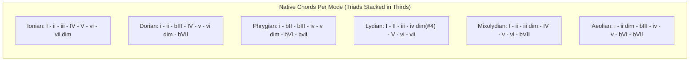
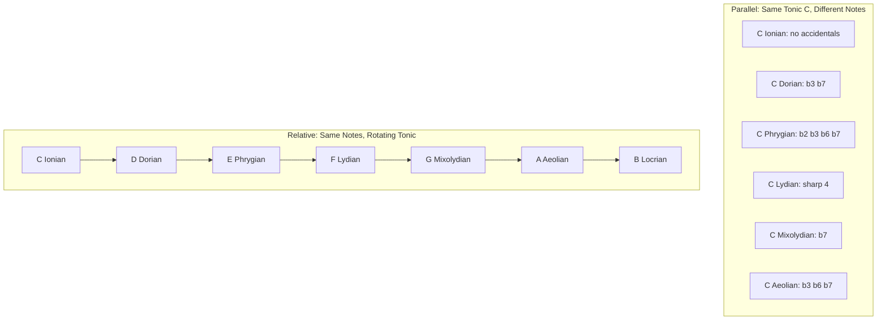

# Lesson 2: Scales and Modes – From Fingerboard to Functional Harmony

## 1. First-Principles Intuition (15%)

### Why These Seven Patterns and No Others

Western diatonic modes exist because of a collision between acoustics and ergonomics. The harmonic series gives us consonant integer ratios (octave 2:1, fifth 3:2, fourth 4:3); human pitch discrimination tops out around 12 usable steps per octave before intervals stop feeling distinct; and centuries of vocal polyphony selected the 7-note diatonic collection as the sweet spot between melodic variety and singability. **Equal temperament (12-TET)** splits the octave into 12 identical semitones (ratio $2^{1/12}\approx1.05946$) so that any scale shape sounds the same starting from any note — this is the only physics fact you need to internalize, because it's the reason a guitar fretboard pattern or a piano fingering is *movable*. A 12-TET fifth is 700 cents versus a "pure" 702 cents — 2 cents of compromise nobody but a tuner notices.

Practically: everything below is a **shape**. Learn the shape once, slide it anywhere.

### The Seven Modes, One Parent Scale

Each mode is the same set of notes starting on a different degree. Play only white keys on a piano starting on each letter and you get all seven:

| Mode | Starts on (C major) | Step pattern | Signature degree | Character |
|---|---|---|---|---|
| **Ionian** | C | W-W-H-W-W-W-H | Maj 3, Maj 7 | Bright, resolved |
| **Dorian** | D | W-H-W-W-W-H-W | min 3, **Maj 6** | Minor but jazzy, not sad |
| **Phrygian** | E | H-W-W-W-H-W-W | **♭2**, min 3 | Dark, flamenco |
| **Lydian** | F | W-W-W-H-W-W-H | Maj 3, **#4** | Dreamy, film-score |
| **Mixolydian** | G | W-W-H-W-W-H-W | Maj 3, **♭7** | Bluesy major |
| **Aeolian** | A | W-H-W-W-H-W-W | min 3, min 6, min 7 | Natural minor, melancholic |
| **Locrian** | B | H-W-W-H-W-W-W | **♭5** | Unstable, rarely a tonic |

**The one fact that unlocks all of modal theory**: the 3rd tells you major/minor; everything else (2nd, 4th, 6th, 7th) is color. Dorian's major 6th versus Aeolian's minor 6th is the entire difference between "jazzy minor" and "sad minor" — one semitone, enormous effect on mood.

```mermaid
graph TB
    subgraph sub_c_ionian ["C Ionian — Interval Anatomy"]
        C1["C (1, Root)"] -->|"W"| D1["D (2, Maj 2nd)"]
        D1 -->|"W"| E1["E (3, Maj 3rd)"]
        E1 -->|"H"| F1["F (4, Perf 4th)"]
        F1 -->|"W"| G1["G (5, Perf 5th)"]
        G1 -->|"W"| A1["A (6, Maj 6th)"]
        A1 -->|"W"| B1["B (7, Maj 7th)"]
        B1 -->|"H"| C2["C (8, Octave)"]
    end
    subgraph sub_d_dorian ["D Dorian — Same Notes, New Center"]
        D2["D (1, Root)"] -->|"W"| E2["E (2)"]
        E2 -->|"H"| F2["F (b3, min 3rd)"]
        F2 -->|"W"| G2["G (4)"]
        G2 -->|"W"| A2["A (5)"]
        A2 -->|"W"| B2["B (6, Maj 6th, signature)"]
        B2 -->|"H"| C3["C (b7, min 7th)"]
        C3 -->|"W"| D3["D (8, Octave)"]
    end
```



**Three invariants to carry to the instrument:**
1. A mode's "sound" is fixed by its interval pattern, not by which letters happen to be involved — D Dorian and G Dorian are the identical shape moved.
2. The tonic is a gravity well. Scale degree 7 (if a half-step below the tonic) pulls up into it; degree 4 creates tension that degree 3 resolves.
3. Stack thirds on every scale degree and you get the mode's native chords — this is how you harmonize a melody correctly instead of guessing.

## 2. Core Mechanics: Playing Scales on Real Instruments (85%)

### Piano/Keyboard

**Hand posture first, fingering second.** Curved fingers (as if lightly gripping a ball), relaxed wrist in a neutral line with the forearm, weight transferred from the arm into the key rather than stabbed with the finger alone. Tension in the wrist is the #1 cause of scales sounding clipped and uneven at speed.

**C major, right hand: 1-2-3-1-2-3-4-5.**
- The thumb *tucks under* the hand after finger 3 plays E, landing on F without a position jump. Practice this tuck in isolation: play E with finger 3, then tuck 1 under and land softly on F, dozens of times slowly before adding the rest of the scale.
- Left hand: **5-4-3-2-1-3-2-1** — mirror logic, finger 3 crosses *over* the thumb after the thumb plays C.

**Flat keys change the tuck point.** F major RH: **1-2-3-4-1-2-3-4** — note finger 4 lands on B♭, not finger 3, because the black key sits better under a longer finger. Db major RH starts with finger 2 or 3 on the black key, keeping the thumb free for the next white key — thumbs are weak on black keys and should avoid them where possible.

**Drill progression (apply to any scale, both hands):**
1. Hands separate, quarter notes, 60 BPM. Listen for identical volume on every note — this is the actual skill, not speed.
2. Hands together, parallel motion (both ascending or both descending together), 60 → 80 → 100 BPM.
3. Hands together, contrary motion (RH ascends, LH descends, both starting on C/C an octave apart) — this uses mirrored fingerings (1 against 1, thumbs together) and is easier than it looks once you see the symmetry.
4. Add dynamics: crescendo ascending, diminuendo descending, to force even tone control under expression.

**Dorian and Aeolian on piano** cost you nothing extra in fingering if you stay on the white keys — D Dorian and A Aeolian use the *identical* RH 1-2-3-1-2-3-4-5 pattern as C major, just starting on a different key. This is the practical payoff of "modes are rotations": one fingering, seven sounds.

### Bass Guitar

**Ergonomics before notes.** Thumb anchored on the back of the neck roughly opposite the middle finger, never hooked over the top. Wrist kept straight in line with the forearm — a bent wrist under repetitive motion is how bassists get tendon problems.

**Frets 1–5: use Simandl 1-2-4, not one-finger-per-fret.** The gaps between low frets are wide; stretching finger 3 independently strains the hand. Instead finger 1 covers fret 1, finger 2 covers fret 2, and finger 4 reaches fret 4, skipping finger 3 entirely in this register.

G major scale starting on the low E string, Simandl fingering:

```text
E string:  fret 3 (G) = finger 1
           fret 5 (A) = finger 2
A string:  fret 2 (B) = finger 1   [shift down a string]
           fret 3 (C) = finger 2
           fret 5 (D) = finger 4
D string:  fret 2 (E) = finger 1
           fret 4 (F#) = finger 3   [note: used here, upper neighbor]
           fret 5 (G) = finger 4
```

**Frets 7 and above: switch to One-Finger-Per-Fret (OFPF).** Fret spacing narrows enough that fingers 1-2-3-4 can each own one fret without strain — this is more efficient than Simandl up here and lets you play faster passages.

**Floating thumb muting**: rest the plucking-hand thumb on the string *below* the one you're playing. Playing the D string, thumb rests lightly on the A string. This kills sympathetic ringing from open strings without needing your fretting hand to mute anything — essential for clean recordings and live clarity.

**Practice drill**: G major scale, Simandl fingering, quarter notes, metronome 60 → 80 → 100 BPM. Record yourself and listen specifically for unwanted open-string ring; if you hear it, your thumb isn't floating correctly.

### Guitar: CAGED and 3-Notes-Per-String

The CAGED system gives five movable shapes covering the whole neck, named for the open chord each box resembles. For single-note scale runs, the most common modern approach is **3-notes-per-string**, which keeps picking mechanically even.

**C major, two octaves, starting 3rd fret A string:**

```text
e |---------------------------5--7--8--|
B |------------------5--7--8-----------|
G |------------4--5--7------------------|
D |------4--5--7------------------------|
A |3--5--7-------------------------------|
E |--------------------------------------|
```

Fingering per string: 1-3-4 or 1-2-4 depending on stretch comfort — keep finger 1 anchored to the lowest fret in each position and let 3 or 4 take the top note; don't let the hand creep forward prematurely.

**Picking mechanics**: strict alternate picking (down-up-down-up) through string changes is what makes 3-notes-per-string fast and even — the string crossings are planned so a downstroke always lands you in position to cross cleanly. Practice the crossing from G to D string in isolation at 60 BPM before attempting the full two octaves.

**Drill progression:**
1. Ascending/descending, alternate picking, 60 BPM eighth notes.
2. 80 BPM, then 100 BPM — do not increase tempo until the previous tempo is clean for four consecutive repetitions.
3. **Interval sequencing**: play the scale in 3rds (C-E, D-F, E-G, F-A…), then in 4ths, then 6ths. This is the single most effective drill for making scale tones usable in actual solos instead of just "running the scale."

**D Dorian box, same fretboard region:**

```text
e |----------------------10-12----------|
B |-----------------10-12---------------|
G |------------9-10----------------------|
D |------10-12----------------------------|
A |10-12----------------------------------|
E |----------------------------------------|
```

To make the Dorian color audible rather than just "D minor," phrase so your lines land on and linger on the 6th (B, fret 12 on the D string) rather than racing past it. A slight emphasis — a held note, a slow vibrato — on the characteristic tone is what separates "modal correctness" from "modal *sound*."

### Wind and Voice: Breath, Intonation, Solfège

**Movable-do solfège**, the fastest way to internalize modal color by ear:
- Ionian: Do-Re-Mi-Fa-Sol-La-Ti-Do
- Dorian: Do-Re-**Me**-Fa-Sol-La-**Te**-Do (Me = ♭3, Te = ♭7)
- Phrygian: Do-**Ra**-Me-Fa-Sol-**Le**-Te-Do (Ra = ♭2, Le = ♭6)

**Breath drill (sax, flute, clarinet, voice):**
1. One octave, whole notes, 40 BPM, one breath per full ascending-and-descending pass (8 notes up, implicitly the same down if doing a full cycle — start with just ascending if breath runs short).
2. Air column stays under constant diaphragmatic compression — no pulsing on each note. A pulse is audible as a slight volume bump at each note onset; if you hear it, you're using throat/chest to articulate instead of the tongue.
3. Repeat in Dorian. Deliberately exaggerate the ♭3 and the Maj 6 in your mental tuning reference — wind and voice intonation is adjusted by ear in real time, and you need a strong mental target for where those pitches sit relative to the tonic.

**Brass embouchure**: higher partials need a tighter, smaller aperture, not more air pressure thrown at a loose aperture. Lip-slur drills — slurring from a low scale tone to a higher one on the same fingering/slide position, no tongue articulation — build the aperture control needed for clean scale runs without cracked notes at register breaks.

### Modal Harmony in Practice

The fastest way to *hear* a mode is to play its native vamp, not just run its scale.

**Dorian vamp (D Dorian):** Dm7 – Em7 – Dm7 – Cmaj7 (i7–ii7–i7–♭VII∆7). The Cmaj7 is the tell — natural minor would use Cm, not Cmaj7. This is the exact harmonic fingerprint of "So What."

**Mixolydian (G Mixolydian):** G – F – G – C (I–♭VII–I–IV). The F major chord (not F# diminished, which pure G major would imply) is Mixolydian's signature — this is "Sweet Child O' Mine" territory.

**Phrygian (E Phrygian):** Em – F – Em – Dm (i–♭II–i–♭vii). The F major built on the lowered 2nd degree is Phrygian's dark fingerprint — flamenco and metal both live here.

**Drill:**
1. Play the progression on your instrument — piano block chords, guitar barre chords or arpeggios, bass root-fifth walking line.
2. Loop it (a DAW loop region or a looper pedal), then improvise using only the mode's scale tones, deliberately landing phrase endings on the characteristic tone (6th for Dorian, ♭7 for Mixolydian, ♭2 for Phrygian).
3. Record yourself, then listen back critically: does it sound modal, or does it accidentally slip into plain major/minor? If it slips, you're probably underusing the characteristic tone.



### Ear Training: Modal ID in Under 3 Seconds

**Daily 10-minute drill:**
1. Have a partner (or app: musictheory.net, teoria.com) play an ascending-descending scale.
2. Identify the mode before it finishes descending.
3. **Listening cheat sheet** — the fastest-to-spot feature of each mode:
   - Lydian: the 4th sounds "wrong-bright" — like major with a glitch.
   - Mixolydian: minor-ish 7th in an otherwise happy major scale — "bluesy major."
   - Dorian: a minor scale that doesn't feel sad — the 6th is doing the work.
   - Phrygian: the 2nd scale step is a half-step, immediately "Spanish/dark."
   - Aeolian: plain, unambiguous sad minor — no surprises.
   - Locrian: everything feels like it's sliding off a cliff — the ♭5 against the root never settles.

**Melodic context drill**: play "Scarborough Fair" (naturally Dorian) then alter only the 6th degree to flatten it into Aeolian. That single altered note is the entire perceptual shift — internalize it as a physical/aural landmark, not a definition to memorize.

## 3. Advanced Techniques & Failure Modes

### Parallel vs. Relative — The Error That Derails Beginners

**Relative modes** share notes, different tonics: C Ionian and D Dorian are both "the white keys," just centered differently. **Parallel modes** share a tonic, different notes: C Ionian vs. C Dorian both start on C but C Dorian has a ♭3 and ♭7.

**The error**: told to "play D Dorian," a beginner thinks "D major, but make the 3rd minor" (parallel thinking) instead of "the C major scale, but start on D and resolve to D" (relative thinking, which is what the term actually means in standard usage). Fix this by always asking "what's the parent major scale, and which degree is the tonic?" before touching the instrument.



**Modal interchange**: in a C major song, borrowing B♭ major (the ♭VII from C Mixolydian) or F minor (the iv from C Aeolian) adds color without abandoning C as the tonal center. This is how "Creep" (Radiohead) gets its lift — borrowing from the parallel minor while the melody stays major-key.

### Velocity Without Sloppiness

**Metronome progression for any new scale/mode shape:**
1. Week 1: 60 BPM quarter notes, hands separate (piano) or single position (guitar/bass) — focus entirely on clean articulation, zero tempo pressure.
2. Week 2: 80 BPM eighth notes, hands together or across positions.
3. Week 3: 100 BPM eighth notes, add dynamic shaping.
4. Week 4: 120 BPM, triplet subdivision.
5. Month 2+: 140–180 BPM sixteenth notes.

**The actual trap** is not slowness, it's advancing tempo before articulation is clean. Record every practice session on your phone. If you can't hear a clear gap between consecutive notes at a given tempo, you've gone too fast — drop 20 BPM and rebuild from there rather than pushing through.

### Composing in a Mode Without It Collapsing Into Major/Minor

1. Pick mode and tonic — e.g., E Phrygian.
2. Build the chord progression from the mode's native triads: Em – F – Dm – Em (i–♭II–♭vii–i).
3. Write the bass line with chromatic approach tones reinforcing the tonic: E → F → F# → G → E — the chromatic motion creates pull back to E without implying a key change.
4. Write the melody leaning on the ♭2 (F) and resolving down into E. Deliberately avoid F# (the natural major 2nd) except as a very brief passing tone — F# is the note that will make the piece sound like it slipped into E natural minor with an accidental.
5. Arrange with percussion and pads, returning to the Em tonic chord often enough that the ear never loses the center.

**Diagnostic**: if your Phrygian piece sounds like plain minor, you're overusing the 3rd/6th and underusing the ♭2. The ♭2 is not optional color here, it's the mode's entire identity.

## 4. Real-World Applications

**Jazz — modal improvisation**: Miles Davis's "So What" sits on D Dorian for 16 bars, moves to E♭ Dorian for 8, returns to D Dorian for 8 — no chord changes to navigate, just the mode itself as the entire harmonic environment. Practice approach: learn the head, then solo over a static Dm7 vamp using only D Dorian tones, prioritizing rhythmic placement and silence over note density — this is the actual skill the tune is designed to teach.

**Rock/pop**: "Sweet Home Alabama" (D–C–G) is D Mixolydian (I–♭VII–IV). "Losing My Religion" leans on A Aeolian. Rock's default move is Mixolydian for upbeat major-feel songs, Aeolian for darker minor-feel songs — recognizing this from the chord letters alone speeds up both transcription and songwriting.

**Flamenco — Phrygian dominant**: Phrygian with a raised 3rd. E Phrygian dominant: E–F–G#–A–B–C–D. Progression E–F–G#–Am (i–♭II–III–iv). The rasgueado strum (rapid outward finger rolls, pinky through index across the strings in sequence) drives the ♭II→i cadence (F→E) that defines the sound.

**Failure mode — scales with no musical anchor**: running a scale up and down with no melodic purpose builds finger memory but not musicality. Fix: immediately attach new scale shapes to real repertoire. Learning G major? Play "Over the Rainbow" or "Blackbird." The shape sticks because it's now tied to a melody your ear already knows.

## 5. Lab: Modal Composition Challenge

**Objective**: compose a 16-bar piece in one mode (Dorian, Phrygian, Lydian, or Mixolydian), making the mode's identity unmistakable to a listener.

**Requirements:**
1. Pick one mode and tonic.
2. Write a minimum 4-chord progression built from that mode's native diatonic triads.
3. Write a melody that lands on and lingers over the mode's signature degree (Dorian's 6th, Lydian's #4, Phrygian's ♭2, Mixolydian's ♭7).
4. Record or notate the piece (DAW, notation software, or phone video with instrument).

**Evaluation checklist:**
- [ ] A listener unfamiliar with the piece can tell it isn't plain major or natural minor.
- [ ] Every chord is diatonic to the chosen mode.
- [ ] The melody visibly/audibly emphasizes the characteristic scale degree, not just passes through it.
- [ ] The piece has a clear beginning, middle, cadence.

**Extension**: transpose the finished piece to a new key and confirm the modal character survives the move — if it doesn't, something in your composition was relying on a specific pitch rather than the interval pattern. Perform it at 60 BPM, then at 100 BPM, without losing the characteristic-tone emphasis at speed.

---

**Summary**: modes are shapes under the fingers and colors in the ear, not abstractions on paper. One parent scale, seven rotations, one semitone difference (the 6th or the 2nd, usually) separating "sad" from "jazzy" or "normal" from "Spanish." Drill the fingerings until they're automatic, drill the vamps until the characteristic chord is obvious, drill the ear until you can name the mode before the scale finishes — then go find it in a record you already love.
