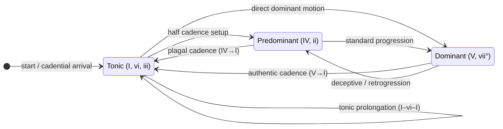
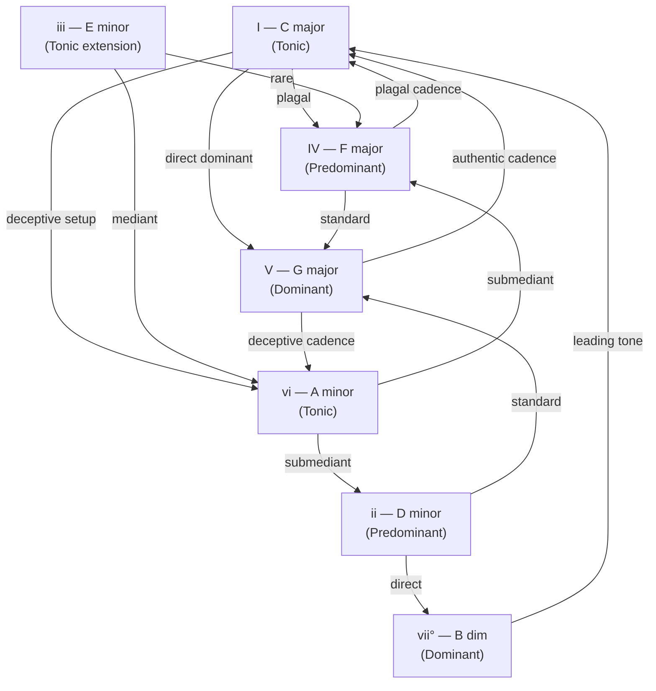
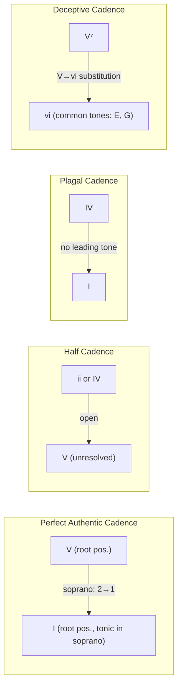
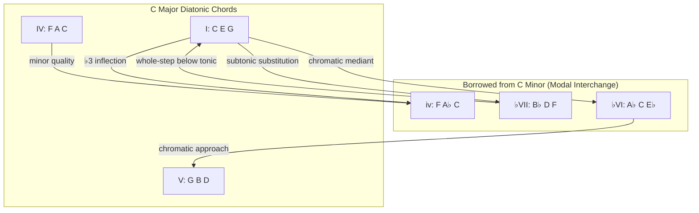
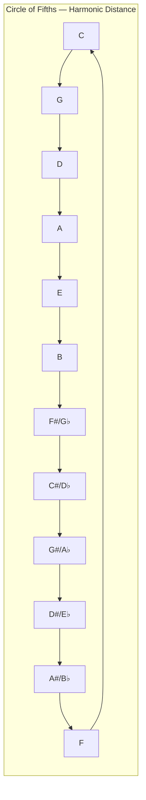
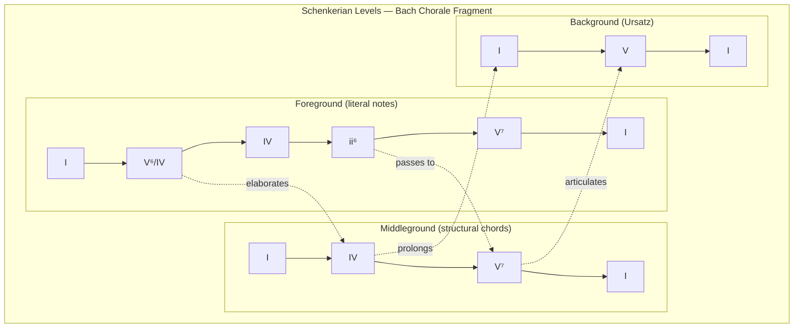

# Lesson 3: Chord Progressions

## 1. First-Principles Intuition & Invariants

### The Acoustic Foundation of Harmony

Every chord progression is, at its core, a manipulation of psychoacoustic expectation. To understand *why* certain progressions sound inevitable and others feel arbitrary, one must begin not with notation but with physics: the behavior of a vibrating string or column of air, and the overtone series that emerges from it.

When a string of length *L* vibrates, it does not produce a single frequency. It vibrates simultaneously at integer multiples of its fundamental frequency *f₀*: the fundamental (1×f₀), the octave (2×f₀), the perfect fifth above that (3×f₀), the second octave (4×f₀), the major third above that (5×f₀), and so on. This is the **harmonic series**, and it is a physical invariant—not a cultural convention. Its first few partials (normalized to a single octave) outline precisely the notes of a major triad:

- Partial 4: f₀ (root)
- Partial 5: 5/4 × f₀ ≈ major third (386 cents, vs. equal-temperament's 400)
- Partial 6: 3/2 × f₀ = perfect fifth (702 cents, virtually identical to equal temperament's 700)

The major triad, then, is not an invention—it is an auditory recognition of naturally co-occurring partials. This is why it is perceived as stable: the overtones of its constituent notes align and reinforce one another rather than creating interference beats. The minor triad and all dissonant intervals introduce more complex frequency ratios whose partials generate audible beating (periodic amplitude fluctuations at rate |f₁ − f₂|), which the auditory cortex registers as tension.

### Equal Temperament as a Mathematical Compromise

Just intonation tunes intervals to pure integer ratios: the perfect fifth is exactly 3:2, the major third exactly 5:4. The problem is that stacking twelve pure perfect fifths does not return to the starting pitch. The Pythagorean comma—the difference between twelve pure fifths and seven pure octaves—is approximately 23.46 cents:

$$\left(\frac{3}{2}\right)^{12} = \frac{531441}{4096} \approx 129.746 \neq 128 = 2^7$$

Equal temperament (ET-12) resolves this by distributing the comma evenly across all twelve semitone steps. Each semitone is defined as the twelfth root of two:

$$f_n = f_0 \cdot 2^{n/12}$$

This makes every perfect fifth slightly flat (700 cents instead of 701.96), every major third noticeably wide (400 cents instead of 386.31), but crucially, it makes the system **closed under transposition**. A progression in C major is structurally identical to the same progression in F♯ major—the interval ratios are the same to within floating-point precision. This is the architectural invariant that makes key modulation tractable.

The tradeoff is real: equal temperament major thirds beat at roughly 7 Hz at A4 (440 Hz), which is audible. Historical keyboard temperaments—Meantone, Werckmeister III, Kirnberger III—distributed the comma unevenly, making some keys purer and others harsher. Bach's *Well-Tempered Clavier* (1722) was written to demonstrate that a well-tempered (not necessarily equal-tempered) system permitted music in all 24 keys, each with a distinct character.

```python
import math

def et12_frequency(f0: float, semitones: int) -> float:
    """
    Compute the equal-temperament frequency n semitones above f0.
    f0: fundamental frequency in Hz
    semitones: signed integer number of semitone steps
    """
    return f0 * (2 ** (semitones / 12))

def just_ratio(numerator: int, denominator: int, f0: float) -> float:
    """Return frequency of a just-intoned interval above f0."""
    return f0 * (numerator / denominator)

def cents(f1: float, f2: float) -> float:
    """Interval in cents between two frequencies."""
    return 1200 * math.log2(f2 / f1)

A4 = 440.0

# Compare equal temperament vs. just intonation for thirds and fifths
intervals = {
    "Major Third (ET)":  (et12_frequency(A4, 4),       "ET"),
    "Major Third (JI)":  (just_ratio(5, 4, A4),         "JI"),
    "Perfect Fifth (ET)": (et12_frequency(A4, 7),       "ET"),
    "Perfect Fifth (JI)": (just_ratio(3, 2, A4),        "JI"),
}

print(f"{'Interval':<22} {'Freq (Hz)':>10}  {'Cents from A4':>14}")
print("-" * 50)
for name, (freq, _) in intervals.items():
    c = cents(A4, freq)
    print(f"{name:<22} {freq:>10.4f}  {c:>14.2f}")

# Pythagorean comma demonstration
stacked_fifths = A4
for _ in range(12):
    stacked_fifths = just_ratio(3, 2, stacked_fifths)
# Reduce to same octave range
while stacked_fifths > A4 * 2:
    stacked_fifths /= 2
pythagorean_comma_cents = cents(A4, stacked_fifths)
print(f"\nPythagorean comma: {pythagorean_comma_cents:.4f} cents")
# Should be approximately +23.46 cents
```

### Functional Harmony as a Finite-State Machine

Tonal functional harmony—the system underlying virtually all Western music from roughly 1600–1900 and most popular music since—can be modeled precisely as a **directed weighted graph** where nodes are scale-degree chords and edges represent transition probabilities weighted by conventional practice. Each chord occupies one of three functional categories:

- **Tonic (T):** Chords built on scale degrees I and VI (also III in some analyses). They represent the resting state, the equilibrium point of the system.
- **Predominant (PD):** Chords built on scale degrees II and IV. They possess forward momentum away from tonic but do not yet create the maximal tension of the dominant.
- **Dominant (D):** Chords built on scale degrees V and VII. The dominant seventh chord (V⁷) contains the tritone—the interval between scale degrees 4 and 7—whose strong tendency toward resolution drives harmonic motion.

The canonical motion is T → PD → D → T, a cycle that mirrors a system transitioning from low entropy through a high-energy intermediate state and back to equilibrium. This is not metaphor: the tritone in V⁷ (the interval B–F in the key of C) contains two of the most tension-laden tendencies in tonal music:

- Scale degree 7 (the leading tone, B) is a semitone below the tonic (C) and has a powerful upward tendency.
- Scale degree 4 (F) tends downward by semitone to the third of I (E).

Both resolutions are half-step (minimum-energy) voice motions. The tritone resolves inward to a third (B→C, F→E), and this resolution is the fundamental acoustic mechanism driving the entire tonal system.



### Voice Leading as a Minimum-Energy Routing Problem

Voice leading is the discipline governing how individual pitches in a chord move to the pitches in the next chord. Its rules are not stylistic impositions but are derived from two sources: psychoacoustics (smooth motion is perceptually preferred) and physics (smaller interval leaps represent smaller frequency displacements, reducing the perceptual discontinuity).

The four classical part-writing constraints—most codified in 18th-century counterpoint pedagogy and rigorously formalized by theorists like Rameau and later Heinrich Schenker—are:

1. **Avoid parallel perfect fifths and octaves.** When two voices move in parallel motion by a perfect fifth or octave, they lose perceptual independence. The two frequencies and their overtones align so completely that the upper voice becomes acoustically absorbed into the lower.
2. **Resolve tendency tones by step.** The leading tone (scale degree 7) and the chordal seventh resolve by half step to minimize perceptual discontinuity.
3. **Avoid large leaps in inner voices.** Soprano and bass can leap; tenor and alto should move by step or small interval where possible.
4. **Prefer contrary or oblique motion between outer voices.** Contrary motion (voices moving in opposite directions) maximizes the independence of parts and creates the clearest harmonic texture.

These are not absolute laws—every master composer violates them deliberately—but they represent the minimum-energy path through harmonic space. Violations require compensating motion or perceptual justification.

---

## 2. Core Architecture & Mechanics

### The Harmonic Graph Model

A tonal key can be represented as a labeled directed graph. In C major, the seven diatonic chords are nodes, and the edges represent conventional functional relationships with directional weights reflecting the strength of harmonic tendency. This model underpins computational harmony analysis tools (e.g., David Temperley's *Music and Probability*, 2007) and automatic chord recognition systems.



### Cadence Types and Their Structural Roles

A cadence is a harmonic formula at a phrase boundary—the musical equivalent of a syntactic period or clause terminator. The four canonical cadences each encode a different degree of closure:

**Authentic Cadence (V→I):** The strongest closure. When both chords are in root position and the soprano ends on the tonic, it is a *perfect authentic cadence* (PAC). Any deviation (inversion, non-tonic soprano) yields an *imperfect authentic cadence* (IAC). The PAC is structurally analogous to a full return to the initial state in a finite automaton.

**Half Cadence (any→V):** A temporary pause on the dominant. The phrase ends in a state of tension, requiring continuation. Analogous to a suspension point in an asynchronous computation—the system is halted but not resolved.

**Plagal Cadence (IV→I):** The "Amen" cadence of liturgical tradition. Weaker closure than authentic because IV lacks the leading tone; there is no semitone resolution driving toward the tonic. Its softness is structural, not incidental.

**Deceptive Cadence (V→vi):** The dominant resolves unexpectedly to vi instead of I. Harmonically, this works because vi and I share two of three pitches (in C major: E and G), making vi a plausible but surprising substitute. This substitution principle—*functional equivalence via common tone*—is a generative rule that explains much of harmonic substitution theory.



### Chord Extensions, Alterations, and the Jazz Harmonic Vocabulary

The triadic and seventh-chord system of common-practice harmony is a subset of a broader chromatic universe that jazz and 20th-century composers systematically explored. Chord extensions add additional tertian (stacked-third) pitches beyond the seventh:

- **Ninth (9):** Adds the note a ninth above the root (equivalent to the second, raised an octave). In a C dominant ninth (C⁷♯9, the "Hendrix chord"), this creates a tone cluster whose upper partial content is extremely dense.
- **Eleventh (11):** Typically raised (♯11) in major-seventh contexts to avoid the tritone conflict with the third. The Lydian mode (raised fourth) is the natural harmonic context for ♯11 chords—which is why Bill Evans favored Lydian-colored major chords.
- **Thirteenth (13):** The full tertian stack. A C13 chord technically contains all seven diatonic scale degrees; in practice, the fifth and ninth are routinely omitted.

Altered dominant chords (V7♭9, V7♯9, V7♭13) replace natural upper partials with chromatic alternatives. These alterations intensify the dissonance of the dominant, increasing resolution urgency. They are drawn from the **altered scale** (seventh mode of melodic minor), which contains both ♭9/♯9 and ♭13/♯11 simultaneously.

```python
from dataclasses import dataclass
from typing import List, Optional
import itertools

# Pitch class integers: C=0, C#=1, D=2, ... B=11
NOTE_NAMES = ['C', 'C#', 'D', 'D#', 'E', 'F',
              'F#', 'G', 'G#', 'A', 'A#', 'B']

@dataclass(frozen=True)
class Chord:
    root: int           # pitch class 0–11
    intervals: tuple    # semitone intervals above root

    @property
    def pitch_classes(self) -> List[int]:
        return sorted({(self.root + i) % 12 for i in self.intervals})

    @property
    def name_pcs(self) -> str:
        return ' '.join(NOTE_NAMES[pc] for pc in self.pitch_classes)

    def tritone_substitute(self) -> 'Chord':
        """
        Tritone substitution: replace a dominant 7th chord with the
        dominant 7th a tritone (6 semitones) away. Both chords share
        the same tritone (3rd and 7th swap roles).
        """
        new_root = (self.root + 6) % 12
        return Chord(root=new_root, intervals=self.intervals)

    def modal_interchange(self, interval_delta: int) -> 'Chord':
        """
        Borrow a chord from the parallel mode by shifting a specific
        interval by interval_delta semitones (e.g., lowering the third
        by 1 semitone to borrow from parallel minor).
        """
        new_intervals = tuple(
            i + interval_delta if i == 4 else i   # flatten the third
            for i in self.intervals
        )
        return Chord(root=self.root, intervals=new_intervals)


# Standard chord templates (interval sets above root)
CHORD_TEMPLATES = {
    'major':       (0, 4, 7),
    'minor':       (0, 3, 7),
    'dominant7':   (0, 4, 7, 10),
    'major7':      (0, 4, 7, 11),
    'minor7':      (0, 3, 7, 10),
    'half_dim7':   (0, 3, 6, 10),   # ø7
    'dim7':        (0, 3, 6, 9),
    'dom7_b9':     (0, 4, 7, 10, 13),  # ♭9 = 13 semitones above root
    'dom7_s9':     (0, 4, 7, 10, 15),  # ♯9 = 15 semitones above root
    'dom7_s11':    (0, 4, 7, 10, 18),  # ♯11 = 18 semitones
    'dom13':       (0, 4, 7, 10, 14, 21),  # 9th and 13th added
}

def build_ii_V_I(key_root: int) -> List[Chord]:
    """
    Construct a ii–V–I progression in the given key.
    key_root: pitch class of the tonic (0=C, 2=D, etc.)
    Returns [ii7, V7, Imaj7]
    """
    ii_root  = (key_root + 2) % 12   # supertonic
    V_root   = (key_root + 7) % 12   # dominant
    return [
        Chord(root=ii_root, intervals=CHORD_TEMPLATES['minor7']),
        Chord(root=V_root,  intervals=CHORD_TEMPLATES['dominant7']),
        Chord(root=key_root, intervals=CHORD_TEMPLATES['major7']),
    ]

def tritone_sub_ii_V_I(key_root: int) -> List[Chord]:
    """
    Tritone-substitute the V7, yielding ii7 – ♭II7 – Imaj7.
    The ♭II7 (Neapolitan dominant) shares the tritone with V7
    and creates chromatic bass motion: 2̂ – ♭2̂ – 1̂.
    """
    progression = build_ii_V_I(key_root)
    progression[1] = progression[1].tritone_substitute()
    return progression

# Demo in the key of C (root = 0)
print("ii–V–I in C major:")
for chord in build_ii_V_I(0):
    print(f"  Root: {NOTE_NAMES[chord.root]:<3}  PCs: {chord.name_pcs}")

print("\nTritone-substituted ii–V–I in C major (ii–♭II–I):")
for chord in tritone_sub_ii_V_I(0):
    print(f"  Root: {NOTE_NAMES[chord.root]:<3}  PCs: {chord.name_pcs}")
```

### The ii–V–I Progression: A Deep Analysis

The ii–V–I is the most foundational progression in jazz and one of the most structurally significant in all tonal music. Its power derives from multiple reinforcing mechanisms:

1. **Root motion by descending fifths (or ascending fourths):** ii→V is a descending fifth (D→G in C major); V→I is another (G→C). Descending fifth root motion is the strongest harmonic motion in tonal music—it corresponds to the 3rd partial resolving to the 2nd, a frequency ratio simplification (3:2 → 2:1) that the auditory system processes as closure.

2. **Tritone resolution in V⁷:** The tritone F–B in Gmaj7 (scale degrees 4–7 of C major) resolves inward by semitone to E–C, the third and root of I.

3. **Common-tone efficiency:** ii and V share one common tone in seventh-chord voicing (C and Am7 share E and G; Dm7 and G7 share D... wait—Dm7 contains D,F,A,C and G7 contains G,B,D,F; they share D and F, the seventh of Dm7 becomes the tritone of G7, and the third of Dm7 becomes the seventh of G7). This recycling of pitch material creates smooth voice leading with minimal motion.

The tritone substitution exploits the fact that any dominant seventh chord shares its defining tritone with exactly one other dominant seventh chord—the one a tritone away. G7 contains the tritone B–F; D♭7 also contains C♭(=B)–F. By substituting D♭7 for G7, the bass moves chromatically (D → D♭ → C) rather than by leap, creating a smoother, more chromatic approach to the tonic. This is the theoretical basis for the **Lydian Dominant** sound (D♭7♯11 → Cmaj7) used extensively by composers from Duke Ellington to Herbie Hancock.

### Modal Interchange and Borrowed Chords

Modal interchange (also called modal mixture) is the borrowing of chords from the parallel mode—most commonly from parallel minor into a major key. Because parallel major and minor share the same tonic, chords from one mode can be inserted into a progression in the other without destroying tonal center, but with a dramatic shift in color.

The most common borrowed chords in a major key (borrowing from parallel natural/harmonic/Phrygian minor):

| Borrowed Chord | Scale degrees | Common use context |
|---|---|---|
| iv (minor IV) | ♭3, 5, ♭7 above IV root | Plagal motion with darker color; common in pop/rock (e.g., "Yesterday" – Beatles) |
| ♭VII (subtonic) | ♭7, 2, 4 of key | Rock and modal contexts; avoids leading tone |
| ♭VI (flat-six) | ♭6, ♭1, ♭3 of key | Chromatic mediant; dramatic shift (e.g., "Creep" – Radiohead uses I–III–IV–iv) |
| ii° (diminished II) | 2, 4, ♭6 of key | Leading to V in Baroque/Classical style |
| V/iv (secondary dominant) | V of the IV chord | Tonicizes subdominant; common in blues |

The chromatic mediant relationship (I → ♭VI or I → ♭III) is particularly powerful because the two chords share one common tone while the other voices move by semitone—a maximum-efficiency voice leading relationship that produces a striking color shift. This is why the progression Am → F → C → G (i–♭VI–♭III–♭VII in A minor, or vi–IV–I–V in C major) is ubiquitous in popular music: it cycles through functional categories while maintaining smooth voice leading throughout.



### The Circle of Fifths: Architecture, Not Metaphor

The circle of fifths is frequently presented as a mnemonic device for key signatures. Its deeper significance is that it encodes the full topology of harmonic distance in equal temperament. Chords adjacent on the circle are maximally related (they share two common tones in triad form); chords diametrically opposite are maximally distant (tritone relationship, zero common tones as triads).

This topology has direct algorithmic consequences. The **Tonnetz** (tone network), introduced by Euler in 1739 and developed by Hugo Riemann in the 19th century, represents pitch-class relationships on a two-dimensional lattice where:
- The horizontal axis represents the perfect fifth relationship
- The vertical axis represents the major-third relationship
- Diagonal motion represents the minor-third relationship

Every triad occupies a triangle on the Tonnetz. The three canonical chord transformations—**P** (parallel: major↔minor, moving the third by semitone), **R** (relative: major↔relative minor, moving the root by step), and **L** (leading-tone exchange: moving the fifth of a major chord down by semitone to its leading tone)—correspond to reflections across the edges of that triangle. This **Neo-Riemannian theory** provides a precise geometric model for chromatic harmony outside functional tonality, used analytically to describe late-Romantic composers (Schubert, Wagner, Liszt) and film composers (John Williams, Hans Zimmer) who use chromatic mediant motion extensively.



```python
def circle_of_fifths(start_pc: int = 0) -> List[int]:
    """
    Generate pitch classes in circle-of-fifths order.
    Each step is +7 semitones (a perfect fifth) mod 12.
    """
    return [(start_pc + 7 * i) % 12 for i in range(12)]

def harmonic_distance(pc1: int, pc2: int) -> int:
    """
    Harmonic distance between two pitch classes measured in
    fifths-steps around the circle. Returns minimum of clockwise
    and counter-clockwise distance (0–6).
    """
    cof = circle_of_fifths()
    idx1, idx2 = cof.index(pc1 % 12), cof.index(pc2 % 12)
    diff = abs(idx1 - idx2)
    return min(diff, 12 - diff)

# Print circle of fifths and harmonic distances from C
cof = circle_of_fifths()
print("Circle of Fifths:", [NOTE_NAMES[pc] for pc in cof])
print("\nHarmonic distances from C (0):")
for pc in range(12):
    d = harmonic_distance(0, pc)
    print(f"  C → {NOTE_NAMES[pc]:<3}: {d} fifth-step(s)")
```

### Harmonic Rhythm and Metric Interaction

Harmonic rhythm—the rate and pattern at which chords change—interacts with meter in ways that create or dissolve rhythmic tension. A chord change on a metrically strong beat confirms the metric hierarchy; a chord change on a weak beat (anticipation) or across a barline (syncopation) creates rhythmic-harmonic ambiguity that is central to the groove of jazz and funk.

Three canonical harmonic rhythm patterns and their structural effects:

**1. Hypermetric stasis (one chord per phrase):** Characteristic of Baroque pedal points, Romantic development sections, and modal jazz (Miles Davis's *So What*, 1959, holds each chord for 8–16 bars). Creates maximum tonal stability; harmonic interest is generated through melodic and rhythmic development against an unchanging harmonic substrate.

**2. Standard metric alignment (one chord per bar or per two beats):** The default of common-practice harmony and most pop music. Chord changes align with the downbeat, reinforcing meter. The I–IV–V–I progression in four bars with one chord per bar is the bedrock of blues, country, and gospel.

**3. Accelerating harmonic rhythm (chord density increases toward cadence):** A structural device used throughout the common-practice period. In a typical Classical period, the opening tonic may be held for four bars while the approach to the cadence involves one chord per beat or faster. This creates a kinetic sense of arrival—harmonic density and rhythmic density peak together at the cadential point.

```mermaid
gantt
    title Harmonic Rhythm — 12-Bar Blues (Key of A)
    dateFormat  X
    axisFormat  Bar %s

    section Chords
    I  (A7)       :a1, 0, 4
    IV (D7)       :a2, 4, 6
    I  (A7)       :a3, 6, 8
    V  (E7)       :a4, 8, 9
    IV (D7)       :a5, 9, 10
    I  (A7)       :a6, 10, 11
    V  (E7)       :a7, 11, 12
```



---

## 3. Secondary Dominants and Tonicization

Any chord in a key can be temporarily treated as a tonic by preceding it with its own dominant seventh chord. This technique—**secondary dominant** or **tonicization**—imports a chord from outside the diatonic set to heighten the approach to a chord other than I.

The formula is straightforward: to tonicize chord X, precede it with a dominant seventh built on the note a perfect fifth above X's root. The resulting chord is labeled **V/X** (read "five of X"). In C major, to tonicize IV (F major), use V/IV = C7 (a dominant seventh on C, which is the fifth of F). C7 contains B♭—a note outside the diatonic C major scale—and its tritone (E–B♭) resolves to F–A, the root and third of IV.

Secondary dominants are used to:
- Create local emphasis on a non-tonic chord
- Facilitate smooth modulation to a new key (the secondary dominant can be reinterpreted as the diatonic V of the new key)
- Add chromatic color and intensify arrival points

The chain of secondary dominants—VI/II → II/V → V/I (i.e., A7 → D7 → G7 → C)—is a sequence of descending fifth root motion with each dominant resolving to the next chord in the chain. This is the structural basis of **ragtime** and **stride piano** sequences and appears throughout the jazz standard repertoire (e.g., "Autumn Leaves," "All The Things You Are").

```python
def secondary_dominant(target_root: int) -> Chord:
    """
    Compute the secondary dominant (V7) of a target chord root.
    The secondary dominant is built on the note a perfect fifth
    above target_root (i.e., target_root + 7 semitones mod 12).
    """
    sd_root = (target_root + 7) % 12
    return Chord(root=sd_root, intervals=CHORD_TEMPLATES['dominant7'])

def tonicization_chain(key_root: int, steps: int = 4) -> List[Chord]:
    """
    Build a chain of secondary dominants resolving through the
    circle of fifths back to the tonic.
    E.g., in C: A7 → D7 → G7 → Cmaj7
    """
    chain = []
    current_root = key_root
    for _ in range(steps - 1):
        # Move up by a fifth (or equivalently, the secondary dominant
        # of current_root is built 7 semitones above it)
        sd_root = (current_root + 7) % 12
        chain.insert(0, Chord(root=sd_root,
                              intervals=CHORD_TEMPLATES['dominant7']))
        current_root = sd_root
    # Resolve to tonic major 7
    chain.append(Chord(root=key_root,
                       intervals=CHORD_TEMPLATES['major7']))
    return chain

print("\nTonicization chain resolving to C (4 steps):")
for chord in tonicization_chain(0, 4):
    print(f"  {NOTE_NAMES[chord.root]:<3} dom7:  {chord.name_pcs}")
```

---

## 4. Schenkerian Analysis and Deep Structure

Heinrich Schenker's theory of tonal structure (elaborated in *Free Composition* [*Der freie Satz*], 1935) provides the most rigorous analytical framework for chord progressions at a large scale. Schenker proposed that every tonal composition, regardless of surface complexity, is a prolongation of a single fundamental structure: the **Ursatz** (fundamental structure).

The Ursatz consists of two components:
1. **Urlinie (fundamental line):** A stepwise descent in the soprano from an upper structural note (typically scale degree 3̂, 5̂, or 8̂) down to 1̂.
2. **Bassbrechung (bass arpeggiation):** An arpeggiation in the bass from I to V and back to I, articulating the fundamental I–V–I harmonic motion.

Every chord progression at the surface is an elaboration—a prolongation—of this deep structure. Prolongation techniques include:

- **Neighboring motion:** A chord that prolongs an adjacent structural chord by decorating it with a step above or below (e.g., I–II–I is a prolongation of I using the neighbor chord II).
- **Passing motion:** A chord that fills the space between two structural chords by step (e.g., I–V⁶–I⁶ passes through V⁶ to connect root-position I with first-inversion I).
- **Arpeggiation:** A chord whose root motion outlines the notes of the underlying structural harmony.

This framework explains phenomena that surface-level harmonic analysis cannot: why a chord that appears to be a IV might function as a prolongation of I; why a chromatic chord can appear without destroying tonal coherence; why a long passage with many chord changes may constitute a single structural dominant.



The Schenkerian perspective reframes chord progressions from sequences of independent chords to hierarchical structures where surface events are prolongations of deeper structural events. This is directly analogous to the relationship between machine instructions and high-level program structure in computer science: the surface events are real and have local effect, but their meaning is fully determined only within their structural context.

---

## 5. Cross-Domain Synthesis: Algorithmic Harmony

The formal properties of harmonic progressions—the graph structure, the state-machine behavior, the voice-leading constraints as optimization criteria—make them well-suited to computational implementation. Modern systems for automatic harmonization, chord recognition, and generative composition encode these principles explicitly.

### Markov Chain Harmonic Generation

A first-order Markov chain over chord states, with transition probabilities derived from corpus analysis (e.g., from the iReal Pro corpus of jazz standards or the McGill Billboard corpus of popular music), produces statistically plausible harmonic progressions. The Markov property (future state depends only on current state) is an approximation—real harmonic grammar has long-range dependencies—but it is a productive starting point.

```python
import random
from typing import Dict

# Transition probability matrix for C major (simplified)
# Rows: current chord; Columns: next chord; Values: probability
CHORD_LABELS = ['I', 'ii', 'iii', 'IV', 'V', 'vi', 'vii°']

TRANSITION_MATRIX: Dict[str, Dict[str, float]] = {
    'I':    {'I': 0.05, 'ii': 0.15, 'iii': 0.05, 'IV': 0.25,
             'V': 0.25, 'vi': 0.20, 'vii°': 0.05},
    'ii':   {'I': 0.05, 'ii': 0.00, 'iii': 0.00, 'IV': 0.10,
             'V': 0.70, 'vi': 0.05, 'vii°': 0.10},
    'iii':  {'I': 0.05, 'ii': 0.05, 'iii': 0.00, 'IV': 0.20,
             'V': 0.10, 'vi': 0.55, 'vii°': 0.05},
    'IV':   {'I': 0.20, 'ii': 0.15, 'iii': 0.05, 'IV': 0.00,
             'V': 0.50, 'vi': 0.05, 'vii°': 0.05},
    'V':    {'I': 0.60, 'ii': 0.05, 'iii': 0.05, 'IV': 0.05,
             'V': 0.05, 'vi': 0.15, 'vii°': 0.05},
    'vi':   {'I': 0.10, 'ii': 0.30, 'iii': 0.05, 'IV': 0.30,
             'V': 0.15, 'vi': 0.05, 'vii°': 0.05},
    'vii°': {'I': 0.70, 'ii': 0.05, 'iii': 0.05, 'IV': 0.05,
             'V': 0.10, 'vi': 0.00, 'vii°': 0.05},
}

def normalize(distribution: Dict[str, float]) -> Dict[str, float]:
    """Normalize a probability distribution to sum to 1.0."""
    total = sum(distribution.values())
    return {k: v / total for k, v in distribution.items()}

def markov_progression(
    start: str = 'I',
    length: int = 8,
    seed: Optional[int] = None
) -> List[str]:
    """
    Generate a chord progression using a first-order Markov chain.
    start: initial chord symbol
    length: number of chords to generate
    seed: random seed for reproducibility
    """
    if seed is not None:
        random.seed(seed)

    progression = [start]
    current = start

    for _ in range(length - 1):
        dist = normalize(TRANSITION_MATRIX[current])
        chords = list(dist.keys())
        weights = list(dist.values())
        current = random.choices(chords, weights=weights, k=1)[0]
        progression.append(current)

    return progression

# Generate and display several progressions
for trial in range(5):
    prog = markov_progression(start='I', length=8, seed=trial * 42)
    print(f"  Trial {trial + 1}: {' → '.join(prog)}")
```

### Voice-Leading Distance as a Shortest-Path Problem

Optimal voice leading between two chords can be computed as a minimum-weight bipartite matching. Given two chords as sets of pitch classes, the voice-leading distance is the minimum total displacement (in semitones, using voice crossing if necessary) needed to move from one chord's voices to the other's.

Dmitri Tymoczko's *A Geometry of Music* (2011) formalizes this as a geometry of **chord spaces**—manifolds where points represent chords and paths represent voice leadings. The orbifold structure of two-voice chord space is a Möbius strip; three-voice chord space is a three-dimensional orbifold with singular boundaries corresponding to unisons and octave doublings. The key insight is that efficient voice leading corresponds to small motion in chord space, and the most common progressions in tonal music are those that traverse minimal distances in this space.

```python
from itertools import permutations

def voice_leading_distance(
    chord_a: List[int],
    chord_b: List[int],
    allow_crossing: bool = True
) -> tuple:
    """
    Compute the minimum-displacement voice leading between two chords.
    Returns (total_distance, optimal_mapping) where optimal_mapping is
    a list of (from_pc, to_pc, semitone_displacement) tuples.

    Uses circular semitone distance (min of upward/downward motion).
    Assumes chords have equal voice count.
    """
    assert len(chord_a) == len(chord_b), "Chords must have same voice count"

    def semitone_dist(pc1: int, pc2: int) -> int:
        """Minimum semitone distance between two pitch classes."""
        up   = (pc2 - pc1) % 12
        down = (pc1 - pc2) % 12
        return min(up, down)

    best_distance = float('inf')
    best_mapping = None

    # Try all permutations of target chord (voice assignments)
    for perm in permutations(chord_b):
        total = sum(
            semitone_dist(chord_a[i], perm[i])
            for i in range(len(chord_a))
        )
        if total < best_distance:
            best_distance = total
            best_mapping = list(zip(chord_a, perm))

    mapping_detail = [
        (NOTE_NAMES[a], NOTE_NAMES[b], semitone_dist(a, b))
        for a, b in best_mapping
    ]
    return best_distance, mapping_detail


# Measure voice-leading distances for common progressions in C major
progressions_to_check = [
    ("I→V",   [0, 4, 7],  [7, 11, 2]),   # C major → G major
    ("I→IV",  [0, 4, 7],  [5, 9, 0]),    # C major → F major
    ("I→vi",  [0, 4, 7],  [9, 0, 4]),    # C major → A minor
    ("V→I",   [7, 11, 2], [0, 4, 7]),    # G major → C major
    ("ii→V",  [2, 5, 9],  [7, 11, 2]),   # D minor → G major
]

print("Voice-leading distances (semitones total):\n")
for label, ca, cb in progressions_to_check:
    dist, mapping = voice_leading_distance(ca, cb)
    moves = ', '.join(f"{a}→{b}({d})" for a, b, d in mapping)
    print(f"  {label:<6}  total={dist}  voices: {moves}")
```

---

## Summary

Chord progressions are not an arbitrary sequential selection of chords. They are structured traversals of a harmonic space whose geometry is determined by acoustic physics (the harmonic series), mathematical constraints (equal temperament's closed transposition group), and psychoacoustic perception (tendency tone resolution, voice-leading efficiency, and functional expectation). The T→PD→D→T functional cycle is an entropy-minimization pattern encoded in the overtone structure of vibrating bodies. Voice leading is a shortest-path problem in chord space. Cadences are syntactic boundary markers with precisely graduated closure strengths. Modal interchange borrows from the parallel mode without destroying tonal center. Secondary dominants locally tonicize non-tonic scale degrees through the same dominant-seventh resolution mechanism that governs the global tonic. Schenkerian analysis reveals that surface chord successions are hierarchical elaborations of a single deep I–V–I structure. And computational models—Markov chains, bipartite matching, orbifold geometry—provide rigorous frameworks for analysis and generation that make the implicit formal structure of harmonic practice fully explicit.

The lesson's central invariant: every mechanism of harmonic progression, from the tritone resolution to the chromatic mediant, is ultimately a consequence of the acoustic properties of vibrating systems and the architecture of human auditory perception.
