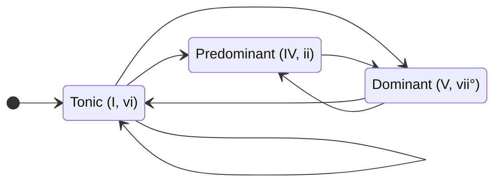
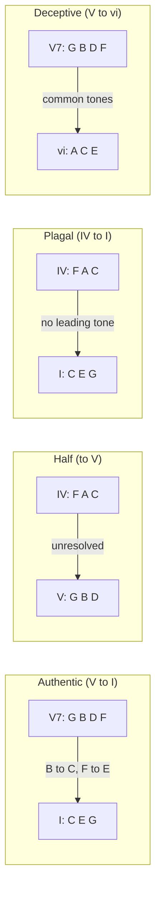
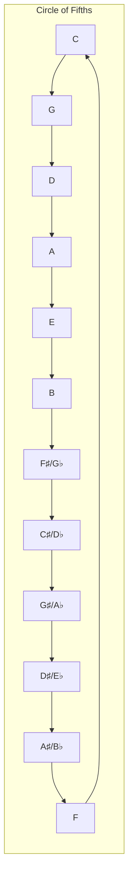

# Lesson 3: Chord Progressions — Hands-On Harmonic Mastery

## 1. First-Principles Intuition (15%)

### Why Chord Progressions Work

A vibrating string or air column doesn't produce one pitch — it produces a **harmonic series**: the fundamental plus integer multiples (f₀, 2f₀, 3f₀, 4f₀, 5f₀...). The first five partials of a low C outline C–C–G–C–E: a major triad hiding inside a single note. That's why a C major chord sounds "already implied" by nature, and why major triads feel stable — their pitches reinforce each other's overtones instead of creating audible beating.

**Equal temperament** squeezes the small tuning discrepancy (the Pythagorean comma) evenly across all twelve semitones, each a ratio of 2^(1/12) ≈ 1.0595. The payoff: a progression in C major has the exact same shape, tension, and fingering logic in F♯ major. The cost: every interval except the octave is very slightly "off" from its pure acoustic ratio — most audibly in major thirds, which beat at a few Hz. You're trading perfect consonance for universal transposability. This is the whole reason the CAGED and ii–V–I shapes you'll drill below simply slide up and down the neck without changing shape.

**Functional harmony is a traffic system, not a list of chords.** Every chord in a key belongs to one of three functional zones:

- **Tonic (T):** I, vi — home base, resolved.
- **Predominant (PD):** ii, IV — leaving home, building motion.
- **Dominant (D):** V, vii° — maximum tension, demands resolution.

The tension in V comes from the **tritone** between scale degrees 4 and 7 (in C: F and B). That tritone is acoustically unstable — it splits the octave exactly in half, so your ear can't decide which way it resolves on its own. Voice-leading rules decide for it: the leading tone (B) pulls up by a half step to the tonic (C), and the 4th (F) pulls down by a half step to the 3rd (E). That double half-step resolution is the single strongest gesture in Western tonal music — everything else in this lesson is a variation on it.



**Voice leading** is just the rule that smaller pitch movement sounds smoother than big jumps. Avoid parallel fifths and octaves (two voices moving in lockstep lose their independence and sound hollow). Resolve tendency tones by step: leading tone up to the tonic, chordal 7th down to the 3rd of the next chord. Everything hands-on below is built to make these motions automatic under your fingers, not something you calculate in real time.

---

## 2. Hands-On Core Mechanics (85%)

### I–IV–V–I in C Major — Keyboard

**Posture check before you play:** curved fingers as if holding a small ball, wrist level with the forearm (not cocked up or down), shoulders relaxed. Weight transfers from the forearm into the keybed — don't just push with finger muscles, or you'll fatigue in under ten minutes.

**Voicing (whole notes, LH root / RH triad):**

```
I   (C major): LH: C2        RH: E4–G4–C5
IV  (F major): LH: F2        RH: F4–A4–C5   (C5 common tone — don't move that finger)
V   (G major): LH: G2        RH: D4–G4–B4
I   (C major): LH: C2        RH: E4–G4–C5
```

**Drill:**
1. Whole notes, 4 beats per chord, metronome at **60 BPM**. Listen for the held C5 across I→IV — your pinky should barely move.
2. Add RH quarter-note arpeggios (root–3rd–5th–octave ascending) while LH sustains the root.
3. Push to **80 BPM**, then **100 BPM**. If your arpeggio starts stumbling, drop 10 BPM and rebuild — never grind through sloppy reps.

### I–IV–V — Guitar, CAGED System

CAGED gives you five movable shapes that cover the whole neck without relearning anything — you're just sliding the same five hand-shapes to different frets.

**Key of A, root on the 5th string:**

```
I  (A major, E-shape, 12th fret):
e|---12---
B|---12---
G|---13---
D|---14---
A|---12---
E|--------

IV (D major, C-shape, 10th fret):
e|---10---
B|---10---
G|---11---
D|---12---
A|---12---
E|--------

V  (E major, A-shape, 12th fret):
e|---12---
B|---12---
G|---13---
D|---14---
A|---14---
E|---12---
```

Fret each shape with a firm fingertip just behind the fret wire, not on top of it — buzzing usually means you're pressing too far back. Mute unused strings with the side of your fretting fingers rather than lifting them entirely; this keeps your hand ready for the next shape.

### Root-Motion Bass Fingering — Simandl 1-2-4

Below the 5th fret, stretching one-finger-per-fret damages tendons over time. Simandl's 1-2-4 system assigns index (1), ring (2), and pinky (4) to cover a four-fret span without the middle finger doing independent work — it rides along with the ring finger for support.

**C major scale on the E string:**

```
Fret:    3   5   7   8   10  12
Finger:  2   4   1   2   4   1
Note:    C   D   E   F   G   A
```

Thumb stays anchored on the back of the neck, roughly opposite your middle finger, the whole time. Don't let it creep over the top — that's what locks up your reach and causes strain.

**I–IV–V–I walking bass, quarter notes, 80 BPM:**

```
|C (E-str fret 8) – E – G – G | F (E-str fret 1) – A – C – C |
|G (E-str fret 3) – B – D – F | C (E-str fret 8) – E – G – C |
```

**Floating thumb mute:** when playing the E string, rest your plucking-hand thumb lightly on the A string. It kills sympathetic ring from the unused string without you having to think about it — set it and forget it.

---

### Cadences: The Syntax of Harmonic Closure

#### Authentic Cadence (V→I) — Maximum Closure

**Keyboard:**
```
V⁷:  LH: G2   RH: F4–G4–B4–D5
I:   LH: C2   RH: E4–G4–C5–E5
```
B4 (leading tone) resolves up to C5; F4 (chordal 7th) resolves down to E4. Both are half-step motions — that's what makes this cadence feel locked shut, not just finished.

**Guitar, open position:**
```
G7 (V⁷):          Cmaj (I):
e|---1---          e|---0---
B|---0---          B|---1---
G|---0---          G|---0---
D|---0---          D|---2---
A|---2---          A|---3---
E|---3---          E|--------
```

#### Half Cadence (ends on V) — Open Ending

Play I–ii–V and stop. The tritone in V is left hanging, unresolved — the ear expects I next. Use it at bar 4 or 8 of a phrase to create a musical question that the next phrase answers.

#### Plagal Cadence (IV→I) — "Amen" Cadence

No leading tone, so no sharp pull — softer, more cushioned landing. This is why it's the standard close of hymns: it resolves without demanding attention.

#### Deceptive Cadence (V→vi) — Expectation Violation

V⁷ sets up I but lands on vi instead (A minor in C major). It works because vi shares two tones with I (E and G) — the ear gets partial confirmation and partial surprise simultaneously.



**Cadence ID drill:** have a partner (or a DAW) play these four cadences in random order on piano. Identify each by ear within 3 seconds, focusing only on whether the bass moves by fifth or step, and whether a leading tone resolves up. Repeat daily until you're at 100% accuracy before moving to ii–V–I work.

---

### The ii–V–I Progression: Jazz Foundation

**Root motion by descending fifths** — Dm7 → G7 → Cmaj7 — is the strongest harmonic pull available: each chord's root sits a perfect fifth below the previous one (or a fourth above, same motion inverted).

**Piano rootless shell voicing** (bassist or LH covers the root, RH plays the color):

```
Dm7:   LH: D2   RH: F4–A4–C5
G7:    LH: G2   RH: F4–A4–B4   (F, A held as common tones; C drops to B)
Cmaj7: LH: C2   RH: E4–G4–B4
```

**Drill, metronome 60 → 80 → 100 → 120 BPM:**
1. Whole notes, 4 beats per chord — lock in the shell shapes.
2. LH walks quarter notes: root–3rd–5th–7th ascending, then reverse descending.
3. RH comps only on beats 2 and 4 (the backbeat) — this is the single habit that makes your comping swing instead of plod.

**Guitar drop-2 voicings, 6th-string roots:**

```
Dm7 (10th position):        G7 (10th position):
e|---10---                  e|---10---
B|---10---                  B|---12---
G|---10---                  G|---10---
D|---12---                  D|---12---
A|---12---                  A|---10---
E|---10---                  E|---10---

Cmaj7 (8th position):
e|---8---
B|---8---
G|---9---
D|---9---
A|---10---
E|---8---
```

**Bass line with chromatic approach:**

```
|Dm7 (A-str fret 5: D) – F – A – C♯ (chromatic approach) |
|G7 (E-str fret 3: G) – B – D – F |
|Cmaj7 (A-str fret 3: C) – E – G – B |
```

C♯ doesn't belong to Dm7 — it's a passing tone that leans into D, the root of the next chord, G7. Chromatic approach notes like this are what separate a walking bass line from a line that just plays roots.

---

### Tritone Substitution: Chromatic Bass Motion

G7 and D♭7 share the exact same tritone (G7 has B–F; D♭7 has Cb/B–F, same two pitches spelled differently). Swap one for the other and the chord's pull to C stays intact, but now the bass moves chromatically: D → D♭ → C, a smooth stepwise descent instead of a fifth leap.

**Keyboard:**
```
Dm7:   LH: D2   RH: F4–A4–C5
D♭7:   LH: D♭2  RH: E4–A♭4–B4   (♭II7 substituting for G7)
Cmaj7: LH: C2   RH: E4–G4–B4
```

D♭7 contains F (its natural 3rd) and Cb/B (its major 7th) — this combination is the **Lydian dominant** sound (D♭7♯11), common in modern jazz reharmonization.

**Guitar, 9th-fret barre:**
```
D♭7:
e|---9---
B|---10---
G|---9---
D|---11---
A|---11---
E|---9---
```

**Drill, 80 BPM swing eighths:**
```
| Dm7 (4 beats) | D♭7 (4 beats) | Cmaj7 (4 beats) | Cmaj7 (4 beats) |
```
Isolate the bass line alone first — D, D♭, C descending — before adding chords on top. The chromatic bass is the whole point of the substitution; if you can't hear it clearly by itself, the chord voicings won't save it.

---

### Modal Interchange: Borrowing from Parallel Minor

Borrow chords from C minor while staying centered on C major — this darkens the color without actually changing key.

| Borrowed chord | Notes | Function | Example |
|---|---|---|---|
| iv (F minor) | F–A♭–C | Predominant | "Yesterday" (Beatles) |
| ♭VII (B♭ major) | B♭–D–F | Subtonic | "Sweet Child O' Mine" (GNR) |
| ♭VI (A♭ major) | A♭–C–E♭ | Chromatic mediant | "Creep" (Radiohead) |

**Keyboard, I–iv–V–I:**
```
I  (C major):  RH: C4–E4–G4
iv (F minor):  RH: C4–E♭4–A♭4   (E→E♭, G→A♭ — both drop a half/whole step)
V  (G major):  RH: B3–D4–G4
I  (C major):  RH: C4–E4–G4
```

**Guitar, open position:**
```
C major:         Fm:              G major:         C major:
e|---0---        e|---1---        e|---3---        e|---0---
B|---1---        B|---1---        B|---0---        B|---1---
G|---0---        G|---1---        G|---0---        G|---0---
D|---2---        D|---3---        D|---0---        D|---2---
A|---3---        A|---3---        A|---2---        A|---3---
E|--------       E|---1---        E|---3---        E|--------
```

**Drill, 70 → 90 BPM:** hold each chord for 2 bars. Exaggerate the chromatic voices (E→E♭, G→A♭) when moving I→iv — physically feel your finger slide down a half step rather than jumping to a new shape. This builds the ear-to-hand connection that makes borrowed chords sound intentional rather than wrong.

---

### Secondary Dominants: Tonicizing Non-Tonic Chords

To temporarily spotlight any chord X, precede it with the dominant seventh built a fifth above it — V7/X.

**Tonicizing ii (Dm) with V7/ii (A7):**
```
| Cmaj | A7 (V7/ii) | Dm | G7 | Cmaj |
```
A7 contains C♯, a note foreign to C major that acts as a temporary leading tone pulling into D.

**Keyboard:**
```
Cmaj:  RH: C4–E4–G4
A7:    RH: C♯4–E4–G4–A4
Dm:    RH: D4–F4–A4
G7:    RH: D4–F4–G4–B4
Cmaj:  RH: C4–E4–G4
```

**Guitar barre chords, 5th fret:**
```
A7:                      Dm:
e|---5---                e|---5---
B|---5---                B|---6---
G|---6---                G|---7---
D|---5---                D|---7---
A|---7---                A|---5---
E|---5---                E|--------
```

**Circle-of-fifths chain drill:** A7 → D7 → G7 → Cmaj7, each chord a descending fifth from the last. Play RH as descending arpeggios in quarter notes at 100 BPM while LH holds root whole notes. This is the harmonic engine behind countless jazz turnarounds — internalize the shape, not just the chord names.

---

### The Circle of Fifths: Harmonic Distance Map

Keys next to each other on the circle share six of seven scale notes; keys directly across (a tritone apart) share almost none. This distance is exactly why modulating to the dominant feels natural and modulating to the tritone key feels abrupt.



**Keyboard drill — ascending major triads around the circle, starting C3:**
```
C3–E3–G3 | G3–B3–D4 | D4–F♯4–A4 | A4–C♯5–E5 | E5–G♯5–B5 | ...
```
Fingering: 1-3-5 (thumb-middle-pinky) for white-key triads; shift fingering slightly for black-key roots (often 2-3-5 feels more stable on F♯ or C♯ major).

**Metronome targets:** 60 BPM whole notes → 80 BPM → 100 BPM.

---

### Harmonic Rhythm: Chord-Change Density

Harmonic rhythm is simply how often the chords change, and it's a compositional tool in its own right:

1. **Stasis** (1 chord per 4–8 bars): modal jazz, pedal points. Miles Davis's *So What* sits on Dm for 8 full bars before moving.
2. **Standard** (1 chord per bar or every 2 beats): most pop, blues, classical writing.
3. **Accelerating** (chord density increases approaching a cadence): common in Baroque/Classical phrasing — the harmony speeds up right before the resolution, like a held breath.

**12-bar blues in A, shuffle feel, 120 BPM:**
```
| A7 (I) | A7 | A7 | A7 |
| D7 (IV) | D7 | A7 | A7 |
| E7 (V) | D7 (IV) | A7 | E7 (turnaround) |
```

**Walking bass:**
```
Bar 1 (A7):  A (5th str, open) – C♯ – E – G
Bar 2 (A7):  A – C♯ – E – G♯ (chromatic approach back to A)
Bar 5 (D7):  D (5th str, 5th fret) – F♯ – A – C
Bar 9 (E7):  E (6th str, open) – G♯ – B – D
```
Keep the floating thumb mute engaged on adjacent lower strings throughout — in a 12-bar form at tempo, unmuted sympathetic ring turns into audible mud fast.

---

### Voice-Leading Optimization: Minimal Motion

The rule: hold common tones, move everything else the shortest distance possible.

**Keyboard, C major → G major:**
```
C major:  RH: C4–E4–G4
G major:  RH: B3–D4–G4   (G4 held; E4→D4 step; C4→B3 step)
```

**Guitar, open position:**
```
C major:         G major:
e|---0---        e|---3---
B|---1---        B|---0---   (1→0)
G|---0---        G|---0---   (held)
D|---2---        D|---0---   (2→0)
A|---3---        A|---2---   (3→2)
E|--------       E|---3---
```

**Drill:** play I–IV–V–I in open-position C major, but before each change, consciously identify which finger can stay put and which needs to move the shortest distance. This habit — scanning for the lazy path before your fingers move — is what separates fluid comping from clunky chord-to-chord jumps.

---

### Cadential 6/4: The I⁶₄–V–I Progression

I in second inversion (5th in the bass) sits before V, with the bass holding G throughout while the upper voices resolve down by step: C→B, E→D.

```
I⁶₄:  LH: G2   RH: C4–E4–G4
V:    LH: G2   RH: B3–D4–G4   (C→B, E→D)
I:    LH: C2   RH: C4–E4–G4
```

This is a **double suspension** resolving over a static dominant bass — a staple of Mozart and Beethoven cadences. Practice it as its own 3-chord unit at 60 BPM before dropping it into a full progression; the bass must not move between the first two chords, or the effect disappears entirely.

---

### Practical Progression Formulas

**Pop/rock, all in C major:**

1. **I–V–vi–IV** ("Axis of Awesome"): `C – G – Am – F`
   "Don't Stop Believin'" (Journey), "Let It Be" (Beatles), "No Woman No Cry" (Bob Marley).
2. **I–vi–IV–V** (doo-wop): `C – Am – F – G`
   "Stand By Me" (Ben E. King), "Every Breath You Take" (The Police).
3. **I–IV–♭VII–IV** (modal rock): `C – F – B♭ – F`
   "Sweet Child O' Mine" verse (GNR).

**Jazz:**

1. **Rhythm changes, A section:** `Imaj7 – VI7 | ii7 – V7` → In C: `Cmaj7 – A7 – Dm7 – G7`
2. **Coltrane changes** (major-third root cycle): `Cmaj7 – E♭7 – A♭maj7 – B7 – Emaj7 – G7 – Cmaj7`
   Root motion by major thirds divides the octave into three equal parts — maximum harmonic distance between consecutive chords, which is exactly why it sounds so unmoored from a single key center.

---

### Real-World Application: Arranging a 16-Bar AABA Phrase

**A (bars 1–4):**
```
| Cmaj7 | Dm7 | G7 | Cmaj7 |
```

**A repeat (bars 5–8):** identical.

**B / bridge (bars 9–12), tonicizing IV then returning to ii:**
```
| Fmaj7 | Fm7 (borrowed iv) | Em7 | A7 (V7/ii) |
```

**A return (bars 13–16):**
```
| Dm7 | G7 | Cmaj7 | Cmaj7 (add 9th for color) |
```

**Build it in layers:**
1. Block chords, whole notes, 60 BPM.
2. Add bass: root on the downbeat, then walking quarter notes.
3. Add RH comping on beats 2 and 4.
4. Push tempo to 100, then 120 BPM.

**Rootless comping voicings:**
```
Cmaj7:  LH: E2–G2   RH: B3–D4–E4
Dm7:    LH: F2–A2   RH: C4–E4–F4
G7:     LH: F2–B2   RH: D4–E4–A4   (emphasizes the tritone F–B)
```

**Guitar Travis picking pattern for Cmaj7 (open position):**

Thumb (p) alternates bass notes on beats 1 and 3; index (i), middle (m), ring (a) pick treble strings on beats 2 and 4.

```
  1   +   2   +   3   +   4   +
  p       i m a       p   i m a
 (G bass)            (C bass)
```
Keep the thumb pattern completely steady first, with the fretting hand silent — Travis picking fails most often because the thumb rushes when the fingers come in. Isolate thumb-only for a full minute before layering the fingers back on.

---

### Debugging Common Harmonic Problems

**Problem: progression sounds directionless.**
Diagnosis: weak root motion — chords moving by step (I–ii–iii–IV) have no harmonic "pull."
Fix: switch to descending-fifth root motion — I–IV–vii°–iii–vi–ii–V–I. Each step is a falling fifth (or rising fourth), which is the strongest forward-moving root motion available.

**Problem: cadence doesn't feel final.**
Diagnosis: it's an imperfect authentic cadence — V or I is inverted, or the soprano doesn't land on the tonic.
Fix: use a perfect authentic cadence — both chords in root position, soprano voice ending on C (the tonic), with the leading tone B resolving up to it.

**Problem: borrowed chord sounds just wrong, not "colorful."**
Diagnosis: no common-tone connection, abrupt chromatic jump.
Fix: find and hold the shared tone. Moving C major → F minor, C stays in both chords — keep that finger planted and only move E→E♭ and G→A♭.

**Problem: jazz voicing sounds muddy on piano.**
Diagnosis: full root-position chord stacked low in the LH creates a low-frequency cluster that masks clarity.
Fix: go rootless in the comping hand. For Dm7, play F–A–C–E and let the bassist (or your own LH, sparse) cover the root. This opens space in the low-mid register where mud accumulates.

---

### Reharmonization: Progressive Layering

**Original:**
```
| C | Am | F | G |
```

**Step 1 — add passing ii–V motion:**
```
| Cmaj7 | A7 (V7/ii) | Dm7 | G7 |
```

**Step 2 — tritone sub on the final V:**
```
| Cmaj7 | A7 | Dm7 | D♭7 (sub for G7) |
```

**Step 3 — modal interchange plus chromatic passing diminished:**
```
| Cmaj7 | A7 | Dm7 | G♯dim7 (passing) | Am7 | D♭7 | Cmaj7 |
```
G♯dim7 is a symmetrical diminished seventh chord that shares tones with both its neighbors — it works as connective tissue between Dm7 and Am7 without belonging functionally to either.

---

### 30-Minute Daily Chord Progression Workout

**0–10 min: Technical foundation**
- I–IV–V–I in all 12 keys, moving chromatically (C, D♭, D, E♭...).
- Metronome 80 BPM, whole notes.
- Priority: smooth voice leading and minimal finger motion over speed.

**10–20 min: ii–V–I around the circle of fifths**
- Start at 60 BPM, add 10 BPM per week as accuracy holds.
- Once stable, add a quarter-note walking bass underneath.

**20–30 min: Real repertoire, one tune per week**
- Week 1: "Autumn Leaves" — ii–V–I in two keys, secondary dominants.
- Week 2: "Giant Steps" — Coltrane changes, major-third root cycles.
- Week 3: "All The Things You Are" — modulation through four keys.
- Week 4: "Rhythm Changes" — I–VI7–ii–V with turnarounds.

Record every session. On playback, check three things in order: are the chord changes smooth and hesitation-free, is the bass line rhythmically even, and does each cadence actually feel resolved. Fix the worst of the three before worrying about the others.

---

## Summary: The Execution Checklist

✅ Play I–IV–V–I in all 12 keys with common-tone voice leading, on both keyboard and guitar.
✅ Execute authentic, half, plagal, and deceptive cadences, correctly resolving tendency tones.
✅ Master ii–V–I with rootless voicings, walking bass, chromatic approach tones, and tritone substitution.
✅ Apply modal interchange (borrowed iv, ♭VII, ♭VI) using common-tone connections.
✅ Use secondary dominants to tonicize any scale degree.
✅ Navigate the circle of fifths for descending-fifth motion and modulation planning.
✅ Control harmonic rhythm deliberately — stasis, standard, or accelerating.
✅ Optimize voice leading: hold common tones, move everything else minimally.
✅ Reharmonize progressively — passing chords, tritone subs, chromatic diminished passing chords.
✅ Diagnose weak progressions by checking root motion, cadence strength, and common-tone smoothness, in that order.

Chord progressions are directed motion through harmonic space, shaped by acoustic physics (the harmonic series, tritone resolution), perceptual habit (smooth voice leading, resolving tendency tones), and formal syntax (functional categories, cadential formulas). Every technique above is a concrete tool for steering that motion — toward closure, toward momentum, or toward unexpected color — under your actual fingers, at a metronome setting you control.
