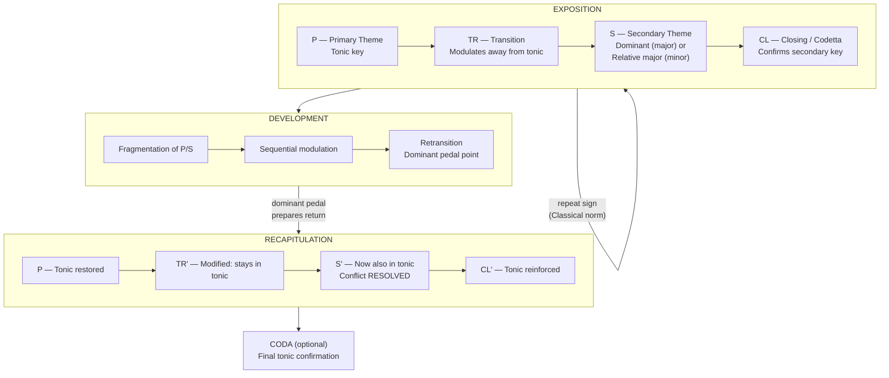
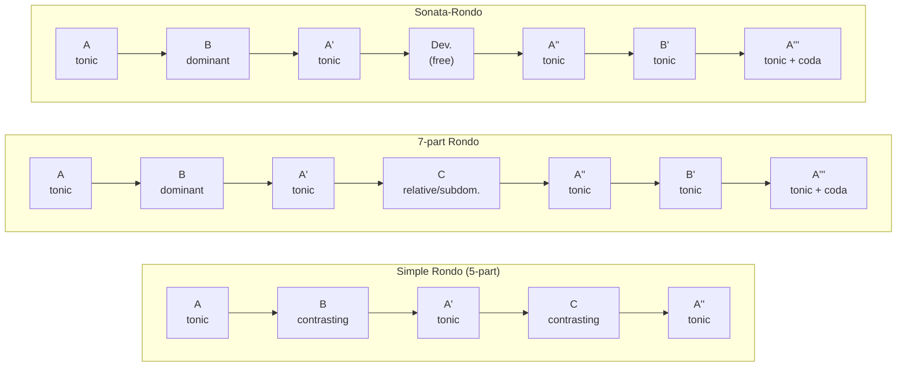
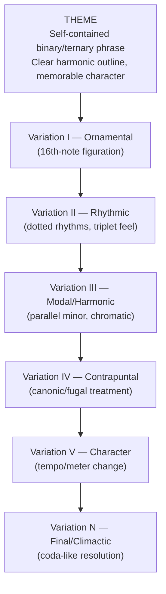
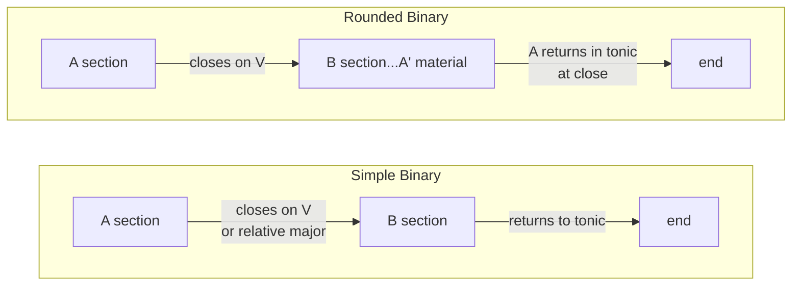
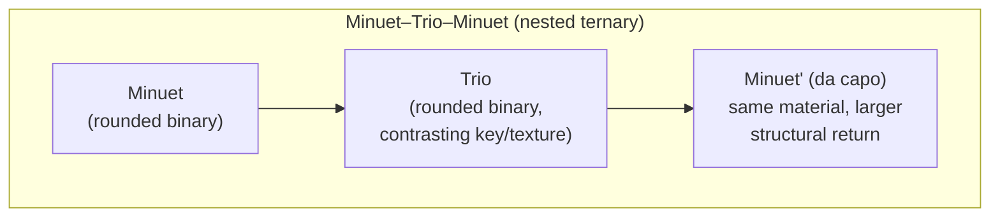
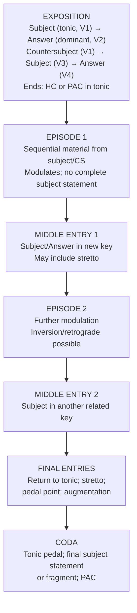
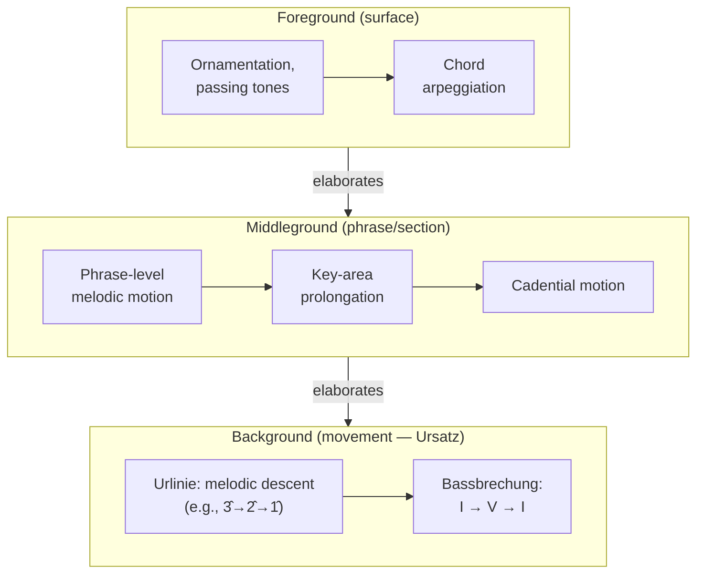

# Lesson 4: Form and Structure in Western Music — A Performer's and Analyst's Guide

## Why This Lesson Exists for Your Hands, Not Just Your Eyes

If you only read about sonata form, you will be able to label diagrams but not play a convincing exposition, voice a development's climax, or shape a rondo refrain so the return actually lands. Form is something you execute at the keyboard, on the fretboard, or at the podium: it dictates dynamics, pedaling, tempo rubato, and phrasing decisions bar by bar. This lesson treats form as a **performance and listening skill** first, an analytical label second.

The first-principles reason form matters: music has no physical artifact you can step back and view at once. Your ear/brain is a prediction engine — it builds statistical models of what's coming and gets a reward hit when predictions land, an arousal spike when they're violated. Form is the deliberate engineering of that cycle: **establish a pattern → depart from it → return to it, resolved.** Every drill in this lesson trains you to recognize that cycle while performing and to shape your playing so the listener feels it.

Three invariants run through everything below:
1. **Tonal departure and return** — leaving home key and coming back is the backbone of nearly all large forms before 1900.
2. **Multi-timescale tension** — a phrase resolves to a cadence, a section resolves to a key arrival, a movement resolves to the home key. Good performance coordinates these so they don't all resolve at once (flat, boring) or never resolve (incoherent).
3. **Identity vs. transformation** — thematic material must stay recognizable while being changed. How much of each defines the character of the form.

---

## Part 1: Sonata Form — Playing the Tonal Argument

Sonata form governs most Classical/Romantic first movements. Before analyzing it, **play the shape**.

### Drill 1.1 — Feel the Tonal Distance (Keyboard, any instrument with chords)

Play this sequence slowly, listening for the *character* of each key relative to your starting tonic. Use C major as home.

```text
C major (I) — hold 4 beats, feel "home"
   ↓
G major (V) — hold 4 beats, feel "related, lifted, bright"
   ↓
C major (I) — return, feel "resolved"
```

Metronome: **60 BPM**, one chord per 4 beats, whole notes. Do this in C, then F, then D minor (using the relative major, F major, as your "away" key instead of the dominant). Repeat daily for a week before moving to Drill 1.2. The goal is purely perceptual: your ear must learn to recognize "home," "related-but-displaced," and "returned" as physically distinct sensations, not labels.

### Drill 1.2 — Voicing an Exposition at the Piano

Take any Classical sonatina (Clementi Op. 36 No. 1 is ideal — public domain, widely available). Mark your score in three colors:
- **Red**: Primary theme (P) — tonic
- **Blue**: Transition (TR) — modulating
- **Green**: Secondary theme (S) — new key

Practice routine:
1. Play P alone, repeatedly, until it is memorized and stylistically settled (articulation, dynamics) — **72 BPM**.
2. Play TR alone. Exaggerate the harmonic instability: crescendo slightly as you approach the new key, as if leaning forward. This is not optional expression — it is the composer's intended function made audible.
3. Play S alone. Shift touch: if P was detached/energetic, make S legato/lyrical. Composers write contrasting *character*, not just contrasting *key* — your touch must deliver both.
4. Chain P→TR→S at **60 BPM**, then **80 BPM**, then **100 BPM**, listening for the arrival at S as a destination, not just "the next tune."

### Structural Anatomy (Reference Map)



### The Tonal Argument — What Your Hands Must Communicate

In a **major-key** movement, S lands on **V** (dominant) — the closest acoustically related key, sharing all but one scale tone, and its tonic triad contains the home key's leading tone. The effect you must produce: familiar but displaced, like a sentence that almost finishes in the key you expect but lands one step sideways.

In a **minor-key** movement, S typically lands on **III** (relative major) — a genuine brightening. Physically, this usually means: open up your dynamic range, lighten your touch, let the music breathe wider. Beethoven and the Romantics increasingly used chromatic mediants for more jarring contrast — when you meet one of these, don't smooth it over; let the harmonic surprise register in your touch (a hair of extra space before the new key's first chord).

**The core asymmetry, and how to play it:** the exposition poses a problem; the recapitulation solves it. When TR returns in the recap (TR'), it is modified to stay in tonic — practice this passage separately from the exposition's TR, because the harmonic goal is different even though the notes look similar. Many intermediate performers play TR' exactly like TR and the resolution evaporates. When S' arrives in tonic, this is the dramatic payoff of the entire movement — give it more structural weight (slightly broader tempo, fuller dynamic) than S had in the exposition, even if the dynamic marking is identical. You are playing the *arrival of resolution*, not a repeat.

### Development Section: Execution Techniques

The development's job is instability. At the instrument, this means:

- **Fragmentation**: themes break into 2–3 note cells. Practice isolating just the motivic cell (e.g., Beethoven's Fifth Symphony opening G–G–G–E♭) and drilling it in isolation at **100 → 140 → 160 BPM**, since the composer will accelerate your perception of it through repetition and sequence even if the notated tempo doesn't change.
- **Sequential modulation**: the same fragment repeats, transposed, often around the circle of fifths. Finger it identically in each transposition if the physical shape allows (common in scalar/arpeggiated fragments) — consistent fingering across transpositions keeps your sequence rhythmically even under pressure.
- **Retransition over dominant pedal**: practice the bass note/pedal alone, sustained or repeated, while you build the figuration above it. The pedal must never waver rhythmically — it is the floor the entire architecture stands on. Use a drone (keyboard sustain, or a bass player holding the note) while you drill the upper voice separately, then combine.

**Case study — Beethoven's Fifth, mvt. 1**: the four-note motif is fragmented as early as bar 2 of the development; by the midpoint, the whole texture rides a single repeated two-note cell over a grinding dominant pedal. If you're in an ensemble playing this, the practical lesson is: that two-note cell must get *more* intense, not just louder — add bow pressure/attack weight (strings), or firmer wrist drive (piano), as the harmonic tension increases, independent of the written dynamic.

### Formal Variants — What to Listen/Watch For

| Variant | What changes | Performance implication | Example |
|---|---|---|---|
| Monothematic sonata | One theme group; same tune serves P and S roles | Must create contrast through *key and texture alone* since melody repeats — vary articulation/register | Haydn, String Quartet Op. 33 No. 3 |
| Slow-movement sonata | Development minimal/absent | Less drama to build; favor warmth and legato over forward drive | Mozart, K. 332, mvt. 2 |
| Concerto (double exposition) | Orchestra states theme in tonic only; soloist's exposition follows the full tonal plan | Soloist must "re-arrive" at material the orchestra already played — add ornamentation/elaboration to justify the restatement | Mozart, Piano Concerto K. 491 |
| Reverse recapitulation | Recap opens with S, not P | The "homecoming" feeling is delayed — don't over-arrive at the start; save your weight for P's later return | Haydn, Symphony No. 46 |
| Sonata-rondo | Development episode replaces rondo's central C section | Treat the episode with genuine developmental instability, not just "another verse" | Beethoven, Piano Sonata Op. 13, mvt. 3 |

---

## Part 2: Rondo Form — Shaping the Refrain's Return

### Drill 2.1 — Refrain Character Contrast

Rondo's structural currency is the **A section's return**, and that return only lands if the episodes contrast it convincingly. Take a simple rondo (Mozart K. 331, third movement, "Alla Turca," or Beethoven's Op. 13 finale) and practice this sequence:

1. Play A alone at performance tempo. Lock in a specific character — articulation, dynamic range, pedal use.
2. Play B alone. Deliberately change at least two of: key, texture (e.g., chordal → contrapuntal), dynamic range, register. If B doesn't feel like leaving the room A was in, your contrast is too weak — exaggerate it in practice, then dial back for performance.
3. Return to A. Do not simply repeat your first reading — add the smallest ornament or dynamic shading that signals "we are glad to be back," without rewriting the composer's text. A breath/slight tenuto on the first note of the return is often enough.

Metronome target: full movement at **♩=100 → 116 → 132** (adjust to piece), always sectioned first, chained last.

### Formal Variants



The **simple rondo** (A–B–A–C–A) treats A as pure refrain — common in dances and character pieces. The **7-part rondo** mirrors sonata-form logic: B appears in the dominant first time, tonic on return. The **sonata-rondo**, Beethoven's favorite finale structure, swaps a genuine development episode in for the rondo's C section — play that episode with real harmonic instability (per Part 1's development drills), not as a lighter "trio."

**Rondo vs. strophic — the practical distinction**: in strophic song, each verse repeats the same music with no interruption, so there's nothing to "resolve" on return. In rondo, the refrain's return only has meaning *because* an episode interrupted it. If you're accompanying or arranging, never treat rondo B/C material as filler — it is specifically engineered to make A's return feel earned. Underplaying the episodes flattens the entire form.

---

## Part 3: Theme and Variations — Practicing Identity Under Transformation

### Drill 3.1 — Memorize the Skeleton Before the Ornament

Before attempting any variation, isolate what the variations are actually varying. Three possibilities, and you must identify which applies to your piece before you can practice intelligently:

1. **Harmonic skeleton fixed** (ground bass / passacaglia / chaconne tradition — Purcell's *Dido's Lament*, Pachelbel's Canon, Beethoven's 32 Variations WoO 80): play the bass line alone, repeatedly, until it's second nature. Everything else is built on top of this floor.
2. **Melodic outline fixed, ornamented** (Bach/Handel *cantus firmus* variation): sing or play the bare tune first, then play the ornamented version while mentally tracking which notes are the "real" tune versus decoration.
3. **Only phrase structure/cadence points fixed** ("character variation," dominant from Beethoven onward): map out bar numbers where cadences fall across all variations — these stay constant even when everything else changes.

### Practice Routine for a Variation Set (e.g., Beethoven, Op. 109, mvt. 3)

1. Learn the theme to performance standard first, at the tempo and character marked. Do not rush to the variations — the audience (and you) need the theme fully internalized as the reference point.
2. For each variation, identify in writing: what changed (rhythm? harmony? texture? register?) and what was preserved (cadence points? harmonic skeleton? melodic contour?).
3. Practice each variation initially **in isolation** at a reduced tempo — typically 70% of target — focusing on whatever new technical demand it introduces (e.g., 16th-note figuration in an ornamental variation demands separate hand-independence drilling before you reintroduce expression).
4. Chain Theme → Var. I → Var. II etc. only after each variation is independently solid. Play the chain slowly first (**60 BPM** macro-pulse) so you can audibly track the thread of identity across transformations; increase to target tempo once the thread survives speed.
5. In performance, the final variation (often climactic or a return to simplicity, as in Op. 109) should feel like the destination the whole set was traveling toward — leave interpretive "room" (dynamic range, rubato) unused in earlier variations so the last one has somewhere to go.

### Structural Architecture



### Canonical Repertoire and What Each Teaches Your Hands

- **Bach, Goldberg Variations BWV 988**: variations on a *bass line*, not the aria's melody — practice the bass alone across several variations to feel the invariant. Every third variation is a canon at an expanding interval; isolate canonic voices hands-separately before combining.
- **Beethoven, 32 Variations WoO 80**: an 8-bar ground bass (chaconne, not loose theme-and-variations) — the bass is non-negotiable; drill it as an ostinato loop before layering anything above it.
- **Brahms, Variations on a Theme by Handel Op. 24**: some variations bear no surface resemblance to the theme — trust the harmonic/phrase skeleton, not melodic memory, when learning these.
- **Beethoven, Op. 109 mvt. 3**: variations fragment toward abstraction, then the theme returns transfigured — the last statement needs more tonal color/pedal nuance than the opening statement of the same notes.

---

## Part 4: Binary and Ternary — The Atomic Units You Already Play

Every larger form above is built from these two primitives. Internalizing them physically (through Baroque dance repertoire and minuets) builds the foundation for everything else.

### Binary Form

**|| : A : || : B : ||** — A establishes tonic, closes on dominant (or relative major in minor keys); B begins away from tonic, returns to it.

- **Simple binary**: A and B are independent material. Practice: play A's final cadence, then B's opening — if B's opening doesn't clearly contrast A's closing gesture (texture, register, rhythmic character), the form reads as one long undifferentiated section. Exaggerate the contrast in early practice.
- **Rounded binary**: B opens with new material but closes with A material, now in tonic — **|| : A : || : B + A' : ||**. This is the direct ancestor of sonata form (A = exposition's P, B's new opening = development, B's A-material close = recapitulation). Practice identifying exactly where A' begins within B — mark it in the score — and give that return the same "arrival" weight you'd give a sonata recapitulation.



### Ternary Form

**A–B–A'**, where each section is harmonically **complete** — full cadence before the next section starts. This is the key practical difference from rounded binary: there is no ambiguity about section boundaries.

- Baroque *da capo* aria, Classical minuet-and-trio, Romantic character piece (Chopin nocturnes, Schumann *Kinderszenen*) all use this.
- **Minuet-and-Trio practice note**: the whole movement is ternary (Minuet–Trio–Minuet), but the Minuet itself is internally a rounded binary, and so is the Trio. This recursive nesting means you must practice at two structural levels simultaneously — shape the Minuet's internal binary return *and* the larger ternary return of the whole Minuet after the Trio, with the larger return carrying more weight (often played with subtle tempo/dynamic broadening compared to the first time through).



---

## Part 5: Fugue — Where Counterpoint *Is* Form

Fugue proves that form doesn't require a pre-set sectional template; it can emerge directly from contrapuntal procedure.

### Structure



### Drill 5.1 — Voice Independence for Fugal Playing

Fugue's demand on a keyboardist is **voice independence under a single pair of hands**. Before attempting any fugue at tempo:

1. Learn each voice alone, as a melody, until it's memorized — no harmony context, just the line.
2. Play any two voices together at **half tempo**, listening specifically for whether you can mentally "hear" each voice independently rather than as a fused chord stream.
3. Add voices one at a time, always dropping back to half tempo when a new voice is introduced.
4. Practice "spotlighting": play all voices but consciously crescendo only the entering subject/answer at each new entry, keeping the others subordinate — this is how performers make a fugue's structure audible to listeners who can't read the score.

**Subject vs. answer**: the answer is the subject transposed to the dominant — **real** (exact transposition) or **tonal** (adjusted, typically when the subject opens with a leap of a fifth, to stay within the home key's scale). When practicing entries, check whether your answer is real or tonal before fingering it — tonal answers often require different fingering than a literal transposition of the subject would suggest.

**Countersubject**: written for invertible counterpoint — it must work both above and below the subject. If you're arranging or reducing a fugue, verify this by playing the CS an octave displaced against the subject; it should still sound correct.

**Episodes are developmental, not decorative** — treat them with the same instability-focused shaping described in Part 1's development drills (building sequences, leaning into modulation), not as a relaxation between entries.

---

## Part 6: Analytical Tools for Practice, Not Just Paper

### Schenkerian Reduction — A Practical Use

You don't need to master full Schenkerian notation to use its central insight at the instrument: **a section is defined by which structural harmony it's prolonging**, not by its busiest surface detail. Before performing a sonata exposition, ask: is this passage prolonging tonic, or prolonging dominant (i.e., already leaning toward the new key)? Shape your dynamics and forward motion accordingly — prolongation of a goal harmony should feel like sustained arrival, not static repetition.



### Formal Function Analysis (Caplin) — Labeling What You Play

Mark your score with these five functions before practicing a new piece; it tells you *how* to shape each passage, not just what key it's in:

- **Presentation** — establishing a basic idea. Play with clarity and settled character.
- **Continuation** — fragmenting, speeding harmonic rhythm, pushing forward. Play with rising energy/momentum.
- **Cadential** — targeting a cadence. Slightly broaden or emphasize the approach; this is a destination.
- **Transitional** — destabilizing the key, preparing a new one. Lean forward; let instability show.
- **Developmental** — systematically avoiding closure. Resist the urge to resolve; sustain tension.

This labeling exercise, done once per piece before practicing, dramatically speeds up interpretive decisions — you stop guessing at expressive shape and start deriving it from structural function.

---

## Part 7: Cross-Era Transformations — What Changes When You Switch Repertoire

| Form | Baroque (1600–1750) | Classical (1750–1820) | Romantic (1820–1900) | 20th Century |
|---|---|---|---|---|
| Binary | Standard dance form, no thematic contrast | Evolves into rounded binary → sonata | Absorbed into larger forms | Returns in Neoclassicism (Stravinsky, Prokofiev) |
| Ternary | *Da capo* aria; Minuet–Trio | Minuet/Scherzo–Trio | Character piece; expanded middle sections | Form-as-process; blurred boundaries |
| Sonata | Absent; binary dominates | Fully codified | Expanded development; cyclic forms (Franck, Liszt) | Compressed (Sibelius 7), deconstructed (Schoenberg) |
| Rondo | *Ritornello* form in concertos/arias | Finale standard; sonata-rondo emerges | Informal; character rondos | Replaced by sectional jazz/minimalist forms |
| Theme & Vars | Passacaglia/chaconne; divisions | Theme + numbered variations | Character variation (Brahms); fugal finale | Twelve-tone variation; minimalist process (Reich) |
| Fugue | Fully elaborated; peak of learned counterpoint | Retained as learned style (Beethoven Op. 59, 131, 133 finales) | Symbol of mastery (Brahms, Franck) | Aleatoric counterpoint; spectralist neo-fugal texture |

**Practical takeaway**: when you pick up a new piece, first identify its era's default assumptions about these forms before assuming Classical-era rules apply. A "sonata form" Romantic movement may have a vastly expanded development and a cyclic recall of themes across movements — don't force Haydn-era proportions onto Liszt.

---

## Part 8: Modeling Form Programmatically (Optional — for Composers, Arrangers, and MIR Work)

If you compose, arrange, or build notation/analysis tools, representing form as a tree structure lets you query and manipulate formal relationships programmatically — useful for algorithmic composition sketches, automated formal labeling, or MIR research.

```python
"""
musical_form.py

Hierarchical model of musical formal structures.
Represents sonata form, rondo, and theme-and-variations as
labeled, recursive tree structures for algorithmic composition
sketches or formal-analysis tooling.

Requires: Python 3.10+
"""

from __future__ import annotations
from dataclasses import dataclass, field
from enum import Enum, auto
import json


class FormalFunction(Enum):
    """Formal functions per Caplin (1998)."""
    PRESENTATION   = auto()
    CONTINUATION   = auto()
    CADENTIAL      = auto()
    TRANSITIONAL   = auto()
    DEVELOPMENTAL  = auto()
    RETRANSITIONAL = auto()
    CODALIKE       = auto()
    INTRODUCTORY   = auto()


class Key(Enum):
    """Simplified key region label (not a full pitch-class model)."""
    TONIC          = "I"
    DOMINANT       = "V"
    RELATIVE_MAJOR = "III"
    SUBDOMINANT    = "IV"
    SUBMEDIANT     = "VI"
    MEDIANT        = "III"
    CHROMATIC      = "?"   # unstable / development


@dataclass
class FormalSection:
    """
    A node in the formal hierarchy.

    label       : e.g. "P", "S", "Dev", "A", "B"
    function    : formal role this section fulfills
    key         : tonal region
    bars        : (start, end), 1-indexed inclusive
    subsections : nested formal sections (recursive)
    notes       : analytical commentary
    """
    label: str
    function: FormalFunction
    key: Key
    bars: tuple[int, int]
    subsections: list[FormalSection] = field(default_factory=list)
    notes: str = ""

    def duration_bars(self) -> int:
        return self.bars[1] - self.bars[0] + 1

    def is_leaf(self) -> bool:
        return len(self.subsections) == 0

    def depth(self) -> int:
        if self.is_leaf():
            return 0
        return 1 + max(s.depth() for s in self.subsections)

    def to_dict(self) -> dict:
        return {
            "label": self.label,
            "function": self.function.name,
            "key": self.key.value,
            "bars": list(self.bars),
            "duration": self.duration_bars(),
            "notes": self.notes,
            "subsections": [s.to_dict() for s in self.subsections],
        }

    def pretty_print(self, indent: int = 0) -> None:
        prefix = "  " * indent
        bar_range = f"mm. {self.bars[0]}-{self.bars[1]}"
        print(
            f"{prefix}[{self.label}] {self.function.name} | "
            f"key={self.key.value} | {bar_range} "
            f"({self.duration_bars()} bars)"
        )
        if self.notes:
            print(f"{prefix}  -> {self.notes}")
        for sub in self.subsections:
            sub.pretty_print(indent + 1)


def build_beethoven_op2_no1_mvt1() -> FormalSection:
    """
    Approximate formal analysis of Beethoven, Piano Sonata Op. 2 No. 1,
    mvt. I (F minor). Bar numbers are illustrative, not an authoritative
    critical edition — verify against a score before using for teaching.
    """
    p_theme = FormalSection("P", FormalFunction.PRESENTATION, Key.TONIC,
                            (1, 20), notes="F minor rocket figure; HC close")
    transition = FormalSection("TR", FormalFunction.TRANSITIONAL, Key.TONIC,
                                (21, 32), notes="Modulates toward A-flat major (III)")
    s_theme = FormalSection("S", FormalFunction.PRESENTATION, Key.RELATIVE_MAJOR,
                            (33, 48), notes="A-flat major; lyrical contrast to P")
    closing = FormalSection("CL", FormalFunction.CADENTIAL, Key.RELATIVE_MAJOR,
                            (49, 55), notes="PAC confirms A-flat major")
    exposition = FormalSection("Exposition", FormalFunction.PRESENTATION, Key.TONIC,
                                (1, 55), subsections=[p_theme, transition, s_theme, closing])

    dev_core = FormalSection("Dev-Core", FormalFunction.DEVELOPMENTAL, Key.CHROMATIC,
                              (56, 88), notes="Sequential fragmentation of P motif")
    retrans = FormalSection("Retrans", FormalFunction.RETRANSITIONAL, Key.DOMINANT,
                            (89, 96), notes="Dominant pedal on C drives to recap")
    development = FormalSection("Development", FormalFunction.DEVELOPMENTAL, Key.CHROMATIC,
                                 (56, 96), subsections=[dev_core, retrans])

    p_recap = FormalSection("P'", FormalFunction.PRESENTATION, Key.TONIC,
                            (97, 116), notes="P returns in tonic")
    tr_recap = FormalSection("TR'", FormalFunction.TRANSITIONAL, Key.TONIC,
                            (117, 128), notes="Modified to remain in tonic")
    s_recap = FormalSection("S'", FormalFunction.PRESENTATION, Key.TONIC,
                            (129, 144), notes="S now in F minor; conflict resolved")
    closing_recap = FormalSection("CL'", FormalFunction.CADENTIAL, Key.TONIC,
                                  (145, 152), notes="PAC confirms F minor")
    recapitulation = FormalSection("Recapitulation", FormalFunction.PRESENTATION, Key.TONIC,
                                    (97, 152), subsections=[p_recap, tr_recap, s_recap, closing_recap])

    coda = FormalSection("Coda", FormalFunction.CODALIKE, Key.TONIC,
                        (153, 165), notes="Reworks P material; final tonic confirmation")

    return FormalSection(
        "Mvt. I (Sonata Form)", FormalFunction.PRESENTATION, Key.TONIC,
        (1, 165), subsections=[exposition, development, recapitulation, coda],
        notes="Beethoven, Piano Sonata Op. 2 No. 1, F minor"
    )


def analyze_tonal_proportions(section: FormalSection) -> dict[str, float]:
    """Percent of total bars each top-level subsection occupies."""
    total = section.duration_bars()
    return {s.label: round((s.duration_bars() / total) * 100, 1)
            for s in section.subsections}


def find_sections_by_function(root: FormalSection,
                               target: FormalFunction) -> list[FormalSection]:
    """Depth-first search for all sections with a given formal function."""
    results: list[FormalSection] = []
    stack = [root]
    while stack:
        node = stack.pop()
        if node.function == target:
            results.append(node)
        stack.extend(reversed(node.subsections))
    return results


if __name__ == "__main__":
    mvt = build_beethoven_op2_no1_mvt1()

    print("=" * 60)
    print("FORMAL ANALYSIS: Beethoven Op. 2 No. 1, Mvt. I")
    print("=" * 60)
    mvt.pretty_print()

    print("\nSECTION PROPORTIONS (% of total bars):")
    for label, pct in analyze_tonal_proportions(mvt).items():
        print(f"  {label:20s}: {pct:5.1f}%")

    print("\nDEVELOPMENTAL PASSAGES (all levels):")
    for s in find_sections_by_function(mvt, FormalFunction.DEVELOPMENTAL):
        print(f"  [{s.label}] mm. {s.bars[0]}-{s.bars[1]}: {s.notes}")

    print("\nJSON (top level only):")
    top = {k: v for k, v in mvt.to_dict().items() if k != "subsections"}
    print(json.dumps(top, indent=2))
```

This is a sketch tool for exploring formal proportions and querying function distributions — treat bar numbers as illustrative scaffolding to adapt to a real critical edition, not as authoritative musicology.

---

## Part 9: Putting It Together — A 4-Week Practice Plan

**Week 1 — Binary/Ternary foundations.** Learn one Baroque binary dance (e.g., a Bach minuet) and one ternary minuet-and-trio. Drill the A-section cadence points and the B-section return explicitly. Metronome: 60 → 80 BPM.

**Week 2 — Sonata exposition.** Take a Classical sonatina movement. Section-practice P/TR/S/CL separately (Drill 1.2), then chain at 60 → 80 → 100 BPM. Mark Caplin functions in the score.

**Week 3 — Development and recapitulation.** Drill fragmentation and retransition (Part 1). Compare TR vs. TR' explicitly — play them back to back to feel the difference in harmonic goal.

**Week 4 — Rondo or variations, your choice.** Apply Drill 2.1 (refrain contrast) or Drill 3.1 (skeleton identification) to a complete short piece. Perform the whole piece from memory, narrating (aloud, to yourself or a teacher) which formal function each passage carries as you play it.

By the end of this plan you should be able to point to any bar in a piece you're learning and say, without stopping to think: what formal function is this, what key is it prolonging, and what should my hands be doing differently here than in the previous section.

---

## Further Study

**Primary theoretical sources:**
- Charles Rosen, *The Classical Style* (1971) — definitive account of sonata form in Haydn, Mozart, Beethoven.
- William E. Caplin, *Classical Form: A Theory of Formal Functions* (1998) — the modern standard reference for formal function analysis.
- Arnold Schoenberg, *Fundamentals of Musical Composition* (1967) — a composer's practical account of form.
- Leonard B. Meyer, *Emotion and Meaning in Music* (1956) — the perceptual/psychological grounding for why form generates expectation and affect.

**Scores for practice and analysis (public domain):**
- Beethoven, Piano Sonatas Op. 2 No. 1, Op. 13, Op. 57 — sonata and rondo forms, graded difficulty.
- Bach, *Well-Tempered Clavier*, Book I — 24 preludes and fugues, all keys; ideal for fugue voice-independence drilling.
- Mozart, Piano Sonata K. 331 — theme and variations (mvt. 1), rondo "alla Turca" (mvt. 3).
- Brahms, *Variations on a Theme by Handel*, Op. 24 — advanced variation technique plus closing fugue.

**Tools:**
- [music21](https://web.mit.edu/music21/) — Python toolkit for score parsing, roman numeral analysis, formal segmentation.
- [MuseScore](https://musescore.org/) — free notation software; annotate formal boundaries directly on your working score.
- [Humdrum Toolkit](https://www.humdrum.org/) — command-line MIR toolkit with formal analysis modules.
