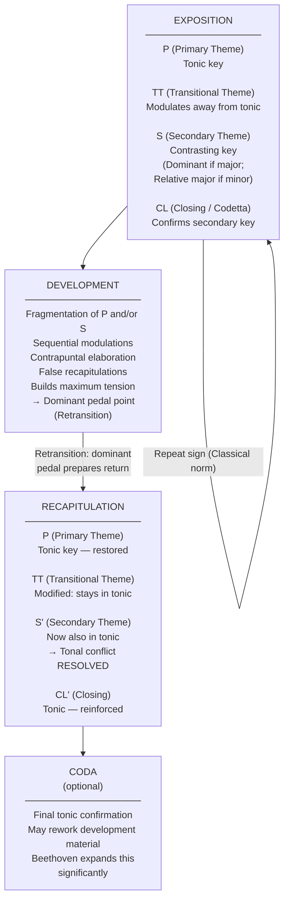
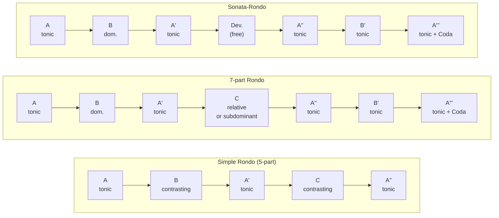
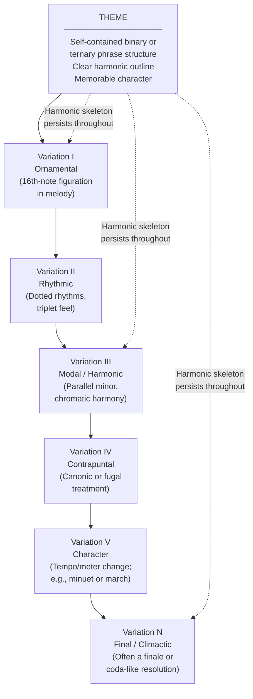
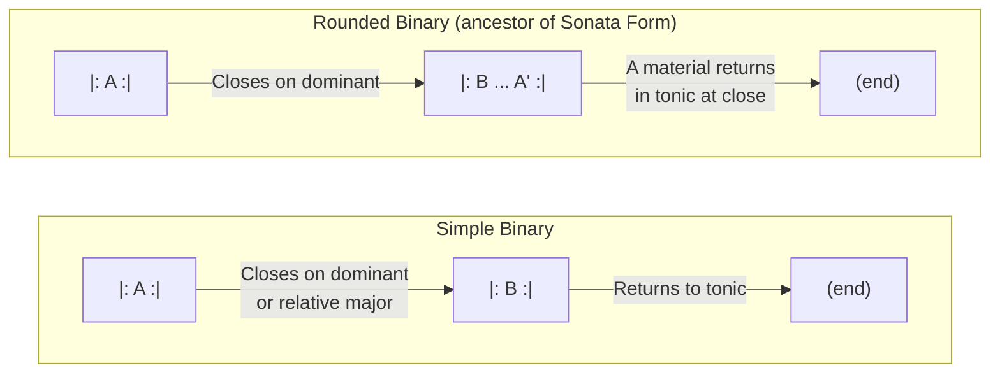
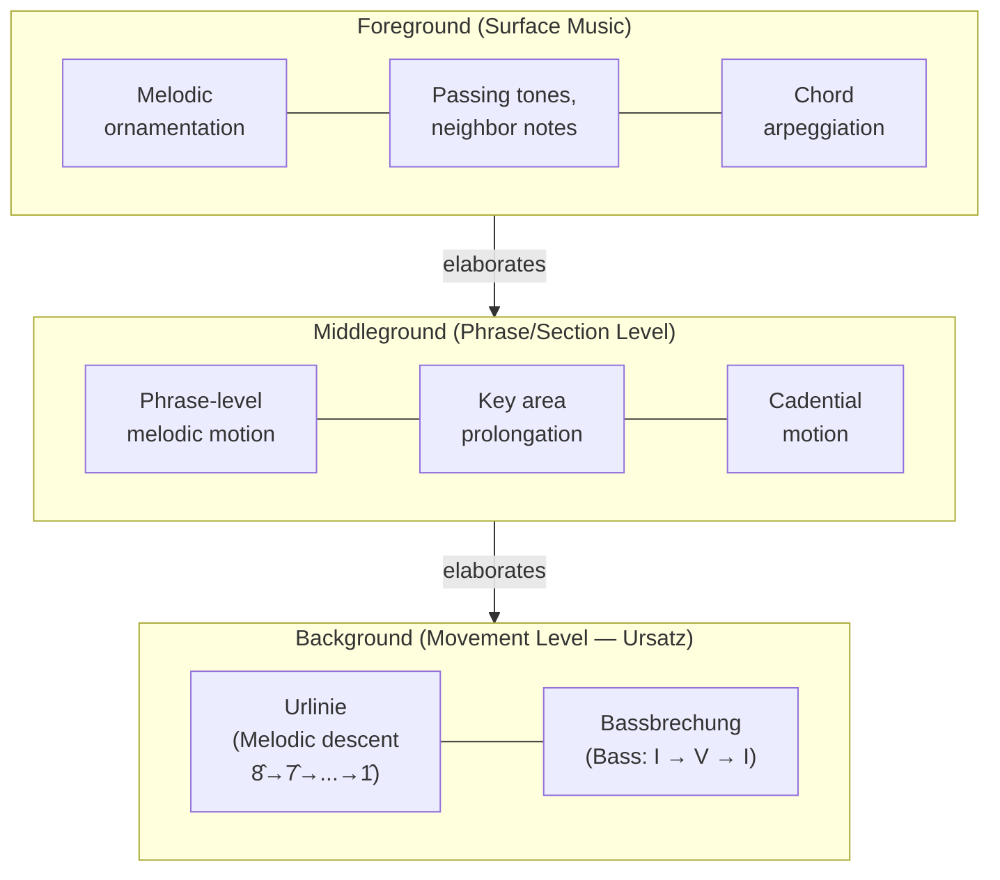
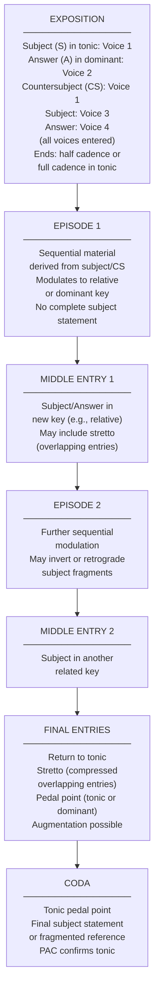

# Lesson 4: Form and Structure in Western Music

## First-Principles Intuition: Why Form Exists

Musical form is not decoration. It is the solution to a fundamental perceptual problem: how do you sustain a listener's engagement across time, in an art form that leaves no physical artifact and exists only in the present moment?

Unlike architecture or painting, music cannot be apprehended all at once. A listener cannot step back and see the whole. This creates an acute cognitive challenge. Without structure, music becomes either relentlessly novel — exhausting and incoherent — or boringly repetitive. Form is the precise engineering of tension between these two failure modes. It manages memory (repetition and return), expectation (the promise of events yet to come), and surprise (deviation from that expectation).

The first principle is therefore **pattern recognition and violation**. The human auditory cortex is a prediction engine. It builds models of statistical regularities in what it hears, then generates reward signals when those predictions are confirmed and arousal signals when they are violated. Musical form operates directly on this mechanism. It establishes patterns so that it can strategically break them, and resolves breaks so that it can establish new patterns. This cycle — establishment, departure, return — is not a stylistic convention of any era. It is a constraint imposed by human neurology.

The second principle is **hierarchical segmentation**. Music must be parseable at multiple timescales simultaneously: the phrase (2–8 bars), the period (8–16 bars), the section (exposition, development), and the movement. Each level has its own tension-and-release grammar. A note resolves to a scale degree; a phrase resolves to a cadence; a section resolves to a tonal arrival; a movement resolves to a home key. Forms are specifications for how these hierarchical resolutions should be coordinated.

The third principle is **tonal narrative**. In the common-practice period (roughly 1600–1900), harmonic tonality provided a spatial metaphor: keys feel near or far, stable or unstable. Form is the journey through that space and back home. The tonic key is not merely a starting point; it is a gravitational well. All structural forms in this period can be understood as controlled excursions away from tonic and eventual returns to it.

---

## Core Architecture and Mechanics

### Sonata Form

Sonata form is the dominant large-scale structure of the Classical and Romantic periods, governing the first movements — and often final movements — of symphonies, string quartets, piano sonatas, and concertos from roughly 1750 onward. It was not codified by theorists until the early nineteenth century (most notably by Anton Reicha in his *Traité de haute composition musicale*, 1826, and later Carl Czerny); the composers who used it — Haydn, Mozart, Beethoven — worked from internalized norms, not written rules.

The form's power lies in its realization of a specific dramatic arc: the presentation of two (or more) thematic ideas in a tonal conflict, the destabilization and fragmentation of those ideas, and their reconciliation under a unified tonal center.

#### Structural Anatomy



#### The Tonal Argument in Detail

The key relationship between the primary and secondary themes is not arbitrary. In a movement in a **major key**, the secondary theme appears in the **dominant** (the fifth above), which is the most acoustically related key — it shares all scale tones with the tonic except one, and its tonic chord contains the leading tone of the home key. This creates a productive ambiguity: the secondary key area feels simultaneously familiar and displaced.

In a movement in a **minor key**, the secondary theme typically appears in the **relative major** (the key built on the third scale degree), which provides a brighter, more open contrast to the minor tonic. Beethoven and later Romantic composers increasingly used the mediant (III) in major-key movements as a more striking alternative to the dominant.

The fundamental asymmetry of sonata form is this: **the exposition presents a tonal problem, and the recapitulation solves it**. In the recapitulation, the transitional theme (which previously modulated away from tonic) is modified — often shortened or reharmonized — so that it no longer departs. The secondary theme, which was heard in the foreign key during the exposition, now sounds in the tonic. This is the structural resolution the entire movement has been preparing.

#### Development Section: Techniques

The development section is the most compositionally variable part of sonata form. Its defining characteristic is **instability** — no single key is established for long. Common techniques include:

- **Fragmentation**: themes are broken into smaller motivic cells (often just 2–3 notes), which are easier to sequence and develop
- **Sequential modulation**: a motivic fragment is transposed repeatedly through a cycle of keys (often the circle of fifths)
- **Contrapuntal combination**: themes or fragments introduced separately in the exposition are combined simultaneously
- **False recapitulation**: the primary theme returns in the wrong key, raising and then deferring the expectation of resolution
- **Retransition**: a passage, frequently built over a dominant pedal point (a held or repeated dominant harmony), which builds tension and directs the ear toward the recapitulation

Beethoven's Fifth Symphony, Op. 67, provides a canonical study in development technique. The opening four-note motif (G–G–G–E♭) is subjected to fragmentation as early as the second bar of the development; by the development's midpoint, the entire orchestra is driving forward on a single repeated two-note figure derived from that motif, over a grinding dominant pedal.

#### Formal Variants

| Variant | Description | Example |
|---|---|---|
| Monothematic sonata | Only one theme group; Haydn frequently reuses primary theme material in the secondary key area | Haydn, String Quartet Op. 33 No. 3 |
| Slow-movement sonata | Abbreviated: development section is minimal or omitted entirely | Mozart, Piano Sonata K. 331, mvt. 2 (actually Theme & Vars) |
| Concerto first movement (Ritornello-Sonata hybrid) | Double exposition: orchestral exposition in tonic only, then soloist exposition follows standard sonata tonal plan | Mozart, Piano Concerto K. 491 |
| Reverse recapitulation | Recapitulation begins with the secondary theme rather than primary | Haydn, Symphony No. 46 |
| Sonata rondo | Rondo structure with development episode replacing the central C episode | Beethoven, Piano Sonata Op. 13, mvt. 3 |

---

### Rondo Form

Rondo form derives from the French *rondeau*, a poetic and musical form of the medieval and Renaissance periods in which a refrain (*rentrement*) alternated with different stanzas (*couplets*). The core structural invariant is a **recurring refrain** (the ritornello or A section) that returns in the tonic key between contrasting episodes.

#### Formal Variants



The **simple rondo** (A–B–A–C–A) deploys A as a refrain with no structural function beyond return. It is common in character pieces and dances.

The **7-part rondo** places B in the dominant on its first appearance and in the tonic on its return before the final A — mirroring the sonata-form principle of tonal resolution.

The **sonata-rondo** is a formal hybrid of considerable sophistication, used extensively by Beethoven for finales. It maps sonata form's exposition/development/recapitulation onto the rondo's refrain/episode/refrain plan. The B episode in the first half functions as a secondary theme group (in the dominant or relative major); a central "development" episode replaces the C section; and the final section brings both A and B back in the tonic. This is the structure of the finale of Beethoven's Piano Sonata Op. 13 (*Pathétique*) and the finale of his Symphony No. 7.

#### Why Rondo is Structurally Distinct from Strophic Form

A common confusion is between rondo and strophic form. In strophic form (a song in which each verse uses the same music), there is no **contrast**: the same material recurs without interruption. In rondo, the refrain's return is structurally meaningful *because* of the episodes that precede it. The episodes are not filler; they are designed to increase the affective weight of the returning refrain through contrast of key, texture, or character.

---

### Theme and Variations Form

Theme and variations (*Thema mit Variationen*) isolates and magnifies the third structural principle identified above: the cycle of transformation and recognition. The theme is stated completely and memorably at the outset; each variation then transforms it while preserving enough identity to be recognizable. The listener holds the theme in working memory and measures each variation against it, deriving pleasure from both the novelty of the transformation and the recognition of the underlying template.

#### What Must a Variation Preserve?

This is a question of musical identity. Historically, three different elements have served as the invariant:

1. **Harmonic skeleton**: The chord progression (the *basso ostinato* or ground bass tradition — Purcell's *Dido's Lament*, Pachelbel's Canon) remains fixed; melody and texture vary freely above it.
2. **Melodic outline**: The tune's contour remains recognizable, ornamented or elaborated (the *cantus firmus* variation technique used by Bach and Handel).
3. **Formal structure**: Only the phrase lengths and cadence points are preserved; harmony, melody, and texture are freely transformed. This "character variation" approach is dominant from Beethoven onward.

Modern analyses add a fourth category: **motivic cell preservation**, in which a single rhythmic or intervallic cell derived from the theme is the only common thread across variations (evident in Brahms's *Variations on a Theme by Paganini*).

#### Structural Architecture



#### Canonical Examples and Their Strategies

**Bach, Goldberg Variations, BWV 988 (1741)**: Thirty variations on a *bass line* and harmonic progression (not the aria's melody). Every third variation is a canon, with the interval of imitation expanding by one step each time (canon at the unison, second, third... up to ninth). The final variation (*quodlibet*) combines two popular songs of Bach's era over the original bass — an act of wit and structural summary. The aria returns at the end, now heard with thirty variations' worth of accumulated context.

**Beethoven, 32 Variations in C minor, WoO 80 (1806)**: Built on an eight-bar *basso ostinato* (a fixed repeated bass figure). The variations are brief, intense, and tightly interlocked — this is a *chaconne* structure, not a typical theme-and-variations. The harmonic skeleton is non-negotiable; everything else varies.

**Brahms, Variations on a Theme by Handel, Op. 24 (1861)**: Twenty-five variations followed by a fugue. The variations range from strict ornamental transformations to character studies bearing no surface resemblance to the theme. The final fugue synthesizes the variation technique with counterpoint — a formal argument that only Brahms's generation would construct.

**Beethoven, Piano Sonata Op. 109, third movement**: Six variations on a theme marked *Gesangvoll, mit innigster Empfindung* ("song-like, with the most intimate feeling"). The variations fragment toward increasing abstraction; the final variation returns the theme with an ornamental richness that makes it sound like both a remembrance and a transfiguration.

---

### Binary and Ternary Form: The Structural Primitives

Sonata form, rondo, and theme and variations are all built from two more fundamental formal units: **binary** and **ternary** form. These are not "simpler" forms so much as the atomic grammatical units from which larger structures are constructed.

#### Binary Form

Binary form consists of two sections, each typically repeated: **|| : A : || : B : ||**. The A section establishes the tonic and closes on the dominant (or, in minor, on the relative major). The B section begins away from tonic and returns to it. This creates the smallest complete tonal narrative: departure and return.

Two subtypes are structurally distinct:

- **Simple binary**: A and B are independent. Neither begins with material from the other. Common in Baroque dances.
- **Rounded binary**: B begins with contrasting material but *ends* with a return of A material, now in the tonic. This is notated **|| : A : || : B + A' : ||**, and it is the direct ancestor of sonata form. The initial A becomes the exposition's primary theme group; B's contrasting opening becomes the development; B's closing return of A material becomes the recapitulation.



#### Ternary Form

Ternary form is **A–B–A'**: a complete section, a contrasting section, and a return. The critical distinction from rounded binary is that in ternary form, **each section is harmonically complete** — it closes in its own key, with a full cadence, before the next section begins. The A section is a closed unit; the B section is a closed unit (often in a contrasting key); the return of A is a closed unit. There is no ambiguity about where sections end.

Ternary form is the standard structure of the Baroque *da capo* aria, the Classical minuet-and-trio (where the minuet = A, the trio = B, and the return of the minuet = A'), and countless character pieces of the Romantic period (Chopin's nocturnes, Schumann's *Kinderszenen*).

The minuet-and-trio itself follows a compound structure: the minuet is internally a rounded binary; the trio is internally a rounded binary; and the whole movement is a ternary. This **recursive nesting** is a key feature of large-scale formal architecture.

---

## Analytical Tools: Reduction and Voice-Leading Graphs

Understanding form analytically requires tools that strip away surface ornamentation to reveal underlying structure. The two most powerful frameworks are **Schenkerian reduction** and **formal function analysis**.

### Schenkerian Analysis (Sketch Description)

Heinrich Schenker (1868–1935) proposed that all tonal music can be understood as the elaboration of a simple fundamental structure (*Ursatz*): a melodic descent from scale degree 3̂, 5̂, or 8̂ to 1̂ (the *Urlinie*) supported by a bass arpeggio from tonic to dominant to tonic (the *Bassbrechung*). Every surface event — every chord, ornament, or modulation — is an elaboration of some level of this hierarchy.

For formal analysis, the key insight is that **sections are defined by which structural pitches they prolong**, not merely by their melodic surface. The exposition of a sonata form prolongs the dominant harmony (the structural dominant is not achieved until the development approaches its close). The recapitulation completes the tonic prolongation that the entire movement has been implying.



### Formal Function Analysis (William Caplin)

William Caplin's *Classical Form* (1998) provides a complementary framework organized around **formal functions** — the specific roles that musical passages play within a larger formal unit. Key functions include:

- **Presentation**: establishes a basic idea and its repetition (or harmonic copy)
- **Continuation**: increases rhythmic activity, fragments the basic idea, moves harmonically
- **Cadential**: targets and achieves a cadence, confirming a formal boundary
- **Transitional**: destabilizes the current key, prepares a new one
- **Developmental**: the characteristic function of development sections; avoids cadential closure systematically

The analytical power of this approach is that formal functions can be identified at multiple levels — a phrase, a section, and a movement can each exhibit presentational, continuational, and cadential functions simultaneously, at their respective scales.

---

## Python: Modeling Formal Structure Programmatically

The hierarchical, recursive structure of musical form maps naturally onto tree data structures. The following implementation demonstrates how formal structures can be represented, analyzed, and traversed programmatically. This is directly applicable to algorithmic composition, music information retrieval (MIR), and music notation software.

```python
"""
musical_form.py

Hierarchical model of musical formal structures.
Demonstrates how sonata form, rondo, and theme-and-variations
can be represented as labeled, recursive tree structures
suitable for algorithmic composition or MIR analysis.

Requires: Python 3.10+
"""

from __future__ import annotations
from dataclasses import dataclass, field
from enum import Enum, auto
from typing import Optional
import json


class FormalFunction(Enum):
    """
    Formal functions as defined in Caplin (1998).
    Identifies the structural role of a formal unit within
    its containing context.
    """
    PRESENTATION    = auto()   # Establishes basic idea
    CONTINUATION    = auto()   # Fragments and propels forward
    CADENTIAL       = auto()   # Targets and achieves a cadence
    TRANSITIONAL    = auto()   # Modulates; destabilizes key
    DEVELOPMENTAL   = auto()   # Avoids closure; fragments themes
    RETRANSITIONAL  = auto()   # Approaches recapitulation
    CODALIKE        = auto()   # Confirms and closes a large section
    INTRODUCTORY    = auto()   # Precedes the main formal unit


class Key(Enum):
    """
    Simplified key representation. 
    In a full implementation this would encode mode (major/minor),
    root pitch-class, and accidentals.
    """
    TONIC           = "I"
    DOMINANT        = "V"
    RELATIVE_MAJOR  = "III"    # from minor tonic
    SUBDOMINANT     = "IV"
    SUBMEDIANT      = "VI"
    MEDIANT         = "III"    # major-key mediant (Romantic usage)
    CHROMATIC       = "?"      # development; no stable tonal center


@dataclass
class FormalSection:
    """
    A node in the formal hierarchy.

    label       : Common-practice label (e.g., "P", "S", "Dev", "A", "B")
    function    : Formal function this section fulfills
    key         : Tonal region in which this section operates
    bars        : (start, end) bar numbers, 1-indexed, inclusive
    subsections : Nested formal sections (recursive)
    notes       : Free-text analytical commentary
    """
    label:       str
    function:    FormalFunction
    key:         Key
    bars:        tuple[int, int]
    subsections: list[FormalSection] = field(default_factory=list)
    notes:       str = ""

    def duration_bars(self) -> int:
        return self.bars[1] - self.bars[0] + 1

    def is_leaf(self) -> bool:
        return len(self.subsections) == 0

    def depth(self) -> int:
        if self.is_leaf():
            return 0
        return 1 + max(s.depth() for s in self.subsections)

    def to_dict(self) -> dict:
        return {
            "label":       self.label,
            "function":    self.function.name,
            "key":         self.key.value,
            "bars":        list(self.bars),
            "duration":    self.duration_bars(),
            "notes":       self.notes,
            "subsections": [s.to_dict() for s in self.subsections],
        }

    def pretty_print(self, indent: int = 0) -> None:
        prefix = "  " * indent
        bar_range = f"mm. {self.bars[0]}–{self.bars[1]}"
        print(
            f"{prefix}[{self.label}] "
            f"{self.function.name} | "
            f"key={self.key.value} | "
            f"{bar_range} ({self.duration_bars()} bars)"
        )
        if self.notes:
            print(f"{prefix}  → {self.notes}")
        for sub in self.subsections:
            sub.pretty_print(indent + 1)


def build_beethoven_op2_no1_mvt1() -> FormalSection:
    """
    Approximate formal analysis of Beethoven, Piano Sonata Op. 2 No. 1,
    first movement (F minor). Bar numbers are approximate and illustrative.

    Formal plan: Sonata form
    - Exposition:   mm. 1–49   (P in f minor, S in A♭ major [III])
    - Development:  mm. 49–96
    - Recapitulation: mm. 97–152 (P in f minor, S now in f minor)
    - Coda:         mm. 152–165
    """
    # --- Exposition ---
    p_theme = FormalSection(
        label="P", function=FormalFunction.PRESENTATION,
        key=Key.TONIC, bars=(1, 20),
        notes="F minor; opening rocket figure; closes with HC in tonic"
    )
    transition = FormalSection(
        label="TR", function=FormalFunction.TRANSITIONAL,
        key=Key.TONIC, bars=(21, 32),
        notes="Modulates toward A♭ major (relative major / III)"
    )
    s_theme = FormalSection(
        label="S", function=FormalFunction.PRESENTATION,
        key=Key.RELATIVE_MAJOR, bars=(33, 48),
        notes="A♭ major; lyrical contrast to P's driving energy"
    )
    closing = FormalSection(
        label="CL", function=FormalFunction.CADENTIAL,
        key=Key.RELATIVE_MAJOR, bars=(49, 55),
        notes="Confirms A♭ major; PAC closes exposition"
    )
    exposition = FormalSection(
        label="Exposition", function=FormalFunction.PRESENTATION,
        key=Key.TONIC, bars=(1, 55),
        subsections=[p_theme, transition, s_theme, closing]
    )

    # --- Development ---
    dev_core = FormalSection(
        label="Dev-Core", function=FormalFunction.DEVELOPMENTAL,
        key=Key.CHROMATIC, bars=(56, 88),
        notes="Sequential fragmentation of P motif; modulates through "
              "d, c, and other keys; no stable tonal area"
    )
    retrans = FormalSection(
        label="Retrans", function=FormalFunction.RETRANSITIONAL,
        key=Key.DOMINANT, bars=(89, 96),
        notes="Dominant pedal on C (V of f); drives toward recapitulation"
    )
    development = FormalSection(
        label="Development", function=FormalFunction.DEVELOPMENTAL,
        key=Key.CHROMATIC, bars=(56, 96),
        subsections=[dev_core, retrans]
    )

    # --- Recapitulation ---
    p_recap = FormalSection(
        label="P'", function=FormalFunction.PRESENTATION,
        key=Key.TONIC, bars=(97, 116),
        notes="F minor; P theme returns in tonic"
    )
    tr_recap = FormalSection(
        label="TR'", function=FormalFunction.TRANSITIONAL,
        key=Key.TONIC, bars=(117, 128),
        notes="Transition modified to remain in tonic; does not modulate"
    )
    s_recap = FormalSection(
        label="S'", function=FormalFunction.PRESENTATION,
        key=Key.TONIC, bars=(129, 144),
        notes="S theme now in F minor — tonal conflict resolved"
    )
    closing_recap = FormalSection(
        label="CL'", function=FormalFunction.CADENTIAL,
        key=Key.TONIC, bars=(145, 152),
        notes="Closing section confirms F minor; PAC"
    )
    recapitulation = FormalSection(
        label="Recapitulation", function=FormalFunction.PRESENTATION,
        key=Key.TONIC, bars=(97, 152),
        subsections=[p_recap, tr_recap, s_recap, closing_recap]
    )

    # --- Coda ---
    coda = FormalSection(
        label="Coda", function=FormalFunction.CODALIKE,
        key=Key.TONIC, bars=(153, 165),
        notes="Reworks P material; final tonic confirmation in F minor"
    )

    # --- Complete Movement ---
    return FormalSection(
        label="Mvt. I (Sonata Form)",
        function=FormalFunction.PRESENTATION,
        key=Key.TONIC, bars=(1, 165),
        subsections=[exposition, development, recapitulation, coda],
        notes="Beethoven, Piano Sonata Op. 2 No. 1, F minor"
    )


def analyze_tonal_proportions(section: FormalSection) -> dict[str, float]:
    """
    Compute what percentage of total bars each key area occupies
    at the top-level subsection level.
    """
    total = section.duration_bars()
    result: dict[str, float] = {}
    for sub in section.subsections:
        pct = (sub.duration_bars() / total) * 100
        result[sub.label] = round(pct, 1)
    return result


def find_sections_by_function(
    root: FormalSection,
    target: FormalFunction
) -> list[FormalSection]:
    """
    Depth-first traversal returning all sections with the given
    formal function. Useful for locating all developmental passages,
    all retransitions, etc.
    """
    results: list[FormalSection] = []
    stack = [root]
    while stack:
        node = stack.pop()
        if node.function == target:
            results.append(node)
        stack.extend(reversed(node.subsections))
    return results


def compute_golden_ratio_bar(section: FormalSection) -> float:
    """
    Compute the bar number corresponding to the golden ratio
    (φ ≈ 0.618) within a section. Composers from Bartók to Debussy
    have been shown (by Ernő Lendvai and others) to place structural
    climaxes near this point. Apply with appropriate skepticism;
    post-hoc golden-ratio analysis is frequently overfit.
    """
    phi = 0.6180339887498949
    return section.bars[0] + phi * section.duration_bars()


if __name__ == "__main__":
    mvt = build_beethoven_op2_no1_mvt1()

    print("=" * 60)
    print("FORMAL ANALYSIS: Beethoven Op. 2 No. 1, Mvt. I")
    print("=" * 60)
    mvt.pretty_print()

    print("\nSECTION PROPORTIONS (% of total bars):")
    proportions = analyze_tonal_proportions(mvt)
    for label, pct in proportions.items():
        print(f"  {label:20s}: {pct:5.1f}%")

    print("\nDEVELOPMENTAL PASSAGES (all levels):")
    dev_sections = find_sections_by_function(mvt, FormalFunction.DEVELOPMENTAL)
    for s in dev_sections:
        print(f"  [{s.label}] mm. {s.bars[0]}–{s.bars[1]}: {s.notes}")

    golden_bar = compute_golden_ratio_bar(mvt)
    print(f"\nGolden ratio position: bar {golden_bar:.1f}")

    print("\nJSON REPRESENTATION (truncated to top level):")
    top_level = {k: v for k, v in mvt.to_dict().items() if k != "subsections"}
    print(json.dumps(top_level, indent=2))
```

**Expected output (approximate):**

```
============================================================
FORMAL ANALYSIS: Beethoven Op. 2 No. 1, Mvt. I
============================================================
[Mvt. I (Sonata Form)] PRESENTATION | key=I | mm. 1–165 (165 bars)
  → Beethoven, Piano Sonata Op. 2 No. 1, F minor
  [Exposition] PRESENTATION | key=I | mm. 1–55 (55 bars)
    [P] PRESENTATION | key=I | mm. 1–20 (20 bars)
      → F minor; opening rocket figure; closes with HC in tonic
    [TR] TRANSITIONAL | key=I | mm. 21–32 (12 bars)
      → Modulates toward A♭ major (relative major / III)
    [S] PRESENTATION | key=III | mm. 33–48 (16 bars)
      → A♭ major; lyrical contrast to P's driving energy
    [CL] CADENTIAL | key=III | mm. 49–55 (7 bars)
      → Confirms A♭ major; PAC closes exposition
  [Development] DEVELOPMENTAL | key=? | mm. 56–96 (41 bars)
  ...
```

---

## The Structural Logic of Counterpoint Within Form

Form is not only horizontal (the sequence of sections across time) but also **vertical**: the simultaneous combination of voices. Counterpoint — the discipline of writing multiple independent melodic lines that work together harmonically — is not a separate topic from form; it is a tool that generates specific formal functions.

**Fugue** is the most systematically contrapuntal of all forms, and it provides an extreme case study in how formal functions are generated by contrapuntal procedure rather than by pre-specified sectional templates.

### Fugue Structure



The **subject** is the fugue's thematic cell — typically 1–4 bars, rhythmically distinctive, with a clear melodic profile. The **answer** is the subject transposed to the dominant; it may be **real** (exact transposition) or **tonal** (intervals adjusted to remain within the home key, specifically when the subject leaps a perfect fifth at its opening). The **countersubject** is the melodic line that accompanies the answer after the subject voice has completed its statement — it is designed for invertible counterpoint with the subject, meaning it works both above and below it.

Episodes are **not** decorative rests between subject entries. They serve the developmental function: they modulate, they build tension through sequences, and they defer the structural resolution that full subject entries in the tonic will eventually provide.

This matches, at a contrapuntal level, the same tension-resolution grammar described for sonata form. The fugue and the sonata are not competing forms; they are different implementations of the same underlying cognitive architecture.

---

## Cross-Era Formal Transformations

Musical forms do not exist in stasis. Each generation of composers inherits a formal vocabulary and either confirms, extends, or subverts it. The following table summarizes the major transformations of core forms across eras:

| Form | Baroque (1600–1750) | Classical (1750–1820) | Romantic (1820–1900) | 20th Century |
|---|---|---|---|---|
| Binary | Standard dance form; no thematic contrast between A and B | Evolves into rounded binary → sonata form | Largely absorbed into larger forms | Returns in Neoclassical works (Stravinsky, Prokofiev) |
| Ternary | *Da capo* aria; Minuet–Trio | Minuet/Scherzo–Trio movement | Character piece (nocturne, intermezzo); expanded middle sections | Form-as-process; boundaries deliberately blurred |
| Sonata | Absent as such; binary is the dominant instrumental form | Fully codified; central formal innovation of the era | Expanded development; cyclic forms (Franck, Liszt); single-movement expansion | Compressed (Sibelius 7th), deconstructed (Schoenberg), or used ironically |
| Rondo | *Ritornello* form in concertos and arias | Finale movement standard; Sonata-rondo hybrid emerges | Used but increasingly informal; character rondos | Less common; replaced by sectional forms in jazz and minimalism |
| Theme & Vars | Passacaglia and chaconne (fixed bass); divisions | Formal theme + numbered variations | Character variation (Brahms); final fugue/fantasia convention | Twelve-tone variations (Schoenberg Op. 31); minimalist process (Reich) |
| Fugue | Fully elaborated; highest form of learned counterpoint | Retained as learned style; finale fugues (Beethoven Op. 59, 131, 133) | Fugue as symbol of mastery (Brahms, Franck); increasingly self-referential | Aleatoric counterpoint; spectralist texture as neo-fugal |

---

## Summary: The Invariants

Every form discussed in this lesson is an implementation of three structural invariants that derive from the physics and psychology of musical perception:

1. **Tonal departure and return.** All large-scale forms in the common-practice period are organized around leaving the tonic and returning to it. The specific mechanism differs (key-area contrast in sonata form, refrain return in rondo, harmonic skeleton in variations), but the underlying tonal narrative is constant.

2. **Tension and resolution cycling at multiple timescales.** A movement generates and resolves tension simultaneously at the phrase, section, and movement levels. Well-formed music manages these levels so they do not all resolve simultaneously (which would create premature closure) or all remain unresolved (which would create incoherence). The craft of form is the coordination of these cycles.

3. **Identity and transformation.** All forms maintain recognizable thematic material (identity) while subjecting it to change (transformation). The ratio of identity to transformation defines the character of each form: theme and variations foregrounds transformation of a fixed identity; fugue foregrounds transformation through contrapuntal combination; sonata form distributes identity and transformation across separate sections.

These invariants are not features of Western music alone — analogues appear in Carnatic music's *raga* development, in West African call-and-response structures, and in Javanese *gamelan* cyclic forms. The specific techniques differ; the cognitive architecture they exploit does not.

---

## Further Study

**Primary theoretical sources:**
- Charles Rosen, *The Classical Style* (1971): The definitive analytical account of sonata form in Haydn, Mozart, and Beethoven. Chapter 2 on binary and ternary origins is essential.
- William E. Caplin, *Classical Form: A Theory of Formal Functions* (1998): The most rigorous modern theory of formal functions in Classical-period music.
- Arnold Schoenberg, *Fundamentals of Musical Composition* (1967): A practitioner's account of form from the composer's perspective.
- Leonard B. Meyer, *Emotion and Meaning in Music* (1956): The psychological-perceptual foundation for understanding why formal patterns generate expectation and affect.

**Scores for primary analysis (all public domain):**
- Beethoven, Piano Sonatas Op. 2 No. 1, Op. 13, Op. 57 (*Appassionata*) — sonata and rondo forms
- Bach, *Well-Tempered Clavier*, Book I — 24 preludes and fugues in all keys
- Mozart, Piano Sonata K. 331 — theme and variations (first movement), rondo (*alla Turca*, third movement)
- Brahms, *Variations on a Theme by Handel*, Op. 24

**Analytical software:**
- [music21](https://web.mit.edu/music21/) (Python): MIT's music analysis toolkit; supports score parsing, roman numeral analysis, and formal segmentation
- [MuseScore](https://musescore.org/): Score notation; free; useful for annotating formal boundaries directly on score
- [Humdrum Toolkit](https://www.humdrum.org/): Command-line MIR toolkit with formal analysis modules
