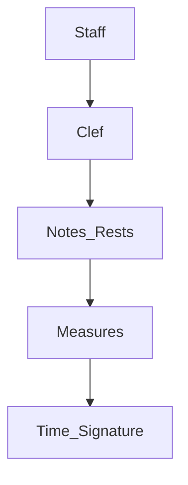

# Beginner Foundation: Notation

## 1. Everyday Intuition & First Principles

Imagine you are trying to teach a friend how to play a song on the piano. You could hum the melody and show them the keys, but that would be inefficient and prone to misinterpretation. Instead, you could write down the song using a system that everyone understands. This system is called **notation**. Just as a map helps you navigate unfamiliar territories, notation helps musicians navigate the complex landscape of music, ensuring that everyone plays the same notes, rhythms, and dynamics.

## 2. Foundational Vocabulary & Glossary

### Staff
The **staff** is a set of five horizontal lines and four spaces that serve as the framework for writing music. Each line and space represents a different pitch. Here is a simple example of a staff:

```
E
D
C
B
A
```

### Clef
A **clef** is a symbol placed at the beginning of the staff to indicate which pitches correspond to which lines and spaces. The most common clefs for beginners are the **treble clef** and the **bass clef**. The treble clef is used for higher-pitched instruments like the violin and flute, while the bass clef is used for lower-pitched instruments like the cello and double bass.

**Treble Clef:**
```
  ____
  \  /
   \/ 
   /\
  /  \
```

**Bass Clef:**
```
  ____
 /    \
 \    /
  \__/
```

### Note
A **note** is a symbol that represents a specific pitch and duration. The shape of the note head and the presence or absence of a stem and flag determine the duration. Here are some common note types:

- **Whole Note (4 beats):**
  ```
  O
  ```

- **Half Note (2 beats):**
  ```
  O-
  ```

- **Quarter Note (1 beat):**
  ```
  O-
  ```

- **Eighth Note (1/2 beat):**
  ```
  O-_
  ```

- **Sixteenth Note (1/4 beat):**
  ```
  O-__-
  ```

### Rest
A **rest** is a symbol that indicates a pause or silence in the music. Like notes, rests have different durations and are represented by various symbols. Here are some common rest types:

- **Whole Rest (4 beats):**
  ```
  ||
  ```

- **Half Rest (2 beats):**
  ```
  ||
  ```

- **Quarter Rest (1 beat):**
  ```
  z
  ```

- **Eighth Rest (1/2 beat):**
  ```
  z_
  ```

- **Sixteenth Rest (1/4 beat):**
  ```
  z__-
  ```

### Measure
A **measure** is a segment of time defined by a specific number of beats. Measures are separated by vertical lines called **bar lines**. The time signature, which appears at the beginning of the staff, indicates how many beats are in each measure and what note value gets one beat. For example, a time signature of 4/4 means there are four beats in each measure, and a quarter note gets one beat.

**Example of a Measure:**
```
| O- O- O- O- |
```

### Time Signature
The **time signature** is a fraction that appears at the beginning of the staff to indicate the meter of the music. The top number tells you how many beats are in each measure, and the bottom number tells you what note value gets one beat. For example, a time signature of 4/4 means there are four beats in each measure, and a quarter note gets one beat.

**Example of a Time Signature:**
```
4/4
```

## 3. Visual System Flow

### ASCII Diagram
Here is a simple ASCII diagram illustrating the basic workflow of notation:

```
Staff
  |
  v
Clef
  |
  v
Notes & Rests
  |
  v
Measures
  |
  v
Time Signature
```

### Mermaid Flowchart
Here is a Mermaid flowchart illustrating the basic workflow of notation:



## 4. Common Beginner Misconceptions & Mental Traps

- **Misconception:** The staff is always the same.
  - **Reality:** The staff can have different numbers of lines and spaces depending on the instrument and the range of the music. For example, the grand staff, which is used for piano music, has two staves: one treble clef and one bass clef.

- **Misconception:** All notes have the same duration.
  - **Reality:** Notes come in various durations, from whole notes (4 beats) to sixteenth notes (1/4 beat). The shape of the note head and the presence or absence of a stem and flag determine the duration.

- **Misconception:** The time signature is always 4/4.
  - **Reality:** While 4/4 is the most common time signature, there are many other time signatures, such as 3/4, 6/8, and 5/4. Each time signature indicates a different meter and rhythm.

- **Misconception:** Rests are not important.
  - **Reality:** Rests are just as important as notes in music. They indicate pauses and silences, which are essential for creating rhythm and dynamics.

## 5. Socratic Discussion Starters

- **What is the purpose of notation in music?**
- **How do clefs help musicians read music correctly?**
- **Can you explain the difference between a quarter note and an eighth note?**
- **What is a measure, and why is it important in notation?**
- **How does the time signature affect the rhythm of a piece of music?**
- **Why are rests important in music notation?**

By exploring these questions, you can deepen your understanding of notation and its role in music.
