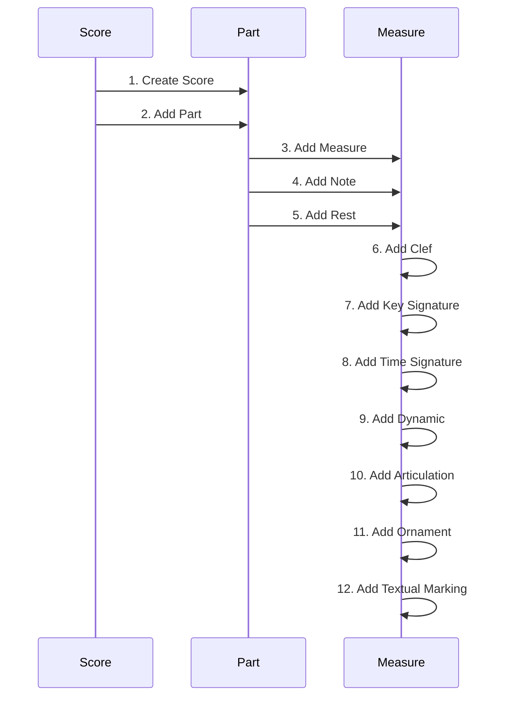

# Intermediate Foundation: Notation

## 1. Architectural Mental Model

In the realm of composition and music notation, the architectural mental model is a foundational framework that guides the design and implementation of systems capable of representing musical ideas with precision and flexibility. This model assumes a basic understanding of musical notation symbols and their meanings, but delves deeper into the structural and functional aspects of notation systems.

At the core of this mental model is the concept of a **musical document**, which is a structured representation of a musical composition. This document is composed of various **components** that interact to convey the intended musical ideas. These components include **scores**, **parts**, **measures**, **notes**, **rests**, **clefs**, **key signatures**, **time signatures**, **dynamics**, **articulations**, **ornaments**, and **textual markings**.

The **score** is the complete representation of a musical composition, typically containing all the parts for each instrument or voice. Each **part** is a separate line of music intended for a specific instrument or voice. **Measures** are the fundamental units of time in a score, divided into beats according to the time signature. **Notes** and **rests** are the basic symbols used to represent sound and silence, respectively. **Clefs**, **key signatures**, and **time signatures** provide essential context for interpreting the notes and rests.

**Dynamics**, **articulations**, and **ornaments** add expressive detail to the music, while **textual markings** provide additional instructions to the performers. These components are organized in a hierarchical structure, with the score at the top level, parts as its children, and measures, notes, rests, and other markings as the leaves of the tree.

## 2. Systems Taxonomy & Component Protocols

### Standard Interfaces and Protocols

In the domain of music notation, several standard interfaces and protocols have been developed to facilitate the exchange and manipulation of musical data. These include:

- **MusicXML**: An XML-based file format for representing musical notation. MusicXML is widely used for exchanging data between different music notation software applications.
- **MIDI**: A protocol for representing musical performance data, including note on/off messages, controller changes, and program changes. MIDI is commonly used for real-time communication between musical instruments and software.
- **MEI (Music Encoding Initiative)**: An XML-based file format for representing musical notation and performance data. MEI is designed to be highly flexible and extensible, making it suitable for a wide range of musical applications.
- **ABC Notation**: A plain text file format for representing musical notation. ABC Notation is designed to be human-readable and easy to edit, making it suitable for quick and simple notation tasks.

### Data Models

The data models used in music notation systems are designed to represent the various components of a musical document in a structured and consistent manner. These models typically include:

- **Score Data Model**: Represents the complete musical document, including all parts, measures, notes, rests, and other markings.
- **Part Data Model**: Represents a separate line of music intended for a specific instrument or voice.
- **Measure Data Model**: Represents a fundamental unit of time in a score, divided into beats according to the time signature.
- **Note Data Model**: Represents a symbol used to represent sound, including its pitch, duration, and other attributes.
- **Rest Data Model**: Represents a symbol used to represent silence, including its duration and other attributes.
- **Clef Data Model**: Represents a symbol used to indicate the pitch of the notes on a staff.
- **Key Signature Data Model**: Represents a symbol used to indicate the key of the music.
- **Time Signature Data Model**: Represents a symbol used to indicate the meter of the music.
- **Dynamic Data Model**: Represents symbols used to indicate the volume of the music.
- **Articulation Data Model**: Represents symbols used to indicate the articulation of the notes.
- **Ornament Data Model**: Represents symbols used to indicate ornaments and other expressive details.
- **Textual Marking Data Model**: Represents symbols used to provide additional instructions to the performers.

## 3. Multi-Component Interaction Flow

### ASCII Sequence Diagram

```
+-------------------+       +-------------------+       +-------------------+
|       Score       |       |       Part        |       |      Measure      |
+-------------------+       +-------------------+       +-------------------+
          |                           |                           |
          | 1. Create Score             |                           |
          |-------------------------->|                           |
          |                           | 2. Add Part                |
          |                           |-------------------------->|
          |                           |                           | 3. Add Measure
          |                           |                           |------------------------->
          |                           |                           |
          | 4. Add Note                 |                           |
          |-------------------------->|                           |
          |                           | 5. Add Rest                |
          |                           |-------------------------->|
          |                           |                           | 6. Add Clef
          |                           |                           |------------------------->
          |                           |                           |
          | 7. Add Key Signature        |                           |
          |-------------------------->|                           |
          |                           | 8. Add Time Signature      |
          |                           |-------------------------->|
          |                           |                           | 9. Add Dynamic
          |                           |                           |------------------------->
          |                           |                           |
          | 10. Add Articulation        |                           |
          |-------------------------->|                           |
          |                           | 11. Add Ornament           |
          |                           |-------------------------->|
          |                           |                           | 12. Add Textual Marking
          |                           |                           |------------------------->
```

### Mermaid Sequence Diagram



## 4. Architectural Trade-offs & Production Pitfalls

### Trade-offs

1. **Flexibility vs. Simplicity**: More flexible notation systems can represent a wider range of musical ideas, but they may be more complex to implement and use. Simpler systems may be easier to use, but they may be limited in their expressive capabilities.
2. **Performance vs. Accuracy**: Systems that prioritize performance may be faster and more efficient, but they may sacrifice accuracy in representing musical details. Systems that prioritize accuracy may be slower and more resource-intensive, but they can represent musical details with greater precision.
3. **Scalability vs. Resource Usage**: Systems that are designed to scale may be able to handle large and complex musical documents, but they may require more resources (e.g., memory, processing power) to do so. Systems that are designed to be resource-efficient may be limited in their ability to handle large and complex documents.

### Production Pitfalls

1. **Inconsistent Data Models**: Using inconsistent data models can lead to errors and inconsistencies in the representation of musical ideas. It is important to use a consistent data model throughout the system to ensure accuracy and consistency.
2. **Poor Interface Design**: Poorly designed interfaces can make it difficult to use the system effectively. It is important to design interfaces that are intuitive and easy to use, with clear documentation and examples.
3. **Lack of Error Handling**: Failing to handle errors properly can lead to crashes and other issues. It is important to implement robust error handling mechanisms to ensure the system is reliable and stable.
4. **Inadequate Testing**: Failing to test the system thoroughly can lead to bugs and other issues. It is important to test the system thoroughly, using a variety of test cases and scenarios, to ensure it is reliable and performs as expected.

## 5. Socratic Discussion Starters

1. **How can we design a notation system that balances flexibility and simplicity?**
2. **What are the trade-offs between performance and accuracy in notation systems?**
3. **How can we ensure consistency in data models across different components of a notation system?**
4. **What are the key considerations in designing intuitive and easy-to-use interfaces for notation systems?**
5. **How can we implement robust error handling mechanisms in notation systems?**
6. **What are the best practices for testing notation systems thoroughly and effectively?**
7. **How can we design notation systems that are scalable and resource-efficient?**
8. **What are the challenges of representing complex musical ideas in a notation system?**
9. **How can we ensure that notation systems are accessible to a wide range of users, including those with disabilities?**
10. **What are the implications of using different file formats and protocols for representing musical notation?**

By exploring these questions and considerations, engineers and practitioners can gain a deeper understanding of the architectural and design challenges involved in creating effective notation systems.
