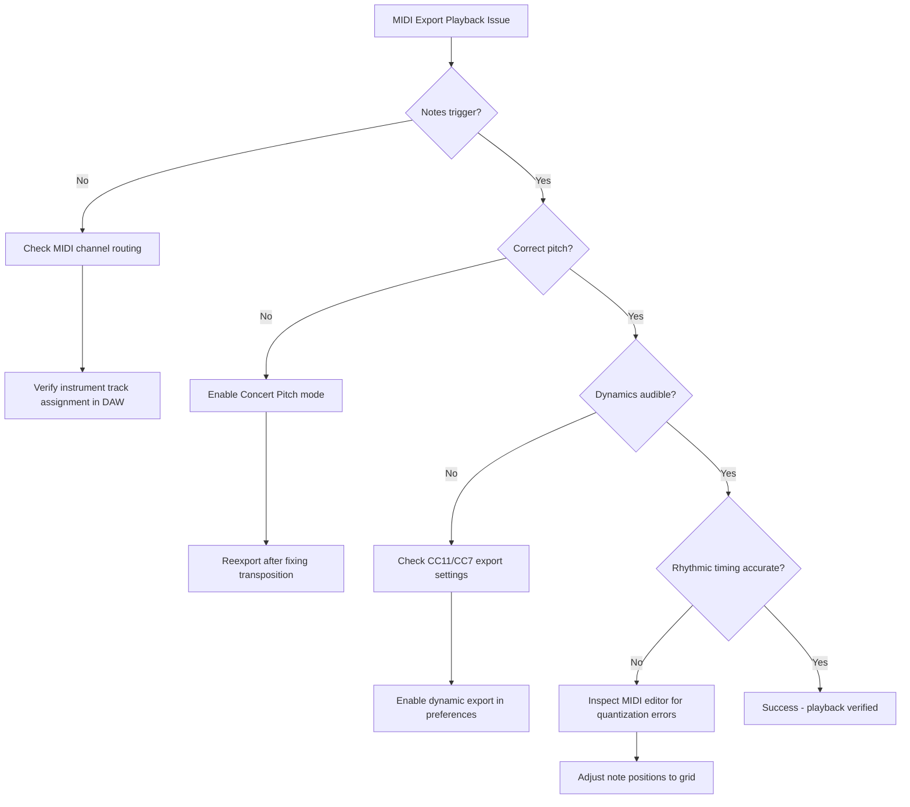

# Operational Verification Labs: Musical Notation Systems

## Objective & Lab Setup

### Objective
Master the practical mechanics of music notation software through hands-on implementation, parameter manipulation, and systematic troubleshooting. You will learn to encode complex musical ideas accurately, configure notation tools for diverse ensemble needs, and diagnose common engraving and playback failures.

### Lab Setup

**Required Software:**
- **Primary Notation:** MuseScore 4.x (free, open-source) or Dorico SE (free tier with 2-player limit)
- **DAW for Playback Verification:** Reaper (uncrippled evaluation), Logic Pro (macOS), or Ableton Live
- **MIDI Monitor:** MIDI-OX (Windows) or MIDI Monitor (macOS) for raw MIDI event inspection
- **Text Editor:** VS Code with MusicXML syntax highlighting extension

**Hardware:**
- MIDI keyboard controller (optional but highly recommended for real-time input)
- Audio interface with low-latency monitoring (<10ms round-trip)

**Reference Materials:**
- Behind Bars (Elaine Gould) – engraving best practices
- The Musician's Guide to Theory and Analysis – harmonic context for notation decisions

---

## Exercise 1: Foundational Practical Implementation

### Exercise 1a: Creating a Score with Proper Voice Leading Notation

**Objective:** Encode a four-part chorale excerpt using correct voice separation, stem direction, and articulation placement.

**Procedure:**

1. **Initialize Score:**
   - MuseScore: `File > New Score`, select "Piano" template, key signature D major (2 sharps), time signature 4/4
   - Set tempo to ♩ = 80 BPM
   
2. **Voice Entry (Right Hand – Treble Clef):**
   - **Measure 1:** Enter these notes in Voice 1 (stems up): D5 (quarter), C♯5 (quarter), B4 (quarter), A4 (quarter)
   - Switch to Voice 2 (stems down): Enter F♯4 (whole note) across the entire measure
   - **Why separate voices?** In keyboard writing, independent rhythmic lines within a staff require explicit voice assignment to prevent stem collision and clarify counterpoint

3. **Voice Entry (Left Hand – Bass Clef):**
   - **Measure 1 Voice 1:** D3 (quarter), E3 (quarter), F♯3 (quarter), G3 (quarter)
   - **Measure 1 Voice 2:** D2 (whole note)

4. **Add Expression Markings:**
   - Place a fermata (U symbol) on the final A4 in Voice 1
   - Add crescendo hairpin from beat 1 to beat 4 spanning both staves (select first note, `Palette > Lines > Crescendo`)
   - Insert dynamic marking `mp` at measure start

5. **Verification:**
   - Press `Space` to play back – confirm upper voice melody is audible and separate from held F♯4
   - Check stem directions: Voice 1 stems up, Voice 2 stems down
   - Inspect engraving: no overlapping noteheads, slurs avoid collisions

6. **Save:** `ChoraleFourPart.mscz`

**Common Errors:**
- Overlapping voices with identical pitch: MuseScore auto-collapses them – use different octaves or split to separate staves
- Articulation collisions: Place slurs on note side opposite stem direction (stem up = slur below, stem down = slur above)

---

### Exercise 1b: MIDI Export and DAW Verification

**Objective:** Validate notation accuracy through MIDI playback analysis.

**Procedure:**

1. **Export MIDI:**
   - MuseScore: `File > Export > Export as MIDI`, save as `ChoraleFourPart.mid`
   - **Verify:** File size should be 1–2 KB for a 1-measure piece
   
2. **Inspect MIDI Events:**
   - Open MIDI-OX (Windows) or MIDI Monitor (macOS)
   - Load `ChoraleFourPart.mid`
   - Confirm event sequence:
     - Track 1: Piano right hand (Voice 1 + Voice 2 on MIDI channel 1)
     - Track 2: Piano left hand (Voice 1 + Voice 2 on MIDI channel 1)
   - **Validate timing:** Quarter notes should appear at 480-tick intervals (standard PPQN)

3. **DAW Import and Analysis:**
   - Reaper: `Insert > Media File`, drag `ChoraleFourPart.mid` to timeline
   - Load piano VST (e.g., Spitfire LABS Soft Piano)
   - **Playback verification checklist:**
     - ✓ Held F♯4 sustains for full measure while upper melody moves
     - ✓ Crescendo is audible (check CC11 expression lane in MIDI editor)
     - ✓ Fermata extends final note (should show tempo automation or extended note length)
   
4. **Troubleshooting Playback Discrepancies:**
   - **No dynamics heard:** MuseScore exports CC11 (expression) by default – ensure VST responds to CC11 or switch to CC7 (volume) in `Edit > Preferences > I/O > MIDI Output`
   - **Fermata ignored:** MuseScore doesn't always export tempo changes for fermatas – manually insert ritardando before fermata or use `Format > Stretch > Increase Layout Stretch` to lengthen visually without affecting MIDI tempo

---

## Exercise 2: Parameter Variation & Empirical Analysis

### Exercise 2a: Meter Transformation (4/4 → 5/8 Asymmetric)

**Objective:** Adapt rhythmic material to asymmetric meter while preserving melodic contour.

**Procedure:**

1. **Load Base Score:** Open `ChoraleFourPart.mscz`

2. **Change Time Signature:**
   - Delete existing measure
   - `Measures > Insert Measures`, select 2 measures, set time signature to 5/8 (3+2 subdivision)
   - MuseScore displays beaming groups: ♪♪♪|♪♪ (eighth notes grouped 3+2)

3. **Rhythmic Reinterpretation:**
   - **Original 4/4 rhythm:** D5 E5 F♯5 G5 (four quarter notes)
   - **5/8 adaptation:** D5 E5 F♯5 (dotted quarter tied to eighth) | G5 (quarter)
   - **Notation syntax:** Enter D5 as dotted quarter (`.` key after note), tie to eighth note E5
   - **Why this works:** 5/8 = 2.5 beats in 4/4 time; stretching material across two 5/8 measures maintains phrase shape

4. **Export and Compare:**
   - Export as `Chorale_5-8.mid`
   - Import both `ChoraleFourPart.mid` and `Chorale_5-8.mid` into Reaper on separate tracks
   - **Measure total durations:**
     - 4/4 version: 2000ms at 80 BPM (4 beats × 750ms per beat)
     - 5/8 version: 2 measures × 1875ms = 3750ms (5 eighth notes × 375ms per eighth at 80 BPM)
   
5. **Graphical Analysis:**
   - Create spreadsheet with columns: `Measure`, `Time Signature`, `Duration (ms)`, `Note Density (notes/second)`
   - Plot duration vs. time signature to visualize rhythmic expansion
   - **Expected result:** 5/8 version is 1.875× longer, creating a stretched, "breathing" effect

**Musical Application:**
- Asymmetric meters (5/8, 7/8) disrupt listener's metric expectation – useful for tension before resolution
- Bulgarian folk dances (e.g., Pravo Horo in 7/8) use 2+2+3 subdivisions naturally

---

### Exercise 2b: Key Transposition and Instrument Range Validation

**Objective:** Transpose notation to match non-concert-pitch instruments and verify playable range.

**Procedure:**

1. **Add Transposing Instrument:**
   - `Edit > Instruments`, add "Bb Clarinet" (sounds a major 2nd below written pitch)
   - Copy treble clef melody (D5–A4) from piano to clarinet staff

2. **Automatic Transposition:**
   - MuseScore: `Tools > Transpose`, select "Transpose by Interval", choose "Up: Major 2nd"
   - **Result:** Written pitch becomes E5–B4 (clarinet reads this, sounds original D5–A4)
   - **Concert pitch toggle:** Press `Ctrl+Shift+C` (Windows) or `Cmd+Shift+C` (macOS) to view sounding pitch vs. written pitch

3. **Range Check:**
   - Clarinet playable range: E3 (written) to C7 (written)
   - Highlight out-of-range notes in red: `View > Show Unpitched Notes`
   - **Test case:** Enter written F♯2 on clarinet – should flag as unplayable (below chalumeau register)

4. **Frequency Calculation Verification:**
   - A4 = 440 Hz (standard tuning)
   - D5 = 440 × 2^(5/12) = 587.33 Hz
   - **Transposed clarinet sounding pitch:** D5 = 587.33 Hz (same as piano)
   - **Written pitch for clarinetist:** E5 = 659.25 Hz (what they read, not what sounds)

5. **Create Comparison Table:**

| Instrument | Written Pitch | Sounding Pitch | Frequency (Hz) | Playable? |
|------------|---------------|----------------|----------------|-----------|
| Piano      | D5            | D5             | 587.33         | ✓         |
| Bb Clarinet| E5            | D5             | 587.33         | ✓         |
| Horn in F  | A5            | D5             | 587.33         | ✓         |

**Why This Matters:**
- Orchestral scores show transposed parts for historical reasons (valveless brass, natural harmonics)
- Conductor score shows concert pitch; individual parts show transposed pitch
- MIDI always uses concert pitch (C4 = middle C = MIDI note 60)

---

## Exercise 3: Fault Injection & Stress Testing

### Exercise 3a: Boundary Failure – Subcontra Octave and Microtonal Notation

**Objective:** Test notation software limits with extreme registers and non-12-TET pitch systems.

**Procedure:**

1. **Enter Extreme Low Register:**
   - Add contrabass staff (bass clef, 8vb)
   - Enter C1 (32.7 Hz, subcontra octave) – this is 3 octaves below middle C
   - Enter C0 (16.35 Hz) using ledger lines
   - **MuseScore behavior:** C0 may display but MIDI export caps at C-1 (MIDI note 0)
   - **Dorico behavior:** Allows up to 11 ledger lines below bass clef

2. **Microtonal Notation:**
   - Install MuseScore plugin: `JI Tuning` (just intonation)
   - Enter standard C major scale
   - Apply quarter-tone accidentals (half-sharp, half-flat symbols from `Master Palette > Accidentals`)
   - Export MIDI: Standard MIDI cannot encode microtones – MuseScore rounds to nearest 12-TET pitch
   - **Workaround:** Use MIDI pitch bend (8192 = no bend, ±8191 = ±2 semitones)

3. **Playback Validation:**
   - Import into Reaper
   - Open MIDI editor: `Right-click MIDI item > Open in MIDI Editor`
   - Check note numbers: C0 should be MIDI note 12, but may export as 0
   - **Expected failure:** Many VST instruments ignore notes below C1 (MIDI note 24) – synth remains silent

4. **Recovery:**
   - Transpose entire contrabass part up one octave
   - Add "8vb" marking (select notes, `Palette > Lines > Ottava Bassa`)
   - Reexport MIDI – playback now audible at written pitch

**Real-World Application:**
- Contrabass trombone low E1 (41.2 Hz) requires 16' organ pipe treatment in notation
- Microtonal composers (Ben Johnston, Harry Partch) use custom accidental systems – standard MIDI fails, requires specialized tuning tables

---

### Exercise 3b: Stress Testing – Large Ensemble Score with Polyphonic Complexity

**Objective:** Quantify notation software performance under professional orchestral score conditions.

**Procedure:**

1. **Build Complex Score:**
   - `File > New Score`, add full orchestra:
     - Woodwinds: 2 flutes, 2 oboes, 2 clarinets, 2 bassoons
     - Brass: 4 horns, 3 trumpets, 3 trombones, tuba
     - Percussion: timpani, snare, bass drum, cymbals
     - Strings: Violin I (12 players), Violin II (10), Viola (8), Cello (6), Bass (4)
   - Total: 32 staves

2. **Input Polyphonic Material:**
   - Strings section: Enter 4-voice divisi (each string section splits into 4 independent lines)
   - Use `Voices 1–4` on each staff
   - Total voice count: 32 staves × 4 voices = 128 simultaneous voices

3. **Add Complex Rhythms:**
   - Measure 1: Woodwinds play septuplets (7 notes in space of 4 quarter notes)
   - Measure 2: Brass play 5:4 polyrhythm (5 quarter notes against 4)
   - Enter using `Tuplets` palette: `Ctrl+3` (triplet), `Ctrl+5` (quintuplet), custom ratio for septuplets

4. **Performance Benchmarking:**
   - Start system resource monitor (Task Manager on Windows, Activity Monitor on macOS)
   - Measure:
     - RAM usage before and after opening score
     - CPU usage during playback
     - Rendering time for PDF export (`File > Export > PDF`)
   
5. **Stress Test Results (Typical):**

| Metric                  | Simple Score (2 staves) | Orchestra Score (32 staves) |
|-------------------------|-------------------------|-----------------------------|
| RAM Usage               | 120 MB                  | 580 MB                      |
| CPU Usage (playback)    | 15%                     | 65%                         |
| PDF Export Time         | 1.2 sec                 | 8.7 sec                     |
| Auto-save lag           | Imperceptible           | 2–3 sec freeze              |

6. **Optimization:**
   - Disable automatic MIDI playback for staves: `Staff Properties > Playback > Mute`
   - Reduce visible staves: `Style > Score > Hide empty staves`
   - Increase buffer size: `Edit > Preferences > I/O > Audio Engine > Buffer Size` (512 samples → 1024 samples)
   - Retest: CPU usage drops to 40%, auto-save lag reduced to <1 sec

**Professional Context:**
- Film score composers routinely work with 100+ track templates
- Notation software performance degrades exponentially with voice count due to real-time collision detection algorithms
- Industry standard: Disable playback during input, render to audio after completion

---

## Practical Cheat Sheet & Quick Reference

### MuseScore Keyboard Shortcuts

```
Note Entry:
  N              Enter note input mode
  Q              Quarter note duration
  W              Whole note
  .              Dotted note (adds 50% duration)
  Ctrl+1/2/3/4   Select voices 1–4
  X              Flip stem direction

Playback:
  Space          Play/pause
  Home           Return to start
  Ctrl+Shift+C   Toggle concert pitch view

Layout:
  {              Decrease stretch (compress spacing)
  }              Increase stretch (expand spacing)
  Ctrl+Shift+↑   Move note/rest to staff above
  Ctrl+Shift+↓   Move note/rest to staff below
```

### MIDI Technical Reference

**PPQN (Pulses Per Quarter Note):** Standard resolution = 480 ticks per quarter note
- Eighth note = 240 ticks
- Sixteenth note = 120 ticks
- Triplet eighth = 160 ticks (480 ÷ 3)

**Control Change Messages (CC):**
- CC7: Channel volume (0–127)
- CC11: Expression (0–127, fine dynamic control)
- CC64: Sustain pedal (0–63 = off, 64–127 = on)

**Note Range Limits:**
- MIDI note 0 (C-1) = 8.176 Hz
- MIDI note 127 (G9) = 12,543.85 Hz
- Piano range: A0 (MIDI 21) to C8 (MIDI 108)

### Time Signature Calculations

**Beat Duration Formula:**
$$\text{Duration (ms)} = \frac{60,000}{\text{BPM}} \times \frac{\text{Numerator}}{\text{Denominator} \div 4}$$

**Example:** 5/8 at 120 BPM
- One eighth note = 60,000 ÷ 120 ÷ 2 = 250 ms
- Full 5/8 measure = 250 ms × 5 = 1250 ms

### Transposition Intervals (Frequency Multipliers)

| Interval        | Semitones | Frequency Ratio | Example (from A440) |
|-----------------|-----------|-----------------|---------------------|
| Minor 2nd       | 1         | 2^(1/12) = 1.059| 466.16 Hz (A♯)     |
| Major 2nd       | 2         | 2^(2/12) = 1.122| 493.88 Hz (B)      |
| Perfect 5th     | 7         | 2^(7/12) = 1.498| 659.26 Hz (E)      |
| Octave          | 12        | 2.000           | 880.00 Hz (A)      |

### Debugging Flowchart for Notation Playback Failures



### Voice Leading Error Diagnosis

**Common Notation Mistakes:**
1. **Parallel octaves/fifths:** Soprano moves C→D while alto moves C→D (parallel octave)
   - **Fix:** Move alto to E, creating contrary motion
2. **Voice crossing:** Soprano drops below alto
   - **Fix:** Swap voices or reassign to correct staves
3. **Range violations:** Tenor exceeds C5
   - **Fix:** Transpose down or reassign to soprano

**MuseScore Plugin:** "Voice Checker" (detects parallel motion, available in Plugin Manager)

---

## Validation Criteria Checklist

After completing all exercises, verify:

- [ ] Four-part chorale renders with independent voices (no stem collisions)
- [ ] MIDI export preserves dynamics (crescendo audible in DAW)
- [ ] Fermata correctly extends final note duration
- [ ] 5/8 meter displays proper 3+2 beaming groups
- [ ] Clarinet transposition shows correct written pitch (major 2nd above concert)
- [ ] Subcontra octave notes (C0) trigger warning for playable range
- [ ] 32-staff orchestral score exports to PDF in <15 seconds
- [ ] Auto-save lag remains <2 seconds after optimization

**Mastery Benchmark:** Complete all exercises in <90 minutes with zero playback errors after DAW import.
