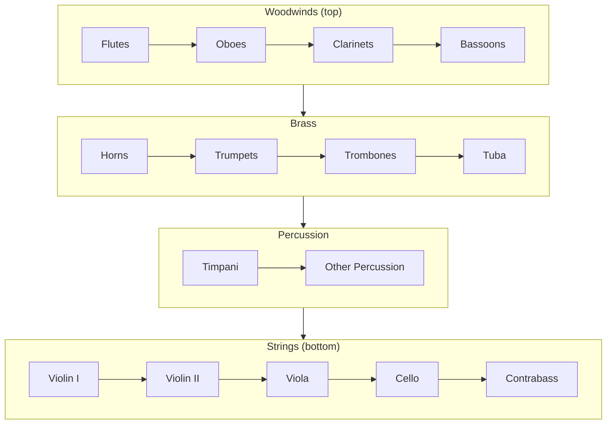
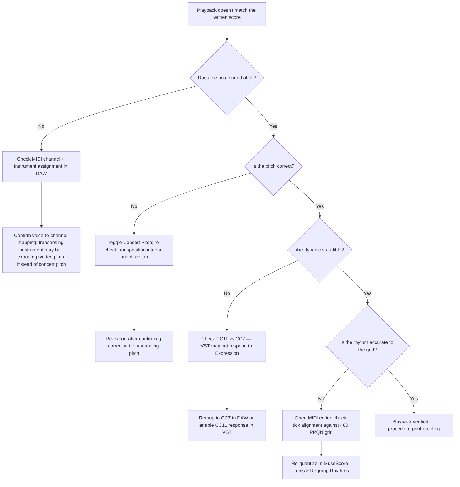

# Masterclass: Music Notation — From Manuscript Literacy to Professional Engraving

## Who this is for and what you'll leave with

This is a working engraver's and performer's course in notation: reading it fluently under tempo, writing it so a sightreading musician doesn't stumble, and operating MuseScore 4 / Dorico at a production level. By the end you will hand-copy a four-part chorale correctly by ear and eye, engrave it to professional standard, transpose it for a real transposing instrument without guessing, and know the five engraving mistakes that make parts unplayable at sight.

**Software:** MuseScore 4.x (free) for all exercises; Dorico SE callouts where its engraving engine behaves differently. A MIDI keyboard is strongly recommended — notation fluency is learned faster through the hands than the mouse.

---

## Part 1 — Reading Notation Cold (the skill software can't give you)

Before touching software, you must be able to read standard notation at sight, because every engraving decision you make is in service of a *sightreader*, and you can't serve a reader you can't simulate.

### 1.1 The staff, clefs, and your anchor notes

Don't count lines and spaces from scratch every time — that's how sightreading collapses under tempo. Memorize **anchor notes** and read everything else by interval distance from them.

**Treble clef anchors:**
- Middle line (B4) — mnemonic: lines bottom-to-top "Good Boys Do Fine Always"
- Spaces bottom-to-top spell "FACE"
- Middle C (C4) sits one line below the staff on its own ledger line

**Bass clef anchors:**
- The two clef dots straddle the F3 line
- Lines bottom-to-top: "Good Boys Do Fine Always" shifted — "G B D F A"
- Middle C (C4) sits one line above the staff on its own ledger line

**Drill — Interval Leap Reading (15 min/day):**
1. Write (or print) 20 random notes spanning two octaves in treble clef.
2. Name each note in under 1 second, reading by distance from the nearest anchor (not by counting from C).
3. Metronome target: 40 notes/minute cold, 60 notes/minute after one week.
4. Repeat in bass clef, then alternate treble/bass every 4 notes to force clef-switching speed — this is the actual skill a pianist or conductor needs.

### 1.2 Rhythm notation: subdivide by the beam, not the beat

Beams group notes to show the metric subdivision — this is information, not decoration. In 4/4, eighth notes beam in groups of 2 (showing where the beat falls); in 6/8, they beam in groups of 3 (showing the compound beat). If you ever see unbeamed or oddly-beamed eighths, that's the composer telling you the beat structure is irregular.

**Core duration table (drill until automatic, don't calculate it live):**

| Symbol | Name | Beats in 4/4 | Subdivision count |
|---|---|---|---|
| 𝅝 | Whole | 4 | — |
| 𝅗𝅥 | Half | 2 | — |
| ♩ | Quarter | 1 | — |
| ♪ | Eighth | 0.5 | 2 per beat |
| 𝅘𝅥𝅯 | Sixteenth | 0.25 | 4 per beat |
| ♩. | Dotted quarter | 1.5 | adds half the note's value |
| 𝅗𝅥. | Dotted half | 3 | adds half the note's value |

**Drill — Rhythmic Dictation Clap-Back (progressive):**
1. Metronome at 60 BPM. Clap quarter/eighth patterns from written rhythm while counting "1-and-2-and" aloud.
2. Move to syncopation: tied eighth-to-quarter across the beat ("1-and-2-AND-3" feel).
3. Progress 60 → 80 → 110 BPM over a week, only advancing tempo once you clap three consecutive perfect reps.
4. Add dotted-rhythm patterns (dotted eighth + sixteenth) last — this is the one that trips up most self-taught readers because the ear wants to even it out into swing.

### 1.3 Key signatures: read the pattern, not the count

Don't count sharps/flats one by one under tempo. Memorize the **shape**:

- **Sharp keys** (order of sharps: F♯ C♯ G♯ D♯ A♯ E♯ B♯) — the last sharp in the key signature is the **leading tone**; the key is a half step above it. 2 sharps → last sharp is C♯ → key is D major.
- **Flat keys** (order of flats: B♭ E♭ A♭ D♭ G♭ C♭ F♭) — the **second-to-last flat** names the key (except F major = one flat, memorize separately). 3 flats → B♭ E♭ A♭ → second-to-last is E♭ → key is E♭ major.

**Drill:** Flash 12 key signatures, name major key in < 2 seconds each, then name the relative minor (down a minor 3rd) in the same breath.

---

## Part 2 — Engraving a Four-Part Chorale (MuseScore 4 Walkthrough)

### 2a. Setup

1. `File > New Score` → Choose Template: **"Treble Clef + Bass Clef"** (not "Piano" — chorales conventionally engrave as SATB on two staves with four independent voices, matching Bach chorale publications).
2. Key: D major (2 sharps). Time: 4/4. Tempo: ♩ = 80.
3. Rename staves via `Edit > Instruments`: top staff "Soprano/Alto," bottom staff "Tenor/Bass" — standard four-part hymnal layout.

### 2b. Voice assignment — the part that trips up every beginner

In a single staff, **Voice 1 always carries stems up, Voice 2 always stems down** — this is not configurable per-piece, it's the notation convention that lets a reader separate two simultaneous lines on sight without color-coding.

**Treble staff:**
- Select **Voice 1** (`Ctrl+Alt+1`), enter Soprano: D5 (♩) C♯5 (♩) B4 (♩) A4 (♩)
- Select **Voice 2** (`Ctrl+Alt+2`), enter Alto: F♯4 as a whole note spanning the measure

**Bass staff:**
- Voice 1 (Tenor): D3 E3 F♯3 G3, all quarters
- Voice 2 (Bass): D2, whole note

**Why this voice split matters beyond cosmetics:** when the alto holds F♯4 while the soprano moves, a reader scanning only stems-up notes gets the melodic line instantly; a reader scanning stems-down gets the sustained harmony tone. Collapsing both into one voice (common beginner mistake: entering all four notes as chords in Voice 1) destroys this and makes four-part part-extraction for choir parts impossible later.

### 2c. Check voice leading as you enter it (the real craft)

This chorale fragment is a I–V⁶–vi–V progression in D. Before moving on, check it against the two cardinal part-writing rules — this is the actual music-theory content notation exists to serve:

- **No parallel 5ths/8ths between any two voices.** Soprano D5→C♯5 against Bass D2→E3: that's a 6th moving to a 10th, no parallel motion — clean.
- **Leading tone (C♯) resolves up to D** when it's in an outer voice, unless it's in an inner voice and can resolve down by common practice (frequently relaxed in alto/tenor). Here C♯5 in the soprano at beat 2 should resolve to D at the final cadence, not downward — confirm your final soprano note lands on D5 or A5, not C♯ hanging unresolved.

**MuseScore plugin check:** install **"Voice Checker"** (Plugins → Manage Plugins) to flag parallel 5ths/octaves automatically — use it as a second pass, not a crutch; you should be able to spot these by eye first.

### 2d. Articulation and expression placement rules

- **Slur placement:** always on the side opposite the stem. Stem-up notes → slur curves below the noteheads; stem-down notes → slur curves above. MuseScore defaults correctly most of the time, but manually dragged slurs in dense passages often need this rule applied by hand.
- **Fermata:** select final A4 (Voice 1) → `Palette > Fermata > Fermata`. Convention: fermata sits above the staff regardless of stem direction, centered over the notehead.
- **Crescendo hairpin across both staves:** select the first note of the treble staff, Shift+click the corresponding bass note to extend selection vertically, then `Palette > Lines > Crescendo Hairpin`. A hairpin that spans a system (both staves) should be entered once at the top staff with "apply to all staves" rather than duplicated per staff — duplicated hairpins is a common engraving error that causes misaligned dynamic swells on playback.
- **Dynamic `mp`:** place at the *start of the measure, below the bottom staff* (standard dynamic placement for keyboard/choral scores is below the system, not between staves, unless the two staves belong to different instruments).

### 2e. Verify by playback, then by eye

1. `Space` to play. Confirm: sustained F♯4 is audible under the moving soprano line, not swallowed by voice collapse.
2. Visual check: zoom to 150%, confirm noteheads in Voice 1 and Voice 2 don't overlap (MuseScore auto-offsets opposing voices on the same pitch, but check unison/near-unison spots manually).
3. Save as `ChoraleFourPart.mscz`.

**Most common real error:** entering the alto's F♯4 in Voice 1 by accident, which causes it to merge rhythmically with the soprano notes and display as a single chord instead of two independent voices. If your held note suddenly shows four separate quarter-note stems instead of one whole note, you're in the wrong voice — undo and reassign.

---

## Part 3 — MIDI Verification: What Notation Actually Produces

Notation software's real job is translating visual symbols into a performance. Verifying the MIDI output against your intent is how you catch encoding errors before a player does.

### 3a. Export and inspect

1. `File > Export > MIDI`, save `ChoraleFourPart.mid`. A 1-measure, 4-voice piece should be 1–2 KB — if it's dramatically larger, you likely have duplicate/ghost notes from a voice-entry mistake.
2. Open in a MIDI monitor (MIDI-OX on Windows, MIDI Monitor on macOS) or drag into Reaper's MIDI editor and inspect the piano-roll directly — this is faster and shows you the same information visually.
3. **Confirm tick alignment.** Standard export resolution is 480 PPQN (pulses per quarter note):

| Note value | Ticks (at 480 PPQN) |
|---|---|
| Quarter | 480 |
| Eighth | 240 |
| Sixteenth | 120 |
| Triplet eighth | 160 |

If your quarter notes land at 479 or 481 ticks instead of exactly 480, you have a quantization drift from manual MIDI-keyboard entry that wasn't snapped to grid — re-quantize via `Tools > Regroup Rhythms` in MuseScore before final export.

### 3b. Common playback discrepancies and fixes

| Symptom | Cause | Fix |
|---|---|---|
| Crescendo not audible in DAW | MuseScore exports dynamics as CC11 (Expression); some VSTs only respond to CC7 (Volume) | In the target DAW, remap CC11→CC7, or in MuseScore `Edit > Preferences > Export`, switch default dynamics CC |
| Fermata has no audible length change | MuseScore fermatas are a *visual/layout* symbol by default — they don't insert a tempo change into the MIDI | Manually add a ritardando/tempo marking at the fermata location if you need the lengthening to be audible in playback, independent of the visual symbol |
| Held note cuts out early | Voice 2 whole note was accidentally entered with a tie-break at the barline instead of one sustained note | Check Selection Filter → Voice 2 only, confirm single note object spans full measure, not two tied half notes |
| Note missing entirely in DAW | MIDI channel mismatch — two voices on the same staff exported to different channels than the DAW track expects | Open MIDI item in DAW, check channel assignment per note; MuseScore exports all voices on one staff to the same channel by default, so a mismatch usually means a channel override was set accidentally in `Staff/Part Properties` |

---

## Part 4 — Meter, Beaming, and the Craft of Asymmetric Time

### 4a. Why beaming groups are not optional typography

A time signature tells the performer the meter; the **beaming** tells them where the strong pulses fall inside it. Get this wrong and a competent sightreader will misplace the beat even if every pitch and duration is correct.

**5/8 as 3+2** (the Bulgarian/Eastern-European convention, strong-weak feel: ONE-two-three, ONE-two):
```text
♪ ♪ ♪ | ♪ ♪
```
**5/8 as 2+3** (equally valid, different feel: ONE-two, ONE-two-three):
```text
♪ ♪ | ♪ ♪ ♪
```

In MuseScore 4, set this explicitly: `Time Signature Properties > Beam Pattern`, enter "3+2" or "2+3" — don't rely on the default, which may not match your intended subdivision. This single setting changes how every sightreader internally counts the bar.

### 4b. Adapting the chorale melody to 5/8

Stretching a 4-beat idea into a 5/8 feel isn't mechanical — you're deciding which notes get emphasized by landing on the strong subdivision. Using 3+2 beaming:

- Original: D5(♩) E5(♩) F♯5(♩) G5(♩) — four equal quarters, 4/4.
- 5/8 (3+2) adaptation: D5 (dotted quarter, fills the "3" group) — E5 (eighth, finishes group) | F♯5 (quarter) G5 (eighth) — the melodic contour is preserved, but D5 now gets metric weight (landing on the downbeat *and* occupying the strong 3-group), giving the phrase a lean-and-release feel characteristic of asymmetric folk meters.

**Why this is useful beyond the exercise:** this is literally how Bartók and Brubeck-era arrangers adapt symmetric tunes into odd meters — stretch the strongest melodic note across the long subdivision, let the shorter subdivision carry the pickup into the next bar.

**Drill:** Take any 8-bar melody you know by ear. Rebar it in 5/8 (3+2), then 7/8 (2+2+3, the Pravo Horo pattern). Clap the new beaming out loud before entering it in software — if you can't feel the new strong beats by clapping, the notation won't communicate them either.

---

## Part 5 — Transposition: Writing for the Instrument That Actually Plays It

### 5a. The rule, stated once, applied forever

A transposing instrument's written pitch is **not** what sounds. The instrument name tells you the transposition interval and direction:

| Instrument | Sounds relative to written | Written-to-concert action |
|---|---|---|
| B♭ Clarinet / B♭ Trumpet | Major 2nd **lower** | Concert pitch = written − major 2nd |
| E♭ Alto Sax | Major 6th **lower** | Concert pitch = written − major 6th (down a 6th, or up a minor 3rd + down an octave, same result) |
| F Horn | Perfect 5th **lower** | Concert pitch = written − perfect 5th |
| B♭ Bass Clarinet | Major 9th **lower** | Concert pitch = written − major 2nd − octave |
| Piccolo | Octave **higher** | Concert pitch = written − octave |

**The practical consequence:** if you want a clarinet to *sound* the same D5 the piano plays, you must write **E5** on the clarinet's part — a major 2nd higher than concert pitch, because the clarinet sounds a major 2nd below what's written.

### 5b. Doing it correctly in MuseScore

1. `Edit > Instruments` → add "Clarinet in B♭." MuseScore auto-labels the staff as a transposing instrument.
2. Copy the concert-pitch melody into the clarinet staff.
3. **Critical step:** toggle `Ctrl+Shift+C` (Concert Pitch). With Concert Pitch **ON**, you see/enter concert pitches and MuseScore auto-displays the correct transposed written pitch for playback and print. With it **OFF**, you see the actual written pitch the clarinetist reads.
4. Always do final proofing with Concert Pitch **OFF** — that's what gets printed on the part, and that's what you must proofread against the instrument's real playable range.

### 5c. Range check — don't write unplayable notes

| Instrument | Written range (low–high) | Notes |
|---|---|---|
| B♭ Clarinet | E3–C7 | Below E3 (written) is impossible on a standard Boehm clarinet — no keys exist for it |
| B♭ Trumpet | F♯3–D6 (practical); extends higher for pros | Above G5 written requires advanced lip flexibility — flag in parts for amateur ensembles |
| F Horn | B1–F5 (written, extendable) | Horn's range is wide but the extreme low register is weak and slow to speak — avoid pp dynamics down there |
| Violin | G3–open string up to ~E7 (practical) | G3 is the open G string, the absolute floor |
| Cello | C2–practical ceiling ~A5 (thumb position) | Below C2 doesn't exist without a 5-string instrument |

**Drill:** Take your chorale's bass line and rewrite it for a horn in F. Remember: horn sounds a 5th *below* written, so you must write a 5th *above* the pitch you want to hear. Check the output against the horn's written range table — if your transposed note falls outside B1–F5, you've picked the wrong octave for the written transposition (a common error: transposing the interval correctly but forgetting to also pick the octave that keeps the part in a playable register).

---

## Part 6 — Engraving for Extremes: Register, Microtones, and When MIDI Breaks

### 6a. Extreme low register

Standard MIDI covers C-1 (MIDI note 0, 8.18 Hz) through G9 (MIDI note 127, 12,543.85 Hz) — wider than any acoustic instrument, but **playback engines and VSTs are much narrower**. Most orchestral sample libraries go silent below C1 (MIDI note 24, roughly contrabass's open string) regardless of what the score says.

**Practical fix when notating contrabass/contrabassoon extremes:** if your sampled playback goes silent on a legitimately playable low note, don't assume the note is wrong — check whether your VST's sample range covers it before troubleshooting the score. Common recovery: write the passage at pitch for the player, but create a playback-only octave-up duplicate track (muted from print, audible in mockup) so your demo doesn't misrepresent a correctly-notated passage as silent.

### 6b. Microtones — know the limitation before you commit

Standard MIDI note numbers are fixed to 12-tone equal temperament; there is no "quarter sharp" MIDI note. MuseScore's quarter-tone accidentals (half-sharp ‡, half-flat 𝞫) are visual/notational only unless you route playback through **pitch bend** messages or a microtonal-capable synth.

**Workable pipeline for quarter-tone playback:**
1. Notate normally with quarter-tone accidental symbols from `Master Palette > Accidentals`.
2. For audible playback, each microtonal note needs a pitch-bend event: MIDI pitch bend range is typically ±2 semitones, center value 8192 (no bend). A quarter tone (50 cents) = bend value 8192 + (8191 × 0.5 / 2) ≈ **10,239** (depends on your synth's configured bend range — confirm it's set to ±2 semitones, the DAW default, before calculating).
3. Realistically: for serious microtonal work (Ben Johnston-style just intonation, Partch's 43-tone scale), use a dedicated microtonal plugin or retuning table rather than hand-calculating pitch bends per note — tools like Pianoteq or a Scala (.scl) file loaded into a compatible synth handle this correctly where raw MIDI cannot.

### 6c. Ottava marks — the engraving shortcut for register

Rather than stacking five ledger lines (hard to read fast), use **8va** (octave up) or **8vb** (octave down) brackets over/under the passage. This is standard practice for extreme-register piano and orchestral writing, and it directly improves sightreading speed — a player reads the bracket once and shifts their mental register, rather than decoding ledger-line count on every note.

**Rule of thumb:** switch to an ottava bracket once you need **4 or more ledger lines**. Below that, ledger lines read faster than a bracket shift.

---

## Part 7 — Full-Score Engraving: Orchestral Layout and Performance Practicality

### 7a. Score order (top to bottom) — this is fixed convention, not preference



Deviating from this order (e.g., putting horns above the woodwinds) will genuinely confuse a conductor reading the full score at sight, because this order is memorized muscle-memory for anyone trained on orchestral repertoire.

### 7b. Divisi and multi-voice strings — notate for the stand partners, not the software

When a string section splits (divisi), the convention is: **top notes = desk 1 (outside player), bottom notes = desk 2 (inside player)**, written in the same voice with stems distinguishing them, *not* spread across four separate software voices unless the divisi is 3-way or more. Over-using Voice 1–4 for a simple 2-way divisi creates needless stem/beam collisions that a two-note chord with "div." marked would avoid entirely — software permits 4 voices, but engraving practice says use the minimum notation that's unambiguous.

**When to actually use multiple software voices:** true independent rhythms within the section (one half of the violins sustaining while the other half has a rhythmic figure) — that's genuine divisi counterpoint, not just a harmonic split, and it needs separate voices to notate stem direction and rhythm independently.

### 7c. Performance-practical engraving checklist for ensemble parts

- **Page turns:** never force a player to turn a page during a passage they're actively playing — insert a turn at a rest of at least one full measure, or write "V.S." (volti subito, turn quickly) only when unavoidable.
- **Cue notes:** small noteheads in a resting instrument's part showing another instrument's line, so a player can re-enter accurately after a long rest — essential in parts with 50+ measure rests.
- **Rehearsal marks:** boxed letters (A, B, C...) at structurally meaningful points (new section, tempo change, double bar) — never mid-phrase. A conductor needs to call "measure 47, letter D" and have every player land on the same beat instantly.
- **Multi-measure rests:** consolidate consecutive rests into one rest with a number above it (e.g., a single rest marked "12" instead of 12 separate whole-rest measures) — this is standard for any rest longer than 2 measures and dramatically reduces part length and player confusion.

### 7d. Large-score software performance — practical workflow, not a benchmarking exercise

Large scores (full orchestra, 30+ staves) get sluggish in any notation software because of real-time collision detection and playback engine overhead, not because the software is broken. Production workflow to keep this manageable:

1. **Input with playback disabled** (`Edit > Preferences > Note Input`, disable "Play notes when editing") — most slowdown during data entry comes from re-triggering the sample engine on every keystroke, not from layout itself.
2. **Hide empty staves** (`Style > Score > Hide empty staves in empty systems`) — this is standard for any published orchestral score; a page with eight instruments tacet shouldn't show eight blank staves.
3. **Increase the autosave interval** temporarily while doing heavy input (`Edit > Preferences > General > autosave every N minutes`), and save manually at natural stopping points instead — frequent forced autosaves during dense multi-voice entry cause the visible freeze most users complain about.
4. **Render to audio only after the structure is locked** — don't use real-time playback as your primary proofing tool on a full score; proof visually (voice leading, range, collisions) first, bounce to audio for a final listen-through.

---

## Reference Tables (keep these open while working)

### MuseScore 4 essential shortcuts

```text
Note entry:
  N                Enter note input mode
  0–9              Set duration (5=quarter, 6=eighth, 4=half, etc. — MuseScore 4 uses number row)
  .                 Add dot (increases duration by 50%)
  Ctrl+Alt+1–4      Switch active voice 1–4
  X                 Flip stem/notehead direction
  J                 Repeat last interval entry

Transposition / pitch view:
  Ctrl+Shift+C      Toggle Concert Pitch

Layout:
  { / }             Decrease / increase measure stretch
  Ctrl+Shift+↑/↓    Move selection to staff above/below

Playback:
  Space             Play / pause
  Home / End        Jump to start / end
```

### MIDI reference you'll actually use

| Item | Value |
|---|---|
| PPQN (standard export resolution) | 480 ticks/quarter note |
| Eighth note | 240 ticks |
| Sixteenth note | 120 ticks |
| Triplet eighth | 160 ticks |
| CC7 | Channel volume |
| CC11 | Expression (fine dynamic shaping) |
| CC64 | Sustain pedal (0–63 off, 64–127 on) |
| MIDI note 60 | Middle C (C4) |
| MIDI note 21 / 108 | Piano range floor (A0) / ceiling (C8) |

### Beat duration quick math (no formula-memorization needed)

At any BPM, one beat in ms = 60,000 ÷ BPM. Everything else scales from there:

- At 80 BPM: quarter = 750 ms, eighth = 375 ms, 5/8 bar (5 eighths) = 1875 ms.
- At 120 BPM: quarter = 500 ms, eighth = 250 ms, 5/8 bar = 1250 ms.

### Transposition interval cheat sheet (semitones → common instruments)

| Semitones | Interval | Instruments transposing by this |
|---|---|---|
| 2 | Major 2nd down | B♭ Clarinet, B♭ Trumpet, B♭ Soprano Sax |
| 3 | Minor 3rd down | — (used for some E♭ context shifts) |
| 7 | Perfect 5th down | F Horn |
| 9 | Major 6th down | E♭ Alto Sax, E♭ Clarinet (up a m3 + 8ve conventions vary — verify per part) |
| 12 | Octave down | Guitar (written), Bass Clarinet (additional to M2) |
| 12 | Octave up | Piccolo, Celesta (sometimes notated at pitch) |

---

## Diagnosing Playback vs. Notation Problems



---

## Voice-Leading Error Catalogue (check every chorale-style passage against this)

| Error | How it looks on the page | Fix |
|---|---|---|
| Parallel 5ths/8ves | Two voices move in the same direction by the same interval, landing on a 5th or octave in both chords | Move one voice to create contrary or oblique motion |
| Voice crossing | A "lower" voice's notehead sits above a "higher" voice's notehead | Swap pitches between voices, or accept it only if intentional (rare, usually a copying error) |
| Unresolved leading tone | 7th scale degree in an outer voice doesn't move up to the tonic at a cadence | Reassign the resolution note or move the leading tone to an inner voice |
| Range violation | A voice exceeds its idiomatic range (e.g., written tenor above C5) | Transpose the passage down an octave or reassign to a different voice |
| Overlapping voice | Voice 2's note is higher than Voice 1's note at the same beat (inverted from the intended registral order) | Check entry order; swap voice assignment if the inner/outer relationship is backwards |

**Tool:** MuseScore plugin "Voice Checker" flags parallel motion automatically — run it as a final pass, after you've trained your eye to catch these manually.

---

## Mastery Checklist

- [ ] Can sight-read a two-octave span in both treble and bass clef at 60 notes/minute
- [ ] Can clap/count a syncopated rhythm correctly at 110 BPM on first read
- [ ] Four-part chorale engraved with correct Voice 1 (stems up) / Voice 2 (stems down) separation and zero collisions
- [ ] MIDI export verified in a DAW: dynamics audible, rhythm aligned to 480-PPQN grid, fermata behavior understood
- [ ] Correctly transposed a melody for B♭ clarinet and F horn, verified against each instrument's written range
- [ ] Rebarred a melody into 5/8 (3+2) and 7/8 (2+2+3) with correct beaming
- [ ] Identified and fixed one instance each of parallel 5ths, voice crossing, and range violation
- [ ] Produced a full orchestral score with correct instrument order, divisi notated minimally and correctly, and consolidated multi-measure rests

**Benchmark:** engrave, transpose, and verify-by-playback a new four-part chorale excerpt in under 30 minutes, with zero voice-leading errors and zero MIDI playback discrepancies on first export.
