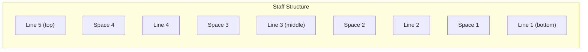
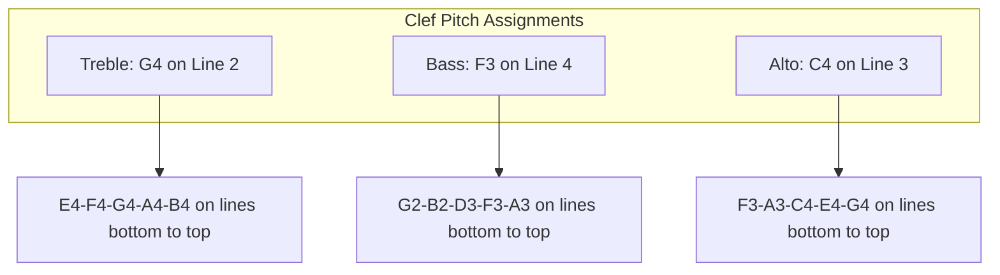
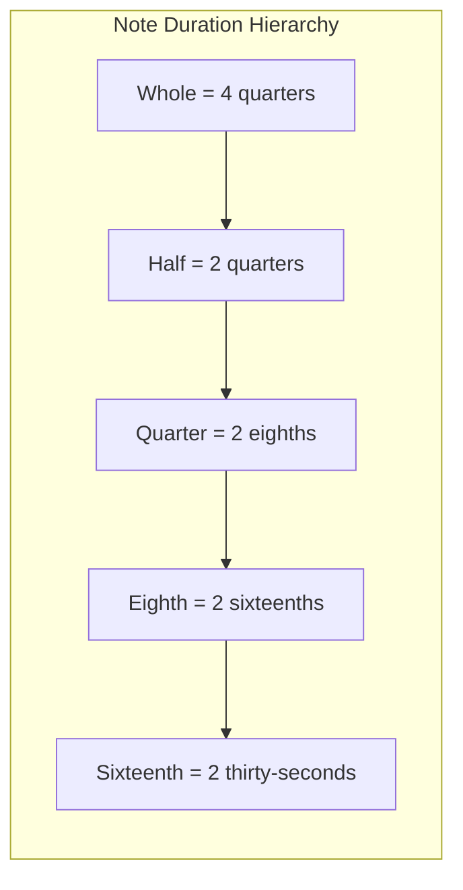

# Lesson 1: Introduction to Notation

## 1. First-Principles Intuition: Why Notation Exists

Music notation is a transmission protocol—a way to freeze live performance gestures into a reproducible instruction set. Before notation, all music was oral tradition; a melody survived only if someone remembered it and taught it directly. Notation emerged when monastics needed to standardize Gregorian chant across Europe (~9th century), then evolved through Renaissance polyphony, Baroque figured bass, and modern DAW piano rolls.

**Core invariant:** Notation encodes three properties of sound that human ears distinguish:

1. **Pitch** (frequency): How high or low a tone sounds
2. **Duration** (time): How long a tone lasts relative to others
3. **Loudness & timbre** (amplitude & spectral shape): How forcefully or softly you play, and with what articulation

The staff, clefs, and rhythmic values are not arbitrary—they emerged from practical constraints of handwriting, eyesight, and the need to notate polyphonic counterpoint where multiple independent voices move simultaneously.

## 2. The Staff & Pitch Representation

### The Five-Line Staff

The staff uses five horizontal lines and four spaces to represent pitch locations. Each line and space corresponds to a letter name (A–G) that cycles continuously. The staff alone is ambiguous—you need a **clef** to assign specific pitches.

**Why five lines?** Historical consensus: fewer lines couldn't show enough range for vocal polyphony; more lines created visual clutter. Ledger lines extend the range when needed.



### Clefs: The Pitch Anchor Points

A clef assigns absolute pitch names to staff positions. The three essential clefs:

1. **Treble Clef (G-clef):** The spiral centers on the second line from the bottom = G4 (392 Hz). Used for violin, flute, right-hand piano, guitar (sounds octave lower), soprano/alto voices.

2. **Bass Clef (F-clef):** The two dots surround the fourth line from the bottom = F3 (174.6 Hz). Used for cello, bassoon, trombone, left-hand piano, bass guitar, bass voices.

3. **Alto Clef (C-clef):** The center notch points to middle C (C4 = 261.6 Hz) on the third line. Used for viola, alto trombone, and vocal scores where range sits between treble and bass.

**Practical keyboard reference:** Middle C (C4) sits on the first ledger line below the treble staff and the first ledger line above the bass staff. This shared landmark anchors grand staff reading for pianists.



### Accidentals: Chromatic Pitch Modification

Natural notes (A B C D E F G) form the white keys on a piano. **Accidentals** shift pitch by semitones:

- **Sharp (♯):** Raises pitch by one semitone (half step)
- **Flat (♭):** Lowers pitch by one semitone
- **Natural (♮):** Cancels a previous sharp or flat
- **Double sharp (𝄪):** Raises by two semitones (whole step)
- **Double flat (𝄫):** Lowers by two semitones

**Accidental scope rule:** An accidental applies to all notes on that staff line/space for the remainder of the measure, then resets at the next barline. To cancel mid-measure, use a natural sign.

**Key signatures** place accidentals at the staff's beginning to indicate the tonal center. Example: two sharps (F♯, C♯) = D major or B minor. All F and C notes are automatically sharpened unless overridden by a natural sign.

## 3. Rhythm & Time: The Quantized Grid

### Time Signatures: Establishing the Metric Grid

A time signature defines the rhythmic container. It's written as a fraction at the start of a piece:

$$\frac{\text{beats per measure}}{\text{note value receiving one beat}}$$

**Common time signatures:**

- **4/4 (Common Time):** Four quarter-note beats per measure. The universal default in pop, rock, jazz, and most Western music.
- **3/4:** Three quarter-note beats per measure (waltz feel).
- **6/8:** Six eighth-note beats per measure, grouped in two (compound duple meter—feels like two dotted-quarter beats).
- **5/4:** Five quarter-note beats per measure (asymmetric—used in prog rock, jazz fusion, Balkan folk).
- **7/8:** Seven eighth-note beats per measure (common grouping: 2+2+3 or 3+2+2).

**Bottom number decoder:**
- 4 = quarter note gets the beat
- 8 = eighth note gets the beat
- 2 = half note gets the beat
- 16 = sixteenth note gets the beat (rare, found in contemporary classical)

### Note Durations: Binary Subdivision Hierarchy

All Western note values relate by powers of two:

| **Note**       | **Duration Relative to Whole** | **Visual Shape**                          |
|----------------|--------------------------------|-------------------------------------------|
| Whole note     | 1                              | Hollow oval, no stem                      |
| Half note      | 1/2                            | Hollow oval with stem                     |
| Quarter note   | 1/4                            | Filled oval with stem                     |
| Eighth note    | 1/8                            | Filled oval, stem with one flag (or beam) |
| Sixteenth note | 1/16                           | Filled oval, stem with two flags/beams    |
| Thirty-second  | 1/32                           | Filled oval, stem with three flags/beams  |

**Dotted notes:** A dot after a note adds half the note's value.
- Dotted half note = 3 quarter notes
- Dotted quarter = 1.5 quarter notes (one quarter + one eighth)
- Dotted eighth = 3 sixteenth notes

**Tuplets:** Divide a beat into irregular groupings:
- **Triplet:** Three notes in the time of two (e.g., three eighth-note triplets = two normal eighths)
- **Quintuplet:** Five notes in the time of four
- **Sextuplet:** Six notes in the time of four (or two triplets per beat)



### Rests: Encoding Silence

Rests are duration symbols for silence, mirroring note values:

| **Rest**          | **Duration** | **Visual Symbol**                        |
|-------------------|--------------|------------------------------------------|
| Whole rest        | 1 whole      | Solid rectangle hanging below Line 4     |
| Half rest         | 1 half       | Solid rectangle sitting on Line 3        |
| Quarter rest      | 1 quarter    | Zigzag squiggle                          |
| Eighth rest       | 1 eighth     | Single-flag hook                         |
| Sixteenth rest    | 1 sixteenth  | Double-flag hook                         |
| Thirty-second rest| 1 thirty-second | Triple-flag hook                        |

**Whole rest rule:** In any time signature, a whole rest always means "rest for the entire measure," even in 3/4 or 5/4.

## 4. Practical Reading Drills: From Symbols to Sound

### Drill 1: Treble Clef Line & Space Note Names

**Objective:** Instant visual-to-pitch recognition without counting.

**Mnemonic for lines (bottom to top):** Every Good Boy Does Fine = E4, G4, B4, D5, F5  
**Mnemonic for spaces (bottom to top):** F-A-C-E = F4, A4, C5, E5

**Practice protocol:**
1. Set a metronome to 60 BPM.
2. Flash a randomized stack of treble clef notes (use flashcards or a sight-reading app).
3. Name the pitch aloud before the next click.
4. Increase to 80 BPM, then 100 BPM once accuracy exceeds 95%.

**Target proficiency:** 100+ notes per minute with zero hesitation.

### Drill 2: Bass Clef Line & Space Note Names

**Mnemonic for lines (bottom to top):** Good Boys Do Fine Always = G2, B2, D3, F3, A3  
**Mnemonic for spaces (bottom to top):** All Cows Eat Grass = A2, C3, E3, G3

Repeat the same metronome drill as treble clef. Many beginners plateau here—force yourself to practice bass clef separately, not as a transposed treble clef. Violinists and guitarists especially need this when reading piano scores or bass lines.

### Drill 3: Rhythm Reading with Subdivisions

**Objective:** Translate notation into precise temporal execution.

**Method:**
1. Clap or tap the following rhythm at 60 BPM in 4/4 time:

```
| Quarter | Eighth Eighth | Quarter | Half |
```

2. Count aloud: "1, 2-and, 3, 4 (hold through 1 of next measure)"
3. Add sixteenth-note subdivisions:

```
| Quarter | Sixteenth Sixteenth Eighth | Eighth Eighth | Quarter |
```

Count: "1, 2-e-and-a, 3-and, 4"

4. Progress to syncopated rhythms (accents on off-beats):

```
| Eighth rest Eighth | Quarter | Eighth rest Eighth | Quarter |
```

**Target proficiency:** Execute any rhythm with subdivisions down to sixteenth notes at 120 BPM without rushing or dragging.

### Drill 4: Grand Staff (Piano) Simultaneous Reading

**Objective:** Track two independent melodic lines (treble + bass) with separate hand coordination.

**Starting exercise:** Play block chords (both hands attack simultaneously).

```
Treble: C5 (half note)
Bass:   C3 (half note)
```

Then progress to contrary motion (hands move in opposite directions):

```
Treble: C5 → B4 → A4 → G4 (quarter notes)
Bass:   C3 → D3 → E3 → F3 (quarter notes)
```

**Target proficiency:** Read and execute independent rhythms in each hand (e.g., treble plays quarter notes while bass plays eighth notes).

## 5. Articulation, Dynamics & Expression Symbols

### Articulation Marks: Attack & Release Profiles

| **Symbol**     | **Name**   | **Execution**                                                                 |
|----------------|------------|-------------------------------------------------------------------------------|
| · (dot above)  | Staccato   | Shorten the note to ~50% of written value; crisp detachment                   |
| − (line above) | Tenuto     | Hold the note for its full value; slight emphasis                             |
| > (accent)     | Accent     | Attack the note louder than surrounding notes                                 |
| ^ (marcato)    | Marcato    | Heavy accent with aggressive attack (stronger than accent)                    |
| ‿ (slur)       | Legato     | Connect notes smoothly without re-articulating (single bow stroke or breath)  |

**Physical translation:**
- **Staccato on piano:** Rapid wrist lift immediately after key depression; finger releases before full duration.
- **Staccato on strings:** Short bow stroke with immediate stop; wrist snap, not arm movement.
- **Legato on winds:** Single breath across multiple notes; tongue only re-attacks when slur ends.

### Dynamics: Volume Gradations

Dynamics are Italian abbreviations indicating relative loudness:

| **Symbol** | **Meaning**   | **Relative dB (approx)** |
|------------|---------------|--------------------------|
| ppp        | Pianississimo | Barely audible           |
| pp         | Pianissimo    | Very soft                |
| p          | Piano         | Soft                     |
| mp         | Mezzo-piano   | Moderately soft          |
| mf         | Mezzo-forte   | Moderately loud          |
| f          | Forte         | Loud                     |
| ff         | Fortissimo    | Very loud                |
| fff        | Fortississimo | Maximum volume           |

**Gradual changes:**
- **Crescendo (<):** Gradually get louder
- **Decrescendo or Diminuendo (>):** Gradually get softer

**Execution tip:** On piano, dynamics control comes from arm weight and velocity of key depression, not finger strength. On strings, bow speed and pressure on the string. On winds, air column compression and embouchure tension.

### Tempo & Expression Marks

| **Mark**       | **Meaning**                                | **BPM Range** |
|----------------|--------------------------------------------|---------------|
| Largo          | Very slow, broad                           | 40–60         |
| Adagio         | Slow                                       | 66–76         |
| Andante        | Walking pace                               | 76–108        |
| Moderato       | Moderate                                   | 108–120       |
| Allegro        | Fast, lively                               | 120–168       |
| Presto         | Very fast                                  | 168–200       |
| Fermata (𝄐)    | Hold the note longer than written duration | —             |
| Ritardando (rit.) | Gradually slow down                     | —             |
| Accelerando (accel.) | Gradually speed up                   | —             |

**Metronome marking:** A precise tempo indication, e.g., ♩ = 120 means 120 quarter-note beats per minute.

## 6. Reading Real Music: Worked Example

Below is a simple melody in C major, 4/4 time, with articulation and dynamics. Practice steps:

1. **Identify clef and key:** Treble clef, no sharps/flats = C major.
2. **Analyze time signature:** 4/4 = four quarter-note beats per measure.
3. **Name pitches:** C5, D5, E5, F5, G5 (ascending scale fragment).
4. **Execute rhythm:** All quarter notes = steady pulse.
5. **Apply articulation:** First two notes staccato (short), last three slurred (legato).
6. **Apply dynamics:** Start mf (moderately loud), crescendo to f (loud) by final note.

```
Measure 1:
  Treble Clef, 4/4 time, Key of C major
  Beat 1: C5 (quarter note, staccato, mf)
  Beat 2: D5 (quarter note, staccato)
  Beat 3: E5 (quarter note, start of slur, crescendo begins)
  Beat 4: F5 (quarter note, continue slur)

Measure 2:
  Beat 1: G5 (half note, end of slur, f)
  Beat 3-4: Quarter rest, Quarter rest
```

**Practice protocol:**
1. Clap the rhythm while counting aloud: "1, 2, 3, 4 | 1-2 (rest) (rest)"
2. Sing or play the pitches at 60 BPM, ignoring articulation.
3. Add articulation: shorten beats 1-2, connect beats 3-4-1.
4. Add dynamics: start medium volume, smoothly increase to loud by measure 2.
5. Increase tempo to 80 BPM, then 100 BPM once execution is clean.

## 7. Common Notation Pitfalls & Troubleshooting

### Problem: Rushing Through Rests
**Symptom:** Skipping over rests or shortening their duration.  
**Fix:** Count rests aloud as if they were notes. A quarter rest gets a full beat—count "rest" or tap your foot silently.

### Problem: Misreading Accidentals
**Symptom:** Forgetting that a sharp or flat applies for the entire measure.  
**Fix:** Circle all accidentals in pencil when first reading a piece. At each barline, mentally reset to the key signature.

### Problem: Losing Track in Grand Staff Reading
**Symptom:** Eyes drift between staves; hands play wrong notes.  
**Fix:** Practice each hand separately first. Use a ruler to block the opposite staff. Gradually increase the "reveal" rate as fluency improves.

### Problem: Inconsistent Tempo
**Symptom:** Speeding up on easy passages, slowing down on hard ones.  
**Fix:** Practice with a metronome at 70% of target tempo. Record yourself and compare playback to a metronome click track.

### Problem: Ignoring Dynamics
**Symptom:** Playing everything at one volume level.  
**Fix:** Exaggerate dynamics initially (make p whisper-quiet, f near maximum volume). Once the contrast habit forms, dial back to musical taste.

## 8. Next Steps: Building Fluency

1. **Daily sight-reading:** Spend 5–10 minutes per day reading unfamiliar music at a slow tempo. Do not stop to correct mistakes—prioritize continuous rhythm.

2. **Interval recognition training:** Use apps like Teoria, musictheory.net, or Functional Ear Trainer to drill intervallic distances (major 2nd, perfect 5th, etc.). Fluent readers recognize intervals by shape, not by counting staff lines.

3. **Transposition practice:** Rewrite a simple melody in different keys. Forces deeper understanding of pitch relationships beyond rote memorization.

4. **Polyrhythmic independence:** Practice playing 3 against 2 (three quarter notes in one hand, two dotted quarters in the other). Essential for advanced repertoire and orchestral reduction.

5. **Lead sheet & chord chart literacy:** Learn to read jazz/pop notation (melody + chord symbols). Requires understanding chord construction and voicing, covered in Lesson 2: Harmony & Chord Notation.

You now have the foundational tools to decode Western music notation. Fluency comes from repetition—read daily, start slow, and gradually increase complexity. Notation is not theory; it's a practical skill like typing or reading maps. The faster you internalize symbol-to-sound mappings, the more music becomes accessible.
