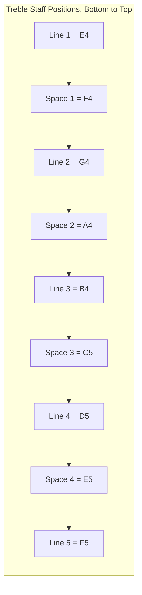
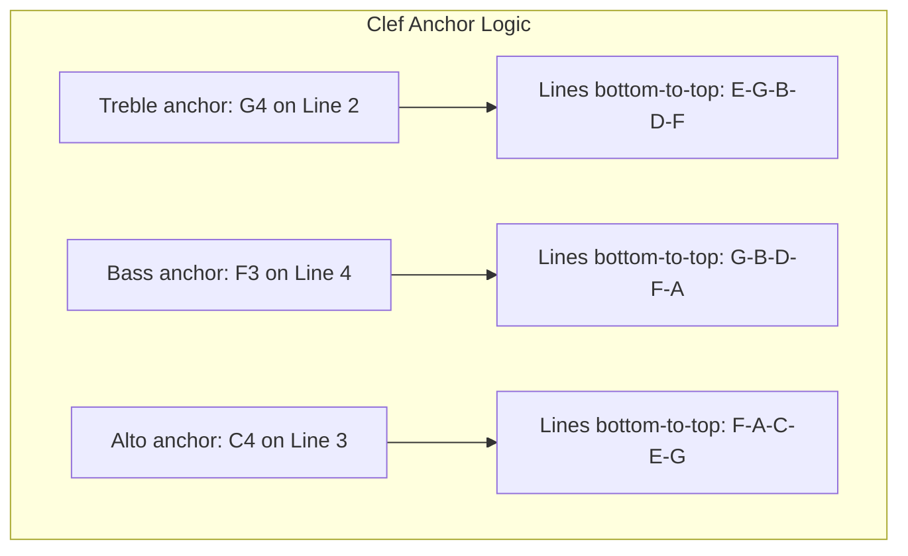
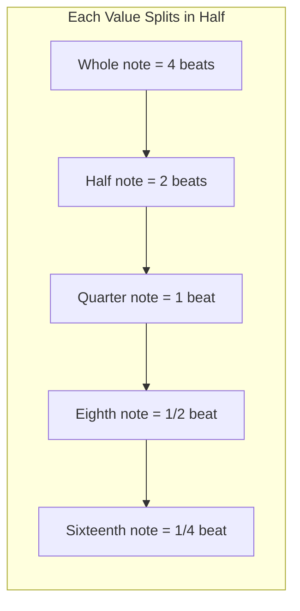

# Lesson 1: Music Notation — Reading the Page at Performance Speed

## 1. Why Notation Exists (and Why It's Shaped This Way)

Notation is a transmission protocol: it freezes a performance gesture into symbols another musician can reconstruct without ever hearing the original. Before ~900 CE, music lived entirely in oral tradition — a melody survived only as long as someone remembered it. Monastic scribes building Gregorian chant needed a way to standardize chant across monasteries that never heard each other sing, so they invented pitch-height notation on a staff. Everything since — mensural rhythm, figured bass, modern engraving — is an extension of that same problem: **how do I encode enough information on a page that a stranger can reproduce my intent?**

Three properties of sound get encoded:

1. **Pitch** — vertical position on the staff (frequency)
2. **Duration** — note shape and beaming (time)
3. **Dynamics & articulation** — words, symbols, slurs (amplitude envelope and attack shape)

The physical layout (five lines, round noteheads, stems) is not arbitrary — it is the layout that survived centuries of hand-copying and candlelight reading because it is fast to scan at a glance. That's the only "theory" you need before you start drilling: **notation is optimized for glance-speed recognition, not derivation.** You train it like a visual-to-motor reflex, the same way you learn to read traffic signs without translating them into English first.

## 2. The Staff and Clefs: Your Coordinate System

### Reading the Grid, Not Counting It

The staff gives five lines and four spaces, each a fixed letter name that repeats every seven positions (A–G, then back to A). Counting "line, space, line, space" from a reference point is how *beginners* read — it is too slow for performance tempo. The goal of this lesson is to retrain your eye to recognize staff positions **as shapes**, the same way you recognize a word without sounding out each letter.



### The Three Clefs You Actually Need

A clef is an anchor — it tells your eye which letter name attaches to one fixed line, and every other line/space falls out relative to that anchor.

| Clef | Anchor | Anchor note | Who reads it |
|---|---|---|---|
| **Treble (G-clef)** | spiral center on line 2 | G4 | violin, flute, guitar (sounds an octave lower than written), RH piano, soprano/alto voice |
| **Bass (F-clef)** | two dots straddle line 4 | F3 | cello, bassoon, trombone, LH piano, bass guitar, bass voice |
| **Alto (C-clef)** | notch points at line 3 | C4 (middle C) | viola, alto trombone |

**The one fact that unlocks grand staff reading:** middle C (C4) sits on the first ledger line *below* the treble staff and the first ledger line *above* the bass staff. They are the same key on the piano, approached from opposite directions. When you lose your place reading piano music, find middle C first — everything else is counted from there.



### Accidentals: Scope Rules That Trip Everyone Up

- **Sharp (♯):** raise one semitone (next key up, white or black)
- **Flat (♭):** lower one semitone
- **Natural (♮):** cancel a previous sharp/flat
- **Double sharp (𝄪) / double flat (𝄫):** shift by a whole step — rare outside chromatic classical writing

**Scope rule (this is the one that causes wrong notes in performance):** an accidental affects *every* occurrence of that letter name, in that octave, for the rest of the measure — not just the note it's attached to. It resets automatically at the next barline. Tied notes crossing a barline keep the accidental; everything else does not.

**Key signatures** front-load the accidentals for the whole piece. Two sharps (F♯, C♯) = D major or B minor — every F and C you see is sharp unless a natural cancels it locally.

**Practice fix for accidental errors:** on your first read-through of new music, take a pencil and circle every accidental, then draw a light vertical line down through the barline where it expires. This forces your eye to register the scope boundary instead of assuming it carries over.

## 3. Rhythm: Reading the Grid in Real Time

### Time Signature = Container Size + Subdivision Unit

Top number = beats per measure. Bottom number = which note value counts as one beat.

| Signature | Feel | Where you'll meet it |
|---|---|---|
| **4/4** | four quarter-note pulses | pop, rock, jazz, default classical |
| **3/4** | three quarter-note pulses | waltz, minuet |
| **6/8** | two dotted-quarter pulses, each split into 3 | compound meters, Irish jigs, ballads |
| **5/4** | asymmetric 3+2 or 2+3 | prog rock, "Take Five" |
| **7/8** | asymmetric 2+2+3 or 3+2+2 | Balkan folk, math rock |

The thing that separates fluent sight-readers from strugglers in 6/8 and other compound meters: **stop counting "1-2-3-4-5-6."** Feel it as two big beats, each with an internal triplet bounce ("ONE-and-a, TWO-and-a"). Counting all six subdivisions equally is the single most common reason students can't swing a 6/8 jig at tempo.

### Note Value Hierarchy — Binary Division



**Dotted notes** add half the note's own value: dotted half = 3 beats, dotted quarter = 1.5 beats (quarter + eighth), dotted eighth = 0.75 beat (eighth + sixteenth).

**Tuplets** override the binary grid to fit an odd number of notes into a beat:
- **Triplet:** 3 notes in the space of 2 — count "trip-a-let" or "1-trip-let"
- **Quintuplet:** 5 notes in the space of 4 — count "1-ta-ka-ta-ka" at speed, or subdivide as 2+3
- **Sextuplet:** 6 notes in the space of 4 — functionally two triplets per beat, count "1-trip-let-2-trip-let"

### Rests Are Notes You Don't Play — Not Notes You Skip

| Rest | Duration | Common performance error |
|---|---|---|
| Whole rest | entire measure, in *any* time signature | assuming it's only 4 beats in non-4/4 meters |
| Half rest | 2 beats | cutting it short to "catch up" |
| Quarter rest | 1 beat | glossing over it instead of holding silence |
| Eighth rest | 0.5 beat | rushing into the next note early |
| Sixteenth rest | 0.25 beat | often missed entirely at fast tempos |

**The fix that works for every student:** count rests out loud exactly like notes, including subdivision syllables ("3-and-a REST"). Silence is a rhythmic event you perform, not an absence of performance.

## 4. The Drills — Daily Practice Protocol

These four drills are the actual skill-building content of this lesson. Everything above is context; this is the work.

### Drill 1 — Treble Clef Note-Naming Speed

**Mnemonics:**
- Lines bottom to top: **E**very **G**ood **B**oy **D**oes **F**ine → E4 G4 B4 D5 F5
- Spaces bottom to top: **FACE** → F4 A4 C5 E5

**Protocol:**
1. Metronome at **60 BPM**.
2. Flashcards (physical deck or a sight-reading app like Tenuto/musictheory.net) — one new card per click, name the pitch aloud *before* the next click lands.
3. Hold at 60 BPM until accuracy ≥ 95% across a full 52-card deck.
4. Progress **60 → 80 → 100 → 120 BPM**, one card per click at each stage.
5. **Target:** sustained 120+ cards/minute with zero hesitation, ledger lines up to 2 above/below included.

### Drill 2 — Bass Clef Note-Naming Speed

**Mnemonics:**
- Lines bottom to top: **G**ood **B**oys **D**o **F**ine **A**lways → G2 B2 D3 F3 A3
- Spaces bottom to top: **A**ll **C**ows **E**at **G**rass → A2 C3 E3 G3

Run the identical 60→120 BPM protocol as Drill 1, as its own separate session — do not treat it as "treble shifted down." Guitarists and violinists plateau here because they mentally transpose from treble shapes instead of building an independent bass-clef reflex; that transposition step is exactly what costs you speed under tempo pressure.

### Drill 3 — Rhythm Reading With Spoken Subdivision

**Stage 1 (quarters/eighths), 60 BPM, 4/4:**
```
| ♩ | ♪♪ | ♩ | 𝅗𝅥 |
```
Count: **"1, 2-and, 3, 4"** (hold the half note through beats 3–4 into beat 1 of the next bar's silence if none follows).

**Stage 2 (adds sixteenths):**
```
| ♩ | ♬♬ ♪ | ♪♪ ♪♪ | ♩ |
```
Count: **"1, 2-e-and-a, 3-and 4-and"**

**Stage 3 (syncopation — off-beat accents):**
```
| 𝅘𝅥𝅮-rest ♪ | ♩ | 𝅘𝅥𝅮-rest ♪ | ♩ |
```
Count: **"1-(silent)-and, 2, 3-(silent)-and, 4"** — clap only on "and."

**Protocol:** clap each stage for 8 bars clean at 60 BPM before advancing. Record yourself on a phone against the click; listening back exposes rushing far more reliably than playing in the moment.

**Target:** execute any combination down to sixteenth-note subdivision and one syncopated figure, cleanly, at **120 BPM**, without a visible/audible drift against the click track.

### Drill 4 — Grand Staff Two-Hand Independence (Piano-Specific)

**Stage 1 — Block chords, both hands attack together:**
```
Treble: C5 (half note)
Bass:   C3 (half note)
```
Both hands land exactly on the click. This builds the habit of reading both staves in one glance rather than sequentially.

**Stage 2 — Contrary motion, quarter notes:**
```
Treble: C5 → B4 → A4 → G4
Bass:   C3 → D3 → E3 → F3
```
Hands move in mirror-opposite directions — this is deliberately easier than parallel motion because the visual symmetry helps your eyes track both staves.

**Stage 3 — Rhythmic independence:**
```
Treble: quarter notes (4 per bar)
Bass:   eighth notes (8 per bar)
```
**Fix when hands collide rhythmically:** practice each hand alone against the metronome for 4 bars, then combine at half tempo. Never combine two unfamiliar hands at full speed — that's how you bake in a wrong habit instead of the right one.

**Target:** sight-read a simple two-hand piece (e.g., a Bach minuet from the *Notebook for Anna Magdalena*) at a steady 70 BPM with each hand rhythmically independent and no stop-and-fix pauses.

## 5. Articulation: Translating Symbols Into Physical Motion

Articulation marks are motion instructions, not abstract labels. Each one maps to a specific physical gesture on your instrument.

| Symbol | Name | What it means | Piano execution | String execution | Wind execution |
|---|---|---|---|---|---|
| `.` above note | Staccato | shorten to ~50% written value | fast wrist-lift immediately after key contact | short bow stroke, stop the bow dead | tongue stops the air column early (“tah” then cutoff) |
| `–` above note | Tenuto | hold full value, slight weight | sustain full key depression, lean into the key | full bow length, even pressure | hold full breath support for the whole value |
| `>` | Accent | louder than neighbors | faster key velocity (arm drop, not finger poke) | faster bow speed at the attack | harder diaphragm pulse on the attack syllable |
| `^` | Marcato | accent + staccato combined | sharp arm-weight drop, immediate release | strong bow attack, quick stop | hard "tah" articulation, short decay |
| slur (curved line) | Legato | connect without re-articulating | overlap key releases/depressions, no gap in sound | one continuous bow stroke across the slurred notes | one breath, tongue only on the first note of the slur |

**Physical cue that fixes most staccato problems on piano:** the shortness comes from an early *release*, not a lighter attack. Students who play staccato too softly are pulling back the attack velocity instead of cutting the duration — attack normally, release early.

## 6. Dynamics and Tempo: What the Words Actually Ask Your Body to Do

### Dynamic Markings

| Symbol | Name | Practical target |
|---|---|---|
| ppp | Pianississimo | at the edge of audibility |
| pp | Pianissimo | very soft, controlled |
| p | Piano | soft |
| mp | Mezzo-piano | moderately soft |
| mf | Mezzo-forte | moderately loud |
| f | Forte | loud |
| ff | Fortissimo | very loud, full-bodied tone, not forced |
| fff | Fortississimo | maximum controlled volume (not distortion/strain) |

Crescendo (`<` or the word) and decrescendo/diminuendo (`>` or the word) are *rate of change* instructions, not static levels — the error students make is jumping straight to the target volume instead of spreading the change evenly across the written notes.

**Physical mechanism per instrument:**
- **Piano:** dynamics come from the **speed** of key descent (arm weight dropped faster), not from pressing harder after contact — the hammer has already left the string by the time you'd apply more finger force.
- **Strings:** bow **speed** and **pressure** combined — more speed for projection, more pressure (sparingly) for weight, too much pressure alone chokes the tone.
- **Winds/brass:** air column **compression**, controlled by diaphragm support, not by squeezing the throat or embouchure, which damages intonation and tone quality under volume changes.

### Tempo Marks

| Mark | Meaning | BPM range |
|---|---|---|
| Largo | very slow, broad | 40–60 |
| Adagio | slow | 66–76 |
| Andante | walking pace | 76–108 |
| Moderato | moderate | 108–120 |
| Allegro | fast, lively | 120–168 |
| Presto | very fast | 168–200 |
| Fermata (𝄐) | hold beyond written value, performer's judgment | — |
| Ritardando (rit.) | gradually slow | — |
| Accelerando (accel.) | gradually speed up | — |

A metronome marking like **♩ = 120** is the unambiguous version of these words — when in doubt, or when recording for ensemble playback, trust the number over the Italian.

## 7. Worked Example: Full Read-Through

A short melody in C major, 4/4, with every layer of notation stacked together:

```
Measure 1:
  Clef: Treble | Key: C major (no sharps/flats) | Meter: 4/4
  Beat 1: C5, quarter note, staccato, mf
  Beat 2: D5, quarter note, staccato
  Beat 3: E5, quarter note, slur begins, crescendo begins
  Beat 4: F5, quarter note, slur continues

Measure 2:
  Beats 1-2: G5, half note, slur ends, f
  Beats 3-4: quarter rest, quarter rest
```

**Layered practice protocol — do these steps in order, don't skip ahead:**

1. **Rhythm only, no pitch:** clap "1, 2, 3, 4 | 1-2, (rest), (rest)" at 60 BPM until automatic.
2. **Pitch only, no articulation:** play/sing C5-D5-E5-F5-G5 at 60 BPM, ignore staccato and dynamics entirely.
3. **Add articulation:** shorten beats 1–2 (early release), connect beats 3-4-into-measure-2 with zero gap between notes.
4. **Add dynamics:** start at a genuine mf, spread the crescendo evenly across beats 3-4-1, land f exactly on the half note.
5. **Tempo ramp:** repeat the fully assembled version at 60 → 80 → 100 BPM, advancing only once the previous tempo is clean twice in a row.

This five-layer method — rhythm, pitch, articulation, dynamics, tempo — is the general-purpose approach for sight-reading *any* new piece, not just this example. Stacking one variable at a time prevents the common failure of trying to nail everything simultaneously on first read.

## 8. Troubleshooting Table

| Problem | Symptom | Fix |
|---|---|---|
| Rushing through rests | Silence gets shortened or skipped | Count rests aloud with full subdivision syllables, same as notes |
| Misreading accidental scope | Playing a note natural when it should still be sharp/flat within the bar | Pencil-circle every accidental on first read; mark the barline where it expires |
| Losing the line in grand staff | Eyes jump between staves, wrong-hand errors | Isolate each hand for 4 bars before combining; re-anchor on middle C when lost |
| Tempo drift | Speeding up on easy bars, dragging on hard ones | Practice at 70% of target tempo first; record and compare against a click track |
| Flat, uniform dynamics | Everything sounds mf regardless of marking | Over-exaggerate p and f in practice (near-silent vs. near-max) before dialing back to taste |
| Compound meter miscounted as simple | 6/8 feels stiff, like six separate pulses | Recount in two big dotted-quarter pulses with internal triplet feel |

## 9. Building Long-Term Fluency

1. **Daily sight-reading, 5–10 minutes.** Unfamiliar material, slow tempo, never stop to fix a mistake mid-phrase — prioritize unbroken rhythm over note accuracy early on.
2. **Interval recognition by shape**, not by counting lines — drill with musictheory.net or Functional Ear Trainer until a major 2nd vs. perfect 5th is recognized instantly on the page.
3. **Transpose a simple melody into 3 different keys by hand.** This forces pitch-relationship understanding that memorized fingerings alone won't give you.
4. **Polyrhythm drills (3:2, 4:3)** — one hand/foot on quarter-note triplets, the other on straight quarters, starting at 50 BPM. Essential groundwork for orchestral reductions and advanced repertoire.
5. **Lead sheet literacy** — melody + chord symbols, the standard jazz/pop format — covered in depth in Lesson 2: Harmony & Chord Notation.

Treat this exactly like learning to type: the symbols are not a puzzle to solve each time, they're a direct motor trigger you build through repetition. Five focused minutes daily beats one unfocused hour weekly — the drills above are designed to be run that way.
