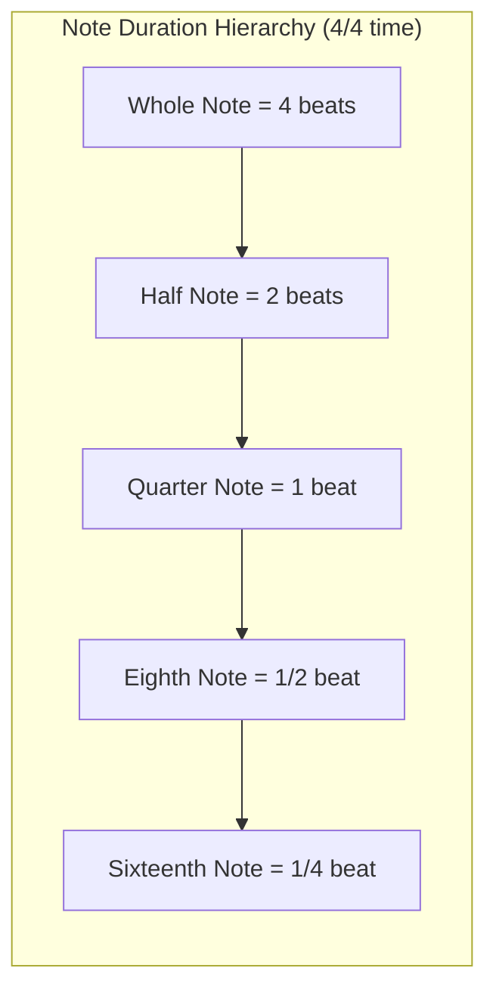
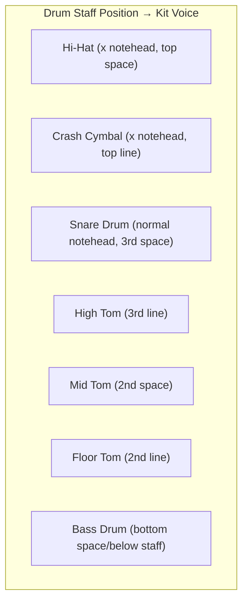

# Lesson 2: Musical Notation — Reading, Writing, and Performing from the Page

## 1. First-Principles Intuition: The Page Is a Control Surface

Notation is not decoration on top of music — it's an instruction set. Every symbol answers one of two questions: **when** does this happen, and **what pitch/sound is it**. Horizontal position = time. Vertical position = pitch (or, on a drum staff, which voice of the kit). Once that mapping is automatic, reading becomes as fast as reading text.

The staff (5 lines, 4 spaces) is a coordinate grid. A clef tells you which pitch a specific line represents, anchoring the whole grid. Treble clef (G clef) curls around the second line from the bottom, fixing it as G4. Bass clef (F clef) puts two dots around the fourth line from the bottom, fixing it as F3. Everything else on the staff is read *relative* to that anchor — you should never be counting up from a known note letter by letter in real time; you should recognize shapes and intervals instantly (more on that in the drills below).

Time signatures and note durations run on a binary subdivision system — whole, half, quarter, eighth, sixteenth — because human rhythmic perception naturally groups in twos and fours. Key signatures preload the sharps/flats that define a tonal center so you don't re-notate the same accidental on every note. Keys a fifth apart differ by exactly one accidental (the circle of fifths), which is why F major (one flat) and G major (one sharp) sit on either side of C major (no accidentals) — this is the mechanical backbone of nearly all modulation and transposition logic you'll meet later.

Keep the acoustic physics to this: pitch is the ear's perception of vibration frequency, and the staff's "up = higher" convention is a direct visual mapping of "faster vibration = higher pitch." You don't need the Hz math to play correctly — you need instant symbol recognition. That's the entire focus of this lesson.

## 2. Staff Notation: Reading the Grid at Performance Speed

### The Grand Staff (Piano & Multi-Voice Music)

Piano notation joins treble (right hand) and bass (left hand) with a brace. Middle C (C4) lives on the first ledger line below the treble staff / first ledger line above the bass staff — it's the hinge connecting both hands' ranges.

**Landmark-based reading** (how professionals actually read, not letter-counting):

| Landmark | Clef | Location | Why it matters |
|---|---|---|---|
| Middle C (C4) | Both | 1st ledger line below treble / above bass | Hand-crossing pivot, thumb reference |
| G4 | Treble | 2nd line from bottom | Clef anchor |
| F3 | Bass | 4th line from bottom | Clef anchor |
| Top line treble (F5) | Treble | 5th line | High-register landmark |
| Bottom line bass (G2) | Bass | 1st line | Low-register landmark |

Ledger lines extend the grid in the same stepwise pattern as the staff itself. Above treble: A5, C6, E6 (every other letter, skipping one line's worth each time). Below bass: E2, C2, A1. Don't memorize these as isolated facts — recognize them as "one more line up/down from the clef anchor," the same stepwise logic as the staff itself.

**Practice Drill: Clef Fluency (Landmark Method)**

1. **Interval-jump flash cards**: Instead of drilling notes in isolation, drill *distance from a landmark*. Card shows a note; you call out "2 above G4" or "1 below Middle C" before naming the letter. This builds the skill you actually use when sight-reading — judging position relative to a known point, not counting from the bottom every time.
2. **Timed naming**: Metronome at 60 BPM, one flash card per beat, call the letter name aloud. Target: 30 consecutive correct, zero hesitation, before moving up.
3. Progress 60 → 80 → 100 BPM. At 100 BPM you're reading at roughly the pace of a moderato quarter-note passage — this is the actual speed threshold for comfortable sight-reading.
4. **Cross-staff drill**: Alternate treble and bass flash cards randomly (not blocked by clef). This mimics real piano reading, where your eyes jump staves constantly.

### Note Durations & the Rhythmic Grid



Rests mirror note durations exactly — same rhythmic real estate, zero sound:

- **Whole rest**: block hanging from the 4th line
- **Half rest**: block sitting on the 3rd line
- **Quarter rest**: zigzag
- **Eighth rest**: single flag on a short stem
- **Sixteenth rest**: double flag

**Dots and ties**: a dot adds half the note's value (dotted quarter = 1.5 beats). A tie sustains pitch across a barline or across a duration no single symbol can represent (e.g., 3 beats = half note tied to a quarter note).

**Practice Drill: Subdivision Internalization**

Clap and count aloud over a metronome. This is not optional theory — it is the single highest-leverage rhythm drill that exists, because it forces your motor system (clapping) to lock to subdivisions your voice is simultaneously naming.

1. Quarters: "1, 2, 3, 4"
2. Eighths: "1-and-2-and-3-and-4-and"
3. Sixteenths: "1-e-and-a-2-e-and-a-3-e-and-a-4-e-and-a"
4. Mixed: quarter / two eighths / four sixteenths / quarter → "1, 2-and, 3-e-and-a, 4"
5. **Syncopation add-on**: dotted-eighth + sixteenth pattern ("1-...-a-2-...-a") — this is the rhythm underneath most pop, funk, and swing-adjacent grooves, and it's where most self-taught readers break down. Isolate it at 50 BPM before integrating.

Run each pattern at 60 → 80 → 100 BPM. Do not increase tempo until the pattern is clean for 8 consecutive bars.

### Accidentals: Altering Pitch Within a Measure

- **Sharp (♯)**: up one half step
- **Flat (♭)**: down one half step
- **Natural (♮)**: cancels a sharp/flat, back to the unaltered pitch
- **Double sharp (𝄪)** / **double flat (𝄫)**: rare, appear in chromatic harmony and some minor-key leading-tone spellings

An accidental holds for the rest of that measure, same octave only — a new measure resets to the key signature's defaults, and the same letter name in a different octave is unaffected unless separately marked.

**Enharmonic spelling is a harmonic decision, not a cosmetic one.** C♯ and D♭ are the same key on a keyboard but mean different things on paper: in G major (1 sharp), the leading tone is F♯, never G♭, because the key signature and the function of that note (leading tone resolving up to G) demand sharp spelling. Spelling wrong makes a passage unreadable to anyone sight-reading it, even though it "sounds" identical.

### Clefs: Why Four of Them Exist

| Clef | Anchor pitch | Typical instruments | Purpose |
|---|---|---|---|
| Treble (G) | G4, 2nd line | Violin, flute, oboe, trumpet, piano RH | High-register default |
| Bass (F) | F3, 4th line | Cello, bass, bassoon, trombone, piano LH | Low-register default |
| Alto (C) | C4, 3rd line (center) | Viola, alto trombone | Keeps viola's mid-range off ledger lines |
| Tenor (C) | C4, 4th line (center) | Upper cello/bassoon, tenor trombone | Keeps high passages off ledger lines |

The practical reason to learn alto and tenor clef if you play viola, cello, bassoon, or trombone: **ledger lines slow down reading.** A viola part in treble clef would sit almost entirely above the staff. Alto clef centers the instrument's actual range inside the five lines. If you switch between clefs mid-piece (common for cello and bassoon), practice the transition point explicitly — mark it on your part before you sight-read through it.

## 3. Chord Notation: Staff Voicing & Lead Sheet Symbols

### Staff Notation: Vertical Stacking

Chord tones share a stem, stacked vertically by pitch. When two noteheads are a 2nd apart (adjacent line/space), offset one to the right so they don't collide visually.

**Voicing** is the vertical arrangement of the same chord tones. Close voicing keeps everything within an octave (common in choral writing and comping). Open voicing spreads tones across two+ octaves (common in orchestral and big-band writing, where it avoids muddiness in low registers). On piano, a standard split is root in the left hand, 3rd-5th-7th in the right — but jazz voicings usually drop the root and 5th entirely in comping (see rootless voicings below).

**Practice Drill: Triad Quality Recognition**

1. **C major**: C–E–G (major 3rd + minor 3rd stacked)
2. **C minor**: C–E♭–G
3. **C diminished**: C–E♭–G♭ (two minor 3rds stacked — symmetrical, unstable sound)
4. **C augmented**: C–E–G♯ (two major 3rds stacked — also symmetrical)

Drill: flash a triad on staff, name its quality in under 3 seconds. The visual tell — before you even calculate intervals — is the *shape*: diminished triads look visually "compressed" (both intervals narrow), augmented triads look visually "stretched" (both intervals wide), major/minor are the asymmetrical in-between shapes. Train your eye on shape first, confirm with interval counting second.

### Lead Sheet Chord Symbols

Lead sheets give root + quality; the performer supplies voicing, rhythm, and often the inner-voice motion.

**Triads and basic sevenths:**

| Symbol | Notes | Function |
|---|---|---|
| C | C–E–G | Major triad |
| Cm / C− | C–E♭–G | Minor triad |
| Cdim / C° | C–E♭–G♭ | Diminished triad |
| Caug / C+ | C–E–G♯ | Augmented triad |
| C7 | C–E–G–B♭ | Dominant 7th |
| Cmaj7 / CΔ7 | C–E–G–B | Major 7th |
| Cm7 | C–E♭–G–B♭ | Minor 7th |
| Cm7♭5 / Cø7 | C–E♭–G♭–B♭ | Half-diminished |
| Cdim7 / C°7 | C–E♭–G♭–B𝄫(=A) | Fully diminished |

**Extensions and alterations** (built on the dominant or major 7th stack):

| Symbol | Notes | Note |
|---|---|---|
| C9 | C-E-G-B♭-D | Dominant + maj 9th |
| Cmaj9 | C-E-G-B-D | Major 7 + maj 9th |
| C7♯9 | C-E-G-B♭-D♯ | "Hendrix chord" quality |
| C7♭9 | C-E-G-B♭-D♭ | Common in dominant-to-minor resolution |
| C13 | C-E-G-B♭-D-A | Usually voiced without 9th and 11th in practice |
| C7sus4 | C-F-G-B♭ | 3rd replaced by 4th, common pre-dominant sound |

**Slash chords** specify the bass note separately from the harmony above it: **C/E** = C major triad over an E bass (first inversion — smooth bass motion). **Dm7/G** = Dm7 voiced over a G bass, the standard "ii7 over V" sound used constantly in jazz ballad comping to imply V9sus without spelling it that way.

**Practice Drill: Rootless Jazz Voicing Realization**

Metronome at 60 BPM. For each chord, play **left hand: nothing (or a single root on beat 1 only)**, **right hand: 3-5-7-9 or 7-9-3-5 voicing** (the two standard rootless shapes, named A-form and B-form):

1. **I–ii–V–I in C**: Cmaj7 → Dm7 → G7 → Cmaj7
   - Cmaj7 (A-form): E-G-B-D
   - Dm7 (B-form): C-E-F-A (7-9-3-5 of Dm7).
   - G7 (A-form): B-D-F-A
   - Resolve back to Cmaj7
2. **vi–II–V–I in C**: Am7 → D7 → Gmaj7 → Cmaj7
3. **ii–V–I in E♭**: Fm7 → B♭7 → E♭maj7

The point of this drill is *voice-leading economy* — each chord's right-hand voicing should move by the smallest possible distance to the next. If your hand is jumping around, you're choosing the wrong inversion. Increase 60 → 80 → 100 BPM only once the voice leading is smooth, not before.

## 4. Tablature: Fretboard and String Maps

TAB encodes *where to put your fingers*, not pitch names. Six horizontal lines = six strings, top line = highest-pitched string (thin high E), bottom line = lowest-pitched string (thick low E). A number is a fret; "0" is open string.

```text
e |--0--1--3--5--|
B |--0--1--3--5--|
G |--0--2--4--5--|
D |--0--2--4--5--|
A |--0--2--4--5--|
E |--0--1--3--5--|
```

**C Major Scale, Open Position:**

```text
e |--------------------0--1--3--|
B |--------------0--1--3--------|
G |--------0--2------------------|
D |--0--2--3----------------------|
A |--3-----------------------------|
E |--------------------------------|
```

Fingering: A-string 3rd fret (C, index), D-string open (D), D-string 2nd fret (E, index), D-string 3rd fret (F, middle), G-string open (G), G-string 2nd fret (A, middle), B-string open (B), B-string 1st fret (C, index), E-string open (E), E-string 1st fret (F, index), E-string 3rd fret (G, ring).

**Chord diagram convention (open C major):**

```text
  E A D G B e
  x 3 2 0 1 0
```
x = mute/don't play, 3 = A-string 3rd fret (ring), 2 = D-string 2nd fret (middle), 0 = open G, 1 = B-string 1st fret (index), 0 = open high e.

**Technique shorthand you must recognize instantly when sight-reading a riff:**

| Symbol | Meaning | Execution |
|---|---|---|
| `5h7` | Hammer-on | Pick fret 5, snap finger onto fret 7 without re-picking |
| `7p5` | Pull-off | Pick fret 7, pull finger off to sound fret 5 (already fretted underneath) |
| `7b9` | Bend | Pick fret 7, bend string until pitch matches fret 9 |
| `9r7` | Release | From a held bend, release back down to fret 7's pitch |
| `/` `\` | Slide up / down | Pick first fret, slide finger to target fret, no re-pick |
| `~` | Vibrato | Rapid small pitch oscillation via wrist/finger motion |

**Practice Drill: Box Shape Fluency**

1. **A minor pentatonic, Box 1**, ascending/descending at 60 BPM, one note per beat:

```text
e |--5--8--|
B |--5--8--|
G |--5--7--|
D |--5--7--|
A |--5--7--|
E |--5--8--|
```

2. **CAGED system**: play C, A, G, E, D major chord shapes moving up the neck, then transpose one shape to a new key by sliding it — e.g., take the "C-shape" and move it up 2 frets to produce D major while keeping the same finger pattern. The entire point of CAGED is that five shapes cover the whole neck for any major chord; drill each shape until the finger pattern is automatic independent of fret position.

### Bass TAB: Four-String Grid

Four lines, E-A-D-G low to high (five-string adds low B below the E).

```text
G |-----------------|
D |-----------------|
A |--3--5--7--8-----|
E |-----------------|
```

**Walking bass line, C major, 4/4** (chord tones + chromatic/diatonic passing tones):

```text
G |---------------------|
D |--------2-----0------|
A |--3-----------3------|
E |------------------3--|
    C    D    E    G
```

**Practice Drill: Root-Octave Box, Movable**

Root on the E string, octave two strings up and two frets over (e.g., G on E-string 3rd fret → G octave on D-string 5th fret). Slide the shape up the neck: A-root at 5th fret, B-root at 7th fret, C-root at 8th fret.

**Fingering discipline matters here**: use Simandl 1-2-4 fingering for frets 1–5 (index (1) covers the first note, middle finger (2) covers the note a semitone higher, and pinky (4) covers the note a tone above index with ring-finger reinforcement. — this spacing matches the wider fret gaps in the low register and prevents tendon strain from overstretching). Switch to one-finger-per-fret (OFPF) at fret 7 and above, where the frets are close enough together that 1-2-3-4 mapping directly to frets 7-8-9-10 is both comfortable and faster.

## 5. Drum Notation: The Kit as a Pitch-Free Staff

Drum notation repurposes the five-line staff positionally — each line/space is a *drum or cymbal*, not a pitch. Duration symbols (quarter, eighth, sixteenth) work exactly as in pitched notation.

**Standard kit map (top to bottom):**



**Notehead shape encodes technique:**
- **x notehead**: cymbal (hi-hat closed, ride, crash)
- **circle notehead**: open hi-hat
- **normal (filled oval) notehead**: drum
- **parenthesized notehead**: ghost note (quiet, barely-there snare hit)

**Basic Rock Beat, 4/4:**

```text
HH  x   x   x   x   x   x   x   x
SD      o       o       o       o
BD  o       o       o       o
    1   +   2   +   3   +   4   +
```

Hi-hat: steady eighths. Snare: backbeat on 2 and 4. Bass drum: beats 1 and 3. This is the DNA of rock, pop, blues, and most of their derivatives — internalize this one pattern cold before touching variations.

**Practice Drill: Four-Limb Independence Build-Up**

Build independence additively, never all four limbs at once from a cold start:

1. 60 BPM: right hand alone, hi-hat eighths.
2. Add left hand: snare on 2 and 4 only, hi-hat continues.
3. Add right foot: bass drum on 1 and 3.
4. Hold steady at 60 BPM for 2 full minutes without a single dropped limb before increasing tempo.
5. Progress 60 → 80 → 100 → 120 BPM, dropping back 20 BPM any time coordination breaks.
6. **Variation**: shift the bass drum to "1-and, 3-and" (syncopated off-beats) — this is the next skill tier after the basic beat is solid, and it's the pattern underneath most funk and disco grooves.

**Ghost notes** sit between the main backbeat hits, played at low velocity to add groove texture without competing with the backbeat:

```text
SD  (o) o (o) o (o) o (o) o
```

Practice these at a fixed quiet dynamic relative to the backbeat — roughly 1/4 the volume — using wrist-only Moeller-style rebound rather than a full stroke, so the ghost notes stay light and even.

## 6. Dynamics, Articulation, and Expression Markings

### Dynamics

| Marking | Name | Meaning |
|---|---|---|
| pp | pianissimo | very soft |
| p | piano | soft |
| mp | mezzo-piano | moderately soft |
| mf | mezzo-forte | moderately loud |
| f | forte | loud |
| ff | fortissimo | very loud |

**Crescendo** (cresc. or `<`) = gradually louder. **Decrescendo/diminuendo** (decresc. or `>`) = gradually softer. These are placed below the staff (or above, in vocal/choral parts) and apply across the marked span, not instantaneously.

### Articulation

| Symbol | Name | Execution |
|---|---|---|
| dot above/below notehead | Staccato | Short, detached — cut the note well before its full written value |
| `>` | Accent | Sharp, louder attack on that one note |
| `—` (horizontal line) | Tenuto | Hold full value, slight weight on the note |
| slur (curved line) | Legato | No gap between notes — smooth connection |
| `^` | Marcato | Strong, separated accent — louder than accent, shorter than tenuto |

**Practice Drill: Articulation Contrast**

Play a C major scale four ways at 80 BPM, recording each pass:

1. Staccato: every note cut short, audible silence between notes.
2. Legato: zero gap, smooth connection note to note.
3. Accented: every note hits hard but holds full value.
4. Mixed: quarter (normal) → staccato eighth → accented quarter → two legato eighths.

Listen back specifically for whether staccato and legato are *actually* distinguishable — beginners often play both the same way because the attack is identical; the difference lives entirely in the **release**, not the attack.

### Tempo

| Term | BPM range | Feel |
|---|---|---|
| Largo | 40–60 | Slow, broad |
| Adagio | 60–80 | Slow |
| Andante | 80–100 | Walking pace |
| Moderato | 100–120 | Moderate |
| Allegro | 120–160 | Fast |
| Presto | 160–200 | Very fast |

A metronome marking like ♩ = 120 is unambiguous — "quarter note equals 120 BPM" — and overrides the Italian term whenever both are present, since the Italian terms carry a wide tempo range and some genre-dependent flexibility.

### Repeat Signs & Navigation

- `|: :|` — repeat the enclosed section once (play through, jump back to `|:`, play again, continue past `:|`)
- **1st/2nd endings**: play the 1st-ending bracket on the first pass, skip it and play the 2nd-ending bracket on the repeat
- **D.C. (Da Capo)**: return to the very beginning
- **D.S. (Dal Segno)**: return to the segno (𝄋) sign
- **Fine**: stop here
- **Coda (⊕)**: jump to the coda section, used with "D.S. al Coda" or "D.C. al Coda"

**D.S. al Coda walkthrough**: play from the top to the segno (𝄋) → continue until you hit the instruction "D.S. al Coda" → jump back to the segno → play forward again until you hit "To Coda" → jump to the ⊕ coda section → finish.

## 7. Practice Workflow: From Page to Performance

```mermaid
graph TD
    subgraph sub_workflow ["Score-to-Performance Pipeline"]
        A["Scan: key, time, tempo, form"] --> B["Mark difficult passages"]
        B --> C["Chunk into 2-4 bar phrases"]
        C --> D["Hands-separate / section-isolated practice"]
        D --> E["Slow tempo drill, 50-60% target"]
        E --> F["3 clean reps before tempo increase"]
        F --> G["Incremental tempo increase, +5-10 BPM"]
        G --> H["Hands/parts together, slow"]
        H --> I["Add dynamics and articulation"]
        I --> J["Full performance run, recorded"]
    end
```



**Protocol:**

1. **Scan before playing a single note**: time signature, key signature, tempo marking, repeat structure, dynamic range. Circle anything unfamiliar.
2. **Chunk**: 2–4 measure phrases, not whole pages. Mastery happens chunk by chunk, not top-to-bottom in one pass.
3. **Isolate**: piano — right hand alone, then left hand alone, each at reduced tempo, before combining. Other instruments — isolate the technically hardest bar, not just play through from the top.
4. **Slow drill**: metronome at 50–60% of performance tempo. Three clean repetitions in a row required before any tempo increase — "clean" means correct notes, correct rhythm, correct fingering, every time.
5. **Increment**: +5–10 BPM per session, never more. Accuracy degradation at a new tempo means drop back immediately, don't push through sloppy reps hoping they'll clean up.
6. **Integrate**: combine hands/parts at a tempo slower than you think you need, then build up.
7. **Musicality pass**: once notes and rhythm are automatic (no longer requiring conscious attention), layer in dynamics, articulation, phrasing, tone color.
8. **Performance simulation**: one uninterrupted run-through, recorded, at tempo, no stopping for mistakes — simulates actual performance pressure and reveals weak spots that slow practice hides.

**Failure Mode: Rushing tempo increases.** Symptom: sloppy notes, uneven rhythm, tense hands. Fix: drop 20 BPM, rebuild clean reps before climbing again. Speed is accuracy repeated faster — it is never a separate skill you can shortcut into.

**Failure Mode: Ignoring written fingerings.** Symptom: the same passage goes wrong in a different way each time. Fix: write fingerings directly on the score (1–5 for piano, fret/string numbers for guitar/bass) and use the identical fingering every single rep — muscle memory requires a fixed motor pattern, not "whatever feels right in the moment."

**Failure Mode: Practicing mistakes into muscle memory.** Symptom: the same wrong note or rhythm recurs across sessions. Fix: stop the instant a mistake happens, isolate that single measure, play it correctly 5 times in a row at half tempo before resuming forward motion. Repetition without accuracy actively trains the error.

## 8. Real-World Notation Systems You Will Actually Encounter

### Full Orchestral Score

Instruments stack top to bottom by family: woodwinds, brass, percussion, strings. The conductor reads every staff simultaneously, tracking vertical alignment across the whole ensemble.

**Transposing instruments** are notated in their own transposed key, not concert pitch — B♭ clarinet, B♭ trumpet, F horn, E♭ alto sax. A B♭ clarinet reads a written C and produces a concert B♭. As a player, you read and finger exactly what's on your part — the transposition is handled by the composer/arranger at the writing stage, not something you calculate in real time while playing.

### Jazz Chart

Melody plus chord symbols; the rhythm section comps from the changes, soloists improvise over them.

Standard chart order: **Head** (melody, unison) → **Solos** (changes repeat per chorus, e.g., trumpet 2 choruses, tenor sax 2 choruses, piano 1 chorus) → **Head out** (melody returns, ends with coda or ritardando).

### Hybrid TAB + Rhythm Slash Notation (Session/Rock Charts)

Combines fret numbers with diagonal rhythm slashes for strum pattern, letting a session guitarist see both exact voicing and the rhythmic feel without full notation:

```text
Gtr 1 (Verse), C5 power chord, straight eighths:
e |----------------------------|
B |----------------------------|
G |--5--5--5--5--5--5--5--5----|
D |--5--5--5--5--5--5--5--5----|
A |--3--3--3--3--3--3--3--3----|
E |----------------------------|
    / / / / / / / /
```

### DAW Piano Roll (MIDI)

Horizontal = time, vertical = pitch (keyboard strip on the left edge). Each note is a rectangle: length = duration, vertical position = pitch, color/opacity often maps to velocity (0–127). Functionally this is staff notation re-skinned for direct manipulation of MIDI note-on/note-off and velocity data sent to a virtual instrument.

**Practice Drill: Staff ↔ Piano Roll Round Trip**

1. Write an 8-bar melody on staff paper.
2. Recreate it in a DAW piano roll (Ableton, Logic, FL Studio, Reaper — any works identically for this drill).
3. Compare note lengths, pitches, and placement against the original.
4. Export as MIDI, import into notation software (MuseScore, Dorico, Finale).
5. Check round-trip accuracy — did rests, ties, and articulation survive the conversion, or did the DAW's quantization grid mangle anything? This exposes exactly where piano-roll and staff notation diverge (piano roll has no native concept of a tie vs. a long note, for example — it's all just note length).

## 9. Training Regimen: Fluency Milestones

**Weeks 1–2 — Pitch & rhythm recognition**: landmark-based flash cards (50/day), clapping subdivisions (10 min/day), metronome ramps 60→100 BPM.

**Weeks 3–4 — Chord symbol realization**: realize all 12 major/minor triads on staff from memory; voice 12 major/minor/dominant-7th chords at the keyboard or guitar; run ii–V–I in all 12 keys, 2 minutes each.

**Weeks 5–6 — Tablature & fretboard mapping**: read 10 simple riffs hands-separate at 50% tempo; drill all 5 CAGED positions; map major, minor pentatonic, and blues scale boxes in 5 positions each.

**Weeks 7–8 — Integration & performance**: sight-read one new piece daily, difficulty increasing; record and self-critique for rhythmic and pitch accuracy; perform one full piece from memory at performance tempo with zero mistakes.

**Success metric**: sight-read a Grade 3 ABRSM-equivalent piece at 95% first-pass accuracy — correct rhythm, correct pitches, dynamics and articulation observed, no stopping.
