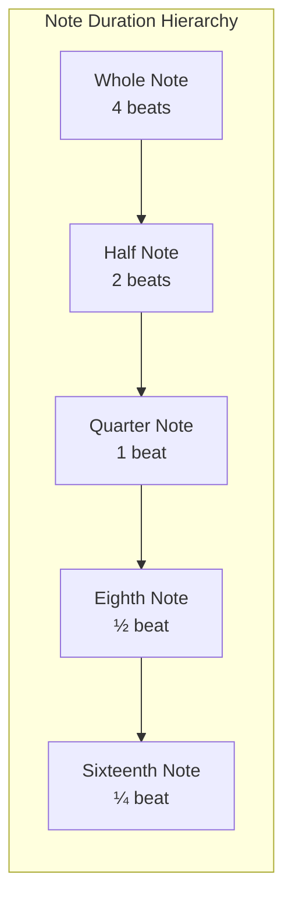
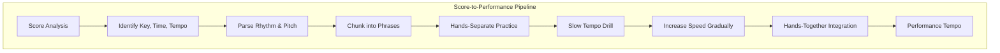

# Lesson 2: Common Notational Forms

## 1. First-Principles Intuition: Visual Language for Sound

Musical notation is a spatial map of time and pitch. Every symbol on the page answers two fundamental questions: *when* does a sound occur, and *what pitch* should it be? Understanding this dual nature—horizontal position = time, vertical position = pitch—unlocks the entire system.

The staff (five lines, four spaces) functions as a coordinate grid. Pitches ascend as you move up the staff, mirroring the physical reality of frequency: higher pitches = faster vibrations. The clef anchors this grid to specific pitches. Treble clef places G4 on the second line from the bottom; bass clef places F3 on the fourth line. Alto and tenor clefs center middle C (C4) on different lines, optimizing readability for vocal and string ranges.

Time flows left to right. Note shapes encode duration through a binary division system: a whole note lasts four beats in 4/4 time, a half note lasts two beats, a quarter note lasts one beat, an eighth note lasts half a beat. This powers-of-two structure reflects how rhythm perception works—we naturally subdivide time into halves and quarters, not thirds or sevenths.

The time signature (two stacked numbers at the start) sets the meter: the top number tells you how many beats per measure, the bottom number tells you what note value gets one beat. 4/4 means "four quarter notes per measure." 6/8 means "six eighth notes per measure," creating a lilting compound feel versus the straight quarter-note pulse of 4/4.

Key signatures (sharps or flats grouped after the clef) define the tonal center. They tell you which notes are raised or lowered *by default* throughout the piece, eliminating the need to write accidentals on every note. C major has no sharps or flats; G major has one sharp (F♯); F major has one flat (B♭). This system is rooted in the overtone series and the circle of fifths—keys a perfect fifth apart differ by one accidental.

## 2. Staff Notation: Reading the Grid

### The Grand Staff (Piano & Multi-Voice Music)

Piano music uses two staves joined by a brace: treble clef on top for the right hand, bass clef on bottom for the left. Middle C (C4) sits on a ledger line between the two staves—one ledger line below treble, one ledger line above bass. This shared landmark connects the two registers.

**Ledger lines** extend the staff above and below its five lines when pitches exceed the standard range. Each ledger line represents the next note in the sequence. Above treble clef: A5 (first ledger line), C6 (second ledger line), E6 (third ledger line). Below bass clef: E2 (first ledger line), C2 (second ledger line), A1 (third ledger line).

**Practice Drill: Treble & Bass Clef Fluency**

1. Flash cards: Write each line and space note on index cards. Treble: E4, G4, B4, D5, F5 (lines); F4, A4, C5, E5 (spaces). Bass: G2, B2, D3, F3, A3 (lines); A2, C3, E3, G3 (spaces).
2. Timed reading: Set a metronome to 60 BPM. Read one note per beat, calling out the pitch name aloud. Target: 30 consecutive correct notes without hesitation.
3. Increase to 80 BPM, then 100 BPM as accuracy solidifies.

### Note Durations & Rhythmic Relationships



Each note shape has a corresponding *rest* symbol indicating silence of equal duration. Rests occupy the same rhythmic grid as notes:

- **Whole rest**: hangs from the fourth line (looks like a filled rectangle)
- **Half rest**: sits on the third line (looks like a filled rectangle sitting on a line)
- **Quarter rest**: zigzag shape
- **Eighth rest**: flag attached to a stem
- **Sixteenth rest**: two flags attached to a stem

**Dots and ties** extend durations. A dot adds half the note's value: a dotted quarter note = 1.5 beats (1 beat + 0.5 beat). A tie connects two notes of the same pitch, sustaining the sound across both durations. Ties are essential when a note must cross a barline or when a duration cannot be represented by a single note shape.

**Practice Drill: Rhythmic Subdivision Grids**

Write out a 4/4 measure. Clap and count aloud:

1. **Quarter notes**: "1, 2, 3, 4"
2. **Eighth notes**: "1-and-2-and-3-and-4-and"
3. **Sixteenth notes**: "1-e-and-a-2-e-and-a-3-e-and-a-4-e-and-a"
4. **Mixed rhythms**: quarter, two eighths, four sixteenths, quarter: "1, 2-and, 3-e-and-a, 4"

Metronome at 60 BPM, then 80 BPM, then 100 BPM. Goal: internalize how each subdivision lands against the steady pulse.

### Accidentals: Altering Pitches

Accidentals modify a note's pitch *within a measure*. They override the key signature for all subsequent occurrences of that note in the same measure and same octave.

- **Sharp (♯)**: raises pitch by one half step
- **Flat (♭)**: lowers pitch by one half step
- **Natural (♮)**: cancels a sharp or flat, returning to the white key
- **Double sharp (𝄪)**: raises pitch by two half steps (rare, used in complex harmonic contexts)
- **Double flat (𝄫)**: lowers pitch by two half steps (rare)

**Enharmonic equivalents** are pitches that sound identical but are spelled differently: C♯ = D♭, F♯ = G♭, B = C♭. The spelling you choose depends on harmonic context. In G major (one sharp, F♯), write F♯, not G♭. In D♭ major (five flats), write D♭, not C♯.

### Clefs: Anchoring the Pitch Grid

**Treble clef (G clef)**: The spiral curls around the second line from the bottom, marking G4. Used for violin, flute, oboe, trumpet, soprano/alto voices, and piano right hand.

**Bass clef (F clef)**: Two dots surround the fourth line from the bottom, marking F3. Used for cello, bass, bassoon, trombone, tuba, bass voice, and piano left hand.

**Alto clef (C clef)**: The clef's center marks middle C (C4) on the third line. Used for viola, alto trombone, and alto voice in choral scores.

**Tenor clef (C clef)**: The clef's center marks middle C (C4) on the fourth line. Used for upper cello/bassoon passages, tenor trombone, and tenor voice in choral scores.

Why multiple clefs? To minimize ledger lines. Viola sits between violin and cello—alto clef keeps most viola notes within the five-line staff. Without it, viola music would require constant ledger lines in either treble or bass clef.

## 3. Chord Notation: Vertical Stacking & Lead Sheets

### Staff Notation: Vertical Stacking

Chords on the staff are written as vertically aligned noteheads sharing a single stem. The lowest note is the bass note (often the root), and higher pitches stack above. If noteheads are a second apart (adjacent lines/spaces), offset them slightly to the right to prevent visual collision.

**Voicing** refers to the vertical spacing between chord tones. Close voicing packs notes within an octave; open voicing spreads them across multiple octaves. Piano voicings often place the root in the bass (left hand) and the 3rd, 5th, and 7th in the treble (right hand).

**Practice Drill: Triad Recognition on Staff**

Write and identify major, minor, diminished, and augmented triads in root position:

1. **C major**: C-E-G (root, major 3rd, perfect 5th)
2. **C minor**: C-E♭-G (root, minor 3rd, perfect 5th)
3. **C diminished**: C-E♭-G♭ (root, minor 3rd, diminished 5th)
4. **C augmented**: C-E-G♯ (root, major 3rd, augmented 5th)

Drill: Given a triad on the staff, identify its quality within 3 seconds. Repeat until automatic.

### Lead Sheet Notation: Chord Symbols

Lead sheets use chord symbols above the staff, allowing performers to comp (accompany) freely. The symbol specifies the root and chord quality; performers choose voicings and rhythm.

**Basic Symbols:**

- **C**: C major triad (C-E-G)
- **Cm** or **C−**: C minor triad (C-E♭-G)
- **Cdim** or **C°**: C diminished triad (C-E♭-G♭)
- **Caug** or **C+**: C augmented triad (C-E-G♯)
- **C7**: C dominant seventh (C-E-G-B♭)
- **Cmaj7** or **CΔ7**: C major seventh (C-E-G-B)
- **Cm7**: C minor seventh (C-E♭-G-B♭)
- **Cm7♭5** or **Cø7**: C half-diminished seventh (C-E♭-G♭-B♭)
- **Cdim7** or **C°7**: C fully diminished seventh (C-E♭-G♭-B𝄫/A)

**Extensions and Alterations:**

- **C9**: Dominant 7th + major 9th (C-E-G-B♭-D)
- **Cmaj9**: Major 7th + major 9th (C-E-G-B-D)
- **C7♯9**: Dominant 7th + augmented 9th (C-E-G-B♭-D♯)
- **C7♭9**: Dominant 7th + minor 9th (C-E-G-B♭-D♭)
- **C13**: Dominant 7th + 9th + 13th (C-E-G-B♭-D-A)
- **C7sus4**: Dominant 7th, replace 3rd with 4th (C-F-G-B♭)

**Slash Chords** specify a bass note different from the root:

- **C/E**: C major triad with E in the bass (first inversion)
- **Dm7/G**: Dm7 chord with G in the bass (common ii⁷/V voicing)

**Practice Drill: Chord Symbol Realization**

Set metronome to 60 BPM. Play each chord in root position, then close voicing (rootless left hand + 3-7-9 right hand for jazz):

1. Cmaj7 → Dm7 → G7 → Cmaj7 (I-ii-V-I in C major)
2. Am7 → D7 → Gmaj7 → Cmaj7 (vi-II-V-I in C major)
3. Fm7 → B♭7 → E♭maj7 → A♭maj7 (ii-V-I in E♭ major)

Goal: Hear the progression, see the Roman numerals, and voice chords without hesitation. Increase to 80 BPM, then 100 BPM.

## 4. Tablature: Fretboard & String Maps

Tablature (TAB) represents finger positions on fretted instruments (guitar, bass, ukulele) using horizontal lines for strings and numbers for frets. It bypasses traditional pitch notation, focusing on *where* to place your fingers rather than *what* note sounds.

### Guitar TAB: Six-Line Grid

Six lines represent the six strings, ordered from highest pitch (top line, thin E string) to lowest pitch (bottom line, thick E string). Numbers indicate which fret to press. "0" means play the open string (no finger pressing).

```
E |--0--1--3--5--|
B |--0--1--3--5--|
G |--0--2--4--5--|
D |--0--2--4--5--|
A |--0--2--4--5--|
E |--0--1--3--5--|
```

**Example: C Major Scale (Open Position)**

```
E |--------------------0--1--3--|
B |--------------0--1--3--------|
G |--------0--2-----------------|
D |--0--2--3--------------------|
A |--3--------------------------|
E |-----------------------------|
```

Read left to right. Play each note in sequence: A string 3rd fret (C), D string open (D), D string 2nd fret (E), D string 3rd fret (F), G string open (G), G string 2nd fret (A), B string open (B), B string 1st fret (C), E string open (E), E string 1st fret (F), E string 3rd fret (G).

**Chord Diagrams** show finger placement for entire chords:

```
C Major:
  E A D G B E
  x 3 2 0 1 0
  
  x = don't play this string
  3 = 3rd fret, A string (index finger)
  2 = 2nd fret, D string (middle finger)
  0 = open G string
  1 = 1st fret, B string (ring finger)
  0 = open high E string
```

**Technique Markings:**

- **h**: hammer-on (5h7 = pick fret 5, hammer to fret 7 without picking again)
- **p**: pull-off (7p5 = pick fret 7, pull off to sound fret 5)
- **b**: bend (7b9 = pick fret 7, bend string to sound like fret 9)
- **r**: release bend (9r7 = release bend from fret 9 pitch back to fret 7)
- **/**: slide up (\\ for slide down)
- **~**: vibrato

**Practice Drill: TAB Reading & Box Shapes**

1. **Minor Pentatonic Box 1 (A minor)**: Play ascending and descending at 60 BPM, one note per beat.

```
E |--5--8--|
B |--5--8--|
G |--5--7--|
D |--5--7--|
A |--5--7--|
E |--5--8--|
```

2. **CAGED System Chord Shapes**: Play C, A, G, E, D major shapes across the neck. Transpose each shape to play the same chord (e.g., move C shape up two frets to play D major in C shape).

### Bass TAB: Four-Line Grid

Bass TAB uses four lines (E-A-D-G in standard tuning, low to high). Five-string bass adds a low B string below the E.

```
G |-----------------|
D |-----------------|
A |--3--5--7--8-----|
E |-----------------|
```

**Example: Walking Bass Line (C Major, 4/4)**

```
G |---------------------|
D |--------2-----0------|
A |--3-----------3------|
E |------------------3--|
   C    D    E    G (chord tones + passing tones)
```

**Practice Drill: Movable Root-Octave Boxes**

Play root on E string, octave on D string (two frets higher, two strings up). Example: E string 3rd fret (G) → D string 5th fret (G octave). Move this shape up the neck: A at 5th fret, B at 7th fret, C at 8th fret. Lock in the 1-2-4 Simandl fingering for frets 1-5, OFPF for frets 7+.

## 5. Drum Notation: Rhythmic Grid & Kit Map

Drum notation uses a five-line staff, but each line and space represents a different drum or cymbal, not a pitch. Note shapes indicate duration (quarter notes, eighths, sixteenths), and noteheads indicate which drum to strike.

### Standard Kit Map

```
  Hi-Hat (x or circle notehead)
  ────────────────────────── (top space)
  Crash Cymbal (x notehead)
  ────────────────────────── (top line)
  Snare Drum (normal notehead)
  ────────────────────────── (third space)
  High Tom (normal notehead)
  ────────────────────────── (third line)
  Mid Tom (normal notehead)
  ────────────────────────── (second space)
  Floor Tom (normal notehead)
  ────────────────────────── (second line)
  Bass Drum (normal notehead)
  ────────────────────────── (bottom space/below staff)
```

**X noteheads** = cymbals (hi-hat, ride, crash). **Circle noteheads** = open hi-hat. **Standard noteheads** = drums.

**Example: Basic Rock Beat (4/4)**

```
HH  x   x   x   x   x   x   x   x
    ────────────────────────────────
SD      o       o       o       o
    ────────────────────────────────
BD  o       o       o       o
    ────────────────────────────────
    1   +   2   +   3   +   4   +
```

Hi-hat plays eighth notes (x = closed hi-hat). Snare hits beats 2 and 4 (backbeat). Bass drum hits beats 1 and 3. This is the foundational groove for rock, pop, and blues.

**Practice Drill: Four-Limb Independence**

1. **Metronome at 60 BPM**: Play hi-hat eighth notes with right hand (x-x-x-x-x-x-x-x).
2. Add snare on beats 2 and 4 (left hand).
3. Add bass drum on beats 1 and 3 (right foot).
4. Increase to 80 BPM, then 100 BPM, then 120 BPM.
5. Variation: Shift bass drum to "1-and-3-and" (offbeat eighths). Lock in the pocket.

**Ghost Notes** (quieter snare hits between main backbeats) are notated with parentheses or smaller noteheads:

```
SD  (o) o (o) o (o) o (o) o
```

## 6. Specialized Notation: Dynamics, Articulation & Expression

### Dynamics: Volume Markings

Dynamic markings indicate relative loudness. They are Italian abbreviations placed below the staff:

- **pp** (pianissimo): very soft
- **p** (piano): soft
- **mp** (mezzo-piano): moderately soft
- **mf** (mezzo-forte): moderately loud
- **f** (forte): loud
- **ff** (fortissimo): very loud
- **fff** (fortississimo): extremely loud

**Crescendo** (cresc. or <): gradually get louder. **Decrescendo/Diminuendo** (decresc. or >): gradually get softer.

### Articulation: Note Attack & Release

- **Staccato (dot above/below notehead)**: Short, detached. Release immediately after attack.
- **Accent (>)**: Emphasized, louder attack.
- **Tenuto (—)**: Full value, slightly emphasized. Hold the note for its entire duration.
- **Legato (slur line connecting notes)**: Smooth, connected. No gap between notes.
- **Marcato (^)**: Strong, separated accent. Shorter than tenuto, louder than staccato.

**Practice Drill: Articulation Contrast**

Play a C major scale:

1. **Staccato**: Each note short and bouncy (quarter notes sound like sixteenth notes with rests).
2. **Legato**: Each note flows into the next with no gap.
3. **Accented**: Every note has a sharp attack, full duration.
4. **Mixed**: Quarter, staccato eighth, accented quarter, legato eighths.

Metronome at 80 BPM. Record yourself. Listen back: Can you hear clear differences in attack and release?

### Tempo Markings: Pace & Feel

Tempo is specified in beats per minute (BPM) or Italian terms:

- **Largo**: slow and broad (40–60 BPM)
- **Adagio**: slow (60–80 BPM)
- **Andante**: walking pace (80–100 BPM)
- **Moderato**: moderate (100–120 BPM)
- **Allegro**: fast (120–160 BPM)
- **Presto**: very fast (160–200 BPM)

**Metronome markings** are precise: ♩ = 120 means "quarter note equals 120 BPM."

### Repeat Signs & Navigation

- **Repeat barlines (|: and :|)**: Repeat the enclosed section. Play once, return to |:, play again, then continue.
- **1st and 2nd endings**: Play through the 1st ending, repeat, skip the 1st ending, play the 2nd ending instead.
- **D.C. (Da Capo)**: Return to the beginning.
- **D.S. (Dal Segno)**: Return to the segno sign (𝄋).
- **Fine**: End here.
- **Coda (⊕)**: Jump to the coda section (used with D.S. al Coda or D.C. al Coda).

**Example: D.S. al Coda**

1. Play from the beginning to the segno (𝄋).
2. Continue to the phrase "D.S. al Coda."
3. Jump back to the segno, play until "To Coda."
4. Jump to the coda (⊕), finish the piece.

## 7. Workflow: From Page to Performance



**Step-by-Step Practice Protocol:**

1. **Scan the entire piece**: Identify time signature, key signature, tempo, repeat signs, dynamics, and articulations. Mark difficult sections.
2. **Chunk into phrases**: Break the piece into 2–4 measure segments. Focus on one chunk at a time.
3. **Hands-separate practice (piano) / section isolation (other instruments)**: Right hand only, 50% tempo. Left hand only, 50% tempo. Lock in correct fingerings and note accuracy before combining.
4. **Slow tempo drill**: Metronome at 50–60% performance tempo. Play perfectly 3 times in a row before increasing speed.
5. **Incremental tempo increases**: Add 5–10 BPM per session. Never sacrifice accuracy for speed.
6. **Hands-together integration**: Combine both hands (or full band parts) at slow tempo. Gradually approach performance tempo.
7. **Dynamic and articulation refinement**: Once notes and rhythm are automatic, focus on musicality—dynamics, phrasing, tone color.
8. **Performance simulation**: Play through without stopping, as if in a concert. Record and review.

**Failure Mode: Rushing Tempo Increases**

Symptom: Notes become sloppy, rhythms uneven, fingers tense.

Fix: Drop tempo by 20 BPM. Return to slow, perfect repetitions. Muscle memory must solidify at each speed increment before advancing. Fast playing is slow playing sped up, not a separate skill.

**Failure Mode: Ignoring Fingerings**

Symptom: Inconsistent execution, frequent mistakes in the same passage.

Fix: Write fingerings (1-2-3-4-5 for piano, string/fret numbers for guitar/bass) directly on the score. Use the same fingerings every time. Muscle memory depends on consistency.

**Failure Mode: Practicing Mistakes**

Symptom: The same wrong note or rhythm appears repeatedly.

Fix: Stop immediately when a mistake occurs. Isolate the measure. Play correctly 5 times in a row at half tempo. Practicing mistakes ingrains them—repetition without accuracy is worse than not practicing.

## 8. Real-World Notation Systems

### Classical Score: Full Orchestral Notation

A full orchestral score arranges instruments vertically by family (top to bottom): woodwinds, brass, percussion, strings. Each instrument has its own staff. The conductor reads all staves simultaneously.

Transposing instruments (clarinet in B♭, trumpet in B♭, horn in F, alto saxophone in E♭) are notated in their transposed key, not concert pitch. A B♭ clarinet reading a written C sounds a concert B♭. The player reads the transposed part; the conductor sees the transposed notation but mentally hears concert pitch.

### Jazz Chart: Melody + Changes

Jazz lead sheets provide the melody line and chord symbols. The rhythm section (piano, bass, drums) comps using the chord changes. Soloists improvise over the changes, referencing the melody as a thematic anchor.

**Standard notation order in a jazz chart:**

1. **Head (melody)**: Played in unison by horns or lead instrument.
2. **Solo section**: Chord changes repeat; soloists improvise (trumpet solo 2 choruses, tenor sax solo 2 choruses, piano solo 1 chorus).
3. **Head out**: Return to the melody, end with a coda or ritardando.

### Guitar/Bass TAB: Session & Rock Notation

Session musicians and rock bands often use TAB paired with chord symbols and rhythmic slashes (diagonal lines indicating rhythm without specific pitches). This hybrid notation shows *where* to play (fret numbers) and *how* to comp (slashes for strumming rhythm).

```
Gtr 1 (Verse):
E |----------------------------|
B |----------------------------|
G |--5--5--5--5--5--5--5--5----|  (rhythm slashes + TAB)
D |--5--5--5--5--5--5--5--5----|
A |--3--3--3--3--3--3--3--3----|
E |----------------------------|
    / / / / / / / /
    C major power chord, eighth notes
```

### DAW Piano Roll: MIDI Sequencing

Digital Audio Workstations (DAWs) use piano roll editors: horizontal grid = time, vertical grid = pitch (piano keyboard on the left axis). Each MIDI note is a colored rectangle; length = duration, vertical position = pitch, velocity (attack strength) shown by color saturation.

Piano roll is functionally identical to staff notation but optimized for electronic music production. It directly manipulates the data sent to virtual instruments and synthesizers: note-on/note-off messages, velocity (0–127), and timing (measured in ticks or milliseconds).

**Practice Drill: Staff-to-Piano-Roll Translation**

1. Write a simple melody on staff notation.
2. Open a DAW (Ableton Live, Logic Pro, FL Studio, Reaper).
3. Recreate the melody in the piano roll editor.
4. Compare timing, note lengths, and pitch accuracy.
5. Export MIDI, import into notation software (MuseScore, Finale, Dorico). Verify round-trip accuracy.

## 9. Training Regimen: Fluency Milestones

### Week 1-2: Pitch & Rhythm Recognition

- Flash cards: treble and bass clef, 50 notes/day.
- Clapping drills: quarter, eighth, sixteenth notes, 10 minutes/day.
- Metronome subdivisions: 60 BPM → 80 BPM → 100 BPM.

### Week 3-4: Chord Symbol Realization

- Realize 12 major/minor triads on staff.
- Voice 12 major/minor/dominant 7th chords on piano or guitar.
- Play ii-V-I progressions in all 12 keys, 2 minutes per key.

### Week 5-6: Tablature & Fretboard Mapping

- TAB reading: 10 simple riffs, hands-separate, 50% tempo.
- Movable chord shapes: CAGED system, all positions.
- Scale box patterns: major, minor pentatonic, blues scale, 5 positions each.

### Week 7-8: Integration & Performance

- Sight-read 1 new piece daily, progressively harder.
- Record yourself: listen for rhythmic accuracy, pitch accuracy, dynamic contrast.
- Perform 1 full piece from memory, no mistakes, at performance tempo.

**Success Metric**: Read and perform a Grade 3 ABRSM or equivalent piece with 95% accuracy on first read-through, rhythm and pitch correct, dynamics and articulations applied.
