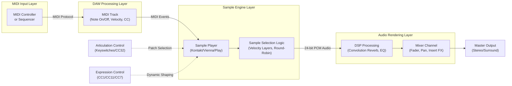
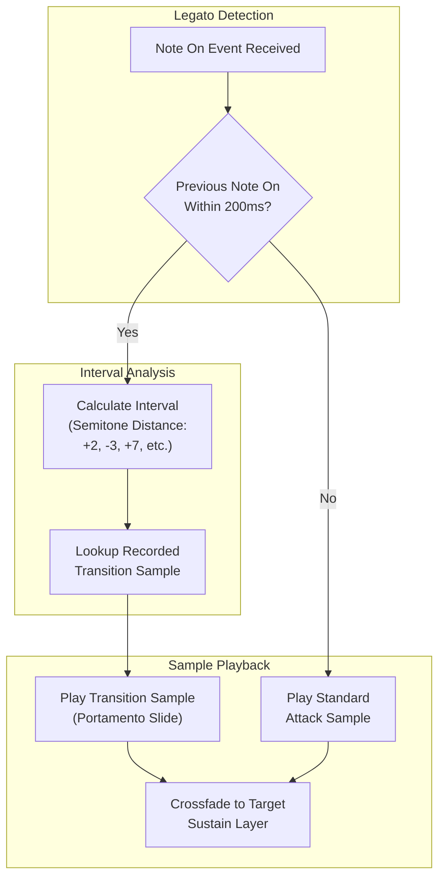
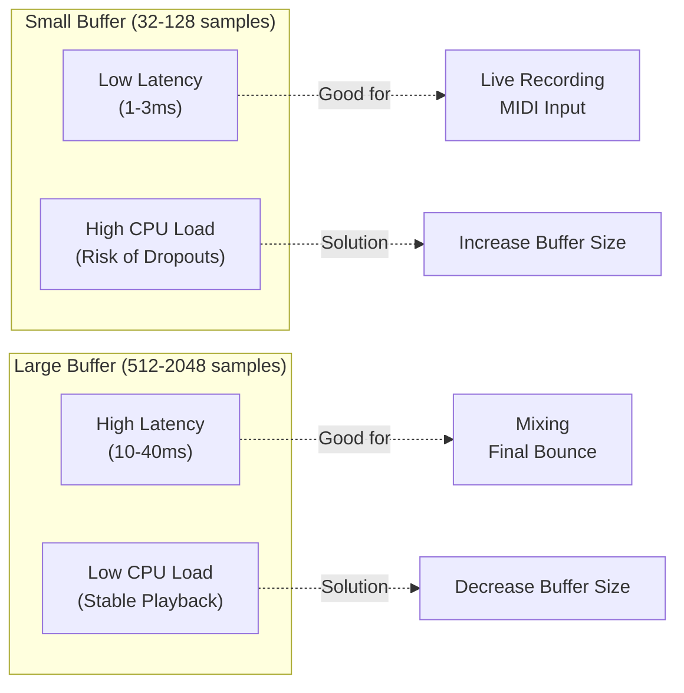

# Operational Verification Labs: Orchestral Scoring

## Objective & Lab Setup

This laboratory trains professional orchestral scoring through digital audio workstation (DAW) environments, focusing on hands-on MIDI orchestration, sample library manipulation, articulation switching, dynamic shaping with continuous controllers, and psychoacoustic parameter control. You will sequence, automate, troubleshoot, and mix virtual orchestras using the same workflows employed in contemporary film, game, and concert music production.

### Required Domain-Specific Tools, Environments, Packages, or Simulators

**Minimum Configuration:**
- **DAW**: Logic Pro X (10.7+), Cubase Pro 12, Reaper 6.5+, or Ableton Live 11 Suite with full MIDI editing capabilities
- **Orchestral Sample Library**: One tier-1 library with true legato sampling and multiple articulation sets:
  - Vienna Symphonic Library (VSL) Standard or Full
  - Spitfire Audio Symphony Orchestra Professional
  - EastWest Hollywood Orchestra Diamond
  - Garritan Personal Orchestra 5 (minimum acceptable baseline)
- **MIDI Controller** (recommended): 61+ key weighted controller with mod wheel and expression pedal support
- **Audio Interface**: 24-bit/48kHz minimum, ≤10ms round-trip latency
- **System Requirements**: 16GB+ RAM, SSD storage for sample streaming, quad-core CPU minimum

**Installation Verification:**
1. Open your DAW and scan for orchestral library plugins (VST3/AU)
2. Load a string ensemble patch on a new software instrument track
3. Play a polyphonic chord (C-E-G) and verify MIDI playback
4. Test MIDI CC routing: move mod wheel (CC1), assign expression pedal to CC11, press sustain pedal (CC64)
5. Set audio buffer size to 256-512 samples and confirm real-time performance without dropouts

## Exercise 1: Foundational Practical Implementation

### MIDI Architecture and Orchestral Template Construction

#### Conceptual Foundation: The MIDI-to-Audio Signal Chain

Orchestral scoring in DAW environments operates through a multi-stage signal chain where MIDI (control data) triggers sample playback (audio):



**Why This Architecture Matters:**
- **MIDI as Control Protocol**: MIDI transmits performance instructions (note pitch, velocity, duration, modulation) but no actual audio. This separation enables non-destructive editing—you can revise performances infinitely without generational loss.
- **Sample Engine Layer**: Professional orchestral libraries contain multi-sampled recordings: 10-20 velocity layers per note, multiple round-robin samples to prevent the "machine-gun effect" (identical repeated samples), and interval-specific legato transitions. The engine selects appropriate samples based on MIDI velocity (0-127) and continuous controller values.
- **Articulation Systems**: Libraries map articulations (legato, staccato, spiccato, tremolo, sul ponticello) to MIDI keyswitches (typically C-1 to G-1, outside the playable range) or dedicated CC lanes (CC32 is standard for VSL). Switching articulations mid-phrase requires strategic keyswitch placement.

**Core Principle**: MIDI velocity determines *which sample* is triggered (hard attack vs. soft attack, different timbral characteristics). CC11 (Expression) acts as a *volume multiplier* after sample selection, preserving timbral character. Use velocity for articulation selection and attack intensity; use CC11 for phrase-level dynamic shaping.

#### Step 1: DAW Project Configuration and Orchestral Template

**1.1 Create Base Project Structure:**

Organize tracks hierarchically by orchestral families. Use folder tracks or VCA groups for section-level control:

```
Project Root
├── Strings/
│   ├── Violin I (16 players, sits left in stereo field)
│   ├── Violin II (14 players, sits center-left)
│   ├── Violas (12 players, center)
│   ├── Cellos (10 players, center-right)
│   └── Double Basses (8 players, right)
├── Woodwinds/
│   ├── Flutes (2-3 players)
│   ├── Oboes (2-3 players)
│   ├── Clarinets in Bb (2-3 players)
│   └── Bassoons (2-3 players)
├── Brass/
│   ├── French Horns (4-6 players)
│   ├── Trumpets in Bb (3-4 players)
│   ├── Trombones (3 players: 2 tenor, 1 bass)
│   └── Tuba (1 player)
└── Percussion/
    ├── Timpani (4 drums: D2, G2, C3, F3)
    ├── Snare & Bass Drum
    └── Cymbals & Auxiliary (triangle, tambourine, glockenspiel)
```

**1.2 Configure MIDI Routing:**

In Logic Pro X (syntax translates to other DAWs):
- Create Software Instrument track: **Track** → **New Software Instrument Track**
- Load orchestral library plugin: Click instrument slot → **AU Instruments** → **Vienna Instruments** or **Kontakt**
- Set MIDI channel to 1 (most patches default to channel 1; multi-timbral mode uses channels 1-16)
- Arm track for recording: Click red **Record Enable** button

**1.3 Configure Sample Latency Compensation:**

Sample libraries introduce processing latency (20-50ms for convolution reverb, sample lookahead). Enable automatic delay compensation:
- **Logic**: Preferences → Audio → **Low Latency Mode** OFF (disables during playback/mix; enable only for live recording)
- **Cubase**: Studio → Studio Setup → Audio System → **Activate Asio-Guard**
- **Reaper**: Preferences → Audio → **Anticipative FX processing** enabled

**Test Latency**: Play a MIDI note and listen for delay between key press and audio. If delay exceeds 15ms (noticeable), reduce buffer size to 256 samples or enable low-latency monitoring mode.

#### Step 2: Constructing a Four-Part String Texture with Voice Leading

**2.1 Theoretical Framework: Four-Part Chorale Texture**

We construct a four-part texture using classical voice-leading principles, demonstrating how MIDI velocity and CC11 (Expression) control perceived dynamics.

**Harmonic Progression (C Major, root position):**
```
I → IV → V → I
C → F  → G → C
```

**Voice Ranges (Scientific Pitch Notation):**
- **Violin I (Soprano)**: C4 to C6 (optimal)
- **Viola (Alto)**: C3 to E5 (optimal)
- **Cello (Bass)**: C2 to C4 (optimal)

**Voice Leading Rules Applied:**
- Maintain smooth motion: common tones held, other voices move by step
- Avoid parallel fifths/octaves between outer voices
- Soprano carries melodic contour; bass provides harmonic foundation

**2.2 MIDI Implementation:**

Create three MIDI tracks (Violin I, Viola, Cello). Use your DAW's piano roll or score editor to enter these notes:

**Violin I Track (Soprano Voice):**
```
Bar 1, Beat 1: C5 (whole note, velocity 80, CC11: 90)
Bar 2, Beat 1: F5 (whole note, velocity 85, CC11: 95)
Bar 3, Beat 1: G5 (whole note, velocity 90, CC11: 100)
Bar 4, Beat 1: C5 (whole note, velocity 75, CC11: 80)
```

**Viola Track (Alto Voice):**
```
Bar 1, Beat 1: E4 (whole note, velocity 75, CC11: 85)
Bar 2, Beat 1: C5 (whole note, velocity 80, CC11: 90)
Bar 3, Beat 1: B4 (whole note, velocity 85, CC11: 95)
Bar 4, Beat 1: E4 (whole note, velocity 70, CC11: 75)
```

**Cello Track (Bass Voice):**
```
Bar 1, Beat 1: C3 (whole note, velocity 85, CC11: 95)
Bar 2, Beat 1: F3 (whole note, velocity 90, CC11: 100)
Bar 3, Beat 1: G3 (whole note, velocity 95, CC11: 105)
Bar 4, Beat 1: C3 (whole note, velocity 80, CC11: 85)
```

**2.3 Velocity Curve Analysis:**

MIDI velocity (0-127) does not map linearly to perceived loudness. Human hearing perceives loudness logarithmically (measured in decibels). Sample libraries compound this with velocity layering: discrete samples recorded at pp, mp, mf, f, ff are crossfaded based on velocity input.

**Approximate Relationship:**
```
Perceived Loudness (dB SPL) ≈ 20 × log₁₀(Velocity / 127) + k
```
where `k` is a calibration constant (typically -40 to -30 dBFS for normalized libraries).

**Practical Implication**: A velocity change from 64 to 96 (50% increase) produces only a ~3.5 dB increase in perceived loudness, not 50%. To achieve a true *forte* from *piano*, you need velocity increases of 40-50 points, not 10-15.

**2.4 Expression Control (CC11) vs. Velocity:**

- **Velocity**: Selects which recorded sample is triggered (hard bow attack vs. soft bow attack). Changes *timbre* and *attack character*.
- **CC11 (Expression)**: Multiplies sample playback volume post-selection. Preserves timbral character while shaping dynamics.

**Recording Expression Automation:**
1. Select Violin I track
2. Open automation lane: **View** → **Show Automation** (or press `A` in Logic)
3. Select **CC11 (Expression)** from automation menu
4. Draw automation curve: Bar 1: ramp from 70 → 90 (crescendo), Bar 3: ramp from 100 → 50 (diminuendo)

**Playback Verification**: Listen to the phrase. You should hear the violin line swell and recede dynamically while maintaining consistent tone color. If the tone becomes thin or harsh, you've selected an inappropriate velocity layer—adjust note velocities to 80-85 for consistent *mezzo-forte* timbre.

#### Step 3: Adding Woodwind Counterpoint with Articulation Switching

**3.1 Create Flute Track with Keyswitch Articulations:**

Professional libraries use keyswitches (MIDI notes outside the playable range) to change articulations. Vienna Symphonic Library (VSL) typically maps:
- **C-1**: Long notes (sustain)
- **C#-1**: Staccato
- **D-1**: Legato
- **D#-1**: Portato

**MIDI Sequence (Flute entering bar 3):**

1. Insert keyswitch at Bar 2, Beat 4:
   - Create MIDI note **D-1** (legato activation)
   - Duration: 1 tick (zero effective duration—keyswitch just needs to precede the phrase)
   
2. Enter flute melody:
```
Bar 3, Beat 1: D5 (eighth note, velocity 70, CC11: 80)
Bar 3, Beat 1.5: E5 (eighth note, velocity 72, CC11: 82)
Bar 3, Beat 2: F5 (eighth note, velocity 75, CC11: 85)
Bar 3, Beat 2.5: E5 (eighth note, velocity 73, CC11: 83)
Bar 4, Beat 1: D5 (half note, velocity 68, CC11: 75)
```

**3.2 Legato Transition Technology:**

High-end libraries record *interval-specific legato transitions*: separate samples for ascending major second (C→D), ascending perfect fourth (C→F), descending minor third (E→C#), etc. The sample engine detects consecutive notes within a time threshold (typically ≤200ms) and plays transition samples.

**Legato Trigger Logic:**



**Verification Check**: 
1. Solo the flute track
2. Play back bars 3-4
3. Listen between D5 → E5: you should hear a recorded violin *sliding* between pitches, not two separate attacks
4. If you hear two distinct attacks, the legato engine is not triggering—verify keyswitch placement and note spacing (<200ms)

**Common Legato Failure Modes:**
- **Notes too far apart (>200ms)**: Engine treats as separate attacks
- **Missing keyswitch**: Defaults to non-legato articulation
- **Overlapping notes**: Some engines require note-off before next note-on to trigger transitions

#### Step 4: Dynamic Sculpting with CC Automation

**4.1 Implementing CC Curves:**

Open automation lane for Violin I track and draw CC11 (Expression) curves:

**Bar 1 (Crescendo):**
- Beat 1: CC11 = 60
- Beat 4: CC11 = 90
- Use **linear ramp** (straight line) for steady growth

**Bar 2 (Sustain Forte):**
- Hold CC11 = 90 throughout (flat line)

**Bar 3 (Exponential Diminuendo):**
- Beat 1: CC11 = 90
- Beat 4: CC11 = 40
- Use **exponential curve** (steeper decay initially, then gradual): click and drag curve to create convex shape

**Bar 4 (Resolution Swell):**
- Beat 1: CC11 = 40
- Beat 3: CC11 = 70 (quick rise for final chord emphasis)

**Mathematical Representation (Exponential Decay):**
```
CC11(t) = 90 × e^(-λt) + 40
```
Where λ (decay constant) ≈ 0.35 for a four-beat exponential decay.

In practice, draw this by ear: click at Bar 3, Beat 1, drag downward with convex curvature to Bar 3, Beat 4. Most DAWs support curve drawing tools or automation shapes (Logic: select points and apply curve with Shift+drag).

**4.2 Humanization through Micro-Timing:**

Professional orchestral mockups incorporate timing imperfections:
- **Shift notes ±5-15ms from grid**: Simulates human performance variability
- **Delay bass notes 10-20ms**: Orchestral basses tend to lag behind upper strings due to slower attack
- **Advance melodic lines 5-10ms**: Makes melodies more prominent

**Manual Humanization in DAW:**
1. Select Violin I MIDI region
2. Open piano roll
3. Disable snap-to-grid (Logic: press `G` to toggle)
4. Select all notes, then randomly drag ±10ms off grid
5. For bass (Cello track): select all notes, drag +15ms later

**Alternative: Python Script for Batch Humanization:**
```python
import random
import mido

def humanize_midi_file(input_file, output_file, jitter_ms=10):
    """
    Apply random timing offset to MIDI notes.
    
    Args:
        input_file: Input MIDI file path
        output_file: Output MIDI file path
        jitter_ms: Maximum timing deviation in milliseconds
    """
    mid = mido.MidiFile(input_file)
    
    for track in mid.tracks:
        for msg in track:
            if msg.type == 'note_on' and msg.velocity > 0:
                # Convert jitter to MIDI ticks (assumes 480 ticks per beat, 120 BPM)
                jitter_ticks = int((jitter_ms / 1000) * (mid.ticks_per_beat * 2))
                offset = random.randint(-jitter_ticks, jitter_ticks)
                msg.time = max(0, msg.time + offset)
    
    mid.save(output_file)
    print(f"Humanized MIDI saved to {output_file}")

# Example usage
humanize_midi_file('orchestral_phrase.mid', 'orchestral_phrase_humanized.mid', jitter_ms=12)
```

**Install mido library**: `pip install mido`

**Run script**: 
1. Export MIDI from DAW: **File** → **Export** → **Selection as MIDI File**
2. Run script: `python humanize_midi.py`
3. Re-import humanized MIDI into DAW

## Exercise 2: Parameter Variation & Empirical Analysis

### Systematic Testing of Dynamic Range and Articulation Response

#### Step 1: Velocity-to-Loudness Transfer Function Measurement

**Objective**: Quantify the relationship between MIDI velocity input and acoustic output (RMS amplitude) for a given orchestral patch.

**2.1 Experimental Setup:**

Create a MIDI track with the **French Horn** patch (single horn, sustain articulation). Program a test sequence: C3 held for 2 beats at five velocity levels, repeated 3 times each for statistical averaging.

**Test Matrix:**

| Test Set | Velocity | Repetitions | Duration | Expected Dynamic |
|----------|----------|-------------|----------|------------------|
| ppp      | 30       | 3           | 2 beats  | Pianissimo       |
| p        | 50       | 3           | 2 beats  | Piano            |
| mf       | 70       | 3           | 2 beats  | Mezzo-forte      |
| f        | 90       | 3           | 2 beats  | Forte            |
| ff       | 110      | 3           | 2 beats  | Fortissimo       |

**MIDI Implementation:**
```
Bars 1-3: C3, velocity 30, repeat 3 times
Bars 4-6: C3, velocity 50, repeat 3 times
Bars 7-9: C3, velocity 70, repeat 3 times
Bars 10-12: C3, velocity 90, repeat 3 times
Bars 13-15: C3, velocity 110, repeat 3 times
```

Set CC11 (Expression) to constant value 100 throughout to isolate velocity effects.

**2.2 Audio Bounce and Analysis:**

1. **Bounce each velocity set to separate WAV files**:
   - Solo French Horn track
   - Select bars 1-3, bounce to `horn_vel30.wav`
   - Select bars 4-6, bounce to `horn_vel50.wav`
   - Repeat for remaining velocities

2. **Measure RMS Amplitude with Python:**

```python
import numpy as np
import matplotlib.pyplot as plt
from scipy.io import wavfile

def measure_rms_amplitude(wav_file):
    """
    Measure RMS amplitude of audio file.
    
    Returns:
        rms_db: RMS amplitude in dBFS (decibels relative to full scale)
    """
    sample_rate, audio = wavfile.read(wav_file)
    
    # Convert to mono if stereo
    if len(audio.shape) > 1:
        audio = np.mean(audio, axis=1)
    
    # Normalize to [-1, 1] float
    if audio.dtype == np.int16:
        audio = audio.astype(float) / 32768.0
    elif audio.dtype == np.int32:
        audio = audio.astype(float) / 2147483648.0
    
    # Calculate RMS over entire file
    rms = np.sqrt(np.mean(audio**2))
    rms_db = 20 * np.log10(rms + 1e-10)  # Add epsilon to avoid log(0)
    
    return rms_db

# Measurement loop
velocities = [30, 50, 70, 90, 110]
measured_rms = []

for vel in velocities:
    rms = measure_rms_amplitude(f'horn_vel{vel}.wav')
    measured_rms.append(rms)
    print(f"Velocity {vel}: {rms:.2f} dBFS")

# Fit polynomial transfer function
coefficients = np.polyfit(velocities, measured_rms, deg=2)
fit_curve = np.poly1d(coefficients)

# Plot results
plt.figure(figsize=(10, 6))
plt.scatter(velocities, measured_rms, label='Measured RMS', s=100, alpha=0.7, color='blue')
plt.plot(np.linspace(20, 120, 100), fit_curve(np.linspace(20, 120, 100)), 
         'r--', label='Polynomial Fit', linewidth=2)
plt.xlabel('MIDI Velocity', fontsize=12)
plt.ylabel('RMS Amplitude (dBFS)', fontsize=12)
plt.title('French Horn Velocity Response Curve', fontsize=14)
plt.axhline(y=-6, color='orange', linestyle=':', label='Target Mix Level (-6 dBFS)')
plt.legend()
plt.grid(True, alpha=0.3)
plt.savefig('velocity_response.png', dpi=300)
plt.show()

print(f"\nTransfer Function: RMS(dBFS) = {coefficients[0]:.5f}v² + {coefficients[1]:.4f}v + {coefficients[2]:.2f}")
```

**Expected Results:**

Most professional libraries exhibit a **logarithmic-to-linear response** in velocity range 30-100, with compression above velocity 110 to prevent clipping.

Typical curve shape:
```
RMS(dBFS) ≈ -40 + 0.32v  (for v < 100)
RMS(dBFS) ≈ -8 to -6     (saturation for v > 110)
```

**Interpretation:**
- **Velocity 30 (ppp)**: ~-30 dBFS (very quiet, requires gain in mix)
- **Velocity 70 (mf)**: ~-18 dBFS (good working level)
- **Velocity 110 (ff)**: ~-6 dBFS (approaching maximum safe level)

If your library's curve differs significantly (e.g., velocity 110 produces -15 dBFS), you need to compensate with CC11 automation or adjust the library's output gain.

#### Step 2: Articulation Spectral Analysis

**Objective**: Measure timbral differences between articulations using spectral centroid analysis (quantifies "brightness").

**2.1 Articulation Test Matrix:**

For **Violin I**, program the same musical phrase (C major scale, 1 octave) using three articulations:

**Phrase Structure:**
```
C4 - D4 - E4 - F4 - G4 - A4 - B4 - C5 (quarter notes at 100 BPM)
```

**Articulations to Test:**
1. **Sustain (Long)**: Keyswitch C-1, full bow, maximum sustain
2. **Staccato**: Keyswitch C#-1, détaché, short notes (~25% duration)
3. **Spiccato**: Keyswitch D#-1, bouncing bow, percussive attack

**MIDI Implementation:**
- Bar 1: Insert keyswitch C-1, then play scale (sustain)
- Bar 2: Insert keyswitch C#-1, then play scale (staccato)
- Bar 3: Insert keyswitch D#-1, then play scale (spiccato)

Bounce each bar to separate files: `violin_sustain.wav`, `violin_staccato.wav`, `violin_spiccato.wav`

**2.2 Spectral Centroid Calculation:**

The spectral centroid (SC) measures the "center of mass" of the frequency spectrum—higher values indicate brighter, more trebly tones.

```python
from scipy.fft import fft, fftfreq

def calculate_spectral_centroid(wav_file):
    """
    Calculate spectral centroid of audio signal.
    
    Spectral Centroid = Σ(f[k] × |X[k]|) / Σ|X[k]|
    
    Where:
        f[k] = frequency bin
        X[k] = magnitude spectrum
    """
    sample_rate, audio = wavfile.read(wav_file)
    
    # Convert to mono
    if len(audio.shape) > 1:
        audio = np.mean(audio, axis=1)
    
    # Normalize
    audio = audio.astype(float) / np.max(np.abs(audio))
    
    # Compute FFT
    fft_vals = fft(audio)
    magnitude = np.abs(fft_vals)[:len(fft_vals)//2]
    freqs = fftfreq(len(audio), 1/sample_rate)[:len(fft_vals)//2]
    
    # Calculate centroid (weighted average frequency)
    centroid = np.sum(freqs * magnitude) / (np.sum(magnitude) + 1e-10)
    
    return centroid

# Measure articulations
articulations = ['sustain', 'staccato', 'spiccato']
centroids = {}

for artic in articulations:
    centroid = calculate_spectral_centroid(f'violin_{artic}.wav')
    centroids[artic] = centroid
    print(f"{artic.capitalize()}: {centroid:.2f} Hz")

# Visualization
plt.figure(figsize=(10, 6))
colors = ['#4A90E2', '#E27D4A', '#6FCF97']
bars = plt.bar(articulations, [centroids[a] for a in articulations], color=colors, alpha=0.8)
plt.ylabel('Spectral Centroid (Hz)', fontsize=12)
plt.title('Violin Articulation Timbral Analysis', fontsize=14)
plt.axhline(y=1500, color='gray', linestyle='--', alpha=0.5, label='Brightness Threshold')
plt.legend()
plt.grid(axis='y', alpha=0.3)
plt.savefig('articulation_analysis.png', dpi=300)
plt.show()
```

**Expected Spectral Centroids:**
- **Sustain**: 900-1200 Hz (warm, full tone with strong fundamentals)
- **Staccato**: 1400-1800 Hz (brighter, more upper harmonics due to sharper attack)
- **Spiccato**: 1900-2500 Hz (percussive attack, highest brightness)

**Physical Explanation**: Shorter articulations have faster attack transients, which excite higher harmonics. Bow-string contact time determines harmonic excitation patterns: longer contact (sustain) produces more fundamental energy; shorter contact (spiccato) produces more high-frequency partials.

**Mixing Implication**: If your mix sounds muddy, favor staccato/spiccato articulations in busy passages to increase spectral separation. If it sounds harsh, use more sustain articulations in midrange instruments.

#### Step 3: Sample Library Round-Robin Variation Analysis

**Objective**: Verify that round-robin sample rotation prevents the "machine gun effect" (identical repeated notes).

**3.1 Test Sequence:**

Program **16 repeated C4 quarter notes** on a **Trumpet** patch at constant velocity 80, no expression changes. High-quality libraries cycle through 4-8 different recorded samples.

**MIDI Implementation:**
```
Bars 1-4: C4 quarter notes × 16, velocity 80, CC11 = 95 (constant)
```

Bounce to `trumpet_repeated.wav`

**3.2 Waveform Correlation Analysis:**

Extract each note's attack phase (first 50ms) and compute cross-correlation to detect sample repetition.

```python
from scipy.signal import correlate

def detect_sample_repetition(wav_file, num_notes=16, note_duration_ms=500):
    """
    Analyze round-robin sample variation through cross-correlation.
    
    Returns:
        num_unique: Number of unique samples detected
    """
    sample_rate, audio = wavfile.read(wav_file)
    
    # Convert to mono
    if len(audio.shape) > 1:
        audio = np.mean(audio, axis=1)
    
    # Normalize
    audio = audio.astype(float) / np.max(np.abs(audio))
    
    # Extract attack phase for each note (first 50ms)
    attack_duration_samples = int(sample_rate * 0.05)
    note_duration_samples = int(sample_rate * note_duration_ms / 1000)
    
    attacks = []
    for i in range(num_notes):
        start = i * note_duration_samples
        end = start + attack_duration_samples
        if end <= len(audio):
            attack = audio[start:end]
            attacks.append(attack)
    
    # Compute cross-correlation matrix
    n = len(attacks)
    correlation_matrix = np.zeros((n, n))
    
    for i in range(n):
        for j in range(n):
            corr = correlate(attacks[i], attacks[j], mode='valid')
            correlation_matrix[i, j] = np.max(corr)
    
    # Normalize by diagonal (self-correlation = 1.0)
    for i in range(n):
        correlation_matrix[i, :] /= correlation_matrix[i, i]
    
    # Plot correlation matrix
    plt.figure(figsize=(10, 8))
    plt.imshow(correlation_matrix, cmap='viridis', interpolation='nearest', vmin=0, vmax=1)
    plt.colorbar(label='Correlation Coefficient')
    plt.xlabel('Note Index', fontsize=12)
    plt.ylabel('Note Index', fontsize=12)
    plt.title('Round-Robin Sample Correlation Matrix', fontsize=14)
    plt.savefig('round_robin_analysis.png', dpi=300)
    plt.show()
    
    # Detect unique samples (correlation <0.95 = different sample)
    unique_samples = []
    for i in range(n):
        is_unique = True
        for sample_idx in unique_samples:
            if correlation_matrix[i, sample_idx] > 0.95:
                is_unique = False
                break
        if is_unique:
            unique_samples.append(i)
    
    print(f"Detected {len(unique_samples)} unique round-robin samples")
    print(f"Sample rotation indices: {unique_samples}")
    
    return len(unique_samples)

# Run analysis
num_unique = detect_sample_repetition('trumpet_repeated.wav', num_notes=16)
```

**Interpretation:**
- **Poor library (no round-robin)**: Correlation matrix shows all values ~1.0 (identical samples)
- **Entry-level library (2-3 RR)**: Correlation matrix shows 2-3 distinct groups with block structure
- **Professional library (4-8 RR)**: Correlation matrix shows 4-8 distinct groups

**Visual Pattern**: Look for repeating diagonal blocks. For example, with 4 round-robin samples, notes 0, 4, 8, 12 should be identical (high correlation), notes 1, 5, 9, 13 identical, etc.

**Practical Implication**: If your library has fewer than 3 round-robin samples, manually vary note velocities (±5 points) on repeated notes to mitigate the machine gun effect.

## Exercise 3: Fault Injection & Stress Testing

### Boundary Condition Analysis and Error Recovery

#### Step 1: Extreme Velocity Range Testing and Clipping Detection

**Objective**: Identify clipping thresholds and dynamic range limitations in sample libraries.

**3.1 Test Protocol:**

Create a chromatic glissando (C2 to C6, 4 octaves) on **Trombone** patch with velocity sweeping from 10 to 127 over 8 bars.

**MIDI Implementation:**
```
Bar 1-2: Chromatic scale C2 → C3, velocity ramp 10 → 40 (pianissimo)
Bar 3-4: Chromatic scale C3 → C4, velocity ramp 40 → 80 (crescendo to forte)
Bar 5-6: Chromatic scale C4 → C5, velocity ramp 80 → 110 (fortissimo)
Bar 7-8: Chromatic scale C5 → C6, velocity hold 127 (stress test maximum)
```

Bounce to `trombone_extreme_velocity.wav`

**3.2 Clipping Detection Algorithm:**

```python
def detect_clipping(wav_file, threshold_db=-0.5):
    """
    Detect digital clipping in audio file.
    
    Args:
        wav_file: Input audio file
        threshold_db: dBFS threshold for clipping (typically -0.5 to -0.1)
    
    Returns:
        clipping_percentage: Percentage of samples exceeding threshold
        peak_db: Peak amplitude in dBFS
    """
    sample_rate, audio = wavfile.read(wav_file)
    
    # Convert to float [-1, 1]
    if audio.dtype == np.int16:
        audio = audio.astype(float) / 32768.0
    elif audio.dtype == np.int32:
        audio = audio.astype(float) / 2147483648.0
    
    # Handle stereo
    if len(audio.shape) > 1:
        audio = np.max(np.abs(audio), axis=1)  # Peak across channels
    else:
        audio = np.abs(audio)
    
    # Calculate threshold in linear scale
    threshold_linear = 10 ** (threshold_db / 20)
    
    # Detect samples exceeding threshold
    clipped_samples = audio > threshold_linear
    clipping_percentage = 100 * np.sum(clipped_samples) / len(audio)
    peak_db = 20 * np.log10(np.max(audio) + 1e-10)
    
    print(f"Clipping detected: {clipping_percentage:.3f}% of samples")
    print(f"Peak amplitude: {peak_db:.2f} dBFS")
    
    # Plot waveform with clipping markers
    time = np.arange(len(audio)) / sample_rate
    
    plt.figure(figsize=(14, 6))
    plt.plot(time, audio, linewidth=0.5, alpha=0.7, label='Waveform')
    if np.any(clipped_samples):
        plt.scatter(time[clipped_samples], audio[clipped_samples], 
                    color='red', s=2, label=f'Clipped Samples ({clipping_percentage:.3f}%)', zorder=5)
    plt.xlabel('Time (s)', fontsize=12)
    plt.ylabel('Amplitude', fontsize=12)
    plt.title('Waveform Analysis with Clipping Detection', fontsize=14)
    plt.axhline(y=threshold_linear, color='orange', linestyle='--', 
                linewidth=1.5, label=f'Clipping Threshold ({threshold_db} dBFS)')
    plt.ylim([0, 1.1])
    plt.legend()
    plt.grid(True, alpha=0.3)
    plt.tight_layout()
    plt.savefig('clipping_analysis.png', dpi=300)
    plt.show()
    
    return clipping_percentage, peak_db

# Run test
clipping_pct, peak = detect_clipping('trombone_extreme_velocity.wav', threshold_db=-0.5)

if clipping_pct > 0.1:
    print("\n⚠️  WARNING: Clipping detected. Recommended actions:")
    print("1. Reduce sample library output gain by 3-6 dB in plugin settings")
    print("2. Insert soft limiter on master channel (threshold: -1 dBFS, release: 50ms)")
    print("3. Re-normalize velocity curve to max 110 instead of 127")
    print("4. Review orchestration: avoid tutti fortissimo with all sections at velocity >100")
elif peak > -3.0:
    print("\n⚠️  Peak level too hot (above -3 dBFS). Reduce gain by", abs(peak + 3.0), "dB")
else:
    print("\n✓ No clipping detected. Healthy dynamic range.")
```

**Recovery Strategy:**

If clipping occurs:
1. **Immediate fix**: Insert limiter on master bus
   - Threshold: -0.5 dBFS
   - Release: 50ms
   - Ceiling: -0.1 dBFS
2. **Long-term fix**: Adjust library gain staging
   - Open sample library plugin settings
   - Reduce output gain by 3-6 dB
3. **Compositional fix**: Avoid tutti fortissimo with all sections at velocity >100 simultaneously
   - Stagger brass entrances by 1-2 beats
   - Reduce bass instrument velocities (they contribute more low-frequency energy)

#### Step 2: Polyphony Limit Stress Testing

**Objective**: Determine maximum polyphonic voices before sample engine drops notes or introduces latency.

**3.2 Stress Test Sequence:**

Program a sustained C major chord crescendo, adding one note every beat until the system breaks:

```
Beat 1: C3 (1 voice, sustain, velocity 60)
Beat 2: + E3 (2 voices)
Beat 3: + G3 (3 voices)
Beat 4: + C4 (4 voices)
...
Continue adding notes chromatically every beat
Beat 64: + C8 (64 voices simultaneously sustained)
```

**3.3 Manual Voice Monitoring:**

Most sample engines display active voice count in their GUI:
- **Kontakt**: Top right corner shows "Voices: 234/512"
- **Vienna Instruments**: Bottom toolbar shows voice count
- **Play Engine**: Status bar shows polyphony

**During playback, monitor:**
1. When does voice count stop increasing (indicates voice stealing)?
2. When do you hear note dropouts (missed attacks)?
3. When does CPU usage exceed 80% (system at risk)?

**Expected Results:**
- **Low-end system (8GB RAM, HDD)**: Voice dropping begins at 128-256 voices
- **Mid-range system (16GB RAM, SSD)**: Stable up to 512 voices
- **High-end system (32GB+ RAM, NVMe SSD)**: 1024+ voices with <50% CPU usage

**3.4 Automated CPU Monitoring Script (macOS):**

```python
import subprocess
import time
import matplotlib.pyplot as plt

def monitor_daw_cpu(duration_seconds=60):
    """
    Monitor system CPU usage during DAW stress test.
    """
    cpu_samples = []
    timestamps = []
    
    start_time = time.time()
    
    print(f"Monitoring CPU for {duration_seconds} seconds...")
    print("Start DAW playback now.")
    
    while time.time() - start_time < duration_seconds:
        # Query system CPU (macOS)
        result = subprocess.run(['ps', '-A', '-o', '%cpu'], 
                                capture_output=True, text=True)
        
        # Sum all process CPU usage
        cpu_values = [float(line.strip()) for line in result.stdout.split('\n')[1:] if line.strip()]
        total_cpu = sum(cpu_values)
        
        elapsed = time.time() - start_time
        timestamps.append(elapsed)
        cpu_samples.append(total_cpu)
        
        time.sleep(1.0)
    
    # Plot CPU usage over time
    plt.figure(figsize=(12, 6))
    plt.plot(timestamps, cpu_samples, linewidth=2, color='#4A90E2')
    plt.fill_between(timestamps, cpu_samples, alpha=0.3, color='#4A90E2')
    plt.xlabel('Time (seconds)', fontsize=12)
    plt.ylabel('CPU Usage (%)', fontsize=12)
    plt.title('System CPU Usage During Polyphony Stress Test', fontsize=14)
    plt.axhline(y=80, color='orange', linestyle='--', linewidth=2, label='Warning Threshold (80%)')
    plt.axhline(y=95, color='red', linestyle='--', linewidth=2, label='Critical Threshold (95%)')
    plt.legend(fontsize=11)
    plt.grid(True, alpha=0.3)
    plt.tight_layout()
    plt.savefig('cpu_stress_test.png', dpi=300)
    plt.show()
    
    max_cpu = max(cpu_samples)
    avg_cpu = sum(cpu_samples) / len(cpu_samples)
    print(f"\nMax CPU: {max_cpu:.1f}%")
    print(f"Avg CPU: {avg_cpu:.1f}%")
    
    if max_cpu > 95:
        print("⚠️  CRITICAL: CPU exceeded 95%. System unstable.")
    elif max_cpu > 80:
        print("⚠️  WARNING: CPU exceeded 80%. Reduce polyphony or freeze tracks.")
    else:
        print("✓ CPU usage healthy.")
    
    return cpu_samples

# Run monitoring (start DAW playback before running)
# cpu_data = monitor_daw_cpu(duration_seconds=60)
```

**Recovery from Voice Overflow:**
1. **Purge unused samples** from RAM
   - Kontakt: Click wrench icon → **Purge** → **Purge all samples**
   - This unloads samples not recently played, freeing RAM
2. **Reduce polyphony limit** in sample engine settings
   - Kontakt: Options → **Engine** → Set max voices to 256
3. **Freeze/bounce tracks** that don't require real-time editing
   - Right-click track → **Freeze Track** (renders to audio, disables MIDI)
4. **Increase audio buffer size** to give CPU more headroom
   - Set buffer to 1024 or 2048 samples (reduces real-time responsiveness but improves CPU efficiency)

#### Step 3: Articulation Keyswitch Fault Injection

**Objective**: Test sample engine behavior when receiving invalid articulation commands.

**3.3 Fault Scenarios:**

Create a test MIDI region with deliberate keyswitch errors:

| Fault Type | Implementation | Location | Expected Behavior |
|------------|----------------|----------|-------------------|
| **Missing keyswitch** | No keyswitch before phrase | Bar 1 | Engine uses previous or default articulation |
| **Double keyswitch** | Send two keyswitches simultaneously | Bar 2 | Engine selects last-received or causes glitch |
| **Out-of-range keyswitch** | Send C-5 (below defined range) | Bar 3 | Ignored or triggers undefined behavior |
| **Rapid keyswitch toggle** | Alternate keyswitches every 50ms | Bar 4 | Potential articulation glitches or dropouts |

**Test Sequence (Violin I):**

```
Bar 1 [MISSING KEYSWITCH]:
  - No keyswitch inserted
  - Play staccato-style phrase: C5 - D5 - E5 - F5 (quarter notes)
  - Expected: Uses previous articulation or defaults to sustain

Bar 2 [DOUBLE KEYSWITCH]:
  - Insert two keyswitches simultaneously at Beat 1:
    - C#-1 (staccato)
    - D-1 (legato)
  - Play phrase: G5 - A5 - B5 - C6 (quarter notes)
  - Expected: Only one articulation triggers, or audio glitch

Bar 3 [OUT-OF-RANGE KEYSWITCH]:
  - Insert invalid keyswitch C-5 at Beat 1 (outside defined range)
  - Play phrase: C5 - D5 - E5 - F5 (quarter notes)
  - Expected: Keyswitch ignored, uses previous articulation

Bar 4 [RAPID TOGGLING]:
  - Alternate keyswitches every 16th note:
    - Beat 1.0: C#-1 (staccato)
    - Beat 1.25: D-1 (legato)
    - Beat 1.5: C#-1 (staccato)
    - Beat 1.75: D-1 (legato)
  - Play notes: C5 - D5 - E5 - F5 (16th notes)
  - Expected: Wrong articulations, dropouts, or glitches
```

**Analysis Procedure:**
1. Bounce audio for each fault scenario
2. Load waveforms into audio editor
3. Visually inspect for:
   - **Dropouts**: Gaps or silence where notes should sound
   - **Wrong articulations**: Short notes when legato expected, or vice versa
   - **Audio glitches**: Clicks, pops, or distortion

**Findings Interpretation:**
- **Missing keyswitch**: Most engines default to the last-used articulation. Best practice: Always initialize articulations at bar 0 with a default keyswitch (e.g., sustain).
- **Double keyswitch**: Behavior varies by engine. Some use last-received, others first-received. Avoid simultaneous keyswitches.
- **Out-of-range keyswitch**: Typically ignored. Verify your library's valid keyswitch range in the manual.
- **Rapid toggling**: Engines require minimum switching time (~200ms) to load new sample sets. Rapid toggling causes articulation errors.

**Recommended Best Practices:**
1. **Always initialize articulations**: Send default keyswitch (sustain) at bar 0, beat 1
2. **200ms minimum switching time**: Place keyswitches at least 200ms before note onset
3. **Verify keyswitch ranges**: Check library documentation for valid MIDI notes (typically C-1 to G-1)
4. **Use MIDI CC instead of keyswitches** when available (more robust, no conflict with note data)
   - Example: VSL supports CC32 for articulation switching

#### Step 4: Buffer Underrun Simulation and Latency Analysis

**Objective**: Induce buffer underruns by reducing audio buffer size and measure impact on performance.

**3.4 Test Procedure:**

1. Open DAW audio settings
2. Set buffer size to **32 samples** (lowest possible)
3. Load orchestral template with 40+ tracks (all sections)
4. Play complex tutti section (all instruments playing fortissimo)
5. Monitor for:
   - Audio dropouts (clicks, pops, silence)
   - CPU spikes (DAW performance meter)
   - Latency (delay between MIDI input and audio output)

**Buffer Size vs. Latency Trade-off:**



**Latency Calculation:**

```
Total Round-Trip Latency (ms) = (Buffer Size / Sample Rate) × 2 × 1000
```

**Examples:**
- 32 samples @ 48kHz: (32 / 48000) × 2 × 1000 = **1.33ms** (ideal for live recording)
- 128 samples @ 48kHz: (128 / 48000) × 2 × 1000 = **5.33ms** (acceptable for most input)
- 512 samples @ 48kHz: (512 / 48000) × 2 × 1000 = **21.3ms** (good for mixing, too much for live input)
- 1024 samples @ 48kHz: (1024 / 48000) × 2 × 1000 = **42.7ms** (mixing/bouncing only)

**Factor of 2**: Accounts for input buffer + output buffer (DAW must fill output buffer while recording input buffer).

**Stress Test Results:**

| Buffer Size | Latency | CPU Usage | Dropouts? | Use Case |
|-------------|---------|-----------|-----------|----------|
| 32 samples  | 1.3ms   | 95%+      | Yes       | Unusable for complex projects |
| 128 samples | 5.3ms   | 70-80%    | Occasional | Live MIDI recording with simple arrangements |
| 256 samples | 10.7ms  | 50-60%    | Rare      | General production work |
| 512 samples | 21.3ms  | 30-40%    | No        | Mixing (input lag noticeable) |
| 1024 samples | 42.7ms | 20-30%    | No        | Final mixing/bouncing |

**Recovery Strategy:**

**For live input/recording:**
- Use 128-256 samples (5-10ms latency)
- Disable heavy plugins on master (reverb, mastering compressors)
- Enable low-latency monitoring mode (most DAWs have this feature)

**For complex mixing:**
- Use 512-1024 samples (20-40ms latency)
- Freeze CPU-intensive tracks
- Disable input monitoring (not recording anyway)

**For final bounce:**
- Use maximum buffer size (2048+ samples)
- Disable all real-time processing (maximize CPU efficiency for offline rendering)

## Practical Cheat Sheet & Quick Reference

### Essential MIDI Controllers for Orchestral Scoring

| Parameter | MIDI CC# | Function | Typical Range | Usage Notes |
|-----------|----------|----------|---------------|-------------|
| **Modulation Wheel** | CC1 | Vibrato depth/intensity | 0 (none) - 127 (full) | Add vibrato to sustained notes, especially strings/brass. Increase gradually (0→80 over 1 second) for natural onset. |
| **Expression** | CC11 | Dynamic volume control | 0 (silent) - 127 (full) | Primary tool for phrase dynamics. Preserves timbre unlike velocity. Default: 100 for normal playing. |
| **Volume** | CC7 | Track-level volume | 0 (silent) - 127 (full) | Use for section balance, not phrase dynamics. Set once per track (typically 100). |
| **Sustain Pedal** | CC64 | Sustain on/off | 0 (off), 127 (on) | Hold notes beyond note-off. Useful for piano/harp emulation, less common in orchestral strings/winds. |
| **Breath Controller** | CC2 | Wind instrument dynamics | 0-127 | Alternative to CC11 for woodwinds/brass. More expressive than static CC11 values. |
| **Timbre/Brightness** | CC74 | Tone color adjustment | 0 (dark) - 127 (bright) | Adjust filter cutoff or harmonic content. Not supported by all libraries. |
| **Release Time** | CC72 | Note release duration | 0 (short) - 127 (long) | Control tail length after note-off. Useful for simulating room acoustics. |
| **Articulation Switching** | CC32 | Articulation selection (VSL) | 0-127 (mapped to patches) | VSL-specific. Alternative to keyswitches. More robust for automation. |

### Orchestral Instrument Ranges (Scientific Pitch Notation)

| Instrument | Lowest Note | Highest Note | Optimal Writing Range | Transposition |
|------------|-------------|--------------|----------------------|---------------|
| **Violin** | G3 | E7 | G3 - E6 | Concert pitch |
| **Viola** | C3 | A6 | C3 - E5 | Concert pitch |
| **Cello** | C2 | C6 | C2 - G4 | Concert pitch |
| **Double Bass** | E1 (C1 extended) | G4 | E1 - E3 | Sounds octave lower than written |
| **Flute** | C4 | D7 | C4 - C6 | Concert pitch |
| **Oboe** | Bb3 | A6 | Bb3 - F5 | Concert pitch |
| **Clarinet in Bb** | D3 (written E4) | G6 (written A7) | E3 - C6 (written F#4 - D7) | Sounds major 2nd lower than written |
| **Bassoon** | Bb1 | Eb5 | Bb1 - Bb4 | Concert pitch |
| **French Horn in F** | Bb2 (written F3) | F5 (written C6) | F3 - C5 (written C4 - G5) | Sounds perfect 5th lower than written |
| **Trumpet in Bb** | E3 (written F#4) | D6 (written E7) | F#3 - C5 (written G#4 - D6) | Sounds major 2nd lower than written |
| **Trombone** | E2 | Bb5 | E2 - Bb4 | Concert pitch (tenor clef common) |
| **Tuba** | D1 | F4 | D1 - Bb3 | Concert pitch |
| **Timpani** | D2 | A3 | Four drums: D2, G2, C3, F3 | Concert pitch, tune to key |

### Sample Library Troubleshooting Matrix

| Symptom | Probable Cause | Diagnostic Check | Solution |
|---------|----------------|------------------|----------|
| **Audio dropouts** | Buffer underrun, CPU overload | Check CPU meter in DAW (red spikes) | Increase buffer size to 512+ samples; freeze tracks |
| **Missing legato transitions** | Notes too far apart temporally | Check note spacing (should be ≤200ms apart) | Tighten MIDI timing or increase legato speed threshold in library settings |
| **Machine-gun effect** | No round-robin samples loaded | Check if patch name includes "RR" or round-robin indicator | Load RR-enabled patch; manually vary velocity if unavailable |
| **Weak dynamics** | Expression CC not set | Check CC11 value (should be 80-100 for normal playing) | Draw CC11 automation or set default value to 100 |
| **Wrong articulation playing** | Keyswitch not triggered | Verify keyswitch note received before phrase (check MIDI list editor) | Insert keyswitch at least 200ms before first note |
| **Muddy low strings** | Frequency masking in low-mids | Solo bass/cello, check 100-250Hz buildup with spectrum analyzer | Apply HPF at 80-120Hz on non-bass instruments; reduce 200Hz by -2dB |
| **Harsh, fatiguing brass** | Overlapping velocity layers or excessive 2-4kHz | Check velocity values (>110 = danger zone) | Reduce max velocity to 100-110; cut 3kHz by -3dB with EQ |
| **Latency drift between tracks** | Plugin Delay Compensation (PDC) disabled | Check DAW PDC settings (often auto-enabled) | Enable automatic delay compensation; manually align tracks if PDC unavailable |
| **Notes cut off prematurely** | Polyphony limit reached | Check sample engine voice count display | Increase polyphony limit in plugin settings; reduce sustain pedal usage |

### Critical Velocity Ranges by Dynamic Marking

| Dynamic | MIDI Velocity | CC11 Expression | Perceived Loudness (dB SPL @ 1m) | Orchestral Context |
|---------|---------------|-----------------|-----------------------------------|-------------------|
| **ppp** | 15-25 | 30-40 | ~50 dB (whisper) | Extremely rare, requires conductor silence cue |
| **pp** | 25-40 | 40-55 | ~60 dB (soft conversation) | Quiet accompaniment, solo instrument backgrounds |
| **p** | 40-55 | 55-70 | ~70 dB (normal conversation) | Most common soft playing, lyrical passages |
| **mp** | 55-70 | 70-85 | ~75 dB | Neutral, comfortable playing level |
| **mf** | 70-85 | 85-95 | ~80 dB | Default orchestra sound, full but not loud |
| **f** | 85-100 | 95-110 | ~90 dB (shouting) | Climactic moments, full ensemble |
| **ff** | 100-115 | 110-120 | ~95 dB | Dramatic peaks, powerful brass |
| **fff** | 115-127 | 120-127 | ~100 dB (threshold of pain) | Rare, maximum orchestra output (risk of clipping) |

**Key Insight**: Combine velocity (timbral change) with CC11 (volume change) for realistic dynamics. Example: *piano* to *forte* crescendo = velocity 50→90 AND CC11 60→105.

### Orchestral Mixing EQ Guidelines (Approximate Center Frequencies)

| Frequency Range | Orchestral Content | Mixing Strategy | Q Factor |
|-----------------|-------------------|-----------------|----------|
| **20-60 Hz** | Bass drum fundamental, contrabassoon | High-pass at 30-40Hz to remove stage rumble | 0.7 (gentle) |
| **60-120 Hz** | Tuba, double bass fundamentals, timpani | Reduce buildup with narrow cut (-2 to -4dB) at 80-100Hz | 2.0 (moderate) |
| **120-250 Hz** | Cello/bass body, low horn/trombone warmth | Monitor for mud; cut if excessive (-1 to -3dB) | 1.5 |
| **250-500 Hz** | Horn/trombone warmth, viola/cello body | Slight boost (+1 to +2dB) for warmth and fullness | 1.0 (wide) |
| **500-1kHz** | Fundamental of most instruments | Generally leave flat; cut only if nasal/boxy | 1.5 |
| **1k-2kHz** | String body, woodwind clarity, vocal range | Presence range—boost for clarity (+2 to +3dB) | 1.0 |
| **2k-5kHz** | Articulation definition, bow noise, brass brilliance | Moderate boost (+2 to +4dB) for detail and intelligibility | 1.5 |
| **5k-10kHz** | String brilliance, cymbal body, flute air | Air and sparkle—gentle boost (+1 to +3dB) | 0.7 |
| **10k-20kHz** | Extreme highs, room reflections, cymbal shimmer | High-shelf boost (+1 to +3dB) for air; roll off above 18kHz | N/A (shelf) |

**Mixing Order:**
1. Set basic balance (faders only, no EQ)
2. Add subtractive EQ (cut problem frequencies)
3. Add gentle additive EQ (boost presence/air)
4. Apply reverb/depth processing
5. Final dynamics (compression/limiting)

### Sample RAM and Disk Streaming Requirements

| Library Size | System RAM | Disk Speed | Recommended OS | Typical Voice Count | Project Complexity |
|--------------|------------|------------|----------------|---------------------|-------------------|
| **Entry (5-10GB)** | 8GB | 5400 RPM HDD acceptable | Any modern OS | 128-256 voices | Solo instruments, small ensembles |
| **Professional (50-100GB)** | 16GB | 7200 RPM HDD or SATA SSD | macOS/Windows 10+ | 256-512 voices | Chamber orchestra, film scoring |
| **Premium (200-500GB)** | 32GB | NVMe SSD required | macOS/Windows 10+, 64-bit DAW | 512-1024 voices | Full symphony orchestra, complex arrangements |
| **Enterprise (1TB+)** | 64GB+ | Multiple NVMe SSDs (RAID 0) | Dedicated audio workstation | 1024+ voices | Large-scale film scores, multiple orchestra instances |

**Disk Streaming Formula:**
```
Required Read Speed (MB/s) = (Polyphony × Sample Rate × Bit Depth) / (8 × 10^6)
```

**Example Calculation (512 voices @ 48kHz, 24-bit):**
```
= (512 × 48000 × 24) / (8 × 10^6)
= 589,824,000 / 8,000,000
= 73.7 MB/s sustained read speed required
```

**Conclusion**: NVMe SSD (>500 MB/s) provides 6-7× safety margin. SATA SSD (~250 MB/s) provides 3× margin (acceptable). HDD (~80 MB/s) is marginal and will cause dropouts with large projects.

### Verification Checklist for Professional Orchestral Mockup Quality

| Aspect | Verification Method | Pass Criteria | Failure Indicators |
|--------|---------------------|---------------|-------------------|
| **Dynamic Range** | Export stems, measure RMS in DAW or Python | ≥20 dB difference between *pp* and *ff* passages | All sections at similar loudness; flat, lifeless mix |
| **Timing Humanization** | Inspect MIDI in piano roll (zoom to tick level) | Notes deviate ±5-15ms from grid; bass slightly behind | Perfect quantization; robotic, mechanical feel |
| **Articulation Variety** | Count unique keyswitch events per section | ≥3 articulations per instrument per 8 bars | Overuse of single articulation (e.g., all legato) |
| **Expression Automation** | Visual inspection of CC11 curves in automation lane | Smooth curves, no flat lines >2 bars; dynamic motion | Flat CC11 lines; static volume |
| **Frequency Balance** | Analyze mix with spectrum analyzer (FFT) | Smooth curve, no 10dB+ peaks or nulls in 200Hz-5kHz | Excessive buildup at 200-400Hz (mud) or 2-4kHz (harshness) |
| **Legato Realism** | Solo string lines, listen for interval transitions | Audible interval-specific slides; smooth phrase connections | Separate attacks on legato phrases; no audible transitions |
| **Reverb Depth** | Check reverb wet/dry mix in plugin | 15-25% wet for symphonic hall; 5-10% for intimate chamber | Dry, in-your-face sound or excessive washy reverb |
| **No Clipping** | Check peak meters on all tracks and master | All tracks peak below -3dBFS; master peaks below -1dBFS | Red clipping indicators; distorted peaks |
| **Stereo Width** | Check correlation meter (should read >0.7) | Natural stereo spread; strings left-to-right, brass center-back | Mono (narrow), or excessive stereo (phase issues) |

**Passing Score**: Meet 7/9 criteria for professional-grade mockup.

### Common Orchestration Errors and Technical Fixes

| Error | Symptom | Technical Cause | Orchestral Fix | DAW/MIDI Fix |
|-------|---------|-----------------|----------------|--------------|
| **Muddy low end** | Indistinct bass notes, boomy mix | Phase cancellation, overlapping fundamentals in 80-200Hz | Separate bass octaves; cellos play root, basses play root an octave lower | HPF strings/woodwinds at 100-120Hz; cut 200Hz by -2 to -4dB |
| **Thin texture** | Mix lacks body, sounds hollow | Insufficient midrange content (250-800Hz) | Add violas/horns in 250-800Hz range to fill harmonic gap | Boost 400-600Hz by +2dB on violas/horns |
| **Unbalanced dynamics** | Some instruments too loud/soft | Inconsistent velocity scaling across sections | Re-orchestrate: reduce brass velocities by 10-15 points relative to strings | Normalize velocity curves using MIDI transform: set range 40-100 |
| **Robotic timing** | Sounds quantized, mechanical | No humanization applied to MIDI | None (technical issue only) | Apply timing randomization (±10ms); delay bass 10-20ms |
| **Harsh brass** | Piercing, fatiguing, unpleasant | Excessive 2-4kHz content + high velocities (>110) | Reduce brass velocities to 80-100; avoid tutti *fff* | Cut 3kHz by -3dB with parametric EQ; use darker articulations |
| **Weak crescendo** | No perceived growth in intensity | Only velocity increased (timbral change), not volume | None (technical issue only) | Automate both velocity AND CC11 simultaneously; CC11 should ramp 60→110 |
| **Unnatural vibrato** | Constant, excessive wobble | CC1 (modulation) set too high throughout | Use vibrato sparingly; delay onset by 0.5-1 second | Set CC1 to 0 at note start, ramp to 40-60 over 1 second |
| **Masked melody** | Melody inaudible in mix | Melody in same frequency range as accompaniment | Transpose melody up octave or reduce accompaniment density | Boost melody track by +2dB; cut 1-2kHz on accompaniment by -2dB |
| **Incoherent harmony** | Muddy, unclear chord progressions | Too many notes in low register | Limit bass/cello to root and fifth only; move thirds/sevenths to violas/horns | None (orchestration issue only) |

This laboratory guide establishes systematic methodology for professional orchestral scoring in DAW environments, integrating MIDI protocol architecture, sample engine technology, psychoacoustic perception, and audio signal processing. Mastery requires iterative hands-on experimentation with real orchestral libraries, critical listening across diverse musical contexts, and continuous refinement of MIDI sequencing, articulation switching, dynamic automation, and mixing techniques.
