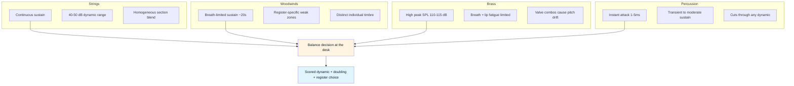

# Lesson 1: Orchestral Scoring — Instrument Families at the Desk

This lesson treats orchestration as a craft practiced at the writing desk and verified at the piano, not a physics subject. The goal: when you write a chord for 2 horns + 2 clarinets, you already know in your ear and in your hand how it will balance, blend, and sit in the hall. Every section below ends in something you do — voice a chord, check a range, mark a dynamic, run a drill with a score excerpt.

## 1. The One-Paragraph Physics You Actually Need

A string's pitch rises when you shorten it, tighten it, or make it lighter — that's why the E string is thin and the G string is thick, and why a cello (longer, heavier strings) sits an octave-plus below a violin for the same tension class. Wind pitch is set by effective tube length: open-open tubes (flute) give the full harmonic series and overblow at the octave; closed-open tubes (clarinet) suppress even harmonics and overblow at the twelfth — this is *why* the clarinet's low (chalumeau) and high (clarion) registers sound like different instruments and why its break near written C4–G4 is notoriously awkward to voice through cleanly. Brass pitch locks to one of the tube's natural resonances via the lips; valves/slides change tube length to fill in the chromatic gaps between those natural partials. That's the entire physics budget for this lesson — everything else below is ear, hand, and score paper.

## 2. String Family: Writing for Bow and Blend

### What strings give you that nothing else does
Indefinite sustain with continuous dynamic control mid-note (impossible on piano, limited on winds/brass by breath). This is why strings are the default harmonic bed under winds and brass in 90% of the repertoire — they can crescendo, diminuendo, swell, and die away on a single held chord for sixteen bars without a breath mark.

### Section balance ratios (orchestral desk reference)
Standard modern section sizes and why they're proportioned this way — lower strings need more bodies per part to balance the natural brightness-forward bias of a full section playing in tune (upper partials reinforce constructively more easily in the violin's register):

| Section | Typical count | Balances |
|---|---|---|
| Violin I | 14–16 | carries melody, needs to sit over everything |
| Violin II | 12–14 | harmony/counter-melody, often doubles Vln I at the octave below in tutti |
| Viola | 10–12 | inner harmony, alto-register melody |
| Cello | 8–10 | bass line or tenor melody |
| Bass | 6–8 | harmonic foundation, doubles cello at the octave |

**Practical rule**: at *forte* tutti, 2 trombones at full voice will sit over the entire string section unless you add winds doubling the string line or drop the trombone dynamic a full marking (write trombones *mf* against strings *f* for a true balance, not *f* against *f*).

### Chord voicing at the string section — spacing by register
This is the single most common string-writing error: voicing a low chord like a keyboard chord (close position) and getting mud.

- **Below cello C3**: space chord tones a 5th or more apart. A bass-and-cello major triad root position voiced as a close triad below C3 will smear into a single buzzing mass — the chord tones fall inside the same critical band and the ear can't resolve them as separate pitches.
- **C3–C5 (viola/cello tenor range)**: 3rds and 4ths read clearly.
- **Above C5 (violin territory)**: close-position triads, even 2nds, read clean and bright.

**Drill**: Take a C major triad (C-E-G). Voice it four ways and play each at the piano, listening for clarity vs. mud:
1. C2-E2-G2 (closed, low) — notice the smear
2. C2-G2-E3 (open 5th + 3rd above) — notice the clarity
3. C4-E4-G4 (closed, middle) — acceptable
4. C5-E5-G5 (closed, high) — bright, clean

Rule of thumb for any orchestral chord below the treble staff: **open it up, 5th on the bottom.**

### Bowing marks you must write into the part
A string part without bowings is an unfinished part. At minimum, mark:
- **Down-bow (⌐) / up-bow (V)** at phrase starts and any spot where the natural alternation would land wrong (e.g., you want a down-bow accent on a strong beat)
- **Slurs** for legato groupings — the bow determines phrasing, not just pitch grouping
- **div.** (divisi) when you split a section into two different pitches, and **unis.** when they rejoin — forgetting the unis. marking is a common score error that causes real rehearsal confusion
- **arco** after any pizzicato passage — players will not know when to put the bow back without it

### Technique vocabulary → what to write → what it sounds like
| You want | Write this | What happens physically | Sound result |
|---|---|---|---|
| Glassy, metallic edge | *sul ponticello* (bow 1–2 cm from bridge) | excites higher string modes | thin, bright, slightly unstable pitch |
| Flutey, veiled | *sul tasto* / *flautando* | suppresses upper harmonics | soft-edged, breathy |
| Dry percussive attack, no pitch focus | *col legno battuto* | wood strikes string, inharmonic | clattering, skeletal |
| Muffled, distant | *con sordino* (mute on) | damps high-frequency radiation 6–10 dB | veiled, indoor quality — always write "senza sordino" when removing |
| Pure flute-like overtone | natural harmonic, diamond notehead at touch point | isolates a nodal mode | pure, ethereal, limited dynamic range |

**Harmonics at the desk**: for a natural harmonic, write a diamond notehead at the touch point and a small circle above the resulting pitch, or just the touch point with "harm." — never ask for a harmonic above the 5th partial in a loud dynamic; above that the tone is too weak to project.

### Right-hand bow hold and left-hand mechanics (what you check if writing for a specific player, or coaching a section)
- Bow hold: thumb curved opposite the middle finger at the frog; wrist flexible, never locked.
- Détaché = full, even strokes, alternating direction, no gap. Martelé = pressure built before the stroke, released explosively — use for sharp accented attacks (`>` marking). Spiccato = bouncing, middle of the bow — use for light, articulated repeated notes under 120 BPM; above that, spiccato becomes uncontrollable and you should write sautillé instead (natural fast bounce, no lift).
- Left hand: Simandl 1-2-4 logic applies on bass in low positions (skip the ring finger — frets are too wide for 4 fingers); violin/viola/cello use all four fingers from first position up.

**Drill for your own ear-training**: sing or play at the piano a string divisi passage at 60 BPM, then write it out voiced correctly by register (open below C3, moderate C3–C5, close above). Check it against a recording of the same passage in the repertoire (e.g., opening of Brahms Symphony No. 1, low string pedal — note the open spacing).

## 3. Woodwind Family: Writing Through the Break and the Register Seams

### The clarinet break — the #1 practical woodwind scoring issue
The clarinet overblows at the twelfth, not the octave, which means the fingering system has an awkward transition zone around written D4–G4 ("the break" / "throat tones"). Notes in this zone are weaker and duller than the chalumeau or clarion registers.

**Practical rule**: avoid sustained solo exposure in the break at *piano* dynamics. If your melody must pass through D4–G4, either thicken the texture (add a second instrument) or accept the tonal dip as a deliberate color — don't be surprised when it sounds muted; it's not a performance error, it's physics.

### Register map (write where the instrument actually speaks best)
| Instrument | Weak/awkward zone | Sweet spot | Avoid sustained *pp* here |
|---|---|---|---|
| Flute | low register (below B3) needs lots of air, little carrying power | C5–C6 | low register at *pp* under any other instrument |
| Oboe | extreme high (above A6) sharp, strained | A4–F5 | nothing — oboe projects everywhere in its core range |
| Clarinet | D4–G4 (the break) | chalumeau (E3–G4... avoid upper edge) and clarion (G4–C6) | throat tones at *pp* solo |
| Bassoon | extreme low (below B♭1) needs huge air | tenor range (F3–F4) for melody | top of bass clef at *ff* — reedy and effortful |

### Embouchure cheat-sheet (what actually changes the sound you're writing for)
- **Flute**: jaw/lip roll controls dark vs. bright. Write "covered tone" direction informally in a note to the player if you need a specifically mellow color in low register — it's within normal technique, not an extended technique.
- **Oboe**: needs the highest air pressure, lowest air volume of any orchestral wind. Don't write long unbroken phrases beyond ~8–10 seconds at moderate tempo without a breath gap; oboists will run out of air pressure control before they run out of air volume.
- **Clarinet**: register key overblows at the 12th. Rapid register-crossing passages (chalumeau to clarion in under a beat) are playable but cost tone evenness — fine for effect, risky for a quiet exposed line.
- **Bassoon**: left thumb alone operates 9+ keys. Extremely fast chromatic passages in the low register are harder than they look on paper because of this thumb workload — when in doubt, check against an existing bassoon part for a similar passage before assuming playability.

### Woodwind doubling and blend combinations (desk-ready pairings)
| Combination | Effect | Use for |
|---|---|---|
| Flute + Violin I (unison or 8ve) | bright, soaring | prominent singing melody over full texture |
| Oboe + Violin I (unison) | penetrating, focused | melody that must cut through moderate dynamics |
| Clarinet + Horn | dark, velvety | warm inner harmony, low-middle register |
| Bassoon + Cello (unison or 8ve) | warm bass-tenor | melodic bass line, not just harmonic foundation |
| 2 Flutes + 2 Clarinets (close chord) | pastel, blended | soft sustained harmonic pad under solo string or brass line |

### Extended technique notation (write these exactly — performers rely on standard markup)
- Flutter-tongue: write "flutter-tongue" or "flatt." above the staff with a tremolo-style slash through the stem.
- Multiphonics: cite a specific fingering chart (e.g., the standard Kientzy or Rehfeldt charts) or notate stacked noteheads with "multiphonic — see fingering chart" — never assume a multiphonic will sound the same across players/instruments without consultation.
- Key clicks: notehead with "x" and the marking "key click, no air."

**Drill**: Take a four-bar melodic phrase. Score it three times — once for flute alone, once doubled with violin at the unison, once doubled with oboe at the unison. Play all three at the piano (or with a sample library) and listen for how the doubling changes projection and color without changing a single pitch.

## 4. Brass Family: Writing for Lips, Valves, and Bells

### What you're actually balancing against
A single trumpet at *ff* can hit 110–115 dB SPL at 1 meter; a full violin section tops out near 90 dB. This is not a minor imbalance — it's a 20+ dB gap, which is perceptually several times louder. **Never write brass and strings at the same dynamic marking expecting equal presence.** If you want strings audible against brass, either mute the brass, drop the brass dynamic 2 full markings below the strings, or thin the brass voicing (fewer notes, higher register where the sound is more focused but not necessarily louder in total energy).

### Natural harmonic series — why certain valve combinations are dangerous for intonation
Valve combinations don't produce mathematically exact tube lengths; the 1-3 and 1-2-3 combinations in particular run sharp relative to the written pitch on most B♭/C trumpets and tenor trombones-with-valves. This is why instruments have trigger slides.

**Practical scoring consequence**: don't assume every chromatic note is equally stable. If you're writing a fast passage that repeatedly lands on notes requiring 1-3 or 1-2-3 fingerings, you're asking the player to lip-correct constantly — fine for a slow lyrical passage, risky for a fast passage where there's no time to adjust.

### Mute chart (desk reference — effect and dynamic cost)
| Mute | Sound | Dynamic effect | Use for |
|---|---|---|---|
| Straight | nasal, focused, slightly sharp (compensate tuning) | reduces volume moderately | bright edge in soft-medium passages |
| Cup | distant, veiled | reduces volume more than straight | background brass under strings |
| Harmon (stem in) | tight, pinched, "wah" when hand covers/uncovers | significant reduction, very different timbre | jazz-inflected color, Miles Davis-style trumpet effects, "distant" fanfare echoes |
| Practice mute | 20–30 dB reduction, poor tone | severe | rehearsal only — never write into a performance score |

Always write "senza sordino" (mute out) clearly at the release point, with enough measures of lead time for the player to physically remove the mute (minimum 1–2 beats rest, more at fast tempo).

### Hand-stopped horn — a real technique, not an extended technique
Horn players routinely play "stopped" (hand fully in the bell), which raises pitch roughly a semitone and gives a nasal, covered color. Mark "+" above notes needing this, "o" to release (open). This is standard practice-period notation, used constantly from Brahms onward for horn color — know it, don't treat it as exotic.

### Brass embouchure quick reference (what to expect when you ask for extremes)
- **Trumpet**: smaller aperture = higher notes, more lip tension. Extended time above written G5 fatigues fast — don't stack a high tessitura passage for more than 15–20 seconds without a rest, even for a strong section.
- **Horn**: highest mouthpiece pressure of the brass family relative to lip area — horn parts traditionally get more rest bars than trumpet in the same symphony for this reason.
- **Trombone/tuba**: larger mouthpiece, more air volume required, less lip tension-dependent. These instruments handle sustained *forte* longer than trumpet/horn but take longer to respond to fast articulation — avoid asking tuba for the same rapid tongued passage you'd give a trumpet.

**Drill**: Score a 4-bar fanfare for 2 trumpets + 2 horns. Write it first with everyone at *ff* in unison rhythm. Then rewrite with horns in a supporting harmonic role at *mf* under the trumpets at *ff*. Compare — the second version will balance correctly in rehearsal; the first will likely bury the horns' harmonic content under trumpet overtones.

## 5. Percussion Family: Writing for Attack and Decay

### Timpani — the pitched anchor of the section
Tuning is set by pedal; players need audible reference time (play the fundamental quietly before an entrance in a new key, or give several bars' rest for silent re-tuning using the gauge). **Always indicate the required pitches at each change** ("Timp: tune to F-C") — don't make the player guess from context.

Striking zone: roughly 1/3 of the radius in from the rim gives the cleanest fundamental. Mallet choice changes attack sharply:
- Soft felt — warm, legato-friendly, blends into sustained string/brass textures
- Hard felt — rhythmic clarity, cuts through tutti
- Wood — sharp percussive accent, rare, reserve for specific effects (e.g., militaristic or stark passages)

### Snare drum — write the stroke type you actually want
A "roll" marking alone is ambiguous in modern practice — for a sustained legato roll (concert/orchestral roll), write "roll" with a slur or tremolo marking over a long note value and trust the convention; for a tighter, buzzier texture write "buzz roll" explicitly. For accented single-stroke figures (flam, drag), use standard rudiment notation (grace notes before the main note) — these are universally read by orchestral percussionists.

### Cymbals — attack style changes the result more than volume marking does
Write "crash" for the standard glancing-angle strike (bright, complex attack); write "choke" or add a staccato dot with "immediately damp" instruction if you need the crash cut short rather than left to ring. For suspended cymbal, specify the striking zone if it matters: "edge" for maximum brightness/sustain, "bow" (main surface) for the balanced default, "bell" for a focused ping — most parts default to "bow" if unspecified, so only mark when you deviate.

### Mallet percussion — resonator tubes and roll speed
Marimba/xylophone bars sit over tuned resonator tubes that reinforce the fundamental — this is why mallet percussion has real sustain despite being struck, not bowed or blown. For a written sustained note on marimba/vibraphone, use a tremolo (roll) marking — single strokes decay audibly within 1–2 seconds depending on register (lower bars ring longer).

**Vibraphone-specific**: the sustain pedal behaves like piano's — write pedal markings explicitly (ped. / release) when you need overlapping harmony rather than dry staccato. The motor (vibrato fans) is usually left to the player's discretion unless you specifically want it off ("no vibrato" / motor off) for a cold, static bell-like tone.

### Density rule for percussion in a score
Percussion attacks always cut through a texture regardless of dynamic marking because the attack transient (1–5 ms) is much faster than any sustained instrument's attack. **Score percussion sparingly in sustained textures** — one well-placed triangle hit at *pp* will be heard over a full string section at *mf*; this is not a balance error to fix, it's a tool to use deliberately for punctuation.

**Drill**: Take a 4-bar sustained string chord (strings only, *mf*, half notes). Add a single triangle note on the last beat of bar 2 at *pp*. Play it back or imagine the rehearsal — the triangle will be clearly audible despite the dynamic gap. Now try adding a full crash cymbal at *pp* in the same spot: it still cuts through, but the longer decay (10–20 seconds for large cymbals) will bleed into the next two bars unless you follow with a choke marking.

## 6. Comparative Quick-Reference (desk card)

| Family | Dynamic range | Peak SPL @1m | Sustain | Primary scoring role |
|---|---|---|---|---|
| Strings | 40–50 dB | 85–90 dB | indefinite | harmonic bed, melody, continuous texture |
| Woodwinds | 30–40 dB | 75–85 dB | ~20s (breath) | color, melody, agile articulation |
| Brass | 45–55 dB | 110–115 dB | ~30s (breath) | power, fanfare, punctuation |
| Percussion | 50–60 dB (peak) | 100–120 dB | transient–moderate | rhythmic drive, accent, texture |

**Balance rule derived from this table**: to balance 1 trumpet at *f* against strings, you need roughly 6–8 violins at the same marking, or drop the trumpet to *mp*, or both. Never balance purely by adjusting the dynamic text — adjust instrument count and register too.

## 7. Transposition — The Desk Procedure That Prevents Wrong Notes

Work out your harmony in concert pitch first. Transposing in your head while composing invites errors. The transposition only happens when you extract parts (or let your notation software do it — but always proofread the transposed part against the concert score, software transposition errors in cross-staff passages do happen).

**Transposition table (written pitch sounds this interval away from written)**:
| Instrument | Sounds | Interval |
|---|---|---|
| Clarinet in B♭ | major 2nd lower | down a whole step |
| Clarinet in A | minor 3rd lower | down a step and a half |
| Horn in F | perfect 5th lower | down a 5th |
| Trumpet in B♭ | major 2nd lower | down a whole step |
| English Horn | perfect 5th lower | down a 5th |
| Alto Sax | major 6th lower | down a 6th |
| Piccolo | octave higher | up an 8ve |
| Contrabassoon | octave lower | down an 8ve |

**Proofreading drill**: write a four-note concert-pitch motif (say, C4-E4-G4-C5). Transpose it by hand for B♭ clarinet (should read D5-F#5-A5-D6), horn in F (should read G4-B4-D5-G5), and B♭ trumpet (D5-F#5-A5-D6). Check your written transpositions against a piano playback set to "concert pitch" — any mismatch means you made an error, catch it before it reaches a player's stand.

## 8. Textural Hierarchy — The Four-Layer Scoring Checklist

Before adding a single note, decide what each instrument group is doing:

1. **Melodic foreground** — who has the tune, and is it in their best projecting register? (violins upper register, oboe/flute/clarinet above the staff, solo horn/trumpet at moderate dynamic)
2. **Harmonic support** — who sustains the chord underneath, one dynamic step quieter than the melody? (horns, inner strings, clarinets/bassoons)
3. **Bass foundation** — who anchors the root, usually louder than you'd expect because low frequencies need more energy to register as equally loud (cellos+basses, bassoon, tuba, timpani on tonic/dominant)
4. **Rhythmic/textural embellishment** — countermelody, pizzicato, percussion color — quietest layer, added last

**Desk checklist before moving to the next phrase**:
- [ ] Does the melody sit in the instrument's strongest register?
- [ ] Is the harmonic support marked at least one dynamic level below the melody?
- [ ] Is the bass line scored with enough weight (more players, or lower-register doubling) to be felt, not just seen on paper?
- [ ] Have I avoided stacking two foreground-weight lines in overlapping registers?
- [ ] Is percussion reserved for accents rather than continuous texture?

## 9. Practical Workflow: Short Score to Full Score

1. **Sketch** in 2–4 staves: melody, harmony, bass. Get the music right before orchestrating it.
2. **Assign layers**: melody → instrument + register; harmony → sustaining instruments one dynamic down; bass → low strings + bassoon/tuba; embellishment → percussion/pizzicato last.
3. **Check every range** against the sweet-spot table (Section 3) and string sweet spots (Vln A4-E6, Vla C4-A5, Vc C3-G5).
4. **Write bowings, articulations, breath marks** — an orchestration isn't finished until the performance markings are in.
5. **Balance pass**: read through dynamics with the loudness table in mind (Section 6) — adjust doublings and register, not just dynamic text.
6. **Proofread transpositions** against the concert score.

## 10. Summary — What to Actually Remember at the Desk

- Strings sustain indefinitely and blend as a section — your default harmonic bed.
- Woodwinds have specific weak registers (clarinet break, flute low register, oboe extreme high) — don't expose them there at soft dynamics.
- Brass is loud in short bursts — balance by dynamic marking gap and doubling count, never by assuming equal markings mean equal volume.
- Percussion cuts through regardless of dynamic — use sparingly and deliberately for accent, not as continuous texture.
- Space chords wide below the staff, moderate in the middle, close above — critical bandwidth physics, applied by ear.
- Work in concert pitch, transpose at the end, proofread the transposition.
- Decide the four textural layers (melody, harmony, bass, embellishment) before writing a single doubling.

Next lesson builds directly on this: detailed string writing (double stops, divisi strategies, con sordino ensemble voicing) and woodwind chord-pad construction for sustained harmonic backgrounds.
