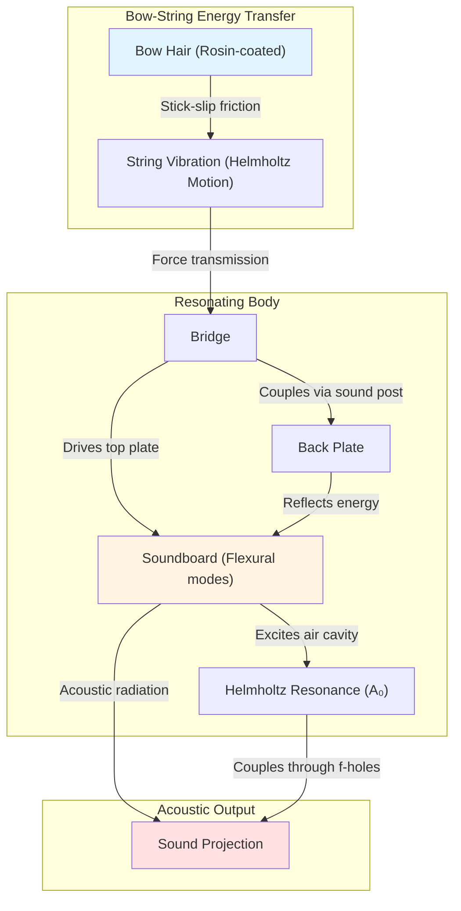
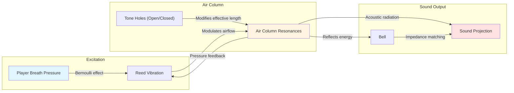
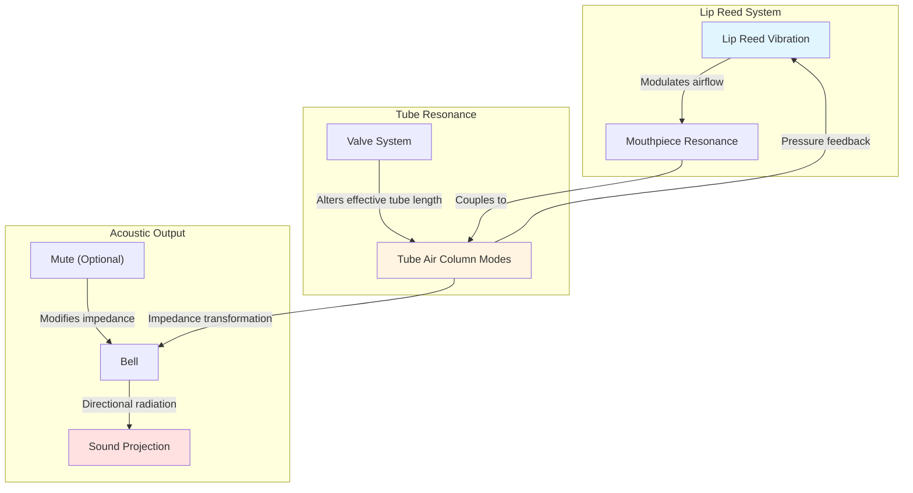
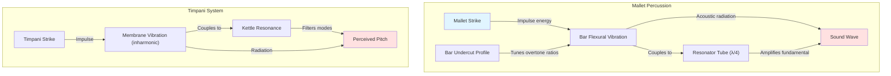

# Lesson 1: Overview of Instrument Families

## 1. First-Principles Intuition & Invariants

The modern symphony orchestra represents four centuries of acoustic engineering, instrument design evolution, and compositional practice. Understanding orchestral instrument families requires grounding in the physics of sound production, the biomechanics of performance, and the psychoacoustic principles that govern human perception of timbre, pitch, and dynamics.

### The Physics of Sound Production

Sound propagates as a longitudinal pressure wave through air. The fundamental frequency *f₀* of a vibrating system is determined by its physical constraints. For a taut string fixed at both ends:

**f₀ = (1/2L) × √(T/μ)**

where *L* is vibrating length, *T* is tension, and *μ* is linear mass density (kg/m). This explains why shorter, lighter, tighter strings produce higher pitches—a principle exploited across all string instruments.

For air columns in tubes (woodwinds and brass), a closed-open tube produces **f₀ = v/4L**, while open-open tubes produce **f₀ = v/2L** (where *v* ≈ 343 m/s at 20°C). These acoustic principles constrain instrument design and explain why longer tubes produce lower pitches.

### The Overtone Series and Timbre

No musical instrument produces a pure sinusoid. Real-world vibrating systems generate complex waveforms comprising the fundamental frequency plus integer multiples (harmonics). The **overtone series** defines the spectral content that distinguishes a violin from a clarinet playing the same pitch:

**f_n = n × f₀, where n = 1, 2, 3, 4...**

The relative amplitudes of these harmonics define **timbre**. A clarinet's cylindrical bore and closed-end reed cavity strongly emphasize odd-numbered harmonics (n = 1, 3, 5, 7...), producing its characteristic hollow, reedy quality. A violin's bowed excitation generates a rich harmonic spectrum with strong even and odd harmonics, creating a brilliant, penetrating sound.

The **formant frequencies**—resonant peaks determined by the geometry of the resonating body—further shape timbre. The violin's body formants near 500 Hz and 2 kHz amplify harmonics in these regions, contributing to its characteristic "vocal" quality.

### Psychoacoustic Foundations

Human auditory perception is nonlinear and frequency-dependent. The **Fletcher-Munson equal-loudness contours** demonstrate that sensitivity peaks around 2-4 kHz—the frequency range of human speech—and drops off at low and high extremes. At 50 Hz, a sound requires approximately 70 dB SPL to match the perceived loudness of a 1 kHz tone at 40 dB SPL.

This nonlinearity explains orchestration practices: low brass and contrabass instruments require greater physical energy to achieve perceived balance with mid-range instruments. Composers exploit this by scoring more instruments in the bass to achieve timbral equilibrium.

**Critical bandwidth** and **masking effects** govern how orchestral voices blend or separate. Instruments playing within the same critical band (roughly 100 Hz bandwidth below 500 Hz, widening to ~15% of center frequency above) merge perceptually. Orchestrators leverage this by spacing chord tones wider in low registers than in higher registers.

### Fundamental Invariants Across Instrument Families

Three invariant principles govern all orchestral instruments:

1. **Energy transduction coupling**: All instruments convert mechanical energy (bowing, blowing, striking) into acoustic radiation. Efficiency depends on impedance matching between the excitation mechanism and the resonating body. String instruments achieve ~5% efficiency; brass instruments reach 15-30% due to better impedance matching between the lip reed and bell.

2. **Resonance and mode excitation**: Sustained-tone instruments (strings, winds, brass) require positive feedback between the excitation mechanism and acoustic resonances. Bowed strings exhibit stick-slip friction that phase-locks to string resonance. Reed and lip reed oscillations couple to air column modes. This self-sustaining oscillation distinguishes pitched instruments from percussive ones.

3. **Radiation pattern directivity**: All instruments exhibit frequency-dependent radiation patterns. High-frequency content radiates directionally, while low frequencies radiate omnidirectionally. This explains why string sections project forward (high-frequency bow noise and harmonics beam toward the audience) while tuba sound wraps around (low fundamentals radiate spherically).

## 2. Core Architecture & Mechanics

### The String Family: Bowed Resonators

The string family—violin, viola, cello, double bass—represents a sophisticated coupled oscillator system. The vibrating string transfers energy to the bridge, which drives the soundboard (top plate) into flexural vibration. The soundboard's radiation efficiency determines the instrument's volume and tonal character.

#### Acoustic Architecture

The violin body functions as a Helmholtz resonator with additional flexural modes. The f-holes act as acoustic ports, coupling the enclosed air cavity to external space. The primary acoustic modes include:

- **A₀ mode** (~270 Hz for violin): The enclosed air mass resonates as a Helmholtz oscillator, pumping in and out through the f-holes.
- **C₃ mode** (~400-500 Hz): First major body mode where the top plate moves as a hinged system around the longitudinal axis.
- **Multiple higher modes**: Complex flexural patterns in the 1-4 kHz range create the instrument's formant structure.

The sound post—a cylindrical spruce dowel wedged between top and back plates beneath the treble foot of the bridge—critically couples plate vibrations and tunes these modes. Moving the sound post by 1-2 mm dramatically alters tonal balance.

#### String Mechanics and Bow-String Interaction

Bowed strings exhibit **Helmholtz motion**: a sharp corner propagates along the string, alternating direction at the endpoints. This sawtooth waveform generates a harmonic spectrum rich in upper partials. The friction force between bow hair and string follows a velocity-dependent friction curve. The coefficient of friction decreases with increasing relative velocity (Stribeck effect). Rosin applied to bow hair increases friction and sharpens the velocity dependence, enabling reliable stick-slip oscillation.

The player controls three primary parameters:
- **Bow force** (*F_b*): Normal force applied perpendicular to the string
- **Bow velocity** (*v_b*): Speed of bow travel
- **Bow-bridge distance** (*β*): Position along the string length

The **Schelleng diagram** maps playable regions in bow force and position space. Insufficient bow force causes the string to slip continuously (whistling). Excessive force crushes the string against the fingerboard (scratching). Skilled players navigate this region with precision, achieving dynamic ranges from 40 dB (pianissimo) to 85 dB (fortissimo) at the player's ear.

#### Physical Playing Technique: Bow Hold and Arm Weight

**Right hand bow hold (violin/viola)**:
- Thumb placement: Curved, resting on the stick opposite the middle finger, approximately at the frog's leather thumb grip
- Index finger: Rests on top of the stick, providing downward pressure control
- Middle and ring fingers: Wrap around the stick, providing lift and rotational control
- Pinky: Curved, resting on top of the stick near the screw, acts as a counterbalance
- Wrist remains flexible and aligned with the forearm, never locked or bent sharply

**Bow stroke mechanics**:
- **Détaché**: Full bow strokes with continuous sound, alternating down-bow and up-bow with smooth bow changes at the frog and tip
- **Martelé**: Hammered strokes with bow pressure applied before the stroke begins, released explosively for a sharp attack
- **Spiccato**: Off-the-string bouncing strokes using the bow's natural spring, typically in the middle third of the bow
- **Staccato**: On-the-string short strokes with stopped motion between each note, controlled by stopping bow motion rather than lifting

**Left hand position and shifting**:
- Thumb position: Opposite first or second finger on the neck's back, never gripping tightly
- Fingers curved, striking the string with the fleshy pad just before the fingertip
- Shifts executed by sliding the entire hand along the neck, maintaining finger shape
- Vibrato produced by rocking motion from the forearm (arm vibrato) or wrist (wrist vibrato), not from finger joints alone

**String crossing efficiency**:
- Upper arm controls string level (E, A, D, G strings)
- Elbow leads the bow to new string levels
- Minimal wrist rotation—arm elevation does the primary work
- For rapid string crossings, reduce bow length and use middle portion of bow where balance point facilitates quick changes

#### Extended Techniques and Timbral Variation

- **Sul ponticello**: Bowing near the bridge emphasizes high-frequency harmonics, creating a glassy, metallic timbre. Position the bow within 1-2 cm of the bridge. The reduced β value excites higher-order string modes.
- **Sul tasto**: Bowing over the fingerboard (typically above the end of the fingerboard or over it) produces a flute-like tone by suppressing high harmonics. Requires lighter bow pressure to avoid scratching.
- **Col legno battuto**: Striking strings with the wood of the bow generates percussive, inharmonic attacks. Turn the bow stick over so wood contacts the string. Risk of bow damage limits use.
- **Col legno tratto**: Bowing with the wood side, producing a fragile, scratchy whisper.
- **Mute (con sordino)**: A rubber, wooden, or metal device clamped to the bridge damps high-frequency resonances, reducing radiation efficiency by 6-10 dB and producing a veiled sound. Three-pronged rubber mutes are most common; heavy practice mutes reduce volume by 20+ dB.
- **Harmonics**: Lightly touching the string at nodal points (1/2, 1/3, 1/4, 1/5 of string length) while bowing produces pure sine-like tones at integer multiples of the open string frequency. Natural harmonics use open strings; artificial harmonics use stopped notes as fundamentals.

**Cello-specific techniques**:
- Thumb position (above C4 on A string): Thumb acts as a movable "nut," pressing the string from the side while fingers play above
- Endpin height adjustment: Taller players use longer endpins; the instrument's C-bout should rest against the sternum with a slight forward tilt
- Bow hold differs: French bow hold (similar to violin/viola) vs. German bow hold (underhand grip with palm facing up)

**Double bass-specific considerations**:
- Franz Simandl 1-2-4 fingering system in low positions (below thumb position): Uses index, middle, and pinky fingers, skipping the ring finger due to wide fret spacing
- German bow vs. French bow: German uses underhand grip optimized for the instrument's weight and string tension; French uses overhand grip similar to cello
- Solo tuning vs. orchestral tuning: Orchestral tuning (E₁-A₁-D₂-G₂) vs. solo tuning (F#₁-B₁-E₂-A₂, whole step higher for increased projection)

### The Woodwind Family: Reed-Excited Air Columns

Woodwinds produce sound through self-sustained oscillation of a reed coupled to an air column resonator. Unlike strings, where the excitation mechanism (bow) is external, the reed forms an integral part of the acoustic system.

#### Single-Reed Instruments (Clarinet, Saxophone)

The clarinet uses a single cane reed clamped to a mouthpiece. The player's embouchure controls the reed's natural frequency and damping. When the player blows, the Bernoulli effect creates a pressure drop in the constricted flow between reed and mouthpiece, pulling the reed closed. This interrupts airflow, pressure recovers, and the reed opens. The cycle repeats at a frequency determined by the air column resonances.

**Clarinet embouchure mechanics**:
- Lower lip rolls over bottom teeth, cushioning them
- Upper teeth rest directly on top of the mouthpiece (typically 8-12 mm from the tip)
- Corners of mouth firm inward (smile muscles engaged), preventing air leaks
- Jaw position determines effective reed opening: dropped jaw = more reed vibration (louder, brighter); raised jaw = less vibration (softer, darker)
- Tongue position for articulation: tip touches reed's underside near the tip, releasing cleanly for note attacks

**Voicing and pitch adjustment**:
- Vowel shapes (ee, eh, ah, oh, oo) inside the oral cavity adjust resonance and pitch
- "Ee" vowel (tongue high and forward): brightens tone, raises pitch slightly
- "Oh" vowel (tongue low and back): darkens tone, lowers pitch slightly
- Throat must remain open—avoid constriction that chokes airflow

The clarinet acts as a **stopped cylindrical pipe** (effectively closed at the reed end, open at the bell), supporting only odd harmonics of the fundamental. The lowest note (written E₃, sounding D₃ for B♭ clarinet) has a fundamental near 147 Hz with a tube length of ~585 mm.

**Register mechanism**: By opening a register key (speaker key) that vents a node of the fundamental while preserving the third harmonic's node structure, the clarinet overblows at the **twelfth** (3:1 frequency ratio) rather than the octave. This acoustic property necessitates the Boehm key system's complexity.

**Saxophone embouchure differences**:
- Wider mouthpiece opening requires more bottom lip cushion
- Mouthpiece angle typically 45° downward vs. clarinet's more horizontal orientation
- Subtone technique: extremely loose embouchure with breathy airflow, producing a quiet, airy tone with significant noise content (popularized in jazz)

#### Double-Reed Instruments (Oboe, Bassoon)

Double-reed instruments use two cane blades bound together, forming a narrow slit. The reeds vibrate against each other with greater independence from the air column than single reeds, producing more complex, inharmonic partials during attack transients.

**Oboe embouchure mechanics**:
- Lips roll inward over teeth completely—no teeth contact with reed
- Embouchure forms a small, focused aperture around the reed
- Reed insertion depth: typically 3-5 mm into the mouth
- Pressure applied with lips, not teeth or jaw—jaw remains relaxed
- Crow (the sound produced by blowing the reed alone) should produce a stable C5 or C6 pitch

**Breath support and air pressure**:
- Oboe requires extremely high air pressure (one of the highest in the orchestra) but low air volume
- Common problem: insufficient air expulsion leads to CO₂ buildup and dizziness
- Practice technique: exhale remaining air before each breath to prevent hyperventilation

The oboe functions as an **open cylindrical pipe**, supporting both even and odd harmonics and overblowing at the octave. The conical bore (expanding diameter) shifts the effective acoustic length, raising the impedance at the bell and strengthening high-frequency radiation.

**Bassoon-specific considerations**:
- Reed held between lips with less inward roll than oboe—more of the reed is exposed
- Bocal (the metal tube connecting reed to instrument body) choice significantly affects intonation and response
- Hand position: Left thumb operates 9+ keys; right thumb supports the instrument's weight with a seat strap or neck strap
- Whisper key (Venting key): Opened for lowest notes to stabilize pitch and response

#### Flute: Edge-Tone Mechanism

The flute operates on a fundamentally different principle: an **edge-tone** or jet oscillation. The player directs a jet of air across the embouchure hole edge. The jet alternately deflects inside and outside the tube due to feedback from acoustic pressure waves. The air column resonances stabilize this oscillation.

**Flute embouchure mechanics**:
- Lips form a small aperture (approximately 8-10 mm wide for adults)
- Lower lip positioned at the front edge of the embouchure plate, not centered on the hole
- Air stream directed across the hole at a slight downward angle (approximately 30-45°)
- Embouchure hole covers approximately 1/4 to 1/3 of the lower lip
- "Smile" vs. "pucker" controversy: slight outward corners (smile) brighten tone; rounded corners (pucker) darken tone

**Voicing and register changes**:
- Low register: Relaxed embouchure, wider aperture, slower air speed, air directed more into the flute
- Middle register: Moderate embouchure tension, medium aperture
- High register: Firm embouchure, smaller aperture, faster air speed, air directed more across the embouchure hole (not into it)
- Harmonics above C7: Require extremely fast, focused air and precise embouchure angle adjustments

**Tone color control**:
- **Covered sound**: Roll the flute inward slightly, directing more air into the tube—produces a darker, rounder tone
- **Open sound**: Roll the flute outward slightly, directing more air across the embouchure hole—produces a brighter, more projecting tone
- Vibrato: Produced by oscillating air pressure from the diaphragm (not throat or jaw), typically 5-6 oscillations per second

The flute's cylindrical bore and open-open configuration support a complete harmonic series with strong high-frequency content, producing a bright, projecting tone. The headjoint cork position (typically 17-17.5 mm from the center of the embouchure hole to the cork face) tunes the octave relationship between registers.

#### Tone Hole Lattice and Effective Length

Modern woodwinds use a lattice of tone holes to alter the effective acoustic length. Opening a tone hole creates a low-impedance shunt, causing the air column to terminate acoustically at that point rather than at the physical end. Low harmonics see the tube as effectively shortened; high harmonics sense the full tube length. This frequency-dependent behavior complicates intonation across the instrument's range.

**Practical fingering considerations**:
- **Fork fingerings**: Closing a tone hole below an open hole (e.g., clarinet E♭, B♮) creates acoustic complexity but enables chromatic playing without excessive mechanical key systems
- **Half-holing**: Partially covering a tone hole for microtonal adjustments or alternate fingerings (common on baroque-style instruments, less on modern Boehm-system instruments)
- **Trill fingerings**: Alternate fingerings that minimize finger motion for rapid trills, sometimes sacrificing tone quality or intonation for speed
- **Vent keys**: Small keys that open auxiliary holes to stabilize high register response (flute C# key, clarinet register key)

### The Brass Family: Lip-Reed Resonance

Brass instruments form a unique class where the player's lips function as the vibrating reed. The lips are pressed against a cup-shaped mouthpiece, and breath pressure causes them to vibrate in a complex nonlinear manner. The air column resonances of the instrument couple to the lip vibration, locking the oscillation frequency to one of the tube's natural modes.

#### Mouthpiece and Bore Profile

The mouthpiece geometry profoundly affects playability and timbre. Key parameters include:
- **Cup depth**: Shallow cups favor high-frequency response and facilitate high register (trumpet, commercial lead trumpet); deep cups favor low-frequency response and produce darker tone (French horn, tuba)
- **Throat diameter**: The constriction linking cup to backbore controls impedance matching; smaller throats increase resistance and darken tone
- **Backbore taper**: Gradual expansion shapes the frequency response and affects intonation
- **Rim width and contour**: Wider, flatter rims provide comfort for extended playing; narrower, sharper rims provide more precise articulation

The instrument tube expands from the mouthpiece to the bell in either cylindrical (trumpet, trombone) or conical (French horn, euphonium) profiles. **Cylindrical bores** produce a bright, edgy tone with strong high harmonics. **Conical bores** produce a darker, mellower tone with subdued high frequencies.

#### Physical Embouchure Mechanics

**Trumpet/cornet embouchure**:
- Mouthpiece placement: Centered horizontally, typically 50/50 or 60/40 upper/lower lip distribution (slight variations based on facial structure)
- Lip tension: Firm corners pulled slightly back and down, creating a taut aperture
- "Buzzing": Lips vibrate together in the center, producing a buzz even without the instrument
- Aperture size: Smaller for high notes (increased lip tension), larger for low notes (relaxed lip tension)
- Jaw position: Slightly forward, not retracted—retracted jaw pinches the embouchure and restricts airflow
- Tongue position: Arched high for high register (faster air), low and relaxed for low register (slower air)

**Horn embouchure differences**:
- Significantly more mouthpiece pressure than trumpet (due to smaller mouthpiece and higher resistance)
- Mouthpiece placement often favors upper lip (2/3 upper, 1/3 lower) though varies by player
- Hand-in-bell technique: Right hand inserted into bell to approximately second knuckle, cupped slightly, palm facing left; hand position adjusts intonation and tone color

**Trombone/euphonium/tuba embouchure**:
- Larger mouthpiece requires more relaxed embouchure with less tension
- Greater air volume required—focus on steady, supported air column rather than lip tension
- Jaw drops slightly lower than trumpet to accommodate larger mouthpiece
- Tuba: Mouthpiece often placed more centered or slightly favoring lower lip due to larger rim diameter

**Breath support mechanics**:
- Diaphragmatic breathing: Inhalation expands lower ribcage and abdomen, shoulders remain still
- Support: Maintaining expansion while exhaling, preventing ribcage collapse
- Abdominal engagement: Subtle inward compression from abdominal muscles sustains air pressure
- Steady, warm air: Focus on continuous, consistent air stream—brass tone quality depends primarily on air consistency, not lip tension

#### The Natural Harmonic Series and Valve Systems

An ideal cylindrical tube supports a harmonic series based on its fundamental (pedal tone):

**f_n = n × f₁, where n = 2, 3, 4, 5, 6, 7, 8...**

The fundamental is often weak or unplayable on brass instruments due to lip-reed coupling constraints. Practical playing begins at the second harmonic (first playable note).

Historical natural brass instruments could play only notes in this harmonic series. The **valve system** (patented 1818) solved this limitation. Each valve routes air through an additional length of tubing, lowering the fundamental:
- **First valve**: Lowers pitch by 2 semitones (tube length × 1.122)
- **Second valve**: Lowers pitch by 1 semitone (tube length × 1.059)
- **Third valve**: Lowers pitch by 3 semitones (tube length × 1.189)

Combinations access the chromatic scale. However, valve combinations introduce **intonation errors**: the combined lengths don't precisely match the required ratios. Players compensate by:
- **Third valve slide trigger/ring**: Extends third valve slide while playing to correct flat tendencies on 1-3 and 1-2-3 combinations
- **First valve slide trigger**: Extends first valve slide for flat tendencies on 1-2 combination
- **Alternate fingerings**: Using different valve combinations for the same pitch (e.g., 1-2 vs. 3) to adjust intonation
- **Lip adjustments**: Slight embouchure adjustments bend pitch up or down

**Trombone slide positions**:
- First position: Slide fully retracted (shortest tube length)
- Seventh position: Slide fully extended (longest tube length)
- Each position lowers pitch by one semitone
- Partial series available in each position (2nd partial through 8th partial in practical range)
- Intonation adjustments: Fine-tuning slide position within each nominal position

#### Brass Acoustics and Radiation

The bell acts as an **acoustic transformer**, matching the impedance of the tube's internal acoustic waves to the external air. This dramatically increases radiation efficiency above the **cutoff frequency**. Below cutoff, radiation efficiency drops rapidly, explaining why low brass instruments require large bells to project low frequencies effectively.

Brass instruments exhibit **strong directivity** at high frequencies. A trumpet radiates frequencies above 2 kHz in a narrow cone (±15°) along the bell axis, while low frequencies radiate omnidirectionally. Orchestral seating exploits this: brass sections sit elevated and aim over the orchestra toward the audience.

**Practical projection techniques**:
- Bell angle: Raising the bell aims high-frequency content toward the audience; lowering aims at nearby players (useful for blend in ensemble playing)
- Dynamic control: Not just air volume—increasing air speed (faster air) brightens tone and projects more; slower air produces darker, less projecting tone
- Vibrato: Less common in orchestral brass than in strings; when used, produced by jaw oscillation or hand vibrato (horn only)

#### Mute Technology

Mutes inserted into the bell modify the impedance spectrum and radiation pattern:
- **Straight mute**: Conical metal (aluminum or fiber) mute that blocks the bell partially, leaving gaps around the perimeter. Creates a nasal, focused sound. Raises pitch slightly—players compensate by pulling tuning slide.
- **Cup mute**: Adds a cup at the mute's end, producing a distant, veiled quality. Darker than straight mute.
- **Harmon mute** (wah-wah): Aluminum mute with adjustable stem that extends into the bell throat. With stem fully in: tight, pinched sound. With stem partially out: vowel-like "wah" effects (by covering the stem opening with the hand). With stem removed: brilliant, edgy sound.
- **Practice mute**: Heavy rubber or dense foam mute that reduces volume by 20-30 dB for practice. Severely compromises tone quality and intonation—for volume reduction only, not performance.
- **Plunger**: Rubber sink plunger or specialized plunger mute held in front of the bell, moved in and out for "wah-wah" effects (jazz and contemporary orchestral music).

### The Percussion Family: Impact Excitation and Vibrating Bodies

Percussion instruments encompass the greatest diversity of sound production mechanisms. They share the common feature of **transient excitation**—energy delivered in a short impact—followed by free vibration of the resonating body.

#### Timpani: Tunable Membrane Resonator

The timpani (kettledrum) consists of a stretched membrane (typically calfskin or Mylar) tensioned over a hemispherical copper or fiberglass kettle. The fundamental frequency is controlled by membrane tension, adjustable via a pedal mechanism.

**Timpani tuning mechanics**:
- Pedal mechanism: Foot pedal connects to a spider (crown) via cable or linkage; depressing pedal increases tension, raising pitch
- Tuning gauge: Mechanical or electronic indicator showing approximate pitch; always verify by ear
- Clear note vs. thud: Optimal tension produces a clear, singing pitch; insufficient tension produces a dull thud; excessive tension produces a pinched, choked sound
- Tuning sequence: Tap the drum head lightly near each tension rod, listening for pitch uniformity around the drum; adjust individual rods to even the pitch before setting final pitch with pedal

**Striking technique**:
- Strike zone: Optimal striking point is approximately 4-6 inches from the rim (roughly 1/3 of the radius from rim to center)
- Stroke motion: Primarily wrist rotation with forearm support, not arm or finger-driven
- Mallet grip: Traditional German grip (matched grip) with thumbs on top of sticks, or French grip with thumbs to the side
- Rebound: Allow mallet to bounce naturally off head—burying the mallet chokes the sound
- Dead stroke: For short, muted attacks, keep mallet on head after striking to damp vibration

**Mallet selection**:
- **Soft felt mallets**: Large, soft felt cores produce warm, round tone with slow attack; ideal for legato passages and soft dynamics
- **Medium felt mallets**: General-purpose mallets for most orchestral writing
- **Hard felt mallets**: Smaller, denser felt produces bright, articulate attack; ideal for rhythmic clarity and louder dynamics
- **Wood mallets**: Produce sharp, extremely defined attack with strong high-frequency content; used for special effects and some contemporary works

Unlike strings, membrane modes are **inharmonic**—the overtones don't form integer ratios. For a circular membrane, the frequency ratios are approximately 1 : 1.59 : 2.14 : 2.30 : 2.65 : 2.92... This inharmonicity would produce an indefinite pitch, but the kettle cavity acts as a Helmholtz resonator, reinforcing partials near its resonance frequency and imposing a clearer pitch.

**Muting and dampening**:
- Finger damping: Lightly touching the drum head near the rim with fingertips damps vibration for staccato articulation
- Cloth damping: Placing a cloth or felt strip on the head near the rim reduces sustain and lowers pitch slightly—used for extreme staccato or to control excessive ringing

#### Snare Drum: Dual-Membrane System with Snares

The snare drum uses two membranes (batter head and resonant head) with a set of metal or gut snares stretched across the resonant head. When the batter head is struck, the vibration couples through the air cavity to the resonant head, causing the snares to buzz against it.

**Snare drum technique (orchestral)**:
- Stick grip: Matched grip (both hands hold sticks identically, thumbs on top) or traditional grip (left hand underhand, developed from military marching technique with tilted drum)
- Fulcrum: Thumb and index finger form the pivot point; remaining fingers provide control and support
- Stroke types:
  - **Full stroke**: Begin with stick raised, strike, allow full rebound
  - **Down stroke**: Begin with stick raised, strike, stop stick near head (no rebound)—used before soft notes
  - **Tap stroke**: Begin with stick near head, strike with minimal motion, minimal rebound—for soft dynamics
  - **Up stroke**: Begin with stick near head, strike, allow full rebound—used before loud notes

**Rudiments and orchestral applications**:
- **Roll** (orchestral roll, concert roll): Rapid alternating strokes producing smooth, sustained sound; minimum of 5-6 strokes per second for smooth perception
- **Flam**: Grace note stroke (tap) immediately before main stroke (full), creating a slightly thickened attack
- **Drag**: Two grace notes (double-stroke) before main note
- **Buzz roll** (press roll, multiple bounce roll): Allow stick to bounce multiple times per hand motion, creating denser, smoother texture than open roll

**Snare tension adjustment**:
- Snare throw-off: Lever that releases snares completely, converting to a tom-tom sound when disengaged
- Snare tension: Adjustable with knob or lever; tight snares produce crisp, bright response; loose snares produce rattling, sizzling response
- Batter head tension: Higher tension produces higher pitch and brighter tone; lower tension produces darker, fatter tone

The snares add **broadband noise** to the drum's tone, extending frequency content from ~200 Hz to beyond 10 kHz. This noise component provides the characteristic "crack" and enables the snare drum to cut through orchestral textures.

#### Cymbals: Chaotic Mode Coupling

Cymbals are thin, curved disks of brass alloy (typically 80% copper, 20% tin, B20 bronze for professional orchestral cymbals) that vibrate in extraordinarily complex patterns. Cymbal modes are highly inharmonic and **couple nonlinearly**—striking a cymbal excites not just linear vibrational modes but also sum-and-difference frequencies generated by nonlinear interaction.

**Crash cymbal technique (pair)**:
- Grip: Hold cymbal straps with thumb and fingers, maintaining flexibility
- Basic crash: Bring cymbals together at a slight angle (approximately 30-45°), sliding slightly past each other on contact; this glancing blow produces a more complex, musical sound than a direct perpendicular crash
- Cymbal angle: Vertical orientation (edges touching first) produces sharp, bright attack; horizontal orientation (faces touching first) produces broader, more diffuse attack
- After striking: Lift cymbals upward and outward in a smooth motion to allow full sustain; avoid damping against body
- Dampening: Press cymbals against torso to stop vibration for choked, stopped sounds

**Suspended cymbal technique**:
- Mounting: Suspend from strap or mount on stand; mounting method affects sustain and tone (felt washers damp; allow free vibration for maximum ring)
- Striking zones:
  - **Bell/cup** (center dome): Produces clear, defined ping with focused pitch
  - **Bow** (main surface between edge and bell): General playing area; sweet spot for balanced tone
  - **Edge**: Produces maximum volume and brightest tone, longest sustain
- Stick/mallet selection:
  - **Hard sticks** (wood, plastic): Sharp, defined attack with strong high frequencies
  - **Medium mallets** (felt, yarn): Balanced attack with moderate high-frequency content
  - **Soft mallets** (large yarn, tam-tam mallets): Slow attack, emphasizes low-frequency wash
- Roll technique: Rapid alternating strikes on the bow area using medium mallets, building gradually from silence to create cymbal crescendo

The frequency spectrum is **continuous** rather than discrete, resembling filtered noise. This broadband character allows cymbals to blend with or punctuate any harmonic context. Cymbal decay times extend to 10-20 seconds for large crash cymbals (18-20 inch orchestral crash cymbals).

**Tam-tam (gong) technique**:
- Large tam-tam mallets: Soft, heavy felt mallets specifically designed for tam-tam
- Striking zone: Center for focused attack; off-center for more complex, shimmering tone
- Scraping: Drawing a coin, triangle beater, or metal implement across the surface creates eerie, rising/falling glissandi

#### Xylophone and Marimba: Bar Resonators with Tuned Tubes

Keyboard percussion instruments use wooden (marimba, xylophone) or metal (glockenspiel, vibraphone) bars suspended at **nodal points** (approximately 22% from each end for fundamental mode) to allow free vibration. The bars vibrate in flexural modes.

**Mallet selection and technique**:
- **Xylophone mallets**: Hard plastic, rubber, or phenolic cores with little yarn wrapping; produce bright, articulate, percussive tone; essential for clarity in fast passages
- **Marimba mallets**: Soft to medium yarn-wrapped mallets; softer mallets emphasize fundamental and produce warm, singing tone; harder mallets increase articulation and high-frequency content
- **Grip**: Traditional (matched) grip: thumbs point up, middle and ring fingers control handle; use wrist rotation, not finger motion
- **Stevens grip** (four-mallet technique): Two mallets per hand held between fingers; allows independent mallet control for chords and intervals
- **Burton grip** (four-mallet technique): Alternative four-mallet grip with different mallet crossing mechanics

**Striking technique**:
- Strike zone: Center of bar for maximum fundamental; edges for brighter tone with more overtones
- Mallet height: Allow natural rebound; bury mallets to dampen sustain (rarely needed in orchestral writing)
- Roll technique: Rapid alternating single strokes (not double-stroke) for sustained notes; minimum 5-7 strokes per second for smooth perception
- Dampening: Touch the bar with the mallet shaft or free hand to stop vibration for staccato articulation

For a uniform rectangular bar, the frequency ratio between fundamental and first overtone is ~2.76:1 (not harmonic). To produce musically useful overtones, bars are **undercut**—material is removed from the underside in a parabolic arch. This tuning process adjusts the bar's mass distribution to align the first overtone at 4× the fundamental (two octaves) and the second at 10× (three octaves plus a major third).

Each bar has a **resonator tube** suspended beneath it, tuned to the bar's fundamental frequency. The tube length is **L = (v / 4f) × (1 - ε)** where ε corrects for end effects (~0.3 × tube_diameter). The resonator amplifies the fundamental by 6-12 dB and extends sustain.

**Vibraphone-specific techniques**:
- Pedal: Sustain pedal lifts bar dampers (similar to piano); allows sustained, overlapping notes
- Motor: Electric motor rotates discs (fans) in resonator tubes, creating vibrato effect (typically 5-8 Hz rate)
- Dead stroke: With pedal up, bars are automatically dampened—produces dry, staccato articulation

## 3. Comparative Analysis and Orchestration Implications

### Dynamic Range and Spectral Density

The dynamic range and spectral characteristics of each family dictate their orchestrational roles:

| Family | Dynamic Range (dB) | Spectral Centroid (kHz) | Sustain Capability | Peak SPL at 1m |
|--------|-------------------|------------------------|-------------------|----------------|
| Strings | 40-50 | 1.5-3.0 | Indefinite (bowed) | 85-90 dB |
| Woodwinds | 30-40 | 1.0-2.5 | Limited by breath (~20s) | 75-85 dB |
| Brass | 45-55 | 0.8-2.0 | Limited by breath (~30s) | 110-115 dB |
| Percussion | 50-60 (peak) | 0.5-8.0 (varies widely) | Transient to moderate | 100-120 dB |

Strings dominate classical scoring due to their **continuous sustain** and **homogeneous blend**. A violin section produces a composite sound whose amplitude adds linearly but whose timbre remains recognizable—12 violins playing unison produce a sound 12× louder (≈ +21 dB) but retain violin character.

Brass instruments achieve greater **instantaneous power** but fatigue limits sustained output. A fortissimo trumpet can produce 110-115 dB SPL at 1 meter, while a violin tops out around 85-90 dB. However, the trumpet cannot maintain this for extended periods due to lip fatigue and breath limitations.

**Practical scoring implications**:
- Balance low brass with multiple string basses (4-8 basses balance 2-3 trombones at forte)
- Score softer instruments in their strongest registers when projecting over louder instruments (flute above the staff projects better than in its low register)
- Use mutes to bring brass into balance with strings and woodwinds for chamber-like textures
- Percussion should be scored sparingly in sustained textures—its transient attacks always cut through

### Blend and Contrast

Instruments within a family blend seamlessly due to similar production mechanisms and overlapping formant structures. The string quartet exploits this, achieving a unified sonority despite four distinct instruments.

**Cross-family blend** requires careful management. Strings and woodwinds blend well when woodwinds play in their middle registers (avoiding extreme highs and lows). Brass additions add power and brilliance but risk overwhelming softer instruments unless dynamically balanced.

**Specific blend combinations**:
- **Violins + flutes** (unison or octaves): Bright, soaring blend for prominent melodic lines
- **Cellos + bassoons**: Warm, rich blend for melodic bass lines and tenor melodies
- **Horns + strings**: Horns' mellow tone blends exceptionally well with strings; can double either melody or inner harmony
- **Clarinets + horns**: Dark, velvety blend in middle-low registers
- **Oboes + violins**: Penetrating, focused blend that projects melody clearly
- **Trumpets + strings tremolo**: Brilliant, heroic effect (common in film scoring)

**Contrast and separation**:
- Brass vs. strings: Clear separation due to vastly different attack characteristics and spectral profiles
- Solo woodwind vs. string accompaniment: Woodwind's distinct timbre easily separates from homogeneous string background
- Staccato strings vs. legato winds: Articulation contrast separates similar pitch material

Percussion provides **rhythmic articulation** and **textural punctuation** but rarely blends in the conventional sense. Pitched percussion (timpani, xylophone) can double melodic lines or harmonic foundations.

### Transposition and Range Considerations

Many orchestral instruments are **transposing instruments**—their written pitch differs from sounding pitch. This system evolved from historical instrument construction (different key crooks for brass and woodwinds) and persists for fingering consistency across instrument families.

**Common transposing instruments**:
- **B♭ Clarinet**: Written C sounds B♭ (major 2nd lower)
- **A Clarinet**: Written C sounds A (minor 3rd lower)
- **Horn in F**: Written C sounds F (perfect 5th lower)
- **B♭ Trumpet**: Written C sounds B♭ (major 2nd lower)
- **English Horn**: Written C sounds F (perfect 5th lower)
- **Alto Saxophone**: Written C sounds E♭ (major 6th lower)
- **Tenor Saxophone**: Written C sounds B♭ (major 9th lower)
- **Double Bass**: Sounds octave lower than written (not technically a transposing instrument, but practical consideration)
- **Piccolo**: Sounds octave higher than written
- **Contrabassoon**: Sounds octave lower than written

**Practical orchestration workflow**:
1. Compose in concert pitch (sounding pitch) for clarity
2. Transpose parts for each instrument when extracting parts
3. Modern notation software handles transposition automatically—ensure playback is set to concert pitch for accurate harmonic hearing
4. When conducting or score reading, develop facility reading transposed parts at concert pitch

**Range considerations**:
- Avoid extreme registers for extended passages—extreme high and low require greater effort and produce strained tone quality
- Each instrument has a "sweet spot" register where tone is most characteristic and projection is optimal:
  - **Violin**: A4-E6
  - **Viola**: C4-A5
  - **Cello**: C3-G5
  - **Clarinet**: G3-C6
  - **Oboe**: B♭3-F6
  - **Trumpet**: F#4-C6
  - **Horn**: Written C3-C5 (sounds F2-F4)

### Articulation and Attack Characteristics

Each family exhibits distinct attack profiles:
- **Strings**: Variable attack from soft (spiccato, minimal bow noise) to hard (martelé, pronounced bow noise), controllable by bow speed and pressure. Attack time: 10-50 ms depending on technique.
- **Woodwinds**: Tongue articulation provides crisp attacks (5-20 ms attack time); breath pressure controls dynamics. Softest attacks (breath attacks without tongue) achieve 20-30 ms attack time.
- **Brass**: Tongue articulation combined with lip tension; attacks can be explosive (staccato, 5-15 ms) or soft (legato, 20-40 ms).
- **Percussion**: Instantaneous attack transients (1-5 ms for hard mallets), though mallet hardness affects spectral content. Timpani with soft mallets: 10-20 ms attack time.

**Orchestration applications**:
- Use strings for smooth, legato melodic lines that require seamless connection between notes
- Use woodwinds for agile, articulated passages that benefit from clear tongue articulation
- Use brass for punctuation, fanfares, and moments requiring strong rhythmic definition
- Use percussion for rhythmic drive, textural accents, and moments requiring instantaneous attack

**Mixed articulation textures**:
- Strings legato with woodwinds staccato: Creates separation between simultaneous melodic layers
- Brass marcato with string tremolo: Brass melody projects clearly over shimmering string background
- Pizzicato strings with staccato woodwinds: Creates unified, articulated texture with varied timbral colors

## 4. Historical Evolution and Contemporary Extensions

### Development of Standard Instrumentation

The modern orchestra crystallized between 1750-1850, evolving from smaller baroque ensembles to the massive forces of the romantic era and beyond.

**Baroque orchestra (1600-1750)**:
- Core: Strings (violins, violas, cellos, basses), continuo (harpsichord, organ, theorbo)
- Winds: Pairs of oboes, bassoons; occasional flutes, recorders
- Brass: Natural trumpets (no valves), natural horns (no valves) for fanfares
- Percussion: Timpani only, used sparingly
- Size: 15-30 players total

**Classical orchestra (1750-1820)**:
- Haydn's early symphonies (1760s): Strings, pairs of oboes, bassoons, horns; occasional flutes, trumpets, timpani
- Mozart (1770s-1790s): Added clarinets to standard pairs; expanded horn writing
- Beethoven (1800-1827): Expanded to triple winds (3 flutes, 3 oboes, etc.), added trombones, contrabassoon, piccolo
- Size: 30-50 players

**Romantic orchestra (1830-1900)**:
- Berlioz (1830s): Pioneered massive orchestration—quadruple winds, expanded brass (4 horns, 4 trumpets, 3 trombones, tuba), expanded percussion (multiple timpanists, percussion section)
- Wagner (1850-1880): Demanded even larger forces—8 horns, 4 Wagner tubas, bass trumpet, contrabass trombone
- Mahler (1890s-1910): Symphony No. 8 "Symphony of a Thousand" used over 1000 performers (though typically performed with 400-600)
- Size: 80-120 players

**Modern orchestra (1900-present)**:
- Standard complement: 16-18 first violins, 14-16 second violins, 12-14 violas, 10-12 cellos, 8-10 basses; triple or quadruple winds; 4-8 horns; 3-4 trumpets; 3-4 trombones; tuba; 4-6 percussionists
- Expanded percussion: Xylophone, glockenspiel, celesta, vibraphone, marimba, extensive battery of drums and cymbals, ethnic percussion
- Modern additions: Saxophone (occasionally), electric instruments (rarely), synthesizers (contemporary works)
- Size: 90-110 players

This expansion reflected both acoustic needs (larger concert halls requiring greater volume) and expressive ambitions (greater timbral variety, increased dynamic range, more complex textures).

### Extended Techniques in Contemporary Music

20th-century composers systematically explored non-traditional sound production methods, expanding the timbral palette available to orchestrators.

**Strings**:
- **Col legno battuto**: Striking strings with bow stick (Mahler Symphony No. 1, Holst "Mars"). Produces dry, percussive attack. Score as "col legno battuto" or "c.l. batt."
- **Col legno tratto**: Bowing with bow stick rather than hair. Produces fragile, scratchy whisper. Score as "col legno tratto" or "c.l. tratto."
- **Flautando/sul tasto**: Bowing over fingerboard for flute-like tone. Soft, ethereal, minimal high-frequency content. Score as "sul tasto" or "flautando."
- **Sul ponticello**: Bowing near bridge for glassy, metallic tone. Emphasizes high harmonics. Score as "sul pont."
- **Scratch tone**: Extreme bow pressure crushing string against fingerboard, producing harsh, distorted sound.
- **Behind-the-bridge playing**: Bowing between bridge and tailpiece (Penderecki "Threnody"). Produces high, indeterminate squeals.
- **Subharmonics**: On cello and bass, bowing with extreme pressure to produce pitches below the open string (artificial subharmonic oscillation).
- **Scordatura**: Retuning strings to alternate pitches, changing harmonic relationships and enabling otherwise impossible passages (Stravinsky "The Rite of Spring").

**Woodwinds**:
- **Multiphonics**: Fingerings that produce multiple simultaneous pitches due to mode coupling. Inherently unstable and instrument-specific—requires consultation of multiphonic fingering charts. Notation: note heads for each audible pitch, or graphic notation specifying fingering.
- **Flutter-tonguing**: Rolling the tongue while playing (Strauss "Don Quixote," Varèse "Density 21.5"). Produces buzzing, growling effect. Score as "flutter-tongue" or "flatterzunge."
- **Key clicks**: Percussive sounds from key mechanisms striking tone holes (Berio "Sequenza"). Produces dry, pitched click. Notation: note head with "x" or "key click."
- **Pitch bending**: Embouchure or fingering adjustments for microtonal inflections. Lipslide (embouchure adjustment) or finger glissandi.
- **Singing while playing**: Vocalist hums or sings pitch while playing different pitch, creating unusual beating and combination tones.
- **Slap tongue**: Tongue strikes reed forcibly, producing percussive "slap" sound with minimal pitch.

**Brass**:
- **Stopped horn**: Right hand fully inserted in bell, raising pitch by semitone and creating nasal timbre. Score as "stopped" or "chiuso" (traditional notation uses + above note).
- **Brassy tone**: Extreme volume with harsh, distorted quality—pushing instrument beyond normal limits. Score as "cuivré" or "brassy."
- **Half-valving**: Partial valve depression creating microtones and pitch instability, producing out-of-tune, fragile sound.
- **Rips and glissandi**: Rapid lip-pressure changes sliding through harmonic series. Common in jazz and contemporary orchestral writing. Notation: portamento line between pitches.
- **Valve tremolo**: Rapid alternation of valves to create pitch oscillation. Notation: "tr" with indication of interval.
- **Multiphonics**: Singing one pitch while playing another, creating difference and summation tones (more common in jazz than orchestral contexts).

**Percussion**:
- **Prepared instruments**: Placing objects on drum heads or between cymbal layers (Cage). Alters resonance and sustain.
- **Bowing**: Using violin bow on cymbals, tam-tams, or vibraphone bars. Produces eerie, sustained tones. Score as "bow" or "arco."
- **Superball mallets**: High-friction rubber creating sustained tones on resonant surfaces (vibraphone bars, tam-tam). Produces loud, penetrating sustained tones.
- **Talking drums**: Applying variable pressure to rope-tensioned drums to produce pitch bending effects.
- **Guiro, rainstick, wind chimes, etc.**: Incorporation of world percussion into orchestral palette (Copland, Revueltas, Varèse).

These techniques expand the timbral palette but require specialized notation and performer expertise. Always include clear explanatory text in scores when using extended techniques, as notational conventions vary.

## 5. Practical Orchestration Principles

### Voice Leading and Registration

Orchestral voices follow principles analogous to SATB (Soprano-Alto-Tenor-Bass) vocal writing but extended across three to four octaves. **Registral spacing** becomes critical due to psychoacoustic constraints.

**Spacing principles**:
- **Low register** (below C3): Maintain wider spacing (5ths, octaves, tenths) to avoid muddiness caused by critical band overlap. The critical bandwidth below 500 Hz is approximately 100 Hz, meaning chord tones spaced closer than 100 Hz will blur perceptually.
- **Middle register** (C3-C5): Moderate spacing (3rds, 4ths, 5ths) works well. Most flexible register for harmonic voicing.
- **High register** (above C5): Closer spacing is acceptable due to wider critical bandwidths (approximately 15% of center frequency). Close-position triads work well above C5.

**Four-part harmony guidelines** (adapted from vocal writing):
- Avoid parallel 5ths and octaves between outer voices (soprano and bass)—parallel motion within inner voices is generally acceptable
- Avoid crossing voices—maintain consistent voice ordering from bottom to top
- Avoid large leaps in inner voices (alto and tenor)—outer voices have more freedom
- Double root most often, 5th occasionally, 3rd rarely (especially in minor triads)

**Doublings** reinforce melodic lines and adjust timbral balance:
- **Unison doubling**: Same pitch, multiple instruments. Adds volume and blends timbres. (Example: Violins I + Flutes in unison for bright melody)
- **Octave doubling**: Reinforces melody, expands register. (Example: Cellos + Basses at the octave for bass foundation)
- **Two-octave doubling**: Creates massive, open sonority. (Example: Melody in violins, doubled by violas one octave lower, cellos two octaves lower)
- **Harmonic doubling**: Multiple instruments playing different notes of the same chord. Creates fuller texture.

**Registral strategies**:
- Place melodic material in instruments' strongest registers for projection
- Use registral contrast to separate simultaneous melodic lines
- Exploit register changes for dramatic effect (sudden shift from low brass to high strings)

### Textural Hierarchy and Foreground-Background Balance

Effective orchestration establishes clear **textural layers** with distinct foreground, middleground, and background elements.

**Primary textural layers**:

1. **Melodic foreground**: Primary thematic material, typically scored for instruments with clear projection
   - High strings (violins in their upper register)
   - Woodwinds in middle-upper register (flute, oboe, clarinet above the staff)
   - Solo brass in moderate dynamics (trumpet, horn)
   - Dynamic marking: typically *mf* to *ff*, or *pp* to *mp* when solo

2. **Harmonic support**: Sustained chords or arpeggiated figures providing harmonic context
   - Middle strings (violas, cellos in tenor register)
   - Horns (the quintessential harmony instrument—blends with both strings and woodwinds)
   - Sustained woodwinds (clarinets, bassoons)
   - Dynamic marking: typically 1-2 dynamic levels softer than melody (*mp* when melody is *f*)

3. **Bass foundation**: Root motion and harmonic anchoring
   - Low strings (cellos, basses)
   - Bassoons, contrabassoon
   - Tuba (when present)
   - Timpani (for harmonic reinforcement of tonic and dominant)
   - Dynamic marking: typically *f* for projection, but can be softer than melody when texture requires subtlety

4. **Rhythmic/textural embellishment**: Countermelodies, rhythmic motifs, coloring
   - Pizzicato strings
   - Staccato woodwinds
   - Percussion (snare drum, triangle, tambourine, cymbals)
   - Inner string voices (violas, second violins)
   - Dynamic marking: typically softest layer (*pp* to *mp*)

**Balance strategies**:

Dynamic markings alone cannot ensure balance. Orchestrators must consider inherent loudness differences:
- A solo flute marked *forte* will not project over three trumpets marked *piano*
- One oboe marked *fortissimo* can cut through full string section if strings are marked *forte* or softer

**Compensation techniques**:
- **Numerical reinforcement**: Add more instruments to softer voices (6-8 violins balance 1-2 trumpets)
- **Registral placement**: Put softer instruments in their strongest registers (flute above the staff projects better than in low register)
- **Timbral selection**: Choose instruments with complementary rather than competing frequency profiles (oboe projects in 1-3 kHz range where most instruments are weaker)
- **Dynamic scaling**: Write melody at *mf*, harmony at *mp*, bass at *f* (bass requires more energy for perception)

### Instrumentation Density and Transparency

Dense scoring (many instruments playing simultaneously) creates power and weight but risks opacity. Transparent scoring (selective instrumentation) enhances clarity and definition.

**Density spectrum**:

1. **Maximum density** (tutti): Full orchestra playing simultaneously
   - Use: Climactic moments, fortissimo dynamics, massive sonorities
   - Risk: Muddiness, loss of detail, listener fatigue
   - Example: Stravinsky "The Rite of Spring," Ravel "Daphnis et Chloé"

2. **Heavy scoring**: Most sections playing, some doublings
   - Use: Forte passages, dramatic moments, rich textures
   - Example: Brahms symphonies, Dvořák "New World Symphony"

3. **Moderate scoring**: Selective instrumentation, some solo lines
   - Use: Mezzo-forte passages, balanced textures, clear counterpoint
   - Example: Mozart late symphonies, Beethoven middle-period symphonies

4. **Light scoring**: Chamber-like textures, solo instruments predominate
   - Use: Piano to mezzo-piano dynamics, exposed melodic lines, transparent textures
   - Example: Mendelssohn "Midsummer Night's Dream," Debussy "Prélude à l'après-midi d'un faune"

5. **Minimal scoring**: Solo instrument or small ensemble
   - Use: Pianissimo dynamics, intimate moments, maximum clarity
   - Example: Ravel "Boléro" opening, Mahler Symphony No. 1 slow movement opening

**Transparency techniques**:
- **Selective doublings**: Double melody only, leave harmony and bass undoubled
- **Registral separation**: Place simultaneous lines in non-overlapping registers
- **Timbral contrast**: Use contrasting timbres for simultaneous lines (strings vs. winds)
- **Textural variety**: Alternate dense and sparse scoring within sections for contrast and relief

Beethoven's scoring often alternates density: thick tutti passages contrast with exposed chamber textures (Symphony No. 5, first movement). Mahler achieves transparency through selective doublings and linear independence despite massive forces (Symphony No. 1, slow movement features transparent textures with 100+ player orchestra).

**Contemporary orchestration** often favors **timbral heterophony**—multiple instruments playing similar material with slight variation in articulation or rhythm, creating a shimmering, complex texture without obscuring individual voices (Ligeti, Lutosławski, Adams).

### Practical Scoring Workflow

**Sketch-to-score process**:

1. **Piano/short score sketch**: Compose material in condensed 2-4 staff format, focusing on harmonic progression, melody, and bass line
2. **Textural planning**: Decide which instruments will carry each layer (foreground, harmony, bass, embellishment)
3. **Register assignment**: Determine optimal octave for each line based on instrument ranges and blend
4. **Orchestration draft**: Expand short score to full orchestral score, adding doublings and adjusting dynamics
5. **Balance refinement**: Adjust dynamics, doublings, and instrumentation for optimal balance
6. **Detail pass**: Add articulations, phrasing, bowings, breathing marks, and expression indications
7. **Proofreading**: Check transpositions, verify ranges, ensure part logic

**Common scoring patterns**:

- **Melody in high strings, harmony in winds**: Classic Mozart/Haydn texture
- **Melody in winds, harmony in strings**: Reverses typical roles; gives winds prominence
- **Melody in brass, accompaniment in strings**: Wagner, Bruckner, Mahler style; powerful, heroic
- **Melody in low strings, countermelody in high strings**: Textural richness (Brahms)
- **Alternating sections**: Dialogue between winds and strings (antiphonal)

## 6. Acoustic Measurement and Analysis Methods

### Spectral Analysis Techniques

Modern orchestration study employs digital signal processing to analyze instrument spectra objectively. **Fast Fourier Transform (FFT)** converts time-domain waveforms to frequency-domain representations, revealing harmonic content.

**Key spectral metrics**:

- **Spectral centroid**: The "center of mass" of the spectrum, calculated as the weighted mean of frequencies present. Measured in Hz or kHz. Correlates strongly with perceived brightness. Violin: 2-3 kHz; clarinet: 1-2 kHz; tuba: 0.5-1 kHz.

- **Spectral rolloff**: Frequency below which 85-95% of spectral energy lies, indicating frequency range. Distinguishes dark (low rolloff) vs. bright (high rolloff) timbres.

- **Harmonic-to-noise ratio (HNR)**: Ratio of periodic to aperiodic energy, measured in dB. Distinguishes pitched (high HNR) from noisy (low HNR) sounds. Violin: 20-30 dB HNR; cymbals: -10 to 5 dB HNR.

- **Spectral flux**: Measure of how quickly the spectrum changes over time. High flux indicates rapidly changing timbre (percussive attacks); low flux indicates stable timbre (sustained tones).

- **Inharmonicity coefficient**: Measure of deviation from perfect harmonic series. Strings and winds: very low (~0.001); piano: moderate (~0.0005-0.002); bells: very high (~0.1-0.5).

**Mel-frequency cepstral coefficients (MFCCs)** capture timbral characteristics in a perceptually relevant way, used in instrument recognition algorithms and audio fingerprinting. MFCCs represent the spectral envelope (formant structure) independently of pitch.

**Practical analysis tools**:
- **SPEAR**: Sinusoidal Partial Editing Analysis and Resynthesis (free, cross-platform)
- **Sonic Visualiser**: Open-source audio analysis application with spectral analysis plugins
- **Audacity**: Free audio editor with spectrum analysis tools
- **MATLAB/Python**: Professional-grade analysis using signal processing libraries (scipy.signal, librosa)

**Analysis applications for orchestrators**:
- Compare spectral profiles of different instruments to predict blend or separation
- Identify frequency ranges where instruments compete for acoustic space
- Analyze successful orchestrations to understand balance and timbral interaction
- Design instrumental combinations with complementary rather than overlapping spectra

### Reverberation and Acoustic Environments

Orchestral instruments evolved in specific acoustic environments. Concert halls introduce **reverberation time** (RT60, time for sound to decay by 60 dB) typically ranging from 1.8-2.5 seconds for symphonic repertoire.

**Hall acoustics and orchestration**:

- **Dry halls** (RT60 < 1.5s): Permit denser textures without muddiness. Require more dynamic shaping and articulation detail. Example: Barbican Centre, London (1.5s).

- **Moderate halls** (RT60 1.8-2.2s): Ideal for classical and romantic repertoire. Natural balance between clarity and blend. Example: Symphony Hall, Boston (1.9s); Musikverein, Vienna (2.0s).

- **Reverberant halls** (RT60 > 2.3s): Require sparser scoring to maintain clarity. Sustained notes accumulate and overlap. Favor slower tempos. Example: Concertgebouw, Amsterdam (2.3s).

**Early reflections** (arriving within 50-80 ms) fuse with direct sound, enhancing loudness and spaciousness through **temporal integration**. Early reflections that reinforce direct sound improve clarity; reflections that arrive from side walls enhance listener envelopment and spaciousness.

**Late reverberation** creates diffuse ambience. Long RT60 enhances legato string writing (sound sustains naturally) but obscures rapid articulations (notes blur together).

**Orchestration compensations**:
- In reverberant halls: Use lighter scoring, fewer doublings, more space between attacks
- In dry halls: Use fuller scoring, more doublings, more frequent attacks to maintain acoustic warmth
- When writing for recordings with artificial reverb: Score for dry acoustics, apply reverb in post-production for desired effect

**Reverberation parameters for studio mixing** (if composing for recorded media):
- **Early reflections**: 20-50 ms pre-delay, moderate level
- **Late reverberation**: 1.8-2.2s RT60 for orchestral, frequency-dependent decay (high frequencies decay faster)
- **Predelay**: 30-60 ms gap between direct sound and reverberation onset (prevents muddiness)

### Non-Linear Dynamics and Masking

Real-world orchestral dynamics exhibit **non-linear compression** due to ear physiology and hall acoustics. A written dynamic range from *ppp* to *fff* (typically scored as ~30 dB range) may compress to 15-20 dB in perception.

**Causes of dynamic compression**:

1. **Loudness recruitment**: Logarithmic perception compresses extreme dynamics. The relationship between physical intensity (dB SPL) and perceived loudness (sones) is non-linear, following approximately:
   - At low levels (< 40 dB): Perception is highly dynamic-sensitive
   - At moderate levels (40-80 dB): Perception follows roughly 10 dB = 2× louder
   - At high levels (> 80 dB): Perception compresses further; 10 dB may feel like only 1.5× louder

2. **Acoustic saturation**: Hall reverberation and absorption limit peak levels. Once a hall is acoustically saturated (all reflecting surfaces fully energized), additional acoustic power does not proportionally increase listener-perceived volume.

3. **Masking effects**: Loud instruments obscure softer voices disproportionately. **Simultaneous masking**: loud sound masks quieter sound at similar frequency. **Temporal masking**: loud sound masks quieter sounds immediately before (backward masking) and after (forward masking).

**Orchestration compensations**:

- **Textural variation**: Use fewer instruments at soft dynamics (*pp*: solo strings or small ensemble), fuller scoring at loud dynamics (*ff*: full orchestra with doublings)
- **Registral placement**: Place soft passages in instruments' most projecting registers
- **Timbral contrast**: Use timbres with distinct spectral profiles for simultaneous soft and loud lines (oboe cuts through brass)
- **Dynamic scaling**: Notate larger dynamic range than desired; performers will compress it naturally

**Practical dynamic ranges** (approximate dB differences between markings):
- *ppp* to *pp*: 3-5 dB
- *pp* to *p*: 4-6 dB
- *p* to *mp*: 4-6 dB
- *mp* to *mf*: 4-6 dB
- *mf* to *f*: 5-8 dB
- *f* to *ff*: 6-10 dB
- *ff* to *fff*: 6-10 dB

Total: ~36-55 dB physical range, compressing to ~20-30 dB perceptual range.

## 7. Summary and Synthesis

The orchestral instrument families represent distinct solutions to the fundamental problem of converting mechanical energy into acoustic radiation across a wide range of pitches, dynamics, and timbres. Strings achieve sustained tone through friction-driven oscillation; woodwinds through reed-air column coupling; brass through lip-reed resonance; percussion through transient impact excitation.

Understanding these mechanisms at a physical level—string motion governed by tension and mass, reed vibration coupled to air column resonances, lip-reed nonlinear dynamics, membrane and bar flexural modes—provides the foundation for informed orchestrational decisions.

**Core principles for practical orchestration**:

1. **Know each instrument's physics and biomechanics**: Understanding how sound is produced enables prediction of capabilities, limitations, and timbral characteristics.

2. **Match technique to acoustics**: Select instruments whose natural projection and timbral characteristics suit the desired musical effect. Don't fight the physics.

3. **Balance through orchestration, not just dynamics**: Numerical reinforcement, registral placement, and timbral selection are more effective than dynamic markings alone.

4. **Textural hierarchy creates clarity**: Establish clear foreground, harmony, bass, and embellishment layers. Avoid scoring all instruments at the same dynamic and textural weight.

5. **Transparency requires deliberate restraint**: Maximum density is not maximum effect. Selective instrumentation often projects more powerfully than full orchestra.

6. **Extended techniques expand palette**: Modern orchestral writing incorporates non-traditional playing methods, but these require clear notation and player expertise.

7. **Context matters**: Hall acoustics, ensemble size, and repertoire style all influence orchestration choices. What works in a reverberant hall may not work in a dry studio.

Yet acoustics alone does not dictate practice: historical convention, performer technique, psychoacoustic perception, and compositional intent all shape how these instruments function within the orchestra.

Mastery of orchestration requires synthesis across domains: physics (sound production), physiology (performance biomechanics), psychology (auditory perception), and art (expressive intent). The following lessons will build on this foundation, exploring specific instrumental techniques, scoring strategies, and analytical methods in detail.
