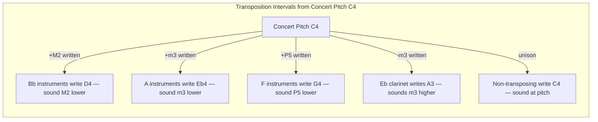
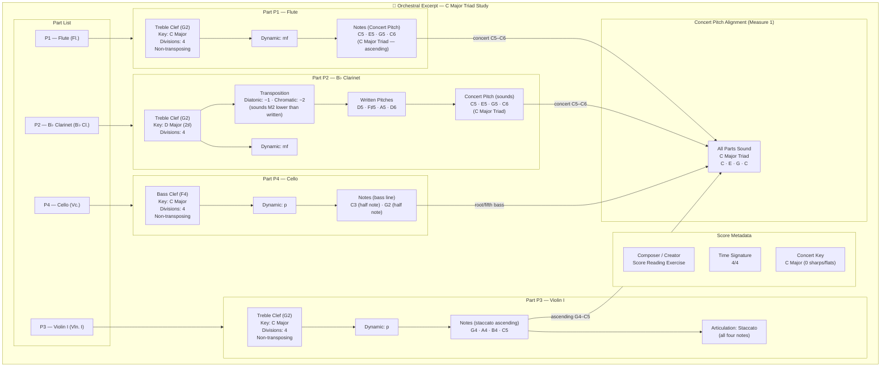

# Lesson 2: Reading Orchestral Scores — From Page to Baton

Score reading is a physical skill before it is an intellectual one. A conductor or composer who reads well does not translate symbol-by-symbol; their eye moves in trained patterns across the page while the hand (for a conductor) or the inner ear (for anyone) stays locked to a steady pulse. This lesson builds that skill through daily drills with a metronome, a pencil, and real repertoire — not through abstract notation theory.

Treat Sections 1–2 as the minimum vocabulary you need before the drills matter. Spend most of your practice time in Sections 3, 6, and 7.

## 1. The Notation Coordinate System — What You Actually Need to Know Fast

### Clefs: memorize these as hand positions, not just facts

Every clef names one line. Everything else is counted from there in alternating line-space-line steps. Drill this by singing, not just naming.

**Treble clef (G clef)** — the curl circles the G4 line (2nd line from bottom):

| Position | Pitch |
|---|---|
| Line 1 | E4 |
| Space 1 | F4 |
| Line 2 (anchor) | G4 |
| Space 2 | A4 |
| Line 3 | B4 |
| Space 3 | C5 |
| Line 4 | D5 |
| Space 4 | E5 |
| Line 5 | F5 |

**Bass clef (F clef)** — the two dots straddle F3 (4th line from bottom):

| Position | Pitch |
|---|---|
| Line 1 | G2 |
| Space 1 | A2 |
| Line 2 | B2 |
| Space 2 | C3 |
| Line 3 | D3 |
| Space 3 | E3 |
| Line 4 (anchor) | F3 |
| Space 4 | G3 |
| Line 5 | A3 |

**Alto clef (C clef, middle line)** — viola's home clef. The clef's waist pinches the middle line, C4:

| Position | Pitch |
|---|---|
| Line 1 | F3 |
| Space 1 | G3 |
| Line 2 | A3 |
| Space 2 | B3 |
| Line 3 (anchor) | C4 |
| Space 3 | D4 |
| Line 4 | E4 |
| Space 4 | F4 |
| Line 5 | G4 |

**Tenor clef (C clef, fourth line)** — cello, bassoon, and tenor trombone use this for high passages. The waist pinches line 4, C4:

| Position | Pitch |
|---|---|
| Line 1 | D3 |
| Space 1 | E3 |
| Line 2 | F3 |
| Space 2 | G3 |
| Line 3 | A3 |
| Space 3 | B3 |
| Line 4 (anchor) | C4 |
| Space 4 | D4 |
| Line 5 | E4 |

**Physical drill — Clef Flash Cards (10 min/day):** Write 20 random notes on blank staff paper in treble clef, 20 in bass, 20 in alto, 20 in tenor. Name each aloud against a metronome click at 40 BPM, one note per click. When you hit 95%+ accuracy at 40 BPM, move to 60, then 80. Most conductors can name any note in all four clefs in under a second; that speed comes only from this drill, not from reading about it.

### Key signatures: read them as a shape, not a list

You don't have time in real reading to count sharps one by one. Learn the *silhouette* of each key signature on the page.

Order of sharps (always this order, always starting from F): F♯ C♯ G♯ D♯ A♯ E♯ B♯
Order of flats (always this order, always starting from B, the mirror of the sharp order): B♭ E♭ A♭ D♭ G♭ C♭ F♭

Fast rule for sharp keys: the last sharp is the leading tone; go up one half step to name the key.
Fast rule for flat keys: the second-to-last flat names the key (for more than one flat); one flat alone is F major.

**Drill:** Flash 15 key signatures (mixed sharps/flats, 0–7 each) and name the major key in under 2 seconds each. This is the gate skill for transposition work in Section 2 — if you hesitate on key signatures, you will hesitate on every transposed part.

### Meter: feel the subdivision in your conducting arm, not just know the fraction

Simple meter (beat divides in 2): 2/4, 3/4, 4/4, 2/2
Compound meter (beat divides in 3): 6/8, 9/8, 12/8

**Physical drill:** Conduct basic patterns while subdividing aloud.
- 4/4 at 60 BPM: say "1-and, 2-and, 3-and, 4-and" while drawing the standard down-left-right-up pattern.
- 6/8 at 72 BPM (dotted quarter = pulse): say "1-2-3, 2-2-3" (two compound beats) while drawing a 2-pattern, not a 6-pattern — this is the single most common beginner error, conducting 6/8 as six beats when the music moves in two.
- Progress: 60 → 80 → 110 BPM over a week for each meter, always checking that your arm gesture matches the felt subdivision, not the printed denominator.

### The overtone series — one paragraph, because orchestration decisions live here

A vibrating string or air column produces a fundamental (f) plus integer-multiple harmonics: 2f (octave), 3f (fifth above that octave), 4f (two octaves), 5f (major third above two octaves), 6f (fifth above two octaves). This is *why* octave doublings between instruments fuse into a single fused tone (they reinforce the fundamental and its nearest overtone) while a doubling at the third or seventh stays more separate and colorful. It is also why horn blends under woodwinds — its spectrum is overtone-rich in the lower partials that match flute/clarinet/bassoon — while trumpet's stronger upper partials let it cut through a full tutti. Keep this one paragraph in your head as you orchestrate; you do not need the math beyond it.

## 2. The Full Score: Layout You Must Recognize Instantly

### Score order — read this top-to-bottom shape automatically


**Why memorize order instead of just looking it up each time:** in a tutti passage you have roughly one measure's duration to locate the entrance of a solo oboe or a divisi viola line before the moment passes. If you have to hunt for the row, you lose the downbeat. Drill: given a blank score page template with only instrument names removed, write the full 16-row order from memory in under 30 seconds. Do this until it's automatic — a few days for most people.

### Transposing instruments — the single hardest real-time skill

Written pitch is what's on the page. Concert (sounding) pitch is what the audience hears. For a piece in C major:

| Instrument | Written | Sounds | Interval | Semitones |
|---|---|---|---|---|
| Flute, Oboe, Bassoon | C | C | Unison | 0 |
| B♭ Clarinet, B♭ Trumpet | D | C | down M2 | −2 |
| A Clarinet | E♭ | C | down m3 | −3 |
| F Horn | G | C | down P5 | −7 |
| E♭ Clarinet | A | C | up m3 | +3 |
| English Horn (in F) | G | C | down P5 | −7 |
| Bass Clarinet (B♭) | D | C | down M9 | −14 |
| Piccolo | written 8va low | C | up 8va | +12 |
| Double Bass | written 8va high | C | down 8va | −12 |

Key signature of the same C-major piece as it appears in each transposing part:
- B♭ clarinet part: D major, 2♯
- A clarinet part: A major, 3♯
- F horn part: G major, 1♯
- E♭ clarinet part: A major, 3♯

**The mental shortcut that actually works in real time:** don't do interval math note-by-note. Instead, transpose the *key* once at the top of the system, then read the transposing part using that new key's scale-degree shapes mapped onto the part's actual notes. For B♭ clarinet (sounds down a major second): read the note, say the scale degree in D major, then sing that same scale degree in C major. With practice this collapses into a single step — you simply "hear in C" while your eye tracks notation that looks like D.



**Daily transposition drill (15 min, do this before anything else):** Pick one transposing instrument per day. Write out a 4-note major scale fragment in concert C. Transpose it to that instrument's written key by hand on staff paper, including the correct key signature. Then sight-sing the *written* version while naming the *sounding* pitches out loud. Rotate through B♭ clarinet, A clarinet, F horn, E♭ clarinet, English horn, bass clarinet over a week, then repeat the cycle at a faster tempo.

### Clef assignments by instrument — the lookup table you'll use constantly

| Instrument | Primary Clef | Secondary Clef(s) | Notes |
|---|---|---|---|
| Flute, Piccolo | Treble | — | — |
| Oboe, English Horn | Treble | — | — |
| B♭/A Clarinet, E♭ Clarinet | Treble | — | — |
| Bass Clarinet | Treble | — | Transposing, sounds M9 lower |
| Bassoon | Bass | Tenor | Tenor for high passages |
| Contrabassoon | Bass | — | Sounds at pitch, modern practice |
| Horn | Treble | Bass (historical) | Modern scores: treble only |
| Trumpet | Treble | — | — |
| Trombone | Bass | Tenor, Alto (rare) | Tenor for high passages |
| Tuba | Bass | — | — |
| Timpani | Bass | — | Sometimes single-line staff |
| Violin | Treble | — | — |
| Viola | Alto | Treble | Treble for high passages |
| Cello | Bass | Tenor, Treble | Tenor mid-high, treble very high |
| Double Bass | Bass | — | Sounds 8va lower |
| Piano, Celesta | Grand staff | — | Treble + bass joined |
| Harp | Grand staff | — | Treble + bass joined |

**Historical trap:** in scores before roughly 1950, horn in F written in bass clef sounds a perfect *fourth above* written pitch (not a fifth below) — same pitch class, different octave placement by convention. If you're reading Brahms or Wagner in an old edition and a bass-clef horn line looks absurdly low for the harmony, check whether you need the old bass-clef convention. Modern engraved editions standardize to "down a fifth" in both clefs, so this trap mostly affects antiquarian parts and facsimile scores.

### Divisi — catch it by eye before you need it by ear

"div." above a string staff means the section splits; stems up = one voice, stems down = the other. "unis." cancels it. When a page has a string section split into three or four independent lines, it may spread onto two staves temporarily. **Drill:** scan ten pages of a Mahler or Strauss score and circle every "div." and "unis." marking before playing or conducting a note. Mahler 1 and Strauss tone poems are generous with these markings and good training ground.

## 3. Reading Strategies: From Page to Sound

### The five-second page scan — do this before any downbeat

1. Key signature(s) across all staves — note discrepancies, they flag transposing instruments
2. Time signature and tempo marking
3. Which instruments are active on this page (and which have multi-measure rests)
4. Any clef changes from the previous page
5. Overall dynamic level

This is not optional ceremony — skipping it is the single biggest cause of conductors losing their place in the first ten seconds of a rehearsal.

### Vertical reading: hearing the chord in real time

Vertical reading means scanning one instant across every staff. Working method, in order:
1. Transpose every transposing instrument to concert pitch (use the shortcut from Section 2)
2. Stack the resulting pitches low to high
3. Reduce to a close-position triad or seventh chord by removing octave duplicates
4. Spell the chord root and quality
5. Assign a Roman numeral against the established key

Texture vocabulary you need to apply live, not just define:
- **Monophonic** — single line, possibly doubled at the unison or octave across instruments
- **Homophonic** — melody plus accompanying harmony
- **Polyphonic** — two or more independent simultaneous lines
- **Heterophonic** — one melodic idea played with simultaneous variation across instruments (Rimsky-Korsakov, Debussy, and many folk-derived orchestral textures use this)

### Horizontal reading: following the tune as it migrates

The melody rarely stays in one instrument for long. Track it with these cues, in priority order:
1. **Dynamic level** — the melody is usually marked one notch louder than its surroundings (mf against p accompaniment, for instance)
2. **Entry after a rest** — a fresh entrance after silence is very often thematic, not filler
3. **Sequence and imitation** — a motive heard once will often reappear transposed in another voice within a few beats
4. **Rhythmic activity** — the busiest line, especially with the fastest subdivision, is often carrying the tune even under a thicker texture

**Highlighter drill:** take a photocopy or PDF printout of Ravel's Boléro (any stretch of 30–40 measures) and physically highlight the melody's path across instruments in one color as it migrates. Do the same with a second color for the countermelody once it enters. This builds the eye-tracking habit that later happens unconsciously.

### Score reduction: the real test of whether you understood the page

1. Principal melody → right hand
2. Bass line and harmonic skeleton → left hand
3. Essential inner voices (thirds, sevenths, suspension tones) filled in only where they carry harmonic information
4. Octave doublings dropped — keep one statement only
5. Rhythms compressed where orchestration is reinforcing rather than developing the line

```mermaid
graph TD
    subgraph reading_flow ["Score Reading Workflow"]
        start["Open score page"]
        scan["5-second scan: key, time, tempo, instrumentation"]
        transp["Flag transposing instruments present"]
        vert["Vertical pass: chord at the downbeat"]
        horiz["Horizontal pass: locate the melody"]
        track["Track melody as it migrates across staves"]
        bass["Trace bass line and harmonic rhythm"]
        texture["Classify texture: mono / homo / poly / hetero"]
        reduce["Mentally reduce to 2-stave skeleton"]
        synth["Relate orchestration choices to form and harmony"]
    end

    start --> scan --> transp --> vert --> horiz --> track --> bass --> texture --> reduce --> synth
```



## 4. Instrument Characteristics You Read By, Not Just Memorize

Knowing range and timbre tells you what to expect on the page before you've fully parsed it — a bass clarinet line sitting in the staff's basement in treble clef is instantly recognizable once you know its register is offset two octaves from where treble clef "normally" sits.

### Woodwinds

**Flute** — cylindrical bore, no reed. Low register breathy/intimate, middle clear and lyrical, high brilliant and penetrating. Written/sounding range C4–D7. Treble clef, non-transposing.

**Piccolo** — cylindrical, no reed. Piercing, cuts through full tutti. Written D5–C8, sounds 8va higher (D6–C9). Treble clef.

**Oboe** — conical bore, double reed. Nasal, penetrating; low register reedy, middle expressive. Range B♭3–A6. Treble clef, non-transposing.

**English Horn** — conical, double reed, larger oboe in F. Darker and more melancholy than oboe. Written E3–A5, sounds P5 lower (A2–D5). Treble clef, transposes down a fifth.

**B♭ Clarinet** — cylindrical, single reed. Chalumeau (low) dark and warm, clarion (middle) bright, altissimo (high) piercing. Written D3–B♭6, sounds M2 lower (C3–A6). Treble clef.

**A Clarinet** — same family, slightly darker timbre. Written D3–B♭6, sounds m3 lower (B♭2–G6). Treble clef.

**Bass Clarinet (in B♭)** — rich, dark low register. Written D2–B♭5, sounds M9 lower (C1–A4). Treble clef, transposes down an octave-plus-second.

**Bassoon** — conical, double reed. Tenor register warm and expressive, bass register dark. Range B♭1–B♭5 (E5 on modern instruments). Bass clef primary, tenor for high writing, non-transposing.

**Contrabassoon** — conical, double reed. Deep foundational register. Range B♭0–C4. Bass clef, non-transposing in modern scores.

### Brass

**Horn (in F)** — conical bore, warm timbre that blends with woodwinds. Written B1–F5 and higher, sounds P5 lower (E1–B♭4). Treble clef in modern scores, transposes down a fifth.

**B♭ Trumpet** — cylindrical, bright and piercing. Written E3–D6, sounds M2 lower (D3–C6). Treble clef.

**C Trumpet** — cylindrical, slightly brighter than B♭. Written and sounding E3–D6. Treble clef, non-transposing.

**Tenor Trombone** — cylindrical, slide. Noble and sonorous. Range E2–B♭4 and higher with extended technique. Bass clef low, tenor clef high, non-transposing.

**Bass Trombone** — cylindrical, slide with trigger valve. Deeper and more powerful than tenor. Range B♭1–B♭4. Bass clef.

**Tuba** — conical, deep and foundational. Range D1–G4 approximately. Bass clef, non-transposing.

### Strings

**Violin** — tuned G3 D4 A4 E5. Practical range G3 to roughly A7 with harmonics. Treble clef, non-transposing.

**Viola** — tuned C3 G3 D4 A4. Range C3 to roughly E6. Alto clef primary, treble for high passages.

**Cello** — tuned C2 G2 D3 A3. Range C2 to roughly A5, higher with harmonics. Bass clef primary, tenor mid-high, treble very high.

**Double Bass** — tuned E1 A1 D2 G2 (five-string adds B0). Written E1–C5, sounds 8va lower (E0–C4). Bass clef, transposes down an octave.

### Percussion

**Timpani** — tuned drums, typically 2–4 covering roughly a tenth in total range (individual drums D2–A3 varies by set). Bass clef or single-line staff with pitch names. Pedal- or rod-tuned mid-performance, non-transposing.

## 5. Programmatic Score Representation and Analysis

### MusicXML: the interchange format

MusicXML encodes the full coordinate system — staves, clefs, key signatures, pitches, durations, dynamics, articulations, and transpositions — as structured, machine-readable XML. The excerpt below is a four-measure study in C major for flute (non-transposing), B♭ clarinet (transposing), violin, and cello: flute and clarinet state a broken C-major triad in concert pitch, violin plays a staccato ascending line, cello supplies the bass.



**What to notice:** the clarinet's `<transpose>` block (`diatonic=-1`, `chromatic=-2`) is the formal statement of "B♭ instrument, sounds a major second below written." Its key signature reads `<fifths>2</fifths>` (D major) while the non-transposing parts read `<fifths>0</fifths>` (C major) — that mismatch is not a different key, it's the transposition artifact you must learn to read past instantly. The `<alter>1</alter>` on the clarinet's F marks F♯ in the written key; in concert pitch that note is E natural, the plain third of C major with no accidental at all.

### Python analysis with music21

```python
"""
Orchestral score analysis using music21.

Requires: pip install music21

Demonstrates:
- Loading a MusicXML score
- Identifying transposing instruments and their intervals
- Converting to concert pitch and chordifying
- Roman numeral analysis of the resulting harmonies
- Generating a skeleton piano reduction (melody + bass)
"""

from music21 import converter, roman, chord as m21chord
from collections import Counter


def analyze_score(filepath: str) -> None:
    score = converter.parse(filepath)

    print("=" * 60)
    print("INSTRUMENT INVENTORY")
    print("=" * 60)
    for part in score.parts:
        instr = part.getInstrument()
        name = instr.partName or instr.instrumentName or "Unnamed part"
        if instr.transposition is not None:
            t = instr.transposition
            print(f"  {name:20s} | Transposing, semitones: {t.semitones:+d}")
        else:
            print(f"  {name:20s} | Non-transposing (concert pitch)")

    print("\n" + "=" * 60)
    print("CONCERT-PITCH CHORD ANALYSIS")
    print("=" * 60)

    # transposeAtSoundingPitch() is the programmatic equivalent of a
    # score reader mentally converting every transposing part to
    # concert pitch before stacking the harmony.
    score_at_pitch = score.transposeAtSoundingPitch()
    chordified = score_at_pitch.chordify()
    detected_key = score_at_pitch.analyze('key')
    print(f"  Detected key: {detected_key}\n")

    for measure in chordified.getElementsByClass('Measure')[:8]:
        chords_in_measure = list(measure.getElementsByClass(m21chord.Chord))
        if not chords_in_measure:
            continue
        first_chord = chords_in_measure[0]
        try:
            rn = roman.romanNumeralFromChord(first_chord, detected_key)
            figure = rn.figure
        except Exception:
            figure = "(unanalyzable)"
        pitch_names = [p.name for p in first_chord.pitches]
        print(f"  m.{measure.number:<3d} | Pitches: {pitch_names!s:24s} | Roman: {figure}")

    print("\n" + "=" * 60)
    print("PITCH-CLASS DENSITY (concert pitch)")
    print("=" * 60)
    all_notes = score_at_pitch.recurse().getElementsByClass('Note')
    pc_counter = Counter(n.pitch.pitchClass for n in all_notes)
    pitch_names = ['C', 'C#', 'D', 'Eb', 'E', 'F', 'F#', 'G', 'Ab', 'A', 'Bb', 'B']
    for pc in range(12):
        bar = '#' * pc_counter.get(pc, 0)
        print(f"  {pitch_names[pc]:3s} ({pc:2d}): {bar}")

    print("\n" + "=" * 60)
    print("PIANO REDUCTION (melody + bass skeleton)")
    print("=" * 60)
    reduction = score_at_pitch.chordify()
    count = 0
    for chord_obj in reduction.recurse().getElementsByClass(m21chord.Chord):
        count += 1
        if len(chord_obj.pitches) > 2:
            chord_obj.pitches = [chord_obj.pitches[0], chord_obj.pitches[-1]]
    print(f"  Reduction generated: {count} chords (top + bottom notes retained)")


if __name__ == '__main__':
    analyze_score('orchestral_excerpt.xml')
```

This script performs the same four moves a trained score reader does: inventory which parts transpose, convert everything to concert pitch and read the resulting chords, build a pitch-class histogram to confirm the tonal center, and extract outer voices as a reduction skeleton. Run it against your own MusicXML exports (Sibelius, Dorico, and MuseScore all export MusicXML) to check your mental analysis against the computed one while you're still building fluency.

### SQL: score metadata schema for a repertoire library

```sql
CREATE TABLE scores (
    id SERIAL PRIMARY KEY,
    title VARCHAR(255) NOT NULL,
    composer VARCHAR(255) NOT NULL,
    year_composed INTEGER,
    key_signature VARCHAR(10),
    time_signature VARCHAR(10),
    tempo_marking VARCHAR(100),
    movement_count INTEGER DEFAULT 1,
    duration_seconds INTEGER,
    created_at TIMESTAMP DEFAULT CURRENT_TIMESTAMP
);

CREATE TABLE instruments (
    id SERIAL PRIMARY KEY,
    name VARCHAR(100) NOT NULL,
    family VARCHAR(50) NOT NULL,
    transposition_semitones INTEGER DEFAULT 0,
    transposition_diatonic INTEGER DEFAULT 0,
    default_clef VARCHAR(20),
    secondary_clef VARCHAR(20),
    range_low_written VARCHAR(10),
    range_high_written VARCHAR(10),
    range_low_sounding VARCHAR(10),
    range_high_sounding VARCHAR(10)
);

INSERT INTO instruments
  (name, family, transposition_semitones, transposition_diatonic, default_clef,
   range_low_written, range_high_written, range_low_sounding, range_high_sounding)
VALUES
  ('Flute',         'woodwind',   0,  0, 'treble', 'C4',  'D7',  'C4',  'D7'),
  ('Piccolo',       'woodwind',  12,  7, 'treble', 'D5',  'C8',  'D6',  'C9'),
  ('Oboe',          'woodwind',   0,  0, 'treble', 'Bb3', 'A6',  'Bb3', 'A6'),
  ('English Horn',  'woodwind',  -7, -4, 'treble', 'E3',  'A5',  'A2',  'D5'),
  ('Bb Clarinet',   'woodwind',  -2, -1, 'treble', 'D3',  'Bb6', 'C3',  'A6'),
  ('A Clarinet',    'woodwind',  -3, -2, 'treble', 'D3',  'Bb6', 'Bb2', 'G6'),
  ('Bass Clarinet', 'woodwind', -14, -8, 'treble', 'D2',  'Bb5', 'C1',  'A4'),
  ('Bassoon',       'woodwind',   0,  0, 'bass',   'Bb1', 'Bb5', 'Bb1', 'Bb5'),
  ('Contrabassoon', 'woodwind',   0,  0, 'bass',   'Bb0', 'C4',  'Bb0', 'C4'),
  ('Horn in F',     'brass',     -7, -4, 'treble', 'B1',  'F5',  'E1',  'Bb4'),
  ('Bb Trumpet',    'brass',     -2, -1, 'treble', 'E3',  'D6',  'D3',  'C6'),
  ('C Trumpet',     'brass',      0,  0, 'treble', 'E3',  'D6',  'E3',  'D6'),
  ('Trombone',      'brass',      0,  0, 'bass',   'E2',  'Bb4', 'E2',  'Bb4'),
  ('Bass Trombone', 'brass',      0,  0, 'bass',   'Bb1', 'Bb4', 'Bb1', 'Bb4'),
  ('Tuba',          'brass',      0,  0, 'bass',   'D1',  'G4',  'D1',  'G4'),
  ('Timpani',       'percussion', 0,  0, 'bass',   'D2',  'A3',  'D2',  'A3'),
  ('Violin',        'string',     0,  0, 'treble', 'G3',  'A7',  'G3',  'A7'),
  ('Viola',         'string',     0,  0, 'alto',   'C3',  'E6',  'C3',  'E6'),
  ('Cello',         'string',     0,  0, 'bass',   'C2',  'A5',  'C2',  'A5'),
  ('Double Bass',   'string',   -12, -7, 'bass',   'E1',  'C5',  'E0',  'C4');

CREATE TABLE score_instruments (
    score_id INTEGER REFERENCES scores(id) ON DELETE CASCADE,
    instrument_id INTEGER REFERENCES instruments(id),
    part_count INTEGER DEFAULT 1,
    score_order INTEGER NOT NULL,
    PRIMARY KEY (score_id, instrument_id)
);

-- Which instruments in a given score require real-time mental transposition
CREATE VIEW score_transpositions AS
SELECT
    s.title,
    s.composer,
    i.name AS instrument,
    i.transposition_semitones,
    i.transposition_diatonic,
    s.key_signature AS concert_key
FROM scores s
JOIN score_instruments si ON s.id = si.score_id
JOIN instruments i ON si.instrument_id = i.id
WHERE i.transposition_semitones != 0
ORDER BY s.id, si.score_order;
```

Use this schema if you're building a rehearsal-prep tool: query `score_transpositions` for any work in your library and you get an instant checklist of exactly which parts need mental transposition before you walk into the room.

## 6. Practical Reading Drills — Do These in Order, Daily

### Drill 1: Transposition Recognition (10–15 min)

Repertoire: Brahms Symphony No. 1, mvt. I; Beethoven Symphony No. 5, mvt. I; Mahler Symphony No. 1, mvt. I.

On the first page, for every transposing instrument:
1. State the written key signature
2. State the concert key signature
3. Name the transposition interval
4. Find the first melodic phrase and sing it mentally in concert pitch

Metronome target: work with the score silent first, then try reading while a metronome clicks the quarter note at 50 BPM, naming the concert pitch of each written note on the beat. Progress 50 → 70 → 90 BPM over two weeks.

### Drill 2: Vertical Chord Reading (20 min)

Repertoire: Brahms Symphony No. 1, mvt. II, mm. 1–8; Wagner, Siegfried Idyll, opening.

At each downbeat: transpose to concert pitch, stack low to high, name root and quality, assign Roman numeral. Start untimed. Once accurate, set a metronome at 40 BPM (one chord per click) and work up to 60 BPM over two weeks — that pace matches a genuinely slow rehearsal tempo, which is the real-world floor for this skill.

### Drill 3: Melody Tracking (15–20 min)

Repertoire: Ravel, Boléro (full piece); Rimsky-Korsakov, Scheherazade, mvt. III.

Highlight the melody's path across instruments by hand. Note how dynamics mark entrances, how doublings thicken or blur the line, and how register shifts change its character. No metronome needed here — the point is visual tracking speed, which you build by repetition across multiple passages, not by rushing a click track.

### Drill 4: Bass Line Analysis (15 min)

Repertoire: Mozart Symphony No. 40, mvt. I, mm. 1–16; Beethoven Symphony No. 7, mvt. I Vivace, mm. 1–32.

Trace cello/bass (often doubled by bassoon or low brass). Per measure: identify the bass note, the harmonic rhythm, and the root progression (I–IV–V–I, i–♭VI–♭III–♭VII–i, etc.). Metronome target: read at the printed tempo once you can do it untimed accurately — Mozart 40/i is marked Molto allegro, so start at 80 BPM and build to the printed ~120–132 over several sessions.

### Drill 5: Score Reduction at the Piano (20–30 min)

Pick an 8–16 measure passage of moderate density.
1. Melody → right hand
2. Bass → left hand
3. Essential inner voices only (thirds, sevenths, suspension resolutions)
4. Drop octave doublings
5. Compress merely-reinforcing rhythms
6. Play it. If it sounds wrong or incomplete at the piano, you missed something — go back to the full score and find it.

Progress from Haydn/Mozart-level transparency to Brahms/Wagner-level density over several weeks. This single drill, done consistently, is the best predictor of real-time reading fluency.

## 7. Common Errors and Fixes

**Forgetting to transpose.** Reading written pitch as if it were sounding pitch produces nonsense harmony. Fix: flag every transposing instrument during the page scan before you read a single note of pitch content.

**Confusing written and sounding octaves.** Piccolo and double bass notate an octave away from where they sound. Fix: memorize the two octave-transposers by name — piccolo up an octave, bass down an octave — so this becomes reflex, not lookup.

**Misreading clefs.** Treating a C clef as treble or bass, or missing a mid-system clef change. Fix: check the clef at the start of every staff and after every system break; mark changes with a pencil tick until this becomes automatic.

**Ignoring key signature discrepancies.** Assuming the whole orchestra shares the piece's nominal key. Fix: scan all key signatures before reading; any mismatch flags a transposing instrument, and the specific mismatch tells you which one (D major next to C major on the same page means a B♭ instrument).

**Losing the melody in dense texture.** Doublings and countermelodies can bury the main line. Fix: look for the loudest dynamic, the highest register statement, and the fastest rhythmic activity — in that order.

**Overlooking divisi.** Reading a split string section as one voice. Fix: watch for "div." markings and opposite stem directions on a single staff; treat each stem direction as an independent voice.

**Misspelling chords from transposition slips.** Fix: when in doubt, write out the concert-pitch pitches by hand, use enharmonic equivalents to simplify spelling (G♯ = A♭), and stack in thirds to confirm the chord's structure.

## Summary

Score reading fluency rests on six skills, trained in this order of priority:

1. **Clef fluency** — instant recognition in treble, bass, alto, and tenor, including ledger lines
2. **Transposition fluency** — real-time mental conversion of every transposing part to concert pitch
3. **Vertical harmonic analysis** — stacking pitches and naming chord quality and Roman numeral function on the fly
4. **Horizontal voice tracking** — following melodic lines as they migrate across instruments
5. **Textural classification** — monophonic, homophonic, polyphonic, heterophonic, and knowing which line is primary
6. **Score reduction** — condensing a full texture to a two-stave piano skeleton that keeps melody, bass, and harmonic function intact

Start with transparent scores — Haydn, Mozart, early Beethoven — where transposing instruments are few and textures are uncluttered. Move to Brahms, Wagner, Mahler, and Stravinsky as the drills above become automatic. Run Drills 1–5 daily, in order, with the metronome progressions given. Six months of consistent daily practice is the realistic timeline for real-time fluency, not a motivational estimate — it matches how long it takes the eye-brain-ear loop to internalize transposition and vertical reading under tempo pressure.
