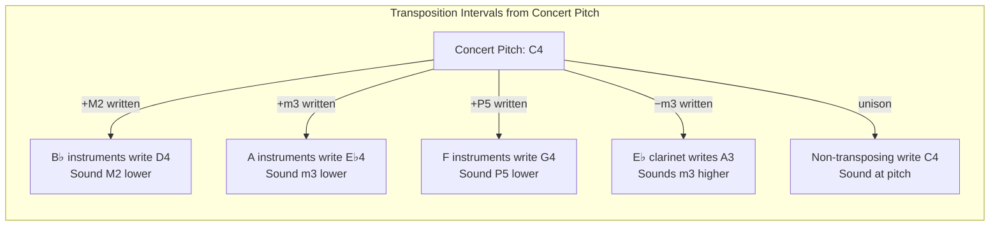

# Lesson 2: Reading Orchestral Scores

## 1. The Notation Coordinate System: First Principles

An orchestral score is a two-dimensional coordinate system. The vertical axis encodes pitch as a function of staff position; the horizontal axis encodes time as a function of left-to-right position. Every symbol on the page — notes, rests, dynamics, articulations, clef changes — is positioned within this grid. Understanding the score means understanding the rules that govern this coordinate system and the transformations applied to it for different instruments.

### The Staff as a Diatonic Pitch Grid

The five-line staff maps successive diatonic pitch classes. Each line or space represents the next letter name in the cycle C-D-E-F-G-A-B, cycling back to C. Adjacent staff positions advance the letter name by one, creating a repeating seven-note pattern across the eleven positions (five lines + four spaces + ledger lines above and below).

Ascending one staff position (from a line to the next space above, or from a space to the next line above) raises the pitch by one diatonic step. The actual interval — major second, minor second, augmented unison — depends on the key signature and any accidentals, but the letter name always advances by one.

The staff does not map to the overtone series. The overtone series is a sequence of integer-multiple frequencies (f, 2f, 3f, 4f, 5f, …) producing progressively narrower intervals (octave, fifth, fourth, major third, minor third, …). The overtone series governs timbre and acoustic blend in orchestration, but staff positions encode diatonic scale steps, not harmonic partials.

### Clefs: Origin Points for Pitch Mapping

A clef anchors the pitch coordinate system to a specific line of the staff. Without a clef, staff positions are abstract; with a clef, each line and space maps to a definite pitch.

**Treble clef (G clef):** The spiral wraps around the second line from the bottom, marking it as G4. From this anchor:

| Position | Pitch |
|---|---|
| Line 1 (bottom) | E4 |
| Space 1 | F4 |
| Line 2 (G clef anchor) | G4 |
| Space 2 | A4 |
| Line 3 (middle) | B4 |
| Space 3 | C5 |
| Line 4 | D5 |
| Space 4 | E5 |
| Line 5 (top) | F5 |

**Bass clef (F clef):** The two dots sit on either side of the fourth line from the bottom, marking it as F3:

| Position | Pitch |
|---|---|
| Line 1 (bottom) | G2 |
| Space 1 | A2 |
| Line 2 | B2 |
| Space 2 | C3 |
| Line 3 | D3 |
| Space 3 | E3 |
| Line 4 (F clef anchor) | F3 |
| Space 4 | G3 |
| Line 5 (top) | A3 |

**Alto clef (C clef on third line):** Marks the middle line as middle C (C4). Used primarily by viola:

| Position | Pitch |
|---|---|
| Line 1 (bottom) | F3 |
| Space 1 | G3 |
| Line 2 | A3 |
| Space 2 | B3 |
| Line 3 (C clef anchor) | C4 |
| Space 3 | D4 |
| Line 4 | E4 |
| Space 4 | F4 |
| Line 5 (top) | G4 |

**Tenor clef (C clef on fourth line):** Marks the fourth line from the bottom as C4. Used by cello, bassoon, and trombone in higher registers:

| Position | Pitch |
|---|---|
| Line 1 (bottom) | D3 |
| Space 1 | E3 |
| Line 2 | F3 |
| Space 2 | G3 |
| Line 3 | A3 |
| Space 3 | B3 |
| Line 4 (C clef anchor) | C4 |
| Space 4 | D4 |
| Line 5 (top) | E4 |

### Key Signatures and the Circle of Fifths

A key signature specifies which of the seven diatonic pitch classes are raised (sharpened) or lowered (flattened) relative to the natural (white-key) collection. Its derivation comes from the circle of fifths: traveling clockwise from C major adds one sharp per step (G major = 1♯, D major = 2♯, A major = 3♯, …); traveling counterclockwise adds one flat per step (F major = 1♭, B♭ major = 2♭, E♭ major = 3♭, …). Each step corresponds to transposing the tonic by a perfect fifth.

Key signatures predate equal temperament by centuries and function identically in meantone, well-tempered, and equal-tempered systems. The key signature is a notational shorthand for a diatonic pitch collection, not a tuning prescription.

The order of sharps: F♯, C♯, G♯, D♯, A♯, E♯, B♯.  
The order of flats: B♭, E♭, A♭, D♭, G♭, C♭, F♭.

### Time Signatures and Metric Grid

The time signature defines the temporal grid. The upper number specifies beats per measure; the lower number specifies the note value that constitutes one beat. In 4/4, each measure contains four quarter-note beats. In 6/8, each measure contains six eighth-note beats, typically grouped into two compound beats of three eighths each.

Simple meter: beats divide into two (4/4, 3/4, 2/4, 2/2).  
Compound meter: beats divide into three (6/8, 9/8, 12/8).

The distinction determines how the performer subdivides and where accents fall.

### The Overtone Series: Acoustic Foundation for Orchestration

The overtone series has nothing to do with staff layout, but it is the acoustic foundation for understanding why certain instrument combinations blend and why certain intervals sound consonant. When a fundamental pitch is produced, the vibrating body — string, air column, lip buzz — simultaneously generates harmonics at integer multiples of the fundamental frequency. The relative strength of these harmonics determines timbre.

For a fundamental frequency f:

- 1st harmonic (fundamental): f  
- 2nd harmonic: 2f (octave above)  
- 3rd harmonic: 3f (perfect fifth above the octave)  
- 4th harmonic: 4f (two octaves above)  
- 5th harmonic: 5f (major third above two octaves)  
- 6th harmonic: 6f (perfect fifth above two octaves)  

The horn, whose bore profile produces a rich spectrum of lower harmonics, blends naturally with woodwinds because its overtone profile overlaps with theirs. The trumpet, with stronger upper harmonics, cuts through the texture and is used for climactic moments. Octave doublings reinforce the fundamental and its first overtone, producing a fused, powerful sonority. Two-octave doublings reinforce the second harmonic as well, creating breadth without excessive density.

## 2. The Full Score: Architecture and Layout

### Score Order: The Instrumental Hierarchy

An orchestral score arranges instruments in a fixed vertical order, standardized since the late nineteenth century. This order groups instruments by family and, within each family, by range from highest to lowest, reflecting both acoustic and practical considerations.

```mermaid
graph TB
    subgraph score_layout ["Full Orchestral Score — Top to Bottom"]
        flutes["1. Flutes / Piccolo"]
        oboes["2. Oboes / English Horn"]
        clarinets["3. Clarinets (B♭/A) / Bass Clarinet"]
        bassoons["4. Bassoons / Contrabassoon"]
        horns["5. Horns (in F)"]
        trumpets["6. Trumpets (B♭ or C)"]
        trombones["7. Trombones / Bass Trombone"]
        tuba["8. Tuba"]
        timpani["9. Timpani"]
        percussion["10. Percussion"]
        keyboards["11. Harp / Piano / Celesta"]
        vln1["12. Violins I"]
        vln2["13. Violins II"]
        violas["14. Violas — Alto Clef"]
        cellos["15. Cellos — Bass / Tenor Clef"]
        basses["16. Double Basses — Sounds 8va lower"]
    end
    
    flutes --> oboes --> clarinets --> bassoons --> horns --> trumpets --> trombones --> tuba --> timpani --> percussion --> keyboards --> vln1 --> vln2 --> violas --> cellos --> basses
```



The horn sits at the top of the brass section despite its alto range because its timbre bridges woodwinds and brass. Historically, the horn was the first brass instrument integrated into the orchestra, and its placement at the woodwind-brass boundary reflects that role. The timpani lead the percussion because they are almost always present and often carry harmonic function (tuned to the tonic and dominant). Strings occupy the bottom of the score because they are the largest section and provide the continuous harmonic and rhythmic foundation.

### Transposing Instruments: Written vs. Concert Pitch

Many orchestral instruments are transposing instruments: the pitch they produce when reading a given note differs from the written note. The written pitch is what appears in the score; the concert (sounding) pitch is what the audience hears. The discrepancy exists because these instruments come in different sizes and keys, and notation is standardized around each instrument's most comfortable key rather than around concert pitch.

For a piece in C major, the transposition relationships are:

| Instrument | Written Pitch | Concert Pitch | Interval | Transposition Semitones |
|---|---|---|---|---|
| Flute, Oboe, Bassoon | C | C | Unison | 0 |
| B♭ Clarinet, B♭ Trumpet | D | C | Sounds M2 lower than written | −2 |
| A Clarinet | E♭ | C | Sounds m3 lower than written | −3 |
| F Horn | G | C | Sounds P5 lower than written | −7 |
| E♭ Clarinet | A | C | Sounds m3 higher than written | +3 |
| English Horn (in F) | G | C | Sounds P5 lower than written | −7 |
| Bass Clarinet (in B♭) | D | C | Sounds M9 lower than written | −14 |
| Piccolo | C (written 8va lower) | C | Sounds 8va higher than written | +12 |
| Double Bass | C (written 8va higher) | C | Sounds 8va lower than written | −12 |

The key signature of a transposing instrument's part also differs from the concert key. For a piece in C major (no sharps or flats):

- B♭ clarinet part: D major (2 sharps) — transposed up a M2  
- A clarinet part: A major (3 sharps) — transposed up a m3  
- F horn part: G major (1 sharp) — transposed up a P5  
- E♭ clarinet part: A major (3 sharps) — transposed down a m3  

The score reader must mentally transpose these parts to concert pitch to understand the actual harmony. This is the core analytical challenge of orchestral score reading.



### Clef Assignments by Instrument

Each instrument's part appears in its standard clef (or clefs, since many instruments change clef depending on register):

| Instrument | Primary Clef | Secondary Clef(s) | Notes |
|---|---|---|---|
| Flute, Piccolo | Treble | — | — |
| Oboe, English Horn | Treble | — | — |
| B♭/A Clarinet, E♭ Clarinet | Treble | — | — |
| Bass Clarinet | Treble | — | Transposing; sounds M9 lower |
| Bassoon | Bass | Tenor | Tenor clef for high passages |
| Contrabassoon | Bass | — | Sounds at pitch (modern) |
| Horn | Treble | Bass (historical) | Modern practice: treble only |
| Trumpet | Treble | — | — |
| Trombone | Bass | Tenor; Alto (rare) | Tenor for high passages |
| Tuba | Bass | — | — |
| Timpani | Bass | — | Sometimes single-line staff |
| Violin | Treble | — | — |
| Viola | Alto | Treble | Treble for high passages |
| Cello | Bass | Tenor; Treble | Tenor for mid-high; treble for very high |
| Double Bass | Bass | — | Sounds 8va lower |
| Piano, Celesta | Grand staff | — | Treble + bass clef joined |
| Harp | Grand staff | — | Treble + bass clef joined |

**Historical note on horn bass clef:** In older scores (roughly before 1950), the horn's bass clef part used a different transposition convention. Where treble clef horn in F sounds a perfect fifth below written, bass clef horn in F sounds a perfect fourth above written — effectively an octave displacement of the same transposition. Modern editions standardize on the same transposition (down a fifth) for both clefs. When reading older scores, this discrepancy must be accounted for.

### Multi-Staff Instruments and Divisi

Several instruments occupy more than one staff in the score. The piano, celesta, and harp each use a grand staff (treble and bass clef joined by a brace). Timpani may use a single staff with each drum on a different line or space, or may use a single-line staff with pitch names indicated.

String sections frequently divide (divisi), where the section splits into two or more parts. This is indicated by the marking "div." (divisi) above the staff, with subsequent "unis." (unison) to restore single-part writing. When divisi produces two independent parts on one staff, the stem directions separate them: one voice stems up, the other stems down. When the parts are too complex for a single staff, the section may temporarily occupy two staves.

## 3. Reading Strategies: From Page to Sound

### Scanning the Score

Before reading individual parts, scan the full page to establish context:

1. **Identify the key signature** — note that transposing instruments will show different key signatures  
2. **Identify the time signature and tempo marking**  
3. **Identify the instrumentation present on this page** — which instruments are active  
4. **Note any clef changes** from the previous page  
5. **Scan for dynamic markings** to understand the overall intensity level  

This initial scan establishes the harmonic, metric, and dynamic context before part-specific analysis begins.

### Vertical Reading: Texture and Harmony

Vertical reading means scanning a single time-slice across all staves to identify the sonority at that moment. This reveals:

- The chord or pitch collection sounding at that instant  
- Which instruments are active and which are resting  
- Doublings — instances where multiple instruments play the same pitch or in octaves  
- The density of the orchestration (how many instruments are sounding)  

**To identify the actual chord:** transpose all transposing instruments to concert pitch, then stack the pitches. This is the fundamental analytical operation of score reading, and it must be performed mentally in real time.

Texture types to identify:

- **Monophonic:** a single melodic line, possibly doubled across instruments at unison or octave  
- **Homophonic:** a principal melody with accompanimental harmony  
- **Polyphonic:** two or more independent melodic lines operating simultaneously  
- **Heterophonic:** a single melodic line performed with simultaneous variations across instruments (common in some folk-influenced orchestral writing)  

### Horizontal Reading: Voice Leading and Melodic Tracking

Horizontal reading means following a single instrument or voice across time. The primary goal is tracking the principal melody as it passes from one instrument to another. The melody rarely stays in a single instrument for an entire movement; it migrates, and the score reader must follow it across staff boundaries.

Techniques for horizontal reading:

- **Track the loudest dynamic marking** — the principal melody is often marked one dynamic level louder than its accompaniment  
- **Identify entries** — the first note after a rest is often a melodic entrance  
- **Look for sequence and imitation** — if a motive appears in one instrument, watch for its reappearance (possibly transposed) in another  
- **Trace the bass line** — provides the harmonic foundation and often moves with slower rhythmic values  

### Score Reduction

Score reduction is the practice of condensing the full score to a more readable format, typically a piano arrangement with two staves. This is both a reading strategy and a performance practice. To reduce mentally:

1. Identify the principal melody and place it in the right hand  
2. Identify the bass line and harmonic skeleton, place it in the left hand  
3. Fill in inner voices where possible, prioritizing notes that define the harmony (thirds, sevenths)  
4. Omit doublings — if the melody is doubled at the octave, keep only one statement  
5. Compress the rhythm where the orchestration is merely reinforcing, not developing  

```mermaid
graph TD
    subgraph reading_flow ["Score Reading Workflow"]
        start["Open Score Page"]
        scan["Scan: Key Sig, Time Sig, Tempo, Instrumentation"]
        transp["Identify transposing instruments on page"]
        vert["Vertical pass: identify chord at downbeat"]
        horiz["Horizontal pass: locate principal melody"]
        track["Track melody across staves as it migrates"]
        bass["Trace bass line and harmonic rhythm"]
        texture["Classify texture: mono / homo / poly / hetero"]
        reduce["Mentally reduce to 2-stave piano skeleton"]
        synth["Synthesize: relate orchestration to form and harmony"]
    end
    
    start --> scan --> transp --> vert --> horiz --> track --> bass --> texture --> reduce --> synth
```



## 4. Instrument Characteristics and Ranges

### Woodwinds

Each woodwind has a characteristic timbre shaped by its bore type (cylindrical vs. conical) and reed configuration (single reed, double reed, none):

**Flute:**  
- Bore: cylindrical, no reed  
- Timbre: Low register is breathy and intimate; middle register is clear and lyrical; high register is brilliant and penetrating  
- Range (written/sounding): C4 to D7  
- Clef: Treble  
- Transposition: Non-transposing (concert pitch)  

**Piccolo:**  
- Bore: cylindrical, no reed  
- Timbre: Piercing, bright, cuts through full orchestra  
- Range (written): D5 to C8; sounds 8va higher (D6 to C8)  
- Clef: Treble  
- Transposition: Sounds one octave higher than written  

**Oboe:**  
- Bore: conical, double reed  
- Timbre: Penetrating, nasal tone that carries over the orchestra. Low register is reedy and somewhat harsh; middle register is expressive and singing  
- Range (written/sounding): B♭3 to A6  
- Clef: Treble  
- Transposition: Non-transposing  

**English Horn (Cor Anglais):**  
- Bore: conical, double reed; larger oboe in F  
- Timbre: Darker, more melancholy than oboe  
- Range (written): E3 to A5; sounds P5 lower (A2 to D5)  
- Clef: Treble  
- Transposition: Sounds a perfect fifth lower than written (−7 semitones)  

**B♭ Clarinet:**  
- Bore: cylindrical, single reed  
- Timbre: Extremely agile across a wide range. Chalumeau register (low) is dark and warm; clarion register (middle) is bright and lyrical; altissimo register (high) is piercing  
- Range (written): D3 to B♭6; sounds M2 lower (C3 to A6)  
- Clef: Treble  
- Transposition: Sounds a major second lower than written (−2 semitones)  

**A Clarinet:**  
- Bore: cylindrical, single reed  
- Timbre: Slightly darker than B♭ clarinet  
- Range (written): D3 to B♭6; sounds m3 lower (B♭2 to G6)  
- Clef: Treble  
- Transposition: Sounds a minor third lower than written (−3 semitones)  

**Bass Clarinet (in B♭):**  
- Bore: cylindrical, single reed  
- Timbre: Rich, dark timbre in the low register  
- Range (written): D2 to B♭5; sounds M9 lower (C1 to A4)  
- Clef: Treble  
- Transposition: Sounds a major ninth lower than written (−14 semitones)  

**Bassoon:**  
- Bore: conical, double reed  
- Timbre: Tenor register is warm and expressive; bass register is dark and somber  
- Range (written/sounding): B♭1 to B♭5 (high E5 in modern instruments)  
- Clef: Bass (primary), tenor (high passages)  
- Transposition: Non-transposing  

**Contrabassoon:**  
- Bore: conical, double reed  
- Timbre: Deep, resonant foundation  
- Range (written/sounding): B♭0 to approximately C4  
- Clef: Bass  
- Transposition: Non-transposing (modern practice; historical practice varied)  

### Brass

**Horn (in F):**  
- Bore: conical  
- Timbre: Broad, warm timbre that blends with woodwinds  
- Range (written): B1 to F5 (and higher); sounds P5 lower (E1 to B♭4 approximately)  
- Clef: Treble (modern), bass (historical, with different transposition)  
- Transposition: Sounds a perfect fifth lower than written (−7 semitones)  

**Trumpet (in B♭):**  
- Bore: cylindrical  
- Timbre: Bright, piercing  
- Range (written): E3 to D6; sounds M2 lower (D3 to C6)  
- Clef: Treble  
- Transposition: Sounds a major second lower than written (−2 semitones)  

**Trumpet (in C):**  
- Bore: cylindrical  
- Timbre: Slightly brighter than B♭ trumpet  
- Range (written/sounding): E3 to D6  
- Clef: Treble  
- Transposition: Non-transposing  

**Trombone (Tenor):**  
- Bore: cylindrical, slide mechanism  
- Timbre: Noble, sonorous  
- Range: E2 to B♭4 (and higher with extended technique)  
- Clef: Bass (low), tenor (high)  
- Transposition: Non-transposing  

**Bass Trombone:**  
- Bore: cylindrical, slide with trigger valve  
- Timbre: Deeper, more powerful than tenor trombone  
- Range: B♭1 to B♭4  
- Clef: Bass  
- Transposition: Non-transposing  

**Tuba:**  
- Bore: conical  
- Timbre: Deep, foundational  
- Range: D1 to G4 approximately  
- Clef: Bass  
- Transposition: Non-transposing  

### Strings

**Violin:**  
- Tuning: G3, D4, A4, E5  
- Range (practical): G3 to approximately A7 (with harmonics)  
- Clef: Treble  
- Transposition: Non-transposing  

**Viola:**  
- Tuning: C3, G3, D4, A4  
- Range: C3 to approximately E6  
- Clef: Alto (primary), treble (high passages)  
- Transposition: Non-transposing  

**Cello:**  
- Tuning: C2, G2, D3, A3  
- Range: C2 to approximately A5 (and higher with harmonics)  
- Clef: Bass (primary), tenor (mid-high), treble (very high)  
- Transposition: Non-transposing  

**Double Bass:**  
- Tuning: E1, A1, D2, G2 (some five-string basses add B0)  
- Range (written): E1 to C5; sounds 8va lower (E0 to C4)  
- Clef: Bass  
- Transposition: Sounds one octave lower than written (−12 semitones)  

### Percussion

**Timpani:**  
- Configuration: Tuned drums, typically 2–4 drums covering a range of approximately a tenth  
- Range: D2 to A3 (individual drum ranges vary)  
- Clef: Bass (or single-line staff with pitch names)  
- Transposition: Non-transposing  
- Tuning: Changed via pedal or tension rods during performance  

## 5. Programmatic Score Representation and Analysis

### MusicXML: The Interchange Format

MusicXML is the de facto standard for representing musical scores in a machine-readable format. It encodes the full coordinate system: staves, clefs, key signatures, time signatures, pitches, durations, dynamics, articulations, and transpositions.

The following MusicXML encodes a four-measure orchestral excerpt for flute (non-transposing), B♭ clarinet (transposing), violin, and cello. The excerpt is in C major, 4/4 time. The flute and clarinet play a broken C-major triad (concert pitch), the violin plays a staccato ascending passage, and the cello provides a bass line.

```xml
<?xml version="1.0" encoding="UTF-8"?>
<!DOCTYPE score-partwise PUBLIC
  "-//Recordare//DTD MusicXML 4.0 Partwise//EN"
  "http://www.musicxml.org/dtds/partwise.dtd">
<score-partwise version="4.0">
  <work>
    <work-title>Orchestral Excerpt — C Major Triad Study</work-title>
  </work>
  <identification>
    <creator type="composer">Score Reading Exercise</creator>
  </identification>

  <!-- Part list: defines each instrument and its transposition -->
  <part-list>
    <score-part id="P1">
      <part-name>Flute</part-name>
      <part-abbreviation>Fl.</part-abbreviation>
      <score-instrument id="P1-I1">
        <instrument-name>Flute</instrument-name>
      </score-instrument>
    </score-part>
    <score-part id="P2">
      <part-name>B♭ Clarinet</part-name>
      <part-abbreviation>B♭ Cl.</part-abbreviation>
      <score-instrument id="P2-I1">
        <instrument-name>B♭ Clarinet</instrument-name>
      </score-instrument>
    </score-part>
    <score-part id="P3">
      <part-name>Violin I</part-name>
      <part-abbreviation>Vln. I</part-abbreviation>
      <score-instrument id="P3-I1">
        <instrument-name>Violin I</instrument-name>
      </score-instrument>
    </score-part>
    <score-part id="P4">
      <part-name>Cello</part-name>
      <part-abbreviation>Vc.</part-abbreviation>
      <score-instrument id="P4-I1">
        <instrument-name>Cello</instrument-name>
      </score-instrument>
    </score-part>
  </part-list>

  <!-- Flute: non-transposing, treble clef, concert C major -->
  <part id="P1">
    <measure number="1">
      <attributes>
        <divisions>4</divisions>
        <key><fifths>0</fifths></key>
        <time><beats>4</beats><beat-type>4</beat-type></time>
        <clef><sign>G</sign><line>2</line></clef>
      </attributes>
      <direction placement="above">
        <direction-type><dynamics><mf/></dynamics></direction-type>
      </direction>
      <!-- C5, E5, G5, C6: broken C major triad at concert pitch -->
      <note>
        <pitch><step>C</step><octave>5</octave></pitch>
        <duration>4</duration><type>quarter</type>
      </note>
      <note>
        <pitch><step>E</step><octave>5</octave></pitch>
        <duration>4</duration><type>quarter</type>
      </note>
      <note>
        <pitch><step>G</step><octave>5</octave></pitch>
        <duration>4</duration><type>quarter</type>
      </note>
      <note>
        <pitch><step>C</step><octave>6</octave></pitch>
        <duration>4</duration><type>quarter</type>
      </note>
    </measure>
  </part>

  <!-- B♭ Clarinet: transposing, sounds M2 lower than written.
       The transpose element specifies how to convert written → sounding:
       diatonic = -1 (down one letter name), chromatic = -2 (down 2 semitones).
       Key signature is D major (2 sharps) = concert C major transposed up M2.
       Written notes D5, F♯5, A5, D6 sound as C5, E5, G5, C6. -->
  <part id="P2">
    <measure number="1">
      <attributes>
        <divisions>4</divisions>
        <key><fifths>2</fifths></key>
        <time><beats>4</beats><beat-type>4</beat-type></time>
        <clef><sign>G</sign><line>2</line></clef>
        <!-- Transposition: written pitch → sounding pitch -->
        <transpose>
          <diatonic>-1</diatonic>
          <chromatic>-2</chromatic>
        </transpose>
      </attributes>
      <direction placement="above">
        <direction-type><dynamics><mf/></dynamics></direction-type>
      </direction>
      <note>
        <pitch><step>D</step><octave>5</octave></pitch>
        <duration>4</duration><type>quarter</type>
      </note>
      <note>
        <pitch><step>F</step><octave>5</octave><alter>1</alter></pitch>
        <duration>4</duration><type>quarter</type>
      </note>
      <note>
        <pitch><step>A</step><octave>5</octave></pitch>
        <duration>4</duration><type>quarter</type>
      </note>
      <note>
        <pitch><step>D</step><octave>6</octave></pitch>
        <duration>4</duration><type>quarter</type>
      </note>
    </measure>
  </part>

  <!-- Violin I: non-transposing, treble clef, staccato ascending passage -->
  <part id="P3">
    <measure number="1">
      <attributes>
        <divisions>4</divisions>
        <key><fifths>0</fifths></key>
        <time><beats>4</beats><beat-type>4</beat-type></time>
        <clef><sign>G</sign><line>2</line></clef>
      </attributes>
      <direction placement="above">
        <direction-type><dynamics><p/></dynamics></direction-type>
      </direction>
      <note>
        <pitch><step>G</step><octave>4</octave></pitch>
        <duration>4</duration><type>quarter</type>
        <notations><articulations><staccato/></articulations></notations>
      </note>
      <note>
        <pitch><step>A</step><octave>4</octave></pitch>
        <duration>4</duration><type>quarter</type>
        <notations><articulations><staccato/></articulations></notations>
      </note>
      <note>
        <pitch><step>B</step><octave>4</octave></pitch>
        <duration>4</duration><type>quarter</type>
        <notations><articulations><staccato/></articulations></notations>
      </note>
      <note>
        <pitch><step>C</step><octave>5</octave></pitch>
        <duration>4</duration><type>quarter</type>
        <notations><articulations><staccato/></articulations></notations>
      </note>
    </measure>
  </part>

  <!-- Cello: non-transposing, bass clef, bass line -->
  <part id="P4">
    <measure number="1">
      <attributes>
        <divisions>4</divisions>
        <key><fifths>0</fifths></key>
        <time><beats>4</beats><beat-type>4</beat-type></time>
        <clef><sign>F</sign><line>4</line></clef>
      </attributes>
      <direction placement="below">
        <direction-type><dynamics><p/></dynamics></direction-type>
      </direction>
      <!-- C3 (half note) + G2 (half note): root and fifth of C major -->
      <note>
        <pitch><step>C</step><octave>3</octave></pitch>
        <duration>8</duration><type>half</type>
      </note>
      <note>
        <pitch><step>G</step><octave>2</octave></pitch>
        <duration>8</duration><type>half</type>
      </note>
    </measure>
  </part>
</score-partwise>
```

**Key observations about the MusicXML structure:**

- The `<transpose>` element in the clarinet part encodes the transposition from written to sounding pitch. `diatonic = -1` means the sounding pitch is one letter name below the written pitch (D → C). `chromatic = -2` means two semitones below (the major second). This is the formal representation of "B♭ instrument, sounds a major second lower than written."
- The clarinet's key signature has `<fifths>2</fifths>` (D major, 2 sharps), while the non-transposing instruments show `<fifths>0</fifths>` (C major). The score reader must recognize this discrepancy as a transposition artifact, not a different key.
- The `<alter>` element on the clarinet's F note specifies F♯ (alter = 1 means raised by one semitone), which is part of the D major key signature. In concert pitch, this note is E natural (the third of C major), which has no accidental in the concert key signature.

### Python Analysis with music21

The music21 library provides programmatic tools for score analysis, including automatic transposition to concert pitch, harmonic analysis, and reduction.

```python
"""
Orchestral score analysis using music21.

Demonstrates:
- Loading a MusicXML score
- Identifying transposing instruments and their intervals
- Chordifying (collapsing all parts to a single chordal sequence)
- Roman numeral analysis of the resulting harmonies
- Generating a piano reduction
"""

from music21 import converter, analysis, key, pitch, chord as m21chord
from collections import Counter

def analyze_score(filepath: str) -> None:
    """Parse and analyze an orchestral score from MusicXML."""
    score = converter.parse(filepath)

    # --- Instrument inventory with transposition status ---
    print("=" * 60)
    print("INSTRUMENT INVENTORY")
    print("=" * 60)
    for i, part in enumerate(score.parts):
        instr = part.getInstrument()
        name = instr.instrumentName if instr else f"Part {i+1}"
        # Check if the part has a transposition
        if hasattr(instr, 'transposition') and instr.transposition is not None:
            t = instr.transposition
            print(f"  {name:20s} | Transposing: {t} "
                  f"(semitones: {t.semitones:+d})")
        else:
            print(f"  {name:20s} | Non-transposing (concert pitch)")

    # --- Transpose all parts to concert pitch for harmonic analysis ---
    print("\n" + "=" * 60)
    print("CONCERT-PITCH CHORD ANALYSIS")
    print("=" * 60)

    # Chordify collapses all simultaneous notes into chords.
    # By default, chordify respects written pitch. To analyze
    # concert-pitch harmony, we transpose each part first.
    score_at_pitch = score.transposeAtSoundingPitch()

    # Chordify the concert-pitch score
    chordified = score_at_pitch.chordify()

    # Analyze each measure's primary chord
    detected_key = score_at_pitch.analyze('key')
    print(f"  Detected key: {detected_key}\n")

    for measure in chordified.getElementsByClass('Measure')[:8]:
        chords_in_measure = list(measure.getElementsByClass(m21chord.Chord))
        if not chords_in_measure:
            continue
        # Analyze the first chord of each measure (downbeat)
        first_chord = chords_in_measure[0]
        try:
            roman = analysis.romanNumeralFromChord(
                first_chord, detected_key
            )
            print(f"  m.{measure.number:3d} | "
                  f"Pitches: {[p.name for p in first_chord.pitches]:20s} | "
                  f"Roman: {roman.figure}")
        except Exception:
            print(f"  m.{measure.number:3d} | "
                  f"Pitches: {[p.name for p in first_chord.pitches]:20s} | "
                  f"Roman: (unanalyzable)")

    # --- Pitch-class density analysis ---
    print("\n" + "=" * 60)
    print("PITCH-CLASS DENSITY (concert pitch)")
    print("=" * 60)
    all_notes = score_at_pitch.recurse().getElementsByClass('Note')
    pc_counter = Counter(n.pitch.pitchClass for n in all_notes)
    pitch_names = ['C', 'C♯', 'D', 'E♭', 'E', 'F',
                   'F♯', 'G', 'A♭', 'A', 'B♭', 'B']
    for pc in range(12):
        bar = '█' * pc_counter.get(pc, 0)
        print(f"  {pitch_names[pc]:3s} ({pc:2d}): {bar}")

    # --- Generate a two-stave piano reduction ---
    print("\n" + "=" * 60)
    print("PIANO REDUCTION")
    print("=" * 60)
    reduction = score_at_pitch.chordify()
    # Keep only the top note (melody) and bottom note (bass) per chord
    for chord_obj in reduction.recurse().getElementsByClass(m21chord.Chord):
        if len(chord_obj.pitches) > 2:
            chord_obj.pitches = [
                chord_obj.pitches[0],    # highest (melody)
                chord_obj.pitches[-1]    # lowest (bass)
            ]
    print(f"  Reduction generated: {len(list(reduction.recurse().getElementsByClass(m21chord.Chord)))} chords")
    print("  (Top + bottom notes retained per time-slice)")


if __name__ == '__main__':
    # Replace with your MusicXML file path
    analyze_score('orchestral_excerpt.xml')
```

This script performs four analytical operations: it inventories all instruments and identifies which are transposing, it chordifies the score at concert pitch to extract the harmonic progression, it computes a pitch-class histogram to reveal the tonal center, and it generates a skeleton piano reduction by extracting the outer voices (melody and bass) from each chord. The `transposeAtSoundingPitch()` method is the programmatic equivalent of what a score reader does mentally: converting all transposing instruments to concert pitch so the actual harmony becomes visible.

### SQL: Score Metadata Schema

For digital music libraries and orchestral repertoire databases, the following schema stores score metadata including transposition relationships:

```sql
-- Schema for orchestral score metadata management

CREATE TABLE scores (
    id SERIAL PRIMARY KEY,
    title VARCHAR(255) NOT NULL,
    composer VARCHAR(255) NOT NULL,
    year_composed INTEGER,
    key_signature VARCHAR(10),          -- e.g., 'C major', 'B♭ minor'
    time_signature VARCHAR(10),         -- e.g., '4/4', '6/8'
    tempo_marking VARCHAR(100),         -- e.g., 'Allegro moderato'
    movement_count INTEGER DEFAULT 1,
    duration_seconds INTEGER,
    created_at TIMESTAMP DEFAULT CURRENT_TIMESTAMP
);

CREATE TABLE instruments (
    id SERIAL PRIMARY KEY,
    name VARCHAR(100) NOT NULL,
    family VARCHAR(50) NOT NULL,          -- 'woodwind', 'brass', 'percussion', 'string', 'keyboard'
    transposition_semitones INTEGER DEFAULT 0,  -- negative = sounds lower than written
    transposition_diatonic INTEGER DEFAULT 0,   -- letter-name steps (for MusicXML compatibility)
    default_clef VARCHAR(20),
    secondary_clef VARCHAR(20),
    range_low_written VARCHAR(10),        -- written pitch, e.g., 'D3'
    range_high_written VARCHAR(10),
    range_low_sounding VARCHAR(10),      -- concert pitch
    range_high_sounding VARCHAR(10)
);

-- Seed data for common orchestral instruments
INSERT INTO instruments (name, family, transposition_semitones, transposition_diatonic, default_clef, range_low_written, range_high_written, range_low_sounding, range_high_sounding)
VALUES
  ('Flute',            'woodwind',  0,  0, 'treble', 'C4',  'D7',  'C4',  'D7'),
  ('Piccolo',          'woodwind', 12,  7, 'treble', 'D5',  'C8',  'D6',  'C9'),
  ('Oboe',             'woodwind',  0,  0, 'treble', 'Bb3', 'A6',  'Bb3', 'A6'),
  ('English Horn',     'woodwind', -7, -4, 'treble', 'E3',  'A5',  'A2',  'D5'),
  ('Bb Clarinet',      'woodwind', -2, -1, 'treble', 'D3',  'Bb6', 'C3',  'A6'),
  ('A Clarinet',       'woodwind', -3, -2, 'treble', 'D3',  'Bb6', 'Bb2', 'G6'),
  ('Bass Clarinet',    'woodwind', -14,-8, 'treble', 'D2',  'Bb5', 'C1',  'A4'),
  ('Bassoon',          'woodwind',  0,  0, 'bass',   'Bb1', 'Bb5', 'Bb1', 'Bb5'),
  ('Contrabassoon',    'woodwind',  0,  0, 'bass',   'Bb0', 'C4',  'Bb0', 'C4'),
  ('Horn in F',        'brass',    -7, -4, 'treble', 'B1',  'F5',  'E1',  'Bb4'),
  ('Bb Trumpet',       'brass',    -2, -1, 'treble', 'E3',  'D6',  'D3',  'C6'),
  ('C Trumpet',        'brass',     0,  0, 'treble', 'E3',  'D6',  'E3',  'D6'),
  ('Trombone',         'brass',     0,  0, 'bass',   'E2',  'Bb4', 'E2',  'Bb4'),
  ('Bass Trombone',    'brass',     0,  0, 'bass',   'Bb1', 'Bb4', 'Bb1', 'Bb4'),
  ('Tuba',             'brass',     0,  0, 'bass',   'D1',  'G4',  'D1',  'G4'),
  ('Timpani',          'percussion',0,  0, 'bass',   'D2',  'A3',  'D2',  'A3'),
  ('Violin',           'string',    0,  0, 'treble', 'G3',  'A7',  'G3',  'A7'),
  ('Viola',            'string',    0,  0, 'alto',   'C3',  'E6',  'C3',  'E6'),
  ('Cello',            'string',    0,  0, 'bass',   'C2',  'A5',  'C2',  'A5'),
  ('Double Bass',      'string',   -12,-7, 'bass',   'E1',  'C5',  'E0',  'C4');

CREATE TABLE score_instruments (
    score_id INTEGER REFERENCES scores(id) ON DELETE CASCADE,
    instrument_id INTEGER REFERENCES instruments(id),
    part_count INTEGER DEFAULT 1,        -- number of players on this part
    score_order INTEGER NOT NULL,         -- vertical position in the score
    PRIMARY KEY (score_id, instrument_id)
);

-- Query: list all transposing instruments in a given score, with their
-- written and sounding key signatures
CREATE VIEW score_transpositions AS
SELECT
    s.title,
    s.composer,
    i.name AS instrument,
    i.transposition_semitones,
    i.transposition_diatonic,
    s.key_signature AS concert_key
FROM scores s
JOIN score_instruments si ON s.id = si.score_id
JOIN instruments i ON si.instrument_id = i.id
WHERE i.transposition_semitones != 0
ORDER BY s.id, si.score_order;
```

The `transposition_semitones` column encodes the same information as MusicXML's `<chromatic>` element: a negative value means the instrument sounds lower than written. The `transposition_diatonic` column corresponds to MusicXML's `<diatonic>` element for applications that need letter-name-accurate transposition. The view `score_transpositions` provides a quick reference for which instruments in any given score require mental transposition and by what interval.

## 6. Practical Reading Drills

### Drill 1: Transposition Recognition

Open a full orchestral score (Brahms Symphony No. 1, first movement; Beethoven Symphony No. 5, first movement; Mahler Symphony No. 1, first movement). Identify all transposing instruments on the first page. For each:

1. State the written key signature  
2. State the concert key signature  
3. Identify the transposition interval  
4. Locate the first melodic statement and mentally transpose it to concert pitch  

Repeat daily with different repertoire until transposition becomes automatic.

### Drill 2: Vertical Chord Reading

Select a slow-moving homophonic passage (Brahms Symphony No. 1, second movement, mm. 1–8; Wagner Siegfried Idyll, opening). For each downbeat:

1. Scan vertically across all staves  
2. Transpose all transposing instruments to concert pitch  
3. Stack the pitches from lowest to highest  
4. Identify the chord by root and quality (major, minor, diminished, augmented, seventh, ninth)  
5. Analyze the Roman numeral function in the key  

Work slowly at first. Speed increases with practice.

### Drill 3: Melody Tracking

Select a passage where the melody migrates between instruments (Ravel Boléro, entire piece; Rimsky-Korsakov Scheherazade, third movement). Follow the principal melodic line as it passes from instrument to instrument. Mark each entrance with a highlighter or pencil. Notice:

- How the composer uses dynamic markings to make entrances clear  
- How doublings reinforce or obscure the melody  
- How register changes affect the character of the melody  

### Drill 4: Bass Line Analysis

Select a passage with clear harmonic rhythm (Mozart Symphony No. 40, first movement, mm. 1–16; Beethoven Symphony No. 7, first movement Vivace, mm. 1–32). Trace the bass line (cellos and basses, often doubled by bassoons and occasionally by low brass). For each measure:

1. Identify the bass note  
2. Identify the harmonic rhythm (how often the harmony changes)  
3. Analyze the root progression (e.g., I–IV–V–I, i–VI–III–VII–i)  

### Drill 5: Score Reduction at the Piano

Select a short passage (8–16 measures) of moderate complexity. Reduce the full score to a two-stave piano arrangement:

1. Identify the principal melody and place it in the right hand  
2. Identify the bass line and place it in the left hand  
3. Fill in essential inner voices (chord tones, suspension resolutions)  
4. Omit doublings and ornamental figuration  
5. Play the reduction at the piano to verify it is complete and accurate  

Repeat with progressively more complex passages. This builds the mental reduction skill used in real-time reading.

## 7. Common Score Reading Errors and How to Avoid Them

### Error 1: Forgetting to Transpose

Reading transposing instruments at written pitch rather than concert pitch. This produces nonsensical harmonies and obscures the actual structure of the music.

**Solution:** Before reading any passage, identify all transposing instruments and their intervals. Mentally transpose as you read. Use the reference table above as a checklist.

### Error 2: Confusing Written and Sounding Octaves

Instruments like piccolo and double bass notate at different octaves than they sound. Reading them at written pitch places them in the wrong register.

**Solution:** Memorize octave-transposing instruments: piccolo sounds 8va higher, double bass sounds 8va lower. Some older contrabassoon parts sound 8va lower; modern practice writes at sounding pitch.

### Error 3: Misreading Clefs

Reading a C clef as if it were treble or bass clef, or failing to notice a clef change mid-system.

**Solution:** Check the clef at the beginning of each staff and after each system break. If an instrument changes clef mid-system, mark it with a highlighter.

### Error 4: Ignoring Key Signature Discrepancies

Assuming all instruments are in the same key because the piece is "in C major." Transposing instruments have different key signatures.

**Solution:** Scan the key signatures across all staves before reading. Discrepancies indicate transposing instruments. Use the key signature as a transposition clue: if the flute is in C major and the clarinet is in D major, the clarinet is a B♭ transposing instrument.

### Error 5: Losing the Melody in Dense Textures

In thick orchestration, the principal melody can be obscured by doublings and countermelodies.

**Solution:** Scan for the loudest dynamic marking, which usually marks the principal melody. Look for the highest-register statement of a melodic idea. Follow rhythmic activity — the melody often has the fastest rhythmic subdivision.

### Error 6: Overlooking Divisi

Reading a string part as if it is a single voice when it has divided into two or more independent lines.

**Solution:** Look for "div." markings above string staves. When stems point up and down on the same staff, the section is divided. Count the number of independent lines and treat each as a separate voice.

### Error 7: Misidentifying Chord Quality

Stacking pitches incorrectly due to transposition errors or enharmonic confusion.

**Solution:** Double-check transpositions. Write out the concert-pitch pitches if needed. Use enharmonic equivalents (G♯ = A♭) to simplify chord spelling. Stack pitches in thirds to reveal chord structure.

## Summary

Reading orchestral scores requires:

1. **Pitch literacy:** Fluency in all common clefs (treble, bass, alto, tenor) and the ability to read ledger lines above and below the staff.  
2. **Transposition fluency:** The ability to mentally transpose all transposing instruments to concert pitch in real time.  
3. **Harmonic analysis:** The ability to perform vertical scans, stack pitches, and identify chord quality and Roman numeral function.  
4. **Voice leading awareness:** The ability to track melodic lines horizontally as they migrate between instruments.  
5. **Textural analysis:** The ability to classify texture (monophonic, homophonic, polyphonic, heterophonic) and identify principal melody versus accompaniment.  
6. **Score reduction:** The ability to condense full orchestral textures to a two-stave piano sketch that preserves melody, bass, and harmonic function.  

These skills develop through deliberate practice. Start with simple scores (Mozart, Haydn, early Beethoven) where textures are transparent and transposing instruments are limited. Progress to more complex scores (Brahms, Wagner, Mahler, Stravinsky) as fluency increases. Use the drills above daily. Within six months of consistent practice, real-time score reading becomes automatic.
