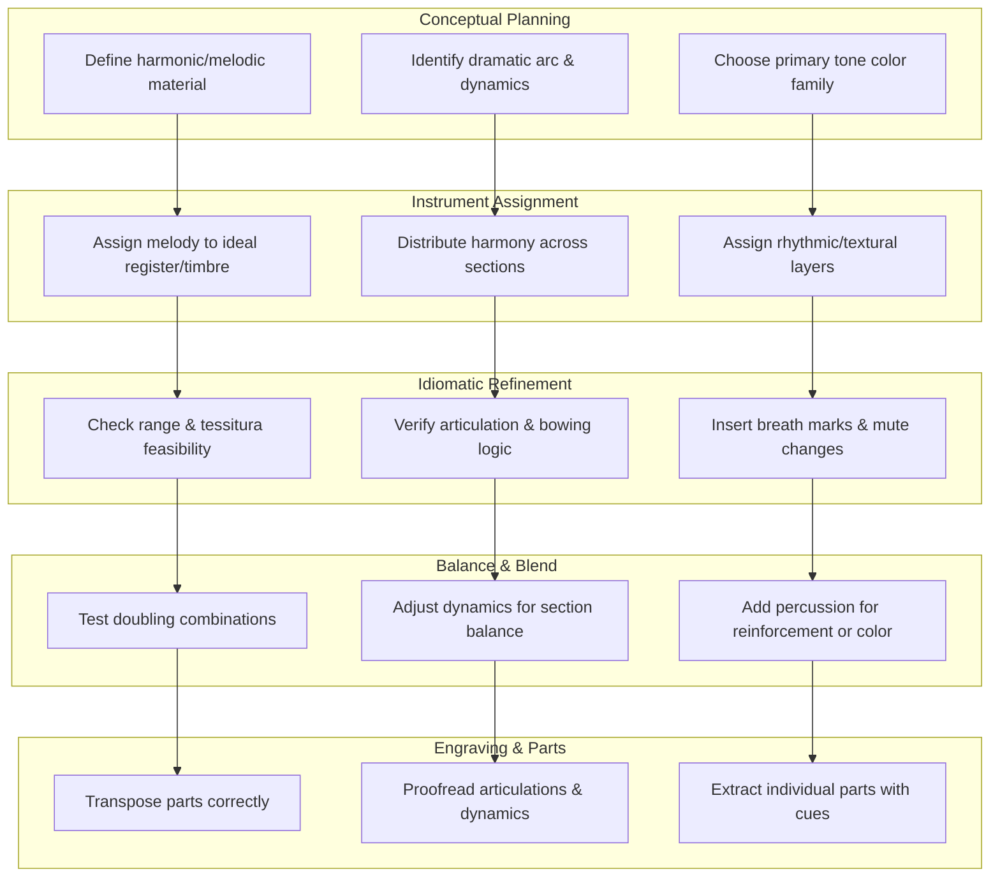

# Lesson 3: Scoring for Individual Instruments

## 1. First-Principles Intuition & Invariants

Every orchestral instrument is an acoustic resonator governed by three fundamental constraints: **physical mechanics** (how it vibrates), **biomechanical interface** (how the player controls it), and **psychoacoustic character** (how we perceive its timbre and blend). Master orchestrators write idiomatically not by memorizing ranges, but by internalizing each instrument's **natural resonance zones, articulation limits, and dynamic sweet spots**.

### Core Physical Principles

**String vibration:** A violin string vibrates as a standing wave, with overtone intensity determined by bow speed, pressure, and contact point (sul tasto = fewer harmonics, sul ponticello = harsh upper partials). The G string (G3) resonates the entire instrument body; the E string (E5–E7) projects with focused brilliance but can thin out if bowed too lightly.

**Air column resonance:** Wind instruments produce standing waves inside tubes. A flute's embouchure hole acts as a turbulent air jet oscillator—small lip adjustments shift the frequency. The lowest register (C4–C5) requires slow, warm air; the third octave (C6–C7) demands faster, focused air and higher lip tension. Overblowing unlocks harmonic series positions (octave, 12th, 15th).

**Membrane vibration:** Timpani heads vibrate in circular modes. Strike the edge (5–7 cm from rim) for fundamental pitch; strike the center for thuddy, pitch-ambiguous impact. Pedal tuning changes membrane tension in real-time, enabling glissandi across a perfect 5th.

**Lip reed brass:** Trumpet players create a "buzz" by tensioning lips inside the mouthpiece. The tube length (valves or slide) selects harmonic series partials. Low register (pedal tones) requires loose, relaxed embouchure; high register demands focused aperture and increased air speed. The "break" between partials (e.g., written C4 to D4) can crack if unsupported.

### Psychoacoustic Blend Zones

- **Strings in unison:** Violins double at the octave blend seamlessly; violas doubling violins at pitch create slight phase interference, adding warmth.
- **Woodwind choirs:** Flutes + oboes in unison produce a shimmery, slightly beating texture; clarinets + bassoons blend into a unified dark column.
- **Brass intonation:** Horn and trombone unisons lock easily due to similar harmonic spectra; trumpet + trombone unisons require careful dynamic balance (trumpet naturally cuts through).

## 2. Instrument-Specific Scoring Mechanics

### Strings (Violin, Viola, Cello, Double Bass)

#### Range & Timbre Zones

| Instrument | Open Strings | Practical Range | Character by Register |
|------------|--------------|-----------------|------------------------|
| Violin | G3–D4–A4–E5 | G3 → A7 | G string (G3–B4): warm, soulful; D/A strings: singing, expressive; E string (B5+): brilliant, penetrating |
| Viola | C3–G3–D4–A4 | C3 → E6 | C/G strings: dark, reedy; upper register: plaintive, tender |
| Cello | C2–G2–D3–A3 | C2 → A5 | C/G strings: sonorous bass; tenor register (A3–A4): vocal, lyrical; thumb position (A4+): intense, narrow |
| Double Bass | E1–A1–D2–G2 | E1 → G4 | Fundamental bass; orchestral parts rarely exceed A2 for clarity |

#### Bowing Techniques & Notation

**Détaché** (default): Smooth, separate bow strokes. Notate normally; add slurs for legato.

**Spiccato** (bouncing bow): Light, articulated notes. Notate with staccato dots; effective at **mf** to **f** dynamics, **♩ = 120–160 BPM**.

**Martelé** (hammered): Heavy, accented attacks. Notate with accent marks (>); best in **forte**, slower tempos (**♩ = 60–100 BPM**).

**Col legno** (with the wood): Tapping the string with the bow stick. Notate "col legno battuto" for percussive effects; produces minimal pitch, ghostly clicks.

**Sul ponticello** (near bridge): Glassy, metallic tone rich in high harmonics. Notate "sul pont."; effective for eerie textures at **pp–mf**.

**Sul tasto** (over fingerboard): Flute-like, soft tone with suppressed overtones. Notate "sul tasto"; ideal for **pp–p** ethereal passages.

**Tremolo** (rapid bow oscillations): Notate with three slashes through stem (♩̸̸̸). Sustains tension; effective at all dynamics.

#### String Harmonics

**Natural harmonics:** Lightly touch the string at nodal points (1/2, 1/3, 1/4, 1/5 of string length). Notate with diamond noteheads at touch point; sounds one or two octaves higher. Most reliable: octave (1/2), 12th (1/3), double octave (1/4).

**Artificial harmonics:** Finger a note firmly, then lightly touch a 4th above (sounds two octaves higher). Notate with solid notehead (fingered pitch) + diamond notehead (touched pitch). Produces pure, flute-like tone.

#### Practical Scoring Example: String Tremolo Crescendo

```
Violin I (div. a 2)
[Staff 1: A5 tremolo, pp → ff, 4 bars]
[Staff 2: E5 tremolo, pp → ff, 4 bars]

Violin II (div.)
[C5 tremolo, pp → ff, 4 bars]

Viola (unis.)
[A4 tremolo, pp → ff, 4 bars]

Cello (unis.)
[A3 tremolo, pp → ff, 4 bars]

Double Bass (unis.)
[A2 tremolo, pp → ff, 4 bars]
```

**Result:** A minor chord emerges from silence, exploiting each instrument's natural resonance (open A strings for violin, viola, cello, bass).

### Woodwinds (Flute, Oboe, Clarinet, Bassoon)

#### Range & Timbre Characteristics

| Instrument | Written Range | Transposition | Register Characteristics |
|------------|---------------|---------------|--------------------------|
| Flute | C4 → C7 (D7 practical) | Concert pitch | Low (C4–C5): breathy, soft; middle (C#5–C6): clear, expressive; high (C#6+): bright, piercing |
| Oboe | Bb3 → A6 | Concert pitch | Low (Bb3–Eb4): reedy, dark; middle (E4–G5): singing, plaintive; high (Ab5+): thin, strained |
| Bb Clarinet | E3 → C7 | Sounds M2 lower | Chalumeau (E3–Bb4): warm, hollow; throat tones (B4–Bb5): weak, avoid exposed; clarion (B5–C7): brilliant |
| Bassoon | Bb1 → Eb5 | Concert pitch | Low (Bb1–Bb2): growling, comic or ominous; tenor (C3–Eb4): vocal, expressive; high (E4+): reedy, strained |

#### Articulation & Tonguing

**Single tonguing:** Default articulation (ta-ta-ta). Clear up to **♩ = 132 BPM** for sixteenth notes.

**Double tonguing:** Alternating syllables (ta-ka-ta-ka). Enables rapid passages **♩ = 144+ BPM**. Notate normally; players apply automatically when needed.

**Flutter tonguing:** Rolling "R" while blowing. Notate "flutter" or abbreviate "flz."; creates buzzing, aggressive texture. Works best **mf–ff**.

**Slap tongue (winds, esp. clarinet/sax):** Tongue slaps against reed for percussive "pop." Notate with "X" notehead or "slap." Limited pitch definition; use sparingly.

#### Breath Phrasing & Rest Placement

Wind players must breathe every 8–12 seconds at moderate tempos. **Always insert breath marks (,) at natural phrase boundaries.** Avoid long sustained notes without staggered breathing (divisi breaths) or rotational phrasing.

**Staggered breathing notation:**
```
Flute I: [C5 whole note, breath after bar 2]
Flute II: [C5 whole note, breath after bar 1]
```
**Result:** Continuous sustained tone with imperceptible breaks.

#### Woodwind Doubling & Blend

**Flute + Oboe (unison):** Shimmering, slightly heterogeneous blend. Oboe core with flute halo.

**Clarinet + Bassoon (unison or octaves):** Dark, unified column. Excellent for melodic bass lines (Tchaikovsky Symphony No. 6, mvt. 1).

**Flute + Clarinet (octaves):** Flute sounds an octave higher; pure, clean blend.

### Brass (Trumpet, Horn, Trombone, Tuba)

#### Range & Practical Tessitura

| Instrument | Written Range | Transposition | Sweet Spot | Extreme Register |
|------------|---------------|---------------|------------|------------------|
| Bb Trumpet | F#3 → C6 | Sounds M2 lower | G4 → C5 (staff) | Above G5: tiring, brilliant but risky |
| F Horn | B2 → F5 | Sounds P5 lower | C3 → C4 (middle) | Above G4: exposed, prone to cracking |
| Tenor Trombone | E2 → F5 (Bb5 with trigger) | Concert pitch | Bb2 → F4 | Pedal tones (Bb1–E2): experimental, thuddy |
| Tuba | D1 → F4 | Concert pitch (or Bb, Eb, F) | F1 → Bb2 | Above C3: heavy, avoid sustained melodies |

#### Mute Techniques & Timbral Effects

**Straight mute:** Metallic, focused tone. Reduces volume slightly. Notate "con sord." (with mute), "senza sord." (remove).

**Cup mute:** Softer, distant tone. More volume reduction than straight mute.

**Harmon (wah-wah) mute:** Iconic jazz sound (Miles Davis). Stem in = tight, nasal; stem out = vocalized "wah."

**Stopped horn (+):** Insert hand fully into bell. Produces brassy, metallic tone **a semitone higher** than written. Notate with "+" above noteheads; limited dynamic range (**f–ff**).

**Hand-stopping (horn):** Gradual insertion for pitch bends and timbral shading. Notate with degree of closure.

#### Brass Blend & Balance

**Trumpet section (3 trumpets in unison/harmony):** Balanced choir at **mf–f**. Single trumpet at **ff** can overpower full strings.

**Horn section (4 horns):** Unisons lock beautifully; horns 1+3 vs. 2+4 create antiphonal effects. Horns blend with woodwinds (bottom of chords) or strings (sustained pads).

**Trombone trio:** Natural blend; often scored in close position triads (root, 3rd, 5th within an octave).

**Brass pyramid:** 3 trumpets, 4 horns, 3 trombones, 1 tuba. Foundational balance for tutti climaxes.

#### Practical Scoring: Brass Chorale (4-part harmony)

```
Trumpet in Bb (a 2): [Top two voices, mf]
Horn in F (4 players): [Alto and tenor voices, mp]
Trombone (3 players): [Tenor and bass voices, mf]
Tuba: [Bass voice, doubling Trombone 3 down an octave, mp]
```

**Balance rule:** Horns play one dynamic softer than trumpets; tuba underpins without overpowering.

### Percussion (Timpani, Snare, Bass Drum, Cymbals, Mallet Instruments)

#### Timpani: Pitch Instrument with Pedal Tuning

**Standard set:** 4 drums covering D2–D3, F2–C3, Bb2–F3, D3–A3. Pedal retuning requires **~4 seconds** per change.

**Articulation:**
- **Single stroke:** Clear, resonant pitch. Notate normally.
- **Roll (tremolo):** Sustained rumble. Notate with three slashes (♩̸̸̸). Use for crescendi, thunder effects.
- **Muffled/secco:** Dampen head with hand. Notate "secco." Produces dry thud.

**Strike zones:**
- **5–7 cm from rim:** Optimal fundamental pitch.
- **Center:** Ambiguous pitch, thuddy impact (avoid unless desired effect).

**Mallet selection:**
- **Soft felt:** Warm, round tone (**pp–mp**).
- **Medium felt:** Versatile (**mp–f**).
- **Hard felt/wood:** Crisp attack, bright (**f–ff**).

**Practical notation: Timpani glissando**
```
[Notate starting pitch D2, wavy line ascending to A2, duration 2 beats]
Mark "gliss." and "pedal."
```

#### Snare Drum, Bass Drum, Cymbals

**Snare Drum:**
- **Snares on:** Crisp, rattling. Notate normally.
- **Snares off:** Hollow tom-like tone. Notate "snares off."
- **Rolls:** Single-stroke roll (orchestral) vs. buzz roll (sustained). Notate with slashes.

**Bass Drum:**
- **Single hits:** Deep, resonant thud. Notate with accent for emphasis.
- **Rolls:** Ominous rumble. Avoid excessive force (muddy, loses pitch definition).

**Cymbals:**
- **Crash (2-plate):** Clashed together for explosive accent. Notate "2" above note, let ring or dampen ("l.v." = laissez vibrer).
- **Suspended cymbal:** Single plate, struck with mallets. Rolls create shimmering wash. Notate "susp. cym."

**Tam-tam (gong):** Large, unpitched gong. Soft mallet for deep rumble; hard mallet for bright crash. Notate "tam-tam."

#### Mallet Instruments (Glockenspiel, Xylophone, Vibraphone, Marimba)

| Instrument | Range | Transposition | Character |
|------------|-------|---------------|-----------|
| Glockenspiel | G5 → C8 | Sounds 2 octaves higher | Piercing, bell-like; cuts through tutti |
| Xylophone | C4 → C7 | Sounds 1 octave higher | Dry, wooden, percussive |
| Vibraphone | F3 → F6 | Concert pitch | Warm, shimmering (motor-driven resonators) |
| Marimba | C2 → C7 | Concert pitch | Warm, round; rich low register |

**Mallets:** Soft = warm, round; Hard = bright, articulate. Specify when critical ("soft yarn mallets").

**Rolls:** Two or four mallets alternate rapidly for sustained tone. Vibraphone motor adds vibrato (notate "motor on/off").

## 3. Idiomatic Writing & Troubleshooting

### Common Scoring Pitfalls

**1. Strings: Impossible string crossings**
- **Problem:** Writing rapid alternating notes across non-adjacent strings (e.g., G string to E string).
- **Solution:** Keep rapid passages on adjacent strings or same string (position shifts).

**2. Woodwinds: Ignoring register breaks**
- **Problem:** Melodic lines crossing clarinet's "break" (written B4–C5) at fast tempos.
- **Solution:** Keep rapid passages within one register, or slow tempo across breaks.

**3. Brass: Extreme high register for extended duration**
- **Problem:** Trumpet holding written A5 for 8 bars at **ff**.
- **Solution:** Rotate melodic peaks among players, or reduce duration/dynamic.

**4. Timpani: Insufficient retuning time**
- **Problem:** Pedal change from D2 to A2 with only one beat rest.
- **Solution:** Allow minimum 4 seconds (approximately 4 beats at ♩ = 60 BPM).

**5. Percussion: Overuse of cymbal crashes**
- **Problem:** Crash cymbals on every downbeat, masking orchestra.
- **Solution:** Reserve crashes for climactic moments; use suspended cymbal rolls for texture.

### Effective Doubling Strategies

**Melodic doubling:**
- **Strings + woodwinds:** Violins + flutes = brilliant; Cellos + bassoons = rich, dark.
- **Brass + strings:** Horns + violas = warm blend; Trombones + cellos = powerful unison.

**Harmonic doubling:**
- **Octave doubling:** Strengthens without thickening texture (e.g., bassoon doubling cello down an octave).
- **Unison doubling:** Thickens timbre (e.g., clarinets + horns in unison for dark chords).

**Textural doubling:**
- **Rhythmic unison:** All instruments play same rhythm, different pitches (monumental impact).
- **Sustained vs. moving:** Brass sustain harmony while strings play running figures.

### Notation Checklist for Copyists

1. **Transposing instruments:** Write trumpet in Bb, clarinet in Bb, horn in F, etc. (never concert pitch in parts).
2. **Articulation consistency:** If violins are slurred, ensure winds match phrase length.
3. **Dynamic placement:** Mark dynamics below staff for winds/brass, above for strings (standard engraving).
4. **Breathing commas:** Insert breath marks for winds every 8–12 seconds.
5. **Mute changes:** Allow 2–4 bars rest for mute insertion/removal (brass).
6. **Timpani tuning:** Specify initial pitches at movement start ("Timp. in D–A–D").
7. **Divisi clarity:** Mark "div." (divided) and "unis." (together) explicitly in string parts.

## 4. Hands-On Orchestration Drill: 4-Bar Crescendo

### Objective
Score a single-chord crescendo from **pp** to **ff** over 4 bars (4/4, ♩ = 60 BPM), utilizing progressive instrument entry for dramatic build.

### Instrumentation
2 Flutes, 2 Oboes, 2 Clarinets in Bb, 2 Bassoons, 4 Horns in F, 2 Trumpets in Bb, 3 Trombones, Tuba, Timpani, Strings (Vln I, Vln II, Vla, Vc, Db).

### Harmonic Target
C major triad (C–E–G–C), with added orchestral spacing.

### Scoring Strategy (Bar-by-Bar Entry)

**Bar 1 (pp):**
- Violins II: G4 tremolo, **pp**, sul tasto
- Violas: E4 tremolo, **pp**, sul tasto
- Cellos (half section): C3 tremolo, **pp**, sul tasto

**Bar 2 (p → mp):**
- Add Violins I: C5 tremolo, **p**, normale
- Add Flutes: C5 sustained, **p**
- Continue Vln II, Vla, Vc tremolo, crescendo to **mp**

**Bar 3 (mp → mf):**
- Add Horns (4): C3–E3–G3–C4 sustained, **mp**
- Add Clarinets: E5–G5 sustained, **mp**
- Add Double Basses: C2 sustained, **mp**
- All instruments crescendo to **mf**

**Bar 4 (mf → ff):**
- Add Trumpets: C4–E4 sustained, **mf**
- Add Trombones + Tuba: C2–E2–G2 sustained, **mf**
- Add Oboes: E5–G5 sustained, **mf**
- Add Bassoons: C3–E3 sustained, **mf**
- Add Timpani: C2 roll, **mf**
- All instruments crescendo to **ff**, arriving simultaneously at Bar 5 downbeat

### Engraving Output (Condensed Score Sketch)

```
Bar 1:
Vln II: [G4 tremolo, pp, sul tasto]
Vla: [E4 tremolo, pp, sul tasto]
Vc: [C3 tremolo, pp, sul tasto]

Bar 2 (cresc.):
Fl 1,2: [C5 whole note, p]
Vln I: [C5 tremolo, p]
Vln II, Vla, Vc: [continue tremolo, cresc. to mp]

Bar 3 (cresc.):
Hn 1,2,3,4: [C3, E3, G3, C4 whole notes, mp]
Cl 1,2: [E5, G5 whole notes, mp]
Db: [C2 whole note, mp]
All strings, winds: [cresc. to mf]

Bar 4 (cresc. to ff):
Ob 1,2: [E5, G5 whole notes, mf]
Bsn 1,2: [C3, E3 whole notes, mf]
Tpt 1,2: [C4, E4 whole notes, mf]
Tbn 1,2,3 + Tuba: [C2, E2, G2 whole notes, mf]
Timp: [C2 roll, mf]
All instruments: [cresc. to ff]
```

### Execution Notes
- **Strings lead:** Tremolo sustains build tension invisibly.
- **Winds reinforce:** Flutes add shimmer; horns add body.
- **Brass crown:** Trumpets and trombones arrive last for maximum impact.
- **Timpani anchor:** Roll solidifies C pedal point.

**Listening Reference:** Ravel, *Boléro* (progressive orchestral crescendo); Beethoven, Symphony No. 9, mvt. 4, bars 1–24 (emergent orchestration).

## 5. Orchestration Workflow Diagram



## 6. Advanced Techniques: Extended & Microtonal Effects

### Strings

**Bartók pizzicato (snap pizz.):** Pull string perpendicular to fingerboard; releases with sharp snap against wood. Notate with circle-plus symbol above note (⊕). Aggressive, percussive.

**Col legno tratto:** Drag bow wood across string (not battuto tap). Produces eerie, scratching glissando. Notate "col legno tratto."

**Subharmonics:** Bowing extremely slowly with heavy pressure below the bridge produces unstable undertones. Experimental; notate with detailed instructions.

### Woodwinds

**Multiphonics:** Fingerings that produce multiple pitches simultaneously. Instrument-specific; consult fingering charts (e.g., Bruno Bartolozzi). Notate all sounding pitches in chord.

**Key clicks:** Percussive clicking of keys without blowing. Notate with "X" noteheads, "key click."

**Circular breathing:** Continuous tone without breaks. Advanced technique; not all players proficient. Avoid assuming availability.

### Brass

**Lip bends:** Pitch inflections via embouchure. Notate with arrow or wavy line. Quarter-tone bends feasible on trombone and horn.

**Pedal tones (brass):** Notes below practical range, produced with loose embouchure. Trombone pedal Bb1, tuba pedal Bb0. Dark, breathy; notate normally with "ped."

### Percussion

**Bowed vibraphone/crotales:** Bow edge of bar for eerie, sustained tone. Notate "arco" or "bowed."

**Prepared piano (inside strings):** Percussion technique adapted from extended piano music. Not standard orchestral; requires setup time.

**Thundersheet:** Large suspended metal sheet, shaken for thunder effect. Notate "thundersheet," specify dynamic/duration.

## 7. Historical Orchestration Models

### Baroque (Bach, Handel)
- **Strings as foundation:** Continuo bass (cello + bassoon + harpsichord); violins carry melody.
- **Winds as color:** Oboes, trumpets, horns used for festive reinforcement, not independent lines.
- **Terrace dynamics:** Sudden shifts (forte/piano), no gradual crescendi.

### Classical (Haydn, Mozart, Beethoven)
- **Wind pairs:** 2 flutes, 2 oboes, 2 bassoons, 2 horns. Balanced, transparent textures.
- **Strings dominate:** Winds punctuate or sustain harmony.
- **Beethoven expansion:** Added piccolo, contrabassoon, trombones for dramatic climaxes (Symphony No. 5, 9).

### Romantic (Berlioz, Wagner, Tchaikovsky)
- **Massive forces:** Triple/quadruple winds, 8 horns, Wagner tubas, expanded percussion.
- **Timbral blending:** Winds and brass co-equal with strings; independent choirs.
- **Leitmotif orchestration:** Specific timbres assigned to dramatic themes (Wagner, *Ring Cycle*).

### Impressionist (Debussy, Ravel)
- **Color over form:** Delicate timbral blends, harp glissandi, muted brass, divided strings.
- **Unconventional doublings:** Flute + horn, clarinet + cello, creating ambiguous timbres.
- **Spatial effects:** Offstage brass, distant horns, antiphonal placement.

### Modern (Stravinsky, Bartók, Ligeti)
- **Percussive strings:** Col legno, Bartók pizzicato, extreme sul ponticello.
- **Micropolyphony:** Dense clusters (Ligeti, *Atmosphères*); individual instruments create mass texture.
- **Extreme registers:** Flute flutter-tonguing at C7, contrabassoon pedal tones, trumpet screams.

## 8. Practical Score Study Assignments

### Assignment 1: Timbre Analysis
**Score:** Ravel, *Daphnis et Chloé*, Suite No. 2, "Lever du jour"
**Task:** Identify all doublings in the sunrise crescendo (Rehearsal 154–161). Note which instruments enter at which dynamic level. Chart the instrumental blend strategy.

### Assignment 2: Register Mapping
**Score:** Stravinsky, *The Rite of Spring*, "Sacrificial Dance"
**Task:** Map the bassoon solo (opening) onto the instrument's range chart. Identify why it sounds strained. List all brass entrances and mark which are in "sweet spot" vs. extreme registers.

### Assignment 3: Orchestration Transcription
**Score:** Mussorgsky/Ravel, *Pictures at an Exhibition*, "The Great Gate of Kiev"
**Task:** Reduce the final tutti climax to short score (3–4 staves). Identify which instruments carry melody, harmony, rhythm. Re-orchestrate the same passage for reduced forces (2 Fl, 2 Cl, 2 Hn, Strings) maintaining dramatic impact.

### Assignment 4: Idiomatic Revision
**Exercise:** You are given a piano reduction with the following problematic bar:
```
Clarinet in Bb: [Rapid arpeggios crossing B4–C5 break, ♩ = 160 BPM]
Trumpet in Bb: [Sustained written B5, pp, 8 bars]
Timpani: [Pedal change D→G→C→F#→Bb, one beat per change]
```
**Task:** Identify all idiomatic problems. Rewrite the passage to be performable.

**Solution hints:**
- Clarinet: Rewrite arpeggios to stay in clarion register (above C5) or slow tempo.
- Trumpet: Lower to G5, shorten duration, or raise dynamic to **mp**.
- Timpani: Space tuning changes with 4-beat rests, or reduce number of pitches.

## 9. Orchestration Troubleshooting Table

| Symptom | Likely Cause | Solution |
|---------|--------------|----------|
| Melody inaudible in tutti | Insufficient doublings or buried in mid-register | Double melody at octave with penetrating timbre (trumpet, violin I) |
| Muddy low register | Too many instruments below C3 | Thin bass: one bass line (cello/bass/bassoon/tuba), not all together |
| Brass overpowers strings | Dynamics imbalanced | Brass one dynamic level softer than strings, or reduce number of brass |
| Woodwind chords sound thin | Spread too wide, gaps in overtone series | Close spacing in middle register; double at octaves |
| Strings sound scratchy | Bowing near bridge unintentionally, or too much bow pressure | Mark "normale" or "sul tasto"; reduce dynamic |
| Timpani pitch unclear | Struck in center, or mallet too soft | Specify "5 cm from rim," use medium felt mallets |
| Cymbal crashes muddy | Overlapping crashes without dampening | Mark "l.v." (let vibrate) selectively, dampen others immediately |
| Horn cracks on high notes | Exposed entrance above G4, or too loud | Approach high notes stepwise, reduce to **mf**, or double with trumpet |

## 10. Repertoire for Score Study (Ranked by Pedagogical Value)

### Foundational Clarity
1. **Mozart, Symphony No. 40 in G minor, K. 550** – Transparent Classical orchestration, clear wind/string hierarchy.
2. **Beethoven, Symphony No. 5 in C minor, Op. 67** – Motivic economy, dramatic brass additions (trombones in mvt. 4).

### Romantic Expansion
3. **Berlioz, *Symphonie fantastique*, Op. 14** – Pioneering coloristic orchestration, idiomatic writing for each instrument.
4. **Tchaikovsky, Symphony No. 4 in F minor, Op. 36** – Brilliant brass writing, lush string textures, virtuosic woodwinds.

### Impressionist Color
5. **Debussy, *La Mer*** – Delicate timbral blends, innovative doublings, spatial effects.
6. **Ravel, *Daphnis et Chloé*, Suite No. 2** – Masterclass in gradual textural accumulation and timbral fusion.

### Modern Techniques
7. **Stravinsky, *The Rite of Spring*** – Extreme registers, percussive strings, rhythmic complexity, unconventional doublings.
8. **Bartók, *Concerto for Orchestra*** – Showcase for every instrument family, extended techniques, folk-inspired rhythms.

### Micropolyphony & Clusters
9. **Ligeti, *Atmosphères*** – Dense string clusters, micropolyphonic textures, elimination of melody/rhythm.
10. **Penderecki, *Threnody for the Victims of Hiroshima*** – Extreme extended techniques, quarter-tone clusters, graphic notation.

---

**Next Steps:** Acquire full scores (IMSLP for public domain, rental for modern works). Analyze with colored pencils: melody = red, harmony = blue, rhythm/texture = green. Listen with score, following each instrument family. Transcribe short passages to internalize orchestrational thinking.
