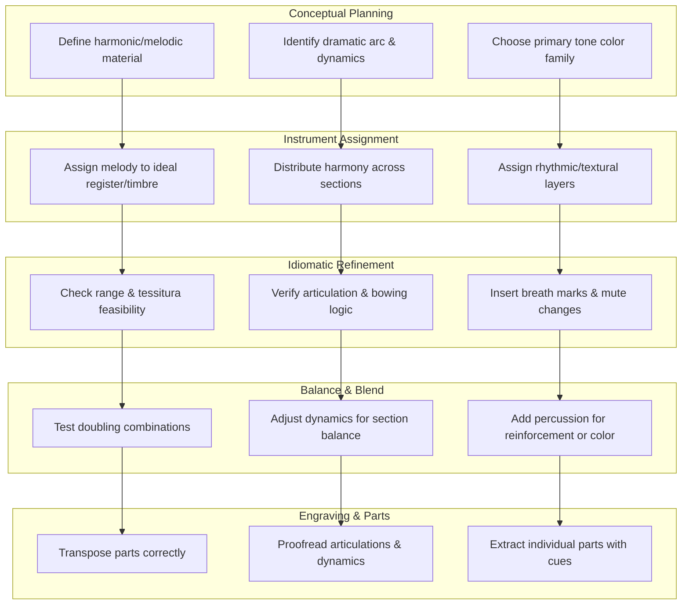

# Lesson 3: Scoring for Individual Instruments

## 1. First-Principles Intuition & Invariants

Every orchestral instrument is an acoustic resonator governed by three constraints: **physical mechanics** (how it vibrates), **biomechanical interface** (how the player controls it), and **psychoacoustic character** (how we perceive its timbre and blend). You don't write idiomatically by memorizing a range chart — you write idiomatically by knowing where an instrument *wants* to sit, where it's straining, and what happens to its tone color as it moves through registers.

### Core Physical Principles (kept to one paragraph each — the rest of this lesson is execution)

**Strings:** A bowed string is a standing wave; which overtones dominate depends on bow speed, pressure, and contact point relative to the bridge. Near the bridge (sul ponticello) you excite more high harmonics — glassy, metallic. Over the fingerboard (sul tasto) you suppress them — soft, flute-like. The open strings are resonance anchors: write a chord that includes an open string pitch and the whole instrument rings sympathetically.

**Winds:** A tube of air resonates at frequencies set by its effective length; overblowing (faster air, tighter aperture) jumps the player to a higher mode in the harmonic series (octave, 12th, double octave). Low notes want slow warm air and a relaxed aperture; high notes want fast, narrow, supported air. This is why a low flute note played too loud goes breathy and a high note played too soft cracks.

**Brass:** The player's lip-buzz is the oscillator; the tubing (valves/slide) selects which harmonic partial that buzz locks onto. Partials get closer together as you go up, which is why high passages are harder to center — the margin for embouchure error shrinks. "Breaks" between partials (shifting valve/slide combinations) are where cracked notes happen, especially under-supported or under-rehearsed.

**Timpani:** The head vibrates in circular (not linear) modes. Striking 5–7 cm from the rim favors the fundamental; striking the center excites inharmonic modes — thuddy, pitch-ambiguous. Pedal changes retension the head in real time, which is a mechanical act requiring the foot to travel and the head to settle — budget real seconds for it, not a wish.

### Psychoacoustic Blend Zones — the orchestrator's actual toolkit

- **Strings in unison/octave:** violins doubling violins at the octave blend seamlessly (same bow technique, same instrument family). Violas doubling violins at pitch (unison) create subtle beating from slightly different formant structure — this *adds* warmth rather than purity.
- **Woodwind choirs:** flute + oboe in unison beats slightly (different attack transients) — shimmering, alive. Clarinet + bassoon blend into one dark, covered column because both are predominantly odd-harmonic (clarinet) or formant-dark (bassoon) timbres.
- **Brass intonation:** horn + trombone unisons lock in easily (similar conical/cylindrical bore ratios and harmonic spectra). Trumpet + trombone unisons need deliberate balancing — trumpet's harmonic spectrum is brighter and cuts through at equal dynamic markings, so write trumpet one dynamic softer on paper if you want a true unison.

---

## 2. Instrument-Specific Scoring Mechanics

### Strings (Violin, Viola, Cello, Double Bass)

#### Range & Timbre Zones

| Instrument | Open Strings | Practical Orchestral Range | Character by Register |
|---|---|---|---|
| Violin | G3–D4–A4–E5 | G3 → C7 (write to A7 only for virtuoso solo passages) | G string (G3–B4): warm, husky; D/A strings: singing core of the instrument; E string above B5: brilliant, can turn shrill if forced |
| Viola | C3–G3–D4–A4 | C3 → G5 (E6 for solo exposure only) | C/G strings: nasal, dark, "reedy"; D/A strings and above: plaintive, slightly covered compared to violin |
| Cello | C2–G2–D3–A3 | C2 → G4 (A5 solo/thumb position) | C/G strings: sonorous bass register; A3–A4 (tenor, thumb-position entry): the "vocal" cello sound used for exposed melody; above A4: increasingly thin and effortful |
| Double Bass | E1–A1–D2–G2 (C1 w/ 5-string or C extension) | E1 → G3 for section writing; soloists to C4+ | Fundamental, foundation-only below E2; keep tutti bass parts at or below A2 for clarity — above that the pitch gets harder to perceive as "bass" |

**Practical rule:** never write a double bass line that mirrors the cello an octave below *and* expects both to carry equal melodic weight — the bass's fundamental is already diffuse above the staff, and the ear will track the cello, not the bass, as the "melody." Use the bass for foundation, let the cello carry the line.

#### Bowing Techniques & Notation — what to write, what you get, where it works

| Technique | Notation | Dynamic/Tempo Window | Result |
|---|---|---|---|
| Détaché (default) | plain notes, slur for legato | any | smooth separate bow strokes |
| Spiccato | staccato dots | mf–f, ♩=120–160 | light bouncing-bow articulation |
| Martelé | accent marks (>) | f, ♩=60–100 | heavy hammered attack, clean stop between notes |
| Col legno battuto | "col legno battuto" | any dynamic marking is nearly moot — it's always quiet | wood of bow taps string, ghostly clicks, almost no pitch |
| Sul ponticello | "sul pont." | pp–mf | glassy, metallic, high-harmonic-rich |
| Sul tasto | "sul tasto" | pp–p | soft, flute-like, overtone-suppressed |
| Tremolo | 3 slashes through stem | any | rapid bow oscillation, sustains tension at any volume |

**Why martelé and spiccato have tempo ceilings/floors:** martelé requires a full stop-and-release of bow pressure between notes — mechanically it can't go much past ♩=100 without turning into détaché. Spiccato relies on the bow's natural bounce (a function of bow weight and string tension) and below ♩=120 it starts to feel effortful and uneven; players will naturally convert it to detached strokes.

#### String Harmonics

**Natural harmonics:** touch the string lightly (don't press to the fingerboard) at a nodal point — half-length (octave), third-length (12th above), quarter-length (two octaves above). Notate with a diamond notehead at the touch point. These are the *reliable* ones; anything past the quarter-point gets unstable and player-dependent.

**Artificial harmonics:** finger the note firmly (this sets the "fundamental"), then lightly touch a perfect 4th above it with another finger on the same string — sounds two octaves above the fingered note. Notate solid notehead (fingered) + diamond notehead (touched, a 4th higher). Gives a pure, pinpoint, flute-like color but costs intonation security — don't ask for these in fast passagework.

#### Practical Scoring Example: String-Only Tremolo Crescendo (A minor, from silence)

```text
Violin I (div. a 2):  Staff 1 – A5 tremolo, pp → ff over 4 bars
                       Staff 2 – E5 tremolo, pp → ff over 4 bars
Violin II (unis.):    C5 tremolo, pp → ff over 4 bars
Viola (unis.):        A4 tremolo, pp → ff over 4 bars
Cello (unis.):        A3 tremolo, pp → ff over 4 bars
Double Bass (unis.):  A2 tremolo, pp → ff over 4 bars
```

**Why this works:** A3 (cello), A2 (bass), and A4 (viola) are *open strings* — the instrument bodies resonate sympathetically even at pp, so the chord has presence before the bow pressure ever increases. This is the mechanism behind the opening of countless symphonic slow introductions — you're not just writing dynamics, you're exploiting resonance.

---

### Woodwinds (Flute, Oboe, Clarinet, Bassoon)

#### Range & Timbre Characteristics

| Instrument | Written Range | Transposition | Register Characteristics |
|---|---|---|---|
| Flute | C4 → C7 (D7 for advanced players) | Concert pitch | Low (C4–C5): breathy, intimate, easily covered by other instruments; mid (C#5–C6): clear, singing, the workhorse register; high (C#6+): bright, piercing, cuts through full orchestra |
| Oboe | Bb3 → A6 | Concert pitch | Low (Bb3–Eb4): reedy, dark, slightly difficult to control softly; mid (E4–G5): the signature plaintive oboe color, best for exposed melody; high (Ab5+): thin, pinched, strained — use sparingly |
| Bb Clarinet | E3 → C7 | Sounds a major 2nd lower than written | Chalumeau (E3–Bb4): warm, hollow, rich; Change to: Throat tones (G4–Bb4): weak and stuffy, avoid exposing melodically; clarion (B4–C6): brilliant, the clarinet's 'singing' register. |
| Bassoon | Bb1 → Eb5 | Concert pitch | Low (Bb1–Bb2): growling — comic in fast rhythms, ominous when sustained; tenor (C3–Eb4): vocal, exposed-melody register; high (E4+): reedy, effortful, strained above F4 |

#### Articulation & Tonguing

| Technique | Notation | Tempo/Dynamic Window | Use |
|---|---|---|---|
| Single tonguing | plain articulation | clean to ♩=132 on 16ths | default |
| Double tonguing | plain articulation (player applies automatically) | ♩=144+ | rapid repeated-note passages |
| Flutter tonguing | "flutter" or "flz." | mf–ff | buzzing, aggressive texture |
| Slap tongue (clarinet/sax) | "X" notehead or "slap" | any, used sparingly | percussive pop, limited pitch definition |

#### Breath Phrasing — the constraint beginners ignore most

A wind player needs to breathe roughly every 8–12 seconds at a moderate tempo and dynamic (less at ff, where air consumption is higher). **Always place a breath mark (,) at a real phrase boundary** — never mid-word of a melodic idea. For a sustained chord that must not break, stagger the breaths across doubled parts:

```text
Flute I:  C5 whole note tied across 4 bars — breathe after bar 2
Flute II: C5 whole note tied across 4 bars — breathe after bar 1 and bar 3
```
Result: the ear hears one continuous tone; no single player's breath gap lines up with another's.

#### Woodwind Doubling & Blend

- **Flute + oboe (unison):** oboe supplies the harmonic "core," flute adds a breathy halo — shimmering, slightly heterogeneous.
- **Clarinet + bassoon (unison or octave):** dark, fused column — excellent for a melodic bass line (Tchaikovsky, Symphony No. 6, mvt. 1, opening bassoon solo doubled an octave below by... study that score).
- **Flute + clarinet (octaves, flute on top):** pure, clean, almost choir-like blend — very reliable combination for a melody that needs brightness without edge.

---

### Brass (Trumpet, Horn, Trombone, Tuba)

#### Range & Practical Tessitura

| Instrument | Written Range | Transposition | Sweet Spot | Extreme Register |
|---|---|---|---|---|
| Bb Trumpet | F#3 → C6 | Sounds M2 lower | G4 → C5 | Above G5: bright but tiring — rotate players or limit duration |
| F Horn | B2 → F5 | Sounds P5 lower | C3 → C4 | Above G4: exposed, prone to cracking on an unsupported entrance |
| Tenor Trombone | E2 → F5 (Bb5 w/ trigger) | Concert pitch | Bb2 → F4 | Pedal tones (Bb1–E2): usable but thuddy, treat as a special color |
| Tuba | D1 → F4 | Concert pitch (parts also exist in Bb/Eb/F) | F1 → Bb2 | Above C3: heavy and effortful — don't sustain a melody there |

#### Mute Techniques

| Mute | Effect | Notation |
|---|---|---|
| Straight | metallic, focused, modest volume cut | "con sord." / "senza sord." |
| Cup | softer, more distant than straight | "con sord." (specify "cup mute") |
| Harmon (no stem) | nasal, buzzy | "con sord." + "Harmon mute" |
| Harmon (stem in) | tight, pinched | specify "stem in" |
| Harmon (stem half-out, hand-wah) | the Miles Davis "wah" | specify "stem out, hand over bell" |
| Stopped horn | brassy, metallic, sounds a semitone **higher** than written — transpose the written pitch down a semitone to compensate | "+" above noteheads |

**Mute-change logistics:** inserting or removing a mute takes real time — give brass players **2–4 bars of rest** before a muted entrance or after a "senza sord." marking. One beat is not enough; you will get a late or fumbled entrance in rehearsal.

#### Brass Blend & Balance

- **3 trumpets** in unison/harmony balance at mf–f; a single trumpet at ff will bury a full string section.
- **4 horns:** unisons lock beautifully (same harmonic series behavior); horns 1+3 vs. 2+4 split for antiphonal writing. Horns blend downward into woodwind chords or sustain as a string-like pad.
- **3 trombones:** natural blend in close-position triads (root/3rd/5th within an octave) — this is the default "brass chord" voicing.
- **Brass pyramid** for tutti climax: 3 trumpets : 4 horns : 3 trombones : 1 tuba — this ratio is why Romantic-era scores sound "balanced" even at full volume; more trumpets than this and the top gets shrill, fewer horns and the middle thins out.

#### Practical Scoring: 4-Part Brass Chorale

```text
Trumpet in Bb (a 2):     top two voices, mf
Horn in F (4 players):   alto and tenor voices, mp   <- one dynamic softer than trumpet
Trombone (3 players):    tenor and bass voices, mf
Tuba:                    bass voice, doubling Trbn 3 an octave down, mp
```
**Balance rule in practice:** write horns a full dynamic marking below trumpets/trombones on the page, because horn's bell-forward projection is weaker than trumpet's direct-line projection even at "equal" dynamics — the markings need to compensate for the physical difference, not just represent the intended blend.

---

### Percussion (Timpani, Snare, Bass Drum, Cymbals, Mallets)

#### Timpani

**Standard 4-drum set:** D2–D3 / F2–C3 / Bb2–F3 / D3–A3. **Budget ~4 seconds per pedal change** — that's roughly 4 beats at ♩=60, or 2 beats at ♩=120. Less than that and the player is retuning by guesswork while playing.

| Technique | Notation | Effect |
|---|---|---|
| Single stroke | plain note | clear resonant pitch |
| Roll | 3 slashes through stem | sustained rumble, use for crescendi |
| Muffled/secco | "secco" | dry thud, hand-damped |

**Strike zone:** 5–7 cm from the rim = clean fundamental. Center strike = ambiguous thud (only use deliberately).

**Mallet choice:** soft felt (pp–mp, round), medium felt (mp–f, all-purpose default), hard felt/wood (f–ff, crisp attack).

#### Snare, Bass Drum, Cymbals

- **Snare:** snares on = crisp rattle (default); snares off = hollow tom tone (notate "snares off"). Orchestral roll = single-stroke roll notated with slashes; distinguish from drum-kit buzz roll if you specifically want the grainier sustained texture.
- **Bass drum:** single hits get an accent mark for emphasis; rolls create ominous rumble but lose pitch definition if struck too hard — don't over-force it.
- **Cymbals:** crash pair = explosive accent, mark "l.v." (laissez vibrer) to let ring, or write a follow-up dampening instruction. Suspended cymbal (single plate, mallet roll) = shimmering wash, notate "susp. cym."
- **Tam-tam:** soft mallet = deep rumble; hard mallet = bright crash. Always specify mallet hardness — it's the single biggest variable in the sound.

#### Mallet Instruments

| Instrument | Range | Transposition | Character |
|---|---|---|---|
| Glockenspiel | G5 → C8 | Sounds 2 octaves higher than written | Piercing, bell-like, cuts through full tutti |
| Xylophone | C4 → C7 | Sounds 1 octave higher than written | Dry, wooden, percussive attack |
| Vibraphone | F3 → F6 | Concert pitch | Warm, shimmering; motor-driven resonators add vibrato — notate "motor on/off" |
| Marimba | C2 → C7 | Concert pitch | Warm, round, rich especially in the low register |

Soft mallets = warm/round, hard mallets = bright/articulate. State mallet hardness explicitly whenever the color matters — don't assume the player's default choice matches your intent.

---

## 3. Idiomatic Writing & Troubleshooting

### Common Scoring Pitfalls

1. **Strings — impossible string crossings:** rapid alternation across non-adjacent strings (G string to E string, skipping two) is either unplayable at tempo or forces an audible scramble. *Fix:* keep fast passages on adjacent strings, or use position shifts on a single string.
2. **Woodwinds — ignoring register breaks:** fast lines crossing the clarinet break (written B4–C5) fight the instrument's mechanism (a dozen keys/fingers move simultaneously at that break). *Fix:* keep rapid runs within one register, or slow the tempo through the break.
3. **Brass — extended extreme-high duration:** trumpet holding a written A5 at ff for 8 bars will physically fatigue the player mid-phrase and the pitch/tone will degrade audibly by bar 5–6. *Fix:* rotate the line between two trumpets, or shorten the exposure.
4. **Timpani — insufficient retuning time:** a pedal change of a 5th or more needs real seconds, not a beat. *Fix:* minimum 4-beat rest at moderate tempo, or simplify the tuning sequence.
5. **Percussion — crash overuse:** a cymbal crash on every downbeat stops being a climax and starts being wallpaper, masking the orchestra underneath. *Fix:* reserve crashes for genuine arrival points; use suspended-cymbal rolls for sustained shimmer instead.

### Effective Doubling Strategies

- **Melodic doubling:** violins + flutes = brilliant top line; cellos + bassoons = rich dark line.
- **Cross-family doubling:** horns + violas = warm blended middle voice; trombones + cellos = powerful unified unison.
- **Octave doubling** strengthens a line without thickening its texture (bassoon doubling cello an octave below reinforces without muddying).
- **Unison doubling** thickens timbre by fusing two different spectra into one perceived color (clarinets + horns in unison darkens a chord).
- **Textural doubling:** rhythmic unison across families = monumental impact (tutti hits); sustained brass under moving string figuration = classic harmony-vs-motion layering.

### Notation Checklist for Copyists

1. Write transposing instruments in their transposed key in the parts — never concert pitch in a Bb trumpet or F horn part.
2. Match articulation across doubled lines (if violins are slurred, winds doubling them should phrase identically).
3. Standard engraving convention: dynamics below the staff for all instruments (including strings), and above the staff for vocal lines.
4. Insert breath commas for winds every 8–12 seconds of continuous playing.
5. Give brass 2–4 bars rest for mute insertion/removal.
6. State initial timpani tuning at the top of the movement ("Timp. in D–A–D").
7. Mark "div." and "unis." explicitly and unambiguously in every string part that splits or rejoins.

---

## 4. Hands-On Orchestration Drill: 4-Bar Crescendo

### Objective
Score a single C major chord crescendo from **pp** to **ff** over 4 bars (4/4, ♩=60), using progressive instrument entry for a dramatic build — the Boléro/Beethoven-9-finale model of orchestration.

### Instrumentation
2 Flutes, 2 Oboes, 2 Clarinets in Bb, 2 Bassoons, 4 Horns in F, 2 Trumpets in Bb, 3 Trombones, Tuba, Timpani, Strings (Vln I, Vln II, Vla, Vc, Db).

### Harmonic Target
C major (C–E–G–C).

### Bar-by-Bar Entry

**Bar 1 (pp):** Violin II — G4 tremolo, sul tasto. Viola — E4 tremolo, sul tasto. Cello (half section) — C3 tremolo, sul tasto.

**Bar 2 (p → mp):** Add Violin I — C5 tremolo, normale. Add Flutes — C5 sustained. Continue Vln II/Vla/Vc tremolo, crescendo toward mp.

**Bar 3 (mp → mf):** Add 4 Horns — C3/E3/G3/C4 sustained. Add Clarinets — E5/G5 sustained. Add Double Basses — C2 sustained. Everyone crescendos toward mf.

**Bar 4 (mf → ff):** Add Trumpets — C4/E4 sustained. Add Trombones + Tuba — C2/E2/G2 sustained. Add Oboes — E5/G5 sustained. Add Bassoons — C3/E3 sustained. Add Timpani — C2 roll. Full crescendo to ff, arriving together at bar 5 downbeat.

### Condensed Score Sketch

```text
Bar 1:
Vln II:  G4 tremolo, pp, sul tasto
Vla:     E4 tremolo, pp, sul tasto
Vc:      C3 tremolo, pp, sul tasto

Bar 2 (cresc.):
Fl 1,2:        C5 whole note, p
Vln I:         C5 tremolo, p
Vln II/Vla/Vc: continue tremolo, cresc. to mp

Bar 3 (cresc.):
Hn 1-4:  C3, E3, G3, C4 whole notes, mp
Cl 1,2:  E5, G5 whole notes, mp
Db:      C2 whole note, mp
All strings/winds: cresc. to mf

Bar 4 (cresc. to ff):
Ob 1,2:          E5, G5 whole notes, mf
Bsn 1,2:         C3, E3 whole notes, mf
Tpt 1,2:         C4, E4 whole notes, mf
Tbn 1,2,3 + Tuba: C2, E2, G2 whole notes, mf
Timp:            C2 roll, mf
All instruments: cresc. to ff
```

### Why this sequencing, specifically
- **Strings lead** because tremolo builds tension without a clear attack — the ear can't pin down exactly when the sound "started," which is what makes a crescendo from silence feel inevitable rather than triggered.
- **Winds add shimmer and body** in the middle because their steady-state tone fills the gaps between the strings' tremolo attacks.
- **Brass arrives last** because their harmonic spectrum is the brightest and most directional — saving them maximizes the perceived leap in intensity at the climax instead of spending that contrast early.
- **Timpani anchors** the bar-4 arrival because a roll on the root reinforces the fundamental exactly when the ear needs the pitch center confirmed under the loudest, most harmonically dense moment.

**Listening reference:** Ravel, *Boléro* (the textbook of this exact technique stretched over 15 minutes); Beethoven, Symphony No. 9, mvt. 4, bars 1–24 (emergent orchestration from near-silence to full statement).

---

## 5. Orchestration Workflow



---

## 6. Advanced Techniques: Extended & Microtonal Effects

### Strings

- **Bartók pizzicato (snap pizz.):** pull the string perpendicular to the fingerboard and release so it snaps back against the wood. Notate with ⊕ above the note. Aggressive, percussive — use for shock accents, not sustained texture.
- **Col legno tratto:** drag the wood of the bow across the string (not the tapping "battuto" version). Produces an eerie scratching glissando quality. Notate "col legno tratto."
- **Subharmonics:** extremely slow bow speed with heavy pressure below the bridge can produce unstable undertones below the fundamental. Experimental and player-dependent — write explicit instructions and don't expect reliability across a section.

### Woodwinds

- **Multiphonics:** special fingerings sound multiple pitches at once; every fingering is instrument-specific — consult a reference fingering chart (Bartolozzi is the standard source) rather than guessing. Notate all sounding pitches stacked as a chord.
- **Key clicks:** percussive key noise with no air column excitation. Notate "X" noteheads with "key click."
- **Circular breathing:** enables a truly continuous tone. Not every player has this skill — never assume it's available without checking with the specific performer/section first.

### Brass

- **Lip bends:** embouchure-driven pitch inflection, notate with an arrow or wavy line. Quarter-tone bends are realistic on trombone (slide) and horn (hand in bell); valve instruments bend less reliably.
- **Pedal tones:** notes below the practical written range, produced with a loose embouchure — trombone pedal Bb1, tuba pedal Bb0. Dark and breathy. Notate normally with "ped." as a reminder to the player.

### Percussion

- **Bowed vibraphone/crotales:** draw a cello/bass bow across the edge of the bar for an eerie sustained tone. Notate "arco" or "bowed."
- **Thundersheet:** large suspended metal sheet, shaken for a thunder rumble. Notate "thundersheet" with explicit dynamic and duration — this instrument has no "default" behavior, so under-specifying it guarantees an inconsistent result.

---

## 7. Historical Orchestration Models

**Baroque (Bach, Handel):** strings as foundation (continuo = cello + bassoon + harpsichord, violins carry melody); winds (oboes, trumpets, horns) as festive color rather than independent lines; terrace dynamics — sudden forte/piano shifts, no gradual crescendo.

**Classical (Haydn, Mozart, Beethoven):** paired winds (2 flutes, 2 oboes, 2 bassoons, 2 horns) in balanced, transparent texture; strings dominate, winds punctuate or sustain harmony; Beethoven expands the palette with piccolo, contrabassoon, and trombones for dramatic climax (Symphonies 5 and 9).

**Romantic (Berlioz, Wagner, Tchaikovsky):** massive forces — triple/quadruple winds, 8 horns, Wagner tubas, expanded percussion; winds and brass become co-equal choirs with strings rather than mere support; leitmotif orchestration assigns specific timbres to dramatic themes (Wagner's *Ring*).

**Impressionist (Debussy, Ravel):** color over architectural form; delicate blends, harp glissandi, muted brass, divided strings; unconventional doublings (flute + horn, clarinet + cello) create deliberately ambiguous composite timbres; spatial effects — offstage brass, distant horn calls, antiphonal placement.

**Modern (Stravinsky, Bartók, Ligeti):** percussive string techniques (col legno, Bartók pizzicato, extreme sul ponticello) become structural, not ornamental; micropolyphony stacks individual lines into a dense mass texture (Ligeti, *Atmosphères*); extreme registers pushed as expressive devices (flutter-tongued flute at C7, contrabassoon pedal tones, screaming trumpet).

---

## 8. Practical Score Study Assignments

**Assignment 1 — Timbre Analysis.** Score: Ravel, *Daphnis et Chloé* Suite No. 2, "Lever du jour." Identify every doubling in the sunrise crescendo (Rehearsal 154–161). Note which instrument enters at which dynamic. Chart the blend strategy bar by bar.

**Assignment 2 — Register Mapping.** Score: Stravinsky, *The Rite of Spring*, "Introduction" (Part 1). Map the opening bassoon solo onto the instrument's range chart and identify exactly why it sits in a strained register for that instrument. Catalogue all brass entrances and mark each as "sweet spot" or "extreme."

**Assignment 3 — Orchestration Transcription.** Score: Mussorgsky/Ravel, *Pictures at an Exhibition*, "The Great Gate of Kiev." Reduce the final tutti climax to a 3–4 stave short score, identifying which instruments carry melody, harmony, and rhythm. Then re-orchestrate the same passage for 2 Flutes, 2 Clarinets, 2 Horns, and strings, preserving the dramatic arc with a fraction of the forces.

**Assignment 4 — Idiomatic Revision.** You are handed this piano-reduction-derived draft:
```text
Clarinet in Bb: rapid arpeggios crossing the B4–C5 break, ♩=160
Trumpet in Bb:  sustained written B5, pp, held for 8 bars
Timpani:        pedal changes D→G→C→F#→Bb, one beat per change
```
**Task:** identify every idiomatic problem and rewrite the passage so it's actually performable.

**Solution hints:**
- Clarinet: restrict the arpeggio to the clarion register (stay above C5) or cut the tempo roughly in half across the break.
- Trumpet: lower the sustained pitch to G5, shorten the duration to 2–3 bars, or raise the dynamic to mp (pp at B5 for 8 bars is both exhausting and pitch-unstable).
- Timpani: a 4-beat rest per pedal change (minimum), or reduce the number of distinct pitches required in the sequence.

---

## 9. Orchestration Troubleshooting Table

| Symptom | Likely Cause | Solution |
|---|---|---|
| Melody inaudible in tutti | insufficient doubling, or buried in mid-register | double the melody at the octave with a penetrating timbre (trumpet, violin I) |
| Muddy low register | too many instruments stacked below C3 | thin the bass to one clear line (cello OR bass OR bassoon OR tuba, not all simultaneously) |
| Brass overpowers strings | dynamic markings don't compensate for projection difference | mark brass one full dynamic level softer than strings, or reduce the number of brass players doubling |
| Woodwind chords sound thin | voicing spread too wide, gaps in the implied overtone series | close the spacing in the middle register; reinforce with octave doubling |
| Strings sound scratchy | unintentional sul ponticello from bow position, or excess pressure | mark "normale" explicitly; reduce the dynamic marking |
| Timpani pitch unclear | struck at center, or mallet too soft for the dynamic | specify "5 cm from rim," use medium felt mallets |
| Cymbal crashes read as muddy | overlapping un-dampened crashes | mark "l.v." selectively, dampen the others immediately after the attack |
| Horn cracks on high entrance | exposed cold entrance above G4 at too high a dynamic | approach the high note stepwise from below, cap dynamic at mf, or double with trumpet for security |

---

## 10. Repertoire for Score Study (Ranked by Pedagogical Value)

**Foundational clarity:** Mozart, Symphony No. 40 in G minor, K. 550 (transparent Classical hierarchy); Beethoven, Symphony No. 5 in C minor, Op. 67 (motivic economy, dramatic late-movement brass additions).

**Romantic expansion:** Berlioz, *Symphonie fantastique*, Op. 14 (pioneering, rigorously idiomatic coloristic writing); Tchaikovsky, Symphony No. 4 in F minor, Op. 36 (brilliant brass, lush strings, virtuosic woodwinds).

**Impressionist color:** Debussy, *La Mer* (delicate blends, spatial effects); Ravel, *Daphnis et Chloé* Suite No. 2 (masterclass in gradual textural accumulation).

**Modern techniques:** Stravinsky, *The Rite of Spring* (extreme registers, percussive strings, unconventional doubling); Bartók, *Concerto for Orchestra* (showcase for every section, folk-rhythm orchestration).

**Micropolyphony & clusters:** Ligeti, *Atmosphères* (dense string clusters, elimination of melody/rhythm as organizing principles); Penderecki, *Threnody for the Victims of Hiroshima* (extended techniques, quarter-tone clusters, graphic notation).

---

**Next steps:** acquire full scores (IMSLP for public domain, rental/purchase for modern repertoire). Study with colored pencils — melody in red, harmony in blue, rhythm/texture in green. Listen with score in hand, tracking one instrument family per pass. Transcribe short passages by hand to internalize orchestrational thinking rather than just recognizing it.
