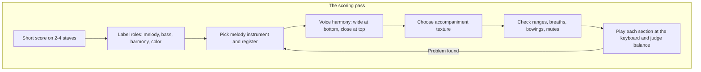
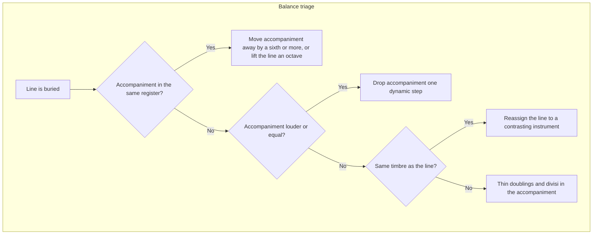
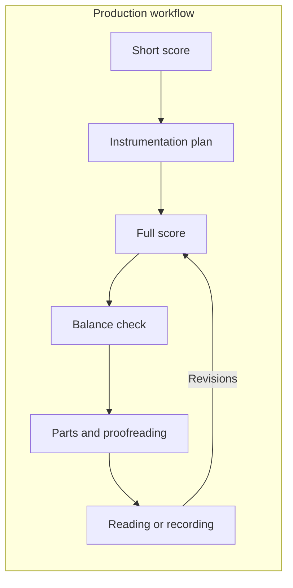

# Lesson 4: Orchestral Scoring, A Practical Masterclass

**Scope and assumptions.** This lesson covers turning a short score (2 to 4 staves) into a playable, balanced full score for a standard double-wind symphony orchestra (pairs of winds, 4 horns, 2 trumpets, 3 trombones, tuba, timpani, strings 16-14-12-10-8). All pitches in examples are **concert (sounding) pitch** unless marked "written". You need a pencil or notation program (Dorico, Sibelius, or free MuseScore 4), a keyboard for checking, and 30 to 45 minutes per drill.

By the end you should be able to:

- Choose an instrument and register for any melody.
- Voice a chord across the orchestra so it blends.
- Write four standard accompaniment textures.
- Build a crescendo by adding instruments.
- Diagnose and fix a buried line.
- Prepare parts that players can read on the first pass.

---

## 1. Working Principles (the 15% theory)

Every instrument produces a fundamental plus overtones, and the overtone mix (the spectrum) and the attack shape make up its timbre. Strings and double reeds are rich in upper partials. Flutes are purer. Clarinets in the low register emphasize odd partials because of their cylindrical bore. Two sources playing independently add in power, not in amplitude, so doubling an instrument adds only **+3 dB per doubling of player count**, and ten players are only about +10 dB louder than one. Perceived loudness roughly doubles for every +10 dB. Two things follow:

- Adding more of the same instrument buys little loudness. Changing register, timbre, or instrument family buys much more.
- The ear groups sounds that share pitch, onset, and timbre into one source (fusion), and it separates sounds that differ in those three. Your scoring decisions are choices about where to fuse and where to separate.

Three rules govern almost every scoring decision:

| Rule | What it means in practice | Your tool |
|---|---|---|
| **Balance** | Loudness is set by dynamic, register, and family, not by player count. | One dynamic step lower for accompaniment, brass one step below strings in a tutti, reduced doublings. |
| **Fusion vs. separation** | Same pitch plus similar timbre plus same attack equals one blended sound. Change one of the three to separate lines. | Octave placement, different articulations, contrasting instruments. |
| **Stream capacity** | Listeners follow about 3 to 4 foreground lines. Beyond that the texture becomes a mass. | Group instruments into blocks (4 horns = 1 stream) and keep a clear melody, bass, and one or two inner roles. |

**Masking** (a loud sound covering a quieter one nearby in frequency) is strongest within a critical band. This is about a third of an octave in the mid and upper range and about 100 Hz wide below 500 Hz. Two practical consequences:

1. Put accompaniment at least a sixth away from the melody in register, or one or two dynamic steps below it.
2. Spacing follows the harmonic series: wide intervals at the bottom (octaves, fifths), progressively closer toward the top.

**Lower interval limits (rule of thumb, concert pitch).** Below C3, use only octaves and fifths. Thirds are acceptable from about C3 upward. Seconds stay above middle C (C4) unless you want a deliberate growl.



---

## 2. Instrument Reference Card

Keep this open while you score. "Sounding" is concert pitch. Ranges are comfortable orchestral ranges, not extremes.

### 2.1 Strings (non-transposing except bass)

| Instrument | Sounding range | Sweet spot for melody | Trap |
|---|---|---|---|
| Violin | G3 to E7 (above A6 only for strong players) | E4 to E6 | Lowest octave is dark and weak against winds. |
| Viola | C3 to E6 (tutti top about A5) | C4 to A5, alto clef | Inner voice often vanishes in tutti unless doubled by horns or clarinet. |
| Cello | C2 to A5 (soloists higher) | G3 to C5 | Thirds below C3 are muddy. Tenor clef above about G3. |
| Double bass | E1 up to about G3 | Bass lines | Written an octave higher than it sounds. Fast notes blur, so double with cellos. |

### 2.2 Woodwinds

| Instrument | Written to sounding | Sounding range | Sweet spot | Trap |
|---|---|---|---|---|
| Piccolo | sounds 8va higher | D5 to C8 | Top-of-texture doubling at the octave | Shrill at ff in the top octave. |
| Flute | none | C4 to D7 | D5 to D6 | Lowest octave is breathy. Flat at pp, sharp at ff. |
| Alto flute (G) | sounds P4 lower | G3 to G6 | Dark, intimate pp solos | Soft. Needs the accompaniment at pp. |
| Oboe | none | Bb3 to A6 | D4 to A5 | Low notes are coarse. Very exposed at pp. |
| English horn (F) | sounds P5 lower | A2 to F5 | Melancholy solos | Slow to respond. Keep it away from fast lines. |
| Clarinet in Bb | sounds M2 lower | D3 to Bb6 | See register map below | Throat tones are weak and stuffy. |
| Clarinet in A | sounds m3 lower | C#3 to A6 | Flat keys vs. sharp keys: pick the one with fewer accidentals | |
| Bass clarinet (Bb) | sounds M9 lower | Db2 to G5 | Dark pads and bass doubling | Written in treble clef. Easy to mis-transpose. |
| Bassoon | none | Bb1 to Eb5 | Tenor register (C3 to G4) for plaintive melody | Top of range sounds strained at pp. |
| Contrabassoon | sounds 8vb | Bb0 and up | Reinforces the bass line | Slow speech. Not for fast figures. |

**Bb clarinet register map (written pitch):**

- **Chalumeau** E3 to F#4: dark, rich.
- **Throat tones** G4 to Bb4: weak, stuffy. Avoid long exposed notes here.
- **Clarion** B4 to C6: bright, lyric.
- **Altissimo** above C6: piercing.

The awkward crossing is Bb4 to B4 (the clarion break). Slurred passages across it are fine for a good player but should not be exposed pp.

### 2.3 Brass

| Instrument | Written to sounding | Sounding range | Notes |
|---|---|---|---|
| Horn in F | sounds P5 lower (written C5 sounds F4) | B1 to F5 (written F#2 to C6) | Blends with both winds and brass. Exposed high notes crack easily at pp. |
| Trumpet in Bb | sounds M2 lower (written C5 sounds Bb4) | E3 to Bb5 (written F#3 to C6) | Many orchestras use C trumpet (non-transposing). Check with the player or the contractor. |
| Trombone (tenor) | none | E2 to Bb5 | Bass and tenor clefs. Seven slide positions. |
| Bass trombone | none | down to about C2 (lower with triggers) | Usually on the 3rd trombone part. |
| Tuba | none | E1 to F4 | Foundation of the brass chord. Slow articulation. |

Valve logic: 1st valve lowers a whole step, 2nd a half step, 3rd a minor third. Combined valves fill the gaps between harmonics. You do not need this to score, but it explains why some notes are sharp and awkward.

### 2.4 Percussion, harp, keyboards

| Instrument | Notes |
|---|---|
| Timpani | Four drums cover roughly D2 to A3 (32", 29", 26", 23"). Pedal changes take a few seconds. Give large tuning changes at least 2 bars of rest at ♩=60. Mute with hand ("damp") for staccato. |
| Glockenspiel | Sounds two octaves above written. Cuts through any tutti. |
| Xylophone | Sounds an octave above written. Dry, fast, rhythmic. |
| Marimba, vibraphone | Sound as written. Marimba is warm and low. Vibraphone sustains and can have motor vibrato. |
| Celesta | Sounds an octave above written. Soft, glassy. |
| Harp | 47 strings, about Cb1 to G#7. Seven-pedal chromatic limits: write a pedal diagram or plan pedal changes. Glissandi sound the diatonic scale set by the pedals. |
| Snare, cymbals, bass drum, tam-tam | Indefinite pitch. Use for punctuation and climax, not for sustaining interest. |

### 2.5 Score order and stage plan

Top to bottom in the score: piccolo, flutes, oboes, English horn, clarinets, bass clarinet, bassoons, contrabassoon; horns, trumpets, trombones, tuba; timpani, percussion; harp, piano or celesta; solo parts; violins I, violins II, violas, cellos, basses.

A common stage plan (audience at bottom; orchestras vary):

```text
                   Timpani   Percussion
        Trumpets      Trombones     Tuba
   Horns       Bassoons      Clarinets
   Harp        Oboes         Flutes                Basses
   Violins I    Violins II     Violas      Cellos
                       [Conductor]
```

Some orchestras use antiphonal seating (violins II on the right), which gives a left-to-right dialogue between the violin sections. If your piece relies on that, write it in the score.

---

## 3. Core Procedures

### 3.1 Choose a melody instrument (4 questions)

1. **Range and tessitura.** Is the line mostly inside one instrument's sweet spot? Use section 2.
2. **Character.** Pick from this table.

| Character | First choices |
|---|---|
| Lyrical, sustained | Violins I, cellos, oboe, clarinet |
| Heroic, declamatory | Trumpet, horns in unison, trombones |
| Delicate, ethereal | Flute, solo violin, harp, celesta |
| Dark, mysterious | Bass clarinet, bassoon, violas, English horn |
| Plaintive, hollow | Bassoon (tenor register), clarinet chalumeau |

3. **Dynamic.** At pp, use flute (middle register), solo strings, or muted brass. At mf, any instrument in its sweet spot. At f or ff, use trumpet, full strings, or oboe or horns doubling.
4. **Articulation.** Fast detached lines suit strings, flutes, clarinets, and trumpets. Long legato lines suit strings, oboe, and horn. Marcato accents suit brass and double reeds.

**Worked example.** A lyrical melody in Bb major, range F4 to Bb5, mf. Candidates:

- Oboe: penetrates, singing in D4 to A5.
- Violins I: warm, supports a crescendo.
- Clarinet: smooth, but needs the accompaniment lower than for oboe.

Decision: oboe for the first phrase for clarity, then add Violins I an octave above for the second phrase (a stepwise change of color through doubling).

### 3.2 Voice a chord for full orchestra

**Voicing rules:**

- Space as the harmonic series does: octave, fifth, then thirds close together toward the top.
- Double roots and fifths in the lower half. Place the third in the middle or upper register.
- Do not double the leading tone. Avoid doubling the third of a minor chord in the bass.
- Give each family a clear role: strings carry the body, winds add color on top, brass add weight at a lower dynamic.

**Worked example: C major chord, mf, concert pitch.**

| Pitch (sounding) | Strings | Woodwinds | Brass |
|---|---|---|---|
| C5 (melody) | Violins I | Oboe 1; Clarinet 1 (written D5); optional Flute 1 at C6 | |
| G4 | Violins II | Clarinet 2 (written A4) | |
| E4 | Violas | | Horn 1 (written B4) |
| C4 | | | Horn 2 (written G4) |
| G3 | Cellos I | Bassoon 1 | Horn 3 (written D4), Trombone 1 |
| E3 | | | Trombone 2 |
| C3 | Cellos II | Bassoon 2 | Horn 4 (written G3) |
| C2 | Basses (written C3) | | Bass trombone, tuba |

**Dynamics.** Strings mf, woodwinds mf (melody doubling), brass mp. Brass sit below because they carry more power per player and would otherwise dominate.

**Keyboard check (Piano, left and right hand).** Hold C2 with the pedal. Left hand plays C3 (5) and G3 (1). Right hand plays E4 (1), G4 (3), C5 (5). You are hearing the voicing: wide at the bottom, closer at the top.

**Common voicing errors:**

| Error | Symptom | Fix |
|---|---|---|
| Muddy bass | Complete triads below C3 | Use only roots and fifths (and octaves) below C3. |
| Buried melody | Top line is no louder than inner voices | Add a brighter doubling (oboe, muted trumpet) or move the melody up an octave. |
| Color jump mid-phrase | Sudden change of instrument | Overlap instruments for at least one beat on a shared note (see 3.7). |
| Chord too thick | Every instrument plays every chord tone | Remove doublings until each pitch has two or three players. |

### 3.3 Accompaniment textures

All grids below are in 4/4. "1 & 2 &" marks eighth-note positions.

**Texture A: Sustained pad**
- Strings: violas and cellos, long bows, poco vibrato, p.
- Horns 1 to 4 in close position, mp.
- Dynamic one to two steps under the melody.
- Use when the melody is lyrical and exposed.

```text
Violas (div. a2):  E4 (whole)   | E4 (whole)   |
                   C4 (whole)   | C4 (whole)   |   p, molto legato
Cellos:            G3 (whole)   | G3 (whole)   |
Horns 3 & 4:       G3 / C3 (whole notes)        |
```

**Texture B: Arpeggiated figure (♩=120, mp, leggiero)**
- Violins II and violas, pizzicato or light detached. Or harp, rolled upward.
- Alternate flutes and clarinets on the top note of each beat for timbral variation.

```text
Violin II:  E4 G4 C5 E5 | G5 E5 C5 G4 |    (eighths, 1 & 2 & 3 & 4 &)
Harp:       C2 ..  G3 ..  E4 ..  C5 ..     (rolled upward, mp)
Cello:      C3 (half)     | G3 (half)     |  pizz.
```

**Texture C: Rhythmic ostinato (♩=132, f, marcato)**

```text
Beat:         1  &  2  &  3  &  4  &
Violins:      -  C5 -  C5 -  C5 C5 C5      (detached, near the bow tip)
Horns 1-4:    -  C4/E4 chord -  C4/E4 chord -  -  -   (short stabs)
Violas/Vc:    C3 -  -  -  C3 -  -  -       (quarter-note pulse)
Timpani:      C2 -  -  -  C2 -  -  -       (hard sticks, damped)
```

Cut the ostinato whenever a melody enters at p or mp, or the pulse will bury it.

**Texture D: Contrapuntal figuration**
- Give each line a different timbre and separate registers by at least an octave.
- Both lines at mf, one clearly articulated, one legato.

```text
Oboe:     C5 D5 E5 F5 E5 D5 C5 B4     (eighths, descending shape)
Bassoon:  C3 .  G3 .  F3 .  E3 .      (quarters, leaps)
```

### 3.4 Balance and masking: a three-fix diagnostic

When a line is buried, work through these three questions in order. Most problems are solved at the first "Yes".



**Worked case: masked oboe solo.**

- Oboe solo, C5 to E5, mf.
- Violins II tremolo C5 to E5, mf.
- Violas tremolo C4 to E4, mf.
- Clarinets sustained G4 to C5, mf.

Problem: the strings and clarinets sit in the same register and dynamic as the oboe.

Fix 1 (conservative): drop Violins II and violas to p, remove the clarinets.

Fix 2 (register): keep all dynamics, but move Violins II tremolo down an octave (C4 to E4), violas to C3 to E3, and clarinets out. The oboe now owns 500 to 1300 Hz alone.

Fix 3 (texture): change Violins II to sul tasto tremolo at pp. Sul tasto cuts the upper harmonics that compete with the oboe.

### 3.5 Additive crescendo

Keep the melody and harmony constant and change only the orchestration. This is the Boléro method.

**32 bars, 4/4, ♩=76 (about 1:41). Melody is a simple 4-bar phrase repeated.**

| Bars | Added | Dynamic | Purpose |
|---|---|---|---|
| 1 to 4 | Flute 1 solo (C5 to C6 range) | pp | Single clear color. |
| 5 to 8 | Clarinet 1 counterline (chalumeau or low clarion), harp arpeggios | pp | Second timbre, wider register. |
| 9 to 12 | Violins II and violas pizzicato, oboe 1 doubles flute | p | Strings enter softly, harmony begins. |
| 13 to 16 | Cellos arco pad, flute and clarinet rise | mp | Bass register added. |
| 17 to 20 | Violins I take the melody, flute doubles at 8va, horns 1 and 2 sustained | mp to mf | Melody changes color, brass appears softly. |
| 21 to 24 | Bassoons double cellos, timpani roll | mf | Low register thickens. |
| 25 to 28 | Trumpet 1 doubles melody, all winds and strings | f | Brightest timbre enters. |
| 29 to 31 | Trombones, tuba, basses, snare roll | ff | Full low end and rhythmic drive. |
| 32 | Cymbal crash, full tutti | fff | Peak. |

Rules that make this work:
1. Add one new timbre every two to four bars.
2. Alternate expanding the register upward and downward. Save the lowest register and the percussion for the last quarter.
3. Do not raise the dynamic of every instrument at once. Let the added instruments carry most of the growth.

### 3.6 Hand-offs between colors

| Technique | Procedure | Example |
|---|---|---|
| **Overlap** | Outgoing and incoming instruments play the same line for 1 to 4 bars. Cross at equal dynamic. | Strings mf to p while winds p to mf over 4 bars. |
| **Pivot** | One instrument that blends with both groups holds through the change. | Horn holds through a strings-to-winds transition. |
| **Register shift** | Move the line to a new register as the color changes. | Cellos (C3 to C4) joined by violins an octave higher, then cellos drop out. |
| **Shared note** | The incoming instrument enters on the same pitch the outgoing one is holding. | Oboe enters on the last note of a flute phrase. |

Match articulation during the overlap or the seam will show.

### 3.7 Attack and rhythm clarity

Different instruments respond at different speeds. Low brass, tuba, basses, and cellos speak later than flutes and timpani. In a tutti with a sharp attack:

- Give slow-speaking instruments shorter notes, a clear accent, or a staccato marking (not a long soft attack).
- Add timpani, pizzicato basses, or a hard-stick percussion hit on the beat to give everyone a common transient.
- Do not mix staccato strings with legato winds in the same rhythm. The mix blurs the pulse.
- Use matching bow direction: mark all down-bows for a heavy tutti accent.

**Tutti attack drill (rehearsal exercise).** Whole orchestra plays unison quarter notes at ♩=60, ff. Rehearse in stages:

1. Strings alone, all down-bow.
2. Winds alone, hard "ta" attack.
3. Brass alone, firm attack.
4. Combine in pairs: strings plus winds, strings plus brass, winds plus brass.
5. Full orchestra. The conductor adjusts the preparatory beat and the players adjust by ear.

---

## 4. Extended Techniques Cheat Sheet

### 4.1 Strings

| Technique | Notation | Sound | Use with | Caution |
|---|---|---|---|---|
| **Divisi (a2, a3)** | "div." then "unis." | Fuller chord inside the section. A3 divisi on 16 violins is about 5 to 6 players per part, roughly 5 dB softer per part. | Chords of 5 to 8 notes | Never fewer than 2 players per part. Mark "unis." clearly. |
| **Con sordino** | "con sord." | Veiled, softer, brighter partials reduced | Night scenes, backgrounds | Allow time to put on and remove the mute (about 1 bar at ♩=60). |
| **Sul ponticello** | "sul pont." | Glassy, metallic, high partials | Tremolo ppp to pp for ghostly color | Fragile at louder dynamics. |
| **Sul tasto / flautando** | "sul tasto" | Soft, hollow | Quiet accompaniment | Return with "ord." |
| **Col legno battuto** | "col legno batt." | Dry click, no clear pitch | Whole section, rhythmic | Players often use a spare bow. Give at least 2 beats to change. |
| **Bartók pizzicato** | circle with line through top | Loud snap on the fingerboard | Accents | Hard on strings. Use sparingly. |
| **Natural harmonics** | small circle above note | Pure, flute-like | Doubled with flute at unison | Not every pitch is available. Check with a player. |
| **Artificial harmonics** | diamond notehead over stopped notehead | Two octaves above the stopped note, very pure | Solo or section passages | Advanced. Avoid fast passages. |
| **Tremolo (measured / unmeasured)** | three slashes on stem | Unmeasured is a shimmer. Measured gives rhythm. | Pads and climaxes | Unmeasured is easier and more reliable. |

### 4.2 Winds

| Technique | Notation | Sound | Caution |
|---|---|---|---|
| **Flutter-tongue** | "flz." plus three slashes | Rapid growl (roughly 15 to 30 Hz amplitude modulation) | Works best in flute, piccolo, trumpet. Less effective in the low register. |
| **Multiphonics** | Stacked noteheads plus fingering diagram | Complex multi-pitch sound | Fingerings are instrument-specific. Consult the player. Rarely appropriate for orchestral winds in section. |
| **Whistle tones / jet whistle** | Text instruction | Soft, airy high tones (whistle tone) or a gliding rush of air (jet whistle) | Specify clearly. Players interpret differently. |
| **Staggered breathing** | Slur with breath marks offset between players | Continuous sustained note | See section 6. |

### 4.3 Brass

| Mute / technique | Notation | Effect | Notes |
|---|---|---|---|
| **Straight mute** | "con sord." | Thin, nasal, distant | Reduces loudness noticeably and shifts the spectrum upward. |
| **Cup mute** | "cup mute" | Warm, muffled | Specify the type. "con sord." defaults to straight. |
| **Harmon mute** | "harmon, stem in / out" | Metallic, narrow | Jazz and film. Stem out gives the classic "wah". |
| **Plunger** | "+" closed, "o" open | Variable wah | Player needs a free hand. |
| **Stopped horn** | "+" above note | Brassy, nasal, buzzy | Write the normal transposed pitch with the "+". The player adjusts fingering for the pitch change. |
| **Cuivré** | "cuivré" | Forced, brassy tone on horn | Use for fanfares and climaxes. |

Mute changes need rest time: allow 4 to 8 seconds (2 bars at ♩=60 in 4/4 or longer).

---

## 5. Intonation Basics for Blended Chords

Strings, winds, and brass adjust pitch by ear. Keyboards, harp, mallets, and fixed-pitch percussion cannot. Pure intervals (just intonation, JI) beat less. Equal temperament (ET) is a compromise.

| Interval | JI (cents) | ET (cents) | Difference |
|---|---|---|---|
| Major third | 386 | 400 | ET is 14 cents wider |
| Perfect fifth | 702 | 700 | ET is 2 cents narrower |
| Minor third | 316 | 300 | ET is 16 cents narrower |
| Harmonic seventh | 969 | 1000 | ET is 31 cents wider |

**Rules:**

- With only strings, winds, or brass: tune thirds low (pure) and fifths pure. Chords lock and the beating stops.
- With piano, harp, or marimba: strings and winds must move toward ET. Expect slightly wider thirds.
- Tune sustained chords from the bottom up. The bass and fifth set the foundation, and then the third adjusts.
- Leading tones (the seventh scale degree) sit slightly high in expressive playing.

**Chord-tuning drill (C major, 4 bars, ♩=60, strings).** Reference cello C3 = 130.8 Hz.

| Part | Note | JI frequency | ET frequency |
|---|---|---|---|
| Cello | C3 | 130.8 Hz | 130.8 Hz |
| Violas | E4 | 327.0 Hz | 329.6 Hz |
| Violins II | G4 | 392.4 Hz | 392.0 Hz |

Procedure:
1. Play the chord at mf. Listen for beating, usually in the third.
2. If the third beats, lower it by about 10 to 14 cents toward JI.
3. If the fifth beats, adjust the less structural note to match the bass.
4. Repeat until beating is below about 1 Hz.
5. Memorize the feel and apply it to other chords.

**Common errors:**

| Symptom | Cause | Fix |
|---|---|---|
| Fast 4 to 8 Hz beating in a third | Third is too wide (near ET) | Lower the third. |
| Slow 1 to 3 Hz beating on octaves | Octave mismatch | Match by ear to the bass. |
| Winds sharp relative to strings late in the concert | Warm air raises wind pitch | Winds pull out slightly. Tune again during a rest. |

---

## 6. Endurance and Breathing

Use these as writing guidelines, not hard limits.

**Brass**
- Sustained loud playing or high register for more than about 1 to 2 minutes causes fatigue (pitch sag, cracked notes).
- Give at least 30 to 60 seconds of rest or soft, low playing after a heavy section.
- Reserve fff for the true climax, and keep it short.

**Strings**
- Continuous ff tires the bow arm after a few minutes. Alternate arco and pizzicato for relief.
- Very fast string crossings are tiring, so plan rests between them.
- A bow stroke lasts roughly 6 to 8 seconds at moderate dynamics. Longer sustained notes need bow changes, which are subtly audible. Use staggered bowing ("circular bowing") in pads.

**Woodwinds**
- Plan a breath every 4 to 8 seconds in loud, high-register, or low-register passages (flute and bassoon use the most air). Oboe and clarinet can sustain longer.
- Mark breath commas where you want them and give breath rests in the parts.

**Staggered breathing for held notes (Flute 1 and 2):**

```text
Bar:      1     2     3     4     5     6
Flute 1:  C5 ------------ (dim.) breathe   C5 -------- 
Flute 2:                  C5 (cresc.) ------------------ (dim.)
Result:   continuous C5, one flute always sounding
```

---

## 7. Hall Acoustics and Space

| Hall type | RT60 | Effect | Adjustment |
|---|---|---|---|
| Dry | under 1.5 s | Clear, fast passages, but sustained chords sound thin | Use legato, vibrato, longer overlaps. |
| Moderate | about 1.8 to 2.2 s | Balanced | Standard practice. |
| Reverberant | over 2.5 s | Sustains chords, smears fast notes | Simplify fast passages, thin texture, add rests between phrases. |

**Example.** A sixteenth-note passage at ♩=144 is 9.6 notes per second. At ♩=120 it is 8 per second. In a reverberant hall, either slow it slightly or add staccato and thin the accompaniment.

**Distance.** Sound drops about 6 dB per doubling of distance in free field. Offstage instruments sound much quieter than the marking suggests. Mark the dynamic you want, then test in the hall and adjust. Sound travels about 3 ms per meter, so a band 30 meters away is about 90 ms late. Use a monitor and an assistant conductor.

---

## 8. Troubleshooting Table

| Symptom | Likely cause | Fix |
|---|---|---|
| Melody inaudible in tutti | Same register and dynamic as accompaniment | Section 3.4 triage. |
| Brass overpowers strings | Equal dynamic marking | Brass one step lower, or add string doublings. |
| Inner voices (violas, second clarinet) missing | Covered by melody and bass | Double with a brighter instrument (oboe, horn). |
| Bass line unclear in loud sections | Mid-register masking, slow low instruments | Double with timpani on strong beats, thin the mid-register, add tuba or bass trombone. |
| Fast passage smears | Reverberant hall or too many players on a fast figure | Slow the tempo, add staccato, reduce divisi. |
| Chords muddy | Thirds too low, too many doublings | Section 3.2: open the bass voicing, cut doublings. |
| Tutti attack ragged | Slow-speaking instruments, mixed articulations | Section 3.7. |
| Solo wind lost against strings | Strings too loud or same register | Strings down to pp, or move strings away from the solo register. |
| Cracked high horn notes at pp | Exposed high note | Raise the dynamic, give a stronger approach, or reassign. |
| Mute change mistakes | Not enough rest time | Allow 4 to 8 seconds. |
| Percussion too loud | Mallet too hard, dynamic too high | Change mallet type or position, or lower the dynamic. |

---

## 9. Case Studies: What to Steal

### 9.1 Ravel, *Boléro* (1928): additive orchestration

- One theme (two alternating melodic halves) is stated 18 times, with a constant snare drum ostinato underneath.
- The orchestration changes with every statement: flute, clarinet, bassoon, E♭ clarinet, oboe d'amore with oboe and clarinet, trumpet with flute, tenor saxophone, sopranino and soprano saxophone, and so on, until the strings and brass take over.
- One statement uses horn with celesta and two piccolos in parallel, a mixture that functions like an organ stop.
- The only changes in the last statement are a modulation to E major and louder dynamic. The crescendo is created by orchestration.

**Use it:** the crescendo plan in 3.5 and drill 8.3.

### 9.2 Stravinsky, *The Rite of Spring* (1913): timbral blocks

- In "Augurs of Spring" (opening of the section, rehearsal 13), the strings repeat a stacked chord (E♭ dominant seventh over a E♭-flat major / F♭ major triad) in eighths with irregular accents, all down-bow.
- Eight horns reinforce the accents.
- Instruments are used as unified blocks rather than blended colors.

**Use it:** use rhythm and accent placement to shape orchestration, not just pitch. Study how the horns and strings are kept in the same rhythm so the accents land as one event.

### 9.3 Mahler, Symphony No. 2, finale: offstage space

- Offstage brass and percussion create a sense of distance in the finale's apocalyptic section.
- Foreground and background layers are clearly separated by dynamic: onstage forces play at f to ff, offstage forces at much softer levels.

**Use it:** build depth by contrast of dynamic and position. Plan for an assistant conductor and monitors for the offstage group.

### 9.4 Debussy, *La Mer* (1905): color handed between instruments

- Study movements I and III for how fragments pass between woodwinds, how divisi strings with tremolo and mutes create a shimmering texture, and how harp and percussion add color without leading.
- Look at how often melodic fragments overlap between instruments so no single timbre dominates.

**Use it:** the hand-off techniques in 3.6.

**Recommended study texts:** Rimsky-Korsakov, *Principles of Orchestration* (free on IMSLP). Samuel Adler, *The Study of Orchestration*. Elaine Gould, *Behind Bars* (notation). Scores of the pieces above on IMSLP.

---

## 10. Workflow: Sketch to Parts



### 10.1 Stages

**Stage 1: Short score.** Write melody, harmony, and bass on 2 to 4 staves. Include dynamics and phrase marks. Play it on the keyboard. If it does not work here, scoring will not save it.

**Stage 2: Instrumentation plan.** Annotate the short score by phrase. Example:

```text
Bars 1-8:   Melody: oboe.     Harmony: strings (div.).    Bass: cellos + basses pizz.
Bars 9-16:  Melody: Vln I.    Harmony: flutes, clarinets. Bass: bassoons.
Bars 17-24: Transition: oboe to Vln I overlap, add horns.
```

**Stage 3: Full score.** Set up the template in standard order. Transfer melody, then bass, then harmony, then doublings and textural fills. Check against this list:

- Every pitch inside the instrument's range?
- Fast passages inside the articulation limits?
- Breath marks and bowings marked?
- Mute changes given enough rest (4 to 8 seconds)?
- No section playing ff continuously for more than about 2 minutes?
- Transposition checked on every transposing part?

**Stage 4: Balance check.** Review every tutti passage. Melody should sit one or two dynamic steps above accompaniment in the same register. Use the triage chart in 3.4.

**Stage 5: Parts.** Extract each part, add rehearsal letters or numbers (matching the score), measure numbers, cues, and page turns. Plan turns on rests (at least about 4 seconds, longer at faster tempi) or use "V.S." Proofread the parts against the score. Mark transposition clearly ("Clarinet in Bb," "Horn in F").

### 10.2 Notation software

- **Dorico, Sibelius, MuseScore 4** are all suitable. Finale is no longer in development, so do not start new projects in it.
- Use an orchestral template with the standard score order.
- Enter music with a MIDI keyboard (step-time: rhythm first, then pitches) and add dynamics and articulations as you go.
- Use playback for error checking (wrong notes, missing accidentals). Do not use it for final balance decisions, because sample playback does not reproduce real instrument dynamics or hall acoustics.

### 10.3 Orchestral mockup

Use mockups for demonstrations and study, not as a replacement for a live reading.

1. Export MIDI from your notation program and import it into your DAW (Cubase, Logic, Reaper, or Pro Tools), one track per instrument.
2. Load patches from a sample library (Spitfire, Vienna, EastWest, or similar), with the articulations you need.
3. Program articulation changes by keyswitch or separate tracks, matching the score markings.
4. In most libraries, **CC1 (modulation) controls the dynamic crossfade** and **CC11 (expression) adjusts overall volume**. Check your library's manual. Draw CC1 curves for crescendos and diminuendos instead of relying on single velocities.
5. Humanize timing: shift note starts by small random amounts (roughly 10 to 20 ms) and offset sections slightly.
6. Mix: balance the levels to match the score, pan to the seating plan, add a hall reverb (about 2 s RT60), and use gentle EQ to clear low-mid build-up.
7. Export a 24-bit, 48 kHz WAV and compare it to a real recording of a similar passage.

---

## 11. Progressive Drills

Each drill has a time limit and a pass test. Do them in order.

### 11.1 Daily transposition drill (10 minutes)

Set a metronome to ♩=60 and name the sounding pitch for each written pitch within two beats. When 12 out of 12 are correct, raise to ♩=90, then ♩=120.

| # | Instrument | Written | Sounding (answer) |
|---|---|---|---|
| 1 | Horn in F | C5 | F4 |
| 2 | Horn in F | G4 | C4 |
| 3 | Horn in F | E5 | A4 |
| 4 | Bb clarinet | C5 | Bb4 |
| 5 | Bb clarinet | F#4 | E4 |
| 6 | Bb trumpet | D5 | C5 |
| 7 | A clarinet | C5 | A4 |
| 8 | English horn | C5 | F4 |
| 9 | Alto flute | C5 | G4 |
| 10 | Bass clarinet | C5 | Bb3 |
| 11 | Double bass | C3 | C2 |
| 12 | Glockenspiel | C5 | C7 |

### 11.2 Drill 1: Chorale orchestration (45 minutes)

**Material:** any 8-bar Bach chorale from the public-domain 371 Harmonized Chorales (IMSLP), in C major or G major, ♩=60.

1. Orchestrate bars 1 to 4 with strings carrying all four voices and winds doubling the soprano and alto. Use the voicing in 3.2.
2. Orchestrate bars 5 to 8 differently: winds carry the voices and strings double softly.
3. Play both versions at the keyboard at ♩=60, then ♩=80.

**Pass test:** every note within instrument range, no complete triads below C3, soprano clearly dominant when you play the parts separately, and brass at least one dynamic step under strings.

### 11.3 Drill 2: Melody and accompaniment (60 minutes)

**Material:** an 8-bar lyrical melody in Bb major, range F4 to Bb5, mf, I-IV-V-I.

1. Choose the melody instrument using 3.1.
2. Write the same melody three times with textures A, B, and C from 3.3.
3. Check each version against the triage chart.

**Pass test:** melody is audible in all three, and accompaniment sits at least one dynamic step lower or a sixth away in register.

### 11.4 Drill 3: Additive crescendo (90 minutes)

**Material:** a D major triad sustained for 16 bars, pp to fff.

1. Follow the entrance logic of 3.5, compressed to 16 bars.
2. Create a second version with a different entrance order (strings first, then winds, then brass).
3. Compare the versions: which feels more natural, and which has a better arc?

**Pass test:** at no point do more than two new instrument types enter at once, and the lowest register and percussion enter in the last quarter.

### 11.5 Drill 4: Reverse orchestration (60 minutes)

Choose 8 bars from a published orchestral score. Reduce it to a 3-staff short score (melody, harmony, bass) and play it at the keyboard. Then list which instruments carry each role.

**Pass test:** you can name the melody, bass, and harmony instruments, and the doublings, for every bar.

### 11.6 Drill 5: Instrumental synthesis (2 hours)

Reconstruct a piano note with orchestral instruments, using the real spectrum.

1. Record a piano note (A2, 110 Hz) as a WAV file.
2. Open it in Sonic Visualiser (free), add a spectrogram layer and a peak-frequency layer, and read off the first 10 to 12 partials. A real piano has slightly stretched partials, so the numbers will not be exact integers.
3. Assign partials to instruments by register:

| Partial | Approx. frequency | Pitch | Instrument and dynamic |
|---|---|---|---|
| 1 | 110 Hz | A2 | Double bass, ff |
| 2 | 220 Hz | A3 | Cello, ff |
| 3 | 330 Hz | E4 | Viola, f |
| 4 | 440 Hz | A4 | Violin II, mf |
| 5 | 550 Hz | C#5 (a little flat) | Violin I, mf |
| 6 | 660 Hz | E5 | Oboe, mp |
| 7 | 770 Hz | G5 (noticeably flat) | Flute, mp |
| 8 to 12 | 880 to 1320 Hz | A5 to E6 | Glockenspiel, p |

4. Match the attack: pizzicato strings, staccato winds, all on the same beat.
5. Compare with your original recording. List which partials sound right and which differ.

**Pass test:** the combined sound reads as one instrument at the first moment, and then blossoms into separate colors. Note which parts of the piano sound you could not capture (usually the hammer transient).

---

## 12. Practice Plan

| Phase | Time | Focus |
|---|---|---|
| 1 | Months 1 to 6 | Daily transposition drill. Drills 1 and 2. Study score excerpts from Haydn, Mozart, and Beethoven. Attend live concerts and listen for balance. |
| 2 | Months 6 to 18 | Drill 3 and Drill 4. Study Brahms and Tchaikovsky for texture management. Experiment with extended techniques (section 4). Attend rehearsals. |
| 3 | Months 18 to 36 | Drill 5. Study Debussy, Ravel, Stravinsky, and then Murail, Grisey, and Saariaho. Try spatial scoring. Get a live reading and revise. |
| 4 | Years 3+ | Fold orchestration into composition from the first sketch. Work with conductors and players. |

**Listening checklist (use on any recording with a score).**
- What are the melody, bass, and harmony instruments?
- Which doublings blend and which stand out?
- How many dynamic steps separate melody from accompaniment?
- Where do attacks line up, and where do they spread?
- How many foreground streams are there at the densest point?

When the score and what you hear disagree, check the hall, the conductor's balance, and your own assumptions about the instruments before blaming the notation.
